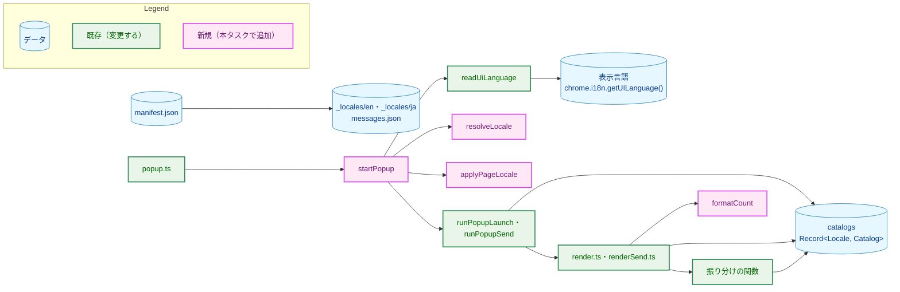
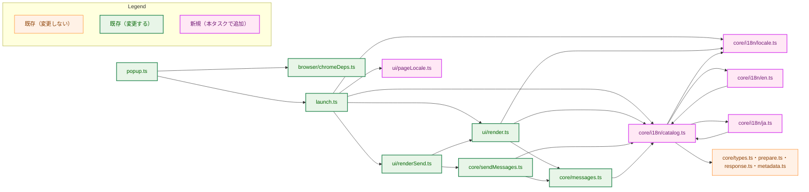
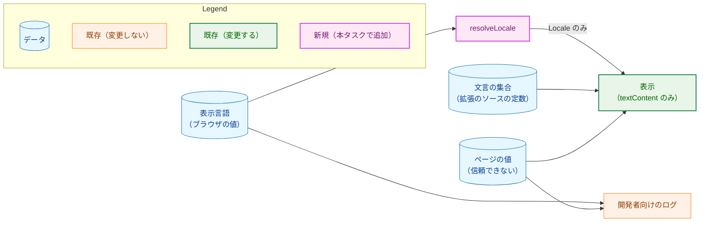
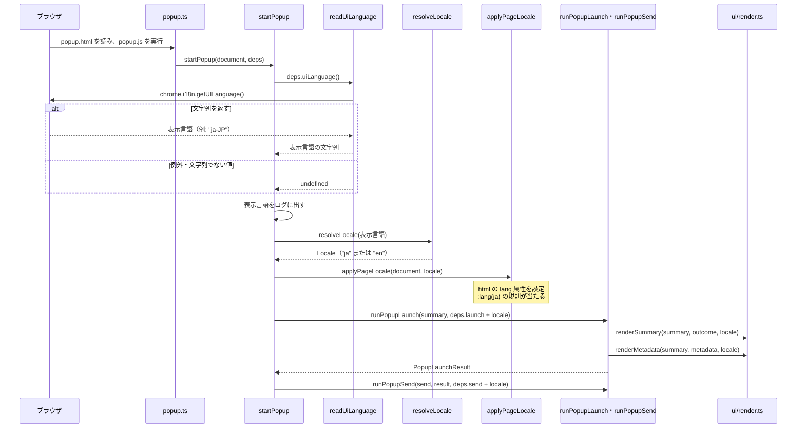

# アーキテクチャ設計書：ブラウザ拡張の UI の多言語化（英語と日本語）

## Document Status

| Item | Value |
|---|---|
| Status | `draft` |
| Created | 2026-10-27 |
| Review date | - |
| Reviewer | - |
| Comments | - |

本書は [01_requirements.md](01_requirements.md)（要件定義書。以下、要件書）の設計である。既存のファイルに関する記述は、コミット `8a39cfc` のファイルで確かめた。`file:line` はこのコミットの行番号を指す。拡張のファイルのパスは `extension/` を省いて書く（例: `src/core/messages.ts` は `extension/src/core/messages.ts`）。F-NNN・AC-NN は要件書の項番を指す。要件のレビューで設計に申し送られた事項（[design_handoff.md](design_handoff.md) の H-01〜H-10）への対応は 3.10 にまとめる。

本書は要件書 6 章の用語（表示言語・選んだ言語・文言の表・拡張の説明・収集の拒否の理由・送信しなかった理由・促しのメッセージ）をそのまま使い、次の用語を加える。

-   **言語の型:** 選んだ言語を表す TypeScript の型 `Locale`（`"en" | "ja"`）。
-   **言語の判定:** 表示言語の文字列を言語の型に変える処理（`resolveLocale`）。本タスクが「Declare, don't infer」に加える例外は、この 1 か所だけである（3.1）。
-   **文言の集合:** 1 つの言語の、ポップアップに表示するすべての文言をまとめた値（`Catalog` 型の値）。文言の表（要件書 6 章）は、言語ごとの文言の集合を言語の型で引く表（`catalogs`）として実装する。
-   **振り分け:** 理由や結果の値から、文言の集合のどの文言を使うかを選ぶ処理。今の `rejectionMessage`・`blockMessage`・`serverRejectMessage`・`sendOutcomeMessage` がこれに当たる。
-   **経路の処理:** ポップアップを開いてから収集・表示・送信までを順に呼ぶ処理（`src/launch.ts` の `runPopupLaunch`・`runPopupSend` と、本タスクで加える `startPopup`）。0007 の設計書の用語のまま使う。

## 1. 設計の全体像 (Design Overview)

### 1.1. 設計原則

-   **振り分けの関数は残し、文言だけを文言の集合へ移す。** 理由や結果の値から文言を選ぶ関数（`src/core/messages.ts:31-63`、`src/core/sendMessages.ts:18-179`）は、どの理由にどの文言を使うかという判断を持つ。この判断は言語によらないので、関数として残す。関数は文言の字句を持たず、受け取った言語の文言の集合から文言を取り出す。こうすると、言語を加えるときに振り分けと表示のコードを変えずに済む（要件書 4.5）。`switch` を残すのは、1 つの理由の型だけではキーを表せない関数（`blockMessage`・`sendOutcomeMessage`・`unexpectedMessage`）に限る。理由の型をそのままキーにできる関数は、文言の集合の `Record` を引く形にする（3.2）。
-   **文言の欠けは型の検査で見つける。** 文言の集合の型 `Catalog` は、理由の型をキーにした `Record` を持つ（例: `Record<RejectionReason, Message>`）。言語ごとの文言の集合を `Catalog` 型の値として書き、それらを `Record<Locale, Catalog>` にまとめる。どちらかの言語で文言が 1 つでも欠ければ、`make ext-typecheck` が失敗する（AC-06）。理由の型に値を加えたときも同じく失敗する。今の `never` による網羅の検査と同じ保証を、`Record` のキーの網羅で得る。
-   **表示言語の文字列を調べるのは、言語の判定の 1 か所だけにする。** ブラウザの表示言語の文字列は、`resolveLocale` が言語の型に変える。それより後の処理は、言語の型だけを受け渡し、表示言語の文字列を調べない（要件書 5 章の「Declare, don't infer」の例外。3.1）。
-   **言語は依存として外から渡す。** `chrome.i18n.getUILanguage()` を呼ぶのは、ブラウザの API を包む `src/browser/chromeDeps.ts` だけとする。経路の処理（`startPopup`）が言語を決め、表示（`src/ui/`）には言語の型の値を引数で渡す。テストは言語や表示言語を fake で選べるので、ブラウザなしで両方の言語を試せる（H-02）。
-   **開発者向けのログは言語に触れない。** ログのラベル（`src/launch.ts:56-60` と、本タスクで加える 1 つ）とログに載せる値は、選んだ言語の文言の集合を参照しない（AC-12）。
-   **表示の安全の規則は変えない。** 文言の集合の文言も、今と同じく `textContent` で表示する（`src/ui/render.ts:97-101`、AC-24）。

### 1.2. 概念モデル

矢印 A → B は「A が B を使う（呼び出す、または読む）」を表す。



-   `popup.ts` は、ブラウザの API から依存を組み立てて `startPopup` を呼ぶだけになる。`startPopup` は、`readUiLanguage` で表示言語を読み、`resolveLocale` で言語の型に変え、`applyPageLocale` でページの `lang` 属性へ言語を設定してから、`runPopupLaunch`・`runPopupSend` を呼ぶ（3.3・3.5）。`readUiLanguage` は `chromeDeps.ts` の関数で、`popup.ts` が `startPopup` に渡す。
-   表示（`render.ts`・`renderSend.ts`）は、振り分けの関数に言語を渡して文言を得るか、欄の名前のように振り分けの要らない文言を文言の集合から直接取り出す。数は `formatCount` で選んだ言語の書式にする。経路の処理も、送信中の案内と送信ボタンの名前を文言の集合から直接取り出す。
-   拡張の管理ページに表示する名前と説明は、ポップアップの文言の集合とは別に、Chrome 標準の `_locales` から manifest が参照する（3.6）。ブラウザが manifest を読むときに解決するので、拡張のコードは関与しない。

**設計の際に決めたこと（2026-10-27）:**

-   **文言の集合は、言語ごとのファイルに置く。** `src/core/i18n/` に、`Message`・`Catalog` 型と `catalogs` を持つ `catalog.ts`、英語の文言の集合を持つ `en.ts`、日本語の文言の集合を持つ `ja.ts` を置く（3.2）。各モジュールの中に `Record<Locale, …>` の表を置く案も検討したが、言語を加えるたびに文言を持つ 5 つ以上のファイルを変えることになり、英語と日本語の文言が混ざって読みにくくなる。言語ごとのファイルなら、文言はその言語のファイル 1 つにまとまり、後続のタスクの #507（ポップアップの再設計）と #503（Viewer）は、同じ `Catalog` に節を加えるだけで文言を書ける。言語を加えるときのそのほかの変更は 9 章に挙げる。
-   **ポップアップの文言には `chrome.i18n.getMessage` を使わない。** manifest の名前と説明には `_locales` を使うが、ポップアップの文言は TypeScript の文言の集合に置く。issue #506 が TypeScript の表を決めており、`messages.json` は理由の型との網羅を型で確かめられない（AC-06）ためである。
-   **YouTube のボタンの日本語の表記は、利用者が観測した表記を使う。** 観測の結果と条件は 3.4 に記録する。観測した「もっと見る」は、用語集の「…もっと見る」と先頭の「…」の有無が異なるので、要件書 1 章「要件定義の際に決めたこと」に従って観測した表記を採り、本設計書と同じ変更で用語集を改める（3.4）。
-   **日本語の行間は `1.7` とする。** ポップアップの文言は、手順のように 1 文が長い日本語を含む。和文の本文で一般に使われる 1.5〜1.8 の範囲の中で、狭い幅（`min-width: 20rem`、`static/style.css:10`）でも行を追いやすい値として `1.7` を選ぶ（AC-16）。
-   **振り分けの関数と表示の関数は、言語の型の値を引数で受け取る。** 文言の集合（`Catalog` の値）を渡す案もあるが、数の書式（`Intl.NumberFormat`）にも言語が要るので、言語の型の値 1 つを渡す方が受け渡す値が少なく済む。テストでは `"en"`・`"ja"` を渡せばよい。

### 1.3. 既存のコードとの関係

本タスクは Go のソース、サーバ、ホスト、API を変えない（要件書 2.3）。変更は拡張のディレクトリ、CLAUDE.md、README、用語集に限る。Go のテストのうち拡張の manifest を読むもの（`cmd/yt2column/extension_docs_test.go:41-58` は `key` と `permissions` だけを読む）は、本タスクで変える manifest のキー（`name`・`description`・`default_locale`）を読まないので、変更は要らない。

既存の方針に対する例外と変更は次の 3 つで、方針・例外の理由・更新が必要なテストを 3.8 にまとめる。

-   CLAUDE.md の「利用者に表示する文字列も英語で書く」規則（`CLAUDE.md:397-400`）を改める（要件書 5 章、AC-21）。
-   CLAUDE.md「Declare, don't infer」（`CLAUDE.md:203`）の例外を、言語の判定の 1 か所に設ける（要件書 5 章。3.1）。
-   manifest の最上位のキーに `default_locale` と `description` を加える（0027・0026 の設計の変更。要件書 5 章。3.6）。

**更新の際の互換性:** 拡張 ID は manifest の `key` だけで決まり（`test/manifest.test.ts:77-80`）、`key` は変えないので、ID は `clfmbbcdpnjcefbdihdoahomaifbabkk` のままである。ホストの manifest が許す拡張は ID で指定されるので、`yt2column-nmhost install` を実行し直す必要はない。拡張は何も保存しないので、移行するデータはない。読み込み済みの拡張は、`make ext-build` の後に拡張の管理ページで再読み込みすれば新しい版になる。CI の拡張のジョブを起動する変更の条件（`scripts/has-extension-changes.sh:18`）は CLAUDE.md と用語集を含まないが、拡張のテストはこの 2 つを読まないので、条件を変える必要はない。

## 2. システム構成 (System Structure)

### 2.1. ディレクトリ構成

```
extension/
├── src/
│   ├── core/
│   │   ├── i18n/
│   │   │   ├── locale.ts        (新規) Locale・locales・resolveLocale・formatCount
│   │   │   ├── catalog.ts       (新規) Message・Catalog 型・catalogs
│   │   │   ├── en.ts            (新規) 英語の文言の集合
│   │   │   └── ja.ts            (新規) 日本語の文言の集合
│   │   ├── messages.ts          (変更) Message を catalog.ts へ移し、RejectionMessage の別名は残す。関数は言語を受け取る
│   │   ├── sendMessages.ts      (変更) 文言を en.ts へ移し、関数は言語を受け取る
│   │   └── types.ts             (変更) SummaryField を加える
│   ├── browser/chromeDeps.ts    (変更) I18nApi・readUiLanguage を加える
│   ├── ui/render.ts             (変更) 言語を受け取り、欄の名前と数を言語に合わせる
│   ├── ui/renderSend.ts         (変更) sendingMessage を en.ts へ移し、言語を受け取る
│   ├── ui/pageLocale.ts         (新規) applyPageLocale（html の lang 属性を設定する）
│   ├── launch.ts                (変更) startPopup を加え、依存の locale を表示へ渡す
│   └── popup.ts                 (変更) 依存を組み立てて startPopup を呼ぶだけにする
├── static/
│   ├── _locales/en/messages.json (新規) 拡張の名前と説明（英語）
│   ├── _locales/ja/messages.json (新規) 拡張の名前と説明（日本語）
│   ├── manifest.json            (変更) default_locale・description、name を __MSG_extName__ に
│   └── style.css                (変更) :lang(ja) の書体と行間
└── test/                        (変更・新規) 3.9
```

`src/core/i18n/` は `src/core/` の下に置くので、ブラウザの型も DOM の型も使わずに型の検査を受ける（`tsconfig.core.json:1-8` は `lib` を `ES2022` に、`types` を空にする）。`Intl.NumberFormat` は `ES2022` の型定義に含まれるので、`formatCount` も `src/core/` に置ける。ページの `lang` 属性は DOM を扱うので、`src/ui/pageLocale.ts` に置く。

### 2.2. コンポーネントの依存関係

矢印 A → B は「A が B を import する（型だけの import を含む）」を表す。`core/i18n/locale.ts` の `Locale` 型は、図の新規・変更のモジュールのほとんどが import するので、`locale.ts` への矢印は `launch.ts`（`resolveLocale`）・`render.ts`（`formatCount`）・`catalog.ts`（`catalogs` の型）の 3 つだけを描く。



-   循環する参照は、`en.ts`・`ja.ts` と `catalog.ts` の間だけである。`en.ts`・`ja.ts` は `catalog.ts` から `Catalog` 型だけを `import type` で読み、`catalog.ts` は `en.ts`・`ja.ts` の値を読んで `catalogs` を組み立てる。型だけの import は実行時に消える（`tsconfig.json` の `verbatimModuleSyntax`）ので、実行時の循環にはならない。
-   `Message` 型を `catalog.ts` に置くので、`core/i18n/` は振り分けのモジュール（`messages.ts`・`sendMessages.ts`）に依存しない。#503 の Viewer などは、ポップアップの振り分けを import せずに文言の集合を使える。
-   `Catalog` 型は、理由と欄の型（`RejectionReason`・`SummaryField`・`PreflightReason`・`ServerRejectReason`・`NotSentCause`・`MetadataField`）を `import type` で読む。`core/` の中の型だけの参照なので、`core/` がブラウザに依存しない性質は変わらない。

### 2.3. 実行時の配置

ポップアップが開くと、ブラウザは `popup.html` を読み、モジュールのスクリプト `popup.js` を実行する。`popup.html` の `body` は空の `div` を 2 つ持つだけで、文字を含まない（`static/popup.html:8-12`）。`startPopup` は、最初の `await` より前に表示言語を読み（`getUILanguage` は同期の API）、`lang` 属性を設定する。最初の描画（`runPopupLaunch` の `renderSummary`）はその後なので、文字が英語の書体で一瞬表示されることはない（H-07）。言語はポップアップを開いている間は変わらない。

拡張の管理ページ（`chrome://extensions/`）の名前と説明は、ブラウザが manifest を読むときに `_locales/<言語>/messages.json` から解決する。ブラウザは自身の表示言語に合う `_locales` の言語を選び、合うものがなければ `default_locale`（`en`）を使う。この選択はブラウザが行うので、ポップアップの言語の判定（3.1）とは別の処理である。日本語の表示言語ではどちらも日本語、それ以外の表示言語ではどちらも英語になる（3.6）。

## 3. コンポーネント設計 (Component Design)

### 3.1. 言語の型と言語の判定（F-001・AC-01〜AC-04、H-02・H-06）

```ts
// src/core/i18n/locale.ts

/** The language the extension displays in. */
export type Locale = "en" | "ja";

/** Runtime iteration order of the locales; a Record, so it stays in step with the union. */
export const locales: Record<Locale, true>;

/**
 * Maps the browser's UI language to a Locale. The only place that chooses a
 * behavior from the content of the UI-language string.
 */
export function resolveLocale(uiLanguage: string | undefined): Locale;

/** Formats a count with the locale's number format. */
export function formatCount(value: number, locale: Locale): string;
```

```ts
// src/browser/chromeDeps.ts（追加分）

/** The chrome.i18n surface used. The result is checked at run time. */
export interface I18nApi {
  getUILanguage(): unknown;
}

/** The browser's UI language, or undefined when it cannot be read. Never throws. */
export function readUiLanguage(i18n: I18nApi): string | undefined;
```

-   `locales` は、テストが両方の言語を順に試すための実行時の一覧で、`resolveLocale` が比べる言語の一覧でもある。`rejectionReasons`（`src/core/types.ts:13-18`）と同じく `Record<Locale, true>` にして、言語の型に値を加えたら一覧にも加えないと型の検査が失敗するようにする。
-   `resolveLocale` は次の規則で言語を決める（AC-01・AC-02）。
    -   値が `undefined` なら `en`。
    -   値の最初の `-` より前の部分（`-` がなければ値の全体）を小文字にしたものが `locales` のキーのどれかと一致すれば、その言語。今のキーは `en` と `ja` なので、`ja`・`ja-JP`・`JA` は `ja` になる。
    -   それ以外はすべて `en`。`ja_JP` は、`-` より前の部分が `ja_jp` でどのキーとも一致しないので `en` になる。`jam`・`jv`・空文字列も `en` である。
    -   比べる相手を `locales` のキーにするので、言語を加えるときに判定の規則を変えずに済む。
-   `readUiLanguage` は、`getUILanguage` が例外を投げた場合と、文字列でない値を返した場合に `undefined` を返す。`I18nApi` の戻り値を `unknown` にするのは、文字列かどうかの実行時の確かめを型の上でも成り立つ形で書けるようにし、テストの fake が型アサーションなしに文字列でない値を返せるようにするためである（`ScriptingApi` の `result?: unknown`、`src/browser/chromeDeps.ts:12` と同じ考え方）。`chrome.i18n` は `I18nApi` に代入できる。`chrome.i18n.getUILanguage` は権限を要しないので、manifest の `permissions` は変わらない（AC-04）。

**「Declare, don't infer」の例外（要件書 5 章、H-06）:**

-   **元の方針と場所:** CLAUDE.md「Key Design Patterns」の「Declare, don't infer」（`CLAUDE.md:203`）は、呼び出し元から渡された文字列の内容を調べて振る舞いを選ぶことを禁じる。
-   **例外とする理由:** 表示言語はブラウザが返す外部の値で、拡張の型では表せない。言語の型に変える処理がどこかで文字列を調べる必要がある。
-   **範囲と境界:** 例外は `resolveLocale` の 1 か所だけである。`resolveLocale` より後の処理は `Locale` の値だけを受け渡し、`switch` や `Record` のキーで振る舞いを選ぶ。どの言語とも判定できない値は広く解釈せず `en` にする。CLAUDE.md の「Reject, don't normalize」は当てはまらない。日本語以外の表示言語は不正な入力ではなく、英語で表示すべき正当な入力だからである（要件書 5 章）。
-   **古い振る舞いを確かめているテスト:** なし。今の拡張は表示言語を読まない。CLAUDE.md の例外の記述の更新（3.7）で、この例外を `internal/transcript` の例外と並べて記す。

### 3.2. 文言の集合（F-002・AC-03・AC-05・AC-06・AC-09）

```ts
// src/core/types.ts（追加分）

/** The fields of the collected summary. */
export type SummaryField = "title" | "url" | "characters" | "lines" | "preview";
```

```ts
// src/core/i18n/catalog.ts

import type { MetadataField } from "../metadata.ts";
import type { PreflightReason } from "../prepare.ts";
import type { NotSentCause, ServerRejectReason } from "../response.ts";
import type { RejectionReason, SummaryField } from "../types.ts";
import type { Locale } from "./locale.ts";

/** The shape of a message: a sentence and optional numbered steps. Moved from messages.ts. */
export interface Message {
  readonly text: string;
  readonly steps: readonly string[];
}

/** Every string the popup displays, for one locale. */
export interface Catalog {
  /** Collection rejection reasons. */
  readonly rejection: Readonly<Record<RejectionReason, Message>>;
  /** Block reasons that are not collection reasons. */
  readonly preflight: Readonly<Record<PreflightReason, Message>>;
  /** Server rejection reasons. */
  readonly serverReject: Readonly<Record<ServerRejectReason, Message>>;
  /** Causes of a request known not to have reached the server. */
  readonly notSent: Readonly<Record<NotSentCause, Message>>;
  /** The other send outcomes. */
  readonly accepted: Message;
  readonly noResponse: Message;
  readonly hostFailed: Message;
  readonly unexpected: Message;
  /** The notice shown while a send is in flight. */
  readonly sending: Message;
  /** The prompt shown when the video description is collapsed. */
  readonly expandPrompt: Message;
  /** Field labels. */
  readonly summaryLabels: Readonly<Record<SummaryField, string>>;
  readonly metadataLabels: Readonly<Record<MetadataField, string>>;
  /** The send button's label. */
  readonly sendButton: string;
}

/** The catalog of every locale. */
export const catalogs: Readonly<Record<Locale, Catalog>>;
```

```ts
// src/core/i18n/en.ts・ja.ts
export const en: Catalog;
export const ja: Catalog;
```

-   `Message` 型（今は `src/core/messages.ts:4-9`）は、形を変えずに `catalog.ts` へ移す。`RejectionMessage` の別名（`:12`）は `messages.ts` に残す。
-   `Catalog` の各節は、理由や欄の型をキーにした `Record` か、1 つの `Message`・`string` である。`en`・`ja` を `Catalog` 型で宣言するので、どちらかの言語で項目が欠ければ型の検査が失敗する（AC-06）。
-   `SummaryField` は、今の要約の欄（`src/ui/render.ts:48-66` の `Title`・`URL`・`Characters`・`Lines`・`Preview`）に対応する。今は欄を表す型がないので、本タスクで `OutcomeSummary` の隣に加える。`render.ts` は、`metadataRows`（`src/ui/render.ts:125-129`）と同じく、`SummaryField` をキーにした表で欄のクラス名と表示の向きを持ち、キーの順を表示の順とする。要約に欄を加えると、その名前を文言の集合に加えないと型の検査が失敗する。
-   結果不明の 3 つ（`noResponse`・`hostFailed`・`unexpected`）と `accepted` を、`Record` にまとめずに個別の項目にするのは、`SendOutcome` の `kind` のうち、文言を 1 つだけ持つものだからである。`rejected` と `not-sent` は、理由ごとの `Record` で持つ。
-   `unexpected` は、検査の種類（`UnexpectedCheck`）によらず 1 つの文言である（AC-09）。

**振り分けの関数（`src/core/messages.ts`・`src/core/sendMessages.ts`）の新しい形:**

```ts
export function rejectionMessage(reason: RejectionReason, locale: Locale): RejectionMessage;
export function expandPromptMessage(locale: Locale): Message;
export function blockMessage(reason: BlockReason, locale: Locale): RejectionMessage;
export function serverRejectMessage(reason: ServerRejectReason, locale: Locale): RejectionMessage;
export function sendOutcomeMessage(outcome: SendOutcome, locale: Locale): RejectionMessage;
```

-   どの関数も、言語に対応する文言の集合（`catalogs[locale]`）から文言を返す。文言の字句は持たない。export しない `notSentMessage`・`unexpectedMessage`（`src/core/sendMessages.ts:92`・`:115`）も同じく言語を受け取り、`sendOutcomeMessage` は受け取った言語をそのまま渡す。
-   `blockMessage` は、今と同じく収集の拒否の理由を `rejectionMessage` に任せる（`src/core/sendMessages.ts:18-35`）。`body-too-large` は `preflight` の節から取る。キーが 2 つの型にまたがるので、`switch` を残す。
-   `sendOutcomeMessage` の `kind` による `switch` と、`unexpectedMessage` の検査の種類による `switch`（`src/core/sendMessages.ts:115-179`）は、`never` による網羅の検査とともに残す。`SendOutcome` や `UnexpectedCheck` に値を加えたとき、その文言をどこから取るかを決めないと型の検査が失敗する性質を保つためである。
-   `rejectionMessage`・`serverRejectMessage`・`notSentMessage`（`src/core/sendMessages.ts:92-112`）の `switch` は、`Record` の引き当てに置き換える。キーの網羅は `Catalog` の `Record` の型が保証するので、`switch` と `Record` の両方で網羅を確かめる必要はない。理由の値は、型に含まれる値しか作られない（サーバの拒否の理由は `isServerRejectReason` が `hasOwnProperty` で確かめる。`src/core/response.ts:32-39`）ので、引き当てに想定外のキーは来ない。
-   `expandPromptMessage` は、今は定数（`src/core/messages.ts:18-24`）だが、言語を受け取る関数にする。
-   `sendingMessage`（`src/ui/renderSend.ts:12-18`）は、`Catalog` の `sending` に移し、`renderSend.ts` から定数をなくす。経路の処理（`launch.ts`）は `catalogs[locale].sending` を表示する。送信中の案内と送信ボタンの名前は振り分けの要らない文言なので、欄の名前と同じく文言の集合から直接取り出す。振り分けの関数を経るのは、理由や結果の値から文言を選ぶものだけである。

### 3.3. 経路の処理と表示（F-001〜F-003・AC-01〜AC-03・AC-05・AC-08・AC-12・AC-13・AC-24）

```ts
// src/launch.ts
export interface PopupLaunchDeps {
  readonly reader: SelectionReader;
  readonly metadataReader: MetadataReader;
  activeTab(): Promise<chrome.tabs.Tab | undefined>;
  readonly log: Logger;
  readonly locale: Locale;   // 追加
}
export interface PopupSendDeps {
  readonly send: SendDeps;
  readonly now: () => number;
  readonly log: Logger;
  readonly locale: Locale;   // 追加
}

/** What the popup entry needs; popup.ts builds it from the chrome APIs. */
export interface PopupStartDeps {
  /** Reads the browser's UI language; readUiLanguage(chrome.i18n) in production. */
  uiLanguage(): string | undefined;
  readonly launch: Omit<PopupLaunchDeps, "locale">;
  readonly send: Omit<PopupSendDeps, "locale">;
}

/**
 * Popup entry. Decides the locale, sets the page language before the first
 * render, then runs the launch and send paths. Never throws.
 */
export function startPopup(doc: Document, deps: PopupStartDeps): Promise<void>;

// src/ui/render.ts
export function messageNodes(doc: Document, message: Message): HTMLElement[];          // 変更なし
export function renderSummary(container: HTMLElement, summary: OutcomeSummary, locale: Locale): void;
export function renderMetadata(container: HTMLElement, result: MetadataResult, locale: Locale): void;

// src/ui/renderSend.ts
export function renderSendOutcome(container: HTMLElement, outcome: SendOutcome, locale: Locale): void;
export function renderBlockReason(container: HTMLElement, reason: BlockReason, locale: Locale): void;
```

-   `startPopup` は、今の `popup.ts`（`src/popup.ts:13-30`）が行っている組み立て（要約と送信の領域を探し、`runPopupLaunch`・`runPopupSend` を順に呼ぶ）を引き取り、その前に言語を決めてページに設定する。`popup.ts` は、ブラウザの API から `PopupStartDeps` を組み立てて `startPopup(document, …)` を呼ぶだけになる。今の `popup.ts` にはテストがないが、言語の決定からページへの設定と依存への受け渡しまでを `startPopup` に置くので、この経路を fake の依存でテストできる（3.9）。
-   `startPopup` は、表示言語を読んだ直後に、固定のラベル（`yt2column ui language`）で、読んだ値をそのままログに出す（読めなかったときは `undefined`）。利用者が日本語の UI と英語の UI のどちらを見ているかを、ポップアップのコンソールで確かめられるようにするためである。値はブラウザから得たものをそのまま出し、ラベルは言語によらない（AC-12）。
-   `renderSummary` は、欄の名前を `summaryLabels` から取り、文字数と行数（`summary.characterCount`・`summary.lineCount`）を `formatCount` で表示する（AC-13）。今は `String(…)` で表示している（`src/ui/render.ts:55-60`）。
-   `renderMetadata` の `metadataRows`（`src/ui/render.ts:125-129`）は、欄の名前（`label`）を持たず、値の要素のクラス名だけを持つ形にする。欄の名前は `metadataLabels` から取る。キーの順（表示の順）は今のまま `metadataRows` が決める。
-   値（タブのタイトル・URL・選択範囲のプレビュー・動画タイトル・チャンネル名・概要欄・リクエスト ID）は、言語によらず今のまま `textContent` で表示する（AC-08・AC-24）。表示の関数が言語を参照するのは、文言の集合の文言と数の書式を選ぶときだけである。
-   `runPopupSend` の送信ボタンの名前（`src/launch.ts:207`）は `sendButton` から取る。
-   ログ（`logSend`・`readMetadata`・`runPopupLaunch` の `deps.log.*`）は、`deps.locale` を参照せず、文言の集合も参照しない。ログのラベルは今の定数（`src/launch.ts:56-60`）のままとする（AC-12）。

**数の書式（AC-13、H-10）:** `formatCount` は、選んだ言語を `Intl.NumberFormat` に渡して数を書式化する。`en` と `ja` の既定の書式は、どちらも 3 桁ごとに `,` で区切る（例: `12,345`）。数の書式は実行環境の ICU のデータに依存しうる。Chrome は ICU のデータをすべて持ち、拡張の Node.js（`extension/.node-version` の `24.21.0`）の公式のビルドも ICU のデータをすべて持つ（full-icu）。本設計の作成時に、この Node.js で `Intl.NumberFormat.supportedLocalesOf(["en", "ja"])` が両方を返し、`12345` が両方の言語で `12,345` になることを確かめた（ICU 78.3）。テストは、`supportedLocalesOf` が両方の言語を返すことを前提として確かめてから書式の結果を比べる。ICU のデータが一部しかない Node.js で実行した場合は、書式の結果の不一致ではなく前提の不成立として失敗するので、原因が分かる。

### 3.4. 日本語の文言（F-002・AC-05・AC-07・AC-09〜AC-11、H-03）

英語の文言は、今の字句をそのまま `en.ts` へ移す（AC-07）。日本語の文言は次のとおりとする。用語は `docs/translation_glossary.md` に合わせる（AC-10）。コマンド名・`Slack`・URL の例は英語の文言と同じ表記にする（AC-09）。

**YouTube のボタンの日本語の表記の観測（AC-11、H-03）:**

| 英語の表記 | 日本語の表記 | 使う場所 |
|---|---|---|
| `...more` | `もっと見る`（先頭に「…」はない） | 促しのメッセージの 1 つめの手順 |
| `Show transcript` | `文字起こしを表示` | `empty-selection` の 1 つめの手順 |

-   観測の条件: 2026-10-27、Google Chrome 155.0.8059.85（公式ビルド、arm64）、YouTube の表示言語はアカウントの設定で日本語。観測は利用者（isseis）が行った。
-   用語集の「促しのメッセージ」の備考は「…もっと見る」と書いていたが、観測した表記は先頭に「…」を持たない。観測した表記を採り（AC-11 を AC-10 より優先する）、本設計書と同じ変更で用語集の備考を「もっと見る」に改めた。
-   観測は 1 つの環境で行ったものである。YouTube が表記を変えたときは、英語の表記（`"...more"`）と同じく、文言の修正で対処する。

**収集の拒否の理由（`rejection`）:**

| 理由 | 本文 | 手順 |
|---|---|---|
| `not-watch-page` | YouTube の動画ページではありません。 | 1. https://www.youtube.com/watch?v=... のような動画ページを開いてください。<br>2. 文字起こしパネルを開き、字幕の行を選択してください。<br>3. もう一度 yt2column を起動してください。 |
| `empty-selection` | テキストが選択されていません。 | 1. 「文字起こしを表示」で文字起こしパネルを開いてください。<br>2. 字幕の行を選択してください。<br>3. もう一度 yt2column を起動してください。 |
| `empty-title` | タブにタイトルがありません。 | なし |
| `collection-failed` | このタブから選択範囲を読み取れませんでした（ページが変わった可能性があります）。 | なし |

**送信しなかった理由（`preflight`）:**

| 理由 | 本文 | 手順 |
|---|---|---|
| `body-too-large` | 選択したテキストが大きすぎます（4 MiB を超えています）。 | 1. 選択する字幕の行を減らして、もう一度試してください。 |

**サーバの拒否の理由（`serverReject`）:**

| 理由 | 本文 | 手順 |
|---|---|---|
| `too_many_requests` | サーバは別の記事を処理しています。 | 1. 送り直す前に、前回の送信の通知が Slack に届いていないか確かめてください。<br>2. しばらく待ってから、もう一度送信してください。 |
| `body_too_large` | リクエストの本文が大きすぎるため、サーバが拒否しました。 | 1. 選択する字幕の行を減らして、もう一度試してください。<br>2. サーバが Slack に失敗の通知を投稿している場合もあります。 |
| `invalid_body` | サーバがリクエストの本文を受け付けませんでした（拡張の不具合の可能性があります）。 | 1. サーバが Slack に失敗の通知を投稿している場合もあります。 |
| `invalid_video_url` | サーバが動画の URL を受け付けませんでした。 | 1. サーバが Slack に失敗の通知を投稿している場合もあります。 |
| `invalid_transcript` | 選択したテキストが、文字起こしパネルの字幕の書式ではありません。 | 1. 文字起こしパネルを開き、字幕の行を選択して、もう一度試してください。<br>2. サーバが Slack に失敗の通知を投稿している場合もあります。 |
| `internal_error` | サーバで内部エラーが起きました。 | 1. サーバのログを確かめてください。<br>2. サーバが Slack に失敗の通知を投稿している場合もあります。 |

**送信の結果:**

| 項目 | 本文 | 手順 |
|---|---|---|
| `accepted` | サーバが記事を受け付けました。記事の生成と投稿の結果は Slack に届きます。 | なし |
| `notSent.server-unavailable` | yt2column のサーバに接続できなかったため、何も送信していません。 | 1. yt2column-server を起動してください。終了処理中のサーバはジョブの完了を待つので、完了するまで新しいサーバは起動できません。<br>2. サーバが動いている場合は、サーバが自分のユーザーアカウントで動いていること、ソケットのディレクトリの権限が README の説明どおりであることを確かめてください。 |
| `notSent.message-too-large` | リクエストがホストには大きすぎるため、何も送信していません。 | 1. 選択する字幕の行を減らして、もう一度試してください。 |
| `noResponse` | サーバが時間内に応答しませんでした。サーバはリクエストを受け取り、処理している可能性があります。 | 1. 送り直す前に、記事または失敗の通知が Slack に届いていないか確かめてください。<br>2. 何も届かない場合は、この時刻の前後のサーバのログを確かめてください。 |
| `hostFailed` | Native Messaging のホストを起動できなかったか、ホストが応答せずに終了しました。 | 1. 多くの場合、ホストがインストールされていないか、そのバイナリが移動されています。ビルドしたバイナリから yt2column-nmhost install chrome（または brave）を実行してください。バイナリを移動した後も、もう一度実行してください。<br>2. リクエストはすでに送信された可能性があります。送り直す前に、記事または失敗の通知が Slack に届いていないか確かめてください。 |
| `unexpected` | 応答を解釈できませんでした。サーバはリクエストを受け取り、処理している可能性があります。 | 1. ホスト・サーバ・拡張が同じビルドのものであることを確かめてください。ビルドしたバイナリから yt2column-nmhost install をもう一度実行してください。<br>2. 送り直す前に、記事または失敗の通知が Slack に届いていないか確かめてください。 |

**そのほかの文言:**

| 項目 | 本文 | 手順 |
|---|---|---|
| `sending` | 記事をサーバに送信しています… | 1. 結果が表示されるまで、このポップアップを閉じないでください。<br>2. 閉じた場合は、送り直す前に Slack を確かめてください。 |
| `expandPrompt` | 概要欄が折りたたまれているため、冒頭だけが送信されます。 | 1. 動画の下の「もっと見る」をクリックして、概要欄をすべて表示してください。<br>2. このポップアップを開き直してから、送信してください。 |

**欄の名前と送信ボタン:**

| 項目 | 英語（今の字句） | 日本語 |
|---|---|---|
| `summaryLabels.title` | Title | タブのタイトル |
| `summaryLabels.url` | URL | URL |
| `summaryLabels.characters` | Characters | 文字数 |
| `summaryLabels.lines` | Lines | 行数 |
| `summaryLabels.preview` | Preview | プレビュー |
| `metadataLabels.title` | Video title | 動画タイトル |
| `metadataLabels.channelName` | Channel | チャンネル名 |
| `metadataLabels.description` | Description | 概要欄 |
| `sendButton` | Send to yt2column | yt2column に送信 |

-   要約の `Title` は、動画タイトルではなくタブのタイトル（`summary.title` はタブの `title`。`src/core/types.ts:20-25`）なので、用語集の「動画タイトル」の備考（タブのタイトルとは別）に従い「タブのタイトル」とする。
-   `summaryLabels.url` は、どちらの言語でも `URL` である。
-   上の日本語の文言は、AC-09 の各性質を次のように満たす。各分類（収集の拒否の理由・送信しなかった理由・サーバの拒否の理由・送信の結果）の中で、本文は互いに異なる。未送信の 2 つは `Slack` を含まない。結果不明の 3 つは、どれも同じ文の中に「送り直す前に」「Slack」「確かめて」をこの順に含む。`accepted` と `too_many_requests` は `Slack` を含む。`body-too-large` は `4 MiB` を含む。`hostFailed` は `yt2column-nmhost install` を、`server-unavailable` は `yt2column-server` を含む。どの文言もオプションページ・トークン・ポートに言及しない。日本語の文言が手順を持つのは、英語の文言が手順を持つものだけである（AC-06）。これらはテストで確かめる（3.9）。

### 3.5. ページの言語・書体・行間（F-003・AC-14〜AC-17、H-07）

```ts
// src/ui/pageLocale.ts

/** Sets the lang attribute of the document's root element to the locale. */
export function applyPageLocale(doc: Document, locale: Locale): void;
```

-   `startPopup` は、`resolveLocale` で言語を決めた直後、`runPopupLaunch` を呼ぶ前に `applyPageLocale` を呼ぶ（2.3）。`popup.html` の静的な `lang="en"`（`static/popup.html:2`）は残す。スクリプトが動かない場合の既定の値が英語のままになるためである。
-   書体と行間は、CSS の `:lang(ja)` 擬似クラスを使う次の 2 つの規則で切り替える。`style.css` の今の規則（`static/style.css:1-61`）は変えない。
    -   `:root:lang(ja)` には、書体の候補 `"Hiragino Sans", "Noto Sans JP", "Yu Gothic UI", system-ui, sans-serif` を指定する（AC-15）。
    -   `body:lang(ja)` には、`line-height: 1.7` を指定する（AC-16）。
-   2 つの規則は `html` 要素と `body` 要素にだけ当たる。子の要素は今と同じく継承で値を受け取るので、子の要素に直接書体を指定する規則（リクエスト ID の `.send-request-id` の `font-family: ui-monospace, monospace`、`static/style.css:58-61`）は日本語でも上書きされない。セレクタを `:lang(ja)` だけにすると、`lang` を継承するすべての要素に当たる。その規則を `.send-request-id` より後ろに書くと、詳細度が同じなので `.send-request-id` の書体を上書きしてしまう。そのため `:lang(ja)` だけのセレクタは使わない。
-   英語のときは `:lang(ja)` の規則が当たらないので、書体は今の `system-ui, sans-serif` のまま、行間は指定しないまま（AC-17）。
-   JavaScript で `style` を書き換える案もあるが、CSS の `:lang()` なら、英語の規則を一切変えずに日本語の規則を加えるだけで済み、AC-17 の「英語は今のまま」を CSS の規則のテストで確かめられる。jsdom の CSSOM が `:root:lang(ja)`・`body:lang(ja)` の規則のセレクタ・書体の候補・行間を読み取れることは、本設計の作成時に確かめた。

### 3.6. manifest と `_locales`（F-004・AC-18〜AC-20、H-08・H-09）

manifest の変更:

| キー | 今 | 本タスクの後 |
|---|---|---|
| `name` | `"yt2column"` | `"__MSG_extName__"` |
| `description` | なし | `"__MSG_extDescription__"`（追加） |
| `default_locale` | なし | `"en"`（追加） |
| その他（`manifest_version`・`version`・`key`・`minimum_chrome_version`・`action`・`permissions`） | 今のまま | 今のまま |

`_locales/<言語>/messages.json` の項目:

| メッセージ名 | `en` | `ja` |
|---|---|---|
| `extName` | `yt2column` | `yt2column` |
| `extDescription` | `Sends the selected YouTube transcript to the local yt2column server to write a column article.` | `選択した YouTube の文字起こしをローカルの yt2column サーバに送り、コラム記事を書かせます。` |

**Chrome の `_locales` の制約（H-09）:** Chrome の拡張の文書（manifest の `default_locale`・`description`・`name` の項と、`chrome.i18n` の項）は次を定める。本設計はこれに従う。

-   `_locales` を持つ拡張は `default_locale` が必須で、`_locales` を持たない拡張は `default_locale` を持ってはならない。どちらに反しても拡張を読み込めない。`default_locale` の言語のディレクトリ（`_locales/en/`）が要る。
-   `description` は 132 文字まで、`name` は 75 文字までである。上の `extDescription` は英語・日本語とも 132 文字に収まる。
-   manifest の文字列の中の `__MSG_<名前>__` は、`messages.json` の同じ名前の `message` に置き換わる。名前は ASCII の英数字・`_`・`@` からなり、大文字・小文字を区別しない。`@@` で始まる名前は予約されている。本設計の名前（`extName`・`extDescription`）はこれに従う。
-   `messages.json` が JSON として読めない場合や、項目が文字列の `message` を持たない場合も、拡張を読み込めない。英語の利用者を含むすべての利用者に影響するので、テストで形を確かめる（3.9）。

これらは文書から確かめたものである。実機では、実装の後に Chrome と Brave でビルドした拡張を読み込み、拡張の管理ページの名前と説明が表示言語に合うことを確かめる（7.2）。Brave は Chromium の拡張の仕組みをそのまま使うので、同じ制約に従う。

**ビルドへの取り込み（H-08）:** `scripts/copy-static.ts:6-12` は `static/` を再帰的に `dist/` へ写すので、`static/_locales/` もそのまま写る。`scripts/check-dist.ts` の `expectedFiles`（`:51-62`）は、`static/` の下のファイルを再帰的に（`listEntries` の `recursive: true`。`:28-31`）期待するファイルに加える。したがって `check-dist` は変更なしで、`dist/` が `static/` の `_locales` の 2 つのファイルを含むことを確かめる（`:199-208`）。`static/` が 2 つのファイルを正しい形で含むことは、`manifest.test.ts` が確かめる（3.9）。

`check-dist.ts` に `__MSG_*__` の解決の検査を加える案もある。しかし、`dist/manifest.json` が `static/manifest.json` と同じバイト列であることは確かめられており（`:167-181`）、`_locales` も `static/` から写る。そのため `static/` の側でテストすれば足り、`check-dist.ts` は変更しない。

### 3.7. 文書（F-005・AC-21〜AC-23）

-   **CLAUDE.md「Go Idioms」（`CLAUDE.md:397-400`）:** 拡張のソースのコメント・識別子・文字列リテラルは英語とする。例外は次の 3 つとする（AC-21）。
    -   `src/core/i18n/` の、英語でない言語の文言の集合のファイル（今は `ja.ts`）の文言。
    -   英語でない言語の文言の集合の性質を確かめるテストの文字列リテラル（3.9 の言語ごとの語の表）。
    -   日本語の文書の見出しや表のセルに一致させるガードのテストの文字列リテラル（今の規定のまま）。

    利用者に表示する文言は文言の集合に置き、英語と日本語の両方を必須とする。開発者向けのログは英語とする。
-   **CLAUDE.md「Declare, don't infer」:** 言語の判定の例外（3.1）を、既存の `internal/transcript` の例外と同じ形（範囲・理由・境界）で記す。要件書 AC-21 は「Go Idioms」の改定だけを求めるが、例外を方針の場所に書かないと、後の読み手が `resolveLocale` を方針の違反と読むためである。
-   **README「Browser extension」:** ポップアップはブラウザの表示言語が日本語なら日本語、それ以外は英語で表示されること、拡張の中に言語の設定はないこと、README が引用するポップアップの文言は英語版であることを説明する段落を、拡張に設定がないことを述べる段落（`README.md:908-912`）の後に加える（AC-22）。
-   **README の促しのメッセージの引用（`README.md:922-926`）:** 変えない。英語の文言が変わらない（AC-07）ので、引用は英語版と一致したままである（AC-23）。ガードのテスト（`test/metadataDocs.test.ts:28-35`）は、比べる相手を `expandPromptMessage("en")` にする（H-01）。
-   **用語集:** 「促しのメッセージ」の備考の「…もっと見る」を、本設計書と同じ PR で「もっと見る」に改めた（3.4）。

### 3.8. 既存の方針からの変更と、更新するテスト

| 方針と場所 | 変更の内容と理由 | 古い振る舞いを確かめているテスト |
|---|---|---|
| 利用者に表示する文言も英語で書く（`CLAUDE.md:397-400`、0007 の要件書 `docs/tasks/0007_browser_extension_skeleton/01_requirements.md:92`） | 利用者に表示する文言を言語ごとの文言の集合に置き、日本語も書く。主な利用者が日本語の話者であるため（要件書 1 章）。0007 の要件書は完了したタスクの記録として変えない | なし（英語だけであることを確かめるテストも lint の規則もない。`eslint.config.js` に文字種の規則はない） |
| 文字列の内容で振る舞いを選ばない（`CLAUDE.md:203`） | 言語の判定の 1 か所を例外とする（3.1） | なし |
| manifest の最上位のキー（0027 の設計 `docs/tasks/0027_remove_context_menu/02_architecture.md:310-316`、0026 の設計 `docs/tasks/0026_native_messaging_relay/02_architecture.md:925`） | `default_locale` と `description` を加え、`name` を `__MSG_extName__` にする。`_locales` による名前と説明の多言語化（issue #506）に `default_locale` が要るため（3.6） | `test/manifest.test.ts:28-41`（最上位のキーの集合）、`test/manifest.test.ts:57-60`（`name` が `yt2column`） |
| 振り分けの関数の引数と、`expandPromptMessage`・`sendingMessage` の定数 | 言語を受け取る形にする（3.2） | `test/messages.test.ts:10-27`、`test/sendMessages.test.ts:39-218`、`test/metadataDocs.test.ts:28-35`、`test/launch.test.ts`（`sendingMessage` の import `:20` と比較 `:493`）、`test/render.test.ts`・`test/renderMetadata.test.ts`・`test/renderSend.test.ts`（表示の関数の呼び出し） |
| 要約の文字数と行数を `String` で表示する（`src/ui/render.ts:55-60`） | 選んだ言語の数の書式で表示する（AC-13） | `test/render.test.ts:29-30`（値が 2 桁と 1 桁なので、桁区切りが入らず期待値は変わらない。呼び出しに言語を加える） |

今のテストのうち、英語の欄の名前を文字列で書いているもの（`test/render.test.ts:29-30`、`test/renderMetadata.test.ts:56-58`）は、文字列のまま残す。英語の文言を `catalogs.en` から読む形に変えると、英語の欄の名前の変化を見つけるテストがなくなるためである。

### 3.9. テストの構成（H-01・H-04・H-05・H-10）

-   **言語の判定（AC-01・AC-02）:** `resolveLocale` に要件書の例の値（`ja`・`ja-JP`・`JA`・`en`・`en-US`・`fr`・`zh-CN`・`jam`・`jv`・`ja_JP`・空文字列・`undefined`）を渡し、結果を確かめる。`readUiLanguage` には、例外を投げる fake と文字列でない値を返す fake を渡し、`undefined` になることを確かめる。
-   **入口の組み立て（AC-01〜AC-03・AC-14）:** `startPopup` を jsdom の文書と fake の依存で実行する。表示言語の fake が `ja-JP` を返すとき、`html` 要素の `lang` 属性が `ja` で、表示された文言が日本語の文言の集合のものであることを確かめる。表示言語の fake が例外を投げるとき、`lang` 属性が `en` で、英語で表示されることを確かめる。`lang` 属性が最初の描画の前に設定されることは、fake の `activeTab` が呼ばれた時点で `lang` 属性が設定済みであることで確かめる。
-   **文言の網羅と性質（AC-06・AC-09、H-04）:** 今の `messages.test.ts`・`sendMessages.test.ts` のテストを、`locales` の各言語について繰り返す形にする。
    -   言語によらない語（`Slack`・`4 MiB`・`yt2column-nmhost install`・`yt2column-server`）の有無を調べるテストは、そのまま両方の言語に当てはめる。
    -   言語によって字句が異なる性質は、テストの中に言語ごとの表を置いて確かめる。結果不明の文言の案内は、1 つの文の中の語の並びとして調べる（例: `en` は今のとおり `check slack` と `before sending again`、`ja` は「送り直す前に」「Slack」「確かめて」がこの順に 1 文に現れること）。オプションページ・トークン・ポートに言及しないことは、言語ごとの禁止する語の一覧で調べる（例: `en` は今の `/option|token|\bport\b/iu`、`ja` は「オプション」「トークン」「ポート番号」）。日本語の「ポート」だけを禁止する語にすると「レポート」「サポート」などにも当たるので、「ポート番号」のように語としてまとまった形を一覧に挙げる。
    -   手順の規則（日本語の文言が手順を持つのは英語の文言が手順を持つときだけ）は、`en` と `ja` の文言の集合の同じ位置の `Message` を組にして確かめる。
    -   文言の集合を言語ごとにたどり、すべての `Message` の本文と手順、すべての欄の名前と送信ボタンの名前が空でないことを確かめる（AC-06）。
-   **型の検査で欠けを見つけること（AC-06）:** `test/typecheck.test.ts` の方式（一時的なファイルを `tsc` で検査する）で、`Catalog` 型の値から項目を 1 つ除いたモジュールの型の検査が失敗することを確かめる恒久的なテストを置く。
-   **選んだ言語だけを表示すること（AC-03・AC-05）:** 表示の関数と経路の処理のテストを、`en` と `ja` の両方で実行し、表示された文言が `catalogs[locale]` の文言と一致することを確かめる。もう一方の言語の文言と一致しないことは、`en` と `ja` で字句が異なる項目についてだけ確かめる（`summaryLabels.url` はどちらも `URL` なので除く）。字句が異なることは、前提としてテストの中で先に確かめる。
-   **ログが言語によらないこと（AC-12）:** 同じ fake の依存で、言語だけを `en` と `ja` に変えて `runPopupLaunch`・`runPopupSend` を実行し、記録したログ（ラベルと値）が一致することを確かめる。
-   **数の書式（AC-13、H-10）:** 3.3 のとおり、ICU のデータの前提を確かめてから、`formatCount(12345, "en")` と `formatCount(12345, "ja")` が `12,345` になることを確かめる。表示のテストでは、4 桁以上の文字数を持つ要約を描画し、桁区切りが入ることを確かめる。
-   **ページの言語・書体・行間（AC-14〜AC-17）:** `applyPageLocale` を jsdom の文書に適用し、`html` 要素の `lang` 属性を確かめる。`style.css` は jsdom の CSSOM（`document.styleSheets` の `cssRules`）で読み、次を確かめる。
    -   セレクタが `:root:lang(ja)` である規則の書体の候補が、3.5 と同じ順であること（AC-15）。
    -   セレクタが `body:lang(ja)` である規則の行間が `1.7` であること（AC-16）。
    -   `:lang(ja)` を含む規則は、この 2 つのセレクタのものだけであること（子の要素の書体を上書きしないため）。
    -   `:root` の規則の書体が `system-ui, sans-serif` のままで、`body:lang(ja)` 以外の規則が `line-height` を持たないこと（AC-17）。
-   **manifest と `_locales`（AC-18〜AC-20）:** `manifest.test.ts` で次を確かめる。
    -   最上位のキーの集合、`default_locale` が `en` であること、`name`・`description` が `__MSG_*__` であること。
    -   `static/_locales/` のディレクトリがちょうど `en` と `ja` で、それぞれが `messages.json` だけを持つこと。
    -   各 `messages.json` が JSON として読め、各項目が文字列の `message`（と任意の文字列の `description`）だけを持ち、`message` が `$` を含まないこと（置き換えの書式を使わないため）。
    -   manifest の中の `__MSG_*__` の名前が、大文字・小文字を区別せずに、どちらの `messages.json` にもあること。
    -   `extName` がどちらも `yt2column` であること、`extDescription` が空でなく 132 文字以下で、言語ごとに異なること。

    `dist/` が `_locales` を含むことは、ビルドの `check-dist`（3.6）が確かめる。
-   **README のガード（AC-23、H-01）:** `metadataDocs.test.ts` は `expandPromptMessage("en")` と比べる。
-   **英語の文言が変わらないこと（AC-07、H-05）:** 変更の前後の関係なので、恒久的なテストにはせず、`docs/tasks/0043_extension_i18n/_checks/` の `diff` の検証にする（`requirements_process.md` §4）。
    -   **取り出し方:** merge-base と PR の head の両方で、同じ方法で表示された文言を取り出す。欄の名前（`src/ui/render.ts:48-66`・`:125-129`）と送信ボタンの名前（`src/launch.ts:207`）は、merge-base では export されていない関数の中の文字列で、関数を呼んでも取り出せない。このため、どちらの側も、jsdom の文書と fake の依存で表示の関数と経路の処理をすべての理由と結果について実行し、表示された要素の文字列を書き出して比べる。実行するのは `renderSummary`・`renderMetadata`・`renderSendOutcome`・`renderBlockReason`・`runPopupSend`（ボタンを押した後の送信中の案内を含む）である。merge-base の側は今の引数（言語なし）で、head の側は言語に `"en"` を渡して呼ぶ。表示された文字列を比べるので、head の側で欄の名前を取り違えた場合も見つかる。
    -   **依存パッケージ:** merge-base の側は、head の `extension/node_modules` をそのまま使う（merge-base と head で `extension/package-lock.json` が同じことを前提として確かめる）。新たなインストールはしない。
    -   **実行する時期:** 英語の文言や表示のコードを変える PR のそれぞれで、その PR の merge-base と head に対して実行する。

    スクリプトの詳細は実装計画書で決める。

### 3.10. design_handoff の各項目への対応

| 項目 | 対応 |
|---|---|
| H-01 README のガードと英語の文言 | `metadataDocs.test.ts` が `expandPromptMessage("en")` と比べる（3.7・3.9） |
| H-02 テストで言語を切り替える方法 | 言語を引数で渡す。`chrome.i18n.getUILanguage()` は `chromeDeps.ts` の `readUiLanguage` が包み、`startPopup` には関数として渡す。言語の判定は純粋な関数 `resolveLocale` にする（3.1・3.3） |
| H-03 YouTube の日本語の表記の観測 | 利用者が観測した表記と条件を 3.4 に記録した。用語集の表記と異なるので、用語集を本設計書と同じ PR で改めた |
| H-04 両方の言語で性質を確かめる方法 | テストを言語ごとに繰り返し、言語によって字句が異なる性質は、テストの中の言語ごとの語の表で確かめる（3.9） |
| H-05 英語の文言が変わらないことの確かめ方 | `_checks/` の `diff` の検証にする。表示された文字列を merge-base と head で同じ方法で取り出す（3.9） |
| H-06 言語の判定を置く場所 | `src/core/i18n/locale.ts` の `resolveLocale` の 1 か所（3.1） |
| H-07 `lang` 属性と書体の設定 | `startPopup` が最初の描画の前に `applyPageLocale` で設定する。書体と行間は `:root:lang(ja)`・`body:lang(ja)` の CSS で切り替え、行間は `1.7`（3.5、2.3） |
| H-08 `_locales` のビルドへの取り込み | `copy-static.ts`・`check-dist.ts` は変更なしで `_locales` を写し、検査する。`manifest.test.ts` の 2 つの検査を更新し、`_locales` の形の検査を加える（3.6・3.8・3.9） |
| H-09 Chrome の `_locales` の制約 | `default_locale` の必須・`description` の 132 文字・`__MSG_*__` の名前の規則を 3.6 に記録した。名前は `extName`・`extDescription` |
| H-10 数の書式のテスト | ICU のデータの前提を確かめてから結果を比べる（3.3・3.9） |

### 3.11. コンポーネント責務表

| ファイル | 区分 | 責務 |
|---|---|---|
| `src/core/i18n/locale.ts` | 新規 | 言語の型 `Locale`、実行時の一覧 `locales`、言語の判定 `resolveLocale`、数の書式 `formatCount` |
| `src/core/i18n/catalog.ts` | 新規 | `Message` 型（`messages.ts` から移す）、文言の集合の型 `Catalog`、言語ごとの文言の集合の表 `catalogs` |
| `src/core/i18n/en.ts` | 新規 | 英語の文言の集合（今の字句を移す） |
| `src/core/i18n/ja.ts` | 新規 | 日本語の文言の集合（3.4） |
| `src/core/messages.ts` | 変更 | `RejectionMessage` の別名を残す。`rejectionMessage`・`expandPromptMessage` を、言語を受け取り文言の集合から取り出す関数にする |
| `src/core/sendMessages.ts` | 変更 | 振り分けを残し、文言を文言の集合から取り出す。各関数が言語を受け取る |
| `src/core/types.ts` | 変更 | `SummaryField` を加える |
| `src/browser/chromeDeps.ts` | 変更 | `I18nApi`・`readUiLanguage` を加える |
| `src/ui/pageLocale.ts` | 新規 | `applyPageLocale`（`html` 要素の `lang` 属性の設定） |
| `src/ui/render.ts` | 変更 | 欄の名前を文言の集合から取り、数を `formatCount` で表示する。要約の欄を `SummaryField` の表で持つ。`renderSummary`・`renderMetadata` が言語を受け取る |
| `src/ui/renderSend.ts` | 変更 | `sendingMessage` を除き、`renderSendOutcome`・`renderBlockReason` が言語を受け取る |
| `src/launch.ts` | 変更 | `startPopup`・`PopupStartDeps` を加える。依存に `locale` を加えて表示へ渡し、送信中の案内と送信ボタンの名前を文言の集合から取る。今のログは変えず、表示言語のログを 1 つ加える |
| `src/popup.ts` | 変更 | ブラウザの API から依存を組み立てて `startPopup` を呼ぶだけにする |
| `static/manifest.json` | 変更 | `default_locale`・`description` を加え、`name` を `__MSG_extName__` にする |
| `static/_locales/en/messages.json` | 新規 | 拡張の名前と説明（英語） |
| `static/_locales/ja/messages.json` | 新規 | 拡張の名前と説明（日本語） |
| `static/style.css` | 変更 | `:root:lang(ja)`・`body:lang(ja)` の規則を加える |
| `test/locale.test.ts` | 新規 | `resolveLocale`・`formatCount`・`applyPageLocale` |
| `test/catalog.test.ts` | 新規 | 文言の集合の空でないこと・手順の規則・言語ごとの性質（3.9） |
| `test/style.test.ts` | 新規 | `style.css` の書体と行間（AC-15〜AC-17） |
| `test/typecheck.test.ts` | 変更 | `Catalog` の項目の欠けで型の検査が失敗すること（AC-06） |
| `test/messages.test.ts`・`test/sendMessages.test.ts` | 変更 | 言語ごとに繰り返す（3.9） |
| `test/render.test.ts`・`test/renderMetadata.test.ts`・`test/renderSend.test.ts`・`test/launch.test.ts` | 変更 | 言語を渡し、両方の言語で表示を確かめる。ログが言語によらないこと、`startPopup` の組み立てを確かめる |
| `test/chromeDeps.test.ts` | 変更 | `readUiLanguage` |
| `test/manifest.test.ts` | 変更 | 最上位のキー・`default_locale`・`__MSG_*__`・`_locales` の形と内容 |
| `test/metadataDocs.test.ts` | 変更 | `expandPromptMessage("en")` と比べる |
| `docs/tasks/0043_extension_i18n/_checks/` | 新規 | 英語の文言が変わらないことの `diff` の検証（AC-07） |
| `CLAUDE.md` | 変更 | 「Go Idioms」の拡張の言語の規則と、「Declare, don't infer」の例外（3.7） |
| `README.md` | 変更 | 「Browser extension」にポップアップの言語の決まり方を加える（3.7） |
| `docs/translation_glossary.md` | 変更 | 「促しのメッセージ」の備考の YouTube の表記（3.4。本設計書の PR で改めた） |

テストのファイルの名前と分け方は、実装計画書で変えてよい。

## 4. エラーハンドリング設計 (Error Handling Design)

### 4.1. エラーの表し方

本タスクは新しいエラーの型を加えない。失敗しうるのは表示言語の読み取りだけで、失敗は `undefined` として表し、`resolveLocale` が `en` にする（AC-02）。例外は投げない。

### 4.2. 失敗時の扱いの原則

| 状況 | 扱い |
|---|---|
| `chrome.i18n.getUILanguage()` が例外を投げる、または文字列でない値を返す | `readUiLanguage` が `undefined` を返し、英語で表示する。表示言語のログには `undefined` が出る。収集と送信の振る舞いは変わらない（AC-02、要件書 4.3） |
| 表示言語がどの言語とも判定できない値（`jam`・`ja_JP`・空文字列など） | 英語で表示する。拒否はしない（3.1） |
| 文言の集合に項目が欠けている | 型の検査（`make ext-typecheck`）とビルドが失敗する。実行時の補い（英語への置き換えなど）は設けない（AC-06、CLAUDE.md「Reject, don't normalize」） |
| `_locales` の形が Chrome の制約に反する | ブラウザが拡張を読み込まない。`manifest.test.ts` が形を確かめるので、ビルドの前に見つかる（3.6・3.9） |
| 実行環境が `ja` の数の書式を持たない | Chrome では起きない（3.3）。`Intl.NumberFormat` は対応しない言語を受け取ると既定の言語の書式を使い、例外を投げないので、表示は止まらない |

### 4.3. 副作用の契約

本タスクは、副作用を変えるフラグ・モード・選択肢を加えない。言語の選択は表示する文言・数の書式・ページの `lang` 属性と書体だけを変え、収集・送信・保存（拡張は何も保存しない）のどれにも影響しない（AC-02・AC-04）。ログは、表示言語のログが 1 つ加わる以外は変わらない（AC-12）。

## 5. セキュリティ考慮事項 (Security Considerations)

条件付きのガイド（`docs/dev/security.md`）: N/A。本タスクは外部コマンドの起動、秘密情報、キャッシュ、ネットワークへの送信、信頼できないテキストのプロンプトや記事への埋め込みのどれにも触れない（要件書 4.2）。

### 5.1. 脅威モデル

矢印 A → B は「A の値が B へ流れる」を表す。



-   **表示言語:** 新しく読む外部の値はこれだけである。`resolveLocale` が `Locale` の値のどれかに変える。表示言語の文字列は、開発者向けのログにだけそのまま出し、表示にも送信にも使わない。`applyPageLocale` は `Locale` 型の値だけを受け取るので、`lang` 属性に外部の文字列は入らない。想定外の値は英語になるだけで、ほかの振る舞いを変えない。
-   **文言の集合:** 拡張のソースの定数で、実行時に外部から変わらない。日本語の文言も、英語の文言と同じく `textContent` で表示し、HTML として解釈しない（AC-24）。`innerHTML` などは lint の規則（`eslint.config.js:5-19`）が今のまま禁じる。
-   **ページの値:** 扱いを変えない（AC-08）。表示の関数が言語を受け取っても、ページの値を書き換えたり、文言に埋め込んだりしない（今の文言に値を埋め込むものはない。要件書 5 章）。
-   **`_locales`:** 拡張のパッケージの中の静的なファイルで、ブラウザが manifest の解決にだけ使う。拡張のコードは読まない。

### 5.2. 信頼できない入力の境界

N/A。新しい境界は表示言語だけで、受理する形の規則は 3.1 の言語の判定である。拒否はせず、どの言語とも判定できない値はすべて英語にする（要件書 5 章「Reject, don't normalize」は当てはまらない）。

### 5.3. 権限

manifest の `permissions` は今の `activeTab`・`scripting`・`nativeMessaging` のままで、`options_ui` を宣言しない（AC-04）。`chrome.i18n` と `_locales` は権限を要しない。言語の選択は保存しない。`chrome.storage` の参照は今の lint の規則（`eslint.config.js:44-52`）が禁じる。

## 6. 処理フロー詳細 (Processing Flow Details)

ポップアップを開いてから最初の描画までの流れを示す。実線の矢印は呼び出しを、破線の矢印は戻り値を表す。



送信の後の表示（`renderSendOutcome`・`renderBlockReason`）も、同じ `locale` を受け取り、同じ文言の集合から文言を取る。

## 7. テスト戦略 (Test Strategy)

### 7.1. ユニットテスト

3.9 のとおり。すべて `make ext-test`（`node --test`）で実行し、ブラウザを使わない。言語と表示言語は fake の依存で渡すので、`chrome.i18n` を偽装するのは `readUiLanguage` のテストだけである。

### 7.2. 統合テスト（手動）

実装の後、ビルドした拡張（`extension/dist/`）を次の環境で読み込んで確かめる。実装計画書の受け入れ基準の検証に記録する。

-   Chrome と Brave のそれぞれで、ブラウザの表示言語を日本語にしたとき、ポップアップが日本語で表示され、拡張の管理ページの説明が日本語になること。英語にしたとき、どちらも英語になること（AC-01〜AC-03・AC-19）。
-   日本語のとき、書体が日本語の書体になり、英語の文言が一瞬も表示されないこと。リクエスト ID が等幅の書体のままであること（AC-14〜AC-16、H-07）。
-   拡張の管理ページで、拡張 ID が `clfmbbcdpnjcefbdihdoahomaifbabkk` のままであること（AC-20）。

**表示言語の切り替え方:** 拡張の中に言語の設定はない（AC-04）ので、ブラウザの表示言語を変えて確かめる。macOS では、システム設定の「一般」→「言語と地域」→「アプリケーション」でブラウザごとに言語を選ぶか、`open -a "Google Chrome" --args -AppleLanguages '(ja)'`（Brave は `"Brave Browser"`）で起動する。macOS の Chrome は `--lang` を使わない。Linux と Windows では、`--lang=ja` で起動するか、ブラウザの言語の設定を使う。どの方法でも、変更はブラウザを完全に終了して起動し直した後に効く。結果は、ポップアップのコンソールの表示言語のログ（3.3）と `document.documentElement.lang` で確かめる。

### 7.3. セキュリティテスト

-   今の lint の規則（HTML として解釈する API の禁止）と、表示が `textContent` だけを使うことを確かめるテスト（`test/render.test.ts`・`test/renderSend.test.ts`）を、日本語の文言でも実行する（AC-24）。
-   manifest の `permissions` の検査（`test/manifest.test.ts:17-26`）を今のまま残す（AC-04）。

### 7.4. 受け入れ基準と設計の対応

| AC | 設計 | 確かめ方 |
|---|---|---|
| AC-01・AC-02 | 3.1・3.3 | `resolveLocale`・`readUiLanguage`・`startPopup` のテスト、手動の確認（7.2） |
| AC-03 | 3.2・3.3 | 両方の言語での表示と `startPopup` のテスト、手動の確認（7.2） |
| AC-04 | 3.1・5.3 | `manifest.test.ts` の権限と最上位のキー、`chrome.storage` の lint の規則 |
| AC-05 | 3.2・3.4 | 両方の言語での表示のテスト |
| AC-06 | 3.2 | `typecheck.test.ts` の欠けの検査と、文言の集合の空でないこと・手順の規則のテスト |
| AC-07 | 3.4・3.9 | `_checks/` の `diff` の検証 |
| AC-08 | 3.3 | 両方の言語で値をそのまま表示するテスト |
| AC-09 | 3.4・3.9 | 言語ごとに繰り返す性質のテスト |
| AC-10 | 3.4 | PR のレビューで読む（`manual`） |
| AC-11 | 3.4 | 観測の記録（3.4）と文言の一致（`manual`） |
| AC-12 | 3.3 | 言語を変えてログを比べるテスト |
| AC-13 | 3.3 | `formatCount` と表示のテスト |
| AC-14 | 3.5 | `applyPageLocale` と `startPopup` のテスト、手動の確認（7.2） |
| AC-15〜AC-17 | 3.5 | `style.css` の CSSOM のテスト、手動の確認（7.2） |
| AC-18 | 3.6 | `check-dist`（ビルド）と `manifest.test.ts` |
| AC-19・AC-20 | 3.6 | `manifest.test.ts` と手動の確認（7.2） |
| AC-21・AC-22 | 3.7 | PR のレビューで読む（`manual`） |
| AC-23 | 3.7 | `metadataDocs.test.ts` |
| AC-24 | 5.1 | lint の規則と表示のテスト（7.3） |

検証の詳細（テストの名前、`static`・`test`・`diff`・`manual` の別）は実装計画書で決める。

## 8. 実装優先順位 (Implementation Priorities)

1.  **CLAUDE.md の言語の規則と例外:** 「Go Idioms」の規則と「Declare, don't infer」の例外（3.7）を、日本語の文言をソースに加えるのと同じ PR か、それより前に改める。今の規則（`CLAUDE.md:397-400`）は日本語の文字列リテラルを認めないためである。
2.  **多言語の土台:** `src/core/i18n/`（`locale.ts`・`catalog.ts`・`en.ts`・`ja.ts`）を加え、振り分けの関数と表示の関数が言語を受け取る形にする。`Catalog` 型が両方の言語を要求するので、`en.ts` と `ja.ts` は同じ段階で書く。英語の表示が変わらないことを、`_checks/` の `diff` の検証で確かめる。
3.  **入口とページ:** `readUiLanguage`・`applyPageLocale`・`startPopup` と `popup.ts` の変更、`style.css` の `:lang(ja)` の規則。
4.  **manifest と `_locales`:** `manifest.json`・`_locales`・`manifest.test.ts`。
5.  **README:** 「Browser extension」の段落（用語集は本設計書の PR で改めた）。

3 は 2 に依存する。4 と 5 は 2・3 と独立である。PR の分け方は実装計画書で決める。

## 9. 将来の拡張性 (Future Extensibility)

-   **言語の追加:** 次の変更で済み、振り分けと表示のコードは変えない（要件書 4.5）。
    -   `Locale` と `locales` に値を加える（`resolveLocale` は `locales` のキーと比べるので、判定の規則は変えない）。
    -   `src/core/i18n/` に `Catalog` 型の文言の集合のファイルを 1 つ加え、`catalogs` に登録する。
    -   `_locales` にその言語のディレクトリを加える。
    -   その言語に合う書体や行間が要るときは、`style.css` に `:lang()` の規則を加える。
-   **#507（ポップアップの再設計）と #503（Viewer）:** `Catalog` に節を加えて文言を書く。Viewer の外枠は、`readUiLanguage`・`resolveLocale`・`applyPageLocale` を同じように使って言語を決める。日時を表示するときは、`formatCount` と同じく `src/core/i18n/locale.ts` に `Intl.DateTimeFormat` を使う関数を加える（要件書 5 章）。
-   **値を埋め込む文言:** 実行時の値を埋め込む文言は、`Catalog` に `string` ではなく値を受け取る関数の型（例: `(count: string) => string`）の項目として加える（要件書 5 章）。数は呼び出し側で `formatCount` を通してから渡す。
