# アーキテクチャ設計書：サーバとホストに、生成と投稿を分けた API と記事のオンメモリのキャッシュを加える

## Document Status

| Item | Value |
|---|---|
| Status | `draft` |
| Created | 2026-10-27 |
| Review date | - |
| Reviewer | - |
| Comments | - |

本書の F-NNN・AC-NN は [01_requirements.md](01_requirements.md)（以下、要件書）の項番、H-NN は [design_handoff.md](design_handoff.md) の項目（対応は §3.16）を指す。既存のコードの行番号は、コミット `c3d20a7`（要件書の承認を含む `main` の先頭）で確かめたものである。

**用語。** 要件書の用語（新しい API、生成の開始、状態の取得、投稿の操作、記事のキー、記事のキャッシュ、ジョブの状態、工程、工程の状態、投稿の状態、Viewer、0011、0026）に加えて、本書では次の語を使う。

-   **サーバ:** 実行ファイル `yt2column-server`（`cmd/yt2column-server`）と、その中心の `internal/server` を指す。
-   **ホスト:** 実行ファイル `yt2column-nmhost`（`cmd/yt2column-nmhost`）と、その中心の `internal/nmhost` を指す。
-   **旧 API:** `POST /articles`。#503 の後に削除する。
-   **記録:** 記事のキャッシュが 1 つのキーについて持つ値の組（ジョブの状態、工程の状態、完了した記事、投稿の状態、失敗の理由、時刻）。
-   **生成のジョブ:** 新しい API の生成の開始が始める、1 つのキーの記事を生成するゴルーチン。旧 API のジョブ（生成と投稿と失敗の通知）とは別のものである。
-   **投稿のジョブ:** 投稿の操作が始める、1 つのキーの記事を Webhook へ送るゴルーチン。
-   **生成の枠:** 今の枠（`internal/server/job.go:16-19` の `maxInFlight`、2 つ）。旧 API のリクエストと新しい API の生成のジョブが合わせて使う。
-   **読み込みの枠:** 生成の開始の本文の読み込みと検査を同時に行う数を限る、新しい枠（§3.4）。
-   **完了の時点の検査:** 生成のジョブが `Write` の後、記事を `完了` にする前に行う検査（§3.6）。公開できるか、応答に収まる大きさか、Slack へ送る前の検査に通るか、を確かめる。
-   **新しい形・今の形:** ホストが受け取るメッセージの 2 つの形（要件書 F-008）。今の形は今の拡張が送る形、新しい形は本タスクで加える版のメンバを持つ形である。

## 1. 設計の全体像 (Design Overview)

### 1.1. 設計原則

-   **新旧の API を分けて置く。** 新しい API の生成・状態・投稿は、旧 API のジョブ・失敗の通知・パイプラインを通らない。共有するのは、本文の検査（`internal/server/request.go:57-110` の `validateBody`）、生成の失敗の分類（`job.go:138-155` の `classifyWrite`）、生成の枠の 3 つだけである。#503 の後に旧 API を削除しても、新しい API の振る舞いは変わらない（要件書 4.5）。
-   **状態は 1 か所で持ち、遷移はメソッドで表す。** 記録の状態と遷移、件数の上限と破棄は、新しいパッケージ `internal/articlecache` が 1 つの排他制御の下で持つ。ジョブは、記録を直接書き換えずに、`articlecache` が返すハンドルのメソッドで遷移を知らせる。HTTP も LLM も Webhook も知らないので、時計を差し替えるだけで単体テストできる（§3.3）。
-   **記事だけを持ち、整形はその都度行う。** 記録は `writer.Article` を持ち、表示用の Markdown・ファイルの中身・Slack のメッセージは、必要なときに `internal/publisher` の関数で作る。これらの関数は、同じ記事から常に同じ結果を返す（`internal/publisher/slack_message.go:23-25` の契約）。整形した文字列を記録に重ねて持たない（要件書 4.5「DRY」）。
-   **型で宣言し、文字列から推し量らない。** ジョブの状態、工程の状態、投稿の状態、失敗の理由、拒否の理由、ホストの操作は列挙型にし、応答の値は網羅的な `switch` で選ぶ。`default` は安全側に倒す（CLAUDE.md「Declare, don't infer」）。例外は、ホストが今の形と新しい形を見分ける 1 か所だけである（要件書 5. の例外、§3.10.2）。
-   **キーは本文で運び、パスは固定にする。** 新しい API のパスは 3 つの固定の文字列で、今の `/articles` と同じく、リクエストのターゲットを完全一致で比べる（`internal/server/handler.go:119-127`）。キーはパスにもクエリにも入れず、本文の JSON で渡す。ホストは、拡張から受け取ったキーをパスに埋め込まない（§3.1、§5.2）。
-   **決まらないものは安全側に倒す。** 列挙の零値は、投稿を起こさず、完了や投稿済みを主張しない値にする（§3.11）。分類できない失敗は内部の失敗にする。
-   **既存の部品を再利用する。** 本文の厳格な読み取りは `internal/strictjson`、ファイルの中身は `renderFileArticle`、送る前の検査と分割は `prepareSlackMessages`、送信は `webhookClient`、料金は `articleCost` を使う（§1.4）。

### 1.2. 概念モデル

矢印 A → B は「A が B へデータを渡す」ことを表す。点線の矢印 A → B は「A が B の値を読む、または参照する」ことを表す。

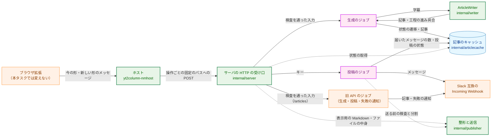

**Legend**

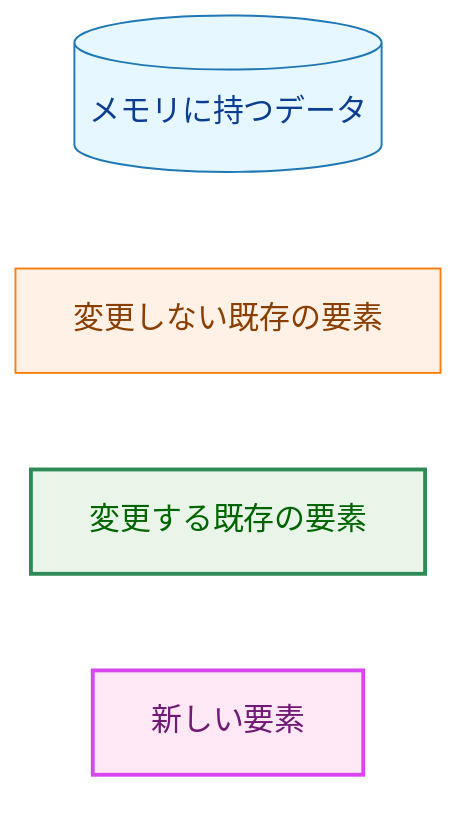

1 つのキーの記録は、生成と投稿の 2 つの状態を持つ。ジョブの状態が `完了` のときだけ、投稿の状態が意味を持つ。

| 状態の軸 | 値 | 変えるもの |
|---|---|---|
| ジョブの状態 | `処理中`・`完了`・`失敗`（キャッシュにないキーは `不明`） | 生成の開始（記録を作る、失敗からやり直す）、生成のジョブ（完了・失敗） |
| 工程の状態 | 工程（下書き・本文の短縮・検証・推敲）ごとに `未着手`・`実行中`・`完了`・`省略`・`失敗` | 生成のジョブ（`writer` からの進み具合の通知） |
| 投稿の状態 | `未投稿`・`投稿中`・`投稿済み`・`投稿の失敗`・`投稿できない` | 生成のジョブ（完了の時点で `未投稿` か `投稿できない`）、投稿の操作（`投稿中`）、投稿のジョブ（`投稿済み`・`投稿の失敗`） |

### 1.3. 設計の際に決めたこと（2026-10-27）

-   **記事のキー・記録の状態遷移・件数の上限と破棄は、新しいパッケージ `internal/articlecache` に置く。** ジョブの実行と HTTP は `internal/server` に置く。理由: 状態遷移を HTTP と LLM から切り離して単体テストでき、#503 の後に旧 API を削除するときに、このパッケージには手が入らないため。
-   **工程の進み具合は、`writer` に加える別の interface `ProgressWriter` で知らせる。** 進み具合の通知先を引数に取るメソッドを持ち、今の `Write` は通知しない形で同じ処理を呼ぶ。理由: 書き手はサーバの起動時に 1 つだけ作られて全ジョブで共有される（`cmd/yt2column-server/run.go:286`）ので、ジョブごとの通知先は呼び出しの引数で渡すしかない。`ArticleWriter.Write` の引数を変えると CLI・`internal/job`・すべての fake が変わり、ジョブごとに `writer.New` を呼ぶとテンプレートの検査のやり直しと新しい失敗の経路ができるため。
-   **状態の取得の応答の上限を超える大きさの記事は、新しい失敗の理由 `article_too_large` で生成の失敗にする。** ホストが中継するサーバの応答の上限も、その応答が収まる値に上げる。理由: 本文の上限 4,000 字は改行を数えず（`internal/writer/length.go:16-22`）、タイトルにも長さの上限がない（`internal/writer/output.go:58-63`）。保証される上限は生成した文字列の 1 MiB（`output.go:13-14`）だけなので、改行だらけの記事は応答の上限を超えうる。既存の「公開できない記事」の理由に含めると、その理由の意味（今の公開が整形の前に拒否する記事。AC-17a）が広がるため。
-   **投稿のジョブの数は限らず、受け付けたらすぐに送り始める。** シャットダウンでは、生成のジョブと同じく取り消さずに完了を待つ。理由: 要件書 F-003 の表に、投稿の操作を `too_many_requests` で拒否する行がない。投稿は利用者が手で選ぶ操作で、同時に走ることはまれである。並んで走るので、待つ時間は 1 回の投稿の最長（約 5 分。§3.7）で済む。ジョブの数は、記事のキャッシュの件数の上限（§3.3.4）で抑えられるため。

### 1.4. 既存コードとの関係

| 既存の部品 | 本設計での扱い |
|---|---|
| 本文の読み込みと検査（`internal/server/request.go:34-49` の `readRequest`、`:57-110` の `validateBody`） | 生成の開始でもそのまま使う。`validateBody` の結果（`jobInput`）に、キーの計算に使う検査を通った値（正規化した URL・字幕・タイトル・チャンネル名・説明）を加える（§3.2） |
| 生成の枠（`job.go:16-39`） | 旧 API と新しい API の生成のジョブが合わせて使う。値（2）は変えない（§3.4） |
| 生成の失敗の分類（`job.go:138-155` の `classifyWrite`） | 新しい API でもそのまま使い、返った `failure.Kind` を新しい失敗の理由に写す（§3.11.3） |
| 拒否の理由（`internal/server/response.go:14-72`） | 既存の値・状態コードは変えず、新しい理由を加える（§3.11.5） |
| `writer.ArticleWriter`（`internal/writer/writer.go:72-79`）と `templateWriter.Write`（`:325-411`） | 工程の進み具合を知らせる `ProgressWriter` を加える。`Write` の振る舞いは変えない（§3.5） |
| `writer.Stage`（`internal/writer/artifact.go:16-31`） | 工程を表す値として使う（`StageGeneration`・`StageShorten`・`StageReview`）。新しい列挙を作らない |
| `renderFileArticle`（`internal/publisher/file_render.go:25-65`） | ファイルの中身を返すのに使う。`FilePublisher.Publish` が書くファイルと同じ文字列になる（§3.6） |
| `prepareSlackMessages`（`slack_message.go:23-58`） | 完了の時点の検査（`投稿できない` の判定）と、投稿のジョブのメッセージの組み立ての両方に使う（§3.6・§3.7） |
| `SlackWebhookPublisher.Publish`（`internal/publisher/slack.go:153-184`） | 送信の繰り返しを、途中から再開できるメソッドに切り出す。`Publish` はそれを最初から呼ぶ形にし、振る舞いは変えない（§3.7） |
| `articleCost`（`internal/publisher/format.go:13-20`） | 状態の取得の料金に使う。ファイルのフロントマターと Slack の脚注と同じ値になる |
| `internal/strictjson` | 状態の取得と投稿の操作の本文、ホストの新しい形のメッセージの検査に使う。ホストが生成の開始の入力をそのまま渡すために、値の元のバイト列を返すメソッドを加える（§3.10.3） |
| `config.LoadServer`（`internal/config/config.go:276-301`） | `SLACK_WEBHOOK_URL` を任意にする。値の検査は変えない（§3.8） |
| ホストの中継（`internal/nmhost/relay.go:215-255` の `forward`） | メッセージを接続の前にすべて読み、形を見分けてから送る。今の形のバイト列と送り先は変えない（§3.10） |

## 2. システム構成 (System Structure)

### 2.1. パッケージ構成

矢印 A → B は「A が B を import する」ことを表す。本タスクで加える依存だけでなく、関係する既存の依存も示す。

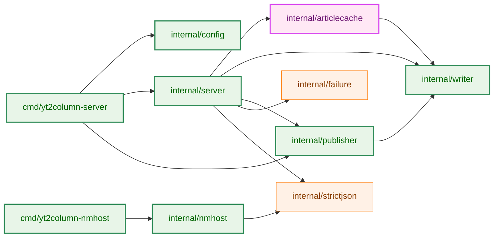

**Legend**

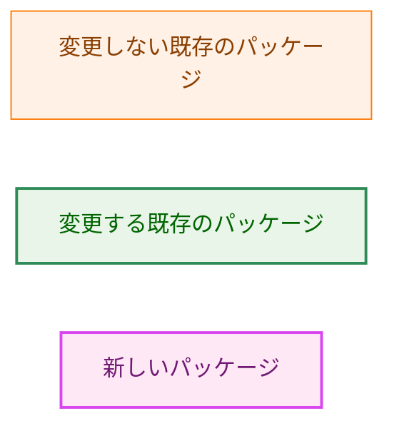

`internal/articlecache` は `internal/writer` の値の型（`Article`・`Stage`）だけを使い、LLM・HTTP・Webhook を知らない。`internal/nmhost` は `internal/strictjson` を新しく import する（§3.10）。

### 2.2. コンポーネント配置

| 置き場所 | 新しく置くもの・変えるもの |
|---|---|
| `internal/articlecache`（新規） | 記事のキー（`Key`・`NewKey`・`ParseKey`）、記録と状態の列挙、`Cache`（生成の開始・状態の取得・投稿の開始の遷移、件数の上限と破棄）、ジョブが遷移を知らせるハンドル（`Run`・`PostRun`） |
| `internal/server` | 新しい 3 つのパスの受け口、読み込みの枠、生成のジョブ、投稿のジョブ、状態の取得の応答の組み立て、新しい拒否の理由、`Options` の Webhook の任意化、旧 API の Webhook 未設定の拒否 |
| `internal/writer` | `ProgressWriter` と `ProgressObserver`、`templateWriter` の進み具合の通知 |
| `internal/publisher` | 表示用の Markdown の整形、ファイルの中身と Slack のメッセージを返す公開の関数、途中から再開できる送信 |
| `internal/config` | `ServerConfig` の Webhook を任意にする |
| `cmd/yt2column-server` | Webhook の有無に応じた組み立て、起動のログ |
| `internal/nmhost` | メッセージの全体の読み込み、形の判定、操作の送り先への対応づけ、応答の上限 |
| `internal/strictjson` | 値の元のバイト列を返すメソッド |
| 文書 | README の「Localhost server」節と設定、`docs/dev/security.md` §8、`docs/dev/project_overview.md`、`docs/translation_glossary.md`、`docs/dev/developer_guide/package_reference.md` |

### 2.3. データフロー

矢印は呼び出しと応答を表す。`par` の枠は、受け口が応答した後も続く非同期の処理を表す。

**生成の開始と状態の取得**

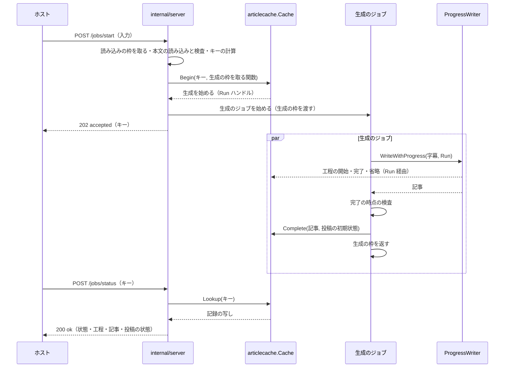

**投稿の操作**

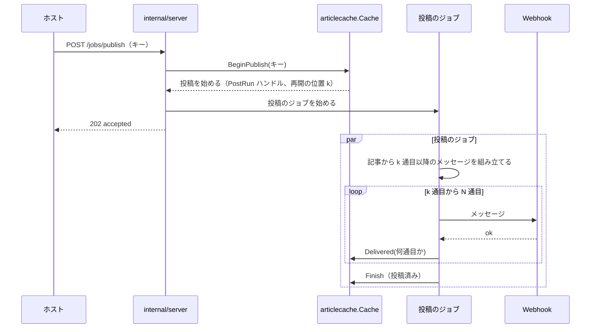

## 3. コンポーネント設計 (Component Design)

### 3.1. HTTP API（F-001〜F-003、H-01）

#### 3.1.1. パスとメソッド

新しい API は 3 つの固定のパスで受ける。メソッドはどれも `POST` である。

| 操作 | リクエストのターゲット | 本文 | 成功の応答 |
|---|---|---|---|
| 生成の開始 | `/jobs/start` | 今の `/articles` と同じ入力（`videoUrl`・`transcript`・`title`・`channelName`・`description`） | `202`、`{"status":"accepted","key":"…","requestId":"…"}` |
| 状態の取得 | `/jobs/status` | `{"key":"…"}` | `200`、`{"status":"ok","requestId":"…","webhookConfigured":…,"job":{…}}`（§3.1.3） |
| 投稿の操作 | `/jobs/publish` | `{"key":"…"}` | `202`、`{"status":"accepted","requestId":"…"}` |

-   **パスの照合:** 受け口は、`r.RequestURI` を、`/articles` と上の 3 つの文字列のどれかと、デコードの前に完全一致で比べる（今の `handler.go:119-127` と同じ方法）。どれにも一致しなければ `not_found`、一致してメソッドが `POST` でなければ `method_not_allowed`（`Allow: POST`）で拒否する。クエリを付けたターゲットは一致しないので `not_found` になる（要件書 3.2「クエリがあれば拒否する」）。
-   **キーを本文で運ぶ理由:** キーをパスに入れると、照合が完全一致でなくなり（H-01）、ホストが拡張から受け取った任意の文字列をリクエストのターゲットに埋め込むことになる。たとえば `abc/publish` というキーは、パスに埋め込むと状態の取得を投稿の操作に変えうる。キーを本文の JSON 文字列にすれば、どの文字列も JSON の符号化だけで運べ、ターゲットは常に固定の 3 つのどれかである（§5.2 の T-02）。
-   **状態の取得のメソッドを `POST` にする理由:** 本文でキーを渡すので `GET` は使えない（`GET` の本文は意味を持たない）。サーバは UDS 上で同じ利用者のプロセスだけから受け、キャッシュの仕組みを持つ途中の装置もないので、`GET` を使う利点がない。状態の取得は `POST` でも記録を変えない（要件書 F-002）。
-   **応答を区別しない:** 生成の開始は、生成を始めた場合も、既存のジョブまたは記事のキーを返した場合も、同じ `202` と同じ形を返す（要件書 F-001 の「区別しない」）。

#### 3.1.2. 状態の取得と投稿の操作の本文

-   本文の上限は 1 KiB とする（`maxKeyBodyBytes`）。`Content-Length` がそれを超えれば、本文を読まずに `body_too_large` で拒否する。`Content-Length` のない本文（chunked）は、今と同じく `http.MaxBytesReader` で上限で止める（`request.go:35-46` の方法）。
-   本文は `strictjson.ParseObject`（UTF-8・対になっていないサロゲートのエスケープ・単一の値・後続のデータの検査）を通し、`CollectOnly("key")` で宣言していないメンバと重複するメンバを拒否し、`key` を必須の文字列として読む。どれかに失敗すれば `invalid_body` で拒否する（要件書 3.2 の 3 行目）。
-   `key` の文字列が §3.2 の受理する形でなければ `invalid_key` で拒否する。どちらの拒否でも、キャッシュは変わらない（AC-44）。
-   この 2 つの操作は、読み込みの枠も生成の枠も使わない。本文が 1 KiB に限られ、`http.Server` の `ReadTimeout`（30 秒、`internal/server/server.go:30-36`）で読み込みの時間も限られるためである。

#### 3.1.3. 状態の取得の応答の形

応答は、記録のジョブの状態ごとに次のメンバを持つ。どのメンバの値も、コード（§3.11）、キーで決まる固定の値、数値、真偽値、または完了した記事の 2 つの文字列（`markdown`・`file`）だけである。

```json
{
  "status": "ok",
  "requestId": "0123456789abcdef",
  "webhookConfigured": true,
  "job": {
    "state": "done",
    "steps": { "draft": "done", "shorten": "skipped", "review": "done" },
    "article": {
      "markdown": "# …",
      "file": "---\n…",
      "cost": { "state": "known", "usd": "0.1234" },
      "durationMs": 81234
    },
    "publish": { "state": "not_posted" }
  }
}
```

| `job.state` | `job` が持つメンバ |
|---|---|
| `running` | `steps` |
| `done` | `steps`（`done` か `skipped` だけ）、`article`、`publish` |
| `failed` | `steps`（失敗した工程は `failed`）、`failure`（生成の失敗の理由） |
| `unknown` | なし |

-   `webhookConfigured` は、このサーバが投稿の操作を受け付けるか（`SLACK_WEBHOOK_URL` が設定されているか）を、どの状態でも返す（要件書 F-002・F-006、AC-34・AC-35）。
-   `article.cost` は、料金が分かれば `{"state":"known","usd":"<小数 4 桁>"}`、分からなければ `{"state":"unknown"}` である。金額の書式は、ファイルのフロントマターの `estimated_cost_usd` と同じ（`articleCost` と `articleCostDecimals`、`internal/publisher/format.go:8-20`）。
-   `article.durationMs` は、完了した生成を始めた受け付けから、生成の完了までの時間（ミリ秒の整数）である（AC-14、§3.3.3）。
-   `publish` は `{"state":"<投稿の状態>"}` で、`failed` と `unpostable` のときだけ `reason` を持つ（§3.11.4）。
-   `requestId` は、今のすべての応答と同じく、サーバが生成した乱数の識別子である（`response.go:139-147`）。要件書 4.2 は新しい API の応答の値を「固定の値、キー、数値」に限るとし、同時に「今の `0011` F-008 と同じ方針」とする。0011 F-008 の応答は `requestId` を含むので、本設計は `requestId` を、キーと同じくサーバが決めた識別子として含める。
-   完了の時点の検査（§3.6）で、この応答が上限（`maxStatusResponseBytes`、256 KiB）に収まることを確かめた記事だけが `done` になる。

#### 3.1.4. 拒否の応答

拒否の応答の形は、今と同じ `{"status":"rejected","reason":"…","requestId":"…"}`（`response.go:130-137`）である。新しい理由は §3.11.5 に挙げる。

### 3.2. 記事のキー（F-001・AC-03〜AC-05・AC-44、H-02）

-   **入力:** 検査を通った後の 5 つの値。`videoUrl` は `transcript.ValidateVideoURL` が返す正規化した URL（`request.go:92`）、`transcript` は受け取った文字列（検査は値を変えない）、`title`・`channelName`・`description` は、省略した場合は空文字列（`request.go:112-125` の `optionalMember`）である。宣言していないメンバ、メンバの順序、JSON の空白とエスケープは、この 5 つの値に届かないので、キーを変えない（AC-03）。
-   **符号化:** 固定の領域の文字列 `yt2column article key v1` と 1 バイトの `0x00` の後に、5 つの値を上の順に、それぞれ「バイト長を 8 バイトのビッグエンディアンで表したもの」と「値の UTF-8 のバイト列」の組として並べる。長さを前に置くので、2 つの値の境目を動かした入力は違うバイト列になる（AC-05）。領域の文字列は、将来キーの計算を変えるときに版を変えるためのものである。
-   **ハッシュ:** 標準ライブラリの SHA-256（`crypto/sha256`）。外部ライブラリを加えない（要件書 5.）。
-   **キーの文字列の形:** ハッシュの 32 バイトを小文字の 16 進で表した 64 文字。受理する形はこれだけで、`ParseKey` は、長さが 64 でない文字列、`0-9a-f` 以外の文字（大文字を含む）を含む文字列を拒否する。前後の空白や大文字を補正しない（AC-44、CLAUDE.md「Reject, don't normalize」）。
-   **型:** `Key` はフィールドを公開しない構造体で、`NewKey`（入力から計算）と `ParseKey`（受理する形の検査）でしか作れない。サーバは、受け取ったキーを `ParseKey` を通してからキャッシュを引く値にだけ使う（要件書 3.2）。

```go
// Package articlecache

// KeyInput is the validated request values the key is computed from.
type KeyInput struct {
	VideoURL    string // the normalized URL transcript.ValidateVideoURL returned
	Transcript  string
	Title       string // "" when the member was absent
	ChannelName string // "" when the member was absent
	Description string // "" when the member was absent
}

// Key identifies one article in the cache. It can only be built by NewKey or
// ParseKey.
type Key struct{ /* unexported: the 32-byte SHA-256 digest */ }

// ErrInvalidKey is wrapped by ParseKey for a string that is not 64 lowercase
// hexadecimal characters. It never holds the string.
var ErrInvalidKey = errors.New("invalid article key")

func NewKey(in KeyInput) Key
func ParseKey(s string) (Key, error)
func (k Key) String() string // 64 lowercase hexadecimal characters
```

-   **キーの性質:** 同じサーバのメモリの中だけで使う値で、サーバの設定（モデルなど）は含めない。記事のキャッシュはサーバの起動ごとに空から始まり、設定は起動の間変わらないので、設定の違う 2 つの記事が同じキーで並ぶことはない。

### 3.3. 記事のキャッシュ（`internal/articlecache`、F-004、H-06）

#### 3.3.1. 状態遷移

矢印は、記録の状態の遷移と、それを起こす操作を表す。`[*]` からの矢印は記録を作ること、`[*]` への矢印は記録を捨てることを表す。

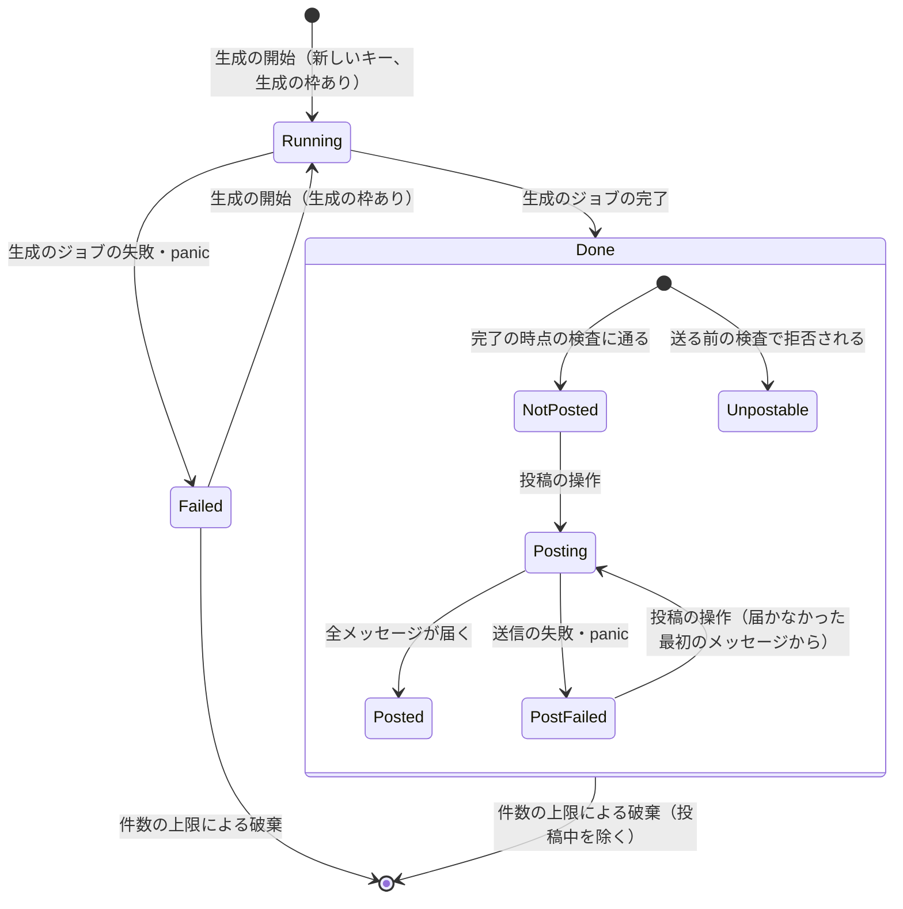

-   `Running` は `処理中`、`Done` は `完了`、`Failed` は `失敗` である。キャッシュにないキーは `不明` を返す。
-   `Posting` の記録と `Running` の記録は捨てない（要件書 F-004）。

#### 3.3.2. 型

```go
// Package articlecache

// JobState is a record's generation state. The zero value is JobUnknown: the
// state of a key the cache does not hold.
type JobState int

const (
	JobUnknown JobState = iota
	JobRunning
	JobDone
	JobFailed
)

// StepState is the state of one step of a generation. The zero value is
// StepPending.
type StepState int

const (
	StepPending StepState = iota
	StepRunning
	StepDone
	StepSkipped
	StepFailed
)

// Steps holds the state of each step, keyed by writer.Stage.
type Steps struct {
	Draft   StepState // writer.StageGeneration
	Shorten StepState // writer.StageShorten
	Review  StepState // writer.StageReview
}

// FailureReason is why a generation failed. The zero value is
// FailureInternal.
type FailureReason int

const (
	FailureInternal FailureReason = iota
	FailureTranscriptTooLong
	FailureLLMTimeout
	FailureLLMEmpty
	FailureLLMTruncated
	FailureLLM
	FailureArticleInvalid  // the article fails writer.Article.CheckPublishable
	FailureArticleTooLarge // the status response would exceed its limit
)

// PostState is a completed article's publish state. The zero value is
// PostUnpostable, which neither sends nor claims a delivery.
type PostState int

const (
	PostUnpostable PostState = iota
	PostNotPosted
	PostPosting
	PostPosted
	PostFailed
)

// UnpostableReason is why the pre-send checks reject an article. The zero
// value is UnpostableOther.
type UnpostableReason int

const (
	UnpostableOther UnpostableReason = iota
	UnpostableMention
)

// PostFailureReason is why a post failed after it started. The zero value is
// PostFailureInternal.
type PostFailureReason int

const (
	PostFailureInternal PostFailureReason = iota
	PostFailureWebhook
)

// Snapshot is a copy of one record, taken under the cache's lock.
type Snapshot struct {
	State      JobState
	Steps      Steps
	Failure    FailureReason // JobFailed only
	Article    writer.Article
	Duration   time.Duration    // JobDone only
	Post       PostState        // JobDone only
	Unpostable UnpostableReason // PostUnpostable only
	PostFailed PostFailureReason // PostFailed only
}
```

```go
// Options configures a Cache. Capacity must be positive; Clock nil selects
// time.Now.
type Options struct {
	Capacity int
	Clock    func() time.Time
}

func New(opts Options) (*Cache, error)

// BeginOutcome is what Begin did. The zero value is BeginFull, which starts
// nothing.
type BeginOutcome int

const (
	BeginFull     BeginOutcome = iota // no evictable record: nothing changed
	BeginNoSlot                       // acquire reported false: nothing changed
	BeginExisting                     // the key is running or done: nothing changed
	BeginStarted                      // a running record was created or a failed one restarted
)

// Begin decides, under the lock, what a generation start does for key. It
// calls acquire only when a generation would start, and only after it has
// confirmed that a record can be added; Run is non-nil only for BeginStarted.
func (c *Cache) Begin(key Key, acquire func() bool) (BeginOutcome, *Run)

// Lookup returns a copy of key's record, or a Snapshot with JobUnknown.
func (c *Cache) Lookup(key Key) Snapshot

// PublishOutcome is what BeginPublish did. The zero value is PublishNoArticle.
type PublishOutcome int

const (
	PublishNoArticle  PublishOutcome = iota // failed or unknown
	PublishNotReady                         // running
	PublishUnpostable                       // done and unpostable
	PublishAlready                          // done and posting or posted: nothing changed
	PublishStarted                          // the record is now posting
)

// BeginPublish moves a done, not-posted or post-failed record to posting and
// returns the article and the index of the first message not delivered.
func (c *Cache) BeginPublish(key Key) (PublishOutcome, *PostRun)
```

```go
// Run is the handle a generation job reports through. It implements
// writer.ProgressObserver. Each method is a no-op after Complete or Fail.
type Run struct{ /* unexported */ }

func (r *Run) StageStarted(s writer.Stage)
func (r *Run) StageFinished(s writer.Stage)
func (r *Run) StageSkipped(s writer.Stage)
func (r *Run) Complete(a writer.Article, post PostState, unpostable UnpostableReason)
func (r *Run) Fail(reason FailureReason) // the running step, if any, becomes StepFailed

// PostRun is the handle a post job reports through.
type PostRun struct{ /* unexported */ }

func (p *PostRun) Article() writer.Article
func (p *PostRun) From() int          // the index of the first message not delivered
func (p *PostRun) Delivered(index int) // message index reached the Webhook
func (p *PostRun) Finish()             // every message was delivered: posted
func (p *PostRun) Fail(reason PostFailureReason)
```

-   **排他制御:** `Cache` は 1 つの `sync.Mutex` で、記録の表と、破棄のための順序をまとめて守る。`Run` と `PostRun` のメソッドも同じ排他制御の下で記録を書き換える。`Lookup` は記録の写しを返し、呼び出し側は排他制御の外で応答を組み立てる。
-   **ハンドルの不変条件:** 1 つのキーで同時に存在する `Run` は高々 1 つ、`PostRun` も高々 1 つである。`Begin` は `Running` の記録に新しい `Run` を作らず、`BeginPublish` は `Posting` の記録に新しい `PostRun` を作らないので、同じキーの生成と投稿はそれぞれ 1 回だけ行われる（AC-09b・AC-20）。`Complete` か `Fail` の後の `Run` のメソッドは何もしない。
-   **生成の枠の取り方:** `Begin` は、キーが `Running` か `Done` なら、`acquire` を呼ばずに `BeginExisting` を返す（AC-02・AC-07）。キャッシュにないキーで、破棄できる記録がなく件数の上限に達していれば、`acquire` を呼ばずに `BeginFull` を返す（AC-26a）。それ以外では `acquire` を呼び、偽なら何も変えずに `BeginNoSlot` を返す（AC-06・AC-07）。真なら、必要なら 1 件捨て、`Running` の記録を作り（失敗の記録ならやり直す）、受け付けの時刻を記録する。キーの状態の判定と生成の枠の取得を同じ排他制御の下で行うので、同じ新しいキーが同時に来ても、生成の枠を取るのは 1 つだけである。`acquire` は待たない関数（`Server.acquireSlot`、`job.go:25-34`）で、排他制御の中で止まらない。
-   **投稿の開始:** `BeginPublish` は、`Done` で `PostNotPosted` か `PostFailed` の記録を `PostPosting` にして、届かなかった最初のメッセージの位置（`From`）と記事を `PostRun` で返す。`PostPosting` と `PostPosted` には `PublishAlready`（何も変えない、AC-20）、`PostUnpostable` には `PublishUnpostable`、`Running` には `PublishNotReady`、`Failed` とキャッシュにないキーには `PublishNoArticle` を返す。

#### 3.3.3. 時刻と所要時間

-   `Begin` が記録を `Running` にした時刻を、受け付けの時刻として記録する。失敗からやり直した記録では、やり直しの時刻で置き換える（AC-14）。
-   `Complete` の時刻を完了の時刻、`Fail` の時刻を失敗の時刻として記録する。所要時間は、完了の時刻から受け付けの時刻を引いた値である。
-   時刻は `Options.Clock` から読む。テストは時計を差し替える（AC-14・AC-25）。単調時計の読みを使えるように、`time.Now` の値をそのまま持つ（`time.Time` の差は、両方が単調時計の読みを持てばそれを使う）。

#### 3.3.4. 件数の上限と破棄（H-06）

-   **上限:** 100 件（`defaultCapacity`）。処理中・完了・失敗のすべての記録を数える。
-   **破棄の対象と順序:** 新しいキーの記録を加えると上限を超えるとき、`Done`（`PostPosting` を除く）と `Failed` の記録のうち、完了または失敗した時刻の最も古いものを 1 件捨てる（AC-25・AC-26）。捨てる記録がなければ `BeginFull` にする（AC-26a）。同じ時刻の記録が 2 つあれば、先に完了または失敗したもの（記録の順）から捨てる。
-   **記録 1 件の大きさの見積もり:** 完了した記録が持つ大きなものは `writer.Article` の文字列だけで、表示用の Markdown・ファイルの中身・メッセージは持たない（§1.1）。本文は改行を除いて 4,000 字以下で（`internal/writer/writer.go:401-405` の最後の長さの検査）、日本語は UTF-8 で 1 字 3 バイトなので、典型的な記事の本文は 12 KB ほどである。これにタイトル・チャンネル名（200 コードポイント以下、`output.go:15-19`）・出典・モデル名（256 バイト以下）・検証・推敲の訂正の一覧を加えても、記録 1 件は 20 KB ほどである。最大の記事は、完了の時点の検査で状態の取得の応答（256 KiB 以下）に収まる記事で、応答は記事の本文をほぼ 2 回含むので、記事の文字列は 128 KiB ほどまでである。
-   **メモリの量:** 典型的な記事で 100 件 × 20 KB ≒ 2 MB、最大の記事ばかりでも 100 件 × 128 KiB ≒ 13 MiB である。失敗の記録は記事を持たないので小さい。処理中の記録は、生成のジョブが字幕を持つ間だけ大きいが、その数は生成の枠（2）で限られ、今の旧 API のジョブと同じである。
-   **値の理由:** 捨てられない記録（処理中と投稿中）で上限が埋まると、新しい生成がすべて拒否される（H-06）。処理中は生成の枠で 2 件まで、投稿中は利用者が手で選ぶ操作で数件を超えることはまれなので、100 件は十分に大きい。利用者が 1 日に生成する記事の数よりも多く、Viewer で開いている記事が 1 日のうちに捨てられることはまずない。
-   **テストの上限:** テストは `Options.Capacity` に小さい値を渡す（AC-25・AC-26・AC-26a）。サーバの `Options` には上限を公開せず、`-tags test` の組み立て（`test_helpers.go`）だけが渡す。

### 3.4. 生成の開始と生成の枠（F-001・F-007、H-04）

#### 3.4.1. 検査の順序

生成の開始は、次の順で検査する（要件書 F-001 の順序）。

1.  パスとメソッド（§3.1.1）。
2.  読み込みの枠を待たずに取る。取れなければ、本文を読まずに `too_many_requests` で拒否する（`Connection: close`、AC-09a）。
3.  本文の読み込みと検査。今の `readRequest` と `validateBody` をそのまま使う（`request.go:34-110`）。拒否の理由は今と同じで（AC-08）、本文の読み込みの失敗（接続の切断など）は、今と同じく応答を書かずに接続を閉じる（`handler.go:66-77`）。読み込みと検査が終わったら、成否にかかわらず読み込みの枠を返す。
4.  キーの計算（§3.2）と `Cache.Begin`。結果ごとに次のように応答する。

| `Begin` の結果 | 応答 | 生成の枠 |
|---|---|---|
| `BeginStarted` | 生成のジョブを始めてから `202` | ジョブが持ち、終わったら返す |
| `BeginExisting` | `202`（同じキー） | 取らない |
| `BeginNoSlot` | `too_many_requests` | 取れなかった |
| `BeginFull` | `too_many_requests` | 取らない |

-   新しい API の拒否は、どれも Webhook へ通知しない（AC-09）。旧 API の `rejectReason.notify`（`response.go:74-85`）と `notifyAsync` は、新しい API の受け口から呼ばない。
-   `202` は、旧 API と同じく、生成のジョブを始めた後に書く（`handler.go:91-99`）。応答が見えたときには、記録は必ず `処理中` 以降にある（AC-01）。

#### 3.4.2. 読み込みの枠

-   **値:** 2（`maxReading`）。生成の開始の本文の読み込みと検査だけが使う。
-   **理由:** 本文は最大 4 MiB（`request.go:18`）で、検査の間はその写しと解析の結果をメモリに持つ。今の旧 API は、生成の枠（2）を取ってから本文を読むので、同時に読む本文は 2 つまでである。読み込みの枠を 2 にすると、新しい API でも同時に読む本文は 2 つまでで、旧 API の分と合わせても 4 つまでになる。値をこれより大きくする理由はない。読み込みの枠と生成の枠は別なので、生成の枠が埋まっていても、処理中または完了したキーの再送はそのキーを受け取れる（AC-07）。
-   **既存の方針の例外:** 0011 の設計（`docs/tasks/0011_localhost_server/02_architecture.md` §3.8.2）は、枠を取ってから本文を読むとした。新しい API の生成の開始は、キーが分かるまで本文を読む必要があるので、生成の枠の前に本文を読み、その代わりに読み込みの枠で同時に読む数を限る（要件書 5. の「以前のタスクの方針の変更」）。旧 API の順序は変えないので、旧 API の順序を確かめる今のテスト（`internal/server/request_test.go` の `TestHeaderRejectionReadsNoBody`、`job_test.go` の `TestSlotLimit`）は変えない。

#### 3.4.3. 生成の枠の合算（H-04）

-   旧 API のリクエスト（ジョブと失敗の通知を含む）と新しい API の生成のジョブは、同じ生成の枠（`Server.slots`、`server.go:69-72`）を使う。値は 2 のまま変えない（要件書 1. の決定）。
-   投稿のジョブは生成の枠を使わない（§3.7、1.3 の決定）。状態の取得も使わない。
-   旧 API の失敗の通知は、今と同じく生成の枠を持ったまま行う（`job.go:79-105`）。新しい API には通知がないので、生成のジョブは記事の生成の間だけ生成の枠を持つ。

#### 3.4.4. 生成のジョブ

生成のジョブは、生成の枠と `Run` を受け取り、自分のゴルーチンで次を行う。

1.  `CopiedSource.Fetch` で `Transcript` を得る。失敗は内部の失敗（今の `classify` の `StageTranscript` と同じ扱い、`job.go:117-120`）。
2.  `ProgressWriter.WriteWithProgress(ctx, t, run)` を呼ぶ。`run` は工程の進み具合を記録に書く（§3.5）。失敗は `classifyWrite` で `failure.Kind` にし、§3.11.3 の表で失敗の理由に写して `run.Fail` を呼ぶ。
3.  完了の時点の検査（§3.6）を行い、結果に応じて `run.Complete` か `run.Fail` を呼ぶ。
4.  生成の枠を返す。

-   `ctx` は今の `jobCtx`（`server.go:76-80`）である。リクエストの `ctx` ではないので、応答を書いた後も取り消されない。
-   ジョブの中の panic は回復し、`run.Fail(FailureInternal)` にして、ログに 1 行書く（AC-45）。生成の枠は `defer` で返す。サーバは動き続ける。
-   生成のジョブは、字幕（`CopiedSource` とそれが作る `Transcript`）をジョブのゴルーチンの中だけで持ち、記録には渡さない。`Complete` が受け取るのは `writer.Article` だけなので、生成が終わった後の記録は、送られた字幕の文字列を含まない（AC-27）。
-   生成のジョブは今の `s.jobs`（`server.go:73-75`）に数え、シャットダウンで取り消さずに完了を待つ（AC-46、§6.4）。

### 3.5. 工程の進み具合（`internal/writer`、F-002・AC-10・AC-11、H-03）

```go
// Package writer

// ProgressObserver receives the progress of one Write. The calls for one
// Write are made from the goroutine that runs it, in order.
type ProgressObserver interface {
	StageStarted(s Stage)  // before the stage's first action
	StageFinished(s Stage) // after the stage's result passed every check of that stage
	StageSkipped(s Stage)  // the stage will not run in this Write
}

// ProgressWriter is an ArticleWriter that also reports its progress.
// WriteWithProgress behaves exactly as Write, and in addition calls observer.
// Write is WriteWithProgress with an observer that does nothing.
type ProgressWriter interface {
	ArticleWriter
	WriteWithProgress(ctx context.Context, t transcript.Transcript, observer ProgressObserver) (Article, error)
}

// New returns a ProgressWriter (today: ArticleWriter); the CLI keeps using it
// as an ArticleWriter.
func New(client llm.LLMClient, opts Options) (ProgressWriter, error)
```

-   **通知の約束:**
    -   `StageGeneration`: 生成のテンプレートの展開の前に `StageStarted`、生成の出力の検査（`checkResponse`）が通った後に `StageFinished`。
    -   `StageShorten`: 本文の短縮を行うとき（`writer.go:367` の条件。本文が 4,000 字を超える）は、その前に `StageStarted`、短縮の結果の検査が通った後に `StageFinished`。行わないとき（本文が 4,000 字以下、または短縮の工程が無効）は、下書きの `StageFinished` の直後に `StageSkipped`（AC-11）。
    -   `StageReview`: 検証・推敲を行うときは、その前に `StageStarted`。`StageFinished` は、検証・推敲の結果の検査と、`Write` の最後の長さの検査（`writer.go:401-405`）が通った後に呼ぶ。検証・推敲の後の本文が長すぎるときの失敗（`stepError(StepReview, …)`）を、検証・推敲の工程の失敗として表せるようにするためである。検証・推敲が無効なとき（CLI の `--no-review`）は `StageSkipped`。サーバは常に有効にするので、サーバでは `StageSkipped` にならない（`cmd/yt2column-server/run.go:93-98`）。
    -   失敗したときは、通知を追加しない。どの工程が失敗したかは、`StageStarted` の後に `StageFinished` が来なかった工程として、受け手（`articlecache.Run`）が決める（§3.3.2 の `Fail`）。
    -   中断からの再開（`Options.Artifacts.Resume`）で再利用した工程は、`StageSkipped` ではなく、再利用した時点で `StageFinished` とする。サーバは再開を使わないので、この場合はサーバの振る舞いに関係しない。CLI が通知を使わないので、この規則は約束としてだけ定める。
-   **既存の振る舞い:** `Write` は、何もしない通知先で `WriteWithProgress` を呼ぶだけにする。CLI（`internal/job`）は `Write` を使い続けるので、振る舞いは変わらない。`writer.New` の戻り値の型を `ProgressWriter` に変えるが、`ProgressWriter` は `ArticleWriter` を含むので、`ArticleWriter` として受け取っている呼び出し側（`cmd/yt2column`、`internal/job`、`writer/testutil.DefaultOptions` の比較）はそのまま動く。
-   **サーバの受け取り方:** `server.Options.Writer` の型を `writer.ProgressWriter` に変える。旧 API のジョブは今と同じく `Write` を（`pipeline` を通して）呼ぶ。
-   **fake:** `writer/testutil.FakeArticleWriter` に `WriteWithProgress` を加え、テストが工程ごとに止められるようにする（§7.1）。

### 3.6. 記事の整形と完了の時点の検査（`internal/publisher`、F-002・F-003・AC-12・AC-13・AC-17a・AC-23、H-05・H-09）

#### 3.6.1. 公開する関数

```go
// Package publisher

// FileContent returns the content FilePublisher writes for a: the same
// string renderFileArticle builds, after the same CheckPublishable check.
func FileContent(a writer.Article) (string, error)

// DisplayMarkdown returns the Markdown the Viewer displays for a: the title
// heading, the channel name line when there is one, and the body (which ends
// with the source block). It runs the same CheckPublishable check.
func DisplayMarkdown(a writer.Article) (string, error)

// SlackMessages returns the messages SlackWebhookPublisher.Publish sends for
// a, in order, or the pre-send error Publish would return. It touches no
// network and returns the same result for the same article.
func SlackMessages(a writer.Article) ([]string, error)

// ArticleCost returns the article's cost formatted as the --out file's
// estimated_cost_usd value, and whether it is known.
func ArticleCost(a writer.Article) (usd string, known bool)
```

-   `FileContent` は `CheckPublishable` と `renderFileArticle` を呼ぶだけの関数で、`FilePublisher.Publish`（`file.go:102-110`）が書く中身と同じ関数で作る。状態の取得が返すファイルの中身は、CLI の `--out` で書いたファイルとバイト単位で同じになる（AC-12）。
-   `SlackMessages` は `prepareSlackMessages` を公開する関数である。今の `SlackMessageCount`（`slack_message.go:60-69`）と、`-tags test` の `SlackMessagesForTest` は、これを呼ぶ形にする。
-   `ArticleCost` は `articleCost` と `articleCostDecimals` を使い、ファイルのフロントマターと同じ書式の文字列を返す。

#### 3.6.2. 表示用の Markdown（H-05）

-   **形:** `# <タイトル>`、空行、チャンネル名の行（チャンネル名があるときだけ）、空行、本文。本文は `writer` が付けた出典の段落（`出典: <URL>`、`output.go:27-29`・`:238`）で終わる。ファイルの中身からフロントマターを除いたものと同じ並びで、`#504` で拡張が描画する入力として、見出し・チャンネル名・本文・出典がそろう。
-   **関数:** 新しい関数 `renderDisplayMarkdown`（`display_render.go`）で整形する。`renderFileArticle` を呼ばず、その一部も切り出さない。
-   **`project_overview.md` の方針の例外:** 同書の `ArticleWriter` の項（`docs/dev/project_overview.md:60`）は、「出力先ごとに別の関数で整形し、共有するのは料金などの値の書式だけである」とする。`renderDisplayMarkdown` は、チャンネル名の行を、ファイルの整形と同じ `escapeLeadingMarkdown`（`file_render.go:73-84` の注釈と関数）で書く。
    -   範囲: 共有するのは `escapeLeadingMarkdown` の 1 つだけである。この関数は 1 行の値を Markdown のブロックとして読まれない形にする値の書式であり、見出しや本文の並びは共有しない。
    -   理由: チャンネル名の行がブロックとして読まれない（見出しやリストにならない）ことは、ファイルと表示で同じ規則でなければならない。別の実装を書くと、片方だけが直されるおそれがある。
    -   更新するテスト: なし。`escapeLeadingMarkdown` の振る舞いを変えないので、`file_render_test.go` は変えない。
-   **安全性:** 表示用の Markdown は、記事の文字列を変えずに並べるだけで、HTML への変換や無害化をしない。描画の安全性は #503・#504 で扱う（要件書 2.3）。

#### 3.6.3. 完了の時点の検査

生成のジョブは、`WriteWithProgress` が返した記事について、次の順に確かめる。

| 順 | 検査 | 失敗のとき |
|---|---|---|
| 1 | `writer.Article.CheckPublishable`（`internal/writer/article.go:10-61`） | 生成の失敗 `article_invalid`（AC-17a） |
| 2 | 状態の取得の応答の大きさ: `FileContent` と `DisplayMarkdown` を作り、記事以外の値が最も長くなる場合の応答を組み立てて、`maxStatusResponseBytes`（256 KiB）以下であること | 生成の失敗 `article_too_large` |
| 3 | `SlackMessages`（送る前の検査と分割） | 記事は `完了`、投稿の状態は `投稿できない`。`publisher.ErrSlackMention` を包むなら理由は `mention`、それ以外は `other`（AC-23） |

-   すべて通れば、記事は `完了`、投稿の状態は `未投稿` になる。
-   3 の検査は、`SLACK_WEBHOOK_URL` が未設定のサーバでも行う（要件書 F-003）。結果は記事だけで決まり、Webhook の有無に関係しない。
-   2 の「最も長くなる場合」は、投稿の状態とその理由、料金、所要時間、`requestId`、`webhookConfigured` が、それぞれ取りうる最も長い値の場合である。どれも固定の長さの上限を持つ値なので、応答の大きさは記事で決まる。状態の取得のたびに組み立てる応答は、この大きさを超えない。
-   **`maxStatusResponseBytes` の値（H-09）:** 256 KiB。典型的な記事の応答は 30 KB ほどで（§3.3.4 の見積もりの 2 倍と JSON のエスケープ）、8 倍の余裕がある。この上限を超えるのは、改行だけの行やタイトルが極端に長い記事で、プロンプトインジェクションか LLM の異常な出力である。ホストの応答の上限はこの 2 倍の 512 KiB にする（§3.10.4）。

### 3.7. 投稿のジョブ（F-003・AC-18〜AC-24、H-04・H-11）

#### 3.7.1. 送信の再開

`SlackWebhookPublisher` の送信の繰り返し（`slack.go:167-183`）を、途中から再開できるメソッドに切り出す。

```go
// Package publisher

// PostMessages posts messages[from:] in order with silent set, waiting the
// interval before every message but the first one it sends. After each
// message the Webhook acknowledged, it calls delivered with that message's
// index in messages. Every failure is a *SlackPostError whose Posted counts
// the messages delivered before it, from the start of messages.
func (p *SlackWebhookPublisher) PostMessages(ctx context.Context, messages []string, from int, delivered func(index int)) error
```

-   `Publish` は `SlackMessages` と `PostMessages(ctx, messages, 0, 何もしない関数)` を呼ぶ形にする。旧 API と CLI の `--slack` の送信の内容・間隔・時間の上限・エラーは変わらない（AC-18 の「`/articles` が投稿した場合と同じ」）。
-   メッセージが届いたとみなすのは、今と同じく Webhook が `200` と本文 `ok` を返した場合だけである（`slack.go:216-224`）。`delivered` はその後にだけ呼ぶ。
-   サーバは `PostMessages` を、次の interface で受け取る。テストは fake の Webhook（`httptest`）で本物の `SlackWebhookPublisher` を使うか、この interface の fake を使う。

```go
// Package server

// MessagePoster posts prepared messages from an index on. The production
// value is *publisher.SlackWebhookPublisher.
type MessagePoster interface {
	PostMessages(ctx context.Context, messages []string, from int, delivered func(index int)) error
}
```

#### 3.7.2. 投稿の操作と投稿のジョブ

-   **検査の順序:** パスとメソッド → `SLACK_WEBHOOK_URL` が設定されているか（未設定なら本文を読まずに `webhook_not_configured`、`Connection: close`。AC-34） → 本文の読み込みと検査（§3.1.2） → `Cache.BeginPublish`。
-   **結果ごとの応答:**

| `BeginPublish` の結果 | 応答 | Webhook |
|---|---|---|
| `PublishStarted` | 投稿のジョブを始めてから `202` | 投稿のジョブが送る |
| `PublishAlready` | `202` | 呼ばない（AC-20） |
| `PublishUnpostable` | `article_not_postable` | 呼ばない（AC-23） |
| `PublishNotReady` | `job_not_ready` | 呼ばない（AC-22） |
| `PublishNoArticle` | `article_not_found` | 呼ばない（AC-22） |

-   **投稿のジョブ:** `PostRun` を受け取り、自分のゴルーチンで、記事から `SlackMessages` でメッセージを組み立て直し、`PostMessages(ctx, messages, run.From(), run.Delivered)` を呼ぶ。成功なら `run.Finish()`（`投稿済み`）、失敗なら `run.Fail(PostFailureWebhook)`（`投稿の失敗`）にする。`SlackMessages` は同じ記事から同じメッセージを返すので、完了の時点の検査で通った記事は、ここでも同じ数のメッセージになる。万一 `SlackMessages` が失敗した場合は、`run.Fail(PostFailureInternal)` にする。
-   **応答を待たない:** 投稿の操作は、`PostMessages` の結果を待たずに `202` を返す（AC-19）。投稿のジョブの `ctx` は `jobCtx` で、リクエストの `ctx` ではない。
-   **再開の位置:** `PostRun.Delivered` は、届いたメッセージの位置を記録に書く。`BeginPublish` が返す `From` は、届いたメッセージの数（最初から数えて連続して届いた数）である。k 通目で失敗した記事のやり直しは、k 通目から送り（AC-21）、1 通目から k−1 通目は送り直さない。k 通目は実は届いていた可能性があり、その 1 通だけは重複しうる（要件書 1. の決定）。
-   **panic:** 投稿のジョブの中の panic は回復し、`run.Fail(PostFailureInternal)` にする。届いたメッセージの位置は `Delivered` で記録に書いた後なので失われず、やり直しは届かなかった最初のメッセージから送る（AC-45a）。
-   **通知しない:** 投稿の失敗は Webhook へ通知しない（AC-24）。
-   **同時実行（H-04）:** 投稿のジョブの数は限らない（1.3 の決定）。同じキーの投稿は `PostRun` の不変条件で 1 つだけである（§3.3.2）。違うキーの投稿が並んで走ると、Webhook の速度の制限に当たりうる。Mattermost（対象の環境）の既定の制限は IP ごとで、数通の並びには当たらない。Slack は best effort の対象である（`_context.md`、Target client environments）。
-   **シャットダウン（H-11）:** 投稿のジョブは `s.jobs` に数え、取り消さずに完了を待つ（要件書 4.3）。1 回の投稿は最大 10 通（`slack_message.go:16-17`）、1 通あたりの時間の上限 30 秒（`slack.go:22-23`）、間隔 1 秒（`slack.go:26-28`）なので、最長 10 × 30 + 9 × 1 = 309 秒で必ず終わる。投稿のジョブは並んで走るので、待つ時間はこの値で決まり、生成のジョブの最長（3 回の LLM の呼び出しで 45 分、`cmd/yt2column-server/run.go:40-43`）より短い。このため、待つ時間の上限を別に設けない。今の停止の案内（「約 45 分」、`run.go:231-236`）はそのまま正しい。

### 3.8. 設定と起動（`internal/config`・`cmd/yt2column-server`、F-006・AC-32〜AC-35）

```go
// Package config

// WebhookURL returns the Webhook URL and whether one is configured.
func (c ServerConfig) WebhookURL() (secret.Secret, bool)
```

-   `LoadServer` は、`SLACK_WEBHOOK_URL` が未設定でもエラーにしない（AC-32）。空の値と `slackwebhook.ValidURL` が拒否する値は、今と同じ `loadSlackWebhook`（`config.go:747-763`）のエラーで拒否する（AC-33）。`ServerConfig.WebhookURL` の戻り値は、`Config.SlackWebhookURL`（`config.go:209-215`）と同じ形にする。
-   `server.Options` は Webhook に関わる部品を 1 つにまとめる。`nil` は「Webhook が設定されていない」ことの宣言である。

```go
// Package server

// Options configures a Server. Writer and LogOutput are required.
type Options struct {
	Writer    writer.ProgressWriter
	Webhook   *WebhookOptions // nil: SLACK_WEBHOOK_URL is not configured
	LogOutput io.Writer
	Secrets   []string
}

// WebhookOptions holds what posts to the Webhook. Every field is required.
type WebhookOptions struct {
	Publisher publisher.Publisher // the legacy /articles job
	Notifier  failure.Notifier    // the legacy /articles failure notice
	Poster    MessagePoster       // the publish operation
}
```

-   `New` は、`Webhook` が `nil` でなければ、3 つのフィールドのどれかが `nil`（型付きの `nil` を含む）のときに `ErrInvalidOptions` で拒否する（今の `validateOptions`、`server.go:117-136` の形）。
-   `cmd/yt2column-server` の `buildServer`（`run.go:277-309`）は、`cfg.WebhookURL()` が設定済みを返したときだけ `SlackWebhookPublisher`（`Publisher` と `Poster` を兼ねる）と `SlackFailureNotifier` を作り、`WebhookOptions` を渡す。未設定なら `Webhook` を `nil` にする。秘密の値の一覧（`redact.SecretStrings`）は、Webhook の URL のゼロ値を受け取ると何も加えない（`internal/redact` の今の振る舞い）ので、そのまま渡す。
-   起動のログの `listening` の行（`run.go:185-189`）に、`webhookConfigured`（真偽値）を加える。利用者が、投稿の操作と旧 API が拒否される理由をログで確かめられるようにするためである。
-   `deps.newPublisher` の戻り値の型を `*publisher.SlackWebhookPublisher` に変える（`Publisher` と `MessagePoster` の両方に使うため）。

### 3.9. 旧 API（F-007・AC-36・AC-37）

-   `SLACK_WEBHOOK_URL` が設定されているときの旧 API の振る舞い（検査・応答・非同期の生成と投稿・失敗の通知・生成の枠）は変えない。変わるのは、生成の枠を新しい API の生成のジョブと共有することだけである（§3.4.3）。新しい API の生成が走っていなければ、旧 API から見た振る舞いは今と同じである（AC-36）。
-   `SLACK_WEBHOOK_URL` が未設定なら、パスとメソッドの検査の後、生成の枠を取る前に、本文を読まずに `webhook_not_configured` で拒否する（`Connection: close`）。ジョブを始めず、失敗の通知もしない（AC-34）。
-   旧 API は記事のキャッシュを読まず、書かない。旧 API の受け口とジョブは `articlecache` を参照しない（AC-37）。

### 3.10. ホスト（`internal/nmhost`、F-008・AC-38〜AC-41a、H-08・H-09）

#### 3.10.1. 中継の手順

1.  長さを読む。上限（32 MiB、`relay.go:29-34`）を超えれば `message_too_large`、0 なら `protocol_error`（今と同じ）。
2.  中継の時間の上限（20 秒、`relay.go:23-27`）を始め、その中でメッセージの全体を標準入力から読む。標準入力が途中で終われば `protocol_error`、上限までに読み終わらなければ（標準入力が止まった場合）`protocol_error` を返す。どちらも接続しない。
3.  形を判定し（§3.10.2）、送り先と本文を決める。新しい形の検査に失敗すれば、接続せずに `protocol_error`（AC-40）。
4.  接続し（失敗は `server_unavailable`）、1 回だけ送る。応答を読み、サーバの応答の上限（§3.10.4）を超えれば `protocol_error`、時間の上限を過ぎれば `server_timeout`（AC-41a、今の `exchangeFailure`、`relay.go:257-268`）。再送しない。

-   **今の設計からの変更:** 0026 の設計（`docs/tasks/0026_native_messaging_relay/02_architecture.md` §3.5.2）は、メッセージをためずに、HTTP の本文として標準入力から流し込むとした（`relay.go:232`）。形を判定するには、接続の前にメッセージの全体を読む必要がある（H-08）。このため、ホストはメッセージを最大 32 MiB までメモリに読む。ホストは 1 回の起動で 1 つのメッセージしか扱わない短い寿命のプロセスなので、32 MiB を一時的に持つことは問題にならない。
-   **標準入力が止まった場合:** 今は、本文の途中で止まった標準入力の読み込みを時間の上限で打ち切れない（`relay.go:23-27` の注釈）。新しい手順では、全体の読み込みを別のゴルーチンで行い、時間の上限で待つのをやめて `protocol_error` を返す。応答を書いたらホストは終了するので、止まった読み込みのゴルーチンはプロセスとともに終わる。接続の前なので、この場合はリクエストを送っていない。それでも、拡張から見て送ったかどうかが分からない失敗として、今の拡張が「結果不明」と表示する `protocol_error` を選ぶ（0026 の fail-secure の方針）。
-   **今の形の送り方:** 今の形は、読んだバイト列を変えずに `POST /articles` の本文として送る。`Content-Length`・`Content-Type`・`Expect: 100-continue` のヘッダは今と同じにする。サーバが `Content-Length` で本文を拒否する場合（4 MiB を超える）、今と同じく本文を送らずに拒否の応答を受け取る。拡張から見た応答は今と変わらない（AC-39）。

#### 3.10.2. 形の判定（CLAUDE.md「Declare, don't infer」の例外）

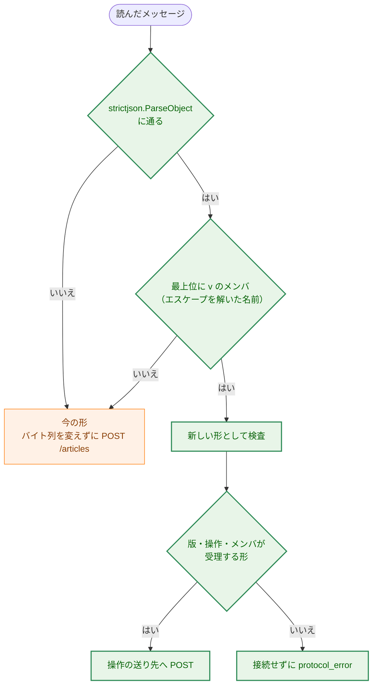

**Legend**

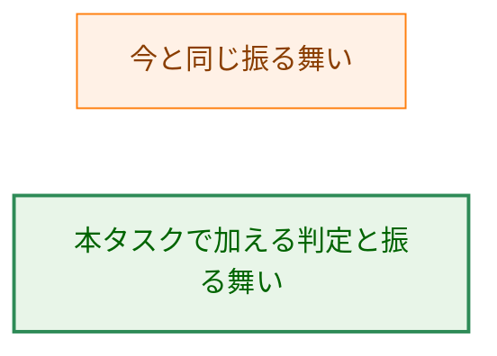

矢印は判定の順序を表す。

-   **1 つの JSON オブジェクトとして読めるか:** `strictjson.ParseObject`（正しい UTF-8、対になっていないサロゲートのエスケープを含まない、オブジェクトである、後続のデータがない）で判定する。要件書 F-008 は「正しい UTF-8、JSON として正しい、オブジェクトである、後続のデータがない」とする。`ParseObject` は、これに加えて対になっていないサロゲートのエスケープを拒否するので、そのようなメッセージも今の形として `/articles` へ中継される。サーバの `validateBody` も同じ `ParseObject` で `invalid_body` にする（`request.go:58-61`）ので、今の拡張から見た振る舞いは今と同じである。
-   **版のメンバ:** 名前は `v` とする（ホストの応答の `v`、`relay.go:41-42` と同じ名前）。`ParseObject` はメンバ名のエスケープを解いて持つ（`encoding/json` のトークンの読み取り）ので、`"v"` と書いた名前も `v` として見つかる（AC-40）。`Object.Has("v")` で有無を見る。
-   **例外の記述:**
    -   方針: 呼び出し側が渡した文字列の中身を調べて振る舞いを選ばない（CLAUDE.md「Key Design Patterns」の「Declare, don't infer」）。
    -   範囲: `internal/nmhost` の、メッセージが 1 つの JSON オブジェクトとして読めるかと、その最上位に `v` があるかで今の形と新しい形を選ぶ 1 か所だけである。新しい形の中では、操作は宣言した値（`op` の列挙）で選ぶ。今の形の中身は、最上位のメンバ名のほかは解析しない。
    -   理由: 今の拡張が送るメッセージは何も宣言しておらず、本タスクでは拡張を変えない（要件書 2.3）。今の形は「宣言がないこと」でしか区別できない（要件書 5.）。
    -   境界: `v` を持つメッセージは新しい形として厳格に検査し、合わなければ拒否する。今の形として扱い直さない。今の形と、この判定は、#503 の後に削除する（§3.14）。
    -   更新するテスト: `internal/nmhost/relay_test.go` の今の中継のテスト（`TestRelayForwardsOneRequest` など）は今の形のメッセージを送るので、期待値は変わらない。標準入力の途中の終わりを確かめる `TestRelayHostErrors` の場合は、ホストが接続しなくなるので、サーバ側でリクエストが届かないことを期待値に加える（§3.13）。

#### 3.10.3. 新しい形のメッセージ（H-08）

```json
{"v":1,"op":"start","input":{"videoUrl":"…","transcript":"…"}}
{"v":1,"op":"status","key":"…"}
{"v":1,"op":"publish","key":"…"}
```

| メンバ | 受理する形 |
|---|---|
| `v` | 整数の `1`（`strictjson.Value.AsNonNegativeInt64` で読み、1 以外は拒否） |
| `op` | 文字列で、`start`・`status`・`publish` のどれか |
| `input` | `op` が `start` のときだけ必須。JSON のオブジェクト（中身は検査しない） |
| `key` | `op` が `status` か `publish` のときだけ必須。JSON の文字列（形は検査しない） |

-   最上位は `Object.CollectOnly("v", "op", "input", "key")` で読み、宣言していないメンバと重複するメンバ（`v` の重複を含む）を拒否する（AC-40）。`op` に要らないメンバ（`status` の `input` など）がある場合、要るメンバがない場合も拒否する。拒否はすべて、接続せずに `protocol_error` である。新しいホストのエラーの値は加えない（今の 4 つの値、`relay.go:56-82`）。
-   **版の値を 1 にする理由:** 今の形は版のメンバを持たないので、新しい形は最初の版である。ホストの応答の `v`（今は 1）とは別の値で、互いに独立に上げる。
-   **操作の値と送り先:**

```go
// Package nmhost

// Operation is the operation a new-form message names. The zero value is
// OperationUnknown, which is rejected without connecting.
type Operation int

const (
	OperationUnknown Operation = iota
	OperationStart             // "start":   POST /jobs/start
	OperationStatus            // "status":  POST /jobs/status
	OperationPublish           // "publish": POST /jobs/publish
)
```

-   送り先のパスは、`Operation` ごとの固定の文字列を網羅的な `switch` で選び、`OperationUnknown` と範囲外の値は接続しない。拡張がパスやメソッドを指定する手段はない（AC-38）。
-   **サーバへ送る本文:**
    -   `start`: `input` の値の元のバイト列を、そのまま本文にする。ホストは中身を検査せず、サーバの境界（`validateBody`）に任せる（要件書 F-008）。元のバイト列を得るために、`strictjson.Value` に `Raw() []byte`（値の元のバイト列の写しを返す）を加える。`ParseObject` は値を `json.RawMessage` として元のバイト列のまま持つ（`internal/strictjson/strictjson.go:57-71`）ので、組み立て直しによる変化（メンバの並び、重複、エスケープ）は起きない。
    -   `status`・`publish`: `{"key":<key の値の元のバイト列>}` を本文にする。キーの文字列を JSON の文字列として変えずに運ぶので、サーバは拡張が送った文字列そのものを `ParseKey` で検査する（AC-40a）。ホストはキーの長さや文字の種類を見ない。
-   **ホストの応答の形（H-08）:** 新しい形のメッセージへの応答も、今と同じ `{"v":1,"kind":"response","status":…,"body":"…"}` と `{"v":1,"kind":"error","error":"…"}` である（`relay.go:84-110`）。サーバの応答の本文を base64 で包むので、ホストはサーバの応答の形を知らずに済む。

#### 3.10.4. 応答の大きさ（H-09）

| 上限 | 今 | 本設計 |
|---|---|---|
| サーバの状態の取得の応答（サーバの内部の上限） | なし | 256 KiB（`maxStatusResponseBytes`、§3.6.3） |
| ホストが中継するサーバの応答の本文（`maxResponseBytes`） | 64 KiB（`relay.go:35-36`） | 512 KiB |
| ホストの応答のフレーム（`maxFrameBytes`） | 1 MiB（`frame.go:18-21`） | 変えない |

-   512 KiB の本文を base64 にすると 699,052 バイトで、固定のメンバを加えても 1 MiB（1,048,576 バイト）のフレームに収まる。サーバの上限 256 KiB の応答は、ホストの上限の半分なので、切り詰められずに中継される（AC-41）。上限を超える応答は、今と同じく `protocol_error` である。
-   今の形の中継にも同じ上限が当てはまる。`/articles` の応答は 100 バイトに満たない（`extension/src/core/response.ts:56-57`）ので、上限を上げても今の拡張から見た振る舞いは変わらない。
-   拡張の応答の上限（`response.ts:57` の 1,024 バイト）は `/articles` の応答のためのもので、新しい形の応答の上限は #503 で決める。
-   **新しい形のメッセージの上限:** 今と同じ 32 MiB とする。形を判定する前に全体を読む必要があるので、新しい形だけに小さい上限を当てることはできない（判定の後に当てても、読み込みの量は減らない）。生成の開始の入力はサーバの 4 MiB の上限で拒否される。

### 3.11. コード（F-005・AC-29〜AC-31、H-07）

コードの綴りは小文字の英語の `snake_case` とし、Go の列挙から網羅的な `switch` で選ぶ。各表は README に同じ値で載せ、ガードのテストが一致を確かめる（§3.15）。

#### 3.11.1. ジョブの状態と工程

| 要件書の値 | コード | Go の値 |
|---|---|---|
| 処理中 | `running` | `JobRunning` |
| 完了 | `done` | `JobDone` |
| 失敗 | `failed` | `JobFailed` |
| 不明 | `unknown` | `JobUnknown`（零値） |

| 工程 | `steps` のメンバ名 | `writer.Stage` |
|---|---|---|
| 下書き | `draft` | `StageGeneration` |
| 本文の短縮 | `shorten` | `StageShorten` |
| 検証・推敲 | `review` | `StageReview` |

#### 3.11.2. 工程の状態

| 要件書の値 | コード | Go の値 |
|---|---|---|
| 未着手 | `pending` | `StepPending`（零値） |
| 実行中 | `running` | `StepRunning` |
| 完了 | `done` | `StepDone` |
| 省略 | `skipped` | `StepSkipped` |
| （失敗した工程） | `failed` | `StepFailed` |

-   **失敗した工程の示し方（H-07）:** 要件書の 4 つの値に `failed` を加える。`実行中` のまま止まった形で示すと、ポーリングしている Viewer は、ジョブの状態を見ないかぎり、まだ実行中なのか失敗したのかを区別できないためである。`failed` は、ジョブの状態が `failed` のときだけ、高々 1 つの工程に現れる。完了の時点の検査の失敗（`article_invalid`・`article_too_large`）と、工程の外の失敗（字幕の取得の失敗）では、どの工程も `failed` にならない。

#### 3.11.3. 生成の失敗の理由

`classifyWrite`（`job.go:138-155`）が返す `failure.Kind` を、次の表で写す。

| 要件書の分類 | コード | `failure.Kind`（`internal/failure/failure.go:14-28`） | Go の値 |
|---|---|---|---|
| コピーした字幕が長すぎる | `transcript_too_long` | `KindTranscriptTooLong` | `FailureTranscriptTooLong` |
| LLM の時間切れ | `llm_timeout` | `KindLLMTimeout` | `FailureLLMTimeout` |
| LLM の空の応答 | `llm_empty` | `KindLLMEmpty` | `FailureLLMEmpty` |
| LLM の打ち切り | `llm_truncated` | `KindLLMTruncated` | `FailureLLMTruncated` |
| その他の LLM の失敗 | `llm_failed` | `KindLLM` | `FailureLLM` |
| 公開できない記事 | `article_invalid` | （完了の時点の検査、§3.6.3） | `FailureArticleInvalid` |
| 応答に収まらない記事 | `article_too_large` | （完了の時点の検査、§3.6.3） | `FailureArticleTooLarge` |
| 内部の失敗 | `internal` | `KindInternal`・`KindUnknown`・その他すべて | `FailureInternal`（零値） |

-   写しの `switch` の `default` は `FailureInternal` である。`classifyWrite` が将来新しい `Kind` を返しても、誤った分類ではなく内部の失敗になる。

#### 3.11.4. 投稿の状態とその理由

| 要件書の値 | コード | Go の値 |
|---|---|---|
| 未投稿 | `not_posted` | `PostNotPosted` |
| 投稿中 | `posting` | `PostPosting` |
| 投稿済み | `posted` | `PostPosted` |
| 投稿の失敗 | `failed` | `PostFailed` |
| 投稿できない | `unpostable` | `PostUnpostable`（零値） |

| 投稿の状態 | 理由のコード | 意味 | Go の値 |
|---|---|---|---|
| `unpostable` | `mention` | メンションとして扱われうる文字列を含む（`publisher.ErrSlackMention`） | `UnpostableMention` |
| `unpostable` | `other` | それ以外の送る前の検査で拒否される（分割できない本文など） | `UnpostableOther`（零値） |
| `failed` | `webhook` | Webhook への送信の失敗（`*publisher.SlackPostError`） | `PostFailureWebhook` |
| `failed` | `internal` | 投稿のジョブの異常終了 | `PostFailureInternal`（零値） |

-   **`投稿できない` の理由の粒度（H-07）:** `mention` と `other` の 2 つにする。今の送る前の検査の拒否は、メンションの拒否（`ErrSlackMention`）と分割の拒否（`ErrSlackUnsplittable`）と本文の UTF-8（`ErrInvalidArticle`、`slack_message.go:30-34`）である。本文の UTF-8 は `writer` の出力の検査で保証され、メンションのほかは利用者が直せる手段がない点で同じなので、分けない。#506 で表示を分ける必要が出たら、コードを加える。
-   **零値（要件書 4.5）:** 投稿の状態の零値は `unpostable` である。設定されなかった投稿の状態は、投稿を起こさず（投稿の操作は拒否される）、投稿済みとも主張しない。

#### 3.11.5. 拒否の理由と HTTP の状態コード

| 理由 | 状態コード | 使う操作 | 意味 |
|---|---|---|---|
| `job_not_ready` | 409 | 投稿の操作 | 記事の生成がまだ完了していない |
| `article_not_found` | 404 | 投稿の操作 | 投稿できる記事がない（失敗、または不明のキー） |
| `article_not_postable` | 409 | 投稿の操作 | この記事は投稿できない（`unpostable`） |
| `webhook_not_configured` | 503 | 投稿の操作、`/articles` | Webhook が設定されていない |
| `invalid_key` | 400 | 状態の取得、投稿の操作 | キーが受理する形でない |

-   既存の理由（`response.go:19-31`）の値と状態コードは変えない。新しい API は、そのうち `not_found`・`method_not_allowed`・`too_many_requests`・`body_too_large`・`invalid_body`・`invalid_video_url`・`invalid_transcript`・`internal_error` を、今と同じ意味で使う。
-   **キーの形の拒否を新しい理由にする理由（H-07）:** `invalid_body` は本文が JSON として読めないことを表す。キーの形の誤りは、拡張がキーを保存し損ねた（または古い版のキーを持っている）ことを表し、拡張の表示も違う。
-   **状態コードの理由:** `job_not_ready` と `article_not_postable` は、記録の今の状態と操作が合わないので 409 にする。`article_not_found` は記録がない（または記事を持たない）ので 404 にする。`not_found`（パスの誤り）と同じ 404 だが、`reason` で区別できる。`webhook_not_configured` は、サーバの設定のために操作を行えないので 503 にする。
-   `rejectReason` の零値は今と同じ `reasonInternal`（500）である。`forceClose`（`response.go:87-101`）は、本文を読まずに拒否する新しい場合（`webhook_not_configured`）で真にする。

### 3.12. ログ（要件書 4.2、H-10）

-   新しい操作のログも、今の方針（0011 の設計 §3.10）に従う。1 つの出来事を 1 行で、固定の属性だけを出し、`redact.Writer` を通す。本文、コピーした字幕、`videoUrl` の文字列、メタデータ、記事の本文、秘密の値を出さない。
-   **キーをログに出す（H-10）:** 属性 `key` に、サーバが計算したキー（生成の開始）と、`ParseKey` を通ったキー（状態の取得と投稿の操作）の 64 文字を出す。受理する形でないキーは、ログにも応答にも出さない。キーは字幕とメタデータの SHA-256 で、中身を復元できない。同じ入力を送ったことの照合はできるが、ログを読めるのはサーバと同じ利用者だけで、その利用者は入力そのものを持っている。開発者が、受け付けから生成のジョブの完了と投稿までを `grep <key>` でたどれるようにするためである。
-   出す行と属性:

| 出来事 | 属性 |
|---|---|
| 生成の開始の受け付け | `requestId`、`key`、`videoId`、`outcome`（`started`・`existing`） |
| 生成のジョブの完了 | `key`、`videoId`、`model`、`modelVersion`、`duration`、`publish`（投稿の初期状態のコード） |
| 生成のジョブの失敗 | `key`、`videoId`、`failure`（失敗の理由のコード）、`step`（失敗した工程）、`error`（今の `logJobFailure` と同じく、秘密と字幕を含まないエラー） |
| 投稿の操作の受け付け | `requestId`、`key`、`outcome`（`started`・`already`）、`from` |
| 投稿のジョブの完了・失敗 | `key`、`posted`、`total`、（失敗なら）`reason`、`error` |
| 拒否 | 今の `reject` と同じ（`requestId`・`status`・`reason`・`detail`、`handler.go:102-113`） |
| 状態の取得 | 出さない（ポーリングで数秒ごとに来るため） |

### 3.13. 既存の設計からの変更と、更新するテスト

| 変わる振る舞い | 元の方針の場所 | 理由 | 更新する既存のテスト |
|---|---|---|---|
| サーバの `SLACK_WEBHOOK_URL` を任意にする | `docs/dev/project_overview.md:148`、0011 の設計 §3.2.1 | 親 issue #501 の決定（要件書 F-006） | `internal/config/config_test.go` の `TestLoadServerWebhookRequired`（未設定のサブテストを「エラーにならない」に変え、空と不正な値のサブテストは残す）、`cmd/yt2column-server/run_test.go` の `TestStartupFailures` の `model and webhook missing`（設定のエラーの行数）、`publisher not built`・`notifier not built`（Webhook がある場合だけの組み立て）、`TestBuildsSlackPublisher` |
| 生成の開始は、生成の枠の前に本文を読む | 0011 の設計 §3.8.2 | キーが分かるまで本文を読む必要がある（要件書 5.） | なし（旧 API の順序は変えない、§3.4.2） |
| 新しい API の失敗を Webhook へ通知しない | 0011 の要件 F-007 | Viewer が失敗を表示する（#501） | なし（旧 API の通知は変えない） |
| ホストはメッセージを解析し、操作を送り先に対応づける | 0026 の設計 §9、§3.5.2（流し込み） | 要件書 F-008 | `internal/nmhost/relay_test.go` の `TestRelayResponseOverLimit`（上限 64 KiB → 512 KiB）、`TestRelayHostErrors` の標準入力の途中の終わり（接続しなくなる） |
| ホストの応答の上限を上げる | 0026 の設計 §3.5.4・§3.5.5 | 完了した記事の応答を中継する（§3.10.4） | `TestRelayResponseOverLimit`、`frame.go` の注釈（最大の応答の見積もり） |
| `server.Options` の形 | 0011 の設計 §3.5.1 | Webhook を任意にする（§3.8） | `internal/server/test_helpers.go:57`・`:74`、`server_test.go:31`、`job_test.go:297` の `New(Options{…})`（Webhook を `WebhookOptions` に移す） |
| 拒否の理由が増える | 0011 の設計 §3.4.3 | §3.11.5 | `internal/server/response_test.go` の `TestRejectReasonSet` と `handler_test.go` の `TestRejectStatusCodes`（`reasonCount` で数えるので新しい理由を加える）、`handler_test.go` の `TestRejectHeaders`（`/jobs/…` が `not_found` でなくなる場合があれば） |
| `writer.New` の戻り値の型 | 0004 の設計 | §3.5 | `internal/writer/testutil` の `FakeArticleWriter`（`WriteWithProgress` を加える）。比較のテスト（`TestWriterOptionsMatchCLIDefaults`）は変わらない |
| 表示用の Markdown がチャンネル名の行の書式を共有する | `docs/dev/project_overview.md:60` | §3.6.2 | なし |

### 3.14. 旧 API の削除と簡素化の項目（H-12）

`03_implementation_plan.md` の最初の手順で、次の一覧を本文に書いた issue を起票する。issue は #501 の子とし、#503 にブロックされることを記す。

**#503 の後に削除するもの（旧 API だけが使うもの）:**

1.  `internal/server` の `/articles` の受け口: `ArticlesPath`、`handler` の旧 API の分岐、`readRequest` を生成の枠の後に呼ぶ順序、旧 API のジョブ（`startJob`・`runJob`、`pipeline` の使用）、`notify`・`notifyAsync`・`notifyTimeout`、`reasonToKind`、`rejectReason.notify`、`classify` のうち `StagePublish`・`StageTranscript` の分岐、`logJobFailure` の `SlackPostError` の属性。
2.  `server.WebhookOptions` の `Publisher` と `Notifier`。
3.  `internal/failure`（`Kind`・`Notice`・`Notifier`）と `internal/failure/testutil`。`classifyWrite` は `failure.Kind` を経ずに `articlecache.FailureReason` を直接返す形にする。
4.  `internal/publisher` の `SlackFailureNotifier`（`slack_failure.go`）と、それだけが使う `ErrSlackInvalidNotice`・`ErrSlackNoticeRejected`。
5.  `cmd/yt2column-server` の `deps.newNotifier` と `newNotifier`。
6.  `internal/nmhost` の今の形の中継: 今の形と新しい形の判定（CLAUDE.md の例外）、`requestURL`（`/articles`）、`Expect: 100-continue` で送る今の形の送り方。削除の後、`v` を持たないメッセージは `protocol_error` にする。CLAUDE.md の「Declare, don't infer」の例外の記述も取り除く。
7.  README の `/articles` の節（curl の例、拒否の理由の表の `/articles` だけの説明、「extension shows」の列の今の拡張のための値）、`docs/dev/security.md` §8.1・§8.2 の `/articles` の記述、`docs/dev/project_overview.md` の `/articles` の記述。
8.  `cmd/yt2column-server/docs_test.go` の `curl` と `server.ArticlesPath` のガード（新しい API の curl の例のガードに置き換える）。

**#503 の後に簡素化するもの（新旧の両対応のために複雑になったもの）:**

1.  生成の枠の合算: 生成の枠は新しい API の生成のジョブだけが使うので、`slots` の説明と、生成の枠を持つ主体（リクエスト・ジョブ・失敗の通知）の区別をなくす。
2.  `webhook_not_configured` の `/articles` での使い方と、それを `forceClose` で扱う分岐。
3.  `SlackWebhookPublisher.Publish` を CLI だけが使うことの確認（`--slack` は残るので、`Publish` は残す）。
4.  `jobInput` の `source` と `requestID` のうち、旧 API のジョブだけが使うもの。
5.  ホストの、接続の前にメッセージ全体を読む手順の説明（今の形の流し込みとの対比が要らなくなる）。

### 3.15. 文書とガード（F-009・AC-29・AC-42・AC-43）

-   **README の「Localhost server」節:** 3 つの操作（パス、本文、応答の形）、§3.11 のコードの表、記事のキャッシュの性質（メモリだけ、件数の上限 100、古いものからの破棄、再起動で記事と投稿の状態が失われること）、`投稿できない` の記事は再起動するか記録が捨てられた後に生成し直すまで投稿できないこと、キーは不透明な値で形や計算方法に依存してはならないこと、`/articles` を #503 の後に削除する予定であること、を加える。curl の例に新しい API を加える。
-   **README の拒否の理由の表:** §3.11.5 の 5 つの行を加える。3 列目（extension shows）は `unexpected reply` とする。今の拡張は新しい理由を知らないので、`fixed message` にしない（`extension/test/serverReasons.test.ts:36` は 3 列目が `fixed message` で始まる行だけを拡張の値と突き合わせる）。AC-42 の Go のガード（`cmd/yt2column-server/docs_test.go:81-107`）は、`RejectReasonsForTest` が新しい理由を返すので、表の行の追加を求める。
-   **コードの表のガード（AC-29）:** `internal/server` に `-tags test` の関数（`StatusCodesForTest`）を加え、§3.11 の 5 つの表のコードの集合を返す。`cmd/yt2column-server/docs_test.go` に、README のそれぞれの表の 1 列目の集合が、返した集合と過不足なく一致することを確かめるサブテストを加える。今の拒否の理由の表のガードと同じ種類の確認（値の一致）で、文言は確かめない（CLAUDE.md「Document tests」）。
-   **README の設定の表と本文:** `yt2column-server` が `SLACK_WEBHOOK_URL` を任意とすること、未設定では投稿の操作と `/articles` が `webhook_not_configured` で拒否され、今の拡張の送信が「想定外の応答」になることを書く。
-   **`docs/dev/security.md` §8:** §8.1 の「202 の後に結果を返す API がない」を、新しい API の状態の取得で結果を返すことに改める。§8.2 の残るリスク（再送による二重の生成と投稿）を、新しい API と旧 API に分けて書き直す（要件書 4.2「二重の投稿の防止」）。キャッシュがメモリに持つ値（記事を持ち、字幕を持たない）、ホストが操作の値を固定の送り先に対応づけ、キーをパスに入れないこと、返す記事が untrusted なテキストであること、を加える。§8.2 の枠の数（`2`）と本文の上限（4 MiB）のガード（`docs_test.go` の `security.md` のサブテスト）は値を変えないので、そのまま通る。
-   **`docs/dev/project_overview.md`:** 要件書 5. の 3 か所（実行形式、`LoadServer` の段落、キャッシュの段落）を更新する。
-   **`docs/translation_glossary.md`:** 記事のキー、記事のキャッシュ、記録、ジョブの状態、工程、工程の状態、投稿の状態、生成の枠、読み込みの枠、完了の時点の検査を加える。「枠」の今の行（`translation_glossary.md:55`）は、旧 API と新しい API の生成のジョブが合わせて数えることを書き加える。
-   **`docs/dev/developer_guide/package_reference.md`:** `internal/articlecache` の行を加え、`internal/server`・`internal/writer`・`internal/publisher`・`internal/config`・`internal/nmhost`・`internal/strictjson`・`cmd/yt2column-server` の行を更新する。
-   **AC-43:** 上の文書の記述は、PR のレビューで読む（`manual`）。

### 3.16. design_handoff の各項目への対応

| 項目 | 本設計の対応 |
|---|---|
| H-01 パス・メソッド・形 | 3 つの固定のパス、すべて `POST`、キーは本文で運ぶ。照合は今と同じ完全一致（§3.1） |
| H-02 キーの符号化とハッシュ | 領域の文字列と長さを前に置く符号化、SHA-256、小文字の 16 進の 64 文字（§3.2） |
| H-03 工程の進み具合 | `writer.ProgressWriter` と `ProgressObserver`（§3.5、1.3 の決定） |
| H-04 同時実行の上限 | 生成の枠は 2 のまま新旧で合算、読み込みの枠は 2、投稿のジョブは数えない（§3.4・§3.7、1.3 の決定） |
| H-05 表示用の Markdown | `renderDisplayMarkdown` を別の関数で書き、`escapeLeadingMarkdown` だけを共有する（例外の記述は §3.6.2） |
| H-06 キャッシュの件数の上限 | 100 件。記録の大きさの見積もりとメモリの量は §3.3.4 |
| H-07 コードの綴り・理由・状態コード | §3.11。失敗した工程は `failed`、キーの形の拒否は `invalid_key`、各列挙の零値も §3.11 |
| H-08 ホストのメッセージの新しい形 | `v`・`op`・`input`・`key`、全体を読んでから判定、応答の形は変えない（§3.10） |
| H-09 応答の大きさの上限 | サーバの状態の取得の応答 256 KiB、ホストの応答の上限 512 KiB、新しい形のメッセージの上限は 32 MiB のまま（§3.6.3・§3.10.4、1.3 の決定） |
| H-10 キーをログに出すか | 出す。受理する形を通ったキーだけ（§3.12） |
| H-11 シャットダウンと投稿のジョブ | 取り消さずに待つ。1 回の投稿は最長 309 秒で、別の上限を設けない（§3.7.2） |
| H-12 旧 API に関わるリファクタリング | §3.14 の一覧を、実装計画の最初の手順で issue に起票する |
| H-13 テストの組み立て | §7 |

### 3.17. コンポーネント責務表

| ファイル | 新規・変更 | 責務 |
|---|---|---|
| `internal/articlecache/key.go` | 新規 | `KeyInput`・`Key`・`NewKey`・`ParseKey`・`ErrInvalidKey` |
| `internal/articlecache/cache.go` | 新規 | `Cache`・`Options`・`New`・`Begin`・`Lookup`・`BeginPublish`、件数の上限と破棄 |
| `internal/articlecache/record.go` | 新規 | 状態の列挙、`Steps`・`Snapshot`、`Run`・`PostRun` の遷移 |
| `internal/server/handler.go` | 変更 | 4 つのパスへの振り分け、旧 API の Webhook 未設定の拒否 |
| `internal/server/jobs_api.go` | 新規 | 生成の開始・状態の取得・投稿の操作の受け口、読み込みの枠、キーの本文の検査 |
| `internal/server/generation.go` | 新規 | 生成のジョブ、完了の時点の検査、失敗の理由の写し |
| `internal/server/publish.go` | 新規 | 投稿のジョブ、`MessagePoster` |
| `internal/server/status.go` | 新規 | 状態の取得の応答の組み立て、コードの選択、応答の大きさの上限 |
| `internal/server/request.go` | 変更 | `jobInput` に検査を通った値（キーの入力）を加える |
| `internal/server/response.go` | 変更 | 新しい拒否の理由、`forceClose` |
| `internal/server/server.go` | 変更 | `Options`・`WebhookOptions`、`Cache` と読み込みの枠の保持 |
| `internal/server/job.go` | 変更 | なし（`classifyWrite` を生成のジョブからも呼ぶ） |
| `internal/server/test_helpers.go` | 変更 | キャッシュの上限と時計を渡す組み立て、`StatusCodesForTest` |
| `internal/writer/writer.go` | 変更 | `ProgressObserver`・`ProgressWriter`、`New` の戻り値、`WriteWithProgress` と通知 |
| `internal/writer/testutil/mocks.go` | 変更 | `FakeArticleWriter.WriteWithProgress` と工程ごとに止める仕組み |
| `internal/publisher/display_render.go` | 新規 | `renderDisplayMarkdown`・`DisplayMarkdown` |
| `internal/publisher/file_render.go`・`file.go` | 変更 | `FileContent` |
| `internal/publisher/slack.go` | 変更 | `PostMessages`、`Publish` をその上に置き直す |
| `internal/publisher/slack_message.go` | 変更 | `SlackMessages` |
| `internal/publisher/format.go` | 変更 | `ArticleCost` |
| `internal/publisher/test_helpers_slack.go` | 変更 | `SlackMessagesForTest` を `SlackMessages` を呼ぶ形にする |
| `internal/config/config.go` | 変更 | `LoadServer` の Webhook の任意化、`ServerConfig.WebhookURL` |
| `cmd/yt2column-server/run.go` | 変更 | Webhook の有無に応じた組み立て、`deps.newPublisher` の型、起動のログ |
| `internal/nmhost/relay.go` | 変更 | 全体の読み込み、形の判定、`Operation`、送り先と本文、応答の上限 |
| `internal/nmhost/frame.go` | 変更 | 注釈（最大の応答の見積もり） |
| `internal/strictjson/strictjson.go` | 変更 | `Value.Raw` |
| `cmd/yt2column-server/docs_test.go` | 変更 | コードの表のガード、新しい API の curl の例のガード |
| `README.md`・`docs/dev/security.md`・`docs/dev/project_overview.md`・`docs/translation_glossary.md`・`docs/dev/developer_guide/package_reference.md` | 変更 | §3.15 |

## 4. エラーハンドリング設計 (Error Handling Design)

### 4.1. エラー型

```go
// Package articlecache

// ErrInvalidKey is wrapped by ParseKey. It never holds the rejected string.
var ErrInvalidKey = errors.New("invalid article key")

// ErrInvalidOptions is wrapped by New for a non-positive Capacity.
var ErrInvalidOptions = errors.New("invalid article cache options")
```

```go
// Package server

// ErrInvalidOptions (existing) is also wrapped when Webhook is non-nil and one
// of its fields is nil.
var errNilPoster = errors.New("poster is nil")
```

-   新しい API の失敗は、Go のエラーとして呼び出し側へ返さず、記録の列挙（`FailureReason`・`PostFailureReason`）と拒否の理由として表す。生成のジョブと投稿のジョブは、エラーをログの 1 行にだけ書く。
-   失敗の理由は、`classifyWrite` と `errors.Is`/`errors.AsType` で選び、エラーの文言から推し量らない（CLAUDE.md「Error Testing」と同じ方針）。投稿の失敗は `errors.AsType[*publisher.SlackPostError]` で `webhook` にし、それ以外は `internal` にする。

### 4.2. エラーメッセージの設計パターン

-   応答はコードだけを返し、文言を返さない（AC-31）。エラーの文言はログにだけ出し、今と同じく秘密と字幕を含まない（`writer`・`publisher` のエラーは値を含まない約束、`writer/article.go:10-12`、`publisher/slack.go:36-48`）。
-   `ParseKey` のエラーは受け取った文字列を含まない。受理する形でないキーはログにも出さない（§3.12）。

### 4.3. 副作用の契約

| 操作 | 起こしうる副作用 | 起こさない副作用 |
|---|---|---|
| 生成の開始 | 記録の作成・やり直し、1 件の破棄、LLM の呼び出し（生成のジョブ） | Webhook への送信、失敗の通知、ディスクへの書き込み |
| 状態の取得 | なし | 記録の変更、LLM の呼び出し、Webhook への送信（AC-17） |
| 投稿の操作 | 投稿の状態の変更、Webhook への送信（投稿のジョブ） | LLM の呼び出し、失敗の通知、記事の変更 |
| 旧 API（Webhook あり） | 今と同じ（LLM、Webhook への投稿、失敗の通知） | 記録の変更 |
| 旧 API・投稿の操作（Webhook なし） | なし（拒否だけ） | ジョブの開始、Webhook への送信 |
| ホストの新しい形の拒否 | なし（応答だけ） | サーバへの接続 |

-   `SLACK_WEBHOOK_URL` の有無は、Webhook への送信と失敗の通知だけを止める。生成の開始・状態の取得・完了の時点の検査（`投稿できない` の判定を含む）は、Webhook の有無で変わらない（AC-34）。

## 5. セキュリティ考慮事項 (Security Considerations)

本タスクは、ネットワークへの送信（LLM API・Webhook）、Webhook の URL、プロンプトに埋め込む untrusted なテキストを扱うので、`docs/dev/security.md` を適用する（要件書 4.2）。

### 5.1. 脅威モデル

矢印 A → B は「A から B へデータが流れる」ことを表す。破線の囲みは信頼の境界である。

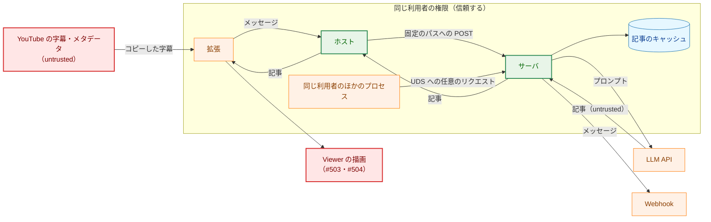

**Legend**

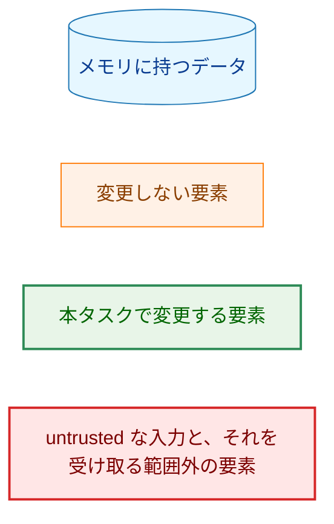

### 5.2. 脅威と対策

| ID | 脅威 | 対策 |
|---|---|---|
| T-01 | 同じ入力の再送や応答の取りこぼしで、記事が 2 回生成・投稿される | キーによる重複の排除（§3.3）、投稿の操作の冪等性（`PublishAlready`）、届いたメッセージの記録による再開（§3.7.2）。残るリスクは §5.4 |
| T-02 | 拡張から受け取ったキーで、ホストが別の操作やパスへ送ってしまう（パスの注入） | キーをパスに入れず、本文の JSON 文字列で運ぶ。送り先は `Operation` ごとの固定の文字列（§3.1.1・§3.10.3） |
| T-03 | 今の形と新しい形の取り違えで、新しい形のつもりのメッセージが `/articles` で記事を生成・投稿する | `v` を持つメッセージは新しい形として厳格に検査し、今の形に戻さない（§3.10.2）。読めないメッセージは今の形として送るが、サーバが `invalid_body` で拒否する |
| T-04 | 大きな本文や多数のリクエストで、メモリや LLM の呼び出しが際限なく増える | 読み込みの枠（2）、生成の枠（2）、キャッシュの件数の上限（100）、状態の取得の応答の上限（256 KiB）、キーの本文の上限（1 KiB）（§3.3.4・§3.4・§3.6.3） |
| T-05 | 応答やログに、字幕・URL・秘密・エラーの文言が漏れる | 応答はコード・キー・数値と完了した記事だけ（§3.1.3）、ログは固定の属性と `redact.Writer`（§3.12）、受理しないキーは出さない |
| T-06 | プロンプトインジェクションで操作された記事が、利用者の画面や Webhook に届く | 完了の時点の検査（公開できるか、送る前の検査）を今の投稿と同じにする（§3.6.3）。表示の安全性は #503・#504 |
| T-07 | 同じ利用者のほかのプロセスが、キーを知って投稿を求める | 信頼の境界は今と同じ（そのプロセスは今も `/articles` で投稿を求められる、要件書 4.2）。UDS の権限（`0700`・`0600`）は変えない |
| T-08 | 字幕がメモリに残り続ける | 生成のジョブの間だけ持ち、記録には記事だけを渡す（§3.4.4、AC-27）。ディスクに書かない |

### 5.3. 信頼できない入力の境界

| 境界 | 受理する形 | 上限 | 拒否 | 設計の箇所 |
|---|---|---|---|---|
| 生成の開始の本文 | 今の `/articles` と同じ（`validateBody`） | 4 MiB | 今と同じ理由。キャッシュに何も加えない | §3.4.1 |
| 状態の取得と投稿の操作の本文 | `ParseObject` に通る 1 つのオブジェクトで、メンバは `key` だけ（重複・宣言していないメンバを拒否）。`key` は文字列 | 1 KiB | `body_too_large`・`invalid_body` | §3.1.2 |
| キー | 小文字の 16 進の 64 文字だけ。補正しない | 64 文字 | `invalid_key`。キャッシュを変えない | §3.2 |
| リクエストのターゲット | 4 つの固定の文字列との完全一致。クエリを含むものは一致しない | `http.Server` の `MaxHeaderBytes`（64 KiB） | `not_found`・`method_not_allowed` | §3.1.1 |
| ホストの新しい形のメッセージ | `ParseObject` に通り、`v`・`op`・`input`・`key` だけを持ち（重複・宣言していないメンバを拒否）、`v` は 1、`op` は 3 つのどれか、操作に要るメンバだけがある | 32 MiB | 接続せずに `protocol_error` | §3.10.3 |
| ホストの今の形のメッセージ | `v` を持たないオブジェクトと、オブジェクトとして読めないもの。中身は解析しない | 32 MiB | サーバの検査が境界 | §3.10.2 |
| LLM が生成した記事 | `writer` の今の検査、`CheckPublishable`、応答の大きさ、送る前の検査 | 状態の取得の応答で 256 KiB | 生成の失敗または `投稿できない` | §3.6.3 |

-   要件書 1. の「Bytes」「Top level」の観点は、本文の検査をすべて `strictjson.ParseObject` に任せることで満たす（不正な UTF-8、対になっていないサロゲートのエスケープ、後続のデータを拒否）。数値は、ホストの `v` だけが読み、`AsNonNegativeInt64` で整数として読む（`-0`・小数・指数・範囲外を拒否）。

### 5.4. 残余のリスク

-   **分割した投稿の 1 通の重複:** 送信の失敗のときに実は届いていたメッセージは、やり直しで重複する（要件書 1. の決定）。
-   **再起動と破棄の後の重複:** 再起動の後と、記録が捨てられた後に同じ入力で生成し直して投稿すると、前に届いたメッセージが重複しうる（要件書 4.3・F-004）。
-   **シャットダウンでの強制終了:** 2 回目のシグナルで、投稿のジョブの途中で終わると、最後に送ったメッセージが届いたかどうかが分からないまま記録が失われる（要件書 4.3）。
-   **旧 API の経路:** `/articles` の再送による二重の生成と投稿は、#503 の後に削除するまで残る（`security.md` §8.2）。
-   **キーの照合:** ログのキーから、同じ入力を 2 回送ったことが分かる。ログを読めるのは同じ利用者だけである（§3.12）。

### 5.5. 対象クライアント環境の検証

-   新しい API が Webhook へ送るメッセージは、今の `/articles` の投稿と同じ内容・同じ送り方（`silent`、分割、間隔、時間の上限）である（§3.7.1）。Slack の新しい機能を使わないので、Mattermost での追加の検証は要らない。届いたメッセージの判定（`200` と `ok`）も今と同じである。

## 6. 処理フロー詳細 (Processing Flow Details)

### 6.1. 生成の開始

矢印は処理の順序を表す。

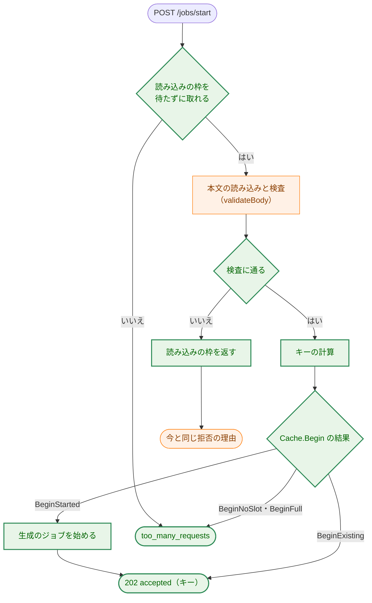

**Legend**

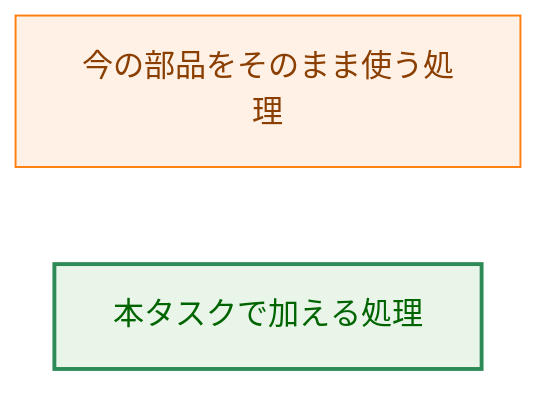

-   図を簡単にするため、読み込みの枠を返す箇所は検査の失敗の側だけに描いた。検査に通った場合も、キーの計算の前に返す。

### 6.2. 生成のジョブ

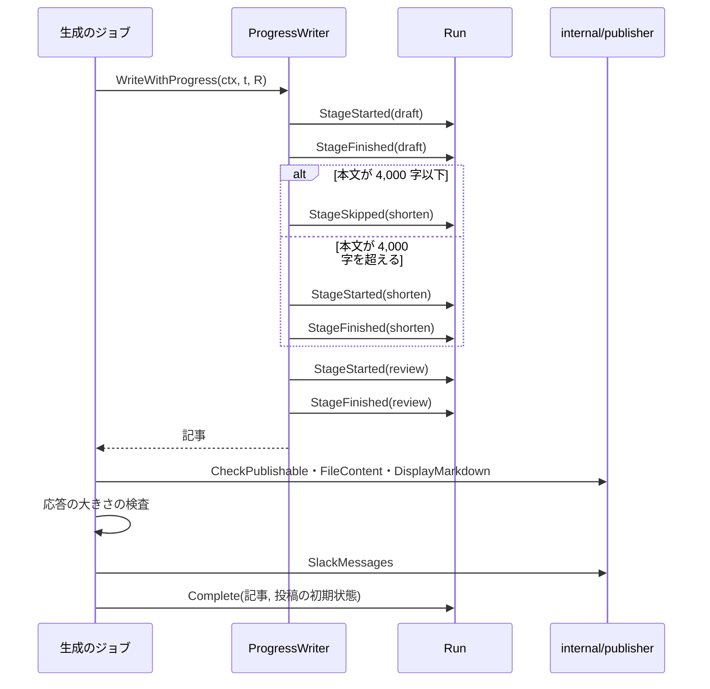

矢印は呼び出しを表す。`WriteWithProgress` か完了の時点の検査が失敗したときは、その時点で `Run.Fail` を呼んで終わる。

### 6.3. ホストの中継

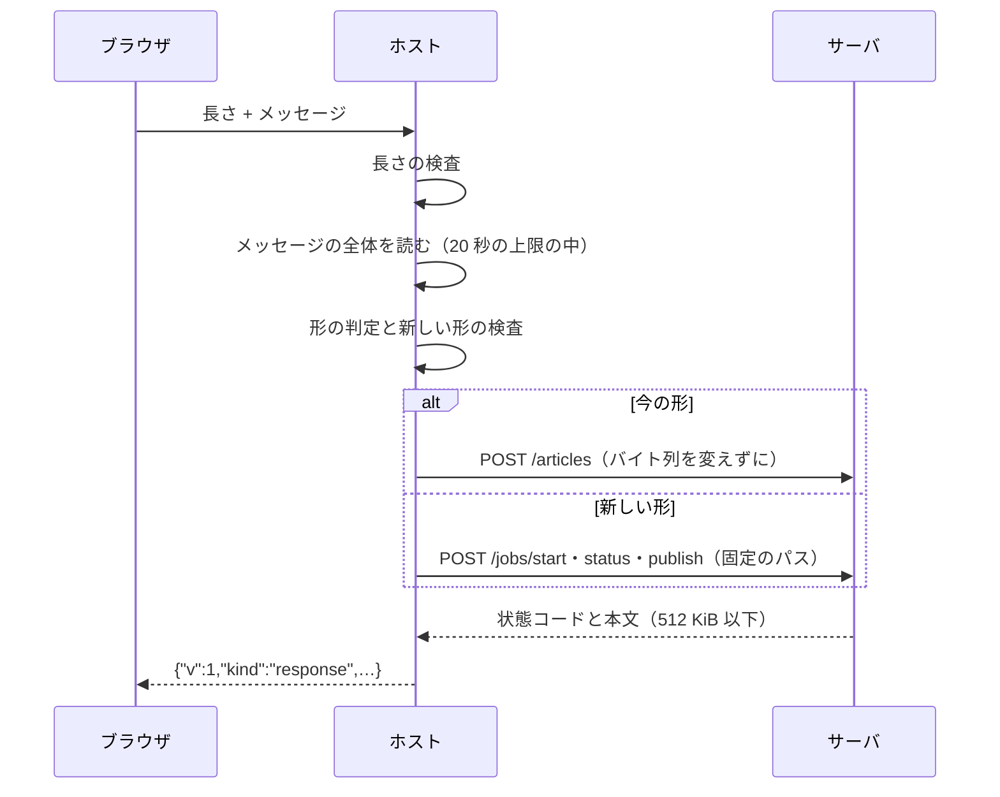

矢印はメッセージとリクエストの流れを表す。新しい形の検査に失敗したとき、接続に失敗したとき、時間の上限を過ぎたときは、ホストの固定のエラーを返す（§3.10.1）。

### 6.4. シャットダウン

-   シグナルを受けたら、今と同じく接続の受け付けをやめ、ソケットを消し、ハンドラの終わりを待つ（`server.go:157-169`）。
-   その後、`s.jobs` で、旧 API のジョブと失敗の通知、生成のジョブ、投稿のジョブのすべてを、取り消さずに待つ（AC-46）。ログの `pending` の数（`server.go:175`）は、今は使っている生成の枠の数であり、投稿のジョブを数えない。投稿のジョブの数も出すために、`pending` を「生成の枠の数」と「投稿のジョブの数」の 2 つの属性に分ける。
-   2 回目のシグナルで、すぐに終わる（今と同じ、`internal/signalrun`）。

## 7. テスト戦略 (Test Strategy)

### 7.1. ユニットテスト（H-13）

-   **`internal/articlecache`:** 時計を差し替え、上限を小さくした `Cache` で、遷移の表（§3.3.1）の各矢印、`Begin` の 4 つの結果、破棄の順序と対象（`投稿中` と `処理中` を捨てない）、`BeginPublish` の 5 つの結果、`Delivered` と `From` の関係、ハンドルの不変条件（同じキーで 2 つ目の `Run`・`PostRun` が作られない）を確かめる。並行の `Begin` を `-race` で走らせ、`acquire` が 1 回だけ呼ばれることを確かめる。キーは、AC-03〜AC-05 の入力の組と、`ParseKey` の拒否の表（短すぎる、長すぎる、大文字、空白、16 進でない文字）で確かめる。
-   **`internal/writer`:** fake の `LLMClient` で、工程の通知の順序（AC-10）、短縮の省略と実行の境目（4,000 字ちょうどと 4,001 字、AC-11）、失敗した工程の後に `StageFinished` が来ないこと、`Write` が通知なしで同じ記事を返すことを確かめる。
-   **`internal/publisher`:** `FileContent` が `FilePublisher` の書いたファイルとバイト単位で同じであること（AC-12、`golden_test.go` の入力を使う）、`DisplayMarkdown` の並び、`PostMessages` の再開（k = 1 と 1 < k、AC-21）と `delivered` の呼び出し、`Publish` の今のテストがそのまま通ること。
-   **`internal/server`:** 次の部品でテストを組み立てる。
    -   工程ごとに止められる fake の `ProgressWriter`（`FakeArticleWriter` に、工程の通知の後で待つチャネルを持たせる）。AC-10・AC-45。
    -   応答を止めておける fake の Webhook（`httptest.Server` のハンドラがチャネルを待つ）と、`n` 通目で失敗させる Webhook。AC-18〜AC-21。
    -   差し替えられる時計と小さいキャッシュの上限（`test_helpers.go` の組み立て）。AC-14・AC-25・AC-26・AC-26a。
    -   再起動は、新しい `Server` の値を作ることで表す。AC-15・AC-28。
    -   コピーした字幕にだけ現れる目印の文字列を入れ、生成の後に `Cache` の記録（`Snapshot` と、`-tags test` で記録の全体を文字列にしたもの）に目印がないことを確かめる。AC-27。
    -   fake のエラーの文言と秘密の値に目印を入れ、すべての新しい API の応答に目印がないことを確かめる。AC-31。
    -   今の `/articles` のテストの入力と期待値（`request_test.go` の表）を、生成の開始にもかけ、拒否の理由が同じであることを確かめる。AC-08。
    -   `Begin` の結果を作る状況（生成の枠を `/articles` のジョブで埋める、上限まで記録を作る）。AC-07・AC-26a。
-   **`internal/nmhost`:** 今の中継のテスト（今の形）はそのまま通す。新しい形の 3 つの操作の送り先（AC-38）、今の形と読めないメッセージのバイト列の保存（AC-39）、`v` のエスケープ・重複・宣言していないメンバ・欠けたメンバ・操作の値の拒否で接続しないこと（`Dialer` が呼ばれないこと、AC-40）、キーの文字列をそのまま本文で渡すこと（AC-40a）、256 KiB の応答の中継（AC-41）、時間の上限（AC-41a）を確かめる。
-   **`internal/config`:** 未設定・空・不正な `SLACK_WEBHOOK_URL`（AC-32・AC-33）。

### 7.2. 統合テスト

-   `cmd/yt2column-server` の `TestServerEndToEnd`（`server_test.go:23`）に、新しい API の生成の開始 → 状態の取得 → 投稿の操作の流れを、fake の LLM とループバックの Webhook で加える。
-   `cmd/yt2column-server/relay_e2e_test.go` の `TestRelayEndToEnd` に、ホストの新しい形の 3 つの操作を実際のソケットで通す場合を加える。
-   Webhook の未設定のサーバの起動（`run_test.go`）と、そのサーバで投稿の操作と `/articles` が `webhook_not_configured` になること（AC-34）。
-   実際の LLM・Webhook を呼ぶ統合テストは加えない（今の Webhook の統合テストが送る内容は変わらない）。

### 7.3. セキュリティテスト

-   パスの注入: ホストに `"key":"abc/publish"` や制御文字を含むキーを送り、サーバのリクエストのターゲットが `/jobs/status` のままで、サーバが `invalid_key` を返すことを確かめる（T-02）。
-   形の取り違え: `v` を持ち形の合わないメッセージが `/articles` へ送られないこと（T-03）。
-   資源の上限: 読み込みの枠・生成の枠・キャッシュの上限で拒否され、記録が変わらないこと（T-04）。
-   漏洩: AC-27・AC-31 のテスト（T-05・T-08）。

### 7.4. 受け入れ基準と設計要素の対応

| AC | 設計の箇所 | テストの置き場所（予定） |
|---|---|---|
| AC-01 | §3.1.1・§3.4.1 | `internal/server` |
| AC-02 | §3.3.2（`BeginExisting`） | `internal/server` |
| AC-03 | §3.2 | `internal/articlecache`・`internal/server` |
| AC-04 | §3.2 | `internal/articlecache` |
| AC-05 | §3.2 | `internal/articlecache` |
| AC-06 | §3.3.2（`BeginNoSlot`）・§3.3.3 | `internal/server` |
| AC-07 | §3.4.3・§3.3.2 | `internal/server` |
| AC-08 | §3.4.1 | `internal/server` |
| AC-09 | §3.4.1 | `internal/server` |
| AC-09a | §3.4.2 | `internal/server` |
| AC-09b | §3.3.2（ハンドルの不変条件） | `internal/articlecache`・`internal/server` |
| AC-09c | §3.3.2（`BeginExisting` は投稿の状態を変えない） | `internal/server` |
| AC-10 | §3.5・§3.11.2 | `internal/writer`・`internal/server` |
| AC-11 | §3.5 | `internal/writer` |
| AC-12 | §3.6.1 | `internal/publisher`・`internal/server` |
| AC-13 | §3.1.3・§3.6 | `internal/server` |
| AC-14 | §3.3.3 | `internal/articlecache`・`internal/server` |
| AC-15 | §3.1.3（`unknown`） | `internal/server` |
| AC-16 | §3.11.2・§3.11.3 | `internal/server` |
| AC-17 | §4.3 | `internal/server` |
| AC-17a | §3.6.3 | `internal/server` |
| AC-18 | §3.7 | `internal/server` |
| AC-19 | §3.7.2 | `internal/server` |
| AC-20 | §3.3.2・§3.7.2 | `internal/articlecache`・`internal/server` |
| AC-21 | §3.7.1・§3.7.2 | `internal/publisher`・`internal/server` |
| AC-22 | §3.7.2・§3.11.5 | `internal/server` |
| AC-23 | §3.6.3・§3.11.4 | `internal/server` |
| AC-24 | §3.7.2 | `internal/server` |
| AC-25 | §3.3.4 | `internal/articlecache`・`internal/server` |
| AC-26 | §3.3.4 | `internal/articlecache` |
| AC-26a | §3.3.2（`BeginFull`） | `internal/articlecache`・`internal/server` |
| AC-27 | §3.4.4 | `internal/server` |
| AC-28 | §3.3 | `internal/server` |
| AC-29 | §3.11・§3.15 | `cmd/yt2column-server/docs_test.go` |
| AC-30 | §3.11.3 | `internal/server` |
| AC-31 | §3.1.3・§4.2 | `internal/server` |
| AC-32 | §3.8 | `internal/config` |
| AC-33 | §3.8 | `internal/config` |
| AC-34 | §3.8・§3.9 | `internal/server`・`cmd/yt2column-server` |
| AC-35 | §3.1.3 | `internal/server` |
| AC-36 | §3.9 | `internal/server`（今のテストがそのまま通る） |
| AC-37 | §3.9 | `internal/server` |
| AC-38 | §3.10.3 | `internal/nmhost` |
| AC-39 | §3.10.1・§3.10.2 | `internal/nmhost` |
| AC-40 | §3.10.2・§3.10.3 | `internal/nmhost` |
| AC-40a | §3.10.3 | `internal/nmhost` |
| AC-41 | §3.10.4 | `internal/nmhost` |
| AC-41a | §3.10.1 | `internal/nmhost` |
| AC-42 | §3.15 | `cmd/yt2column-server/docs_test.go`、`make ext-test` |
| AC-43 | §3.15 | PR のレビュー（`manual`） |
| AC-44 | §3.1.2・§3.2 | `internal/articlecache`・`internal/server` |
| AC-45 | §3.4.4 | `internal/server` |
| AC-45a | §3.7.2 | `internal/server` |
| AC-46 | §6.4 | `internal/server` |

## 8. 実装の優先順位 (Implementation Priorities)

1.  **旧 API の削除と簡素化の issue の起票**（§3.14、H-12）。実装計画の最初の手順。
2.  **土台:** `internal/strictjson` の `Value.Raw`、`internal/articlecache`（キー・記録・遷移・破棄）。ほかに依存しないので、先に単体で仕上げる。
3.  **`writer` と `publisher`:** `ProgressWriter`、`FileContent`・`DisplayMarkdown`・`SlackMessages`・`ArticleCost`・`PostMessages`。今の振る舞いを変えないことを、今のテストで確かめる。
4.  **設定と起動:** `LoadServer` の Webhook の任意化、`server.Options` の `WebhookOptions`、旧 API の `webhook_not_configured`。
5.  **サーバの新しい API:** 生成の開始と生成のジョブ、状態の取得、投稿の操作と投稿のジョブ、ログ。
6.  **ホスト:** 全体の読み込み、形の判定、新しい形、応答の上限。
7.  **文書とガード:** README・`security.md`・`project_overview.md`・`translation_glossary.md`・`package_reference.md`、コードの表のガード。

2 と 3 は互いに依存しない。5 は 2〜4 に、6 は 5 の送り先のパスに依存する。

## 9. 将来の拡張性 (Future Extensibility)

-   **旧 API の削除（#503 の後）:** §3.14 の一覧で行う。新しい API は旧 API の部品に依存しないので、削除で振る舞いは変わらない。
-   **拡張の新しい API への移行（#503）:** 拡張は、ホストの新しい形のメッセージと §3.11 のコードだけを使えばよい。新しい形の応答の上限と、コードごとの文言は #503・#506 で決める。
-   **キーの計算の変更:** 領域の文字列の版（`v1`）を変えれば、前のキーと衝突しない。キーは不透明な値なので、拡張とホストは変わらない。
-   **永続化:** 記録を `articlecache` の 1 か所で持つので、将来ディスクに保存することになっても、変えるのはこのパッケージと起動の手順である（親 issue #501 では行わないと決めた）。
-   **新しい操作:** ホストの `Operation` とサーバの固定のパスを 1 つずつ加える。拡張にパスを指定させない形は保つ。
