# アーキテクチャ設計書：サーバとホストに、生成と投稿を分けた API と記事のオンメモリのキャッシュを加える

## Document Status

| Item | Value |
|---|---|
| Status | `approved` |
| Created | 2026-10-27 |
| Review date | 2026-10-27 |
| Reviewer | isseis |
| Comments | 2026-10-27 に isseis が承認した（PR #519）。2026-10-27 (decision): 記事のキーを、秘密を使わない SHA-256 から、サーバのプロセスごとの秘密を鍵とする HMAC-SHA256 に改めた（§3.2・§5.2 の T-10）。誰でもキーを計算できると、生成を始めずに記事の有無を知る手段になり、キーが不透明であること（要件書 3.2）も保てないためである。レビュアー（isseis）が決め、承認した。2026-10-27 (decision): `/mkplan` の計画の際に、レビュアー（isseis）がセッションの中で、ホストが今の形と新しい形を見分ける判定（§3.10.2）を、CLAUDE.md「Declare, don't infer」の例外として CLAUDE.md に書くと決め、§2.2・§3.15・§3.17 に CLAUDE.md を加えた。§3.14 の 6 は、#503 の後にこの例外を CLAUDE.md から取り除くとしており、加える作業がどこにもなかったためである。決定の変更なので `draft` に戻し、`03_implementation_plan.md` の PR で承認し直す（`requirements_process.md`「Editing an approved document」）。同じ PR で、§3.12 と §3.16 の H-02 の行に残っていた「SHA-256」を、§3.2 の決定（HMAC-SHA256）に合わせた。これは編集上の修正で、決定は変えていない。また、計画のレビューで、§8 の文書の段階を計画の決定（ガードが確かめる値はその値を加える段階で、`package_reference.md` はパッケージを変える段階で更新する）に合わせ、`SLACK_WEBHOOK_URL` を必須と書く `docs/dev/production_profile.md:42` を §2.2・§3.15・§3.17 の更新する文書に加えた。 |

本書の F-NNN・AC-NN は [01_requirements.md](01_requirements.md)（以下、要件書）の項番、H-NN は [design_handoff.md](design_handoff.md) の項目（対応は §3.16）を指す。既存のコードの行番号は、コミット `c3d20a7`（要件書の承認を含む `main` の先頭）で確かめたものである。

**用語。** 要件書の用語（新しい API、生成の開始、状態の取得、投稿の操作、記事のキー、記事のキャッシュ、ジョブの状態、工程、工程の状態、投稿の状態、Viewer、0011、0026）に加えて、本書では次の語を使う。

-   **サーバ:** 実行ファイル `yt2column-server`（`cmd/yt2column-server`）と、その本体である `internal/server` を指す。
-   **ホスト:** 実行ファイル `yt2column-nmhost`（`cmd/yt2column-nmhost`）と、その本体である `internal/nmhost` を指す。
-   **旧 API:** `POST /articles`。#503 の後に削除する。
-   **記録:** 記事のキャッシュが 1 つのキーについて持つ値の組（ジョブの状態、工程の状態、完了した記事、投稿の状態、失敗の理由、時刻）。
-   **生成のジョブ:** 新しい API の生成の開始が始める、1 つのキーの記事を生成するゴルーチン。旧 API のジョブ（生成と投稿と失敗の通知）とは別のものである。
-   **投稿のジョブ:** 投稿の操作が始める、1 つのキーの記事を Webhook へ送るゴルーチン。
-   **生成の枠:** 今の枠（`internal/server/job.go:16-19` の `maxInFlight`、2 つ）。旧 API のリクエストと新しい API の生成のジョブが合わせて使う。
-   **読み込みの枠:** 生成の開始の本文の読み込みと検査を同時に行う数を限る、新しい枠（§3.4.2）。
-   **完了の時点の検査:** 生成のジョブが記事を生成した後、記事を `完了` にする前に行う検査（§3.6.3）。公開できるか、応答に収まる大きさか、Slack へ送る前の検査に通るか、を確かめる。
-   **ハンドル:** 記事のキャッシュが、生成のジョブと投稿のジョブに渡す値（`Run`・`PublishRun`）。ジョブはハンドルのメソッドでだけ記録を変える（§3.3.2）。
-   **新しい形・今の形:** ホストが受け取るメッセージの 2 つの形（要件書 F-008）。今の形は今の拡張が送る形、新しい形は本タスクで加える版のメンバを持つ形である。

## 1. 設計の全体像 (Design Overview)

### 1.1. 設計原則

-   **新旧の API を分けて置く。** 新しい API の生成・状態・投稿は、旧 API のジョブ・失敗の通知（`internal/failure`）・パイプライン（`internal/pipeline`）を通らない。旧 API と共有するのは、受け口の部品（リクエストのターゲットとメソッドの検査、本文の読み込みと検査、拒否の応答、リクエスト ID、ジョブの待ち合わせ）、生成の失敗の分類、生成の枠である。生成の失敗の分類は新しい API の失敗の理由を返す形にし、旧 API はそれを `failure.Kind` に対応づける（§3.11.3）。こうしておけば、#503 の後に旧 API を削除しても、新しい API のコードは変わらない（要件書 4.5）。
-   **状態は 1 か所で持ち、遷移はメソッドで表す。** 記録の状態と遷移、件数の上限と破棄は、新しいパッケージ `internal/articlecache` が 1 つの排他制御の下で持つ。ジョブは、記録を直接書き換えずに、ハンドルのメソッドで遷移を知らせる。HTTP も LLM も Webhook も知らないので、時計を差し替えるだけで単体テストできる（§3.3）。
-   **記事だけを持ち、整形はその都度行う。** 記録は `writer.Article`（検証・推敲の訂正の一覧を除いたもの、§3.3.2）を持ち、表示用の Markdown・ファイルの中身・Slack のメッセージは、必要なときに `internal/publisher` の関数で作る。これらの関数は、同じ記事から常に同じ結果を返す（`internal/publisher/slack_message.go:23-25` の契約）。整形した文字列を記録に二重に持たない（要件書 4.5「DRY」）。
-   **型で宣言し、文字列から推し量らない。** ジョブの状態、工程の状態、投稿の状態、失敗の理由、拒否の理由、ホストの操作は列挙型にし、応答の値は網羅的な `switch` で選ぶ。`default` は安全側に倒す（CLAUDE.md「Declare, don't infer」）。例外は、ホストが今の形と新しい形を見分ける 1 か所だけである（要件書 5. の例外、§3.10.2）。
-   **キーはパスに入れ、デコードせずに照合する。** 新しい API は `POST /jobs`・`GET /jobs/{key}`・`POST /jobs/{key}/publish` の形をとる。サーバはリクエストのターゲットをデコードする前の形で照合し、キーの部分は小文字の 16 進の 64 文字のほかは受け付けない。ホストは、拡張から受け取ったキーをエスケープしてからパスに入れる。キーが別の操作やクエリを作ることはない（§3.1、§5.2）。
-   **判断できないものは安全側に倒す。** 列挙の零値は、投稿を起こさず、完了や投稿済みを主張しない値にする（§3.11）。分類できない失敗は内部の失敗にする。ジョブを始める前の panic でも、記録を `処理中` や `投稿中` のまま残さない（§3.4.5）。
-   **既存の部品を再利用する。** 本文の厳格な読み取りは `internal/strictjson`、ファイルの中身は `renderFileArticle`、送る前の検査と分割は `prepareSlackMessages`、送信は `webhookClient`、料金は `articleCost` を使う（§1.4）。

### 1.2. 概念モデル

矢印 A → B は「A が B へデータを渡す」ことを表す。点線の矢印 A → B は「A が B の値を読む」ことを表す。記事のキャッシュは新しいパッケージだが、メモリに持つデータとして描く。

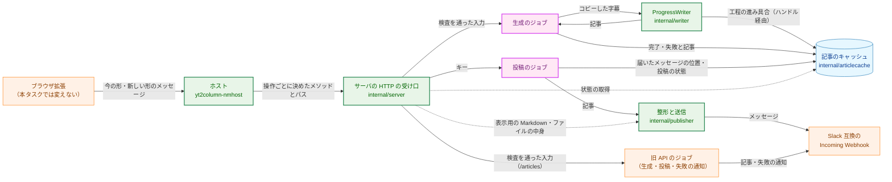

**Legend**

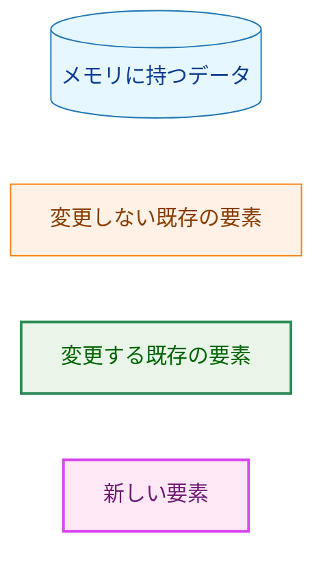

1 つのキーの記録は、生成に関する状態（ジョブの状態と工程の状態）と、投稿の状態を持つ。ジョブの状態が `完了` のときだけ、投稿の状態が意味を持つ。

| 状態の軸 | 値 | 変えるもの |
|---|---|---|
| ジョブの状態 | `処理中`・`完了`・`失敗`（キャッシュにないキーは `不明`） | 生成の開始（記録を作る、失敗からやり直す）、生成のジョブ（完了・失敗） |
| 工程の状態 | 工程（下書き・本文の短縮・検証・推敲）ごとに `未着手`・`実行中`・`完了`・`省略`・`失敗` | 生成のジョブ（`writer` からの進み具合の通知） |
| 投稿の状態 | `未投稿`・`投稿中`・`投稿済み`・`投稿の失敗`・`投稿できない` | 生成のジョブ（完了の時点で `未投稿` か `投稿できない`）、投稿の操作（`投稿中`）、投稿のジョブ（`投稿済み`・`投稿の失敗`） |

### 1.3. 設計の際に決めたこと（2026-10-27）

-   **記事のキー・記録の状態遷移・件数の上限と破棄は、新しいパッケージ `internal/articlecache` に置く。** ジョブの実行と HTTP は `internal/server` に置く。理由: 状態遷移を HTTP と LLM から切り離して単体テストでき、#503 の後に旧 API を削除するときに、このパッケージには手が入らないため。
-   **工程の進み具合は、`writer` に加える別の interface `ProgressWriter` で知らせる。** 進み具合の通知先を引数に取るメソッドを持ち、今の `Write` は通知しない形で同じ処理を呼ぶ。`ProgressWriter` を返す構築の関数は `writer.New` とは別に加え、`writer.New` とその呼び出し側（CLI）は変えない（§3.5）。理由: 書き手はサーバの起動時に 1 つだけ作られて全ジョブで共有される（`cmd/yt2column-server/run.go:286`）ので、ジョブごとの通知先は呼び出しの引数で渡すしかない。`ArticleWriter.Write` の引数を変えると CLI・`internal/job`・すべての fake が変わり、ジョブごとに `writer.New` を呼ぶとテンプレートの検査のやり直しと新しい失敗の経路ができるため。
-   **状態の取得の応答の上限を超える大きさの記事は、新しい失敗の理由 `article_too_large` で生成の失敗にする。** ホストが中継するサーバの応答の上限も、その応答が収まる値に上げる。理由: 本文の上限 4,000 字は改行を数えず（`internal/writer/length.go:16-22`）、タイトルにも長さの上限がない（`internal/writer/output.go:58-63`）。保証される上限は生成した文字列の 1 MiB（`output.go:13-14`）だけなので、改行だらけの記事は応答の上限を超えうる。既存の「公開できない記事」の理由に含めると、その理由の意味（今の公開が整形の前に拒否する記事。AC-17a）が広がるため。
-   **投稿のジョブの数は限らず、受け付けたらすぐに送り始める。** 理由: 要件書 F-003 の表に、投稿の操作を `too_many_requests` で拒否する行がない。投稿は利用者が手で選ぶ操作で、同時に走ることはまれである。また、ジョブの数は、記事のキャッシュの件数の上限（§3.3.4）で抑えられる。複数のメッセージに分かれた記事を 2 本同時に投稿すると、チャンネルでメッセージが混ざって並ぶ。ただし、本文は改行を除いて 4,000 字以下で、1 通は 16,383 コードポイントまで（`internal/publisher/slack_message.go:13-15`）なので、分かれるのは改行やタイトルが異常に長い記事だけである。このため、直列にする仕組みは設けない（§5.4 の残余のリスク）。Incoming Webhook は投稿したメッセージの識別子を返さない（成功の応答は本文 `ok` だけ、`internal/publisher/slack.go:216-224`）ので、分けたメッセージをスレッドの返信としてつなぐ方法は採れない。
-   **シャットダウンでは、新しい API の処理中の生成のジョブを取り消す。** 投稿のジョブと旧 API のジョブは、今と同じく取り消さずに待つ。理由: 記事のキャッシュはサーバの終了で失われるので、シャットダウンの後に完了した記事は誰も受け取れない。待っても LLM の料金と再起動の遅れ（最長約 45 分）が生じるだけである。#501 は作り直しの手段を再起動と決めたので、この場面はよく起きる。この決定で要件書 4.3 の該当の項目と AC-46 を改めた（要件書の `Comments`）。

### 1.4. 既存コードとの関係

| 既存の部品 | 本設計での扱い |
|---|---|
| 受け口の部品（`internal/server/handler.go:15-127` の `handler`・`reject`・`checkHeaders`、`response.go:139-188` のリクエスト ID と応答の書き込み） | 新しいパスへの振り分けを加え、新しい API の受け口でも使う。旧 API の受け口の振る舞いは変えない（§3.1・§3.9） |
| 本文の読み込みと検査（`internal/server/request.go:34-49` の `readRequest`、`:57-110` の `validateBody`） | 生成の開始でもそのまま使う。`validateBody` の結果（`jobInput`）に、キーの計算に使う検査を通った値を加える（§3.2） |
| 生成の枠（`job.go:16-39`） | 旧 API と新しい API の生成のジョブが合わせて使う。値（2）は変えない（§3.4.3） |
| 生成の失敗の分類（`job.go:138-155` の `classifyWrite`） | 新しい API の失敗の理由（`articlecache.FailureReason`）を返す形に変える。旧 API の `classify` は、その結果を `failure.Kind` に対応づける（§3.11.3） |
| 拒否の理由（`internal/server/response.go:14-72`） | 既存の値・状態コードは変えず、新しい理由を加える（§3.11.5） |
| `internal/pipeline`（`pipeline.go:92-123` の `Run`） | 新しい API では使わない。`Run` は字幕の取得・生成・公開を必ず続けて行い、公開を省く手段を持たないためである。生成のジョブは、`CopiedSource.Fetch` と `WriteWithProgress` を直接呼ぶ（§3.4.4） |
| `writer.ArticleWriter`（`internal/writer/writer.go:72-79`）と `templateWriter.Write`（`:325-411`） | 工程の進み具合を知らせる `ProgressWriter` を加える。`Write` の振る舞いは変えない（§3.5） |
| `writer.Stage`（`internal/writer/artifact.go:16-31`） | 工程を表す値として使う（`StageGeneration`・`StageShorten`・`StageReview`）。新しい列挙を作らない |
| `renderFileArticle`（`internal/publisher/file_render.go:25-65`） | ファイルの中身を返すのに使う。見出し・チャンネル名の行・本文の部分を、表示用の Markdown と同じ関数で作る形にする（§3.6.2） |
| `prepareSlackMessages`（`slack_message.go:23-58`） | 完了の時点の検査（`投稿できない` の判定）と、投稿のジョブのメッセージの組み立ての両方に使う（§3.6・§3.7） |
| `SlackWebhookPublisher.Publish`（`internal/publisher/slack.go:153-184`） | 送信の繰り返しを、組み立て済みのメッセージを途中から送るメソッドに切り出す。`Publish` はそれを最初から呼ぶ形にし、振る舞いは変えない（§3.7.1） |
| `articleCost`（`internal/publisher/format.go:13-20`） | 料金の書式を返す関数にまとめ、ファイル・Slack・状態の取得の 3 か所で使う（§3.6.1） |
| `internal/strictjson` | 状態の取得と投稿の操作の本文、ホストの新しい形のメッセージの検査に使う。値の元のバイト列を返すメソッドを加え、`Object.Has` の契約を振る舞いの選択に使えるものに改める（§3.10） |
| `config.LoadServer`（`internal/config/config.go:276-301`） | `SLACK_WEBHOOK_URL` を任意にする。値の検査は変えない（§3.8） |
| ホストの中継（`internal/nmhost/relay.go:215-255` の `forward`） | 接続の後、送る前にメッセージの全体を読み、形を見分けてから送る。今の形のバイト列と送り先は変えない（§3.10） |

## 2. システム構成 (System Structure)

### 2.1. パッケージ構成

矢印 A → B は「A が B を import する」ことを表す。本タスクで加える依存と、関係する既存の依存を示す。

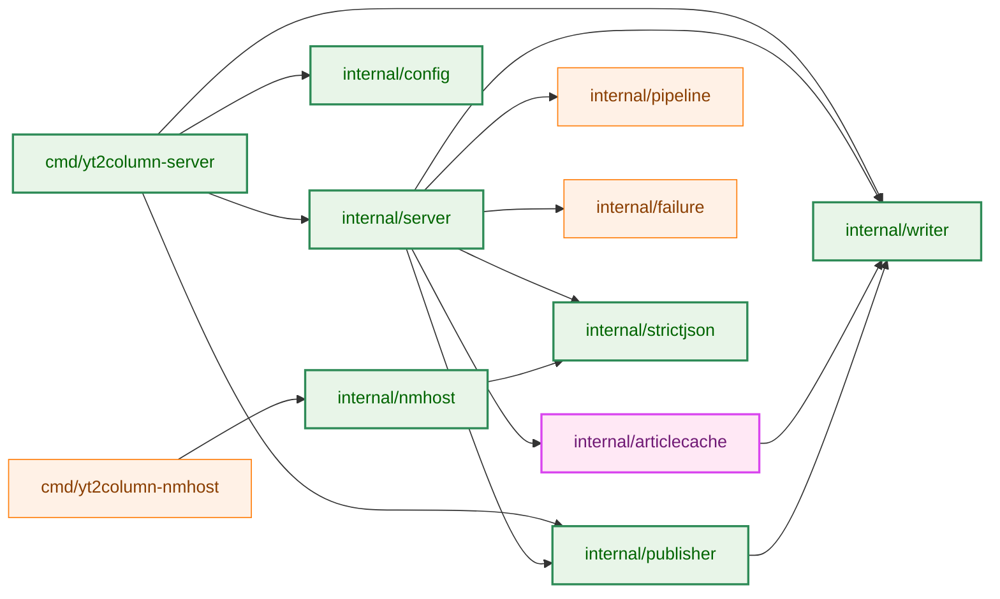

**Legend**

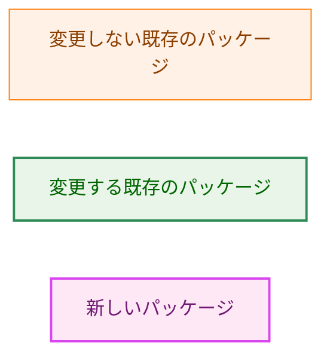

-   `internal/articlecache` は `internal/writer` の値の型（`Article`・`Stage`）だけを使い、LLM・HTTP・Webhook を知らない。これは `.golangci.yml` の `depguard` に規則を加えて強制する（`net/http`・`internal/llm`・`internal/publisher`・`internal/server` を禁止する）。
-   `internal/nmhost` は今も manifest の読み取りに `internal/strictjson` を使っている（`internal/nmhost/manifest.go:16`）。本タスクで、中継でも使うようになる。
-   `internal/server` → `internal/pipeline`・`internal/failure` は旧 API だけが使う依存で、#503 の後に削除する（§3.14）。

### 2.2. コンポーネント配置

| 置き場所 | 新しく置くもの・変えるもの |
|---|---|
| `internal/articlecache`（新規） | 記事のキー（`Key`・`Keyer`・`NewKeyer`・`ParseKey`）、記録と状態の列挙、`Cache`（生成の開始・状態の取得・投稿の開始の遷移、件数の上限と破棄）、ハンドル（`Run`・`PublishRun`） |
| `internal/server` | 新しい 3 つのパスの受け口、読み込みの枠、生成のジョブ、投稿のジョブ、状態の取得の応答の組み立て、新しい拒否の理由、`Options` の Webhook の任意化、旧 API の Webhook 未設定の拒否、ジョブの取り消し |
| `internal/writer` | `ProgressWriter`・`ProgressObserver`・`NewProgressWriter`、`templateWriter` の進み具合の通知 |
| `internal/publisher` | 表示用の Markdown の整形、ファイルの中身・組み立て済みのメッセージ・料金を返す公開の関数、途中から再開できる送信 |
| `internal/config` | `ServerConfig` の Webhook を任意にする |
| `cmd/yt2column-server` | Webhook の有無に応じた組み立て、`deps` の型、起動のログ |
| `internal/nmhost` | メッセージの全体の読み込み、形の判定、操作の送り先への対応づけ、応答の上限、ログの段階 |
| `internal/strictjson` | `Value.Raw`、`Object.Has` の契約 |
| `.golangci.yml` | `internal/articlecache` の依存の規則、`nmhost-boundaries` の説明の更新 |
| 文書 | README の「Localhost server」節と設定、`docs/dev/security.md` §8、`docs/dev/project_overview.md`、`docs/translation_glossary.md`、`docs/dev/developer_guide/package_reference.md`、`docs/dev/production_profile.md`、`CLAUDE.md`（§3.10.2 の例外） |

`cmd/yt2column-nmhost` は変えない。中継の変更はすべて `internal/nmhost` の中にある。

### 2.3. データフロー

実線の矢印は呼び出し、点線の矢印は応答を表す。`par` の枠は、受け口が応答した後も続く非同期の処理を表す。シーケンス図と状態遷移図は色分けしたノードを持たないので、本書では Legend を付けない。

**生成の開始と状態の取得**

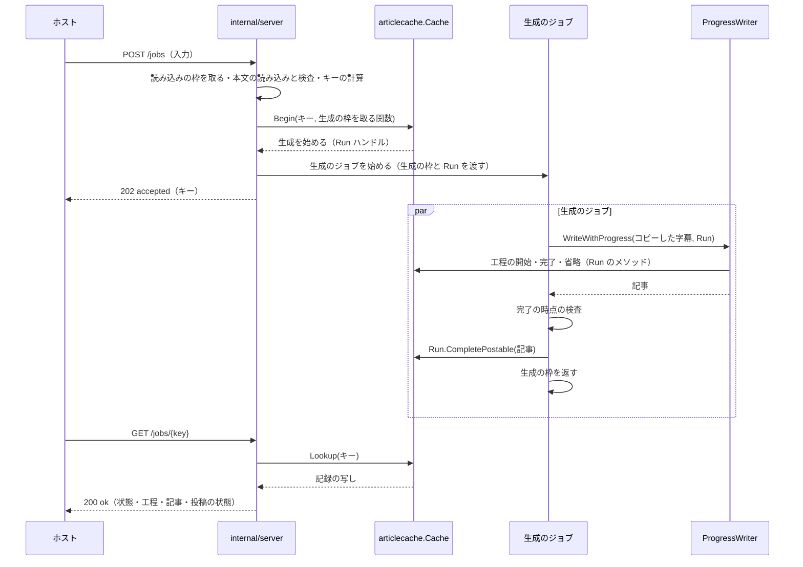

**投稿の操作**

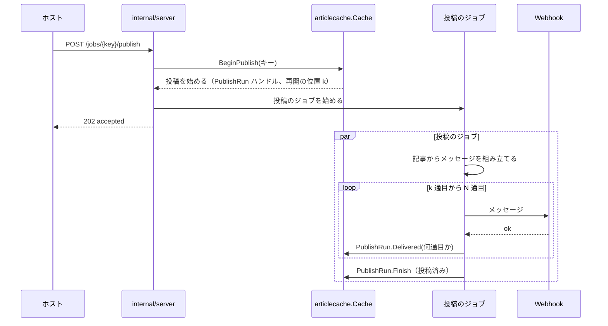

## 3. コンポーネント設計 (Component Design)

### 3.1. HTTP API（F-001〜F-003、H-01）

#### 3.1.1. パスとメソッド

新しい API は、操作の対象を URI で指す Web API の一般的な形（REST の慣例）に合わせ、記事のキーをリクエストのターゲットのパスに入れる。

| 操作 | メソッドとリクエストのターゲット | 本文 | 成功の応答 |
|---|---|---|---|
| 生成の開始 | `POST /jobs` | 今の `/articles` と同じ入力（`videoUrl`・`transcript`・`title`・`channelName`・`description`） | `202`、`{"status":"accepted","key":"…","requestId":"…"}` |
| 状態の取得 | `GET /jobs/{key}` | なし | `200`、`{"status":"ok","requestId":"…","webhookConfigured":…,"job":{…}}`（§3.1.3） |
| 投稿の操作 | `POST /jobs/{key}/publish` | なし | `202`、`{"status":"accepted","requestId":"…"}` |

-   **パスの照合:** 受け口は、`r.RequestURI` を、デコードする前の文字列のまま次の順に照合する。`net/http` の `ServeMux` のパターン（`{key}` の取り出し）は使わない。`ServeMux` はパスをデコードしてから照合するので、`%2F` を含むキーが別の形に読まれうるためである。
    1.  ターゲットが `?` を含めば `not_found`（今の `/articles` の完全一致と同じく、クエリを付けたターゲットは受け付けない。要件書 3.2「クエリがあれば拒否する」）。
    2.  `/articles` と `/jobs` は完全一致で比べる（今の `handler.go:119-127` と同じ方法）。
    3.  `/jobs/` で始まるターゲットは、残りを最初の `/` で 2 つに分ける。`/` がなければ残りの全体をキーの部分とし、状態の取得とする。`/` の後がちょうど `publish` なら、その前をキーの部分とし、投稿の操作とする。それ以外の形は `not_found`。
    4.  メソッドが形に合わなければ `method_not_allowed` で拒否する（`Allow` は状態の取得で `GET`、ほかは `POST`）。
    5.  本文がないこと: 状態の取得と投稿の操作は本文を使わない。`Content-Length` が 0 でないリクエストと、`Transfer-Encoding` を持つリクエストは、本文を読まずに `invalid_body` で拒否する（`Connection: close`、要件書 3.2 の 3 行目、AC-44）。
    6.  キーの部分が §3.2 の受理する形（小文字の 16 進の 64 文字）でなければ `invalid_key`。キーの部分はデコードしないので、`%` によるエスケープ・大文字・空の文字列は、どれもこの検査で拒否される。本文がないことを先に確かめるので、`invalid_key` の拒否では読み残した本文がなく、接続を閉じる必要がない。
    -   投稿の操作では、5 と 6 を Webhook の設定の検査（§3.7.2）の後に行う。
    -   ターゲットの全体（キーの部分を含むリクエストの行）が `http.Server` の `MaxHeaderBytes`（64 KiB、`internal/server/server.go:35`）を超えると、`net/http` がハンドラを呼ぶ前に `431` と JSON でない本文で応答する。キャッシュは変わらないが、拒否の理由は `invalid_key` にならない。ホストはキーの長さを見ない約束（AC-40a）なので、64 KiB ほどを超えるキー（拡張の誤りでしか起きない）は、拡張には想定外の応答として見える。要件書 3.2 の 2 行目は、受理しないキーを `invalid_key` 相当の理由で拒否するとするので、この長さのキーについての例外として受け入れる。
-   **キーの注入の防止:** キーをパスに入れると、ホストが拡張から受け取った任意の文字列をリクエストのターゲットに埋め込むことになる。たとえば `abc/publish` というキーをそのまま埋めると、状態の取得が投稿の操作に変わる。これを次の 2 つで防ぐ（§5.2 の T-02）。
    -   ホストは、キーを `url.PathEscape` で 1 つのパスの区切りとしてエスケープしてから埋め込み、エスケープした形をそのままリクエストのターゲットにする（§3.10.3）。`/`・`?`・`%`・空白・制御文字・ASCII でない文字はエスケープされるので、キーがパスの区切りやクエリを作ることはない。
    -   サーバは、上の 3 と 6 のとおり、デコードしないまま形を照合し、小文字の 16 進の 64 文字のほかは受け付けない。エスケープが要る文字を含むキーは、そもそも受理する形ではない。
-   **接続を閉じるかどうか:** 本文を読まずに拒否するかどうかは、理由ではなく拒否ごとに決まる（同じ `invalid_body` でも、生成の開始では本文を読んだ後の拒否で、状態の取得と投稿の操作では本文を読まない拒否である）。このため、`rejection` に「本文を読み残した」ことを表す値を持たせ、5 の拒否で真にする。`Connection: close` は、この値と今の `forceClose`（`response.go:87-101`）のどちらかが真のときに付ける。
-   **キャッシュを変えない:** パスの照合とキーの検査と本文の拒否のどれでも、キャッシュは変わらない（AC-44）。
-   **応答を区別しない:** 生成の開始は、生成を始めた場合も、既存のジョブまたは記事のキーを返した場合も、同じ `202` と同じ形を返す（要件書 F-001 の「区別しない」）。

#### 3.1.2. 状態の取得と投稿の操作のメソッドと枠

-   状態の取得と投稿の操作は、本文を読まないので、読み込みの枠も生成の枠も使わない。
-   状態の取得は `GET` で、記録を変えない（要件書 F-002）。サーバは UDS 上で同じ利用者のプロセスだけから受け、応答をキャッシュする中継装置（プロキシなど）も間にない。それでも応答には今と同じく `Cache-Control: no-store`（`response.go:174`）を付ける。
-   投稿の操作は、同じキーへの 2 回目以降も投稿し直さない（冪等、§3.7.2）。メソッドは記録を変えうるので `POST` にする。

#### 3.1.3. 状態の取得の応答の形

応答は、記録のジョブの状態ごとに次のメンバを持つ。どのメンバの値も、コード（§3.11）、サーバが決めた識別子、数値、真偽値、または完了した記事の 2 つの文字列（`markdown`・`file`）だけである。

```json
{
  "status": "ok",
  "requestId": "0123456789abcdef",
  "webhookConfigured": true,
  "job": {
    "state": "done",
    "steps": { "draft": "done", "shorten": "skipped", "review": "done" },
    "article": {
      "markdown": "# …",
      "file": "---\n…",
      "cost": { "state": "known", "usd": "0.1234" },
      "durationMs": 81234
    },
    "publish": { "state": "not_posted" }
  }
}
```

| `job.state` | `job` が持つメンバ |
|---|---|
| `running` | `steps` |
| `done` | `steps`（`done` か `skipped` だけ）、`article`、`publish` |
| `failed` | `steps`（失敗した工程は `failed`）、`failure`（生成の失敗の理由） |
| `unknown` | なし |

-   `webhookConfigured` は、このサーバが投稿の操作を受け付けるか（`SLACK_WEBHOOK_URL` が設定されているか）を、どの状態でも返す（要件書 F-002・F-006、AC-34・AC-35）。
-   `article.cost` は、料金が分かれば `{"state":"known","usd":"<小数 4 桁>"}`、分からなければ `{"state":"unknown"}` である。金額の書式は、ファイルのフロントマターの `estimated_cost_usd` と同じ関数で作る（§3.6.1）。
-   `article.durationMs` は、完了した生成を始めた受け付けから、生成の完了までの時間（ミリ秒の整数）である（AC-14、§3.3.3）。
-   `publish` は `{"state":"<投稿の状態>"}` で、`failed` と `unpostable` のときだけ `reason` を持つ（§3.11.4）。
-   `requestId` は、今のすべての応答と同じく、サーバが生成した乱数の識別子である（`response.go:139-147`）。要件書 4.2 は新しい API の応答の値を「固定の値、キー、数値」に限るとし、同時に「今の `0011` F-008 と同じ方針」とする。0011 F-008 の応答は `requestId` を含むので、本設計は `requestId` を、キーと同じくサーバが決めた識別子として含める。
-   完了の時点の検査（§3.6.3）で、この応答が上限（`maxStatusResponseBytes`、256 KiB）に収まることを確かめた記事だけが `done` になる。
-   完了の記録の応答を組み立てるときに、整形の関数（`FileContent`・`DisplayMarkdown`）が失敗した場合は、`internal_error` で拒否する。完了の時点の検査で同じ関数が成功した記事なので、起きるのは実装の誤りだけである。

#### 3.1.4. 拒否の応答

拒否の応答の形は、今と同じ `{"status":"rejected","reason":"…","requestId":"…"}`（`response.go:130-137`）である。新しい理由は §3.11.5 に挙げる。

### 3.2. 記事のキー（F-001・AC-03〜AC-05・AC-44、H-02）

-   **入力:** 検査を通った後の 5 つの値。`videoUrl` は `transcript.ValidateVideoURL` が返す正規化した URL（`request.go:92`）、`transcript` は受け取った文字列（検査は値を変えない）、`title`・`channelName`・`description` は、省略した場合は空文字列（`request.go:112-125` の `optionalMember`）である。宣言していないメンバ、メンバの順序、JSON の空白とエスケープは、この 5 つの値に届かないので、キーを変えない（AC-03）。
-   **入力の作り方:** `KeyInput` を作るのは `validateBody` だけで、検査を通った値を `jobInput` に入れて返す。受け口は `jobInput` の値をそのまま `Keyer.Key` に渡し、ほかの場所で `KeyInput` を組み立てない。`KeyInput` の各フィールドが検査済みであることは、型ではなくこの 1 か所の作り方で保つ。キーの計算は検査の結果に依存し、検査の結果は `jobInput` を作る 1 か所にしかないためである。
-   **符号化:** ドメイン分離のための固定の文字列 `yt2column article key v1` と 1 バイトの `0x00` の後に、5 つの値を上の順に、それぞれ「バイト長を 8 バイトのビッグエンディアンで表したもの」と「値の UTF-8 のバイト列」の組として並べる。長さを前に置くので、2 つの値の境目を動かした入力は違うバイト列になる（AC-05）。この文字列は、将来キーの計算を変えるときに版を変えるためのものである。
-   **計算:** 上の符号化のバイト列の HMAC-SHA256 をキーとする（標準ライブラリの `crypto/hmac` と `crypto/sha256`）。外部ライブラリを加えない（要件書 5.）。HMAC の鍵は、サーバのプロセスごとの秘密である。
-   **秘密:** `crypto/rand` の 32 バイトを、`server.New` が 1 回だけ作り、`articlecache.NewKeyer` に渡す。秘密はメモリにだけ持ち、ログにも応答にも出さず、ディスクにも書かない。
    -   `server.New` で作る理由: 秘密の寿命は記事のキャッシュの寿命と同じで、キャッシュを作るのも `server.New` である。秘密を `cmd/yt2column-server` で作って渡す形にすると、組み立ての側が秘密を扱うことになり、秘密が生きる範囲が広がるだけで得るものがない。
    -   テスト: `-tags test` の組み立て（`internal/server/test_helpers.go`）と `articlecache` のテストは、固定の秘密を渡す。
    -   乱数を得られない場合: Go 1.26（`go.mod`）の `crypto/rand.Read` はエラーを返さず、乱数を得られなければプロセスを止める（標準ライブラリの約束）。このため、サーバは待ち受けずに終わり、固定の秘密に切り替えることはない。
-   **秘密を使う理由:** 秘密を使わないハッシュだと、入力を知る者は誰でも、生成の開始を呼ばずにキーを計算できる。すると、状態の取得を呼ぶだけで、その入力の記事がキャッシュにあるかを知ることができ、記事の有無を調べる手段になる。また、要件書 3.2 はキーを拡張とホストにとって不透明な値とするが、誰でも計算できるキーでは、利用者や拡張が計算方法に依存しうる。秘密を鍵にすれば、キーは生成の開始の応答からしか得られない。
-   **キーの文字列の形:** HMAC の 32 バイトを小文字の 16 進で表した 64 文字。受理する形はこれだけで、`ParseKey` は、長さが 64 でない文字列、`0-9a-f` 以外の文字（大文字を含む）を含む文字列を拒否する。前後の空白や大文字を補正しない（AC-44、CLAUDE.md「Reject, don't normalize」）。
-   **型:** `Key` はフィールドを公開しない構造体で、`Keyer.Key`（入力から計算）と `ParseKey`（受理する形の検査）でしか作れない。`Keyer` もフィールドを公開しない構造体で、秘密を受け取る `NewKeyer` でしか作れない。サーバは、受け取ったキーを `ParseKey` を通してからキャッシュを引く値にだけ使う（要件書 3.2）。

```go
// Package articlecache

// KeyInput is the validated request values the key is computed from. Only the
// server's body validation builds one.
type KeyInput struct {
	VideoURL    string // the normalized URL transcript.ValidateVideoURL returned
	Transcript  string
	Title       string // "" when the member was absent
	ChannelName string // "" when the member was absent
	Description string // "" when the member was absent
}

// Key identifies one article in the cache. It can only be built by
// Keyer.Key or ParseKey.
type Key struct{ /* unexported: the 32-byte HMAC-SHA256 value */ }

// Keyer computes keys with one per-process secret. It can only be built by
// NewKeyer, and it never exposes the secret.
type Keyer struct{ /* unexported: the 32-byte secret */ }

// ErrInvalidKey is wrapped by ParseKey for a string that is not 64 lowercase
// hexadecimal characters. It never holds the string.
var ErrInvalidKey = errors.New("invalid article key")

func NewKeyer(secret [32]byte) Keyer
func (k Keyer) Key(in KeyInput) Key
func ParseKey(s string) (Key, error)
func (k Key) String() string // 64 lowercase hexadecimal characters
```

-   **キーの性質:** 同じサーバのメモリの中だけで使う値で、サーバの設定（モデルなど）は含めない。記事のキャッシュはサーバの起動ごとに空から始まり、設定は起動の間変わらないので、設定の違う 2 つの記事が同じキーで並ぶことはない。1 つのプロセスの中では秘密が変わらないので、同じ入力は同じキーになり、重複の排除（#501、AC-03〜AC-05）は変わらない。秘密は起動ごとに作り直すので、再起動の前に得たキーは、再起動の後には同じ入力から得られない。キャッシュも起動ごとに空から始まる（AC-28）ので、キーが変わっても失うものはない。

### 3.3. 記事のキャッシュ（`internal/articlecache`、F-004、H-06）

#### 3.3.1. 状態遷移

矢印は、記録の状態の遷移と、それを起こす操作を表す。`[*]` からの矢印は記録を作ること、`[*]` への矢印は記録を捨てることを表す。

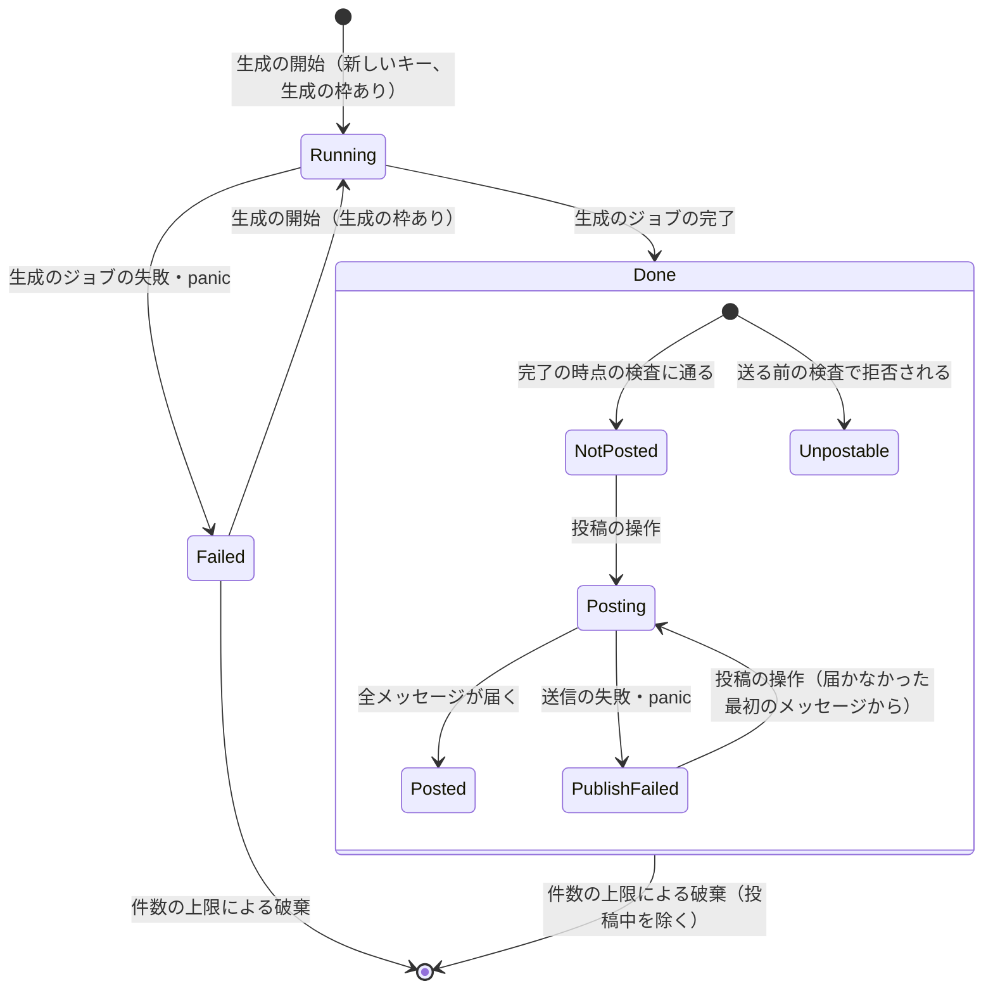

-   `Running` は `処理中`、`Done` は `完了`、`Failed` は `失敗` である。キャッシュにないキーは `不明` を返す。
-   `Posting` の記録と `Running` の記録は捨てない（要件書 F-004）。
-   `Failed` から `Running` に戻るとき、工程の状態をすべて `未着手` に戻し、失敗の理由を消す。

#### 3.3.2. 型

```go
// Package articlecache

// JobState is a record's generation state. The zero value is JobUnknown: the
// state of a key the cache does not hold.
type JobState int

const (
	JobUnknown JobState = iota
	JobRunning
	JobDone
	JobFailed
)

// StageState is the state of one step (a writer.Stage) of a generation. The
// zero value is StagePending.
type StageState int

const (
	StagePending StageState = iota
	StageRunning
	StageDone
	StageSkipped
	StageFailed
)

// Stages holds the state of each step.
type Stages struct {
	Draft   StageState // writer.StageGeneration
	Shorten StageState // writer.StageShorten
	Review  StageState // writer.StageReview
}

// FailureReason is why a generation failed. The zero value is
// FailureInternal.
type FailureReason int

const (
	FailureInternal FailureReason = iota
	FailureTranscriptTooLong
	FailureLLMTimeout
	FailureLLMEmpty
	FailureLLMTruncated
	FailureLLM
	FailureArticleInvalid  // the article fails writer.Article.CheckPublishable
	FailureArticleTooLarge // the status response would exceed its limit
)

// PublishState is a completed article's publish state. The zero value is
// PublishUnpostable, which neither sends nor claims a delivery.
type PublishState int

const (
	PublishUnpostable PublishState = iota
	PublishNotPosted
	PublishPosting
	PublishPosted
	PublishFailed
)

// UnpostableReason is why the pre-send checks reject an article. The zero
// value is UnpostableOther.
type UnpostableReason int

const (
	UnpostableOther UnpostableReason = iota
	UnpostableMention
)

// PublishFailureReason is why a post failed after it started. The zero value
// is PublishFailureInternal.
type PublishFailureReason int

const (
	PublishFailureInternal PublishFailureReason = iota
	PublishFailureWebhook
)

// Snapshot is a copy of one record, taken under the cache's lock. Article is
// never modified after CompletePostable or CompleteUnpostable stores it, so
// the pointers it shares with the record are safe to read without the lock.
type Snapshot struct {
	State          JobState
	Stages         Stages
	Failure        FailureReason        // JobFailed only
	Article        writer.Article       // JobDone only; Review.Revisions is always nil
	Duration       time.Duration        // JobDone only
	Publish        PublishState         // JobDone only
	Unpostable     UnpostableReason     // PublishUnpostable only
	PublishFailure PublishFailureReason // PublishFailed only
}
```

```go
// Options configures a Cache. Capacity must be positive; Clock nil selects
// time.Now.
type Options struct {
	Capacity int
	Clock    func() time.Time
}

// ErrInvalidOptions is wrapped by New for a non-positive Capacity.
var ErrInvalidOptions = errors.New("invalid article cache options")

func New(opts Options) (*Cache, error)

// BeginOutcome is what Begin did. The zero value is BeginFull, which starts
// nothing.
type BeginOutcome int

const (
	BeginFull      BeginOutcome = iota // no evictable record: nothing changed
	BeginNoSlot                        // acquire reported false: nothing changed
	BeginExisting                      // the key is running or done: nothing changed
	BeginStarted                       // a running record was created
	BeginRestarted                     // a failed record was restarted
)

// Begin decides, under the lock, what a generation start does for key. It
// calls acquire only when a generation would start, and only after it has
// confirmed that a record can be added; Run is non-nil only for BeginStarted
// and BeginRestarted. Evicted reports the key of the record it dropped, if any.
func (c *Cache) Begin(key Key, acquire func() bool) (outcome BeginOutcome, run *Run, evicted *Eviction)

// Lookup returns a copy of key's record, or a Snapshot with JobUnknown.
func (c *Cache) Lookup(key Key) Snapshot

// PublishBegin is what BeginPublish did. The zero value is
// PublishBeginNoArticle.
type PublishBegin int

const (
	PublishBeginNoArticle  PublishBegin = iota // failed or unknown
	PublishBeginNotReady                       // running
	PublishBeginUnpostable                     // done and unpostable
	PublishBeginAlready                        // done and posting or posted: nothing changed
	PublishBeginStarted                        // the record is now posting
)

// BeginPublish moves a done, not-posted or publish-failed record to posting
// and returns a handle that carries the article and the index of the first
// message not delivered.
func (c *Cache) BeginPublish(key Key) (PublishBegin, *PublishRun)

// Eviction describes a dropped record, for the log.
type Eviction struct {
	Key     Key
	State   JobState     // JobDone or JobFailed
	Publish PublishState // JobDone only
	Age     time.Duration
}
```

```go
// Run is the handle a generation job reports through. It implements
// writer.ProgressObserver. A Run acts only on the record generation it was
// issued for: after CompletePostable, CompleteUnpostable, or Fail, or once the
// record was replaced, every method does nothing. A stage outside the three
// writer stages is ignored.
type Run struct{ /* unexported */ }

func (r *Run) StageStarted(s writer.Stage)
func (r *Run) StageFinished(s writer.Stage)
func (r *Run) StageSkipped(s writer.Stage)
// CompletePostable stores a, with Review.Revisions dropped, as done and not posted.
func (r *Run) CompletePostable(a writer.Article)
// CompleteUnpostable stores a, with Review.Revisions dropped, as done and unpostable.
func (r *Run) CompleteUnpostable(a writer.Article, reason UnpostableReason)
// Fail marks the record failed; the running stage, if any, becomes StageFailed.
func (r *Run) Fail(reason FailureReason)

// PublishRun is the handle a post job reports through, with the same
// generation rule as Run. An index outside the article's messages is ignored.
type PublishRun struct{ /* unexported */ }

func (p *PublishRun) Article() writer.Article
func (p *PublishRun) From() int            // the index of the first message not delivered
func (p *PublishRun) Delivered(index int)  // message index reached the Webhook
func (p *PublishRun) Finish()              // every message was delivered: posted
func (p *PublishRun) Fail(reason PublishFailureReason)
```

-   **排他制御:** `Cache` は 1 つの `sync.Mutex` で、記録の表と、破棄のための順序をまとめて守る。`Run` と `PublishRun` のメソッドも同じ排他制御の下で記録を書き換える。どのメソッドも、排他制御の解除を `defer` で行い、範囲外の入力（`writer.Stage` の範囲外の値、範囲外のメッセージの位置）では panic せずに何もしない。排他制御の区間の中で panic して、ほかの受け口がすべて止まることを防ぐためである。`Lookup` は記録の写しを返すので、呼び出し側は排他制御の外で応答を組み立てられる。
-   **記事の写し:** `CompletePostable` と `CompleteUnpostable` は、記事の `Review.Revisions` を捨てた写しを記録に入れる。`Review` はポインタなので、生成のジョブが受け取った記事を書き換えず、新しい `ReviewResult` を作って写す。検証・推敲の訂正の一覧は、`Evidence` にコピーした字幕からの引用をそのまま持ち（`internal/writer/revision.go:43-49`）、新しい API の出力（ファイルの中身、表示用の Markdown、Slack のメッセージ、料金）のどれも使わない（使うのは CLI の検証・推敲のログだけ、`internal/publisher/reviewlog.go:76-93`）。`ReviewResult.Check` は空の一覧を受け入れる（`revision.go:27-40`）ので、写しも公開の検査に通る。
-   **ハンドルの世代:** 記録は、作るたびと `Failed` から `Running` に戻るたびに新しい世代の番号を持ち、ハンドルは発行したときの番号を持つ。番号が合わないハンドル（古い生成のジョブの遅れた通知、破棄の後に同じキーで作り直した記録への古い `PublishRun` など）のメソッドは何もしない。
-   **ハンドルの不変条件:** 1 つのキーで、有効な `Run` は高々 1 つ、有効な `PublishRun` も高々 1 つである。`Begin` は `Running` の記録に新しい `Run` を作らず、`BeginPublish` は `Posting` の記録に新しい `PublishRun` を作らないので、同じキーの生成と投稿はそれぞれ 1 回だけ行われる（AC-09b・AC-20）。
-   **生成の枠の取り方:** `Begin` は、キーが `Running` か `Done` なら、`acquire` を呼ばずに `BeginExisting` を返す（AC-02・AC-07）。投稿の状態は変えない（AC-09c）。キャッシュにないキーで、破棄できる記録がなく件数の上限に達していれば、`acquire` を呼ばずに `BeginFull` を返す（AC-26a）。それ以外では `acquire` を呼び、偽なら何も変えずに `BeginNoSlot` を返す（AC-06・AC-07）。真なら、必要なら 1 件捨て、`Running` の記録を作り（失敗の記録ならやり直す）、受け付けの時刻を記録する。キーの状態の判定と生成の枠の取得を同じ排他制御の下で行うので、同じ新しいキーが同時に来ても、生成の枠を取るのは 1 つだけである。`acquire` は待たない関数（`Server.acquireSlot`、`job.go:25-34`）で、排他制御の中で止まらない。
-   **投稿の開始:** `BeginPublish` は、`Done` で `PublishNotPosted` か `PublishFailed` の記録を `PublishPosting` にして、届かなかった最初のメッセージの位置（`From`）と記事を `PublishRun` で返す。`PublishPosting` と `PublishPosted` には `PublishBeginAlready`（何も変えない、AC-20）、`PublishUnpostable` には `PublishBeginUnpostable`、`Running` には `PublishBeginNotReady`、`Failed` とキャッシュにないキーには `PublishBeginNoArticle` を返す。

#### 3.3.3. 時刻と所要時間

-   `Begin` が記録を `Running` にした時刻を、受け付けの時刻として記録する。失敗からやり直した記録では、やり直しの時刻で置き換える（AC-14）。
-   完了の時刻と失敗の時刻を記録する。所要時間は、完了の時刻から受け付けの時刻を引いた値である。
-   時刻は `Options.Clock` から読む。テストは時計を差し替える（AC-14・AC-25）。

#### 3.3.4. 件数の上限と破棄（H-06）

-   **上限:** 100 件（`defaultCapacity`）。処理中・完了・失敗のすべての記録を数える。
-   **破棄の対象と順序:** 新しいキーの記録を加えると上限を超えるとき、`Done`（`PublishPosting` を除く）と `Failed` の記録のうち、完了または失敗した時刻の最も古いものを 1 件捨てる（AC-25・AC-26）。捨てる記録がなければ `BeginFull` にする（AC-26a）。同じ時刻の記録が 2 つあれば、先に完了または失敗したもの（記録の順）から捨てる。捨てた記録は `Eviction` で返し、サーバがログに 1 行書く（§3.12）。
-   **記録 1 件の大きさの見積もり:** 完了した記録で大きいのは、訂正の一覧を除いた `writer.Article` の文字列だけである。表示用の Markdown・ファイルの中身・メッセージは記録に持たない（§1.1）。本文は改行を除いて 4,000 字以下で（`internal/writer/writer.go:401-405` の最後の長さの検査）、日本語は UTF-8 で 1 字 3 バイトなので、典型的な記事の本文は 12 KB ほどである。これにタイトル・チャンネル名（200 コードポイント以下、`output.go:15-19`）・出典・モデル名（256 バイト以下、`output.go:15-16`）を加えても、記録 1 件は 13 KB ほどである。最大の場合は、完了の時点の検査で状態の取得の応答（256 KiB 以下）に収まった記事である。応答には記事の文字列がほぼ 2 回含まれるので、記事の文字列は 128 KiB ほどまでになる。
-   **メモリの量:** 典型的な記事で 100 件 × 13 KB ≒ 1.3 MB、最大の記事ばかりでも 100 件 × 128 KiB ≒ 13 MiB である。失敗の記録は記事を持たないので小さい。処理中の記録はコピーした字幕を持たない（コピーした字幕は生成のジョブが持つ。§3.4.4）。生成のジョブの数は生成の枠（2）で限られ、今の旧 API のジョブと同じである。
-   **値の理由:** 捨てられない記録（処理中と投稿中）で上限が埋まると、新しい生成がすべて拒否される（H-06）。処理中は生成の枠で 2 件まで、投稿中は利用者が手で選ぶ操作で数件を超えることはまれなので、100 件は十分に大きい。利用者が 1 日に生成する記事の数よりも多く、Viewer で開いている記事が 1 日のうちに捨てられることはまずない。
-   **テストの上限:** テストは `Options.Capacity` に小さい値を渡す（AC-25・AC-26・AC-26a）。サーバの `Options` には上限を公開せず、`-tags test` の組み立て（`test_helpers.go`）だけが渡す。

### 3.4. 生成の開始と生成の枠（F-001・F-007、H-04）

#### 3.4.1. 検査の順序

生成の開始は、次の順で検査する（要件書 F-001 の順序）。

1.  パスとメソッド（§3.1.1）。
2.  読み込みの枠を待たずに取る。取れなければ、本文を読まずに `too_many_requests` で拒否する（`Connection: close`、AC-09a）。
3.  本文の読み込みと検査。今の `readRequest` と `validateBody` をそのまま使う（`request.go:34-110`）。拒否の理由は今と同じで（AC-08）、本文の読み込みの失敗（接続の切断など）は、今と同じく応答を書かずに接続を閉じる（`handler.go:66-77`）。読み込みの枠は `defer` で返すので、検査の成否や panic にかかわらず、検査が終わった時点で返る。
4.  キーの計算（§3.2）と `Cache.Begin`。結果ごとに次のように応答する。

| `Begin` の結果 | 応答 | 生成の枠 |
|---|---|---|
| `BeginStarted`・`BeginRestarted` | 生成のジョブを始めてから `202` | ジョブが持ち、終わったら返す |
| `BeginExisting` | `202`（同じキー） | 取らない |
| `BeginNoSlot` | `too_many_requests` | 取れなかった |
| `BeginFull` | `too_many_requests` | 取らない |

-   新しい API の拒否は、どれも Webhook へ通知しない（AC-09）。旧 API の `rejectReason.notify`（`response.go:74-85`）と `notifyAsync` は、新しい API の受け口から呼ばない。
-   `202` は、旧 API と同じく、生成のジョブを始めた後に書く（`handler.go:91-99`）。応答が見えたときには、記録は必ず `処理中` 以降にある（AC-01）。
-   3 つの `too_many_requests`（読み込みの枠、生成の枠、件数の上限）は、応答の理由は同じで、ログの `detail` を分ける（§3.12）。

#### 3.4.2. 読み込みの枠

-   **値:** 2（`maxReading`）。生成の開始の本文の読み込みと検査だけが使う。
-   **理由:** 本文は最大 4 MiB（`request.go:18`）で、検査の間はその写しと解析の結果をメモリに持つ。今の旧 API は、生成の枠（2）を取ってから本文を読むので、同時に読む本文は 2 つまでである。読み込みの枠を 2 にすると、新しい API でも同時に読む本文は 2 つまでで、旧 API の分と合わせても 4 つまでになる。値をこれより大きくする理由はない。読み込みの枠と生成の枠は別なので、生成の枠が埋まっていても、処理中または完了したキーの再送はそのキーを受け取れる（AC-07）。
-   **既存の方針の例外:** 0011 の設計（`docs/tasks/0011_localhost_server/02_architecture.md` §3.8.2）は、枠を取ってから本文を読むとした。新しい API の生成の開始は、キーが分かるまで本文を読む必要があるので、生成の枠の前に本文を読み、その代わりに読み込みの枠で同時に読む数を限る（要件書 5. の「以前のタスクの方針の変更」）。旧 API の順序は変えないので、旧 API の順序を確かめる今のテスト（`internal/server/request_test.go` の `TestHeaderRejectionReadsNoBody`、`job_test.go` の `TestSlotLimit`）は変えない。

#### 3.4.3. 生成の枠の合算（H-04）

-   旧 API のリクエスト（ジョブと失敗の通知を含む）と新しい API の生成のジョブは、同じ生成の枠（`Server.slots`、`server.go:69-72`）を使う。値は 2 のまま変えない（要件書 1. の決定）。
-   投稿のジョブは生成の枠を使わない（§3.7、1.3 の決定）。状態の取得も使わない。
-   旧 API の失敗の通知は、今と同じく生成の枠を持ったまま行う（`job.go:79-105`）。新しい API には通知がないので、生成のジョブは記事の生成の間だけ生成の枠を持つ。

#### 3.4.4. 生成のジョブ

生成のジョブは、生成の枠と `Run` を受け取り、自分のゴルーチンで次を行う。

1.  `CopiedSource.Fetch` で `Transcript` を得る。失敗は内部の失敗（今の `classify` の `StageTranscript` と同じ扱い、`job.go:117-120`）。
2.  `ProgressWriter.WriteWithProgress(ctx, t, run)` を呼ぶ。`run` は工程の進み具合を記録に書く（§3.5）。失敗は `classifyWrite` で失敗の理由にして `run.Fail` を呼ぶ（§3.11.3）。
3.  完了の時点の検査（§3.6.3）を行い、結果に応じて `run.CompletePostable`・`run.CompleteUnpostable`・`run.Fail` のどれかを呼ぶ。
4.  生成の枠を返す（`defer`）。

-   `ctx` は、新しい API の生成のジョブだけが使う `genCtx` である。`genCtx` は `jobCtx`（`server.go:76-80`）と同じくリクエストの `ctx` ではないので、応答を書いた後も取り消されない。シャットダウンの始めにだけ取り消す（§6.4、1.3 の決定）。
-   ジョブの中の panic は回復し、`run.Fail(FailureInternal)` にして、ログに 1 行書く（AC-45）。サーバは動き続ける。
-   生成のジョブは、コピーした字幕（`CopiedSource` とそれが作る `Transcript`）をジョブのゴルーチンの中だけで持ち、記録には渡さない。記録が受け取るのは、訂正の一覧を除いた `writer.Article` だけなので、生成が終わった後の記録は、送られたコピーした字幕の文字列も、その引用も含まない（AC-27、§3.3.2）。
-   生成のジョブは今の `s.jobs`（`server.go:73-75`）に数え、シャットダウンで終わりを待つ（§6.4）。

#### 3.4.5. ハンドルと枠の持ち主

受け口が `Begin` か `BeginPublish` からハンドルを受け取ってから、ジョブのゴルーチンに渡すまでの間に panic が起きると、生成の枠が返されず、記録が `処理中` か `投稿中` のまま残る。`処理中` と `投稿中` は捨てられない記録なので、そのキーは再起動まで使えず、生成の枠は 2 つしかない。これを防ぐために、持ち主を次のように決める。

| 持つもの | 渡すまでの持ち主 | 渡した後の持ち主 | 持ち主が panic で終わるとき |
|---|---|---|---|
| 読み込みの枠 | 生成の開始の受け口 | （渡さない） | `defer` で返す |
| 生成の枠と `Run` | 生成の開始の受け口 | 生成のジョブ | `run.Fail(FailureInternal)` にし、生成の枠を返す |
| `PublishRun` | 投稿の操作の受け口 | 投稿のジョブ | `PublishRun.Fail(PublishFailureInternal)` にする |

-   新しい API の受け口は、それぞれ自分の `recover` を持つ。旧 API の受け口の `recover`（`handler.go:29-49`）は、生成の枠を持っていれば失敗の通知を送るので、新しい API の受け口には使わない。新しい API の受け口の `recover` は、上の表のとおりに後始末をし、まだ応答を書いていなければ `internal_error` を書き、通知を送らない（AC-09・AC-24）。
-   ジョブのゴルーチンに渡すのは、`s.jobs.Go` を呼んだ時点とする。その後の後始末はジョブの `recover` が行う。

### 3.5. 工程の進み具合（`internal/writer`、F-002・AC-10・AC-11、H-03）

```go
// Package writer

// ProgressObserver receives the progress of one Write. The calls for one
// Write are made from the goroutine that runs it, in order.
type ProgressObserver interface {
	StageStarted(s Stage)  // before the stage's first action
	StageFinished(s Stage) // after the stage's result passed every check of that stage
	StageSkipped(s Stage)  // the stage will not run in this Write
}

// ProgressWriter is an ArticleWriter that also reports its progress.
// WriteWithProgress behaves exactly as Write, and in addition calls observer.
type ProgressWriter interface {
	ArticleWriter
	WriteWithProgress(ctx context.Context, t transcript.Transcript, observer ProgressObserver) (Article, error)
}

// NewProgressWriter validates the same Options as New and returns the same
// writer as a ProgressWriter.
func NewProgressWriter(client llm.LLMClient, opts Options) (ProgressWriter, error)
```

-   **通知の約束:**
    -   `StageGeneration`: 生成のテンプレートの展開の前に `StageStarted`、生成の出力の検査（`checkResponse`）が通った後に `StageFinished`。
    -   `StageShorten`: 本文の短縮を行うとき（`writer.go:367` の条件。本文が 4,000 字を超える）は、その前に `StageStarted`、短縮の結果の検査が通った後に `StageFinished`。行わないとき（本文が 4,000 字以下、または短縮の工程が無効）は、下書きの `StageFinished` の直後に `StageSkipped`（AC-11）。
    -   `StageReview`: 検証・推敲を行うときは、その前に `StageStarted`。`StageFinished` は、検証・推敲の結果の検査と、`Write` の最後の長さの検査（`writer.go:401-405`）が通った後に呼ぶ。検証・推敲の後の本文が長すぎるときの失敗（`stepError(StepReview, …)`）を、検証・推敲の工程の失敗として表せるようにするためである。検証・推敲が無効なとき（CLI の `--no-review`）は `StageSkipped`。サーバは常に有効にするので、サーバでは `StageSkipped` にならない（`cmd/yt2column-server/run.go:93-98`）。
    -   失敗したときは、通知を追加しない。どの工程が失敗したかは、`StageStarted` の後に `StageFinished` が来なかった工程として、受け手（`articlecache.Run`）が決める（§3.3.2 の `Fail`）。
    -   中断からの再開（`Options.Artifacts.Resume`）で再利用した工程は、再利用した時点で `StageFinished` とする。サーバは再開を使わないので、この規則は約束としてだけ定める。
-   **既存の振る舞い:** `templateWriter` が `WriteWithProgress` を実装し、`Write` は何もしない通知先で `WriteWithProgress` を呼ぶ。`writer.New` の戻り値の型（`ArticleWriter`）は変えないので、CLI（`cmd/yt2column/run.go` の `deps.newWriter`、`internal/job`）は変わらない。`NewProgressWriter` は `New` と同じ検査をして、同じ書き手を `ProgressWriter` として返す。
-   **サーバの受け取り方:** `server.Options.Writer` の型を `writer.ProgressWriter` に、`cmd/yt2column-server` の `deps.newWriter` の型を `func(llm.LLMClient, writer.Options) (writer.ProgressWriter, error)` に変え、本番の値を `writer.NewProgressWriter` にする。旧 API のジョブは今と同じく `Write` を（`pipeline` を通して）呼ぶ。
-   **fake:** `writer/testutil.FakeArticleWriter` に `WriteWithProgress` を加え、テストが工程ごとに止められるようにする（§7.1）。`internal/server/test_helpers.go` の `gateWriter`・`panickingWriter`（`:105-130`）にも `WriteWithProgress` を加える。

### 3.6. 記事の整形と完了の時点の検査（`internal/publisher`、F-002・F-003・AC-12・AC-13・AC-17a・AC-23、H-05・H-09）

#### 3.6.1. 公開する関数と型

```go
// Package publisher

// FileContent returns the content FilePublisher writes for a, after the same
// CheckPublishable check.
func FileContent(a writer.Article) (string, error)

// DisplayMarkdown returns the Markdown the Viewer displays for a: the title
// heading, the channel name line when there is one, and the body (which ends
// with the source block). It runs the same CheckPublishable check.
func DisplayMarkdown(a writer.Article) (string, error)

// SlackMessages are the messages SlackWebhookPublisher.Publish sends for one
// article, after every pre-send check passed. Only PrepareSlackMessages
// builds one.
type SlackMessages struct{ /* unexported: the message texts */ }

func (m SlackMessages) Len() int

// PrepareSlackMessages runs every pre-send check on a and returns its
// messages, or the pre-send error Publish would return. It touches no network
// and returns the same result for the same article.
func PrepareSlackMessages(a writer.Article) (SlackMessages, error)

// FormatArticleCost returns the article's cost as the --out file's
// estimated_cost_usd value and the Slack footnote amount, and whether it is
// known. When it is not known, usd is "" and each caller writes its own
// placeholder, as today.
func FormatArticleCost(runUsage writer.RunUsage) (usd string, known bool)
```

-   `FileContent` は `CheckPublishable` と `renderFileArticle` を呼ぶ関数で、`FilePublisher.Publish`（`file.go:102-110`）が書く中身と同じ関数で作る。状態の取得が返すファイルの中身は、CLI の `--out` で書いたファイルとバイト単位で同じになる（AC-12）。
-   `PrepareSlackMessages` は今の `prepareSlackMessages` を公開し、結果を、検査を通ったメッセージだけを持つ型 `SlackMessages` にする。送信のメソッド（§3.7.1）はこの型しか受け取らないので、送る前の検査を通っていない文字列を送ることは型で防がれる（CLAUDE.md「Enforce invariants with the type」）。今の `SlackMessageCount`（`slack_message.go:60-69`）と、`-tags test` の `SlackMessagesForTest` は、これを呼ぶ形にする。パッケージの中の関数 `prepareSlackMessages`（`[]string` を返す）は残し、`PrepareSlackMessages` はそれを包むだけにする。`prepareSlackMessages` を使う今のテスト（`slack_message_test.go`・`slack_test.go`）は変わらない。
-   `FormatArticleCost` は `articleCost` と `articleCostDecimals` を使う。今のファイルの整形（`file_render.go:52-56`）と Slack の脚注（`slack_render.go:103-104`）も、これを呼ぶ形にする。状態の取得の料金は同じ関数で作るので、3 つの出力で同じ値になる。

#### 3.6.2. 表示用の Markdown（H-05）

-   **形:** `# <タイトル>`、空行、チャンネル名の行（チャンネル名があるときだけ）、空行、本文。本文は `writer` が付けた出典の段落（`出典: <URL>`、`output.go:27-29`・`:238`）で終わる。#504 で拡張が描画する入力として、見出し・チャンネル名・本文・出典がそろう。
-   **関数:** 新しい関数 `renderDisplayMarkdown`（`display_render.go`）で整形する。この並びは、今の `renderFileArticle` のフロントマターの後の部分（`file_render.go:59-63`）とバイト単位で同じである。そこで、`renderFileArticle` は、フロントマターを書いた後に `renderDisplayMarkdown` の結果を書く形にする。
-   **`project_overview.md` の方針の例外:** 同書の `ArticleWriter` の項（`docs/dev/project_overview.md:60`）は、「出力先ごとに別の関数で整形し、共有するのは料金などの値の書式だけである」とする。本設計では、ファイルの中身が表示用の Markdown の整形を共有する。
    -   範囲: 共有するのは、ファイルの中身のうちフロントマターの後の部分（見出し・チャンネル名の行・本文）だけである。フロントマターと Slack の投稿は、今のまま別の関数で整形する。
    -   理由: Viewer が表示する記事と、Viewer から保存するファイルの記事は同じでなければならない。2 つの関数に同じ並びを書くと、片方だけが直されたときに表示と保存が食い違う。
    -   更新するテスト: なし。ファイルの中身は変わらないので、`file_render_test.go` と `golden_test.go` はそのまま通る。
    -   §3.15 で、同書の出力の形式の記述に、表示用の Markdown を加え、この共有を書く。
-   **安全性:** 表示用の Markdown は、記事の文字列を変えずに並べるだけで、HTML への変換や無害化をしない。描画の安全性は #503・#504 で扱う（要件書 2.3）。

#### 3.6.3. 完了の時点の検査

生成のジョブは、`WriteWithProgress` が返した記事について、次の順に確かめる。

| 順 | 検査 | 失敗のとき |
|---|---|---|
| 1 | `writer.Article.CheckPublishable`（`internal/writer/article.go:10-61`） | 生成の失敗 `article_invalid`（AC-17a） |
| 2 | 状態の取得の応答の大きさ: `FileContent` と `DisplayMarkdown` を作り、記事以外の値が最も長くなる場合の応答を組み立てて、`maxStatusResponseBytes`（256 KiB）以下であること | 生成の失敗 `article_too_large` |
| 3 | `PrepareSlackMessages`（送る前の検査と分割） | 記事は `完了`、投稿の状態は `投稿できない`。`publisher.ErrSlackMention` を包むなら理由は `mention`、それ以外は `other`（AC-23） |

-   すべて通れば、記事は `完了`、投稿の状態は `未投稿` になる。
-   3 の検査は、`SLACK_WEBHOOK_URL` が未設定のサーバでも行う（要件書 F-003）。結果は記事だけで決まり、Webhook の有無に関係しない。
-   2 の「最も長くなる場合」は、投稿の状態とその理由、料金、所要時間、`requestId`、`webhookConfigured` が、それぞれ取りうる最も長い値の場合である。どれも固定の長さの上限を持つ値で、整形の関数は同じ記事から同じ文字列を返すので、状態の取得のたびに組み立てる応答は、この大きさを超えない。
-   **`maxStatusResponseBytes` の値（H-09）:** 256 KiB。典型的な記事の応答は 30 KB ほどで（§3.3.4 の見積もりの 2 倍と JSON のエスケープ）、8 倍の余裕がある。この上限を超えるのは、改行だけの行やタイトルが極端に長い記事で、プロンプトインジェクションか LLM の異常な出力である。ホストの応答の上限はこの 2 倍の 512 KiB にする（§3.10.4）。

### 3.7. 投稿のジョブ（F-003・AC-18〜AC-24、H-04・H-11）

#### 3.7.1. 送信の再開

`SlackWebhookPublisher` の送信の繰り返し（`slack.go:167-183`）を、組み立て済みのメッセージを途中から送るメソッドに切り出す。

```go
// Package publisher

// PostMessages posts the messages from index from on, in order and with silent
// set, waiting the interval before every message but the first one it sends.
// After each message the Webhook acknowledged, it calls delivered with that
// message's index. A from outside 0..m.Len() is rejected without sending;
// from == m.Len() sends nothing and returns nil. Every send failure is a
// *SlackPostError whose Posted counts the messages delivered before it, from
// the first message.
func (p *SlackWebhookPublisher) PostMessages(ctx context.Context, m SlackMessages, from int, delivered func(index int)) error
```

-   `Publish` は `PrepareSlackMessages` と `PostMessages(ctx, messages, 0, 何もしない関数)` を呼ぶ形にする。旧 API と CLI の `--slack` の送信の内容・間隔・時間の上限・エラーは変わらない（AC-18 の「`/articles` が投稿した場合と同じ」）。
-   メッセージが届いたとみなすのは、今と同じく Webhook が `200` と本文 `ok` を返した場合だけである（`slack.go:216-224`）。`delivered` はその後にだけ呼ぶ。
-   サーバは、旧 API の公開と新しい API の送信の両方を、次の 1 つの interface で受け取る。本番の値は `*publisher.SlackWebhookPublisher` で、テストは fake の Webhook（`httptest`）で本物を使うか、この interface の fake を使う。

```go
// Package server

// WebhookPublisher posts to the Webhook: Publish for the legacy /articles job,
// PostMessages for the publish operation. The production value is
// *publisher.SlackWebhookPublisher.
type WebhookPublisher interface {
	publisher.Publisher
	PostMessages(ctx context.Context, m publisher.SlackMessages, from int, delivered func(index int)) error
}
```

#### 3.7.2. 投稿の操作と投稿のジョブ

-   **検査の順序:** パスとメソッド（§3.1.1 の 1〜4） → `SLACK_WEBHOOK_URL` が設定されているか（未設定なら `webhook_not_configured`、`Connection: close`。キーの状態にかかわらず拒否する。AC-34） → 本文がないこと（§3.1.1 の 5） → キーの部分の形（§3.1.1 の 6） → `Cache.BeginPublish`。
-   **結果ごとの応答:**

| `BeginPublish` の結果 | 応答 | Webhook |
|---|---|---|
| `PublishBeginStarted` | 投稿のジョブを始めてから `202` | 投稿のジョブが送る |
| `PublishBeginAlready` | `202` | 呼ばない（AC-20） |
| `PublishBeginUnpostable` | `article_not_postable` | 呼ばない（AC-23） |
| `PublishBeginNotReady` | `article_not_ready` | 呼ばない（AC-22） |
| `PublishBeginNoArticle` | `article_not_found` | 呼ばない（AC-22） |

-   **投稿のジョブ:** `PublishRun` を受け取り、自分のゴルーチンで、記事から `PrepareSlackMessages` でメッセージを組み立て直し、`PostMessages(ctx, messages, run.From(), run.Delivered)` を呼ぶ。成功なら `run.Finish()`（`投稿済み`）、`*publisher.SlackPostError` なら `run.Fail(PublishFailureWebhook)`（`投稿の失敗`）、それ以外の失敗（組み立ての失敗や、範囲外の `from` の拒否）なら `run.Fail(PublishFailureInternal)` にする。`PrepareSlackMessages` は同じ記事から同じメッセージを返すので、完了の時点の検査で通った記事は、ここでも同じ数のメッセージになる。
-   **応答を待たない:** 投稿の操作は、`PostMessages` の結果を待たずに `202` を返す（AC-19）。投稿のジョブの `ctx` は `jobCtx` で、リクエストの `ctx` ではない。
-   **再開の位置:** `PublishRun.Delivered` は、届いたメッセージの位置を記録に書く。`BeginPublish` が返す `From` は、最初から数えて連続して届いたメッセージの数である。k 通目で失敗した記事（`From` が k − 1）のやり直しは、k 通目から送り（AC-21）、1 通目から k−1 通目は送り直さない。k 通目は実は届いていた可能性があり、その 1 通だけは重複しうる（要件書 1. の決定）。最後のメッセージの `Delivered` の後に panic した記事のやり直しでは、`From` が全体の数に等しく、何も送らずに `投稿済み` になる。
-   **panic:** 投稿のジョブの中の panic は回復し、`run.Fail(PublishFailureInternal)` にする。届いたメッセージの位置は `Delivered` で記録に書いた後なので失われず、やり直しは届かなかった最初のメッセージから送る（AC-45a）。
-   **通知しない:** 投稿の失敗は Webhook へ通知しない（AC-24）。
-   **同時実行（H-04）:** 投稿のジョブの数は限らない（1.3 の決定）。同じキーの投稿は `PublishRun` の不変条件で 1 つだけである（§3.3.2）。違うキーの投稿が並んで走ると、メッセージの 1 秒の間隔（`slack.go:26-28`）はジョブごとにしか効かないので、Webhook には並んだジョブの数だけのメッセージが同じ時間に届き、複数のメッセージに分かれた記事どうしではメッセージが混ざって並ぶ。本文の長さの上限から、分かれるのは異常な記事だけである（1.3 の決定、§5.4）。
-   **シャットダウン（H-11）:** 投稿のジョブは `s.jobs` に数え、取り消さずに完了を待つ（要件書 4.3）。1 回の投稿は最大 10 通（`slack_message.go:16-17`）、1 通あたりの時間の上限 30 秒（`slack.go:22-23`、送信と応答の読み込みの両方を含む）、間隔 1 秒（`slack.go:26-28`）なので、最長 10 × 30 + 9 × 1 = 309 秒で必ず終わる。投稿のジョブは並んで走るので、待つ時間はこの値で決まる。このため、待つ時間の上限を別に設けない。

### 3.8. 設定と起動（`internal/config`・`cmd/yt2column-server`、F-006・AC-32〜AC-35）

```go
// Package config

// WebhookURL returns the Webhook URL and whether one is configured.
// (Changed from: func (c ServerConfig) WebhookURL() secret.Secret.)
func (c ServerConfig) WebhookURL() (secret.Secret, bool)
```

-   `LoadServer` は、`SLACK_WEBHOOK_URL` が未設定でもエラーにしない（AC-32）。空の値と `slackwebhook.ValidURL` が拒否する値は、今と同じ `loadSlackWebhook`（`config.go:747-763`）のエラーで拒否する（AC-33）。
-   `ServerConfig.WebhookURL` は、今の `func (c ServerConfig) WebhookURL() secret.Secret`（`config.go:259-262`）の戻り値を、`Config.SlackWebhookURL`（`config.go:209-215`）と同じ形に変える。呼び出し側の `cmd/yt2column-server/run.go:159`・`:290`・`:294` と `internal/config/config_test.go:991` を変える。
-   `server.Options` は Webhook に関わる部品を 1 つにまとめる。`nil` は「Webhook が設定されていない」ことの宣言である。

```go
// Package server

// Options configures a Server. Writer and LogOutput are required.
type Options struct {
	Writer    writer.ProgressWriter
	Webhook   *WebhookOptions // nil: SLACK_WEBHOOK_URL is not configured
	LogOutput io.Writer
	Secrets   []string
}

// WebhookOptions holds what posts to the Webhook. Every field is required.
type WebhookOptions struct {
	Publisher WebhookPublisher // the legacy /articles job and the publish operation
	Notifier  failure.Notifier // the legacy /articles failure notice
}
```

-   `New` は、`Webhook` が `nil` でなければ、2 つのフィールドのどれかが `nil`（型付きの `nil` を含む）のときに `ErrInvalidOptions` で拒否する（今の `validateOptions`、`server.go:117-136` の形）。
-   `cmd/yt2column-server` の `buildServer`（`run.go:277-309`）は、`cfg.WebhookURL()` が設定済みを返したときだけ `deps.newPublisher` と `deps.newNotifier` を呼び、`WebhookOptions` を渡す。未設定なら `Webhook` を `nil` にする。`deps.newPublisher` の戻り値の型を `server.WebhookPublisher` に変える。今の `newPublisher`（`run.go:68-77`）の「型付きの `nil` を返さない」約束は保つ。秘密の値の一覧（`redact.SecretStrings`）は、Webhook の URL のゼロ値を受け取ると何も加えない（`internal/redact/redact.go:90-100`）ので、そのまま渡す。
-   **起動のログ:** `listening` の行（`run.go:185-189`）に `webhookConfigured`（真偽値）を加える。未設定のときは、続けて WARN の行を 1 行書き、投稿の操作と `/articles` が `webhook_not_configured` で拒否されることを伝える。今までは未設定なら起動が止まったが、今後は止まらなくなるので、設定し忘れに気づけるようにするためである。

-   **キーの秘密:** `server.New` は、組み立ての中でキーの秘密を作る（§3.2）。乱数を得られなければプロセスが止まり、サーバは待ち受けない。

### 3.9. 旧 API（F-007・AC-36・AC-37）

-   `SLACK_WEBHOOK_URL` が設定されているときの旧 API の振る舞い（検査・応答・非同期の生成と投稿・失敗の通知・生成の枠）は変えない。変わるのは、生成の枠を新しい API の生成のジョブと共有することだけである（§3.4.3）。新しい API の生成が走っていなければ、旧 API から見た振る舞いは今と同じである（AC-36）。旧 API のテストは、`New(Options{…})` の組み立てを `WebhookOptions` に移す変更（§3.13）のほかは、入力と期待値を変えない。
-   `SLACK_WEBHOOK_URL` が未設定なら、パスとメソッドの検査の後、生成の枠を取る前に、本文を読まずに `webhook_not_configured` で拒否する（`Connection: close`）。ジョブを始めず、失敗の通知もしない（AC-34）。
-   旧 API は記事のキャッシュを読まず、書かない。旧 API の受け口とジョブは `articlecache` を参照しない（AC-37）。
-   旧 API のジョブは、今と同じく `jobCtx` で動き、シャットダウンで取り消さない。

### 3.10. ホスト（`internal/nmhost`、F-008・AC-38〜AC-41a、H-08・H-09）

#### 3.10.1. 中継の手順

1.  長さを読む。上限（32 MiB、`relay.go:29-34`）を超えれば `message_too_large`、0 なら `protocol_error`（今と同じ）。
2.  中継の時間の上限（20 秒、`relay.go:23-27`）を始め、接続する。失敗は `server_unavailable`（今と同じ）。この場合、標準入力のメッセージは読まない（今と同じ）。
3.  メッセージの全体を標準入力から読む。標準入力が途中で終われば `protocol_error`、時間の上限までに読み終わらなければ（標準入力が止まった場合）`server_timeout` を返す。どちらもリクエストを送らない。
4.  形を判定し（§3.10.2）、送り先と本文を決める。新しい形の検査に失敗すれば、リクエストを送らずに `protocol_error`（AC-40）。
5.  1 回だけ送る。応答を読み、サーバの応答の上限（§3.10.4）を超えれば `protocol_error`、時間の上限を過ぎれば `server_timeout`（AC-41a、今の `exchangeFailure`、`relay.go:257-268`）。再送しない。

-   **ホストのエラーの選び方:** 接続の前の失敗は「送っていない」、接続の後の失敗は「届いたかもしれない」とする今の規則（`relay.go:208-214`）を保つ。3 の失敗は接続の後なので、今の規則のまま、時間の上限なら `server_timeout`、それ以外は `protocol_error` になる。メッセージの全体を読む時間も、20 秒の中継の時間の上限に含める（H-08 の「時間の配分」）。読み込みと送信に別の上限を設けないのは、ブラウザはメッセージを一度に書くので、読み込みは通常すぐに終わるためである。
-   **今の設計からの変更（0026 の方針の例外）:**
    -   元の方針: 0026 の設計（`docs/tasks/0026_native_messaging_relay/02_architecture.md` §3.5.2）と `forward` の契約（`relay.go:208-214`）は、メッセージをためずに HTTP の本文として標準入力から流し込み、標準入力は送るときにだけ読むとした。その結果、サーバが本文を読まずに拒否した場合（`Expect: 100-continue` への拒否）、ホストは標準入力の本文を読まない。
    -   例外の理由: 形を判定するには、送る前にメッセージの全体を読む必要がある（H-08）。このため、接続の後、送る前に、メッセージを最大 32 MiB までメモリに読む。接続を読み込みの前にするので、サーバに接続できない場合に標準入力を読まない性質は保つ。
    -   接続を先にするので、標準入力を読む間、接続は何も送らずに開いている。サーバのヘッダの読み込みの上限（`ReadHeaderTimeout` 5 秒、`internal/server/server.go:31`）を超えて標準入力が止まると、サーバが先に接続を閉じ、ホストは送る段階で書き込みに失敗して `protocol_error` を返す。リクエストは届いていないが、拡張には「結果不明」に見える。ブラウザはメッセージを一度に書くので、この場合はまれで、fail-secure の側に倒れる。
    -   変わる性質: サーバが本文を読まずに拒否する場合も、ホストは標準入力の本文を読み終えている。拡張から見た応答は変わらない。標準入力が止まった場合は、今は打ち切れなかった（`relay.go:23-27` の注釈）が、時間の上限で `server_timeout` を返すようになる。止まった読み込みのゴルーチンは、応答を書いてホストが終了するときにプロセスとともに終わる。
    -   更新する既存のテスト（`internal/nmhost/relay_test.go`）: `TestRelayServerRejectsWithoutBody`（`:309-324`、本文が読まれないこと `bodyRead()==0` を確かめている。読み終えることに変える）、`TestRelayHostErrors` の本文が宣言より短い場合（接続はするが、リクエストを送らないことを期待値に加える）。接続できない 4 つの場合（`unread: true`、`:396-441`）と `dials == 1` の確認（`:512`）は、接続を先にするので変わらない。
-   **メモリ:** メッセージの読み込みの領域、`ParseObject` が持つ値の写し（`internal/strictjson/strictjson.go:340-344` の `json.RawMessage`）、`Value.Raw` の写しを合わせて、1 回の中継で最大 100 MiB ほどを一時的に持つ。ホストは 1 回の起動で 1 つのメッセージしか扱わない短い寿命のプロセスで、生成の開始の入力はサーバの上限で 4 MiB までなので、実際の量はずっと小さい。
-   **今の形の送り方:** 今の形は、読んだバイト列を変えずに `POST /articles` の本文として送る。新しい形の生成の開始も、同じヘッダ（`Content-Length`・`Content-Type: application/json`・`Expect: 100-continue`）で送る。状態の取得と投稿の操作は本文を持たないので、`Content-Type` と `Expect` を付けない。サーバが本文を読まずに拒否する場合（4 MiB を超える `Content-Length`、読み込みの枠の不足、Webhook の未設定）、本文を送る前に拒否の応答を受け取るので、ホストは書き込みの失敗ではなくサーバの拒否の応答を中継する（AC-39）。

#### 3.10.2. 形の判定（CLAUDE.md「Declare, don't infer」の例外）

矢印は判定の順序を表す。

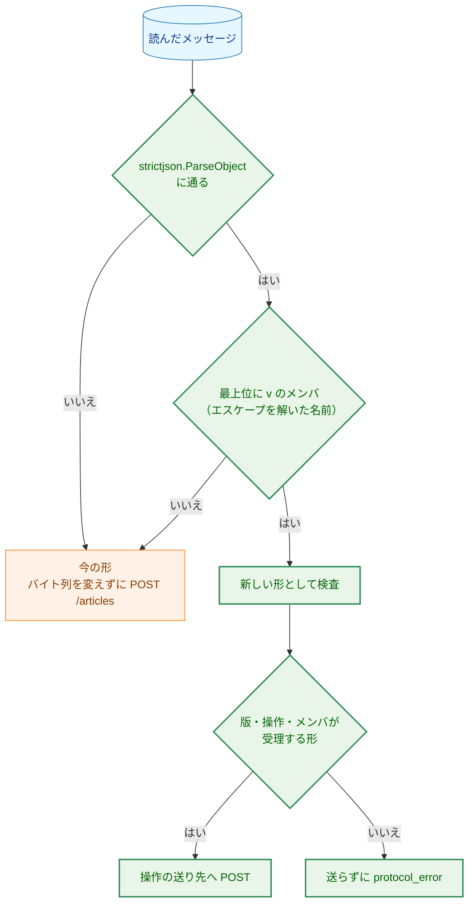

**Legend**

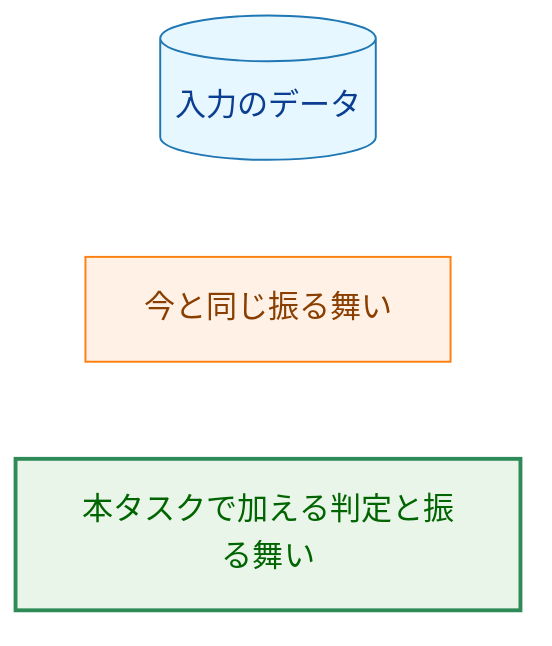

-   **1 つの JSON オブジェクトとして読めるか:** `strictjson.ParseObject`（正しい UTF-8、対になっていないサロゲートのエスケープを含まない、オブジェクトである、後続のデータがない）で判定する。要件書 F-008 は「正しい UTF-8、JSON として正しい、オブジェクトである、後続のデータがない」とする。`ParseObject` は、これに加えて対になっていないサロゲートのエスケープを拒否するので、そのようなメッセージも今の形として `/articles` へ中継される。サーバの `validateBody` も同じ `ParseObject` で `invalid_body` にする（`request.go:58-61`）ので、今の拡張から見た振る舞いは今と同じである。
-   **版のメンバ:** 名前は `v` とする（ホストの応答の `v`、`relay.go:41-42` と同じ名前）。`ParseObject` はメンバ名を `json.Decoder` のトークンとして読み、エスケープを解いた名前で持つ（`strictjson.go:331-337`）ので、`"v"` と書いた名前も `v` として見つかる（AC-40）。`Object.Has("v")` で有無を見る。`Has` の今の契約は「診断のためだけに使う」（`strictjson.go:123-124`）なので、振る舞いの選択に使えるように契約を改め、エスケープを解いた名前で完全一致を見ることを約束にする。
-   **例外の記述:**
    -   方針: 呼び出し側が渡した文字列の中身を調べて振る舞いを選ばない（CLAUDE.md「Key Design Patterns」の「Declare, don't infer」）。
    -   範囲: `internal/nmhost` の、メッセージが 1 つの JSON オブジェクトとして読めるかと、その最上位に `v` があるかで今の形と新しい形を選ぶ 1 か所だけである。新しい形の中では、操作は宣言した値（`op` の列挙）で選ぶ。今の形の中身は、最上位のメンバ名のほかは解析しない。
    -   理由: 今の拡張が送るメッセージは何も宣言しておらず、本タスクでは拡張を変えない（要件書 2.3）。今の形は「宣言がないこと」でしか区別できない（要件書 5.）。
    -   境界: `v` を持つメッセージは新しい形として厳格に検査し、合わなければ拒否する。今の形として扱い直さない。今の形と、この判定は、#503 の後に削除する（§3.14）。
    -   更新するテスト: §3.10.1 の「更新する既存のテスト」のとおり。今の形のメッセージを送る中継のテスト（`TestRelayForwardsOneRequest` など）の期待値は変わらない。
-   **説明の更新:** `internal/nmhost` のパッケージの説明（「記事の JSON を解釈しない」、`frame.go:1-4`）、`RelayTimeout` の注釈（`relay.go:23-27`）、`forward` の契約（`relay.go:208-214`）、`encodeReply` の最大の応答の見積もり（`relay.go:117-118`）、`maxFrameBytes` の注釈（`frame.go:18-21`）、`Relay` の契約（「標準入力の残りを読まない」、`relay.go:176-183`）、`.golangci.yml` の `nmhost-boundaries` の説明を、この判定と全体の読み込みに合わせて改める。

#### 3.10.3. 新しい形のメッセージ（H-08）

```json
{"v":1,"op":"start","input":{"videoUrl":"…","transcript":"…"}}
{"v":1,"op":"status","key":"…"}
{"v":1,"op":"publish","key":"…"}
```

| メンバ | 受理する形 |
|---|---|
| `v` | 整数の `1`（`strictjson.Value.AsNonNegativeInt64` で読み、1 以外は拒否） |
| `op` | 文字列で、`start`・`status`・`publish` のどれか |
| `input` | `op` が `start` のときだけ必須。JSON のオブジェクト（中身は検査しない） |
| `key` | `op` が `status` か `publish` のときだけ必須。JSON の文字列（形は検査しない） |

-   最上位は `Object.CollectOnly("v", "op", "input", "key")` で読み、宣言していないメンバと重複するメンバ（`v` の重複を含む）を拒否する（AC-40）。`op` に対して余分なメンバ（`status` の `input` など）がある場合も、必要なメンバが欠けている場合も拒否する。拒否はすべて、リクエストを送らずに `protocol_error` である。新しいホストのエラーの値は加えない（今の 4 つの値、`relay.go:56-82`）。
-   **版の値を 1 にする理由:** 今の形は版のメンバを持たないので、新しい形は最初の版である。ホストの応答の `v`（今は 1）とは別の値で、互いに独立に上げる。
-   **操作の値と送り先:**

```go
// Package nmhost

// Operation is the operation a new-form message names. The zero value is
// OperationUnknown, which is rejected without sending.
type Operation int

const (
	OperationUnknown Operation = iota
	OperationStart             // "start":   POST /jobs
	OperationStatus            // "status":  GET /jobs/{key}
	OperationPublish           // "publish": POST /jobs/{key}/publish
)
```

-   送り先のメソッドとパスの形は、`Operation` ごとに網羅的な `switch` で選び、`OperationUnknown` と範囲外の値は送らない。拡張がパスやメソッドを指定する手段はない（AC-38）。
-   **サーバへ送る本文:**
    -   `start`: `input` の値の元のバイト列を、そのまま本文にする。ホストは中身を検査せず、サーバの境界（`validateBody`）に任せる（要件書 F-008）。元のバイト列を得るために、`strictjson.Value` に `Raw() []byte`（値の元のバイト列の写しを返す）を加える。`ParseObject` は値を `json.RawMessage` として元のバイト列のまま持つ（`strictjson.go:340-344`）ので、組み立て直しによる変化（メンバの並び、重複、エスケープ）は起きない。
    -   `status`・`publish`: 本文を送らない（`GET` と、`Content-Length: 0` の `POST`）。キーの文字列は、`url.PathEscape` でエスケープしてパスの `{key}` の位置に入れ、エスケープした形をそのままリクエストのターゲットにする（HTTP のクライアントがパスを正規化したりエスケープし直したりしないことを、テストで確かめる）。ホストはキーの長さや文字の種類を見ない。エスケープは運ぶための符号化で、デコードすれば拡張が送った文字列に戻る。受理する形のキー（小文字の 16 進）はエスケープされないので、サーバは拡張が送った文字列そのものを照合する。エスケープが要る文字列は受理する形ではないので、サーバは `invalid_key` で拒否する（AC-40a）。
-   **ホストの応答の形（H-08）:** 新しい形のメッセージへの応答も、今と同じ `{"v":1,"kind":"response","status":…,"body":"…"}` と `{"v":1,"kind":"error","error":"…"}` である（`relay.go:84-110`）。サーバの応答の本文を base64 で包むので、ホストはサーバの応答の形を知らずに済む。

#### 3.10.4. 応答の大きさ（H-09）

| 上限 | 今 | 本設計 |
|---|---|---|
| サーバの状態の取得の応答（サーバの内部の上限） | なし | 256 KiB（`maxStatusResponseBytes`、§3.6.3） |
| ホストが中継するサーバの応答の本文（`maxResponseBytes`） | 64 KiB（`relay.go:35-36`） | 512 KiB |
| ホストの応答のフレーム（`maxFrameBytes`） | 1 MiB（`frame.go:18-21`） | 変えない |

-   512 KiB の本文を base64 にすると 699,052 バイトで、固定のメンバを加えても 1 MiB（1,048,576 バイト）のフレームに収まる。サーバの上限 256 KiB の応答は、ホストの上限の半分なので、切り詰められずに中継される（AC-41）。上限を超える応答は、今と同じく `protocol_error` である。
-   今の形の中継にも同じ上限が当てはまる。`/articles` の応答は 100 バイトに満たない（`extension/src/core/response.ts:56-57`）ので、上限を上げても今の拡張から見た振る舞いは変わらない。
-   拡張の応答の上限（`response.ts:57` の 1,024 バイト）は `/articles` の応答のためのもので、新しい形の応答の上限は #503 で決める。
-   **新しい形のメッセージの上限:** 今と同じ 32 MiB とする。形を判定する前に全体を読む必要があるので、新しい形だけに小さい上限を当てることはできない（判定の後に当てても、読み込みの量は減らない）。生成の開始の入力はサーバの 4 MiB の上限で拒否される。

#### 3.10.5. ホストのログ

今のログの段階（`length`・`connect`・`exchange`・`reply`、`relay.go:150-159`）に、次を加える。どれも固定の値で、メッセージのメンバ名や値は出さない。

-   段階 `read`（メッセージの全体の読み込みの失敗）と `form`（新しい形の検査の失敗）。
-   属性 `form`（`legacy`・`new`）、`op`（`start`・`status`・`publish`。新しい形だけ）、`rule`（新しい形の検査で破った規則の固定の名前: `version`・`operation`・`members`・`input`・`key`）。

標準入力の止まり、途中の終わり、新しい形の誤り、応答の上限の超過を、ログで区別できるようにするためである（どれも拡張には `protocol_error` か `server_timeout` として見える）。

### 3.11. コード（F-005・AC-29〜AC-31、H-07）

コードの綴りは小文字の英語の `snake_case` とし、Go の列挙から網羅的な `switch` で選ぶ。§3.11.1〜§3.11.5 の表は README に同じ値で載せ、ガードのテストが一致を確かめる（§3.15）。

#### 3.11.1. ジョブの状態と工程

| 要件書の値 | コード | Go の値 |
|---|---|---|
| 処理中 | `running` | `JobRunning` |
| 完了 | `done` | `JobDone` |
| 失敗 | `failed` | `JobFailed` |
| 不明 | `unknown` | `JobUnknown`（零値） |

| 工程 | `steps` のメンバ名 | `writer.Stage` |
|---|---|---|
| 下書き | `draft` | `StageGeneration` |
| 本文の短縮 | `shorten` | `StageShorten` |
| 検証・推敲 | `review` | `StageReview` |

#### 3.11.2. 工程の状態

| 要件書の値 | コード | Go の値 |
|---|---|---|
| 未着手 | `pending` | `StagePending`（零値） |
| 実行中 | `running` | `StageRunning` |
| 完了 | `done` | `StageDone` |
| 省略 | `skipped` | `StageSkipped` |
| （失敗した工程） | `failed` | `StageFailed` |

-   **失敗した工程の示し方（H-07）:** 要件書の 4 つの値に `failed` を加える。`実行中` のまま止まった形で示すと、ポーリングしている Viewer は、ジョブの状態を見ないかぎり、まだ実行中なのか失敗したのかを区別できないためである。`failed` は、ジョブの状態が `failed` のときだけ、高々 1 つの工程に現れる。完了の時点の検査の失敗（`article_invalid`・`article_too_large`）と、工程の外の失敗（コピーした字幕の取得の失敗）では、どの工程も `failed` にならない。

#### 3.11.3. 生成の失敗の理由

`classifyWrite`（`job.go:138-155`）を、`failure.Kind` ではなく `articlecache.FailureReason` を返す形に変える。判定の順序と使う番兵のエラーは今と同じである。旧 API の `classify`（`job.go:107-133`）は、`StageWrite` の分岐でその結果を `failure.Kind` に対応づける（下の表の右から 2 列目）。新しい API は `internal/failure` に依存しない。

| 要件書の分類 | コード | Go の値 | 旧 API が通知する `failure.Kind`（`internal/failure/failure.go:14-28`） |
|---|---|---|---|
| コピーした字幕が長すぎる | `transcript_too_long` | `FailureTranscriptTooLong` | `KindTranscriptTooLong` |
| LLM の時間切れ | `llm_timeout` | `FailureLLMTimeout` | `KindLLMTimeout` |
| LLM の空の応答 | `llm_empty` | `FailureLLMEmpty` | `KindLLMEmpty` |
| LLM の打ち切り | `llm_truncated` | `FailureLLMTruncated` | `KindLLMTruncated` |
| その他の LLM の失敗 | `llm_failed` | `FailureLLM` | `KindLLM` |
| 公開できない記事 | `article_invalid` | `FailureArticleInvalid`（完了の時点の検査、§3.6.3） | （旧 API にはない） |
| 応答に収まらない記事 | `article_too_large` | `FailureArticleTooLarge`（完了の時点の検査、§3.6.3） | （旧 API にはない） |
| 内部の失敗 | `internal` | `FailureInternal`（零値） | `KindInternal` |

-   対応づけの `switch` の `default` は、新しい API では `FailureInternal`、旧 API では `KindInternal` である。将来どちらかに値を加えても、誤った分類ではなく内部の失敗になる。旧 API の `TestFailureClassification`（`job_test.go:158`）は、対応づけを通しても同じ `failure.Kind` になることを確かめるので、期待値は変わらない。

#### 3.11.4. 投稿の状態とその理由

| 要件書の値 | コード | Go の値 |
|---|---|---|
| 未投稿 | `not_posted` | `PublishNotPosted` |
| 投稿中 | `posting` | `PublishPosting` |
| 投稿済み | `posted` | `PublishPosted` |
| 投稿の失敗 | `failed` | `PublishFailed` |
| 投稿できない | `unpostable` | `PublishUnpostable`（零値） |

| 投稿の状態 | 理由のコード | 意味 | Go の値 |
|---|---|---|---|
| `unpostable` | `mention` | メンションとして扱われうる文字列を含む（`publisher.ErrSlackMention`） | `UnpostableMention` |
| `unpostable` | `other` | それ以外の送る前の検査で拒否される（分割できない本文など） | `UnpostableOther`（零値） |
| `failed` | `webhook` | Webhook への送信の失敗（`*publisher.SlackPostError`） | `PublishFailureWebhook` |
| `failed` | `internal` | 投稿のジョブの異常終了 | `PublishFailureInternal`（零値） |

-   **`投稿できない` の理由の粒度（H-07）:** `mention` と `other` の 2 つにする。今の送る前の検査の拒否は、メンションの拒否（`ErrSlackMention`）と分割の拒否（`ErrSlackUnsplittable`）と本文の UTF-8（`ErrInvalidArticle`、`slack_message.go:30-34`）である。本文の UTF-8 は `writer` の出力の検査（`output.go:52-54`）で保証され、メンションのほかは利用者が直せる手段がない点で同じなので、分けない。#506 で表示を分ける必要が出たら、コードを加える。
-   **零値（要件書 4.5）:** 投稿の状態の零値は `unpostable` である。設定されなかった投稿の状態は、投稿を起こさず（投稿の操作は拒否される）、投稿済みとも主張しない。

#### 3.11.5. 拒否の理由と HTTP の状態コード

| 理由 | 状態コード | 使う操作 | 意味 |
|---|---|---|---|
| `article_not_ready` | 409 | 投稿の操作 | 記事の生成がまだ完了していない |
| `article_not_found` | 404 | 投稿の操作 | 投稿できる記事がない（失敗、または不明のキー） |
| `article_not_postable` | 409 | 投稿の操作 | この記事は投稿できない（`unpostable`） |
| `webhook_not_configured` | 503 | 投稿の操作、`/articles` | Webhook が設定されていない |
| `invalid_key` | 400 | 状態の取得、投稿の操作 | キーが受理する形でない |

-   既存の理由（`response.go:19-31`）の値と状態コードは変えない。新しい API は、そのうち `not_found`・`method_not_allowed`・`too_many_requests`・`body_too_large`・`invalid_body`・`invalid_video_url`・`invalid_transcript`・`internal_error` を、今と同じ意味で使う。
-   **キーの形の拒否を新しい理由にする理由（H-07）:** `invalid_body` は本文が JSON として読めないことを表す。キーの形の誤りは、拡張がキーを保存し損ねた（または古い版のキーを持っている）ことを表し、拡張の表示も違う。
-   **状態コードの理由:** `article_not_ready` と `article_not_postable` は、記録の今の状態と操作が合わないので 409 にする。`article_not_found` は記録がない（または記事を持たない）ので 404 にする。`not_found`（パスの誤り）と同じ 404 だが、`reason` で区別できる。`webhook_not_configured` は、サーバの設定のために操作を行えないので 503 にする。
-   `rejectReason` の零値は今と同じ `reasonInternal`（500）である。`forceClose`（`response.go:87-101`）は、本文を読まずに拒否する新しい理由 `webhook_not_configured` で真にする。`invalid_body` は、拒否ごとの「本文を読み残した」値で接続を閉じる（§3.1.1）。

### 3.12. ログ（要件書 4.2、H-10）

-   新しい操作のログも、今の方針（0011 の設計 §3.10）に従う。1 つの出来事を 1 行で、固定の属性だけを出し、`redact.Writer` を通す。本文、コピーした字幕、`videoUrl` の文字列、メタデータ、記事の本文、秘密の値を出さない。
-   **キーをログに出す（H-10）:** 属性 `key` に、サーバが計算したキー（生成の開始）と、`ParseKey` を通ったキー（状態の取得と投稿の操作）の 64 文字を出す。受理する形でないキーは、ログにも応答にも出さない。キーはコピーした字幕とメタデータの HMAC-SHA256（§3.2）で、中身を復元できない。同じ入力を送ったことの照合はできるが、ログを読めるのはサーバと同じ利用者だけで、その利用者は入力そのものを持っている。開発者が、受け付けから生成のジョブの完了と投稿までを `grep <key>` でたどれるようにするためである。
-   **要件書 3.2 との関係:** 要件書 3.2 は、受け取ったキーを「ログの書式などに埋め込まない」とする。`log/slog` の属性の値は、書式の文字列ではなく、ハンドラが引用して書く値なので、キーが書式として解釈されることはない。そのうえで、受け取ったキーは `ParseKey` を通った後にだけ、`Key.String()`（サーバが作った 64 文字）として出す。
-   出す行と属性:

| 出来事 | 属性 |
|---|---|
| 生成の開始の受け付け | `requestId`、`key`、`videoId`、`outcome`（`started`・`restarted`・`existing`） |
| 生成のジョブの完了 | `key`、`videoId`、`model`、`modelVersion`、`duration`、`publish`（投稿の初期状態のコード） |
| 生成のジョブの失敗 | `key`、`videoId`、`failure`（失敗の理由のコード）、`step`（失敗した工程）、`error`（今の `logJobFailure` と同じく、秘密と字幕を含まないエラー） |
| 生成のジョブの取り消し（シャットダウン） | `key`、`videoId`。取り消しで終わったジョブは、この行だけを書き、生成のジョブの失敗の行は書かない（取り消しは `classifyWrite` では `llm_failed` になるが、`genCtx` が取り消されていれば失敗として扱わない） |
| 記録の破棄 | `key`、`state`、`publish`、`age` |
| 投稿の操作の受け付け | `requestId`、`key`、`outcome`（`started`・`already`）、`from` |
| 投稿のジョブの完了・失敗 | `key`、`posted`、`total`、（失敗なら）`reason`、`error` |
| 拒否 | 今の `reject` と同じ（`requestId`・`status`・`reason`・`detail`、`handler.go:102-113`）。`too_many_requests` の `detail` は、読み込みの枠・生成の枠・件数の上限で別の固定の値（`read_slot`・`generation_slot`・`cache_full`）にする |
| 状態の取得 | 出さない（ポーリングで数秒ごとに来るため）。このため、状態の取得の応答の `requestId` に対応するログの行はない。README にこのことを書く |

### 3.13. 既存の設計からの変更と、更新するテスト

| 変わる振る舞い | 元の方針の場所 | 理由 | 更新する既存のテスト |
|---|---|---|---|
| サーバの `SLACK_WEBHOOK_URL` を任意にする | `docs/dev/project_overview.md:148`、0011 の設計 §3.2.1 | 親 issue #501 の決定（要件書 F-006） | `internal/config/config_test.go` の `TestLoadServerWebhookRequired`（未設定のサブテストを「エラーにならない」に変え、空と不正な値のサブテストは残す）と `TestLoadServerValid`（`:991` の `WebhookURL` の戻り値）、`cmd/yt2column-server/run_test.go` の `TestStartupFailures` の `model and webhook missing`（設定のエラーの行数）、`publisher not built`・`notifier not built`（Webhook がある場合だけの組み立て）、`TestBuildsSlackPublisher` |
| 生成の開始は、生成の枠の前に本文を読む | 0011 の設計 §3.8.2 | キーが分かるまで本文を読む必要がある（要件書 5.） | なし（旧 API の順序は変えない、§3.4.2） |
| 新しい API の失敗を Webhook へ通知しない | 0011 の要件 F-007 | Viewer が失敗を表示する（#501） | なし（旧 API の通知は変えない） |
| シャットダウンで新しい API の生成のジョブを取り消す | 0011 の設計 §3.8.3 | 1.3 の決定（要件書 4.3） | なし（旧 API のジョブの待ち方は変えない。`TestServeShutdownWaitsForJobs` と `cmd/yt2column-server/signal_test.go` の `TestSignalWaitsForJob` は旧 API のジョブを使う） |
| ホストはメッセージを解析し、操作を送り先に対応づける | 0026 の設計 §9、§3.5.2（流し込み） | 要件書 F-008 | §3.10.1 の「更新する既存のテスト」 |
| ホストの応答の上限を上げる | 0026 の設計 §3.5.4・§3.5.5 | 完了した記事の応答を中継する（§3.10.4） | `TestRelayResponseOverLimit`（上限 64 KiB → 512 KiB） |
| `server.Options` の形 | 0011 の設計 §3.5.1 | Webhook を任意にする（§3.8） | `internal/server/test_helpers.go:57`・`:74`、`server_test.go:31`、`job_test.go:297` の `New(Options{…})`（Webhook を `WebhookOptions` に移す）。`newServer`（`server_test.go:29`）・`newCustomServer`（`test_helpers.go:72`）の引数と `testServer.publisher` の型を `WebhookPublisher` に変え、それらを呼ぶ約 27 か所を合わせる。`countingPublisher`（`test_helpers.go:86-103`）と `internal/publisher/testutil` の `FakePublisher` に `PostMessages` を加える。`gateWriter`・`panickingWriter`（§3.5） |
| `cmd/yt2column-server` の `deps` の型 | 0011 の設計 §3.1 | `ProgressWriter` と `WebhookPublisher`（§3.5・§3.8） | `cmd/yt2column-server/test_helpers.go:265-300` の `testDeps`・`loopbackDeps`（`newWriter: writer.NewProgressWriter`、`nopPublisher` に `PostMessages` を加える）、`run_test.go:129`・`:137`・`:390`・`:394` の差し替えの関数、`TestWriterOptionsMatchCLIDefaults` の差し替えの関数の型 |
| 拒否の理由が増える | 0011 の設計 §3.4.3 | §3.11.5 | `internal/server/response_test.go` の `TestRejectReasonSet` と `job_test.go` の `TestReasonToKind`（`reasonCount` で数える。新しい理由を加える）、`handler_test.go` の `TestRejectStatusCodes`（新しい理由の行を加える） |
| 生成の失敗の分類の戻り値の型 | 0011 の設計 §3.9 | §3.11.3 | `job_test.go` の `TestFailureClassification`（期待値は同じ。対応づけを通す） |
| 料金の書式を 1 つの関数にまとめる | 0028 の設計（出力の形） | §3.6.1 | なし（出力は変わらない。`golden_test.go` がそのまま通る） |
| ファイルの中身が表示用の Markdown の整形を共有する | `docs/dev/project_overview.md:60` | §3.6.2 | なし（ファイルの中身は変わらない） |
| `strictjson.Object.Has` の契約 | `strictjson.go:123-124` の注釈 | §3.10.2 | なし |

### 3.14. 旧 API の削除と簡素化の項目（H-12）

`03_implementation_plan.md` の最初の手順で、次の一覧を本文に書いた issue を起票する。issue は #501 の子とし、#503 の完了を待って着手することを記す。

**#503 の後に削除するもの（旧 API だけが使うもの）:**

1.  `internal/server` の `/articles` の受け口: `ArticlesPath`、`handler` の旧 API の分岐と、その `recover` の失敗の通知、`readRequest` を生成の枠の後に呼ぶ順序、旧 API のジョブ（`startJob`・`runJob`、`internal/pipeline` の使用）、`notify`・`notifyAsync`・`notifyTimeout`、`reasonToKind`、`rejectReason.notify`、`classify` と、`FailureReason` を `failure.Kind` に対応づける関数、`logJobFailure` の `SlackPostError` の属性。
2.  `server.WebhookOptions` の `Notifier`、`WebhookPublisher` のうち `publisher.Publisher`（`Publish`）。
3.  `internal/failure`（`Kind`・`Notice`・`Notifier`）と `internal/failure/testutil`。
4.  `internal/publisher` の `SlackFailureNotifier`（`slack_failure.go`）と、それだけが使う `ErrSlackInvalidNotice`・`ErrSlackNoticeRejected`。
5.  `cmd/yt2column-server` の `deps.newNotifier` と `newNotifier`。
6.  `internal/nmhost` の今の形の中継: 今の形と新しい形の判定（CLAUDE.md の例外）、`requestURL`（`/articles`）。削除の後、`v` を持たないメッセージは `protocol_error` にする。CLAUDE.md の「Declare, don't infer」の例外の記述も取り除く。
7.  README の `/articles` の節（curl の例、拒否の理由の表の `/articles` だけの説明、「extension shows」の列の今の拡張のための値）、`docs/dev/security.md` §8.1・§8.2 の `/articles` の記述、`docs/dev/project_overview.md` の `/articles` の記述。
8.  `cmd/yt2column-server/docs_test.go` の `curl` と `server.ArticlesPath` のガード（新しい API の curl の例のガードに置き換える）。

**#503 の後に簡素化するもの（新旧の両対応のために複雑になったもの）:**

1.  生成の枠の合算: 生成の枠は新しい API の生成のジョブだけが使うので、`slots` の説明と、生成の枠を持つ主体（リクエスト・ジョブ・失敗の通知）の区別をなくす。シャットダウンのログの `pending` の数え方も改める。
2.  `webhook_not_configured` の `/articles` での使い方と、それを `forceClose` で扱う分岐。
3.  `SlackWebhookPublisher.Publish` を CLI だけが使うことの確認（`--slack` は残るので、`Publish` は残す）。
4.  `jobInput` の `source` と `requestID` のうち、旧 API のジョブだけが使うもの。
5.  ホストの `forward` の契約と注釈から、今の形の流し込みとの対比を除く。
6.  停止の案内（`cmd/yt2column-server/run.go:231-236` の「約 45 分」）: 待つのは投稿のジョブだけになるので、最長約 5 分に改める。

### 3.15. 文書とガード（F-009・AC-29・AC-42・AC-43）

-   **README の「Localhost server」節:** 3 つの操作（パス、本文、応答の形）、§3.11 のコードの表、記事のキャッシュの性質（メモリだけ、件数の上限 100、古いものからの破棄、再起動で記事と投稿の状態が失われること）、`投稿できない` の記事は再起動するか記録が捨てられた後に生成し直すまで投稿できないこと、キーは不透明な値で形や計算方法に依存してはならないこと、状態の取得はログに書かないこと、`/articles` を #503 の後に削除する予定であること、を加える。curl の例に新しい API を加える。停止の節（「Stopping the server」）に、新しい API の処理中の生成は取り消され、その結果は失われることを加える。
-   **README の拒否の理由の表:** §3.11.5 の 5 つの行を加える。3 列目（extension shows）は `unexpected reply` とする。今の拡張は新しい理由を知らないので、`fixed message` にしない（`extension/test/serverReasons.test.ts:36` は 3 列目が `fixed message` で始まる行だけを拡張の値と突き合わせる）。AC-42 の Go のガード（`cmd/yt2column-server/docs_test.go:81-107`）は、`RejectReasonsForTest` が新しい理由を返すので、表の行の追加を求める。
-   **コードの表のガード（AC-29）:** `internal/server` に `-tags test` の関数（`APICodesForTest`）を加え、§3.11.1〜§3.11.4 の 6 つの集合（ジョブの状態、工程、工程の状態、生成の失敗の理由、投稿の状態、投稿の状態の理由）を、それぞれの名前とともに返す。README のコードの表は、集合ごとに 1 つの表とし、1 列目の見出しを集合の名前（`job state`・`step`・`step state`・`failure`・`publish state`・`publish reason`）にする。`cmd/yt2column-server/docs_test.go` に、見出しで表を見つけ、1 列目の集合が返した集合と過不足なく一致することを確かめるサブテストを加える。同じコード（`failed`・`running` など）が複数の表に現れるので、表は見出しで区別する。今の拒否の理由の表のガードと同じ種類の確認（値の一致）で、文言は確かめない（CLAUDE.md「Document tests」）。
-   **README の設定の表と本文:** `yt2column-server` が `SLACK_WEBHOOK_URL` を任意とすること、未設定では投稿の操作と `/articles` が `webhook_not_configured` で拒否され、今の拡張の送信が「想定外の応答」になることを書く。
-   **`docs/dev/security.md` §8:** §8.1 の「202 の後に結果を返す API がない」を、新しい API の状態の取得で結果を返すことに改める。§8.2 の残るリスク（再送による二重の生成と投稿）を、新しい API と旧 API に分けて書き直す（要件書 4.2「二重の投稿の防止」）。キャッシュがメモリに持つ値（記事を持ち、コピーした字幕と訂正の一覧を持たない）、ホストが操作の値を固定の送り先に対応づけ、キーをパスに入れないこと、返す記事が untrusted なテキストであること、を加える。§8.2 のホストの「上限」の項（`docs/dev/security.md:136`）の、サーバの応答の 64 KiB と、標準入力が止まった場合の例外を、§3.10 に合わせて改める。ホストの標準出力の項の、ログに書く値に、§3.10.5 の段階と属性を加える。§8.2 の枠の数（`2`）と本文の上限（4 MiB）のガード（`docs_test.go` の `security.md` のサブテスト）は値を変えないので、そのまま通る。
-   **`docs/dev/project_overview.md`:** 要件書 5. の 3 か所（実行形式、`LoadServer` の段落、キャッシュの段落）を更新する。`ArticleWriter` の項の出力の形式（`project_overview.md:60`）に、表示用の Markdown を加え、ファイルの中身がその整形を共有すること（§3.6.2）を書く。
-   **`docs/translation_glossary.md`:** 記事のキー、記事のキャッシュ、記録、ジョブの状態、工程、工程の状態、投稿の状態、生成の枠、読み込みの枠、完了の時点の検査を加える。「枠」の今の行（`translation_glossary.md:55`）は、旧 API と新しい API の生成のジョブが合わせて数えることを書き加える。「段階」の今の行（`writer.Stage` を訳す）と「工程」の関係は、要件書 6. の用語集のとおり、パイプラインの段階（`pipeline.Stage`）と記事の生成の中の工程（`writer.Stage`）を分ける形に揃える。
-   **`docs/dev/developer_guide/package_reference.md`:** `internal/articlecache` の行を加え、`internal/server`・`internal/writer`・`internal/publisher`・`internal/config`・`internal/nmhost`・`internal/strictjson`・`cmd/yt2column-server` の行を更新する。
-   **`docs/dev/production_profile.md`:** 利用者が指定しなければならない変数の記述（`production_profile.md:42`）を、サーバでは `SLACK_WEBHOOK_URL` が投稿するときだけ要ることに改める。
-   **`CLAUDE.md`:** 「Key Design Patterns」の「Declare, don't infer」に、§3.10.2 の例外を、今の例外（コピーした字幕の解析）と同じく方針・範囲・理由・境界の形で加える。範囲は `internal/nmhost` の 1 か所、境界は `v` を持つメッセージを今の形に戻さないこと、#503 の後に取り除くこと（§3.14 の 6）である。
-   **AC-43:** 上の文書の記述は、PR のレビューで読む（`manual`）。`CLAUDE.md` の記述も同じく読む。

### 3.16. design_handoff の各項目への対応

| 項目 | 本設計の対応 |
|---|---|
| H-01 パス・メソッド・形 | `POST /jobs`・`GET /jobs/{key}`・`POST /jobs/{key}/publish`。キーはパスに入れ、デコードする前の `RequestURI` を照合する（`/articles` と `/jobs` は完全一致、`/jobs/` の後はキーの部分と `/publish`）（§3.1） |
| H-02 キーの符号化とハッシュ | 領域の文字列と長さを前に置く符号化、プロセスごとの秘密を鍵とする HMAC-SHA256、小文字の 16 進の 64 文字（§3.2） |
| H-03 工程の進み具合 | `writer.ProgressWriter`・`ProgressObserver`・`NewProgressWriter`（§3.5、1.3 の決定） |
| H-04 同時実行の上限 | 生成の枠は 2 のまま新旧で合算、読み込みの枠は 2、投稿のジョブは数えない（§3.4・§3.7、1.3 の決定） |
| H-05 表示用の Markdown | `renderDisplayMarkdown` を新しい関数で書き、ファイルの中身がそれを共有する（例外の記述は §3.6.2） |
| H-06 キャッシュの件数の上限 | 100 件。記録の大きさの見積もりとメモリの量は §3.3.4 |
| H-07 コードの綴り・理由・状態コード | §3.11。失敗した工程は `failed`、キーの形の拒否は `invalid_key`、各列挙の零値も §3.11 |
| H-08 ホストのメッセージの新しい形 | `v`・`op`・`input`・`key`、接続の後に全体を読んでから判定、読み込みは 20 秒の中継の上限に含める、応答の形は変えない（§3.10） |
| H-09 応答の大きさの上限 | サーバの状態の取得の応答 256 KiB、ホストの応答の上限 512 KiB、新しい形のメッセージの上限は 32 MiB のまま（§3.6.3・§3.10.4、1.3 の決定） |
| H-10 キーをログに出すか | 出す。受理する形を通ったキーだけ（§3.12） |
| H-11 シャットダウンと投稿のジョブ | 取り消さずに待つ。1 回の投稿は最長 309 秒で、別の上限を設けない（§3.7.2）。新しい API の生成のジョブは取り消す（1.3 の決定） |
| H-12 旧 API に関わるリファクタリング | §3.14 の一覧を、実装計画の最初の手順で issue に起票する |
| H-13 テストの組み立て | §7 |

### 3.17. コンポーネント責務表

| ファイル | 新規・変更 | 責務 |
|---|---|---|
| `internal/articlecache/key.go` | 新規 | `KeyInput`・`Key`・`Keyer`・`NewKeyer`・`ParseKey`・`ErrInvalidKey` |
| `internal/articlecache/cache.go` | 新規 | `Cache`・`Options`・`New`・`Begin`・`Lookup`・`BeginPublish`・`Eviction`、件数の上限と破棄 |
| `internal/articlecache/record.go` | 新規 | 状態の列挙、`Stages`・`Snapshot`、`Run`・`PublishRun` の遷移と世代 |
| `internal/server/handler.go` | 変更 | デコードする前のターゲットによる振り分け（`/articles`・`/jobs`・`/jobs/{key}`・`/jobs/{key}/publish`）、旧 API の Webhook 未設定の拒否 |
| `internal/server/jobs_api.go` | 新規 | 生成の開始・状態の取得・投稿の操作の受け口、読み込みの枠、ハンドルと枠の後始末（§3.4.5） |
| `internal/server/generation.go` | 新規 | 生成のジョブ、完了の時点の検査、`genCtx` |
| `internal/server/publish.go` | 新規 | 投稿のジョブ、`WebhookPublisher` |
| `internal/server/status.go` | 新規 | 状態の取得の応答の組み立て、コードの選択、応答の大きさの上限 |
| `internal/server/request.go` | 変更 | `jobInput` に検査を通った値（キーの入力）を加える |
| `internal/server/response.go` | 変更 | 新しい拒否の理由、`forceClose`、`rejection` の「本文を読み残した」値、`too_many_requests` の `detail` |
| `internal/server/server.go` | 変更 | `Options`・`WebhookOptions`、キーの秘密の生成と `Keyer`、`Cache` と読み込みの枠の保持、シャットダウンの取り消しとログ |
| `internal/server/job.go` | 変更 | `classifyWrite` の戻り値、旧 API の `failure.Kind` への対応づけ |
| `internal/server/test_helpers.go` | 変更 | キャッシュの上限と時計とキーの秘密を渡す組み立て、`APICodesForTest`、fake の `WriteWithProgress` |
| `internal/writer/writer.go` | 変更 | `ProgressObserver`・`ProgressWriter`・`NewProgressWriter`、`WriteWithProgress` と通知 |
| `internal/publisher/testutil/mocks.go` | 変更 | `FakePublisher.PostMessages`（`server.WebhookPublisher` を満たす） |
| `internal/writer/testutil/mocks.go` | 変更 | `FakeArticleWriter.WriteWithProgress` と工程ごとに止める仕組み |
| `internal/publisher/display_render.go` | 新規 | `renderDisplayMarkdown`・`DisplayMarkdown` |
| `internal/publisher/file_render.go`・`file.go` | 変更 | `FileContent`、`renderDisplayMarkdown` と `FormatArticleCost` の使用 |
| `internal/publisher/slack.go` | 変更 | `PostMessages`、`Publish` をその上に置き直す |
| `internal/publisher/slack_message.go` | 変更 | `SlackMessages`・`PrepareSlackMessages` |
| `internal/publisher/slack_render.go` | 変更 | `FormatArticleCost` の使用 |
| `internal/publisher/format.go` | 変更 | `FormatArticleCost` |
| `internal/publisher/test_helpers_slack.go` | 変更 | `SlackMessagesForTest` を `PrepareSlackMessages` を呼ぶ形にする |
| `internal/config/config.go` | 変更 | `LoadServer` の Webhook の任意化、`ServerConfig.WebhookURL` |
| `cmd/yt2column-server/run.go` | 変更 | Webhook の有無に応じた組み立て、`deps` の型、起動のログと WARN |
| `cmd/yt2column-server/test_helpers.go` | 変更 | `testDeps`・`loopbackDeps` の型 |
| `internal/nmhost/relay.go` | 変更 | 全体の読み込み、形の判定、`Operation`、送り先と本文、応答の上限、ログの段階と属性、注釈 |
| `internal/nmhost/frame.go` | 変更 | パッケージの説明 |
| `internal/strictjson/strictjson.go` | 変更 | `Value.Raw`、`Object.Has` の契約 |
| `.golangci.yml` | 変更 | `internal/articlecache` の `depguard` の規則、`nmhost-boundaries` の説明 |
| `cmd/yt2column-server/docs_test.go` | 変更 | コードの表のガード、新しい API の curl の例のガード |
| `README.md`・`docs/dev/security.md`・`docs/dev/project_overview.md`・`docs/dev/production_profile.md`・`docs/translation_glossary.md`・`docs/dev/developer_guide/package_reference.md`・`CLAUDE.md` | 変更 | §3.15 |

## 4. エラーハンドリング設計 (Error Handling Design)

### 4.1. エラー型

新しいエラー型は、§3.2 の `articlecache.ErrInvalidKey` と、§3.3.2 の `articlecache.ErrInvalidOptions` だけである。`internal/server` は、`WebhookOptions` のフィールドが欠けているときの固定の理由を今の形（`server.go:42-49`）で加え、今の `ErrInvalidOptions` で包む。

```go
// Package server

// The fixed reasons New rejects Options, added to the existing ones.
var (
	errNilWebhookPublisher = errors.New("webhook publisher is nil")
	errNilWebhookNotifier  = errors.New("webhook notifier is nil")
)
```

-   キーの秘密を作るための乱数が得られない場合、サーバは起動しない（§3.2）。`crypto/rand.Read` がプロセスを止めるので、`server.New` はこの場合のエラーを持たない。固定の秘密や別の乱数の源に切り替えない。
-   新しい API の失敗は、Go のエラーとして呼び出し側へ返さず、記録の列挙（`FailureReason`・`PublishFailureReason`）と拒否の理由として表す。生成のジョブと投稿のジョブは、エラーをログの 1 行にだけ書く。
-   失敗の理由は、`classifyWrite` と `errors.Is`/`errors.AsType` で選び、エラーの文言から推し量らない。投稿の失敗は `errors.AsType[*publisher.SlackPostError]` で `webhook` にし、それ以外は `internal` にする。

### 4.2. エラーメッセージの設計パターン

-   応答はコードだけを返し、文言を返さない（AC-31）。エラーの文言はログにだけ出し、今と同じく秘密と字幕を含まない（`writer`・`publisher` のエラーは値を含まない約束、`writer/article.go:10-12`、`publisher/slack.go:36-48`）。
-   `ParseKey` のエラーは受け取った文字列を含まない。受理する形でないキーはログにも出さない（§3.12）。

### 4.3. 副作用の契約

| 操作 | 起こしうる副作用 | 起こさない副作用 |
|---|---|---|
| 生成の開始 | 記録の作成・やり直し、1 件の破棄、LLM の呼び出し（生成のジョブ） | Webhook への送信、失敗の通知、ディスクへの書き込み |
| 状態の取得 | なし | 記録の変更、LLM の呼び出し、Webhook への送信（AC-17） |
| 投稿の操作 | 投稿の状態の変更、Webhook への送信（投稿のジョブ） | LLM の呼び出し、失敗の通知、記事の変更 |
| 旧 API（Webhook あり） | 今と同じ（LLM、Webhook への投稿、失敗の通知） | 記録の変更 |
| 旧 API・投稿の操作（Webhook なし） | なし（拒否だけ） | ジョブの開始、Webhook への送信 |
| ホストの新しい形の拒否 | なし（応答だけ） | サーバへのリクエスト |
| シャットダウン | 新しい API の生成のジョブの取り消し（LLM の呼び出しの打ち切り） | 投稿のジョブと旧 API のジョブの取り消し |

-   `SLACK_WEBHOOK_URL` の有無は、Webhook への送信と失敗の通知だけを止める。生成の開始・状態の取得・完了の時点の検査（`投稿できない` の判定を含む）は、Webhook の有無で変わらない（AC-34）。

## 5. セキュリティ考慮事項 (Security Considerations)

本タスクは、ネットワークへの送信（LLM API・Webhook）、Webhook の URL、プロンプトに埋め込む untrusted なテキストを扱うので、`docs/dev/security.md` を適用する（要件書 4.2）。

### 5.1. 脅威モデル

矢印 A → B は「A から B へデータが流れる」ことを表す。囲み「同じ利用者の権限」は信頼の境界で、その中のプロセスは信頼する（`security.md` §8）。ラベルに「untrusted」と書いた入力は、その中身を信頼しない。

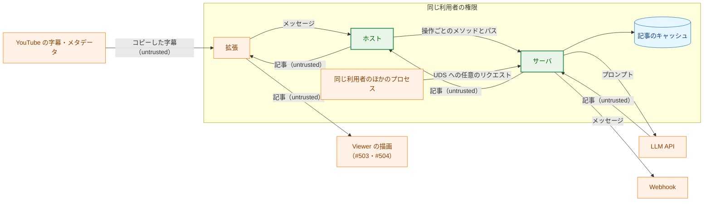

**Legend**

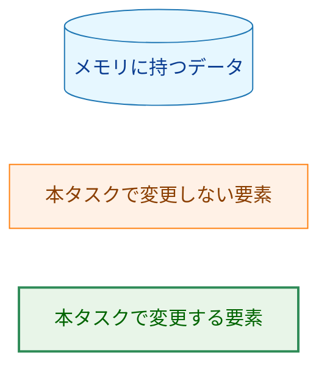

### 5.2. 脅威と対策

| ID | 脅威 | 対策 |
|---|---|---|
| T-01 | 同じ入力の再送や応答の取りこぼしで、記事が 2 回生成・投稿される | キーによる重複の排除（§3.3）、投稿の操作の冪等性（`PublishBeginAlready`）、届いたメッセージの記録による再開（§3.7.2）。残るリスクは §5.4 |
| T-02 | 拡張から受け取ったキーで、ホストが別の操作やパスへ送ってしまう（パスの注入） | ホストはキーを `url.PathEscape` でエスケープしてからパスに入れ、送り先の形は `Operation` で選ぶ。サーバはデコードする前のターゲットを照合し、キーの部分は小文字の 16 進の 64 文字だけを受け付ける（§3.1.1・§3.10.3） |
| T-03 | 今の形と新しい形の取り違えで、新しい形のつもりのメッセージが `/articles` で記事を生成・投稿する | `v` を持つメッセージは新しい形として厳格に検査し、今の形に戻さない（§3.10.2）。読めないメッセージは今の形として送るが、サーバが `invalid_body` で拒否する。新しい形の生成の開始の入力は `input` の下にあるので、`v` を落としたメッセージも `/articles` の本文として受理されない（`videoUrl` と `transcript` が最上位にない） |
| T-04 | 大きな本文や多数のリクエストで、メモリや LLM の呼び出しが際限なく増える | 読み込みの枠（2）、生成の枠（2）、キャッシュの件数の上限（100）、状態の取得の応答の上限（256 KiB）（§3.3.4・§3.4・§3.6.3） |
| T-05 | 応答やログに、字幕・URL・秘密・エラーの文言が漏れる | 応答はコード・識別子・数値と完了した記事だけ（§3.1.3）、ログは固定の属性と `redact.Writer`（§3.12）、受理しないキーは出さない |
| T-06 | プロンプトインジェクションで操作された記事が、利用者の画面や Webhook に届く | 完了の時点の検査（公開できるか、送る前の検査）を今の投稿と同じにする（§3.6.3）。表示の安全性は #503・#504 |
| T-07 | 同じ利用者のほかのプロセスが、キーを知って投稿を求める | 信頼の境界は今と同じ（そのプロセスは今も `/articles` で投稿を求められる、要件書 4.2）。UDS の権限（`0700`・`0600`）は変えない |
| T-08 | コピーした字幕がメモリに残り続ける | コピーした字幕は生成のジョブの間だけ持ち、記録には訂正の一覧（コピーした字幕の引用を含む）を除いた記事だけを渡す（§3.3.2・§3.4.4、AC-27）。ディスクに書かない |
| T-10 | 入力を知る者がキーを計算し、生成を始めずに状態の取得を呼んで、その入力の記事がキャッシュにあるかを知る（記事の有無を調べる手段）。また、計算できるキーに利用者や拡張が依存する | キーを、プロセスごとの秘密を鍵とする HMAC-SHA256 にする。秘密はメモリにだけ持ち、出力しない（§3.2）。残るリスク: 同じ利用者のプロセスは、同じ入力で生成の開始を呼べば今もキーを得られる（その場合は生成が始まりうる。信頼の境界は T-07 と同じ） |
| T-09 | 受け口の panic で、生成の枠や記録が使えないまま残り、生成がすべて止まる | ハンドルと枠の持ち主を決め、panic でも後始末する（§3.4.5）。キャッシュのメソッドは排他制御を `defer` で解き、範囲外の入力で panic しない（§3.3.2） |

### 5.3. 信頼できない入力の境界

| 境界 | 受理する形 | 上限 | 拒否 | 設計の箇所 |
|---|---|---|---|---|
| 生成の開始の本文 | 今の `/articles` と同じ（`validateBody`） | 4 MiB | 今と同じ理由。キャッシュに何も加えない | §3.4.1 |
| 状態の取得と投稿の操作の本文 | なし（`Content-Length` が 0 でないもの、`Transfer-Encoding` を持つものを拒否） | 0 | `invalid_body` | §3.1.1 |
| キー（パスの部分） | デコードする前の文字列が小文字の 16 進の 64 文字だけ。補正しない | 64 文字 | `invalid_key`。キャッシュを変えない | §3.1.1・§3.2 |
| リクエストのターゲット | `/articles`・`/jobs` との完全一致と、`/jobs/{key}`・`/jobs/{key}/publish` の形。`?` を含むものは受け付けない | `http.Server` の `MaxHeaderBytes`（64 KiB） | `not_found`・`method_not_allowed`。上限を超えるものは `net/http` の `431`（JSON でない、§3.1.1） | §3.1.1 |
| ホストの新しい形のメッセージ | `ParseObject` に通り、`v`・`op`・`input`・`key` だけを持ち（重複・宣言していないメンバを拒否）、`v` は 1、`op` は 3 つのどれか、操作に要るメンバだけがある | 32 MiB | 送らずに `protocol_error` | §3.10.3 |
| ホストの今の形のメッセージ | `v` を持たないオブジェクトと、オブジェクトとして読めないもの。中身は解析しない | 32 MiB | サーバの検査が境界 | §3.10.2 |
| LLM が生成した記事 | `writer` の今の検査、`CheckPublishable`、応答の大きさ、送る前の検査 | 状態の取得の応答で 256 KiB | 生成の失敗または `投稿できない` | §3.6.3 |

-   要件書 1. の「Bytes」「Top level」の観点は、本文の検査をすべて `strictjson.ParseObject` に任せることで満たす（不正な UTF-8、対になっていないサロゲートのエスケープ、後続のデータを拒否）。数値は、ホストの `v` だけが読み、`AsNonNegativeInt64` で整数として読む（`-0`・小数・指数・範囲外を拒否）。

### 5.4. 残余のリスク

-   **分割した投稿の 1 通の重複:** 送信の失敗のときに実は届いていたメッセージは、やり直しで重複する（要件書 1. の決定）。
-   **再起動と破棄の後の重複:** 再起動の後と、記録が捨てられた後に同じ入力で生成し直して投稿すると、前に届いたメッセージが重複しうる（要件書 4.3・F-004）。
-   **シャットダウンでの強制終了:** 2 回目のシグナルで、投稿のジョブの途中で終わると、最後に送ったメッセージが届いたかどうかが分からないまま記録が失われる（要件書 4.3）。
-   **並んだ投稿のメッセージの混ざり:** 複数のメッセージに分かれる記事を 2 本同時に投稿すると、チャンネルでメッセージが混ざって並び、Webhook には 1 秒の間隔より短い間隔でメッセージが届く。分かれるのは、改行やタイトルが異常に長く、全体が 16,383 コードポイントを超える記事だけである（1.3 の決定）。
-   **旧 API の経路:** `/articles` の再送による二重の生成と投稿は、#503 の後に削除するまで残る（`security.md` §8.2）。
-   **キーの照合:** ログのキーから、同じ入力を 2 回送ったことが分かる。ログを読めるのは同じ利用者だけである（§3.12）。

### 5.5. 対象クライアント環境の検証

-   新しい API が Webhook へ送るメッセージは、今の `/articles` の投稿と同じ内容・同じ送り方（`silent`、分割、間隔、時間の上限）である（§3.7.1）。Webhook の新しい機能を使わないので、Mattermost での追加の検証は要らない。届いたメッセージの判定（`200` と `ok`）も今と同じである。

## 6. 処理フロー詳細 (Processing Flow Details)

### 6.1. 生成の開始

矢印は処理の順序を表す。

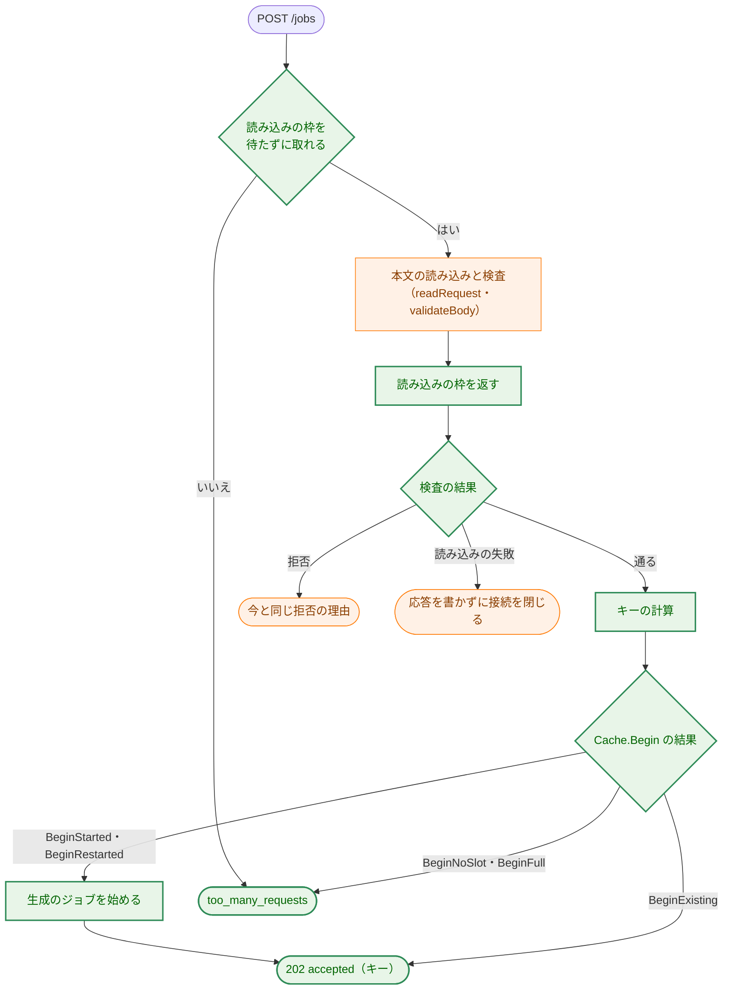

**Legend**

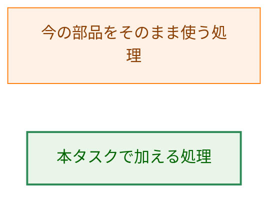

### 6.2. 生成のジョブ

矢印は呼び出しを表す。`WriteWithProgress` か完了の時点の検査が失敗したときは、その時点で `Run.Fail` を呼んで終わる。

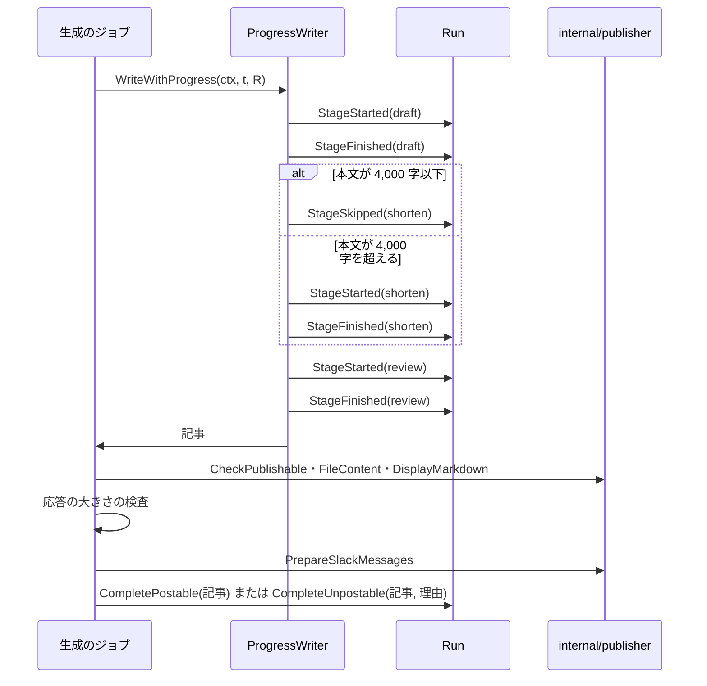

### 6.3. ホストの中継

矢印はメッセージとリクエストの流れを表す。新しい形の検査に失敗したとき、接続に失敗したとき、時間の上限を過ぎたときは、ホストの固定のエラーを返す（§3.10.1）。

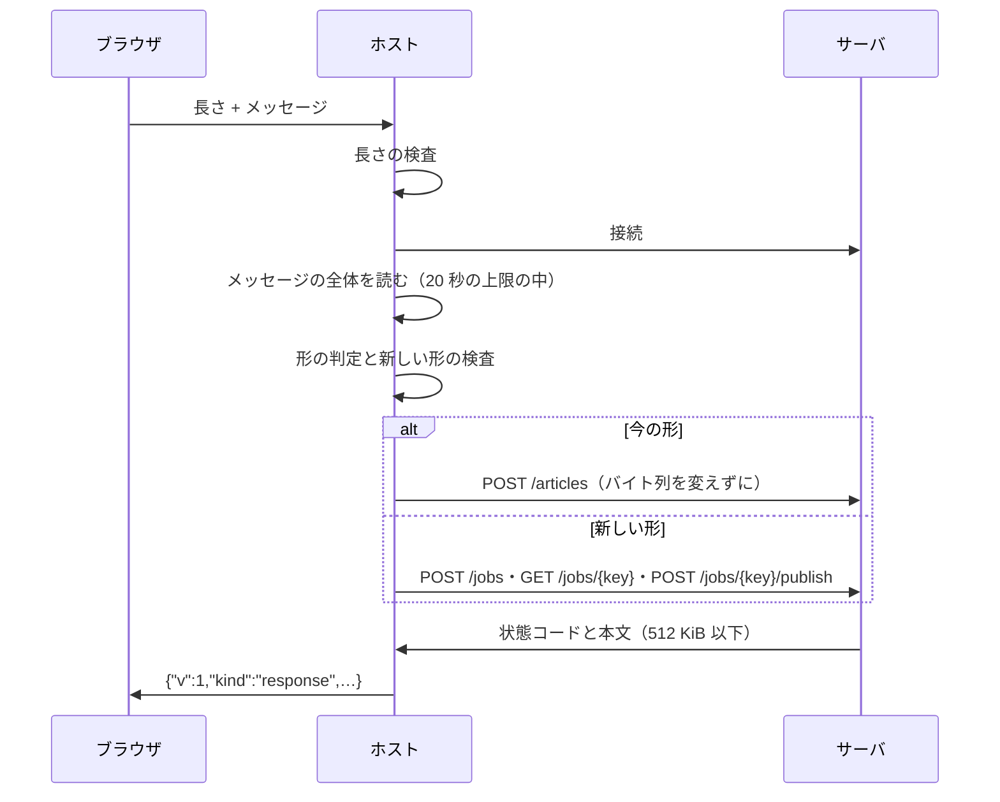

### 6.4. シャットダウン

-   シグナルを受けたら、まず `genCtx` を取り消す。新しい API の処理中の生成のジョブは、LLM の呼び出しの打ち切り（`ctx` の取り消し）で終わり、記録を `Fail` にして生成の枠を返す（AC-46）。記録はこの後の終了で失われる。取り消したジョブは、ログに 1 行書く（§3.12）。
-   続けて、今と同じく接続の受け付けをやめ、ソケットを消し、ハンドラの終わりを待つ（`server.go:157-169`）。`genCtx` の取り消しを先にするので、受け付けをやめるまでの間に来た生成の開始で始まったジョブも、取り消された `genCtx` で始まり、すぐに終わる。
-   その後、`s.jobs` で、旧 API のジョブと失敗の通知、投稿のジョブ、取り消した生成のジョブのすべての終わりを待つ。旧 API のジョブと投稿のジョブは取り消さない（AC-46）。ログの `pending`（`server.go:175`）は、今は使用中の生成の枠の数を表すので、投稿のジョブの数は別の属性で出す。
-   停止の案内（`cmd/yt2column-server/run.go:231-236`）は、旧 API のジョブを待つので「約 45 分」のまま正しい。新しい API の生成が取り消されることを、案内に加える。
-   2 回目のシグナルで、すぐに終わる（今と同じ、`internal/signalrun`）。

## 7. テスト戦略 (Test Strategy)

### 7.1. ユニットテスト（H-13）

-   **`internal/articlecache`:** 時計を差し替え、上限を小さくした `Cache` で、遷移の表（§3.3.1）の各矢印、`Begin` の 5 つの結果、破棄の順序と対象（`投稿中` と `処理中` を捨てない）、`BeginPublish` の 5 つの結果、`Delivered` と `From` の関係、ハンドルの不変条件（同じキーで 2 つ目の有効な `Run`・`PublishRun` が作られない）、ハンドルの世代（破棄と作り直しの後の古いハンドルが何もしない）、範囲外の入力で panic しないこと、`Failed` から `Running` に戻るときに工程の状態が戻ること、記録の記事が訂正の一覧を持たないことを確かめる。並行の `Begin` を `-race` で走らせ、`acquire` が 1 回だけ呼ばれることを確かめる。キーは、固定の秘密を渡した `Keyer` で、AC-03〜AC-05 の入力の組を確かめる。同じ入力を 2 つの違う秘密で計算すると違うキーになることを確かめ、秘密が計算に使われていることを確かめる（キーを 16 進の固定の値と比べるテストは書かない）。拒否は、`ParseKey` とサーバの受け口の拒否の表（短すぎる、長すぎる（65 文字。ヘッダの上限より短い長さで確かめる）、大文字、空白、16 進でない文字）で確かめる。
-   **`internal/writer`:** fake の `LLMClient` で、工程の通知の順序（AC-10）、短縮の省略と実行の境目（4,000 字ちょうどと 4,001 字、AC-11）、失敗した工程の後に `StageFinished` が来ないこと、`Write` と `WriteWithProgress` が同じ記事を返すことを確かめる。
-   **`internal/publisher`:** `FileContent` が `FilePublisher` の書いたファイルとバイト単位で同じであること（AC-12、`golden_test.go` の入力を使う）、`DisplayMarkdown` の並び、`PostMessages` の再開（k = 1 と 1 < k、AC-21）と `delivered` の呼び出し、範囲外の `from` の拒否、`from` が全体の数のときに何も送らないこと、`Publish` の今のテストがそのまま通ること。
-   **`internal/server`:** 次の部品でテストを組み立てる。
    -   工程ごとに止められる fake の `ProgressWriter`（`FakeArticleWriter` に、工程の通知の後で待つチャネルを持たせる）。AC-10・AC-45。
    -   応答を止めておける fake の Webhook（`httptest.Server` のハンドラがチャネルを待つ）と、`n` 通目で失敗させる Webhook。AC-18〜AC-21。
    -   差し替えられる時計と小さいキャッシュの上限（`test_helpers.go` の組み立て）。AC-14・AC-25・AC-26・AC-26a。
    -   再起動は、新しい `Server` の値を作ることで表す。AC-15・AC-28。
    -   コピーした字幕にだけ現れる目印の文字列を入れ、fake の書き手が返す記事の検証・推敲の訂正の一覧の `Evidence` にも同じ目印を入れる。生成の後に `Cache` の記録（`Snapshot` と、`-tags test` で記録の全体を文字列にしたもの）に目印がないことを確かめる。AC-27。
    -   fake のエラーの文言と秘密の値に目印を入れ、すべての新しい API の応答に目印がないことを確かめる。AC-31。
    -   今の `/articles` のテストの入力と期待値（`request_test.go` の表）を、生成の開始にもかけ、拒否の理由が同じであることを確かめる。AC-08。
    -   `Begin` の結果を作る状況（生成の枠を `/articles` のジョブで埋める、上限まで記録を作る）。AC-07・AC-26a。
    -   受け口の後始末: `Begin` の後とジョブに渡す前、`BeginPublish` の後とジョブに渡す前、本文の検査の中で panic を起こし（`-tags test` の差し込み口）、生成の枠と読み込みの枠が返され、記録が `失敗` か `投稿の失敗` になることを確かめる（T-09）。
    -   シャットダウン: 新しい API の生成のジョブが `ctx` の取り消しで終わり、投稿のジョブと旧 API のジョブが完了まで待たれること。AC-46。
-   **`internal/nmhost`:** 今の中継のテスト（今の形）を、§3.10.1 の変更のほかはそのまま通す。新しい形の 3 つの操作の送り先（AC-38）、今の形と読めないメッセージのバイト列の保存（AC-39）、`v` のエスケープ・重複・宣言していないメンバ・欠けたメンバ・操作の値の拒否でリクエストを送らないこと（サーバ側にリクエストが届かないこと、AC-40）、キーの文字列をそのまま本文で渡すこと（AC-40a）、256 KiB の応答の中継（AC-41）、時間の上限（AC-41a）、ログの段階と属性を確かめる。
-   **`internal/config`:** 未設定・空・不正な `SLACK_WEBHOOK_URL`（AC-32・AC-33）。

### 7.2. 統合テスト

-   `cmd/yt2column-server` の `TestServerEndToEnd`（`server_test.go:23`）に、新しい API の生成の開始 → 状態の取得 → 投稿の操作の流れを、fake の LLM とループバックの Webhook で加える。
-   `cmd/yt2column-server/relay_e2e_test.go` の `TestRelayEndToEnd` に、ホストの新しい形の 3 つの操作を実際のソケットで通す場合を加える。
-   Webhook の未設定のサーバの起動（`run_test.go`。WARN の行を含む）と、そのサーバで投稿の操作と `/articles` が `webhook_not_configured` になること（AC-34）。
-   実際の LLM・Webhook を呼ぶ統合テストは加えない（今の Webhook の統合テストが送る内容は変わらない）。

### 7.3. セキュリティテスト

-   パスの注入: ホストに `"key":"abc/publish"`、`?x=1` を含むキー、`..`、`%2F` を含むキー、制御文字や ASCII でない文字を含むキーを送り、サーバが受け取るターゲットが `/jobs/` と 1 つのエスケープしたパスの部分だけからなり（状態の取得のまま）、サーバが `invalid_key` を返すことを確かめる。サーバ単体でも、`/jobs/<64 文字>/publish/x`・`/jobs/<64 文字>?x`・大文字や `%` を含むキーの部分を拒否することを確かめる（T-02）。
-   形の取り違え: `v` を持ち形の合わないメッセージが `/articles` へ送られないこと（T-03）。
-   資源の上限: 読み込みの枠・生成の枠・キャッシュの上限で拒否され、記録が変わらないこと（T-04）。
-   漏洩: AC-27・AC-31 のテスト（T-05・T-08）。
-   後始末: §7.1 の受け口の panic のテスト（T-09）。
-   キーの予測: 違う秘密で違うキーになるテスト（§7.1、T-10）。秘密がログと応答に出ないことは、AC-31 のテストの目印に秘密の値を加えて確かめる。

### 7.4. 受け入れ基準と設計要素の対応

| AC | 設計の箇所 | テストの置き場所（予定） |
|---|---|---|
| AC-01 | §3.1.1・§3.4.1 | `internal/server` |
| AC-02 | §3.3.2（`BeginExisting`） | `internal/server` |
| AC-03 | §3.2 | `internal/articlecache`・`internal/server` |
| AC-04 | §3.2 | `internal/articlecache` |
| AC-05 | §3.2 | `internal/articlecache` |
| AC-06 | §3.3.2（`BeginNoSlot`・`BeginRestarted`）・§3.3.3 | `internal/server` |
| AC-07 | §3.4.3・§3.3.2 | `internal/server` |
| AC-08 | §3.4.1 | `internal/server` |
| AC-09 | §3.4.1・§3.4.5 | `internal/server` |
| AC-09a | §3.4.2 | `internal/server` |
| AC-09b | §3.3.2（ハンドルの不変条件） | `internal/articlecache`・`internal/server` |
| AC-09c | §3.3.2（`BeginExisting` は投稿の状態を変えない） | `internal/server` |
| AC-10 | §3.5・§3.11.2 | `internal/writer`・`internal/server` |
| AC-11 | §3.5 | `internal/writer` |
| AC-12 | §3.6.1 | `internal/publisher`・`internal/server` |
| AC-13 | §3.1.3・§3.6 | `internal/server` |
| AC-14 | §3.3.3 | `internal/articlecache`・`internal/server` |
| AC-15 | §3.1.3（`unknown`） | `internal/server` |
| AC-16 | §3.11.2・§3.11.3 | `internal/server` |
| AC-17 | §4.3 | `internal/server` |
| AC-17a | §3.6.3 | `internal/server` |
| AC-18 | §3.7 | `internal/server` |
| AC-19 | §3.7.2 | `internal/server` |
| AC-20 | §3.3.2・§3.7.2 | `internal/articlecache`・`internal/server` |
| AC-21 | §3.7.1・§3.7.2 | `internal/publisher`・`internal/server` |
| AC-22 | §3.7.2・§3.11.5 | `internal/server` |
| AC-23 | §3.6.3・§3.11.4 | `internal/server` |
| AC-24 | §3.7.2 | `internal/server` |
| AC-25 | §3.3.4 | `internal/articlecache`・`internal/server` |
| AC-26 | §3.3.4 | `internal/articlecache` |
| AC-26a | §3.3.2（`BeginFull`） | `internal/articlecache`・`internal/server` |
| AC-27 | §3.3.2・§3.4.4 | `internal/articlecache`・`internal/server` |
| AC-28 | §3.3 | `internal/server` |
| AC-29 | §3.11・§3.15 | `cmd/yt2column-server/docs_test.go` |
| AC-30 | §3.11.3 | `internal/server` |
| AC-31 | §3.1.3・§4.2 | `internal/server` |
| AC-32 | §3.8 | `internal/config` |
| AC-33 | §3.8 | `internal/config` |
| AC-34 | §3.8・§3.9 | `internal/server`・`cmd/yt2column-server` |
| AC-35 | §3.1.3 | `internal/server` |
| AC-36 | §3.9 | `internal/server`（今のテスト。組み立ての変更のほかは入力と期待値を変えない） |
| AC-37 | §3.9 | `internal/server` |
| AC-38 | §3.10.3 | `internal/nmhost` |
| AC-39 | §3.10.1・§3.10.2 | `internal/nmhost` |
| AC-40 | §3.10.2・§3.10.3 | `internal/nmhost` |
| AC-40a | §3.10.3 | `internal/nmhost` |
| AC-41 | §3.10.4 | `internal/nmhost` |
| AC-41a | §3.10.1 | `internal/nmhost` |
| AC-42 | §3.15 | `cmd/yt2column-server/docs_test.go`、`make ext-test` |
| AC-43 | §3.15 | PR のレビュー（`manual`） |
| AC-44 | §3.1.1・§3.2 | `internal/articlecache`・`internal/server` |
| AC-45 | §3.4.4 | `internal/server` |
| AC-45a | §3.7.2 | `internal/server` |
| AC-46 | §6.4 | `internal/server` |

## 8. 実装の優先順位 (Implementation Priorities)

1.  **旧 API の削除と簡素化の issue の起票**（§3.14、H-12）。実装計画の最初の手順。
2.  **土台:** `internal/strictjson` の `Value.Raw` と `Object.Has` の契約、`internal/articlecache`（キー・記録・遷移・破棄・世代）と `depguard` の規則。ほかに依存しないので、先に単体で仕上げる。
3.  **`writer` と `publisher`:** `ProgressWriter`・`NewProgressWriter`、`FileContent`・`DisplayMarkdown`・`PrepareSlackMessages`・`FormatArticleCost`・`PostMessages`。今の振る舞いを変えないことを、今のテストで確かめる。
4.  **設定と起動:** `LoadServer` の Webhook の任意化、`server.Options` の `WebhookOptions`、`deps` の型、旧 API の `webhook_not_configured`。
5.  **サーバの新しい API:** 生成の開始と生成のジョブ、状態の取得、投稿の操作と投稿のジョブ、後始末、シャットダウンの取り消し、ログ。
6.  **ホスト:** 全体の読み込み、形の判定、新しい形、応答の上限、ログ。
7.  **文書:** README の説明の文・`security.md`・`project_overview.md`・`production_profile.md`・`translation_glossary.md`。

ガードが確かめる値は、その値を加える段階で文書にも加える。README の拒否の理由の表の行は、理由を加える 4・5 で、コードの表とそのガード（§3.15）は、コードを返す 5 で加える。`package_reference.md` は、同書の規則（パッケージを変えるコミットで更新する）に従い、2〜6 のそれぞれで更新する。`CLAUDE.md` の例外（§3.10.2）は、判定を実装する 6 で書く。

2 と 3 は互いに依存しない。5 は 2〜4 に、6 は 5 の送り先のパスに依存する。

## 9. 将来の拡張性 (Future Extensibility)

-   **旧 API の削除（#503 の後）:** §3.14 の一覧で行う。新しい API は旧 API の部品（`internal/failure`・`internal/pipeline`・失敗の通知）に依存しないので、削除で新しい API のコードは変わらない。
-   **拡張の新しい API への移行（#503）:** 拡張は、ホストの新しい形のメッセージと §3.11 のコードだけを使えばよい。新しい形の応答の上限と、コードごとの文言は #503・#506 で決める。
-   **キーの計算の変更:** ドメイン分離の文字列の版（`v1`）を変えれば、前のキーと衝突しない。秘密はプロセスごとなので、計算を変えても再起動の前のキーを引き継ぐ必要はない。キーは不透明な値なので、拡張とホストは変わらない。
-   **永続化:** 記録を `articlecache` の 1 か所で持つので、将来ディスクに保存することになっても、変えるのはこのパッケージと起動の手順である（親 issue #501 では行わないと決めた）。
-   **新しい操作:** ホストの `Operation` と、サーバのメソッドとパスの形を 1 つずつ加える。拡張にパスを指定させない形は保つ。
