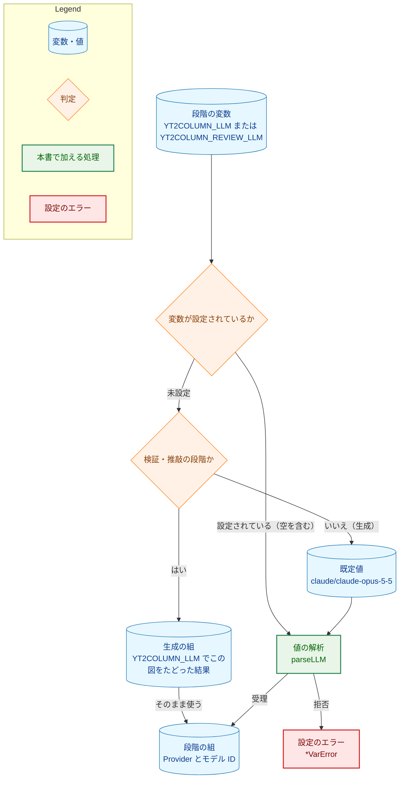
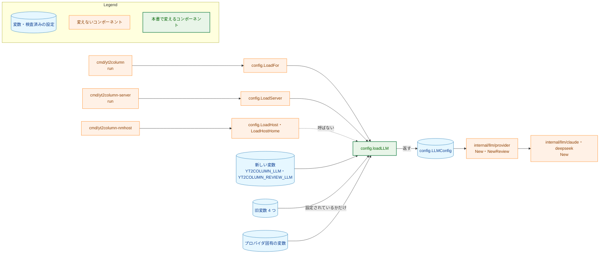
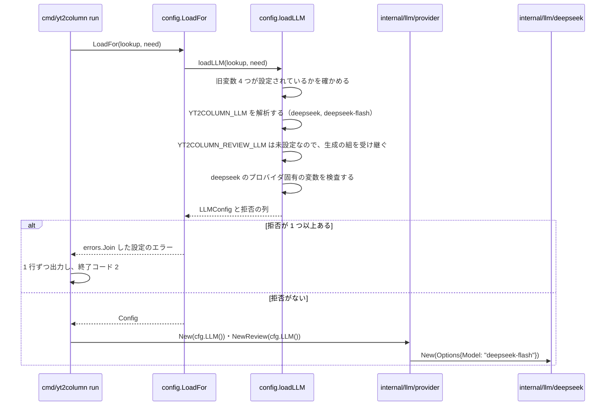
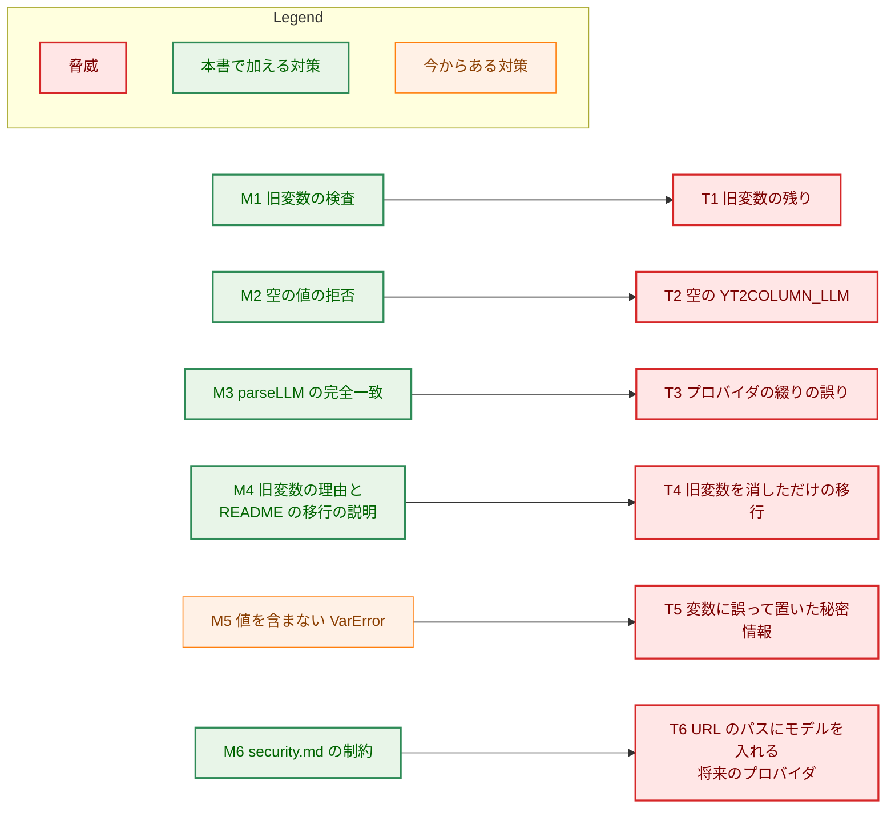
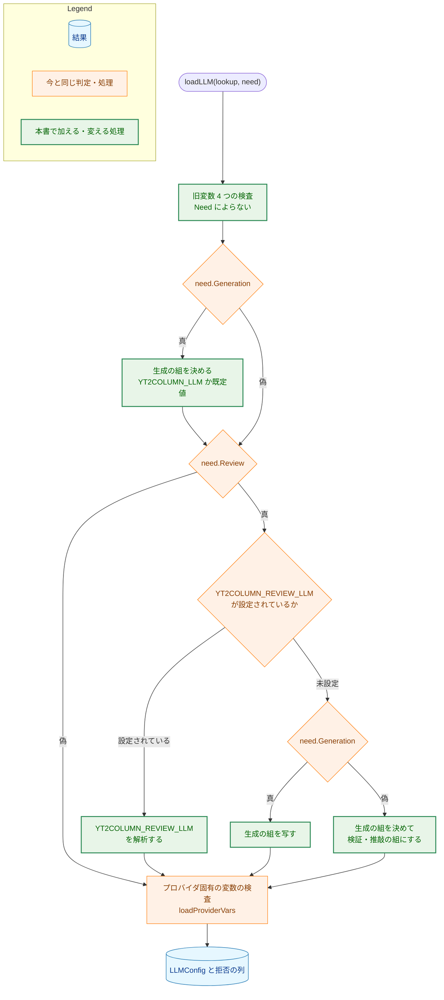

# アーキテクチャ設計書：LLM のプロバイダとモデルを 1 つの環境変数 `<プロバイダ>/<モデル ID>` で指定する

## Document Status

| Item | Value |
|---|---|
| Status | `draft` |
| Created | 2026-10-27 |
| Review date | - |
| Reviewer | - |
| Comments | - |

本書は [01_requirements.md](01_requirements.md)（要件定義書。以下、要件書）の設計である。既存のファイルについての記述は、コミット `30dbae0` のファイルで確かめた。`file:line` はこのコミットの行番号を指す。F-NNN・AC-NN は要件書の項番を指す。要件のレビューで設計に申し送られた事項（[design_handoff.md](design_handoff.md) の H-01〜H-07）への対応は、付録 A にまとめる。

本書は、要件書 6 章の用語（旧変数、組、モデル ID、生成の設定・検証・推敲の設定）と、要件書 §3.1 の「実行を止める」を同じ意味で使う。ほかに次の用語を使う。

-   **新しい変数:** `YT2COLUMN_LLM` と `YT2COLUMN_REVIEW_LLM`。
-   **設定されている:** 変数が環境にあること。空の値を含む（`lookup` の 2 つ目の戻り値が真）。その反対を「未設定」という。
-   **段階:** 設定の読み込みで、組を 1 つ決める単位。生成の段階（生成と字数の調整が使う）と、検証・推敲の段階の 2 つがある。段階が「必要」とは、`config.Need` の対応するフィールドが真であること（`internal/config/config.go:357-360`）。CLI がフラグから `Need` を決める規則（`cmd/yt2column/run.go:481-493`）は、要件書 §3.1 の表のとおりであり、本書は変えない。
-   **プロバイダが決まる:** 値のプロバイダの部分が受理する値（`deepseek`・`claude`）に完全に一致すること。モデル ID が空でも、プロバイダは決まる（要件書 AC-19）。
-   **プロバイダ固有の変数:** `DEEPSEEK_API_KEY`・`ANTHROPIC_API_KEY`・`YT2COLUMN_CLAUDE_EFFORT`・`ANTHROPIC_WORKSPACE_ID`（要件書 AC-18）。

## 1. 設計の全体像 (Design Overview)

### 1.1. 設計原則

-   **規則は `internal/config` の `loadLLM` の 1 か所に置く。** CLI（`LoadFor`。`config.go:370-386`）と localhost サーバ（`LoadServer`。`config.go:282-304`）は、どちらも `loadLLM`（`config.go:413-434`）で LLM の設定を読む。新しい変数の解析、既定値、継承、旧変数の検査をすべて `loadLLM` の下に置けば、2 つの入口に同じ規則が当たる。Native Messaging ホストの `LoadHost`・`LoadHostHome`（`config.go:323-342`）は `loadLLM` を呼ばない。そのため、ホストが旧変数で止まらないこと（AC-17）は、置き場所から決まる。
-   **値の解析は 1 つの関数で行う。** `YT2COLUMN_LLM`・`YT2COLUMN_REVIEW_LLM`・既定値は、どれも同じ解析の関数を通す。プロバイダの文字列と `Provider` の対応は、この関数の `switch` の 1 か所だけに置く。`default` の枝は拒否であり、未知のプロバイダを既定のプロバイダで補わない（`CLAUDE.md`「Declare, don't infer」「Reject, don't normalize」）。
-   **検査済みの設定の形は変えない。** `LLMConfig` の 4 つのアクセサ（`Provider`・`Model`・`ReviewProvider`・`ReviewModel`。`config.go:139-166`）は名前も型も保つ。内部では段階ごとの組を 1 つの非公開の構造体で持つ。これにより、`internal/llm/provider` とサーバの起動のログは変わらない。
-   **送り先を決める判定は、失敗したら止める側に倒す。** 空の値、構文の誤り、旧変数の残りのどれも、既定のプロバイダで補わない。すべて設定の読み込みのエラーとして、LLM の API に何も送らずに止める（要件書 §4.2）。
-   **旧変数は「設定されているか」だけを見る。** 旧変数の値は読まない。値はどの判定にも使わず、エラーにも入れない（AC-14・AC-16）。
-   **既存の拒否の型を保つ。** 拒否はすべて `*VarError`（`config.go:109-123`）で返し、番兵は既存の `ErrMissing`・`ErrInvalid`（`config.go:99-104`）だけを使う。理由（`Reason`）は固定の定数から選ぶ（`config.go:72-92`）。

### 1.2. 設計の際に決めたこと（2026-10-27）

人間のレビュアーが決めたもの:

-   **`LLMConfig` の 4 つのアクセサを保つ（H-04）:** 内部の表現だけを、段階ごとの非公開の組の構造体（3.1 の `llmSelection`）に変える。公開の組の型を作り、`Generation()`・`Review()` で返す案は採らない。要件書 2.3 は出力を変えないとしており、組を 1 つの値として扱う呼び出し側が今はないので、呼び出し側の書き換えに見合う利点がないためである（`CLAUDE.md`「YAGNI」）。
-   **構文の誤りの理由は 2 種類に分ける（H-01）:** 「形が `<provider>/<model ID>` でない、またはモデル ID が空」と「最初の `/` より前のプロバイダが受理する値でない」の 2 つである（4.1）。エラーは値を含まないので、利用者が誤りを探す手がかりは理由の文言だけになる。2 種類の分け目は、プロバイダが決まるかどうかと一致する。AC-19 では、これによってプロバイダ固有の変数を検査するかどうかが変わる。
-   **`production_profile.md` の段階の表は、プロバイダの列とモデルの列を保つ（H-06）:** 文書のガードテストが、2 つのセルの最初のコードスパンを `/` でつないで `YT2COLUMN_LLM` の値にし、`LoadServer` で読み込んで検査する（7.3）。表は人が読むための一覧であり、環境変数の例ではない。AC-22 が `YT2COLUMN_LLM=claude/claude-opus-5-5` の形を求めているのは、環境変数の例（`export` の行）だけである。
-   **モデル ID を要求本文の外に出さない制約は `docs/dev/security.md` に書く（H-07）:** §3「ネットワーク通信」に 1 項目を加える（3.8）。新しいプロバイダを加える変更は、LLM の API への送信を加える変更である。そうした変更では、設計書や実装計画を作るコマンド（`/mkarch` など）が `security.md` を読む（`.claude/commands/_context.md:183` の「Conditional-guide trigger」）。そこに書いておけば、追加する人の目に必ず触れる。

設計で決めたもの（人間のレビュアーに諮らず、理由とともに記す）:

-   **旧変数の拒否は `ErrInvalid` に分類する（H-01）:** 新しい番兵は作らない。この拒否をほかの拒否と区別して扱う呼び出し側はない。CLI もサーバも、設定のエラーを 1 行ずつ出して終了コード `2` で止まるだけである（`cmd/yt2column/run.go:331-334`・`cmd/yt2column-server/run.go:151-157`）。旧変数が空の値でも `ErrMissing` にはしない。拒否の理由は「設定されていること」であり、「値がないこと」ではないからである。
-   **旧変数の理由は、代わりに使う新しい変数ごとに 1 つの定数にする（H-01・AC-14）:** `YT2COLUMN_LLM_PROVIDER`・`YT2COLUMN_MODEL` は `YT2COLUMN_LLM` を示す理由、`YT2COLUMN_REVIEW_PROVIDER`・`YT2COLUMN_REVIEW_MODEL` は `YT2COLUMN_REVIEW_LLM` を示す理由を使う。旧変数と理由の対応は、1 つの表（3.1 の `retiredLLMVars`）に書く。
-   **旧変数の理由は、すべきことと、新しい変数を設定しなかったときの結果を述べる（H-01）:** 理由には、(1) 旧変数を外す（unset する）必要があること（空の値も設定されているとみなす）、(2) 代わりに設定する新しい変数とその形、(3) 新しい変数が未設定のときに何が使われるか（`YT2COLUMN_LLM` なら `claude`、`YT2COLUMN_REVIEW_LLM` なら生成の組）の 3 点を含める（4.1）。サーバでは、標準エラー出力が唯一の手がかりである（拡張からは「サーバが動いていない」としか見えない。要件書 AC-25）。拒否の理由だけを読んで、正しい直し方が分かるようにする必要がある。旧変数を消しただけで新しい変数を設定しないと、字幕などが既定の `claude` へ送られてしまう。理由の (3) は、この結果を拒否の行だけで分かるようにするためである。今の `reasonModelWithoutProvider` も、同じ目的で既定のプロバイダを文言に含めている（`config.go:86-91`）。
-   **旧変数の検査は `loadLLM` の最初に、`Need` によらず行う（H-02）:** `LoadFor` は `Need{}`（`--after review` など）でも `loadLLM` を呼ぶ（`config.go:371`）。そのため、ここに置けば要件書 §3.1 の表のどの行でも検査される（AC-12）。`LoadServer` も `loadLLM` を呼ぶ（AC-13）。旧変数の拒否は `loadLLM` が返すエラーの列の先頭に入り、その後のエラーとまとめて返る（AC-15・AC-20）。`LoadFor` と `LoadServer` にそれぞれ検査を書く案は、同じ規則を 2 か所に書くことになるので採らない。
-   **既定値は `claude/claude-opus-5-5` の 1 つの値として持ち、設定された値と同じ解析を通す（AC-01）:** 既定値の定数は、受理する値の定数 `providerClaude` と、既定のモデルの定数 `defaultClaudeModel` から組み立てる。解析を通すことで、文字列と `Provider` の対応が解析の関数の外に漏れない。今の `defaultProviderValue` も同じ考えで `parseProvider` に通している（`config.go:56-59`・`:445`）。
-   **前後に空白があるモデル ID は、今までどおりアダプタが拒否する（H-03）:** 要件書 §1「要件定義の際に決めたこと」は、設定の読み込みで拒否するモデル ID を空の値だけとしている。前後に空白があるモデル ID は、アダプタの `New` が拒否する（`internal/llm/claude/claude.go:57-65`・`internal/llm/deepseek/deepseek.go:57-65`）。そのため、その段階のクライアントを作らない実行（`--no-review` のときの検証・推敲など）は止まらない（AC-06）。CLI がクライアントを作るのは、その段階を実行するときだけである（`cmd/yt2column/run.go:577-589`）。
-   **生成の組は、生成の段階が必要なときだけ `LLMConfig` に入れる（H-04）:** 今は、検証・推敲だけを行う実行で生成の組を受け継ぐとき、生成のプロバイダとモデルも `LLMConfig` に入る（プロバイダは `config.go:566`、モデルは `loadModelOptional` の `:495`・`:500`）。本書では、受け継いだ組を検証・推敲の組にだけ入れる。これで規則は単純になる。`Provider()`・`Model()` は `Need.Generation` が真のときだけ値を持ち、`ReviewProvider()`・`ReviewModel()` は `Need.Review` が真のときだけ値を持つ。

    生成の組を空にしても、作られるクライアントは変わらない。生成のクライアントは `Need.Generation` が真の実行でだけ作られるからである（`cmd/yt2column/run.go:581-585` は生成か字数の調整を実行するときだけ作り、`resumeNeed` はそのときに `Generation` を真にする。`run.go:481-493`）。将来 `resumeNeed` と `buildWriter` の規則がずれ、`Need.Generation` が偽の実行で生成のクライアントを作ろうとしても、`provider.New` は `ProviderUnset` を `errUnknownProvider` で拒否し（`internal/llm/provider/provider.go:83-84`）、何も送らない。ずれたときも止まる側に倒れる。この場合の振る舞いは 7.2 のテストで確かめる。
-   **サーバの起動のログと記事の出力は変えない:** サーバの `listening` のログは `model` と `reviewModel` を出す（`cmd/yt2column-server/run.go:185-189`）。アクセサを保つので、このログはそのまま動く（要件書 2.3）。
-   **結合テストのモデルの変数の改名は、Makefile の変数名と `deepseektestutil.ModelEnv` の値を変えるだけにする（F-006）:** Makefile は `YT2COLUMN_MODEL ?= deepseek-flash`（`Makefile:128`）で、未定義のときだけ既定を当てる。名前だけを `YT2COLUMN_TEST_DEEPSEEK_MODEL` に変えれば、空の値をそのまま渡す振る舞い（AC-28）も保たれる。

### 1.3. 概念モデル

1 つの段階の組がどう決まるかを示す。矢印 A → B は、処理が A から B へ進むこと（A がデータなら、B がそれを読むこと）を表す。判定から出る矢印のラベルは、判定の結果である。旧変数の検査は段階より前に 1 回だけ行うので、この図には含めない（6.1 に示す）。



検証・推敲の段階が受け継ぐ生成の組は、`YT2COLUMN_LLM` についてこの図をたどった結果である。生成の段階が必要な実行では、生成の段階で決めた組をそのまま写す（生成の組が拒否されていれば、その拒否は生成の段階で 1 件報告するだけで、検証・推敲の段階では重ねて報告しない）。必要でない実行（`--after shorten` など）では、ここで `YT2COLUMN_LLM` を読んで組を決める（3.3）。

### 1.4. 既存の方針の例外

本書は、「実行に使わない変数は読まない」という現行の方針に、1 つだけ例外を設ける。この例外は、要件書 §1「要件定義の際に決めたこと」の「旧変数を拒否する範囲」で決めた。

-   **元の方針と所在:**
    -   README の「A resumed run validates only the settings of the stages it executes, so `--after review` requires no LLM settings at all」（`README.md:193-195`）
    -   `docs/dev/project_overview.md`「設定（環境変数）」の「中断した実行の再開では、実行する段階のモデルの変数だけを読む」（`project_overview.md:152`）
    -   `LoadServer` のコメントの「It reads no variable the server does not use」（`config.go:280-281`）
    -   `LoadFor` のコメントの「reads and validates the variables the run needs」（`config.go:362`）
    -   この方針を決めた設計書: タスク 0017 の `docs/tasks/0017_intermediate_artifacts/02_architecture.md` §3.7（`:474-477`。`Need.Generation`・`Need.Review` が偽の段階の設定を検査しない）と付録の H-04（`:524`）、タスク 0042 の `docs/tasks/0042_default_llm_opus/02_architecture.md` 6.1（`:510`。`need` の両方が偽なら何も読まない）と 6.2 の表（`:522`。LLM を呼ばない実行は LLM の変数を読まない）
-   **例外の内容:** `loadLLM` は、`Need` によらず、旧変数 4 つのそれぞれが設定されているかを `lookup` で確かめる。値は使わない。新しい変数とプロバイダ固有の変数は、今までどおり必要な段階のものだけを読む（AC-11・AC-18）。
-   **例外にする理由:** 古い `.envrc` などに旧変数が残っていると、利用者が意図した送り先（たとえば DeepSeek）が、気づかないうちに既定の Claude に変わる。LLM を呼ばない実行（`--after review`）でも止めれば、いつ実行しても古い設定に気づける（要件書 §1）。
-   **古い振る舞いを確かめている既存のテスト（変更が必要）:**
    -   `internal/config/config_test.go:1276-1324` の `TestLoadFor` の部分テスト「no stage reads no LLM variable」。`Need{}` で読んだ変数の名前を記録し、`llmVars`（旧変数 4 つを含む）のどれも読まないことを確かめている。旧変数 4 つはこの一覧から外し、代わりに新しい変数 2 つを加える。あわせて、旧変数 4 つは読むこと（`lookup` に渡ること）を確かめる。この部分テストの環境「invalid values」（`:1280-1285`）は、不正な値を旧変数（`providerEnv: "gemini"`・`modelEnv: ""`）で与えている。そのままでは `LoadFor(Need{})` が旧変数で失敗するので、不正な値を新しい変数（`YT2COLUMN_LLM` の `gemini/x` や空の値）で与える形に書き換える。
    -   `cmd/yt2column/run_test.go:2269-2281` の `TestRunResumeConfigScoping`。`--after review` が LLM の設定を必要としないことを確かめている。環境から旧変数を除くように書き換える（環境を作る補助関数ごと、7.2）。旧変数が残っている場合に止まることは、新しいテストで確かめる。

この例外は、本書が文書の該当箇所を書き換えることで、文書の上でも明示する（AC-23。3.8）。

## 2. システム構成 (System Structure)

### 2.1. 全体の構成

矢印 A → B は、A が B を呼ぶか、A の値を B が読むことを表す。ラベルのある矢印は、ラベルのとおりの関係を表す。点線の矢印は、本書の変更の後も呼ばないことを示す。「変えないコンポーネント」は、本番のコードの振る舞いを変えないものを指す（`LoadFor`・`LoadServer` はコメントだけを書き換える。3.7）。



`LoadFor` と `LoadServer` は、`loadLLM` の呼び方を変えない（`config.go:283`・`:371`）。`internal/llm/provider` は `LLMConfig` のアクセサだけを使い（`internal/llm/provider/provider.go:34-43`）、アクセサは変わらないので、変えない。

### 2.2. コンポーネント配置

| 場所 | 本書での役割 |
|---|---|
| `internal/config/config.go` | 新しい変数の名前と理由の定数、旧変数の表、組の構造体、値の解析、段階の解決、旧変数の検査を置く。不要になる仕組みを除く（3.6） |
| `internal/config/test_helpers.go` | 文書のガードテストと `cmd/` のテストが使う `...ForTest` 関数を、新しい変数に合わせる（3.7） |
| `cmd/yt2column`・`cmd/yt2column-server` | 本番のコードは変えない。テストの環境を新しい変数に書き換え、旧変数で止まることのテストを加える |
| `cmd/yt2column-nmhost` | 本番のコードは変えない。テストの環境を書き換え、旧変数で止まらないことのテストを加える |
| `internal/llm/provider` | 本番のコードは変えない。テストの環境を書き換える |
| `internal/llm/deepseek/testutil`・`Makefile` | 結合テストのモデルの変数を改名する（3.9） |
| 文書（README ほか 4 つ） | 環境変数の記載を書き換える（3.8） |

### 2.3. データの流れ

CLI の通常の実行（`--after` なし。`Need{Generation: true, Review: true}`）で、`YT2COLUMN_LLM=deepseek/deepseek-flash` だけを設定し、`YT2COLUMN_REVIEW_LLM` は未設定の場合を示す。



## 3. コンポーネント設計 (Component Design)

### 3.1. 定数と型

`internal/config` の非公開の定数と型を次のように変える。公開の型（`Provider`・`VarError`・`LLMConfig`・`Need`・`LookupFunc`）と番兵（`ErrMissing`・`ErrInvalid`）は変えない。

```go
// Names of the environment variables Load reads. providerEnv, modelEnv,
// reviewProviderEnv, and reviewModelEnv are removed.
const (
	llmEnv       = "YT2COLUMN_LLM"
	reviewLLMEnv = "YT2COLUMN_REVIEW_LLM"
	// ... the provider-specific and common variables stay as they are
)

// llmSeparator separates the provider from the model ID in an LLM variable.
// Only its first occurrence separates them; a later one belongs to the model
// ID.
const llmSeparator = "/"

// defaultClaudeModel stays; defaultProviderValue is replaced by
// defaultLLMValue, the YT2COLUMN_LLM value used when the variable is unset.
const (
	defaultClaudeModel = "claude-opus-5-5"
	defaultLLMValue    = providerClaude + llmSeparator + defaultClaudeModel
)

// Fixed reasons. reasonProvider and reasonModelWithoutProvider are removed.
const (
	reasonLLMForm          = `must be "<provider>/<model ID>" with a non-empty model ID`
	reasonLLMProvider      = `the provider before the first "/" must be exactly "` + providerDeepSeek + `" or "` + providerClaude + `"`
	reasonRetiredLLM       = "is no longer supported and must be unset (an empty value counts as set); set " +
		llmEnv + "=<provider>/<model ID> instead; while " + llmEnv + " is unset, the provider is " + providerClaude
	reasonRetiredReviewLLM = "is no longer supported and must be unset (an empty value counts as set); set " +
		reviewLLMEnv + "=<provider>/<model ID> instead; while " + reviewLLMEnv + " is unset, the review step uses " + llmEnv
)

// retiredLLMVar is a variable that selected a provider or a model before
// YT2COLUMN_LLM and YT2COLUMN_REVIEW_LLM. Its presence is a rejection; its
// value is never used.
type retiredLLMVar struct {
	name   string
	reason string // reasonRetiredLLM or reasonRetiredReviewLLM
}

// retiredLLMVars lists the four retired variables, each with its reason
// (the table in section 4.1), in the order their rejections are reported.
var retiredLLMVars []retiredLLMVar

// llmSelection is one stage's provider and model ID. In an accepted
// selection both are set. parseLLM also returns the provider of a rejected
// value whose provider part was accepted (an empty model ID), so that
// provider's own variables are still checked; such a selection never leaves
// loadLLM, because the load then fails. ProviderUnset means the stage was not
// resolved or its provider part was rejected.
type llmSelection struct {
	provider Provider
	model    string
}

// LLMConfig keeps its accessors; its four provider and model fields become
// two llmSelection fields.
type LLMConfig struct {
	generation           llmSelection
	review               llmSelection
	deepSeekAPIKey       secret.Secret
	anthropicAPIKey      secret.Secret
	claudeEffort         claudeparam.Effort
	anthropicWorkspaceID claudeparam.WorkspaceID
}
```

アクセサの契約は次のとおりにする（コメントを書き換える）。

| アクセサ | 値を持つとき | 値 |
|---|---|---|
| `Provider()`・`Model()` | `Need.Generation` が真のとき | `YT2COLUMN_LLM` の組。未設定なら既定値の組 |
| `ReviewProvider()`・`ReviewModel()` | `Need.Review` が真のとき | `YT2COLUMN_REVIEW_LLM` の組。未設定なら生成の組（`YT2COLUMN_LLM` の組、またはその既定値の組） |

値を持たないときは、`ProviderUnset` と空の文字列である。設定の読み込みがエラーを返したときは、`Config`・`ServerConfig` ごとゼロ値を返す（今と同じ。`config.go:296-298`・`:379-381`）。

`Provider` の値（`ProviderUnset`・`ProviderDeepSeek`・`ProviderClaude`。`config.go:24-28`）と、受理する値の定数（`providerDeepSeek`・`providerClaude`。`config.go:47-50`）は変えない。

### 3.2. 値の解析

新しい関数 `parseLLM(name, value string) (llmSelection, error)` は、設定されている変数の値（または既定値）を組にする。`name` は拒否で名指しする変数である。判定は次の表のとおりであり、上の行が優先する。

| 値の形 | 例 | プロバイダが決まるか | 番兵 | 理由 |
|---|---|---|---|---|
| 空 | `` | 決まらない | `ErrMissing` | `reasonUnset`（既存。`config.go:76`） |
| `/` を含まない | `claude` | 決まらない | `ErrInvalid` | `reasonLLMForm` |
| 最初の `/` より前が `deepseek`・`claude` に完全一致しない（空を含む） | `/claude-opus-5-5`、`gemini/x`、`gemini/`、`Claude/claude-opus-5-5`、` claude/claude-opus-5-5`、`claude /claude-opus-5-5` | 決まらない | `ErrInvalid` | `reasonLLMProvider` |
| プロバイダは正しく、モデル ID が空 | `claude/`、`deepseek/` | 決まる | `ErrInvalid` | `reasonLLMForm` |
| 上のどれでもない | `claude/claude-opus-5-5`、`claude/vendor/model-x`、`claude/ claude-opus-5-5` | 決まる | なし | - |

-   値は、最初の `/` で 2 つに分ける。モデル ID は、最初の `/` より後ろの文字列全体であり、変換しない（AC-03）。`claude/vendor/model-x` のモデル ID は `vendor/model-x` である。
-   前後の空白を取り除かない。プロバイダの部分に空白があれば、完全一致しないので拒否する（AC-05）。モデル ID の前後の空白と UTF-8 として不正なバイト列は、ここでは拒否せず、アダプタに任せる（1.2、AC-06）。
-   **契約:** プロバイダが決まった場合は、エラーを返すときも、返す組の `provider` にそのプロバイダを入れる。これは、モデル ID だけが空の値（`claude/`）でも、そのプロバイダ固有の変数を検査するためである（AC-19）。プロバイダが決まらない場合は `ProviderUnset` を入れる。エラーを返した組を `parseLLM` の呼び出し元（`loadLLM`）が使うのは、プロバイダ固有の変数を検査するかどうかの判断だけである。設定の読み込みはエラーで終わるので、この組が `loadLLM` の外へ渡ることはない。
-   文字列から `Provider` への対応は、`switch` で書く。`default` の枝は `reasonLLMProvider` の拒否である。今の `parseProvider`（`config.go:511-522`）の役割を引き継ぎ、`parseProvider` は除く。

### 3.3. 段階の解決

`loadLLM` は、必要な段階の組を次のとおりに決める。

| `Need` | `YT2COLUMN_REVIEW_LLM` | 生成の組 | 検証・推敲の組 | `YT2COLUMN_LLM` を読むか |
|---|---|---|---|---|
| `Generation`・`Review` が真 | 設定されている | `YT2COLUMN_LLM`（未設定なら既定値）を解析 | `YT2COLUMN_REVIEW_LLM` を解析 | 読む |
| `Generation`・`Review` が真 | 未設定 | 同上 | 生成の組を写す | 読む |
| `Generation` だけが真 | 読まない | 同上 | 決めない | 読む |
| `Review` だけが真 | 設定されている | 決めない | `YT2COLUMN_REVIEW_LLM` を解析 | 読まない（AC-10） |
| `Review` だけが真 | 未設定 | 決めない | `YT2COLUMN_LLM`（未設定なら既定値）を解析した組 | 読む（AC-10） |
| どちらも偽（`Need{}`） | 読まない | 決めない | 決めない | 読まない（AC-11） |

-   生成の組を決める処理（`YT2COLUMN_LLM` を読み、未設定なら既定値にして `parseLLM` に通す）は、1 つの関数にまとめる。上の表の 1〜3 行目と 5 行目は、どれもこの関数を呼ぶ。5 行目で `YT2COLUMN_LLM` が拒否された場合のエラーは `YT2COLUMN_LLM` を名指しする（AC-10）。
-   2 行目で生成の組を写すとき、生成の組が拒否された場合も写す。拒否は生成の段階で 1 回だけ報告する。生成のプロバイダが決まらない場合は、写した検証・推敲のプロバイダも決まらないので、プロバイダ固有の変数を検査しない。`claude/` のようにプロバイダだけが決まる場合は、写した組もそのプロバイダを持つので、その変数を検査する（AC-19）。
-   `YT2COLUMN_REVIEW_LLM` が空の値なら、`parseLLM` が `ErrMissing` で拒否する。生成の組は受け継がない（AC-09）。

### 3.4. 旧変数の検査

`loadLLM` の最初に、`retiredLLMVars` の順に、各変数を `lookup` で確かめる。設定されていれば（空の値を含む）、`invalidVar(name, reason)`（`config.go:834-836`）の拒否を加える。

-   `Need` によらず行う（1.4、AC-12・AC-13）。
-   `lookup` が返す値は使わない（AC-16）。拒否には変数の名前と固定の理由だけが入る（AC-14）。
-   設定されていたすべての旧変数を報告する（AC-15）。拒否はそれぞれ別の要素として `loadLLM` のエラーの列に入れる。`loadProviderVars` のコメント（`config.go:618-620`）が述べるとおり、入れ子の `errors.Join` は 1 行にまとまってしまうからである。
-   旧変数があっても、続く段階の解決とプロバイダ固有の変数の検査は行う。そのため、たとえば旧変数だけで DeepSeek を指定していた設定では、`YT2COLUMN_LLM` が未設定なので既定の `claude` が選ばれ、`ANTHROPIC_API_KEY` が未設定ならそのエラーも報告する（AC-15）。旧変数の拒否があるので、設定の読み込みはエラーで終わり、LLM の API には何も送らない。

### 3.5. プロバイダ固有の変数

`loadProviderVars`（`config.go:621-638`）の規則は変えない。必要な段階の組のプロバイダを見て、選ばれたプロバイダの変数だけを読む（AC-18）。変わるのは、参照するフィールドが `cfg.provider`・`cfg.reviewProvider` から `cfg.generation.provider`・`cfg.review.provider` になることだけである。プロバイダが決まらない段階は `ProviderUnset` なので、どのプロバイダの変数も読まれない（AC-19）。

### 3.6. 除く仕組み（H-04）

モデルだけを設定した状態は、構文の上で起こらなくなる。そのため、次のものを除く。

| 除くもの | 場所 | 不要になる理由 |
|---|---|---|
| `settingOrigin`・`stageOrigins` | `config.go:388-403` | 出どころを記録していたのは、モデルだけの設定を拒否するためだけだった |
| `modelWithoutProvider`・`reasonModelWithoutProvider` | `config.go:465-479`・`:86-91` | 拒否する状態がなくなる |
| `resolveProvider`・`parseProvider`・`reasonProvider` | `config.go:436-450`・`:505-522`・`:77` | `parseLLM` と生成の組を決める関数（3.3）が引き継ぐ |
| `defaultModel` | `config.go:452-463` | プロバイダごとの既定のモデルがなくなる。既定は `YT2COLUMN_LLM` 全体の既定値だけになる |
| `loadModel`・`loadModelOptional` | `config.go:640-661`・`:481-503` | モデルは組の一部として `parseLLM` が決める |
| `loadReview` | `config.go:524-610` | 3.3 の規則に置き換える。プロバイダとモデルの組み合わせの分岐はなくなる |
| `defaultProviderValue`・`providerEnv`・`modelEnv`・`reviewProviderEnv`・`reviewModelEnv` | `config.go:56-59`・`:32-35` | 旧変数の名前は `retiredLLMVars` の表にだけ書く |

`settingOrigin` とモデルだけの設定の拒否は、タスク 0042 の設計（`docs/tasks/0042_default_llm_opus/02_architecture.md` 1.2・3.4）が加えたものである。その目的は、利用者が選んでいないプロバイダへモデル名とデータを送らないことだった。本書では、プロバイダとモデルを 1 つの値で指定するので、モデルだけが設定されている状態が値の形として起こらない。その目的は、構文と旧変数の拒否で満たされる。

`LoadFor`・`LoadServer`・`loadProviderVars`・プロバイダ固有の変数を読む関数（`config.go:663-741`）の構造は変えない。

### 3.7. コンポーネントの責務と変えるファイル

| ファイル | 変更 | 古い振る舞いを確かめていて、変更が要るテスト |
|---|---|---|
| `internal/config/config.go` | 3.1〜3.6 のとおり。`LoadServer`・`LoadFor`・アクセサのコメントを、旧変数の例外（1.4）と 3.1 の契約に合わせる。旧変数や除く関数に触れているほかのコメント（`Provider` の定数のコメント `:20-23`、「The accepted values of providerEnv」`:46`、`loadProviderVars` のコメント `:617`）も書き換える | - |
| `internal/config/socketpath_test.go` | `LoadHost`・`LoadHostHome` の記録する `lookup` のテスト（`:158-213`）の環境に旧変数を加える（7.1） | - |
| `internal/config/config_test.go` | 環境を作る補助関数（`validEnv`・`validServerEnv` など）を新しい変数に書き換える。旧変数・値の解析・継承のテストを加える（7.1） | 旧変数の名前の定数を使うすべてのテスト。特に `TestLoadModelWithoutProvider`（`:1648`）と `TestModelWithoutProvider`（`:1760`）は、拒否がなくなるので除く。`TestLoadReviewDefaults`（`:1516`。検証・推敲のプロバイダだけを設定するとそのプロバイダの既定のモデルになる）と `TestLoadGenerationDefaults`（`:1439`。`deepseek` ではモデルが必須）は、新しい規則に合わせて書き直す。`TestLoadFor`（`:1126`）の「no stage reads no LLM variable」は 1.4 のとおり |
| `internal/config/test_helpers.go` | `DefaultProviderValueForTest`・`LLMProviderEnvForTest`・`ModelEnvForTest`・`ModelWithoutProviderErrorForTest`（`:53-79`）を除く。新しい変数の名前、既定値、旧変数の拒否の行を返す関数を加える（名前は実装計画で決める）。`DefaultClaudeModelForTest`・`ClaudeEffortEnvForTest`・`AnthropicAPIKeyEnvForTest` は残す | - |
| `cmd/yt2column/run_test.go`・`signal_test.go` | テストの環境を新しい変数に書き換える。旧変数で止まることのテストを加える（7.2） | `TestRunModelWithoutProvider`（`run_test.go:2005-2025`）は除く。`TestRunDefaultLLMConfig`（`:1976`）は既定値の確かめ方を保つ。`TestRunResumeConfigScoping`（`:2269`）は 1.4 のとおり |
| `cmd/yt2column/test_helpers_integration.go`・`integration_env_test.go` | 結合テストの環境を `YT2COLUMN_LLM=deepseek/<モデル>` に書き換える | `TestIntegrationRunProviderSelection`（`integration_env_test.go:30`）は、環境の `YT2COLUMN_LLM_PROVIDER` を確かめているので、`YT2COLUMN_LLM` を確かめる形に変える |
| `cmd/yt2column/docs_test.go` | 文書のガードテストを新しい変数に合わせる（7.3） | `TestLLMDefaultsDocsContract`（`:258`）、`productionProfileVars`（`:778`）、`checkProfileTable`（`:803`）、`TestProductionProfileDocsContract`（`:874`） |
| `cmd/yt2column/makefile_test.go` | 結合テストのモデルの変数の名前に追従する（3.9） | `deepseektestutil.ModelEnv` を使う行（`:140`・`:240`） |
| `cmd/yt2column-server/test_helpers.go`・`run_test.go` | テストの環境を書き換える。旧変数で止まることのテストを加える | 生成のモデルを消して設定のエラーを起こす行（`run_test.go:66-71`）は、`YT2COLUMN_LLM` を空にする形などに変える |
| `cmd/yt2column-nmhost/main_test.go` | `fullEnv`（`:119-133`）を新しい変数に書き換える。旧変数を加えた環境でも中継・`install`・`uninstall` が動くことのテストを加える | `fullEnv` は「サーバの設定を誤って読んでも成功する環境」なので、旧変数のままでは目的を果たさなくなる |
| `internal/llm/provider/provider_test.go` | テストの環境を新しい変数に書き換える。前後に空白があるモデル ID の部分テスト（`:545-592`）は、`YT2COLUMN_LLM=deepseek/ deepseek-flash` のような値に変える | 同左 |
| `internal/llm/deepseek/testutil/integration.go`・`make.go`・`make_test.go`、`Makefile` | 3.9 | - |
| 文書 | 3.8 | - |

本番のコードで変えるのは `internal/config/config.go` だけである。`internal/maketestutil/make_test.go:12` は、変数の名前の形を検査する関数の入力例として `YT2COLUMN_MODEL` という文字列を使っているだけで、その変数を読まない。AC-29 に関わらないので変えない。

### 3.8. 文書の変更

| 文書 | 変更 | 対応する AC |
|---|---|---|
| README「Configuration」 | 表の旧変数の 4 行を、新しい変数の 2 行に置き換える。`YT2COLUMN_LLM` の「When unset」の列の最初のコードスパンは `claude/claude-opus-5-5` にする。表の後の段落（`README.md:818-842`）を、値の構文（最初の `/` で区切る、モデル ID の中の `/` を保つ、前後の空白を取り除かない）、既定値と継承、空の値の拒否、旧変数の拒否（LLM の変数を読まない実行でも拒否すること）の説明に書き換える | AC-22・AC-23 |
| README「Recommended configuration」 | `export` の例を `YT2COLUMN_LLM=claude/claude-opus-5-5` と `YT2COLUMN_CLAUDE_EFFORT=high` の 2 行にし、「These three values」を例に合わせる。「with `deepseek`, an unset `YT2COLUMN_MODEL` is an error」（`README.md:869`）と、検証・推敲の変数の案内（`:871-874`）も新しい変数と規則に書き換える | AC-22・AC-26 |
| README「Using DeepSeek」 | 旧変数から新しい変数への移行の節に置き換える。少なくとも、`YT2COLUMN_LLM_PROVIDER=deepseek` と `YT2COLUMN_MODEL=deepseek-flash` を `YT2COLUMN_LLM=deepseek/deepseek-flash` に書き換える例、`YT2COLUMN_REVIEW_PROVIDER` だけを設定していた場合（モデル ID も書く必要がある）、`YT2COLUMN_REVIEW_MODEL` だけを設定していた場合（生成のプロバイダも書く必要がある）を示す。さらに次を示す。旧変数は消すだけでなく、設定済みのシェルでは unset する必要があり、空の値も拒否されること。旧変数を消して `YT2COLUMN_LLM` を設定しないと、既定の `claude` が選ばれ、字幕などを Anthropic へ送ること。旧変数の行と同時に出る `ANTHROPIC_API_KEY` のエラーは、既定の `claude` が選ばれた結果であり、DeepSeek を使い続けるなら Anthropic のキーを設定するのではなく `YT2COLUMN_LLM` を設定すること。変数を置きうる場所（`.envrc`・`.env`・シェルの設定ファイル・サーバを起動するスクリプト）を確かめるよう案内すること。設定を直した後、動いているサーバを起動し直すよう案内すること。見出しを変えるなら、その節へのリンク（`README.md:718-723`）も直す | AC-24 |
| README のトラブルシューティング | `configuration: YT2COLUMN_LLM_PROVIDER` の項目（`README.md:718-723`）を、旧変数を名指しする設定エラーで CLI またはサーバが止まった場合の対処に置き換える。サーバなら、拡張からは「サーバが動いていない」としか見えないことを書く。対処は、旧変数を外し（unset）、新しい変数を設定することであり、移行の節へ導く。あわせて、`build the review LLM client` で始まるアダプタのエラー（前後の空白など）は、`YT2COLUMN_REVIEW_LLM`（未設定なら `YT2COLUMN_LLM`）のモデル ID を直すことを示す | AC-25 |
| README の段階の説明 | 検証・推敲の段階の説明（`README.md:158-160`）の `YT2COLUMN_REVIEW_PROVIDER`・`YT2COLUMN_REVIEW_MODEL` を `YT2COLUMN_REVIEW_LLM` に書き換える | AC-26 |
| README の再開の説明 | 「`--after review` requires no LLM settings at all」（`README.md:193-195`）と、`--no-review` でも検証・推敲の設定を検査する説明（`:189-193`）を、新しい変数の名前と、旧変数の検査だけは例外であることが分かる形にする | AC-23 |
| README の結合テストの説明 | `YT2COLUMN_MODEL` を `YT2COLUMN_TEST_DEEPSEEK_MODEL` に書き換える（`README.md:1094`・`:1128`・`:1155` 付近） | AC-30 |
| `docs/dev/project_overview.md`「設定（環境変数）」 | README と同じ内容で、表（`:131-144`）と後の段落（`:146-154`）を書き換える。「中断した実行の再開では、実行する段階のモデルの変数だけを読む」に、旧変数の検査は例外であることを書き加える | AC-22・AC-23 |
| `docs/dev/project_overview.md`「パイプライン」 | 検証・推敲の段階の説明（`project_overview.md:57`）の変数を `YT2COLUMN_REVIEW_LLM` に書き換える | AC-26 |
| `docs/dev/project_overview.md`「前提・制約」 | 既定のモデル名の例外の範囲を「`YT2COLUMN_LLM` が未設定のとき（`YT2COLUMN_REVIEW_LLM` が受け継ぐ場合を含む）」に書き換える | AC-23 |
| `docs/dev/production_profile.md`「本番の構成」 | `export` の例を 2 行にし、変数の数を述べる 2 つの文（「次の 3 つ」と、`:42` の「上の 3 つの変数を指定しなくても」）を例に合わせる。検証・推敲の変数の説明（`:39`）を `YT2COLUMN_REVIEW_LLM` に書き換える。段階の表の列は保つ（1.2） | AC-22・AC-26 |
| `docs/dev/security.md` §4 | 検証・推敲のプロバイダを別にする変数を `YT2COLUMN_REVIEW_LLM` に書き換える（`security.md:58`） | AC-26 |
| `docs/dev/security.md` §3 | 「モデル ID は要求本文（JSON）の値としてだけ送り、要求の URL には入れない。URL のパスにモデルを入れる API のプロバイダを加えるときは、モデル ID の中の `/` や `..` がパスを変えないようにする」という項目を加える | H-07 |
| `docs/dev/developer_guide/package_reference.md` | `internal/config` の行（`:27`）の LLM の設定の説明を、新しい変数、既定値、継承、旧変数の拒否に書き換える。`internal/llm/provider` の行（`:36`）は、アクセサを保つので変えない | AC-26 |
| `Makefile` のコメント | 3.9 | AC-30 |

README と `project_overview.md` の「`YT2COLUMN_REVIEW_LLM`」の行の「未設定のとき」の列には、「生成と同じ」と書く。コードの既定値の定数に当たる値はないので、ガードテストはこの列の値を検査せず、行がちょうど 1 つあることだけを検査する（7.3）。

### 3.9. 結合テストのモデルの変数（F-006）

-   `Makefile:122-139`・`:170-181`・`:210-214` の `YT2COLUMN_MODEL` を、すべて `YT2COLUMN_TEST_DEEPSEEK_MODEL` に変える。`?=` で未定義のときだけ `deepseek-flash` にする形と、各ターゲットが `export` する形は変えない（AC-28）。
-   `internal/llm/deepseek/testutil/integration.go:26` の `ModelEnv` の値を `YT2COLUMN_TEST_DEEPSEEK_MODEL` に変える。結合テストと `make` のスタブのテスト（`make.go` の `recordedEnv`）は、この定数を通して名前を得ているので、定数を変えれば追従する（AC-29）。
-   CLI の結合テストは、閉じた環境（`cmd/yt2column/test_helpers_integration.go:162-168` の `map`）で `run` を呼ぶ。この環境を `YT2COLUMN_LLM=deepseek/<settings.Model>` にする。親のプロセスの環境に旧変数が残っていても、`run` には渡らない。

## 4. エラーハンドリング設計 (Error Handling Design)

### 4.1. エラーの型

新しいエラーの型と番兵は作らない。すべて既存の `*VarError` で返す。

```go
// Unchanged (internal/config/config.go:99-123).
var ErrMissing = errors.New("environment variable is unset or empty")
var ErrInvalid = errors.New("environment variable has an invalid value")

type VarError struct {
	Name   string
	Reason string
	Err    error // ErrMissing or ErrInvalid
}
```

| 拒否 | `Name` | `Err` | `Reason` |
|---|---|---|---|
| `YT2COLUMN_LLM`・`YT2COLUMN_REVIEW_LLM` が空（AC-04・AC-09） | その変数 | `ErrMissing` | `reasonUnset` |
| `/` を含まない、またはモデル ID が空（AC-05・AC-09） | その変数 | `ErrInvalid` | `reasonLLMForm` |
| プロバイダの部分が空または不正（AC-05・AC-09） | その変数 | `ErrInvalid` | `reasonLLMProvider` |
| `YT2COLUMN_LLM_PROVIDER`・`YT2COLUMN_MODEL` が設定されている（AC-12〜AC-14） | その旧変数 | `ErrInvalid` | `reasonRetiredLLM` |
| `YT2COLUMN_REVIEW_PROVIDER`・`YT2COLUMN_REVIEW_MODEL` が設定されている（AC-12〜AC-14） | その旧変数 | `ErrInvalid` | `reasonRetiredReviewLLM` |

理由は、固定の定数と、ほかの定数（変数の名前、受理するプロバイダの値）だけから組み立てる。値を含まない（要件書 §5、`config.go:106-108`）。旧変数の理由は 1.2 のとおり、旧変数を unset すること、空の値も設定されているとみなすこと、代わりの新しい変数、それが未設定のときに使われるものを述べる。

前後に空白があるモデル ID と、UTF-8 として不正なモデル ID の拒否は、今までどおりアダプタのエラー（`internal/llm/claude/errors.go:26-27`・`internal/llm/deepseek/errors.go:18-29`）である。CLI は、クライアントを作る失敗を構築の失敗として終了コード `2` で報告する（今の振る舞い）。このエラーも値を含まない。

### 4.2. 利用者が見るもの

CLI とサーバは、設定のエラーを今と同じ形で 1 行ずつ出す（`<プログラム名>: configuration: <Name>: <Reason>`。CLI は `cmd/yt2column/run.go:622-628`、サーバは `cmd/yt2column-server/run.go:153-155`）。CLI は、その後に使い方の案内の行（`usageHint`。`run.go:113-114`）を 1 行出す。サーバは出さない。たとえば、旧変数 2 つと誤った `YT2COLUMN_REVIEW_LLM` を設定し、`ANTHROPIC_API_KEY` を設定していない場合、CLI は次の 5 行を出して終了コード `2` で止まる（長い行は、ここでは折り返さずに示す）。

```text
yt2column: configuration: YT2COLUMN_LLM_PROVIDER: is no longer supported and must be unset (an empty value counts as set); set YT2COLUMN_LLM=<provider>/<model ID> instead; while YT2COLUMN_LLM is unset, the provider is claude
yt2column: configuration: YT2COLUMN_MODEL: is no longer supported and must be unset (an empty value counts as set); set YT2COLUMN_LLM=<provider>/<model ID> instead; while YT2COLUMN_LLM is unset, the provider is claude
yt2column: configuration: YT2COLUMN_REVIEW_LLM: the provider before the first "/" must be exactly "deepseek" or "claude"
yt2column: configuration: ANTHROPIC_API_KEY: is unset or empty
yt2column: run 'yt2column -h' for usage
```

行の順序は、旧変数、生成の組、検証・推敲の組、プロバイダ固有の変数、そのほかの共通の変数の順である。順序は要件ではないが、この並びなら、まず移行が必要なことが目に入る。旧変数の行は、`YT2COLUMN_LLM` が未設定なら `claude` が使われることを述べるので、続く `ANTHROPIC_API_KEY` の行がその結果であることも、出力だけから読み取れる。

`--slack` のときの `SLACK_WEBHOOK_URL` の未設定は、今までどおり設定の読み込みが成功した後にだけ報告する（`cmd/yt2column/run.go:336-340`。AC-20）。

## 5. セキュリティ考慮事項 (Security Considerations)

本タスクは、字幕などの送り先（LLM のプロバイダ）を決める処理と、API キーを読むかどうかを決める処理を変える。`docs/dev/security.md` の §2（秘密情報）・§3（ネットワーク通信）・§4（LLM プロバイダへ送るデータ）が当てはまる。外部コマンド、キャッシュ、信頼できないテキストの扱いは変えない。本タスクの入力は利用者が設定する環境変数であり、信頼できない入力を新たに読まない。

### 5.1. 脅威モデル

本タスクで防ぐ害は、利用者が選んでいない事業者へ字幕などを送ること（以下、送り先の誤り）と、秘密情報が出力に出ることである。図の矢印 M → T は「対策 M が脅威 T を防ぐ、または和らげる」ことを表す。各脅威が招く害と、残る範囲は図の下の表に示す。



| 脅威 | 招く害 | 対策 | 残る範囲 |
|---|---|---|---|
| T1 古い `.envrc` などに旧変数が残る | 送り先の誤り（たとえば DeepSeek のつもりが既定の Claude） | M1: `Need` によらず拒否する（AC-12・AC-13・AC-16） | なし |
| T2 展開に失敗して `YT2COLUMN_LLM` などが空になる | 送り先の誤り（既定のプロバイダ） | M2: 空の値を拒否し、既定値を当てない（AC-04・AC-09） | なし |
| T3 `Claude/...`・`gemini/...`・前後の空白 | 送り先の誤り | M3: 完全一致だけを受理し、`default` の枝で拒否する（AC-05） | なし |
| T4 旧変数を消し、`YT2COLUMN_LLM` を設定しない | 送り先の誤り（既定の Claude。`ANTHROPIC_API_KEY` が設定済みなら、エラーなしに送る） | M4: 旧変数の理由が、未設定なら `claude` になることを述べる（4.2）。README の移行の説明が、同じことと正しい直し方を示す（3.8） | 文書と文言で和らげるだけである。旧変数がなくなった後は、`YT2COLUMN_LLM` の未設定は正しい設定（既定値）と区別できない |
| T5 秘密情報を新しい変数や旧変数に誤って設定する | 秘密情報が出力に出る | M5: 理由は固定の定数だけから作る（AC-05・AC-14） | 5.2 の「残る範囲」 |
| T6 将来、URL のパスにモデルを入れる API のプロバイダを加える | `/` や `..` を含むモデル ID が要求の URL を変える | M6: `security.md` §3 に制約を書く（H-07） | 本タスクの範囲ではプロバイダを加えないので、今の害はない |

### 5.2. 対策と残る範囲

-   **送り先を利用者が選んだものに限る:** 旧変数の残り（AC-12・AC-13・AC-16）、空の値（AC-04・AC-09）、構文の誤り（AC-05・AC-09）は、どれも設定の読み込みのエラーとして、LLM の API に何も送らずに止める。CLI は、キャッシュディレクトリ、`yt-dlp`、LLM の API、Webhook のどれにも触れる前に止まる（`cmd/yt2column/run.go:328-334` の手順 A3。手順の順序は `run.go:286-291` のコメントのとおり）。サーバは、ソケットで待ち受ける前に止まる（`cmd/yt2column-server/run.go:149-157`）。
-   **失敗したら止める側に倒す:** 文字列から `Provider` への対応は `switch` で書き、`default` の枝は拒否である（3.2）。プロバイダを加えるときに `case` を書き忘れても、その値は拒否され、既定のプロバイダには送られない。
-   **値をエラーに出さない:** 理由はすべて固定の定数から作る（4.1）。秘密情報を誤って `YT2COLUMN_LLM` や旧変数に設定しても、設定のエラーには出ない。
-   **残る範囲（今と同じ）:** 秘密情報を `claude/<秘密情報>` のように、構文として正しい値で `YT2COLUMN_LLM` に設定すると、設定の読み込みは成功する。その文字列はモデル ID として API に送られ、サーバの起動のログ（`model`）や記事の出力に載る。今の `YT2COLUMN_MODEL` でも同じであり、本書は変えない。モデル ID の文字の種類を絞る検証は、要件書 §1 で加えないと決めている。
-   **モデル ID は要求本文にだけ入る:** 今の 2 つのアダプタは、モデルを要求本文（JSON）の `model` の値としてだけ送る（`internal/llm/claude/request.go:52`・`internal/llm/deepseek/request.go:24`）。AC-03 でモデル ID に `/` が入りうるようになるので、この制約を `security.md` §3 に書く（3.8、H-07）。
-   **残る範囲（本書で新しく生じる、または変わらず残るもの）:**
    -   新しい変数の名前の綴りの誤り（`YT2COLUMN_REVIEW_LMM` など）は、未知の変数として無視される。検証・推敲は生成の組を受け継ぐので、別の事業者に分けたつもりの検証・推敲のデータが、生成と同じ事業者へ送られる。今の変数でも同じであり、本書は変えない。
    -   サーバの起動のログは `model` と `reviewModel` だけを出し、プロバイダを出さない（要件書 2.3 でログを変えないと決めている）。`YT2COLUMN_LLM=deepseek/claude-opus-5-5` のような組では、ログの見た目と実際の送り先が食い違う。送り先は設定の値から確かめる必要がある。
    -   前後に空白があるモデル ID の拒否（AC-06）はアダプタのエラーであり、変数を名指ししない。継承があるので、`build the review LLM client` のエラーは `YT2COLUMN_REVIEW_LLM` と `YT2COLUMN_LLM` のどちらを直すかが出力だけでは分からない。README のトラブルシューティングで補う（3.8）。
    -   結合テストの make のターゲットは、改名の後、古い名前 `YT2COLUMN_MODEL` を黙って無視する（`make` の行に `YT2COLUMN_MODEL=...` を書いても `deepseek-flash` で動く）。ターゲットは実行の前に使うモデルを表示する（`Makefile:139` など）ので、害は小さい。
-   **秘密情報の扱いは変えない:** API キーの読み込み（`config.go:666-693`）、`secret.Secret` での保持、出力の伏せ字（`internal/redact`）は変えない。

## 6. 処理フローの詳細 (Processing Flow Details)

### 6.1. `loadLLM` の流れ

矢印 A → B は「A の次に B を行う」ことを表す。どの拒否も処理を打ち切らず、エラーの列に加えて次へ進む。



### 6.2. 代表的な設定の結果

CLI の `--after` なしの実行（`Need` の両方が真）での結果を示す。「プロバイダ固有の変数」は、検査するプロバイダを指す。行に書いていない限り、選ばれたプロバイダの API キーは設定されているものとする。

| 設定（LLM の変数だけ） | 生成の組 | 検証・推敲の組 | プロバイダ固有の変数 | 結果 |
|---|---|---|---|---|
| `ANTHROPIC_API_KEY` だけ | `claude`・`claude-opus-5-5` | 同左 | `claude`（effort は `high`） | 成功（AC-01・AC-07・AC-21） |
| `YT2COLUMN_LLM=deepseek/deepseek-flash` | `deepseek`・`deepseek-flash` | 同左 | `deepseek` | 成功（AC-02・AC-07） |
| 上に加えて `YT2COLUMN_REVIEW_LLM=claude/claude-opus-5-5` | `deepseek`・`deepseek-flash` | `claude`・`claude-opus-5-5` | `deepseek`・`claude` | 成功（AC-08） |
| `YT2COLUMN_LLM=` | 決まらない | 決まらない | なし | `YT2COLUMN_LLM` の `ErrMissing`（AC-04・AC-19） |
| `YT2COLUMN_LLM=claude/` | プロバイダは `claude` | 同左 | `claude` | `YT2COLUMN_LLM` の `ErrInvalid`。`ANTHROPIC_API_KEY` が未設定ならそのエラーも（AC-05・AC-19） |
| `YT2COLUMN_LLM=gemini/x`、`YT2COLUMN_REVIEW_LLM=deepseek/deepseek-flash` | 決まらない | `deepseek` | `deepseek` | `YT2COLUMN_LLM` の `ErrInvalid`。`DEEPSEEK_API_KEY` が未設定ならそのエラーも（AC-19） |
| `YT2COLUMN_LLM_PROVIDER=deepseek`・`YT2COLUMN_MODEL=deepseek-flash`・`DEEPSEEK_API_KEY` | `claude`・`claude-opus-5-5`（既定） | 同左 | `claude` | 旧変数 2 つの `ErrInvalid` と `ANTHROPIC_API_KEY` の `ErrMissing`（AC-15） |
| `YT2COLUMN_MODEL=`（空）と `YT2COLUMN_LLM=claude/claude-opus-5-5` | `claude` | 同左 | `claude` | `YT2COLUMN_MODEL` の `ErrInvalid`（AC-12・AC-16） |

`--after review`（`Need{}`）では、旧変数の検査だけを行う。旧変数が 1 つでも設定されていれば止まり、そうでなければ LLM の変数を何も読まずに成功する（AC-11・AC-12）。

## 7. テスト戦略 (Test Strategy)

ユニットテストは、LLM の API、`yt-dlp`、Webhook を呼ばない（`CLAUDE.md`「Testing Strategy」）。設定はすべて `LookupFunc` に渡す `map` で与え、プロセスの環境を変えない。エラーは `errors.Is` と `*VarError` の `Name`・`Reason`（理由の定数）で確かめ、文言の部分一致は使わない。ただし、CLI とサーバが出す 1 行は利用者が見る契約なので、`test_helpers.go` の関数が返す行と比べる（今の `TestRunModelWithoutProvider` と同じ方法。`cmd/yt2column/run_test.go:2019`）。

### 7.1. ユニットテスト（`internal/config`）

-   **値の解析:** 3.2 の表の各行の例を、`YT2COLUMN_LLM` と `YT2COLUMN_REVIEW_LLM` の両方について確かめる。受理する値では、`Provider()`・`Model()`（または検証・推敲のアクセサ）が期待どおりであること（AC-02・AC-03・AC-08）。`claude/vendor/model-x` ではモデルが `vendor/model-x` であること。拒否する値では、`Name`・番兵・理由が期待どおりであること（AC-04・AC-05・AC-09）。拒否のエラーが値を含まないことは、今の `TestLoadErrorsOmitValues`（`config_test.go:773`）の方法（値に目印の文字列を入れる）で確かめる。
-   **前後の空白:** `claude/claude-opus-5-5 `、`claude/ claude-opus-5-5`、UTF-8 として不正なモデル ID を、設定の読み込みが受理し、モデルがそのまま入ること（AC-06 の前半。拒否はアダプタの役割）。
-   **既定値と継承:** 3.3 の表の各行（AC-01・AC-07・AC-10・AC-11）。`Review` だけが真の実行で、`YT2COLUMN_REVIEW_LLM` が設定されていれば、`YT2COLUMN_LLM` が不正な値でも成功すること。読んだ変数の名前を記録する `lookup`（`socketpath_test.go:127` の `recordingLookup` と同じ形）で、`YT2COLUMN_LLM` を読まないことも確かめる（AC-10）。
-   **アクセサの契約:** `Need{Review: true}` で `YT2COLUMN_REVIEW_LLM` が未設定のとき、`ReviewProvider()`・`ReviewModel()` は生成の組を持ち、`Provider()` は `ProviderUnset`、`Model()` は空であること。`Need{Generation: true}` では、検証・推敲のアクセサがゼロ値であること（3.1 の表）。
-   **旧変数:** 4 つの旧変数のそれぞれについて、値ありと空の値で、`Need` の 4 通り（両方、生成だけ、検証・推敲だけ、`Need{}`）と `LoadServer` のそれぞれで、旧変数を名指しする `ErrInvalid` と、新しい変数を示す理由が返ること（AC-12〜AC-14）。2 つ以上の旧変数と、ほかの拒否がまとめて返ること（AC-15・AC-20）。旧変数と `YT2COLUMN_LLM` の両方を設定しても止まること（AC-16）。旧変数の値に目印の文字列を入れ、エラーに出ないこと（AC-14）。
-   **ホスト:** `LoadHost`・`LoadHostHome` に旧変数を含む環境を渡しても成功し、`HOME` だけを読むこと（AC-17。`socketpath_test.go:158-213` の記録する `lookup` のテストに旧変数を加える）。
-   **プロバイダ固有の変数:** 今のテスト（`TestLoadIgnoresOtherProviderVars`。`config_test.go:487` など）を新しい変数で保つ（AC-18）。AC-19 の各場合（6.2 の表の 4〜6 行目と、検証・推敲の組が決まらない場合）を加える。
-   **本番の既定:** `TestLoadProductionDefaults`（`config_test.go:1876`）と `TestLoadServerLLMDefaults`（`:1843`）を、旧変数を含まない環境で保つ（AC-21）。
-   **除いた仕組み:** モデルだけの設定の拒否のテスト（`TestLoadModelWithoutProvider`・`TestModelWithoutProvider`）を除く。除く前と後で `go tool cover -func` の関数ごとの値を比べ、除いた関数のほかに減ったものがないことを確かめて記録する（`CLAUDE.md`「Deleting a test is a claim that must be checked」）。

### 7.2. CLI・サーバ・ホストのテスト（`cmd/`）

-   **CLI の旧変数（AC-12）:** 要件書 §3.1 の表の各行の実行（`--after` なし、`--no-review`、`--after generation`、`--after shorten`、`--after review`）に旧変数を加えると、終了コード `2` で止まり、旧変数を名指しする 1 行を出すこと。`yt-dlp` の仕掛け（tripwire）が動かず、LLM のクライアントを作らないこと。`-h` は旧変数があっても終了コード `0` で使い方を出し、引数の誤りは使い方の誤りとして報告されること。
-   **サーバの旧変数（AC-13）:** 旧変数があると、ソケットを作る前に終了コード `2` で止まること。
-   **ホスト（AC-17）:** 旧変数を含む環境で、中継・`install`・`uninstall` が今と同じ結果になること。`fullEnv` は新しい変数に書き換え、「サーバの設定を誤って読んでも成功する環境」という目的を保つ。
-   **前後の空白（AC-06）:** `internal/llm/provider/provider_test.go:545-592` の部分テスト（空白のあるモデルで、アダプタの構築が失敗し、送信がないこと）を新しい変数の値で保つ。CLI では、`--no-review` のときに `YT2COLUMN_REVIEW_LLM` のモデル ID に空白があっても止まらないことを確かめる。
-   **エラーの順序（AC-20）:** `--slack` のときに `SLACK_WEBHOOK_URL` が未設定であることは、設定の読み込みが成功したときにだけ報告されることを、今のテストで保つ。
-   **生成の組がないときの止まり方（1.2）:** `--after` と `--no-shorten`・`--no-review` のすべての組み合わせで、生成のクライアントを作るのは `Need.Generation` が真の実行だけであることを確かめる（今の `TestResumeNeed`（`run_test.go:2601`）と、クライアントを作るかどうかのテストを、組み合わせの全体に広げる）。あわせて、`Provider()` が `ProviderUnset` のとき、`provider.New` が送信の前にそれを拒否することを確かめる（今の `provider_test.go:242` の部分テストが確かめている）。

### 7.3. 文書のテスト

`CLAUDE.md`「Document tests check values, structure, and executable examples, never prose」に従う。値と構造だけを検査し、古い名前がないことは主張しない。

-   **`TestLLMDefaultsDocsContract`（`cmd/yt2column/docs_test.go:258`）:** README と `project_overview.md` の表で、`YT2COLUMN_LLM` の行がちょうど 1 つあり、「未設定のとき」の列の最初のコードスパンが、コードの既定値（`defaultLLMValue`）であることを検査する。旧変数の 3 行の検査は除く（AC-27）。
-   **`YT2COLUMN_REVIEW_LLM` の行:** 同じ 2 つの表に、`YT2COLUMN_REVIEW_LLM` の行がちょうど 1 つあることを検査する。「未設定のとき」の列の値は、コードの定数に当たらないので検査しない（3.8、AC-22）。
-   **結合テストの変数の名前:** README が `deepseektestutil` の結合テストの変数（`ModelEnv`・`APIKeyEnv`・2 つの opt-in の変数）の名前を含むことを、`TestClaudeDocsContract`（`docs_test.go:232-250`）と同じ形で検査する。名前の値はコードの定数から取る。名前を変えたのに README が追従しなければ失敗する（AC-30）。
-   **`TestProductionProfileDocsContract`（`:874`）:** 本番の構成を表す変数の一覧（`productionProfileVars`）を `YT2COLUMN_LLM` と `YT2COLUMN_CLAUDE_EFFORT` の 2 つにする。`production_profile.md` と README の `export` の例が、ちょうどこの 2 つを設定し、`LoadServer` で読み込むとコードの既定の構成と一致することを、今と同じ方法で検査する（AC-22・AC-27）。
-   **`checkProfileTable`（`:803`）:** 段階の表の各行から値を作り、`LoadServer` で読み込む。各段階の組と effort が、コードの既定の構成と一致することを検査する（1.2）。
    -   プロバイダの列とモデルの列の最初のコードスパンを `/` でつなぐ。effort の列の値は `YT2COLUMN_CLAUDE_EFFORT` に入れる。
    -   「生成」と「字数の調整」の行: つないだ値を `YT2COLUMN_LLM` に入れ、`Provider()`・`Model()` を比べる。
    -   「検証・推敲」の行: つないだ値を `YT2COLUMN_REVIEW_LLM` に入れ、`ReviewProvider()`・`ReviewModel()` を比べる。
-   **リンク:** README の節の見出しを変える場合は、`TestReadmeLinks`（`:991`）が README の中のリンクを検査する。
-   **手で読んで確かめるもの（`manual`）:** 旧変数を現行の設定として説明しないこと（AC-22 の後半・AC-26）、値の構文・継承・例外の説明（AC-23）、移行の方法（AC-24）、トラブルシューティング（AC-25）、結合テストの説明の文章（AC-30）。どれも文章の内容なので、PR のレビューで読む。

### 7.4. 結合テストと make のテスト

-   `make` のスタブのテスト（`internal/llm/deepseek/testutil/make_test.go`、`cmd/yt2column/makefile_test.go`）で、3 つのターゲットが `YT2COLUMN_TEST_DEEPSEEK_MODEL` を渡すこと、未定義なら `deepseek-flash` になること、空の値をそのまま渡すことを確かめる（AC-28）。
-   同じスタブのテストで、親の環境に `YT2COLUMN_MODEL=<目印>` を置き、`YT2COLUMN_TEST_DEEPSEEK_MODEL` を未定義にして実行する。記録されたモデルが `deepseek-flash` であり、目印でないことを確かめる。これで、ターゲットが `YT2COLUMN_MODEL` からモデルを取らないことを示す（AC-29）。
-   結合テスト自身が `YT2COLUMN_MODEL` を読まないことは、`static` の確認で確かめる。範囲は AC-29 の対象である `Makefile`、`internal/llm/deepseek/`（`testutil/` を含む）、`cmd/yt2column/` の結合テストのファイル（`*integration*`）に限り、そこに `YT2COLUMN_MODEL` という文字列が現れないことを `rg` で確かめる。旧変数を拒否するテスト（`internal/config`・`cmd/` の `run_test.go` など）と `internal/maketestutil/make_test.go:12` は、旧変数の名前を書くが範囲の外である。テストのコードは、`deepseektestutil.ModelEnv` を通してだけモデルの変数を読む（`make.go:18` の `recordedEnv` も同じ定数を使う）。
-   本物の DeepSeek の API を呼ぶ結合テストは、`make test` では動かない。名前の変更の後に一度、利用者の承認を得て動かすかどうかは実装計画で決める（`CLAUDE.md`「Tool Execution Safety」）。

### 7.5. 受け入れ基準と確かめ方の対応

| AC | 確かめ方 |
|---|---|
| AC-01・AC-02・AC-03・AC-07・AC-08 | `test`（7.1 の値の解析と既定値・継承） |
| AC-04・AC-05・AC-09 | `test`（7.1 の値の解析。理由・番兵・値を含まないこと） |
| AC-06 | `test`（7.1 の前後の空白、7.2 の AC-06） |
| AC-10・AC-11 | `test`（7.1 の既定値と継承。記録する `lookup`） |
| AC-12 | `test`（7.1 の旧変数、7.2 の CLI の旧変数） |
| AC-13 | `test`（7.1 の旧変数の `LoadServer`、7.2 のサーバの旧変数） |
| AC-14・AC-15・AC-16 | `test`（7.1 の旧変数） |
| AC-17 | `test`（7.1 のホスト、7.2 のホスト） |
| AC-18・AC-19 | `test`（7.1 のプロバイダ固有の変数） |
| AC-20 | `test`（7.1 の旧変数のまとめ、7.2 のエラーの順序） |
| AC-21 | `test`（7.1 の本番の既定） |
| AC-22 | `test`（7.3 の 2 つのガード）と `manual`（旧変数を載せないこと） |
| AC-23・AC-24・AC-25・AC-26 | `manual`（7.3） |
| AC-27 | `test`（7.3 のガードテストそのもの） |
| AC-28 | `test`（7.4） |
| AC-29 | `test`（7.4 の目印）と `static`（7.4 の `rg`） |
| AC-30 | `test`（7.3 の結合テストの変数の名前）と `manual`（7.3） |

テストを加えるときは、そのテストが確かめる仕組みを壊して失敗することを確かめ、コミットメッセージに書く（`CLAUDE.md`「Every test must be able to fail for its stated reason」）。たとえば、旧変数の検査を `Need` の分岐の中に移すと `Need{}` の部分テストが失敗すること、`parseLLM` が前後の空白を取り除くとプロバイダの部分の部分テストが失敗することを確かめる。

## 8. 実装の優先順位 (Implementation Priorities)

1.  **`internal/config` の変更とそのテスト:** 3.1〜3.6 と 7.1。
2.  **`cmd/` と `internal/llm/provider` のテストの環境の書き換えと、旧変数のテスト:** 7.2。
3.  **文書とガードテスト:** 3.8 と 7.3。
4.  **結合テストのモデルの変数の改名:** 3.9 と 7.4。

1〜3 は同じ PR に入れる。1 だけを入れると、文書のガードテスト（`TestLLMDefaultsDocsContract`・`TestProductionProfileDocsContract`）が旧変数の名前で設定を組み立てて失敗する。また、`cmd/` のテストも旧変数で止まる。文書が古いまま新しい規則が入る期間を作らないためでもある。

4 は、1〜3 より前か、1〜3 と同じ PR でマージする。`Makefile:128` の `YT2COLUMN_MODEL ?= deepseek-flash` は、`make` を起動した環境の `YT2COLUMN_MODEL` を取り込む。1〜3 だけが先に入ると、開発者の環境に残った本番用の `YT2COLUMN_MODEL` が結合テストのモデルとして使われる期間ができる。AC-29 は、まさにそれを防ぐための基準である。PR の分け方は実装計画で決める。

1〜3 をマージすると、旧変数を設定している環境では、CLI もサーバも起動時に止まる（F-003）。動いているサーバは、起動し直すまで古い設定のまま動き、起動し直したときに止まる。実装の PR の説明には、移行の手順（README の移行の節）と、移行の後にサーバを起動し直すことを書く。

## 9. 将来の拡張性 (Future Extensibility)

-   **プロバイダを加える:** `Provider` に値を加え、受理する値の定数と `parseLLM` の `switch` に `case` を加え、`internal/llm/provider` の `newClient` に `case` を加え、`loadProviderVars` にプロバイダ固有の変数を加える。理由の定数 `reasonLLMProvider` は受理する値の定数から組み立てる（3.1）ので、受理する値を 2 つから増やすときは、その組み立て方を直す。`case` を書き忘れると、その値は拒否される（5.2）。
-   **中継するプロバイダ（OpenRouter など）:** 値の構文は最初の `/` で区切るので、`openrouter/anthropic/claude-sonnet-5-5` のモデル ID は `anthropic/claude-sonnet-5-5` になり、構文を変えずに表せる（要件書 §1）。料金表（`internal/pricing`）のキーを組にする必要があるが、本書の範囲外である。URL のパスにモデルを入れる API の場合は、`security.md` §3 に加える制約に従う（H-07）。
-   **プロバイダ固有のオプションを値に埋め込む形（`?effort=high` など）:** 要件書 §1 で採らないと決めている。加えるなら、`parseLLM` の受理する形を広げる要件の変更として扱う。

## 付録 A. 設計への申し送り（design_handoff.md）への対応

| 項目 | 対応 |
|---|---|
| H-01 番兵と理由の文言 | 新しい番兵は作らない。空の値は `ErrMissing`、構文の誤りと旧変数は `ErrInvalid` とする。構文の誤りの理由は、形・モデル ID の誤りとプロバイダの誤りの 2 種類に分ける（人間のレビュアーが決めた）。旧変数の理由は、代わりに使う新しい変数ごとに 1 つの定数にし、unset が必要なこと、空の値も設定とみなすこと、新しい変数が未設定のときに使われるものを述べる。1.2・3.1・4.1 |
| H-02 旧変数の検査を置く場所 | `loadLLM` の最初に、`Need` によらず置く。`LoadHost`・`LoadHostHome` は `loadLLM` を呼ばないので検査しない。拒否は `loadLLM` のエラーの列に入り、ほかの拒否とまとめて返る。`--slack` の `SLACK_WEBHOOK_URL` の報告の順序は変えない。1.2・3.4・4.2 |
| H-03 前後の空白を拒否する層 | アダプタに任せる（要件書 §1 の決定のまま）。設定の読み込みで拒否するモデル ID は空の値だけである。1.2・3.2・4.1 |
| H-04 不要になる仕組みの整理 | `settingOrigin`・`stageOrigins`・`modelWithoutProvider`・`loadModelOptional`・`defaultModel` などを除き、段階の解決を 3.3 の表の規則にする。`LLMConfig` のアクセサの形は保ち、内部だけを組の構造体にする（人間のレビュアーが決めた）。生成の組は生成の段階が必要なときだけ入れる。1.2・3.1・3.3・3.6 |
| H-05 テストとテスト補助の旧変数 | 環境を作る補助関数ごと新しい変数に書き換え、旧変数を拒否するテストを `internal/config` と `cmd/` の 3 つの入口に加える。3.7・7.1・7.2 |
| H-06 文書を検査するガードテスト | 既定値のガードは `YT2COLUMN_LLM` の行を検査する。本番の構成のガードは 2 つの変数の `export` の例を検査し、段階の表はプロバイダの列とモデルの列をつないで組として検査する（人間のレビュアーが決めた）。文章の内容は `manual` とする。7.3 |
| H-07 モデル ID を要求本文の外に出さないこと | `docs/dev/security.md` §3 に制約を 1 項目加える（人間のレビュアーが決めた）。3.8・5.2・9 章 |
