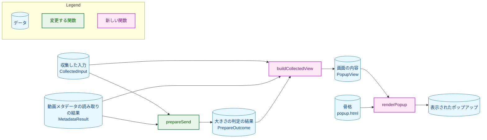
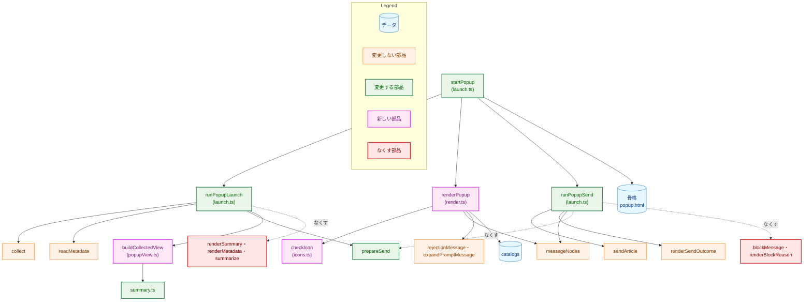
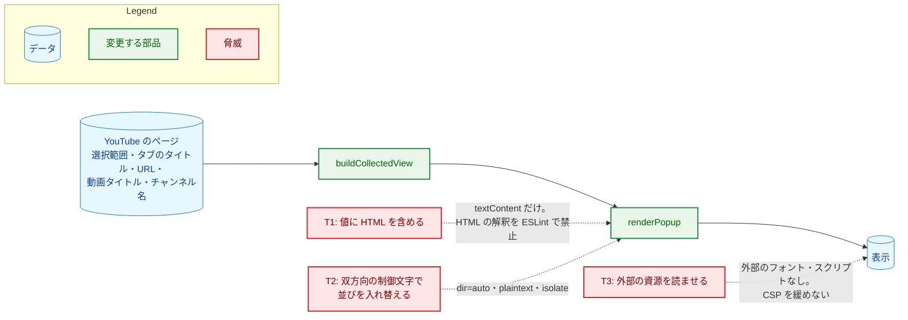
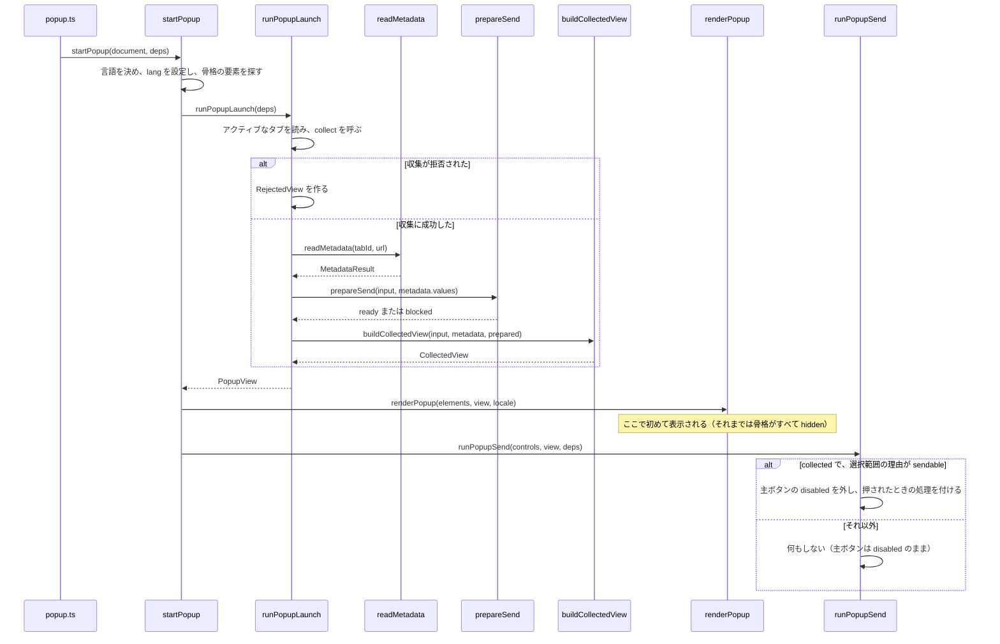
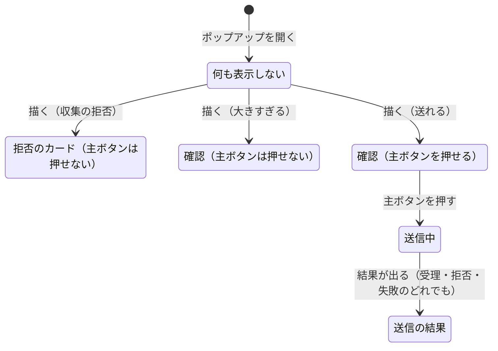

# アーキテクチャ設計書：ポップアップの画面の再設計

## Document Status

| Item | Value |
|---|---|
| Status | `approved` |
| Created | 2026-10-28 |
| Review date | 2026-10-28 |
| Reviewer | isseis |
| Comments | - |

本書は [01_requirements.md](01_requirements.md)（要件定義書。以下、要件書）の設計である。既存のファイルに関する記述は、コミット `f488112` のファイルで確かめた。`file:line` はこのコミットの行番号を指す。拡張のファイルのパスは `extension/` を省いて書く（例: `src/launch.ts` は `extension/src/launch.ts`）。F-NNN・AC-NN は要件書の項番を指す。モックアップは、要件書が参照する issue #507 のモックアップを指す。要件のレビューで設計に申し送られた事項（[design_handoff.md](design_handoff.md) の H-01〜H-12）への対応は 3.11 にまとめる。

本書は要件書 6 章の用語（セクション・動画のセクション・見出し・確認のセクション・操作のセクション・確認の行・選択範囲の行・概要欄の行・主ボタン・詳細・拒否のカード・収集の拒否の理由・先頭のプレビュー・末尾のプレビュー・支援技術・フォーカスの表示・リクエストの本文）と、0043 の設計書の用語（言語の型・文言の集合・振り分け・経路の処理）をそのまま使い、次の用語を加える。

-   **画面の内容:** ポップアップに何を表示し、主ボタンを押せるかを、DOM に触れずに表した値（`PopupView` 型）。収集・動画メタデータの読み取り・リクエストの本文の大きさの判定の結果から作る（3.2）。
-   **確認の状態:** 確認の行が ✓ か ⚠ か（`CheckState` 型、`"ok" | "warning"`）。画面の内容を作るときに、行ごとの理由（大きすぎる・折りたたまれている・送られないなど）から決める（3.2）。
-   **骨格:** `popup.html` に書いておく、セクションの入れ物と主ボタンと状態の領域（3.4）。描く処理は入れ物の中身を作り、表示・非表示を切り替える。
-   **状態の領域:** 操作のセクションの中で、送信中の案内と送信の結果を表示する要素（`role="status"`）。骨格に置き、支援技術に変化を伝える（AC-39）。

## 1. 設計の全体像 (Design Overview)

### 1.1. 設計原則

-   **画面の内容を先に決め、そのあとで描く。** 経路の処理は、収集・動画メタデータの読み取り・本文の大きさの判定をすべて終えてから画面の内容を作り、`renderPopup` で骨格に描く。画面の内容ができる前は何も描かないので、表示した見出しと確認の状態は後で別の値に差し替わらない（AC-05）。
-   **状態と操作は画面の内容の型で宣言する。** 選択範囲の行・概要欄の行の理由（`SelectionStatus`・`DescriptionStatus`）は画面の内容の中に持ち、確認の状態（`CheckState`）は理由の型の各 `kind` にリテラル型で結び付ける。主ボタンを押せるかも、画面の内容だけで決まる。押せるのは、画面の内容が `collected` で、選択範囲の行の理由が `sendable` のときだけで、送るリクエスト（`PreparedRequest`）はその `sendable` の値の中にある。✓ と押せる主ボタンが同じ 1 つの値から決まるので、食い違わない。表示する文字列の中身を調べて状態を決めることはしない（`CLAUDE.md`「Declare, don't infer」「Enforce invariants with the type」、H-02）。
-   **画面の内容を作る処理と、描く処理を分ける。** 画面の内容を作る関数（`buildCollectedView`）は DOM もブラウザの API も使わない純粋な関数で、状態・プレビュー・見出しの代替をすべてここで決める。`renderPopup` は画面の内容を骨格へ写すだけで、判断を持たない。判断のテストは DOM なしで書け、描く処理のテストは画面の内容を直接渡して書ける。
-   **後続タスク #503 の状態（9 章）は、画面の内容の種類として加え、骨格の同じ入れ物に描く。** 画面の内容は `kind` で区別する判別共用体にし、#503 は種類（生成中・生成済み・失敗）を加える。収集に成功したときの 4 つの入れ物（動画のセクション・確認のセクション・操作のセクション・詳細）は変えず、#503 は確認のセクションに状態の表示を描き、操作のセクションの主ボタンを別の操作に変える（9 章、H-01）。
-   **表示の安全の規則は変えない。** 値はすべて `textContent` で設定する。記号（✓・⚠）は、文字列を HTML として解釈せず、DOM の API（`createElementNS`）で作る SVG で描く。ESLint の、文字列を HTML として解釈する API の禁止（`eslint.config.js:7-15`）はそのまま適用される（AC-32・AC-34）。
-   **HTML の要素の意味に任せる。** 主ボタンは `<button>`、押せない状態は `disabled` 属性、詳細は `<details>`/`<summary>`、見出しは `<h1>`、拒否のカードは名前を持つ `<section>` とする。ARIA の属性は、HTML の要素で表せないこと（記号を隠す `aria-hidden`、状態の領域の `role="status"`、カードの名前の `aria-labelledby`）にだけ使う（`CLAUDE.md`「Accessibility」、H-07）。
-   **色は CSS の変数で持ち、コントラストはテストで計算する。** ライトとダークの色を `style.css` の CSS の変数の 2 組として持ち、テストが変数の値からコントラスト比を計算する（AC-26・AC-37、H-06）。

**設計の際に決めたこと（2026-10-28）:**

-   **末尾のプレビューの片側の省略は `:dir()` で決め、向きが混ざった文は保証の外とする（AC-09・H-03）。** ローカルの Chrome 156（headless）で試作して確かめた結果は次のとおりである（6.3）。入れ物を `direction: rtl` にし、中の値を `dir="auto"` と `unicode-bidi: isolate` で包むと、左から右の文（日本語・英語）では最後の文字が見え、前の側が省略記号で隠れる。ただし、右から左の文字（ヘブライ語など）だけの文では最後の文字が隠れる。中の値の向きが右から左に決まったときだけ、入れ物の向きを `ltr` に戻す（`:has(> :dir(rtl))`）と、どちらの向きだけの文でも最後の文字が見える。一方、向きが混ざった文（日本語の後にヘブライ語が続くなど）では、論理上の最後の文字が視覚上の端に来るとは限らない。そのため、片側を隠す方法では、どう組んでも最後の文字が見えるとは限らない。そこで、一方向だけの文で AC-09 を保証し、向きが混ざった文は保証の外とする。日本語と英語の字幕のほとんどは一方向だけの文である。ただし、末尾の 100 コードポイントに右から左の語や、見えない右から左の印（U+200F）が 1 つでも入ると、向きが混ざった文になる。要件書は変えない。向きの判定はブラウザの `dir="auto"` に任せ、拡張のコードは文字列の中身を調べない。
-   **拡張の対応する Chrome の最低バージョン（103）は変えず、Chrome 119 以前では右から左だけの末尾のプレビューを保証の外とする（AC-09）。** manifest は `minimum_chrome_version` を `103` としている（`static/manifest.json:8`。`test/manifest.test.ts` がこの値を固定する）。`:has()` は Chrome 105 から、`:dir()` は Chrome 120 から使える。Chrome 119 以前ではこのセレクタが解釈できず、その規則だけが捨てられる。左から右の文の見え方は `direction: rtl` の規則で決まるので変わらず、右から左だけの文で最後の文字が隠れる。上の決定で保証の外とした範囲が少し広がるだけなので、最低バージョンを上げない。ほかのセレクタを巻き込んで捨てられないように、この規則はほかのセレクタと 1 つの規則にまとめない。
-   **読み取りと判定が終わるまでは何も表示しない（AC-05・H-05）。** 読み取りにかかるのは、ふつうは数十ミリ秒である。その間だけ出る表示は後で差し替わる。差し替わる表示を避け、新しい文言も増やさないために、何も表示しない。骨格の要素はすべて `hidden` で始まる。読み取りが終わらないときの扱いは 3.3 に書く。
-   **拒否のカードに見出しを加えない（AC-23・H-04）。** 今の理由の文をカードの最初の文として太字で示し、カードの名前（`aria-labelledby`）にも使う。理由ごとの見出しの文言（4 つの理由 × 2 言語）を増やさずに、カードが何を伝えるかを示せるためである。
-   **コントラストは、色の変数から計算するテストで確かめる（AC-26・AC-37・H-06）。** 色覚の模擬（AC-40）は手動で確かめる（7.2）。
-   **押せない主ボタンは `disabled` 属性で表す（AC-36・AC-38・H-07・H-08）。** ブラウザが押せなくし、支援技術にも押せないことが伝わる。送信を始めるとフォーカスはボタンから外れるが、送信中の案内と送信の結果は状態の領域が読み上げる（AC-39）。`aria-disabled` を使うと、押されても何もしない処理と押せない見た目を自分で書く必要があり、HTML の要素の意味に任せる原則に反する。
-   **選択範囲の行の名前は `Selected captions`／`選択した字幕` とする（AC-29・H-12）。** モックアップの `Transcript`／`字幕` は、行が「字幕のすべて」を表すように読める。この行の ✓ は送れる大きさであることだけを表す（AC-07）ので、選んだ範囲であることを名前で示す。今の日本語の文言も、選ぶ対象を「字幕の行」と呼んでいる（`src/core/i18n/ja.ts:21`）。
-   **促しのメッセージは、モックアップに合わせて短くする（AC-13・H-04・H-11）。** 概要欄の行の中に収めるので、行の名前（`Description`）と重なる語を省き、手順も 2 つの短い文にする（3.5）。README の引用は同じ変更で直し、ガードのテスト（`test/metadataDocs.test.ts:28-35`）はそのまま、新しい文言と README を比べる。
-   **状態を表す語は、画面には出さず支援技術にだけ渡す（AC-27・AC-38）。** 記号は `aria-hidden` にし、行の名前の直後に、見た目では隠した状態の語（`OK`／`問題なし`、`Warning`／`注意`）を置く。⚠ の行は理由の文が画面に出るので、見える文字でも状態が分かる。モックアップの見た目を保てる。
-   **製品名は表示しない（AC-01）。** モックアップの `YT2COLUMN` は、要件書で採るかを設計に任されている。ポップアップは拡張のアイコンから開くので、製品名がなくてもどの拡張か分かる。表示しなければ高さを使わず、文言も増えない。
-   **✓ は青、⚠ は琥珀色で描く（AC-40）。** モックアップの ✓ は緑である。緑と琥珀色は、1 型・2 型の色覚で見分けにくくなる。青と琥珀色（橙）は、どちらの色覚でも明るさと色相の差が残る組である。形（円の中のチェックと、三角の中の感嘆符）でも区別する。
-   **ポップアップの幅は 360 CSS ピクセルに固定する（AC-17・H-09）。** モックアップの幅で、日本語の最悪の場合の高さ（6.3）をこの幅で確かめた。今の `min-width: 20rem`（`static/style.css:10`、280px）より広く、プレビューが 1 行に多く入る。
-   **チャンネル名も見出しと同じ 2 行に制限する（AC-17・H-09）。** チャンネル名は 200 コードポイントまで表示するので、長い名前は幅 360px で何行にも折り返す。行数を制限しないと、AC-17 の高さの見積もりがチャンネル名の長さで崩れる。見出しと同じ `-webkit-line-clamp: 2` を使い、収まらない分は省略記号で示す。文字列は要素の中に残すので、見えない部分も支援技術には伝わる（AC-38）。
-   **`prepareSend` は収集に成功した入力だけを受け取る形にする（3.3）。** 0020 の設計からの変更で、理由と更新するテストは 3.9 に書く。

### 1.2. 概念モデル

矢印 A → B は「A の値から B を作る」を表す。



収集が拒否されたときは、経路の処理が拒否の理由だけを持つ画面の内容を直接作る（3.3）。画面の内容の種類と、それぞれが表示するものは次のとおりである。

| 画面の内容の種類 | いつ | 表示するもの |
|---|---|---|
| `collected` | 収集に成功した | 動画のセクション・確認のセクション・操作のセクション（主ボタン）・詳細 |
| `rejected` | 収集が拒否された | 拒否のカード・操作のセクション（押せない主ボタン） |

読み取りと判定が終わる前は、画面の内容がまだないので、何も表示しない（1.1「設計の際に決めたこと」）。

### 1.3. 既存のコードとの関係

今のポップアップは、収集の要約を先に描き（`src/launch.ts:180`）、動画メタデータを読んだ後に下へ加え（`src/launch.ts:190`）、その後で送信の領域にボタンを作る（`src/launch.ts:219-226`）。要約を先に描く順序では、表示の後に見出しや状態が変わりうるので、AC-05 を満たせない。また、項目ごとに「ラベルと値」の行を描く形（`src/ui/render.ts:24-43`）では、確認の状態や拒否のカードを表せない。そのため、描き方と経路の処理を作り直す。

-   **再利用する:** 収集（`collect`、`src/core/collect.ts`）、動画メタデータの読み取りと受理（`readMetadata`、`src/launch.ts:96-132`、`acceptMetadata`、`src/core/metadata.ts:174-191`）、本文の組み立て（`buildArticleBody`、`src/core/prepare.ts:26-42`）、送信（`sendArticle`、`src/send.ts:28`）、送信の結果の振り分け（`sendOutcomeMessage`、`src/core/sendMessages.ts:80-102`）と表示（`renderSendOutcome`、`src/ui/renderSend.ts:28-35`）、文言と手順の描き方（`messageNodes`、`src/ui/render.ts:75-91`）、拒否の理由と促しのメッセージの振り分け（`rejectionMessage`・`expandPromptMessage`、`src/core/messages.ts`）、切り詰め（`truncate`、`src/core/summary.ts:13-22`）、数え方（`countCharacters`・`countLines`、`src/core/summary.ts:25-32`）、数の書式（`formatCount`、`src/core/i18n/locale.ts:36-38`）、ページの言語（`applyPageLocale`、`src/ui/pageLocale.ts:10-12`）、ログ（`src/launch.ts:72-77` のラベルと、`logSend`、`src/launch.ts:141-158`）。
-   **置き換える:** 要約の型（`OutcomeSummary`・`SummaryField`、`src/core/types.ts:21`・`:31-43`）と `summarize`（`src/core/summary.ts:35-54`）は `PopupView` と `buildCollectedView` に、`renderSummary`・`renderMetadata`・`field`（`src/ui/render.ts:24-43`・`:107-118`・`:143-174`）は `renderPopup` に、`popup.html` の 2 つの領域（`static/popup.html:9-10`）は骨格に置き換える。
-   **なくす:** `BlockReason`（`src/core/prepare.ts:64`）・`blockMessage`（`src/core/sendMessages.ts:20-37`）・`renderBlockReason`（`src/ui/renderSend.ts:38-45`）。拒否のカードは `rejectionMessage` を、大きすぎるときの選択範囲の行は文言の集合の `preflight` を直接使うので、両方の理由をまとめて振り分ける関数は要らなくなる（3.3）。文言の集合の `summaryLabels`・`metadataLabels`・`sendButton`（`src/core/i18n/catalog.ts:47-50`）もなくし、新しい項目に置き換える（3.5）。

## 2. システム構成 (System Structure)

### 2.1. ディレクトリ構成

```
extension/
├── src/
│   ├── popup.ts                 (変更) 先頭のコメントを新しい骨格に合わせる
│   ├── launch.ts                (変更) 経路の処理: 読み取りと判定の後に描く。骨格の要素を探す
│   ├── core/
│   │   ├── popupView.ts         (新規) PopupView・buildCollectedView・表示の上限
│   │   ├── summary.ts           (変更) summarize をなくし、DisplayText と末尾の切り詰めを加え、数え方を export する
│   │   ├── types.ts             (変更) SummaryField・OutcomeSummary をなくし、CheckState・CheckName を加える
│   │   ├── prepare.ts           (変更) prepareSend が CollectedInput を受け取る。BlockReason をなくす
│   │   ├── sendMessages.ts      (変更) blockMessage をなくす
│   │   └── i18n/
│   │       ├── catalog.ts       (変更) Catalog の項目を置き換える
│   │       ├── en.ts            (変更) 英語の文言
│   │       └── ja.ts            (変更) 日本語の文言
│   └── ui/
│       ├── render.ts            (変更) ActionControls・PopupElements・renderPopup と、セクションごとの描き方
│       ├── icons.ts             (新規) ✓ と ⚠ の SVG を DOM の API で作る
│       └── renderSend.ts        (変更) renderBlockReason をなくす
├── static/
│   ├── popup.html               (変更) 骨格
│   └── style.css                (変更) 色の変数、[hidden]、セクション・確認の行・主ボタン・詳細の規則
└── test/                        (変更・新規) 3.9・3.10
README.md                        (変更) Browser extension の節のポップアップの説明
docs/translation_glossary.md     (変更) 6 章の用語を加える
```

### 2.2. コンポーネントの依存関係

矢印 A → B は「A が B を呼ぶ、または B の値を読む」を表す。点線の矢印は、今の依存のうち本タスクでなくすものである。



`prepareSend` を呼ぶのは、今は送信の処理（`src/launch.ts:211`）で、本タスクの後は経路の処理（`runPopupLaunch`）になる。`popupView.ts`・`summary.ts`・`types.ts` は `src/core/` に置き、DOM を使わない。`render.ts`・`icons.ts` は `src/ui/` に置き、ブラウザの拡張の API（`chrome.*`）を使わない。この分け方は今と同じである（0007 の設計書）。

### 2.3. 実行時の配置

変わらない。ポップアップのページ（`popup.html`・`popup.js`・`style.css`）が拡張のページとして動き、Native Messaging のホストを経てサーバへ送る。manifest は変えない（AC-35）。

## 3. コンポーネント設計 (Component Design)

### 3.1. 選択範囲の切り詰めと数え方（F-002・AC-07〜AC-10、H-03）

`src/core/summary.ts` は、表示のための文字列の処理だけを持つ。

```ts
/** A value shortened for display; the ellipsis is added when it is rendered. */
export interface DisplayText {
  readonly value: string;
  readonly truncated: boolean;
}

/** Cuts text to its first limit code points; a surrogate pair is never split. */
export function truncate(text: string, limit: number): DisplayText;

/** Cuts text to its last limit code points; a surrogate pair is never split. */
export function truncateTail(text: string, limit: number): DisplayText;

/** Counts code points, so a surrogate pair counts as one character. */
export function countCharacters(text: string): number; // export する

/** Counts lines split on \r\n, \r or \n; leading and trailing blanks count. */
export function countLines(text: string): number; // export する
```

-   `truncate` の戻り値は、今の無名の型（`src/core/summary.ts:16`）と同じ形の `DisplayText` に名前を付けたものである。
-   `truncateTail` は、`truncate` と同じく、文字列をコードポイントの列として扱って後ろから数えるので、サロゲートペアの途中で切らない（AC-08）。
-   数え方は今と同じ（AC-07）。
-   改行を空白に置き換える処理は、切り詰めた後に、画面の内容を作るとき（`buildCollectedView`）に行う。順序は「元の選択範囲で 100 コードポイントを数えて切る → 切った文字列の中の改行（`\r\n`・`\r`・`\n` のそれぞれ）を 1 つの空白にする」である（AC-08）。`\r\n` の `\r` と `\n` の間で切れた場合も、残った `\r` または `\n` は 1 つの空白になる。置き換えは画面の内容だけに当たり、送る値（`CollectedInput.selection`）は変えない（AC-19）。
-   選択範囲が 100 コードポイント以下なら、先頭のプレビューは選択範囲の全体で、末尾のプレビューは作らない（AC-10）。
-   `summarize` と `previewLimit`（200）はなくす。`titleLimit`・`urlLimit`（どちらも 1000、`src/core/summary.ts:4-5`）は `popupView.ts` へ移す。

### 3.2. 画面の内容（F-001〜F-005・AC-01〜AC-16・AC-22、H-02）

確認の状態と行の名前の型は、文言の集合（3.5）と画面の内容の両方が使うので、`src/core/types.ts` に置く。

```ts
/** Whether a check row is shown with ✓ or ⚠. */
export type CheckState = "ok" | "warning";

/** The check rows. */
export type CheckName = "selection" | "description";
```

画面の内容は、新しいファイル `src/core/popupView.ts` に置く。

```ts
export interface VideoView {
  /** The video title when it is sent, otherwise the tab title. */
  readonly heading: DisplayText;
  /** Present only when the channel name is sent. */
  readonly channelName?: DisplayText;
}

/** Why the selection row is ✓ or ⚠; declared, never inferred from text. */
export type SelectionStatus =
  | { readonly kind: "sendable"; readonly state: "ok"; readonly request: PreparedRequest }
  | { readonly kind: "blocked"; readonly state: "warning"; readonly reason: PreflightReason };

export interface SelectionCheck {
  readonly status: SelectionStatus;
  readonly characterCount: number;
  readonly lineCount: number;
  /** The first 100 code points, each line break shown as one space. */
  readonly head: DisplayText;
  /** The last 100 code points; absent when the selection is 100 code points or fewer. */
  readonly tail?: DisplayText;
}

/** Why the description row is ✓ or ⚠; declared, never inferred from text. */
export type DescriptionStatus =
  | { readonly kind: "full"; readonly state: "ok"; readonly characterCount: number }
  | { readonly kind: "collapsed"; readonly state: "warning" }
  | { readonly kind: "not-sent"; readonly state: "warning" };

export interface DescriptionCheck {
  readonly status: DescriptionStatus;
}

export interface DetailsView {
  readonly url: DisplayText;
  readonly tabTitle: DisplayText;
}

export interface CollectedView {
  readonly kind: "collected";
  readonly video: VideoView;
  readonly selection: SelectionCheck;
  readonly description: DescriptionCheck;
  readonly details: DetailsView;
}

export interface RejectedView {
  readonly kind: "rejected";
  readonly reason: RejectionReason;
}

/** What the popup displays and whether the primary button can be pressed. */
export type PopupView = CollectedView | RejectedView;

export function buildCollectedView(
  input: CollectedInput,
  metadata: MetadataResult,
  prepared: PrepareOutcome,
): CollectedView;
```

-   **見出し（AC-02・AC-03）:** 動画タイトルを送るとき（`metadata.values.title` があるとき）は動画タイトルを、送らないときはタブのタイトルを見出しにする。表示の上限は今と同じで、動画タイトルは 200 コードポイント（`metadataDisplayLimit`、`src/ui/render.ts:121`。`popupView.ts` へ移す）、タブのタイトルは 1000 コードポイントである。チャンネル名は、`metadata.values.channelName` があるときだけ持ち、200 コードポイントで切り詰める。見出しとチャンネル名の表示の行数は、どちらも 3.4 のとおり 2 行に制限する。
-   **選択範囲の行（AC-07・AC-08・AC-10・AC-11）:** `prepared` が `ready` なら `sendable`（そのリクエストを持つ）、`blocked` なら `blocked`（その理由を持つ）とする。主ボタンを押せるのは `sendable` のときだけである（3.3）。
-   **概要欄の行（AC-12〜AC-14）:** `metadata.values.description` がなければ `not-sent`、あって `metadata.showExpandPrompt` が真なら `collapsed`、それ以外は `full` とし、`full` のときだけ文字数（コードポイントの数）を持つ。`showExpandPrompt` は「概要欄が折りたたまれ、かつ受理した概要欄がある」ときに真になる（`src/core/metadata.ts:188-189`）。概要欄の文章そのものは画面の内容に入れない（AC-15）。
-   **確認の状態（AC-07・AC-11〜AC-14・AC-16）:** 理由の型の各 `kind` に、確認の状態をリテラル型で結び付ける。`sendable` と `full` は `ok`、`blocked`・`collapsed`・`not-sent` は `warning` である。`sendable` なのに `warning`、`blocked` なのに `ok` という値は型の検査を通らないので、記号を描く `renderPopup` と主ボタンを押せるようにする `runPopupSend` は、同じ理由の値から食い違わない判断を得る。
-   **詳細（AC-06）:** URL とタブのタイトルを、今と同じ 1000 コードポイントの上限で持つ。

### 3.3. 経路の処理（F-004・AC-05・AC-11・AC-13・AC-14・AC-17〜AC-21・AC-24、H-05）

**`prepareSend` の変更（`src/core/prepare.ts`）:**

```ts
/** Why a collected input is not sent; only the size check is left. */
export type PreflightReason = "body-too-large"; // 変更なし

export type PrepareOutcome =
  | { readonly kind: "ready"; readonly request: PreparedRequest }
  | { readonly kind: "blocked"; readonly reason: PreflightReason };

export function prepareSend(input: CollectedInput, metadata: ArticleMetadata): PrepareOutcome;
```

-   今の `prepareSend` は収集の結果（`CollectOutcome`）を受け取り、拒否なら収集の拒否の理由を返す（`src/core/prepare.ts:74-80`）。新しい画面では、拒否のときは拒否のカードを出し、`prepareSend` を呼ばない。拒否の理由を返す道を残すと、選択範囲の行が「収集に成功したのに、収集の拒否の理由で止められた」という起こりえない組み合わせを扱うことになる。`CollectedInput` を受け取る形にすれば、この組み合わせを型で書けなくなる（`CLAUDE.md`「Enforce invariants with the type」）。`BlockReason` は不要になり、なくす。
-   `PreparedRequest` を作れるのは `prepareSend` だけという点（0020 の設計書 1.1）は変えない。本文の組み立てと大きさの判定（`buildArticleBody`・`maxBodyBytes`）も変えない（AC-19）。

**経路の処理（`src/launch.ts`）:**

```ts
export async function runPopupLaunch(deps: PopupLaunchDeps): Promise<PopupView>;
export function runPopupSend(controls: ActionControls, view: PopupView, deps: PopupSendDeps): void;
export async function startPopup(doc: Document, deps: PopupStartDeps): Promise<void>;
```

`ActionControls`（主ボタンと状態の領域）は 3.4 で `src/ui/render.ts` に置く。

-   `startPopup` は、今と同じく表示言語を読み、言語を決め、ページの言語を設定する（`src/launch.ts:258-261`）。次に骨格の要素（3.4 の `PopupElements`）を `id` で探す。1 つでも見つからなければ、今と同じく何も描かずに終わる（`src/launch.ts:264-266`）。
-   `runPopupLaunch` は DOM に触れない。アクティブなタブを読み、収集し、ログを書く（今と同じ）。拒否なら、拒否の理由だけを持つ `RejectedView` を作って返し、動画メタデータを読まない（今と同じ、`src/launch.ts:181-183`。AC-24）。成功なら、動画メタデータを読み（今の `readMetadata`）、`prepareSend` で本文の大きさを判定し、`blocked` なら今と同じくログ（`yt2column blocked`、`src/launch.ts:75`・`:214`）を `info` で書き、`buildCollectedView` で画面の内容を作って返す。
-   `startPopup` は、返った画面の内容を `renderPopup` で骨格に描き（3.4）、続けて `runPopupSend` を呼ぶ。描く前は、骨格の要素がすべて `hidden` のままなので、何も表示されない（AC-05）。
-   `runPopupSend` は、主ボタンと状態の領域だけを受け取る。画面の内容が `collected` で、選択範囲の行の理由が `sendable` のときだけ、主ボタンの `disabled` を外し、押されたときの処理を付ける。それ以外のときは何もしないので、主ボタンは `renderPopup` が描いた押せない状態のままである。概要欄の行の状態は、主ボタンを押せるかに関わらない（AC-13・AC-14）。
-   主ボタンを押したときの処理は今と同じである（`src/launch.ts:229-243`）。`sendable` の値の中のリクエストを 1 回だけ送り（AC-18）、押すとすぐに `disabled` にし、状態の領域に送信中の案内を描き、結果が出たら状態の領域を結果で置き換える。文言は今と同じ（AC-20）。`runPopupSend` は主ボタンと状態の領域しか受け取らないので、動画のセクション・確認のセクション・詳細に触れない（AC-21）。
-   読み取りのログ（`yt2column video metadata`）、送信のログ（`logSend`）、表示言語のログ、収集のログは、今と同じラベルと内容で書く。

**動画メタデータの読み取りが終わらないとき:** 読み取り（`src/launch.ts:103-104`）には時間の上限がない。読み取りが終わらなければ、新しい画面は何も表示しないまま止まる。今の画面は要約を表示するが、送信のボタンは読み取りの後にしか作らない（`src/launch.ts:267-271`）ので、送れないことは今と同じである。そこで上限を加えず、この場合を受け入れる。開発者は、ポップアップのコンソールに収集のログ（`yt2column popup launch`）があり、読み取りのログ（`yt2column video metadata`）がないことから、読み取りが終わっていないと分かる。

### 3.4. 骨格と描き方（F-001〜F-006・AC-01〜AC-06・AC-15〜AC-17・AC-22・AC-27・AC-36〜AC-39、H-01・H-07・H-08）

**骨格（`static/popup.html`）:** `<body>` の中に、次の要素をこの順に置く。どれも最初は `hidden` を付ける。主ボタンは最初から `disabled` を付ける。

| 要素 | `id` | 骨格に書く中身 | `renderPopup` が作る中身 |
|---|---|---|---|
| `<section>` | `video` | なし | `<h1>`（見出し）と `<p>`（チャンネル名） |
| `<section>` | `checks` | なし | 確認の行の一覧（`<ul>` と `<li>`） |
| `<section aria-labelledby="rejection-text">` | `rejection` | なし | 理由の文（`id="rejection-text"` を付ける）と手順 |
| `<section>` | `action` | 主ボタン `<button id="primary" type="button" disabled>` と、状態の領域 `<div id="status" role="status">` | 主ボタンの名前 |
| `<details>` | `details` | なし | `<summary>` と、URL・タブのタイトルの一覧 |

入れ物は 5 つある。収集に成功したときの 4 つ（`video`・`checks`・`action`・`details`）と、拒否のときに `video`・`checks` の代わりに出す `rejection` である。`popup.html` の最初の `lang` は今と同じく `en` で、`startPopup` が描く前に選んだ言語に変える（AC-38、0043 AC-14）。

`style.css` に `[hidden] { display: none !important; }` を書く。ブラウザは `hidden` 属性を、既定のスタイルシートの `display: none` だけで隠す。そのため、ほかの規則が入れ物に `display` を指定すると（`section { display: flex }` など）、`hidden` を付けた入れ物が表示されてしまう。AC-05（終わるまで何も表示しない）と AC-22（拒否のときに動画のセクションなどを出さない）は、この隠し方に頼るので、上書きされない規則で守る。

**描き方（`src/ui/render.ts`）:**

```ts
/** The primary button and the status region; all the send path touches. */
export interface ActionControls {
  readonly primary: HTMLButtonElement;
  readonly status: HTMLElement;
}

/** The skeleton's elements; startPopup finds them in popup.html by id. */
export interface PopupElements extends ActionControls {
  readonly video: HTMLElement;
  readonly checks: HTMLElement;
  readonly rejection: HTMLElement;
  readonly action: HTMLElement;
  readonly details: HTMLDetailsElement;
}

export function renderPopup(elements: PopupElements, view: PopupView, locale: Locale): void;
```

両方の型を `src/ui/render.ts` に置き、`src/launch.ts` がそれを使う。UI の層が経路の処理を参照しないようにするためである。

-   `renderPopup` は、作る中身を `replaceChildren` で置き換え、要素を付け足さない。`details` の開閉の状態は、利用者の操作に任せ、`renderPopup` は変えない。
-   `collected` のとき: `video`・`checks`・`action`・`details` を表示し、`rejection` を隠す。主ボタンの名前を描く。`disabled` は外さない（外すのは `runPopupSend`）。`details` は閉じたまま（`open` を付けない、AC-01）。
-   `rejected` のとき: `rejection`・`action` を表示し、`video`・`checks`・`details` を隠す（AC-22）。カードには `rejectionMessage` の文と手順を `messageNodes` で描き、最初の文の要素に `id="rejection-text"` を付けて、太字で示す（AC-23・AC-38）。主ボタンは名前を描き、`disabled` のままにする。
-   **動画のセクション:** `<h1>` に見出しを、チャンネル名があれば `<p>` に描く（AC-02・AC-03）。どちらも `dir="auto"` を付け、CSS で `unicode-bidi: plaintext` を当てる（今の規則、`static/style.css:31-39`、AC-33）。見出しは CSS の `-webkit-line-clamp: 2` で 2 行に制限し、収まらない分は省略記号で示す（AC-04）。チャンネル名も同じ `-webkit-line-clamp: 2` で 2 行に制限し、収まらない分は省略記号で示す（AC-17、1.1「設計の際に決めたこと」）。どちらの要素も中の文字列は CSS では切り詰めないので、見えない部分も支援技術に伝わる（AC-38）。表示の上限（3.2）を超えて切り詰めた値には、今と同じく末尾に `…` を付ける（`src/ui/render.ts:14-16`）。
-   **確認の行:** `checks` の中に、選択範囲の行・概要欄の行の順に、一覧として描く（AC-38 の読み上げの順序）。各行の DOM の順序は、記号（`aria-hidden="true"` の SVG）、行の名前（`checkNames`）、状態の語（`checkStates`。見た目では隠し、支援技術には読ませる要素）、内容である（AC-27・AC-38）。⚠ の行にだけ警告の class を付け、背景の色を付ける（AC-16）。
    -   選択範囲の行の内容: 文字数と行数（`selectionSize`、3.5）、先頭のプレビュー、末尾のプレビュー（あれば）。理由が `blocked` のときは、続けて文言の集合の `preflight[reason]` の文と手順を `messageNodes` で描く（AC-11）。
    -   概要欄の行の内容: `full` は `descriptionFull`（全文と文字数）、`collapsed` は促しのメッセージ（`expandPromptMessage`）の文と手順、`not-sent` は `descriptionNotSent` の文（手順なし）を、`messageNodes` で描く（AC-12〜AC-14）。
-   **見た目では隠す要素:** 状態の語は、要素を 1 ピクセルに切り抜く規則（`clip` と `position: absolute` を使う一般的な規則）で隠す。`display: none`・`visibility: hidden`・`aria-hidden` は、支援技術からも隠してしまうので使わない。
-   **プレビュー（AC-08・AC-09・AC-33）:** 先頭のプレビューは、切り詰めたときに後ろに `…` を、末尾のプレビューは前に `…` を付けて描く。どちらも `white-space: pre`・`overflow: hidden`・`text-overflow: ellipsis` で 1 行にし、幅に収まらない分を省略記号で示す。`pre` にするのは、改行を置き換えた空白と元の空白の並びを、詰めずに表示するためである（AC-08 の「ほかの文字は変えない」）。
    -   先頭のプレビュー: 要素に `dir="auto"` を付け、`unicode-bidi: plaintext` を当てる。要素の向きが中身で決まるので、右から左の文でも選択範囲の最初の文字が見え、後ろの側が隠れる。
    -   末尾のプレビュー: 入れ物の要素に `direction: rtl` を当て、中に値を入れた要素（`dir="auto"`、`unicode-bidi: isolate`）を置く。中の要素の向きが右から左に決まったときは、`:has(> :dir(rtl))` の規則で入れ物を `direction: ltr` に戻す。これで一方向だけの文では最後の文字が見え、前の側が隠れる（1.1「設計の際に決めたこと」、6.3）。中の要素を隔離する（`isolate`）ので、値の中の双方向の制御文字が、ほかの値や行の名前の並びを変えない（AC-33）。
-   **記号（`src/ui/icons.ts`）:**

    ```ts
    /** The ✓ or ⚠ symbol as an SVG built with createElementNS; aria-hidden. */
    export function checkIcon(doc: Document, state: CheckState): SVGSVGElement;
    ```

    ✓ は円の中のチェック、⚠ は三角の中の感嘆符である。文字（`✓`・`⚠`）は使わない。⚠ は環境によって色付きの絵文字で表示され、色と形を CSS で決められないためである。色は CSS の変数（3.6）で付ける（AC-40）。
-   **詳細:** `<summary>` に `details.summary` の文言を、その後に URL とタブのタイトルを、それぞれの名前（`details.url`・`details.tabTitle`）と一緒に描く。値には `dir="auto"` を付け、`unicode-bidi: plaintext` を当てる（AC-06・AC-33）。
-   **すべての文字列は `textContent` で設定する**（AC-32）。今の描き方（`field`・`messageNodes`、`src/ui/render.ts:24-43`・`:75-91`）と同じ規則である。`messageNodes` の要素の class（`summary-message`・`summary-steps`）は、要約の型がなくなり、`<summary>` 要素とも紛らわしいので、名前を変える。

**キーボードとフォーカス（AC-36・AC-37、H-08）:**

-   押せる要素は、主ボタンと詳細の `<summary>` の 2 つで、DOM の順序が表示の順序（上から下）と同じなので、Tab と Shift+Tab の順序も同じになる。`tabindex` は使わない。主ボタンの Enter と Space、`<summary>` の Enter と Space は、ブラウザの既定の振る舞いで動く。フォーカスを閉じ込める処理はない（AC-36）。
-   押せない主ボタン（`disabled`）には、フォーカスが移らない（AC-36 が認める）。
-   経路の処理は、フォーカスを動かさない。ポップアップを開いた時点で主ボタンにフォーカスを置くと、確かめる前に Enter で送れてしまうためである。送信を始めると主ボタンが `disabled` になり、フォーカスはボタンから外れる。送信中の案内と結果は状態の領域が伝える（AC-39）。
-   フォーカスの表示は、ブラウザの既定を消さず、`:focus-visible` に `outline: 2px solid var(--focus)` と `outline-offset: 2px` を当てて置き換える。輪郭と要素の間に背景の色の隙間ができ、輪郭に隣り合う色はページの背景になる。そのため、輪郭と背景のコントラストを 3:1 以上にすればよい（AC-37、3.6）。

**状態の領域（AC-39、H-07）:** `role="status"` の要素は骨格に置く。支援技術は、すでにある live region（`role="status"` のように、変化を読み上げる領域）の中身が変わったときに読み上げる。要素を後から加えると、最初の変化が読み上げられないことがある。そのため、要素は骨格に置く。状態の領域は操作のセクションの中、主ボタンの下にある（AC-20）。操作のセクションは描くまで `hidden` なので、状態の領域が支援技術に見えるのは描いた後である。本タスクでは、状態の領域の最初の変化は、描いた後に利用者が主ボタンを押したときなので、この順序で足りる。

### 3.5. 文言の集合（F-007・AC-13・AC-17・AC-27・AC-29・AC-30、H-04・H-12）

`Catalog`（`src/core/i18n/catalog.ts:23-51`）の項目を次のとおり変える。

```ts
export interface Catalog {
  // 変更しない: rejection・preflight・serverReject・notSent・accepted・
  // noResponse・hostFailed・unexpected・sending

  /** The prompt in the description row when the description is collapsed (wording changed). */
  readonly expandPrompt: Message;

  /** The check rows' names. */
  readonly checkNames: Readonly<Record<CheckName, string>>;
  /** The word that tells a check row's state; given to assistive technology only. */
  readonly checkStates: Readonly<Record<CheckState, string>>;
  /** The selection row's counts; formats the numbers in its own locale. */
  readonly selectionSize: (characters: number, lines: number) => string;
  /** The description row when the full description is sent. */
  readonly descriptionFull: (characters: number) => string;
  /** The description row when no description is sent; no steps. */
  readonly descriptionNotSent: Message;
  /** The details' toggle and its value names. */
  readonly details: { readonly summary: string; readonly url: string; readonly tabTitle: string };
  /** The primary button's name. */
  readonly primaryButton: string;
}
```

-   `summaryLabels`・`metadataLabels`・`sendButton` はなくす。`Catalog` のキーを網羅する型の検査により、どちらかの言語の文言が欠ければ `make ext-typecheck` が失敗する（0043 の設計、AC-29）。
-   数を埋め込む文言（`selectionSize`・`descriptionFull`）は、値を受け取る関数にする。関数は数（`number`）を受け取り、その言語の `formatCount` で整形する（AC-07、0043 AC-13）。0043 の設計の方針との違いは 3.9 に書く。
-   ⚠ の理由の文は、どれも `Message` で持ち、`messageNodes` で同じように描く（`preflight`・`expandPrompt`・`descriptionNotSent`）。

文言は次のとおりとする。

| 項目 | 英語 | 日本語 |
|---|---|---|
| `primaryButton` | `Generate article` | `記事を生成する` |
| `checkNames.selection` | `Selected captions` | `選択した字幕` |
| `checkNames.description` | `Description` | `概要欄` |
| `checkStates.ok` | `OK` | `問題なし` |
| `checkStates.warning` | `Warning` | `注意` |
| `selectionSize(12345, 420)` | `12,345 characters · 420 lines` | `12,345 文字・420 行` |
| `descriptionFull(1203)` | `Full text · 1,203 characters` | `全文・1,203 文字` |
| `descriptionNotSent.text` | `Not available, so it will not be sent.` | `取得できないため、送られません。` |
| `expandPrompt.text` | `Collapsed, so only the beginning will be sent.` | `折りたたまれているため、冒頭だけが送られます。` |
| `expandPrompt.steps` | `Click "...more" below the video.`／`Reopen this popup.` | `動画の下の「もっと見る」をクリックしてください。`／`このポップアップを開き直してください。` |
| `details.summary` | `Details` | `詳細` |
| `details.url` | `URL` | `URL` |
| `details.tabTitle` | `Tab title` | `タブのタイトル` |

-   `selectionSize` の英語は、数が 1 のときに `1 character`・`1 line` とする。`descriptionFull` も同じ。
-   ✓ の状態の文言は、選択範囲が字幕のすべてを含むことや、書式が正しいことを述べない（AC-07）。`OK` と `問題なし` は、行の名前と並べて「送れる」ことだけを表す。
-   大きすぎるときの選択範囲の行の文と手順は、今の `preflight["body-too-large"]`（`src/core/i18n/en.ts:28-33` と日本語版）をそのまま使う（AC-11）。
-   拒否のカードの文と手順は、今の `rejection`（`src/core/i18n/en.ts:5-27` と日本語版）をそのまま使う（AC-23）。
-   YouTube のボタンの名前は、0043 AC-11 の表記（英語 `"...more"`、日本語「もっと見る」）である（AC-30）。

### 3.6. 配色とコントラスト（F-006・AC-16・AC-25・AC-26・AC-37・AC-40、H-06）

-   色は `style.css` の `:root` に CSS の変数として書き、`@media (prefers-color-scheme: dark)` の中の `:root` でダークの値に置き換える。各規則は色を `var(--…)` で参照し、色の値を直接書かない。`color-scheme: light dark`（`static/style.css:2`）は残し、ブラウザが描く部分（`<summary>` の開閉の印、スクロールバー）もテーマに合わせる。ページの背景と文字の色は、変数で明示する（AC-25）。
-   拒否のカードと確認のセクションは、背景をページと同じ `--bg` にし、枠線（`--border`）で区切る。枠線は区切りの飾りで、状態や操作を伝えないので、コントラストの基準の対象にしない。
-   変数と値は次の表のとおりとする。続く表の比は、組ごとのコントラスト比を WCAG 2.2 の式で計算した値である。

| 変数 | 用途 | ライト | ダーク |
|---|---|---|---|
| `--bg` | ページ・確認のセクション・拒否のカードの背景 | `#ffffff` | `#202124` |
| `--text` | 文字（見出し・行の名前・手順・拒否のカードの文） | `#1f1f1f` | `#e8eaed` |
| `--muted` | 補助の文字（チャンネル名・数・プレビュー・詳細） | `#5f6368` | `#a8adb3` |
| `--border` | 確認のセクションと拒否のカードの枠線 | `#e3e3e3` | `#3c4043` |
| `--warn-bg` | ⚠ の行の背景 | `#fff4dc` | `#3b2e12` |
| `--warn-text` | ⚠ の行の理由の文と手順 | `#5c3300` | `#fde7a8` |
| `--ok` | ✓ の記号 | `#1a5fc8` | `#8ab4f8` |
| `--warn` | ⚠ の記号 | `#a15c00` | `#f9ab00` |
| `--primary-bg` | 主ボタンの背景 | `#1a5fc8` | `#8ab4f8` |
| `--primary-text` | 主ボタンの名前 | `#ffffff` | `#202124` |
| `--disabled-bg` | 押せない主ボタンの背景 | `#e8eaed` | `#3c4043` |
| `--disabled-text` | 押せない主ボタンの名前（AC-26 の対象外） | `#5f6368` | `#9aa0a6` |
| `--focus` | フォーカスの表示 | `#1a5fc8` | `#8ab4f8` |

| 組（前景 / 背景） | 基準 | ライト | ダーク |
|---|---|---|---|
| `--text` / `--bg` | 4.5:1 | 16.48 | 13.36 |
| `--muted` / `--bg` | 4.5:1 | 6.05 | 7.12 |
| `--text` / `--warn-bg` | 4.5:1 | 15.09 | 10.99 |
| `--muted` / `--warn-bg` | 4.5:1 | 5.54 | 5.86 |
| `--warn-text` / `--warn-bg` | 4.5:1 | 9.97 | 10.83 |
| `--primary-text` / `--primary-bg` | 4.5:1 | 5.97 | 7.64 |
| `--ok` / `--bg` | 3:1 | 5.97 | 7.64 |
| `--warn` / `--warn-bg` | 3:1 | 4.75 | 6.85 |
| `--focus` / `--bg` | 3:1 | 5.97 | 7.64 |

-   押せる主ボタン（青の背景）と押せない主ボタン（灰色の背景）は、色と明るさが異なる。押せない状態は `disabled` で支援技術にも伝わる。
-   ✓ と ⚠ は、青と琥珀色で色相も明るさも異なり、形（円の中のチェックと三角の中の感嘆符）でも区別する。⚠ の行は背景の色でも区別する。状態は、記号の形と、支援技術に渡す状態の語でも伝える（AC-27・AC-40）。赤と緑の組は使わない。
-   ⚠ の行の背景（`--warn-bg`）とページの背景は、明るさが近い（ライトで比が 1.09:1）。AC-16 は背景の色での区別を求めるが、比の基準は定めていない。⚠ の行は、記号の形・理由の文・手順でも区別できる。色覚の模擬で区別がつくかは手動で確かめる（7.2）。
-   **テスト（AC-26・AC-37）:** `style.css` を jsdom で読み、ライトの `:root` とダークの `@media` の中の `:root` から変数の値を取り出す。テストの中に、前景と背景の組と基準の表（上の表と同じ内容）を持ち、両方のテーマでコントラスト比を計算し、基準を下回れば失敗する。この表と実際の規則がずれないように、同じテストで、この表が対象とする規則（ページの文字と背景、⚠ の行の背景と文字、主ボタン、記号、`:focus-visible` など）が、その組の変数を `var(--…)` で参照していることも確かめる。

### 3.7. 大きさとレイアウト（AC-04・AC-17・AC-28、H-09）

-   `body` の幅を 360 CSS ピクセルに固定する。この幅は、Chrome のポップアップの大きさの上限（幅 800・高さ 600）に収まる。
-   主ボタンは幅いっぱい（`width: 100%`）で、高さを 44 CSS ピクセル以上（`min-height`）にする。`<summary>` は、開閉の印を残すため `display: list-item` のまま、上下の余白で高さを 44 CSS ピクセル以上にし、幅は内容の幅いっぱいにする（AC-28）。
-   新しい規則は `line-height` を宣言しない。日本語の行間は今の `body:lang(ja)` の規則（`static/style.css:71-73`）で決まり、`test/style.test.ts:164-171` が、`line-height` を宣言するのはこの規則だけであることを確かめているためである。
-   **主ボタンが見えること（AC-17）の見積もり:** 試作（6.3）で、日本語・行間 1.7・幅 360px、見出しが 2 行、選択範囲の行が ⚠（数・2 つのプレビュー・理由の文・手順 1 つ）、概要欄の行が ⚠（文・手順 2 つ）の場合に、主ボタンの下端はページの上端から 492px だった（チャンネル名を除く）。チャンネル名は 2 行に制限する（3.4）ので、上限まで長い日本語のチャンネル名でも 2 行（48px。行の高さ 23.8px × 2）で止まる。これを加えた約 540px を上限と見積もる。上限の 600px まで約 60px の余裕がある。英語は行間が狭いので、これより低い。この見積もりは、ブラウザの表示の倍率が 100% で、macOS の既定の書体の場合である。拡張のポップアップはブラウザの既定の倍率に従うので、倍率を 125% にすると約 675px になり、主ボタンの下端が上限を超えてスクロールが要る。AC-17 は倍率 100% で満たし、それより大きい倍率は保証の外とする。実装した画面での確認は手動で行う（7.2）。
-   見出しの 2 行の制限（`-webkit-line-clamp: 2` と `display: -webkit-box`）は、試作で 2 行目の終わりに省略記号が付くことを確かめた（AC-04）。チャンネル名の 2 行の制限も同じ規則で行い、上限まで長い日本語の名前が 2 行で止まり、2 行目の終わりに省略記号が付くことを試作で確かめた（AC-17）。

### 3.8. 文書（F-007・AC-31、H-11・H-12）

-   **README（AC-31）:** 「Browser extension」の節のポップアップの説明（`README.md:1074-1097`）を、新しい画面に合わせて書き直す。主ボタンを **Generate article** と書き、動画のセクション（見出しとチャンネル名）、確認のセクション（選択範囲の行と概要欄の行、⚠ のときの理由と手順）、主ボタン、詳細（URL とタブのタイトル）を説明する。折りたたまれた概要欄の文言と手順の引用（`README.md:1081-1088`）は、新しい英語の文言（3.5）に変える。値が取れないとき（`README.md:1090-1097`）の説明には、概要欄の行が ⚠ になり、見出しがタブのタイトルになることを加える。
-   **ガードのテスト（H-11）:** `test/metadataDocs.test.ts` に、README が主ボタンの英語の名前（`catalogs.en.primaryButton`）を含むことの確認を加える。促しのメッセージの比較（`test/metadataDocs.test.ts:28-35`）は残す。どちらも、README が引用する画面の文言という値を、文言の集合と比べるテストである（`CLAUDE.md`「Document tests check values」）。README の説明の文の内容は、PR のレビューで読んで確かめる。
-   **用語集（H-12）:** 要件書 6 章の用語（セクション・動画のセクション・見出し・確認のセクション・操作のセクション・確認の行・選択範囲の行・概要欄の行・主ボタン・詳細・拒否のカード・収集の拒否の理由・先頭のプレビュー・末尾のプレビュー・選択範囲・支援技術・フォーカスの表示・リクエストの本文）を `docs/translation_glossary.md` に加える。「字幕」の行に、UI の文言では文字起こしパネルの行も指し、英語の UI では `captions` と書くことを注記する。

### 3.9. 既存の方針からの変更と、更新するテスト

| 変更 | 元の方針と場所 | 理由 | 主張が変わるテスト |
|---|---|---|---|
| `prepareSend` が `CollectedInput` を受け取り、拒否の理由を返さない。`BlockReason`・`blockMessage`・`renderBlockReason` をなくす | 0020 の設計書（`docs/tasks/0020_extension_send/02_architecture.md:98`）: `prepareSend` は収集の結果を受け取り、拒否なら拒否の理由を返す。0020 AC-17（拒否なら送信しない）は、拒否のときに `prepareSend` を呼ばないことで保つ | 拒否のときは拒否のカードを出し、送る準備をしない。拒否の理由を返す道を残すと、画面の内容に起こりえない組み合わせができる（3.3） | `test/prepare.test.ts:133-155`（拒否の結果と、拒否が大きさの判定より先であること。拒否を渡す呼び出しは型の検査で書けなくなるので、なくす）、`test/sendMessages.test.ts:63-119`（`blockMessage`）・`:304-315`（`blockMessage` を通して、どの文言も設定画面などに触れないことを確かめる部分）、`test/renderSend.test.ts:86-100`（`renderBlockReason`）、`test/launch.test.ts:622-645`（大きすぎるときの表示） |
| 要約と動画メタデータを別々に描く処理と、2 つの領域（`#summary`・`#send`）をなくし、骨格に描く | 0007 の設計書（`popup.html` の骨格）、0025 の設計書（`docs/tasks/0025_extension_video_metadata/02_architecture.md:97`・`:149`）: 要約の後に `renderMetadata` で値と促しのメッセージを加える | AC-05（一度に表示する）と AC-01（新しい構成）。要約を先に描く順序では AC-05 を満たせない（1.3） | `test/render.test.ts`（全体）、`test/renderMetadata.test.ts`（全体）、`test/summary.test.ts`（全体。どのテストも `summarize` を通して数え方と切り詰めを確かめている。新しい関数を直接呼ぶ形に移す）、`test/helpers/dom.ts:27-42`（`.summary-field` で値を探す）、`test/launch.test.ts:27`（`metadataDisplayLimit` の import 元）・`:928-958`（表示）・`:1002-1071`（日本語と英語への切り替え。`#summary` と `summaryLabels`・`sendButton` を使う）・`:1093-1122`（領域がないとき） |
| 送信のボタンを送信の領域に後から作る処理をなくし、骨格の主ボタンを使う。拒否のときも押せない主ボタンを出す | 0020 の設計（`src/launch.ts:206-209`・`:219-226`。拒否のときは送信の領域を空にし、それ以外はボタンを作る） | AC-22（拒否のカードの下に押せない主ボタン） | `test/launch.test.ts:437-690`（送信の各テストの、ボタンの探し方と名前）。そのうち `:553-575`（促しのメッセージがあってもボタンが押せること）は、AC-13 の確認として新しい画面に合わせて残す。`:647-671`（表示を切り詰めても全文を送ること）は、概要欄の文章を表示しなくなる（AC-15）ので、題名と前提の説明を直し、本文に全文が入ることの確認として残す。`:673-690`（拒否のときに何も描かない）は、押せない主ボタンを出すことの確認に変わる |
| 文言の集合の `summaryLabels`・`metadataLabels`・`sendButton` を新しい項目に置き換え、促しのメッセージの文言を短くする | 0043 の設計書（`docs/tasks/0043_extension_i18n/02_architecture.md` 3.2）、0025 の促しのメッセージ | 新しい画面の文言（3.5） | `test/catalog.test.ts:49-75`（すべての文言が空でないこと）、`test/typecheck.test.ts:159-160`（項目の欠けを型の検査が見つけることを、`sendButton` を除いて確かめている。残る項目に変える）、`test/metadataDocs.test.ts:28-35`（テストは変えず、README を直す） |
| 数を埋め込む文言の関数が、数（`number`）を受け取り、その言語で整形する | 0043 の設計書（`docs/tasks/0043_extension_i18n/02_architecture.md:817`）: 値を受け取る関数の型の例は `(count: string) => string` で、数は呼び出し側で `formatCount` を通してから渡す | 英語の単数形と複数形を選ぶには、整形する前の数が要る。整形した文字列から数を読み戻すと、表示する文字列の中身で振る舞いを決めることになる（`CLAUDE.md`「Declare, don't infer」） | `test/catalog.test.ts:49-75`（文言の集合をたどり、`Message` でない値はオブジェクトであると確かめている。関数の項目は呼び出した結果を確かめるように変える） |
| 0007 AC-21・0025 AC-11 の表示の変更 | 要件書 5 章に記載 | 要件書 5 章に記載 | 上の `render.test.ts`・`renderMetadata.test.ts`・`launch.test.ts` に含まれる |

0043 の差分の確認のスクリプト（`docs/tasks/0043_extension_i18n/_checks/`）は、0043 の PR で一度だけ実行するもので、マージの後は保守しない（`requirements_process.md` §4）。本タスクの変更で動かなくなっても直さない。

### 3.10. テストの構成（H-10）

| テスト | 対象 | 確かめること |
|---|---|---|
| `test/summary.test.ts`（変更） | `truncate`・`truncateTail`・`countCharacters`・`countLines` | 後ろからの切り詰め（ちょうど上限、上限を 1 超える、サロゲートペアの境界）。今の数え方と先頭の切り詰めの確認は、関数を直接呼ぶ形に移す |
| `test/popupView.test.ts`（新規） | `buildCollectedView` | 見出しの代替とチャンネル名の有無（AC-02・AC-03）、選択範囲の理由と状態（AC-07・AC-11）、プレビューの切り詰めと改行の置き換えの順序（`\r\n`・`\r`・`\n`、100 コードポイントちょうど・101、切れ目が `\r\n` の間に来る場合、サロゲートペア。AC-08・AC-10）、概要欄の 3 つの理由と文字数と状態（AC-12〜AC-14・AC-16）、詳細の値（AC-06） |
| `test/render.test.ts`（書き直す） | `renderPopup` | セクションの順序と表示・非表示（AC-01・AC-22）、詳細が閉じていること、URL とタブのタイトルが詳細の外にないこと（AC-06）、見出しが `h1` であること、確認の行の DOM の順序（記号・名前・状態の語・内容）、記号の `aria-hidden`、⚠ の行だけに警告の class があること（AC-16・AC-27・AC-38）、概要欄の文章を描かないこと（AC-15）、両方の言語の文言（AC-29）、`` が要素にならないこと（AC-32）、値の要素の `dir="auto"`（AC-33 の構造）、拒否のカードの文と手順と、`aria-labelledby` の指す要素（AC-23・AC-38）、主ボタンの名前と `disabled`（AC-17・AC-22）、2 回描いても要素が増えないこと |
| `test/launch.test.ts`（変更） | 経路の処理 | 動画メタデータの読み取りを止めておき、その間は骨格がすべて `hidden` で主ボタンが `disabled` であること、終わった後にまとめて表示されること（AC-05）、送信が 1 回だけであること（AC-18）、状態の領域が操作のセクションの中、主ボタンの後にあり、`role="status"` を持つこと（AC-20・AC-39）、送信の前後で動画のセクション・確認のセクション・詳細の内容が変わらないこと（AC-21）、大きすぎるときに主ボタンが押せず送らないこと（AC-11）、折りたたまれているときと概要欄を送らないときも主ボタンが押せること（AC-13・AC-14）、拒否のときに動画メタデータを読まないこと（AC-24、今のテスト `:327`）、本文が今と同じであること（AC-19、今のテスト `:252`・`:647`）、ログが今と同じであること |
| `test/prepare.test.ts`（変更） | `prepareSend` | 引数の型の変更に合わせる。大きさの判定（AC-11・AC-19） |
| `test/catalog.test.ts`（変更） | 文言の集合 | 関数の項目も、両方の言語で空でない文字列を返すこと。英語の単数形 |
| `test/style.test.ts`（変更） | `style.css` | コントラスト比と変数の参照（3.6、AC-26・AC-37）、`[hidden]` の規則（AC-05・AC-22）、主ボタンと `<summary>` の高さ 44px 以上の宣言（AC-28 の宣言の確認）、見出しとチャンネル名の `-webkit-line-clamp: 2`（AC-04・AC-17 の宣言の確認）、プレビューの 1 行の規則と末尾のプレビューの向きの規則（AC-09 の宣言の確認）、見た目では隠す要素が `display: none`・`visibility: hidden` を使わないこと（AC-27）、`:focus-visible` の輪郭（AC-37）、日本語の書体と行間の今の確認 |
| `test/metadataDocs.test.ts`（変更） | README | 主ボタンの名前と促しのメッセージの引用（AC-31） |

jsdom はレイアウトを計算しないので、見た目（2 行の省略、プレビューの見え方、主ボタンが見えること、色、大きさ、フォーカスの表示）は、CSS の宣言の確認と手動の確認で確かめる（7.2）。

### 3.11. design_handoff の各項目への対応

| 項目 | 対応 |
|---|---|
| H-01 | 骨格の入れ物（収集に成功したときの 4 つと拒否のカード）と、画面の内容の判別共用体で持つ（1.1・3.2・3.4）。#503 は画面の内容に種類を加え、`checks` に状態の表示を、主ボタンに別の操作を描く（9 章） |
| H-02 | `OutcomeSummary`・`SummaryField`・要約の欄の表・メタデータの行の表をなくし、画面の内容の `SelectionStatus`・`DescriptionStatus` と `CheckState` で状態を宣言する（3.2） |
| H-03 | `truncateTail` で後ろから切り、改行の置き換えは切った後に画面の内容で行う（3.1）。CSS の片側の省略と双方向テキストの組み合わせは試作で確かめ、`:dir()` で決める。向きが混ざった文と Chrome 119 以前の右から左だけの文は保証の外（1.1・3.4・6.3） |
| H-04 | `summaryLabels`・`metadataLabels` を `checkNames`・`checkStates`・`details` などに置き換え、数を埋め込む文言は関数にする（3.5）。促しのメッセージは短くし、README の引用を同じ変更で直す（3.8）。拒否のカードに見出しを加えない（1.1） |
| H-05 | すべてを終えてから描き、終わるまでは何も表示しない（3.3）。大きさの判定は今と同じく動画メタデータを含めた本文で行う。読み取りが終わらないときの扱いも 3.3 に書く |
| H-06 | CSS の変数を `prefers-color-scheme` の media query で置き換える。`color-scheme: light dark` は残す。コントラストはテストで計算する。✓ と ⚠ は青と琥珀色。色覚の模擬は Chrome の開発者ツールの「視覚障害をエミュレート」で手動（3.6・7.2） |
| H-07 | 記号は `aria-hidden` の SVG で、状態は見た目では隠した状態の語で伝える。主ボタンは `<button>`、`disabled`。詳細は `<details>`/`<summary>`、見出しは `<h1>`。状態の領域は骨格に置いた `role="status"`（3.4） |
| H-08 | `<summary>` は `display: list-item` のまま余白で 44px 以上にする。押せない主ボタンは `--disabled-bg`・`--disabled-text` で描く。ブラウザ既定のフォーカスの表示は `:focus-visible` の輪郭で置き換える。開いたときと送信の後に、フォーカスを動かさない（3.4・3.6・3.7） |
| H-09 | 幅 360px。見出しは `-webkit-line-clamp: 2`、チャンネル名も同じ規則で 2 行に制限する。日本語の最悪の場合の高さを試作で測り、チャンネル名の 2 行分の 48px を加えて、主ボタンの下端は約 540px（倍率 100%。3.7） |
| H-10 | jsdom のテストと手動の確認の分け方（3.10・7 章） |
| H-11 | README を書き直し、主ボタンの名前の比較をガードのテストに加える（3.8） |
| H-12 | 6 章の用語を用語集に加え、「字幕」に注記する。UI の行の名前は「選択した字幕」（1.1・3.5・3.8） |

### 3.12. コンポーネント責務表

| ファイル | 変更 | 責務 |
|---|---|---|
| `src/core/popupView.ts` | 新規 | 画面の内容の型、`buildCollectedView`、表示の上限（`metadataDisplayLimit` を `render.ts` から、`titleLimit`・`urlLimit` を `summary.ts` から移す） |
| `src/core/summary.ts` | 変更 | `DisplayText`、切り詰め（先頭・末尾）と数え方。`summarize` をなくす |
| `src/core/types.ts` | 変更 | `SummaryField`・`OutcomeSummary` をなくし、`CheckState`・`CheckName` を加える。`RejectionReason`・`LaunchContext` は残す |
| `src/core/prepare.ts` | 変更 | `prepareSend(input: CollectedInput, …)`。`BlockReason` をなくす |
| `src/core/sendMessages.ts` | 変更 | `blockMessage` をなくす |
| `src/core/messages.ts` | 変更なし | `rejectionMessage`・`expandPromptMessage` |
| `src/core/i18n/catalog.ts` | 変更 | `Catalog` の項目の置き換え |
| `src/core/i18n/en.ts`・`ja.ts` | 変更 | 新しい文言と、促しのメッセージの短い文言 |
| `src/launch.ts` | 変更 | `runPopupLaunch`（DOM に触れず、画面の内容を返す）・`runPopupSend`（主ボタンと状態の領域だけを使う）・`startPopup`（骨格を探し、描く） |
| `src/popup.ts` | 変更 | 先頭のコメントを新しい骨格に合わせる |
| `src/ui/render.ts` | 変更 | `ActionControls`・`PopupElements`・`renderPopup` とセクションごとの描き方。`messageNodes` は残し、要素の class の名前を変える。`renderSummary`・`renderMetadata`・`field` をなくす |
| `src/ui/icons.ts` | 新規 | `checkIcon` |
| `src/ui/renderSend.ts` | 変更 | `renderBlockReason` をなくす。`renderSendOutcome` は残す |
| `static/popup.html` | 変更 | 骨格（3.4） |
| `static/style.css` | 変更 | 色の変数、`[hidden]`、レイアウト、プレビュー、見出し、確認の行、主ボタン、詳細、フォーカスの表示、見た目では隠す要素の規則 |
| `test/` の各ファイル | 変更・新規 | 3.9・3.10 |
| `README.md` | 変更 | ポップアップの説明（3.8） |
| `docs/translation_glossary.md` | 変更 | 用語の追加（3.8） |

## 4. エラーハンドリング設計 (Error Handling Design)

### 4.1. エラーの表し方

新しいエラーの型は加えない。読み取りの失敗・値の省略は、今と同じく `MetadataResult` の値で表し（0025）、画面の内容では概要欄の `not-sent` や見出しの代替として表示する。送信の結果は今と同じく `SendResult`・`SendOutcome` で表す。

### 4.2. 失敗時の扱いの原則

-   **起動と送信は例外を投げない**（要件書 4.3）。`buildCollectedView` と `renderPopup` は、受け取った値の型の中で完結し、例外を投げる処理を持たない。
-   **骨格の要素がないとき**は、今と同じく何も描かずに終わる（3.3）。どれか 1 つでも欠けたら、すべてを描かない。一部だけ描くと、確かめる前に送れる画面になりうるためである。
-   **主ボタンを押せるのは、画面の内容が `collected` で、選択範囲の理由が `sendable` のときだけ**である。主ボタンは骨格で `disabled` から始まり、`disabled` を外すのは `runPopupSend` のこの場合だけなので、経路の処理が途中で止まっても、主ボタンは押せないまま残る（fail secure）。
-   **動画メタデータの読み取りが終わらないとき**は、何も表示しないまま止まる。扱いと見分け方は 3.3 に書く。

### 4.3. 副作用の契約

本タスクは、表示を変えるだけで、副作用の種類と回数を変えない。

| 副作用 | 本タスクの前 | 本タスクの後 |
|---|---|---|
| 選択範囲の読み取り | 1 回 | 1 回 |
| 動画メタデータの読み取り | 収集に成功したときだけ 1 回 | 同じ（AC-24） |
| リクエストの送信 | 主ボタンを押したときだけ、ポップアップごとに 1 回まで | 同じ（AC-18） |
| ログ | 表示言語・収集・読み取り・大きすぎる・送信の結果 | 同じラベルと内容 |
| 保存 | しない | しない |

## 5. セキュリティ考慮事項 (Security Considerations)

`docs/dev/security.md` の適用の条件には当たらない（要件書 4.2）: N/A。外部コマンドの呼び出し、秘密の扱い、キャッシュ、ネットワークへの新しい送信、プロンプトへの埋め込みのいずれも変えない。ポップアップが信頼できないテキストを表示する方法だけを変えるので、その脅威を次に示す。

### 5.1. 脅威モデル

実線の矢印 A → B は「A の値が B に渡る」を表す。点線の矢印 T → 部品は「脅威 T を、その部品の対策（矢印のラベル）で防ぐ」を表す。



-   **T1（AC-32）:** 値は `textContent` だけで設定する。記号の SVG も、文字列を解釈せず `createElementNS` で作り、ページの値を属性に使わない。ESLint の規則（`eslint.config.js:7-15`、`test/lintRules.test.ts`）が、文字列を HTML として解釈する API の使用を禁止している。
-   **T2（AC-33）:** 値を表示する要素に `dir="auto"` を付け、CSS で `unicode-bidi: plaintext`（見出し・チャンネル名・先頭のプレビュー・詳細の値）または `isolate`（末尾のプレビューの中の要素）を当てて、値の中の制御文字の効果を要素の中に閉じ込める。行の名前と状態の語は、値とは別の要素に置く。
-   **T3（AC-34）:** `popup.html` と `style.css` は外部のフォント・スタイルシート・スクリプトを読み込まない。manifest の Content Security Policy は変えない（AC-35）。

### 5.2. 信頼できない入力の境界

新しい入力を受け取らない（要件書 4.4）。画面の内容は、すでに受理した値（`CollectedInput`、`MetadataResult`、`PrepareOutcome`）だけから作る。

### 5.3. 権限

manifest の権限は変えない（AC-35）。

## 6. 処理フロー詳細 (Processing Flow Details)

### 6.1. ポップアップを開いてから表示するまで



### 6.2. ポップアップの状態

矢印 A → B は「出来事によって状態 A から状態 B へ移る」を表す。



送信中と送信の結果の状態では、主ボタンは押せず、動画のセクション・確認のセクション・詳細は変わらない（AC-18・AC-21）。#503 は、送信中と送信の結果の状態を、生成中・生成済み・失敗の状態に置き換える（9 章）。

### 6.3. 試作による確認（AC-04・AC-09・AC-17）

設計の前提とした Chrome の表示の振る舞いを、ローカルの Chrome 156（headless、macOS、倍率 100%）で、静的な HTML の試作を表示して確かめた。試作は本タスクの成果物ではなく、リポジトリに置かない。実装した画面では、手動の確認（7.2）で同じことを確かめる。

| 確かめたこと | 結果 |
|---|---|
| 見出しの `-webkit-line-clamp: 2` | 2 行に収まり、2 行目の終わりに省略記号が付く |
| チャンネル名に同じ `-webkit-line-clamp: 2` を当てる（200 コードポイントの日本語の名前、幅 360px、14px・行間 1.7） | 2 行（48px）に収まり、2 行目の終わりに省略記号が付く。制限しないと 4 行（95px）になり、主ボタンの余裕をほぼ使い切る |
| 日本語の最悪の場合の主ボタンの下端（幅 360px、行間 1.7、見出し 2 行、確認の行が 2 つとも ⚠ で手順を持つ。チャンネル名を除く） | 492px（上限 600px） |
| 末尾のプレビュー: `direction: rtl` の入れ物と、`dir="auto"`・`isolate` の中の要素 | 左から右の文では最後の文字が見える。右から左だけの文では隠れる |
| 上の構成に、`:has(> :dir(rtl))` で入れ物を `ltr` に戻す規則を加える | 左から右だけの文と、右から左だけの文の両方で最後の文字が見える。向きが混ざった文では隠れることがある |

Brave は Chromium を基にしているので、同じ振る舞いを前提とし、手動の確認（7.2）で Brave でも確かめる。

チャンネル名を含む最悪の場合の高さは、主ボタンの下端の 492px に、チャンネル名の 2 行分の 48px を加えた約 540px と見積もる（3.7）。上限の 600px まで約 60px の余裕がある。

## 7. テスト戦略 (Test Strategy)

### 7.1. ユニットテスト

3.10 のとおり、`node --test` と jsdom で、画面の内容・描き方・経路の処理・文言の集合・CSS の宣言とコントラスト比を確かめる。テストは英語と日本語の両方で実行する（0043 の方針）。各テストは、対象の処理を壊すと失敗することを、コミットの前に確かめる（`CLAUDE.md`「Every test must be able to fail」）。

### 7.2. 統合テスト（手動）

ビルドした拡張を Chrome と Brave に読み込み、次を確かめる。ライトとダーク、英語と日本語（ブラウザの表示言語を切り替える）の組み合わせで行う。ライトとダークは、OS の設定だけでなく、ブラウザの外観の設定（Chrome の「設定 > デザイン > モード」、Brave の外観の設定）も合わせて切り替える。ブラウザの設定は OS の設定より優先されるためである。倍率は 100% とする。

| 確かめること | AC |
|---|---|
| 見出しが長い動画で、見出しが 2 行に収まり、省略記号が付く | AC-04 |
| 先頭と末尾のプレビューが 1 行で、先頭のプレビューは最初の文字、末尾のプレビューは最後の文字が見える。左から右だけの文、右から左だけの文、向きが混ざった文（保証の外であることの確認）、U+200F を含む末尾で試す | AC-09 |
| 見出しが 2 行で、200 コードポイントのチャンネル名が 2 行に省略され、確認の行が 2 つとも ⚠ で手順を持つ画面で、スクロールせずに主ボタンの全体が見える。本文が大きすぎる状態は、4 MiB を超える選択範囲を作るのが難しいので、計画で決める方法で確かめる。その方法は、拡張の成果物（`dist/`）に入らないものとする | AC-17 |
| ライトとダークのそれぞれの配色で表示される | AC-25 |
| 主ボタンと `<summary>` の大きさが 44×44 CSS ピクセル以上である（開発者ツールで測る） | AC-28 |
| 動画タイトル・チャンネル名・選択範囲・タブのタイトルに U+202E を含めても、ほかの値・行の名前・状態の並びが変わらない | AC-33 |
| キーボードだけで、Tab・Shift+Tab で主ボタンと詳細の間を移動でき、Enter と Space で押せ、開閉できる。フォーカスの表示が見える | AC-36・AC-37 |
| macOS の VoiceOver で、主ボタン（名前・押せない状態）、詳細（名前・開閉の状態）、見出し、確認の行（名前・状態の語・内容の順）、拒否のカード（名前と文と手順）、送信中の案内と結果（フォーカスを動かさずに読み上げる）が伝わる | AC-38・AC-39 |
| 開発者ツールの「視覚障害をエミュレート」の 1 型（protanopia）と 2 型（deuteranopia）で、ライトとダークの両方で、⚠ の行と ✓ の行の区別がつき、記号の形を見分けられる | AC-40 |

### 7.3. セキュリティテスト

-   `` を、見出し・チャンネル名・先頭と末尾のプレビュー・詳細の URL とタブのタイトルに含めて描き、`querySelector("img")` が `null` で、`textContent` に元の文字列が含まれることを確かめる（AC-32、jsdom）。
-   ESLint の HTML の解釈の禁止のテスト（`test/lintRules.test.ts`）は変えない（AC-34）。
-   manifest と CSP のテスト（`test/manifest.test.ts`）、ビルドの成果物に外部の資源がないことのテスト（`test/checkDist.test.ts`）は変えずに通す（AC-34・AC-35）。

### 7.4. 受け入れ基準と設計の対応

| AC | 設計 | 確かめ方 |
|---|---|---|
| AC-01 | 3.4 骨格と描き方 | `render.test.ts` |
| AC-02・AC-03 | 3.2 見出し | `popupView.test.ts`・`render.test.ts` |
| AC-04 | 3.4・3.7 | `style.test.ts`（宣言）・手動 |
| AC-05 | 3.3 経路の処理・3.4 `[hidden]` | `launch.test.ts`・`style.test.ts` |
| AC-06 | 3.2・3.4 詳細 | `popupView.test.ts`・`render.test.ts` |
| AC-07・AC-08・AC-10 | 3.1・3.2 | `summary.test.ts`・`popupView.test.ts`・`render.test.ts` |
| AC-09 | 3.4 プレビュー | `style.test.ts`（宣言）・手動 |
| AC-11 | 3.2・3.3・3.4 | `popupView.test.ts`・`launch.test.ts` |
| AC-12〜AC-15 | 3.2・3.3・3.4 | `popupView.test.ts`・`render.test.ts`・`launch.test.ts`（主ボタンを押せること） |
| AC-16 | 3.2・3.4・3.6 | `render.test.ts`・`style.test.ts` |
| AC-17 | 3.4・3.5・3.7 | `render.test.ts`（名前）・`style.test.ts`（チャンネル名の 2 行の宣言）・手動（見えること） |
| AC-18・AC-20・AC-21 | 3.3 | `launch.test.ts` |
| AC-19 | 3.3（`buildArticleBody` を変えない） | `launch.test.ts`・`prepare.test.ts` |
| AC-22・AC-23 | 3.4 拒否のカード | `render.test.ts`・`launch.test.ts`・`messages.test.ts` |
| AC-24 | 3.3 | `launch.test.ts` |
| AC-25 | 3.6 | `style.test.ts`（変数の 2 組）・手動 |
| AC-26 | 3.6 | `style.test.ts`（コントラスト比） |
| AC-27 | 3.4・3.5 状態の語 | `render.test.ts`・`style.test.ts`（見た目では隠す規則） |
| AC-28 | 3.7 | `style.test.ts`（宣言）・手動 |
| AC-29・AC-30 | 3.5 | `catalog.test.ts`・型の検査・PR のレビューでの読み取り |
| AC-31 | 3.8 | `metadataDocs.test.ts`・PR のレビューでの読み取り |
| AC-32 | 5.1 T1 | `render.test.ts` |
| AC-33 | 5.1 T2 | `render.test.ts`（構造）・手動 |
| AC-34・AC-35 | 5.1 T3・5.3 | `lintRules.test.ts`・`manifest.test.ts`・`checkDist.test.ts` |
| AC-36・AC-37 | 3.4 キーボードとフォーカス | `style.test.ts`（`:focus-visible`・コントラスト）・手動 |
| AC-38 | 3.4 | `render.test.ts`（要素の役割・名前・DOM の順序）・手動（VoiceOver） |
| AC-39 | 3.4 状態の領域 | `launch.test.ts`・手動 |
| AC-40 | 3.6 | 手動 |

## 8. 実装優先順位 (Implementation Priorities)

1.  **画面の内容:** `summary.ts` の `DisplayText`・`truncateTail`、`types.ts` の `CheckState`・`CheckName`、`popupView.ts`、`prepareSend` の引数の変更と、それに伴う `blockMessage`・`renderBlockReason` の削除。DOM を使わないので、ここで状態の判断をテストで固める。
2.  **文言の集合:** `Catalog` の項目の置き換えと、英語・日本語の文言。
3.  **骨格と描き方:** `popup.html`・`icons.ts`・`renderPopup`・`style.css`（色の変数とコントラストのテストを含む）。
4.  **経路の処理:** `runPopupLaunch`・`runPopupSend`・`startPopup` の変更。
5.  **文書:** README・用語集・ガードのテスト。手動の確認（7.2）。

1 と 2 は独立している。3 は 1 と 2 の型を使い、4 は 3 を使う。PR の分け方は実装計画で決める。

## 9. 将来の拡張性 (Future Extensibility)

-   **#503 の状態（生成中・生成済み・失敗）:** 画面の内容 `PopupView` に種類を加え、それぞれに主ボタンの操作（Viewer を開くなど）を表す値を持たせる。動画のセクションは `collected` と同じ `VideoView` で描き、確認のセクション（`checks`）に状態の表示（段階ごとのチェックリストと経過時間）を、操作のセクションの主ボタンに別の操作を描く。`renderPopup` は中身を置き換えて描くので、状態が変わるたびに呼べる。`renderPopup` と `runPopupSend` の画面の内容の `switch` に種類を加えれば、型の検査が欠けを知らせる。
-   **状態の領域:** 生成の段階の変化を読み上げるのに使える。#503 で、描いた直後に状態の領域の中身を変える場合は、操作のセクションを表示してから中身を変えるまでの間を空ける（同じ処理の中で続けて変えない）。隠れていた live region の最初の変化は、読み上げられないことがあるためである。
-   **アニメーション:** 生成中のアニメーションは、`prefers-reduced-motion` で止める規則を `style.css` に加える（`CLAUDE.md`「Accessibility」）。
-   **確認の行を加える:** `CheckName` に値を加え、画面の内容に行の型を加える。`checkNames` が `Record<CheckName, string>` なので、文言の欠けは型の検査で見つかる。
-   **色を変える:** 変数の値を変えれば、コントラストのテストが基準を確かめる。
