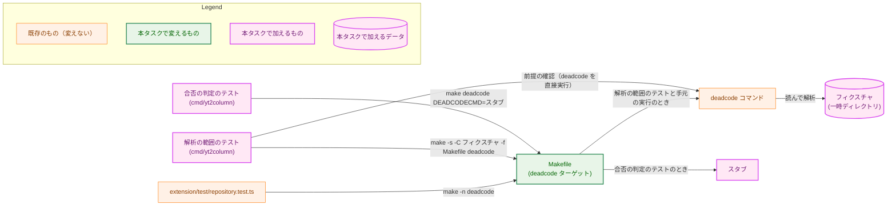
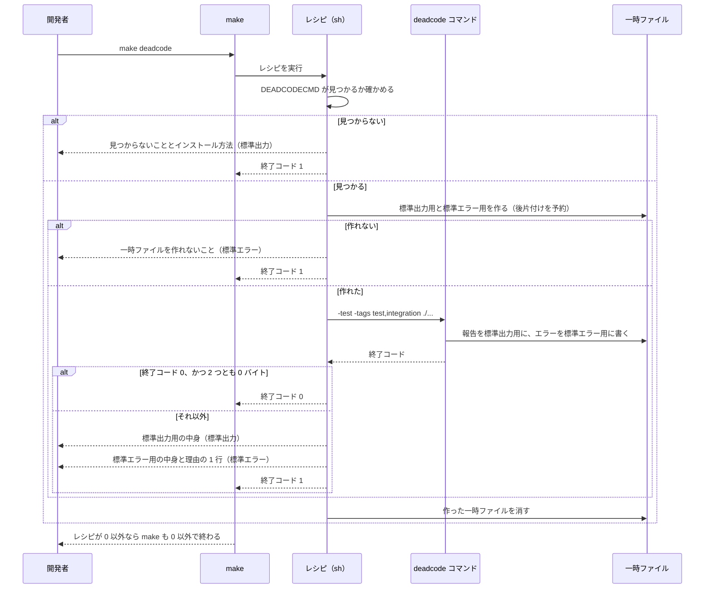
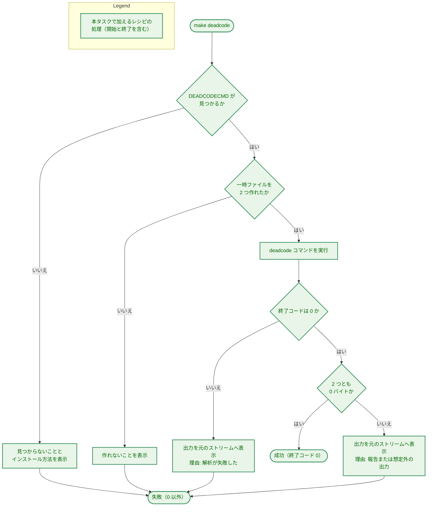

# アーキテクチャ設計書：`make deadcode` の解析の範囲をモジュール全体にする

## Document Status

| Item | Value |
|---|---|
| Status | `draft` |
| Created | 2026-10-28 |
| Review date | - |
| Reviewer | - |
| Comments | - |

本書は [01_requirements.md](01_requirements.md)（要件定義書。以下、要件書）の設計である。このリポジトリのファイルについての記述は、コミット `9dbc1f4` のファイルで確かめた。`file:line` はこのコミットの行番号を指す。`deadcode` についての記述は、`golang.org/x/tools` v0.47.0 のソース（Go のモジュールキャッシュにあるもの）と、手元の macOS（GNU Make 3.81、`/bin/sh` と `/bin/dash`）で v0.47.0 を実行した結果で確かめた。F-NNN（機能要件）・AC-NN（受け入れ基準）は要件書の項番を指す。要件のレビューで設計に申し送られた事項（[design_handoff.md](design_handoff.md) の H-01〜H-04）への対応は、付録 A にまとめる。

本書は、要件書 6 章の用語（到達できない関数、届く、報告、意図した足場、完了条件）を同じ意味で使う。ほかに次の用語を使う。

-   **レシピ:** `Makefile` の `deadcode` ターゲットが実行するシェルのコマンド。
-   **`deadcode` コマンド:** `golang.org/x/tools/cmd/deadcode` をビルドした実行ファイル。`Makefile` のターゲット名と区別するときにこう書く。
-   **出力:** `deadcode` コマンドが標準出力と標準エラーに書いたバイト列。改行だけでも出力とみなす。
-   **合否の判定:** レシピが、`deadcode` コマンドの終了コードと出力の有無から、`make deadcode` を成功させるか失敗させるかを決めること。`deadcode` コマンドが関数に届くかどうかを決めることは「到達の判断」と書き、区別する。
-   **スタブ:** テストで `deadcode` コマンドの代わりに置く小さなシェルスクリプト。決めた内容を出力し、決めた終了コードで終わり、受け取った引数を記録する。
-   **フィクスチャ:** 本物の `deadcode` コマンドで解析の範囲を確かめるための、小さな Go のモジュール。テストが実行のたびに一時ディレクトリに書き出す。

## 1. 設計の全体像 (Design Overview)

### 1.1. 設計原則

-   **変えるのは `deadcode` ターゲットのレシピだけにする。** 解析の範囲は、`deadcode` コマンドに渡す引数（`-test -tags test,integration ./...`）で決まる。到達の判断は `deadcode` コマンドに任せ、レシピ自身では行わない（`CLAUDE.md`「Delegate the fragile part」）。
-   **合否の判定は、終了コードと出力のバイト数だけで行う。** レシピは出力の中身を読まない。報告の形かどうか、どんなエラーかを見分けずに、何か 1 バイトでも出力されたら失敗とする（F-002）。中身で振る舞いを選ばないので、`CLAUDE.md` の「Declare, don't infer」の例外を設ける必要はない。`deadcode` コマンドの出力の形が将来変わっても、合否の判定は変わらない。
-   **失敗する側に倒す。** 一時ファイルを作れない、`deadcode` コマンドが見つからない、`deadcode` コマンドが失敗した、出力があった、のどれでも `make deadcode` は失敗する。成功するのは、`deadcode` コマンドが終了コード 0 で終わり、出力が 0 バイトだった場合だけである。ただし、`deadcode` コマンド自身が書き込みの失敗を無視する場合は、この原則の外にある（4.3）。
-   **パイプを使わない。** `deadcode` コマンドの出力は一時ファイルに受ける。パイプでは、`sh` が最後のコマンドの終了コードを返すので、`deadcode` コマンド自身の失敗が失われる。POSIX の `sh` では `pipefail` を使えるとは限らない（H-01）。
-   **`deadcode` コマンドの有無の確認も、合否の判定も、レシピの中に置く。** `deadcode` コマンドの有無の確認も合否の判定も、`make` が `Makefile` を読むときではなく、レシピの実行時に行う。`make -n` はレシピを表示するだけで実行しないので、`deadcode` コマンドがない環境でも `make -n deadcode` は何も実行せず、標準エラーにも何も出ない（H-02）。
-   **既存の形に揃える。** `deadcode` コマンドの名前は `GOFUMPTCMD`（`Makefile:11`）と同じく変数 `DEADCODECMD` に置き、見つからないときの表示は `check_gofumpt`（`Makefile:20-26`）と同じ形にする。一時ファイルの後片付けは `format_files_from_list` と同じく `trap ... EXIT` で行う（`Makefile:33`）。

### 1.2. 設計の際に決めたこと（2026-10-28）

人間のレビュアーが決めたもの:

-   **解析の範囲（F-001）は、本物の `deadcode` コマンドとフィクスチャで確かめ、`deadcode` コマンドがなければテストをスキップする（H-03）:** 合否の判定（F-002）はスタブで CI でも確かめる。一方、どの関数が届くと数えるか（AC-02〜AC-09）は `deadcode` コマンドの到達の判断なので、本物が要る。CI には `deadcode` コマンドが入っておらず、CI への組み込みは要件書 2.3 でスコープ外である。`deadcode` コマンドがなければ失敗させる案は、CI に `deadcode` コマンドのインストールを加えることになるので採らない。テストを一回限りのスクリプトにする案は、レシピを後で変えたときに手元で気づけないので採らない。CI ではこのテストがスキップされるので、実装では、手元でスキップされずに通ったことを記録する（7.3）。
-   **標準出力と標準エラーは分けたまま扱う（H-01）:** 2 つを別々の一時ファイルに受け、失敗のときは、標準出力の分を標準出力に、標準エラーの分を標準エラーに出す。最後に、失敗の理由を 1 行、標準エラーに出す（4.2）。2 つのストリームの間の順序は失われる。しかし `deadcode` コマンドは、解析に失敗すると報告を出さずに終わる（v0.47.0 の `cmd/deadcode/deadcode.go:123-131` は、読み込みの失敗やコンパイルエラーで `log.Fatalf` を呼び、報告を書く処理（`:373-443`）に進まない）。そのため、順序が失われても読み取りに困らない。
-   **インストール方法は `go install golang.org/x/tools/cmd/deadcode@latest` と表示する（H-04）:** `gofumpt` の表示（`Makefile:24`）と同じ形である。`deadcode` コマンドの版は固定しない（要件書 2.3）。そのため、特定の版を表示すると、固定したかのように読めてしまう。本書が前提にした版（v0.47.0）は 9 章に記録する。

設計で決めたもの（人間のレビュアーに諮らず、理由とともに記す）:

-   **`deadcode` コマンドの名前を変数 `DEADCODECMD` に置く:** `GOFUMPTCMD` と同じく `=` で代入し、既定値は `deadcode` とする。`?=` にすると、環境変数 `DEADCODECMD`（`.envrc` などに残ったもの）が黙ってコマンドを差し替えてしまう。`=` なら、差し替えられるのは `make` のコマンドラインの指定だけである。テストは `make deadcode DEADCODECMD=<スタブの絶対パス>` でスタブに差し替える。`maketestutil.RunTarget` が `GOTEST` をスタブに差し替えるのと同じ方法である（`internal/maketestutil/make.go:131`）。有無の確認でも実行でも、値は 1 つのコマンドのパスとして引用符で囲んで使う（空白を含む一時ディレクトリのパスでも動くようにするため）。この変数が変えるのは、実行するコマンドだけである。レシピの副作用（3.3）は変わらない。
-   **フィクスチャはテストのコードに持ち、実行のたびに一時ディレクトリに書き出す:** リポジトリの中に `.go` ファイルとして置かない。`make test` で走るガードテストの中には、`cmd/` や `internal/` の下の `.go` ファイルを、`testdata` を除かずにファイルシステムからたどるものがある（`internal/pipeline/pipeline_test.go:590-640` の `TestFakesCarryBuildTag`、`:671-731` の `TestPackageReferenceListsPackages`、`internal/config/envaccess_test.go:91-110`）。フィクスチャの `main` パッケージや関数をリポジトリに置くと、これらが失敗する。また、`make` と `deadcode` コマンドだけが読むファイルは Go のテストのキャッシュを無効にしないので、フィクスチャだけを直したときに古い PASS が返りうる。テストのコードにあれば、どちらも起きない。
-   **子プロセスの環境は、同じパッケージの既存の許可リストから作る:** `make` の子プロセスに、外側の `make test` の `MAKEFLAGS` などを渡してはならない。新しいテストを置く `cmd/yt2column` には、この目的の `childEnvAllowlist`（`cmd/yt2column/test_helpers.go:75-82`。`PATH`・`HOME`・`TMPDIR` とプロキシの変数）がすでにある。新しいテストはこれを使い、許可リストを新しく書かない。`maketestutil.RunTarget` は、`make` が失敗するとテストを失敗させ（`make.go:134-137`）、`GOTEST` しか差し替えないので、`make deadcode` の失敗を確かめるテストには使えない。`maketestutil` が作るスタブ（`make.go:64-73`）も、決めた出力と終了コードを返せないので使わない。
-   **AC-01（今の木で報告が 0 件）は、恒久的なテストにしない:** `make test` の中で、このリポジトリ自身に `make deadcode` を走らせるテストは書かない。そうすると、`make test` が到達できない関数の検査を兼ねることになるが、検査が働くのは `deadcode` コマンドのある手元だけで、CI（`deadcode` コマンドがない）との差が大きくなる。AC-01 は、実装計画の完了条件として `make deadcode` を実行し、あとから確かめられる形で記録する（7.3）。本タスクの後は、`runplan.md` の step 6（AC-15）が、フェーズ群ごとに同じ確認を求める。
-   **失敗の理由の行は、終了コードを優先する:** `deadcode` コマンドが 0 以外で終わったときは、出力があっても「解析が失敗した」とその終了コードを示す。終了コードが 0 で出力があったときは、「到達できない関数を報告したか、想定外の出力をした」と示す。後者は出力の中身を読まないので、報告とそれ以外を区別しない。
-   **成功したときは何も出さない:** レシピの行には `@` を付け、`make` がコマンドの文面を表示しないようにする（今のレシピ `Makefile:245` には付いていない）。

### 1.3. 概念モデル

`make deadcode` の入力と出力を示す。ラベルのない矢印 A → B は、A から B へデータが渡ることを表す（`PKGS` から `DC` への矢印は `deadcode` コマンドがパッケージを読むこと、`DC` から一時ファイルと終了コードへの矢印は `deadcode` コマンドがそれらを書くこと、`RECIPE` から `VERDICT` への矢印はレシピがそれを決めること）。ラベルのある矢印は、A が B を起動することを表し、ラベルは渡す引数である。

解析の起点は次のとおりである。`deadcode` コマンドは `-test` を付けると、各パッケージのテストの実行ファイルの `main` も起点に数える。

| 起点 | 今のレシピ（`Makefile:244-245`） | 本書のレシピ |
|---|---|---|
| `cmd/yt2column` の `main` | 起点 | 起点 |
| ほかの `main` パッケージ（`cmd/yt2column-server`・`cmd/yt2column-nmhost`・`cmd/fixprguard`・`cmd/mergepr`、今後加わるもの） | 起点でない | 起点 |
| `cmd/yt2column` のテスト | 起点 | 起点 |
| ほかのパッケージのテスト | 起点でない | 起点 |
| ビルドタグ `integration` のファイル | 解析しない | 解析し、テストなら起点 |
| `go list` が列挙しないディレクトリ（`_` か `.` で始まるもの、`testdata`） | 起点でない | 起点でない |

## 2. システム構成 (System Structure)

### 2.1. 全体の構成

本タスクで変えるファイルと、それを確かめるテストの関係を示す。矢印 A → B は、A が B を起動することを表す。ラベルは、起動の形か、どのテストでの起動かである。ただし、フィクスチャへの矢印だけは、`deadcode` コマンドがそれを読んで解析することを表す。

`CLAUDE.md` と `runplan.md` も本タスクで変えるが、開発者とエージェントが読む説明であり、どのコードからも実行されないので図に含めない（3.4）。

### 2.2. コンポーネント配置

-   **`Makefile`:** `deadcode` ターゲットのレシピと、変数 `DEADCODECMD`。`MAIN_PKG`（`Makefile:14`）は `build` などがまだ使うので残す。
-   **`cmd/yt2column/` のテスト:** `Makefile` のターゲットを確かめるテストは、すでにこのパッケージにある（`cmd/yt2column/makefile_test.go`。`repositoryRoot` は `:27`）。`deadcode` ターゲットのテストも、新しいテストファイルとしてここに置く。スタブとフィクスチャの中身も、このテストファイルに持つ（1.2）。
-   **ほかのパッケージ:** 変えない。

### 2.3. データの流れ

`make deadcode` を実行したときの流れを示す。

## 3. コンポーネント設計 (Component Design)

### 3.1. 型とインターフェース

本タスクは Go の本番のコードを変えず、公開する識別子も加えない。テストの中の型と関数は、実装計画で決める。

### 3.2. `Makefile` の契約

| 項目 | 内容 |
|---|---|
| 変数 | `DEADCODECMD`（`=` で代入）。既定値は `deadcode`。`PATH` から探すコマンド名か、実行ファイルのパス。1 つのコマンドとして扱い、引数を含められない |
| 実行する引数 | `-test -tags test,integration ./...`。`make` を実行したディレクトリのモジュールを解析する |
| 成功の条件 | `deadcode` コマンドが終了コード 0 で終わり、標準出力にも標準エラーにも何も書かなかったこと |
| 失敗のときの終了コード | レシピは 1 で終わる。`make` 自身は 2 で終わる（GNU Make の規則） |
| 表示 | 4.2 のとおり。成功したときは何も出さない |

`ext-` で始まらないほかのターゲットと同じく、`Makefile` を読むときに評価される式（`$(shell ...)` など）を `deadcode` ターゲットのために加えない（要件書 4.4、H-02）。

### 3.3. 副作用

`make deadcode` の副作用は次のとおりである。`DEADCODECMD` を変えても、レシピ自身の副作用（1 つ目）は変わらない。

-   `mktemp` が作る一時ファイル 2 つ。`trap ... EXIT` で、レシピのシェルが終わるときに消す。1 つ目を作った後に 2 つ目を作れなかったときも、1 つ目を消す。シグナルで `make` が止まったときは残ることがある（`format_files_from_list` と同じ）。
-   `deadcode` コマンドが呼ぶ `go list` が書く Go のビルドキャッシュ。
-   `deadcode` コマンドの Go のテレメトリ。v0.47.0 は起動時に `golang.org/x/telemetry` を始め（`cmd/deadcode/deadcode.go:67`）、モードによっては、カウンタのファイルをユーザーの設定ディレクトリ（`os.UserConfigDir()` の下の `go/telemetry`）に書き、補助のプロセスを起動する。補助のプロセスは親の標準出力も標準エラーも受け継がないので、一時ファイルに書くことはない。

ネットワークへの送信はレシピからは行わない。ただし、`deadcode` コマンドが呼ぶ `go list` は、モジュールの依存やツールチェーンが手元になければダウンロードしうる。このリポジトリのモジュールは外部の依存を持たない（`go.mod`）。

### 3.4. コンポーネントの責務と、変えるファイル

| ファイル | 変更 | 責務 |
|---|---|---|
| `Makefile` | 変える | `DEADCODECMD` を加え、`deadcode` ターゲットのレシピを 1.1・3.2 のとおりにする（F-001・F-002） |
| `CLAUDE.md` | 変える | 「Code Quality」の `make deadcode` の説明（`CLAUDE.md:80`）に、解析の範囲（モジュール全体と、そのテスト。ビルドタグ `test`・`integration`）と、報告が 1 件以上あれば失敗することを書く（AC-14） |
| `.claude/commands/runplan.md` | 変える | step 6（`runplan.md:117`）に、`make deadcode` が通ること、意図した足場を残すならテストから届くようにすること（届かないなら、使う PR まで加えないこと）を書く（AC-15） |
| `cmd/yt2column/` の新しいテストファイル | 加える | 合否の判定のテストと解析の範囲のテスト。スタブとフィクスチャの中身を含む（7 章） |

今の振る舞いを前提にしたテストは次のとおりである。

-   `extension/test/repository.test.ts:230-258` は、`node` と `npm` のない `PATH` で `make -n build test lint deadcode` を実行し、終了コード 0、標準エラーが空、出力に `node`・`npm`・`npx` がないことを確かめる。本書のレシピは `make -n` では実行されず（1.1）、`$(MAKE)` も含まず、これらの名前も含まないので、このテストは変えずに通る。`Makefile` を変えるので、実装では `make ext-test` を実行して確かめる（`CLAUDE.md`、Development Notes）。
-   `deadcode` ターゲットのレシピ、`CLAUDE.md:80`、`runplan.md:117` の今の文面を確かめるテストはない（コミット `9dbc1f4` で、`*_test.go` と `*.test.ts` に `deadcode` の語を含むものは上の 1 つだけである）。

## 4. エラーハンドリング設計 (Error Handling Design)

### 4.1. 失敗の分類

本タスクは Go のエラー型を加えない。レシピが区別する失敗は次の 4 つである。どれも `make deadcode` を 0 以外で終わらせる。

| 失敗 | 合否の判定の材料 | 対応する AC |
|---|---|---|
| `deadcode` コマンドが見つからない | `PATH` から `DEADCODECMD` を探せない | AC-13 |
| 一時ファイルを作れない | `mktemp` が失敗する。`deadcode` コマンドは実行しない | 要件書 4.3 |
| 解析が失敗した | `deadcode` コマンドの終了コードが 0 でない | AC-12 |
| 報告または想定外の出力がある | 終了コードは 0 だが、どちらかの一時ファイルが 1 バイト以上 | AC-11、F-002 |

### 4.2. 表示

-   **見つからないとき:** `check_gofumpt` と同じく標準出力に 2 行出す。`Error: deadcode is required but not found` と `Please install deadcode: go install golang.org/x/tools/cmd/deadcode@latest` である（1 行目のコマンド名は `DEADCODECMD` の値）。`DEADCODECMD` には実行ファイルのパスも指定できるので、`check_gofumpt` の「in PATH」は付けない。
-   **一時ファイルを作れないとき:** `mktemp` のエラーのメッセージに続けて、標準エラーに `Error: cannot create a temporary file for deadcode output` を出す。`deadcode` コマンドの失敗と取り違えないよう、`Error: deadcode failed with exit status <N>` の行は出さない。
-   **`deadcode` コマンドが失敗したか、出力があったとき:** 受けた出力を、加工せずにすべて元のストリームへ出す（AC-11・AC-12）。続けて、標準エラーに理由を 1 行出す。
    -   終了コードが 0 でないとき: `Error: deadcode failed with exit status <N>`
    -   終了コードが 0 で出力があったとき: `Error: deadcode reported unreachable functions or produced unexpected output`
-   **成功したとき:** 何も出さない。

理由の行は、出力の中身から選ばない（1.1）。古い `deadcode` コマンド（モジュールの `go` の行より古い Go でビルドしたもの）は、型検査のエラーで失敗する。この場合の直し方も、`go install golang.org/x/tools/cmd/deadcode@latest` での入れ直しである。

### 4.3. 受け入れる残りのリスク

v0.47.0 の `deadcode` コマンドは、報告を標準出力に書くときの書き込みのエラーを無視する（`cmd/deadcode/deadcode.go:429`・`:443` の `os.Stdout.Write` は戻り値を捨てる）。一時ファイルの置き場所が満杯などで書き込めないと、`deadcode` コマンドは終了コード 0 で終わり、一時ファイルは 0 バイトのままになる。このとき `make deadcode` は成功してしまう。書き込みのエラーをレシピが見られるようにするには、別のプロセスを挟んでその終了コードを見る形にするしかない。しかし、パイプを使わない方針（1.1）を保ったままそうすると、レシピが複雑になる。起きるのは一時ファイルの置き場所が書き込めないときに限られ、そのときは同じディスクを使うビルドやテストもふつう失敗する。そこで、この場合は受け入れ、本節に記録する。

## 5. セキュリティ考慮事項 (Security Considerations)

N/A。要件書 4.2 のとおり、本タスクは開発用のターゲットだけを変え、`docs/dev/security.md` を適用する条件に当たらない。

外部コマンドの出力の扱いは次のとおりである。レシピは `deadcode` コマンドの出力を、合否の判定の材料としてはバイト数しか使わない。表示するときは、端末にそのまま書く。この出力は手元のソースのファイル名と関数名から作られ、信頼できない第三者の入力は含まない。脅威モデルの図は省く。

## 6. 処理の流れの詳細 (Processing Flow Details)

レシピの合否の判定の流れを示す。矢印 A → B は、処理が A から B へ進むことを表す。ラベルは判定の結果である。

改行だけの出力も 1 バイト以上なので、失敗になる。出力を文字列として取り込んで空かどうかを見る方法（コマンド置換）は、末尾の改行を取り除くので使わない。一時ファイルの大きさで判定する。

## 7. テスト戦略 (Test Strategy)

### 7.1. 合否の判定のテスト（スタブ。CI でも走る）

`make deadcode DEADCODECMD=<スタブ>` を、`childEnvAllowlist` から作った環境で実行する。スタブは、テストが決めたバイト列を標準出力と標準エラーに書き、決めた終了コードで終わり、受け取った引数をファイルに記録する。

各ケースは、確かめたい仕組みだけが失敗を検出する入力にする（`CLAUDE.md`「A layered path needs inputs only one layer can handle」）。終了コードだけで検出するケース（出力なしで終了コード 1）と、バイト数だけで検出するケース（終了コード 0 で出力あり）を、どちらも含める。

| ケース | スタブ | 期待 | AC |
|---|---|---|---|
| 報告なし | 終了コード 0、出力なし | `make` が 0 で終わり、何も表示しない | AC-10 |
| 報告あり | 終了コード 0、標準出力に報告の形の行を 2 行 | 0 以外。2 行とも標準出力に出て、出力があったことを示す理由の行が標準エラーに出る | AC-11 |
| 解析の失敗 | 終了コード 1、標準エラーにエラーのメッセージ | 0 以外。メッセージが標準エラーに出て、理由の行が終了コード 1 を示す | AC-12 |
| 終了コードだけ | 終了コード 1、出力なし | 0 以外。理由の行が終了コード 1 を示す | F-002 |
| 終了コードと報告 | 終了コード 1、標準出力に報告の形の行 | 0 以外。行は標準出力にそのまま出て、理由の行は（出力ではなく）終了コード 1 を示す | F-002 |
| 標準エラーだけ | 終了コード 0、標準エラーに 1 行 | 0 以外 | F-002 |
| 改行だけ | 終了コード 0、標準出力に改行 1 つ | 0 以外 | F-002 |
| 一時ファイルを作れない | 失敗する `mktemp` を `PATH` の先頭に置く | 0 以外。作れないことを示し、スタブは実行されない | 要件書 4.3 |
| 見つからない | `DEADCODECMD` を変えず、`make` と `sh` へのシンボリックリンクだけを置いたディレクトリを `PATH` にして、`make` を絶対パスで実行（`repository.test.ts:230-258` と同じ形） | 0 以外。見つからないこととインストール方法を表示する | AC-13 |
| 引数 | 報告なしのケースで記録した引数 | ちょうど `-test`・`-tags`・`test,integration`・`./...` | F-001 |

### 7.2. 解析の範囲のテスト（本物の `deadcode` コマンド。手元で走る）

`PATH` に `deadcode` コマンドがなければ、理由を示してスキップする（1.2）。あれば、フィクスチャを一時ディレクトリに書き出し、`make -s -C <フィクスチャ> -f <リポジトリの Makefile> deadcode` を実行して報告を確かめる。`-s` を付けるのは、GNU Make 4.x が `-C` のときに表示する「Entering directory」の行を出さないためである。失敗のときは `make` 自身のエラーの行も出るので、出力の確かめ方は、期待する行を含むかどうかにする（完全な一致にしない）。失敗のメッセージには、使った `deadcode` コマンドのモジュールの版（`go version -m` で読めるもの）と、本書が前提にした版（v0.47.0）を含める。版の違いが原因の失敗だと分かるようにするためである。

**フィクスチャのパッケージの構成:**

| パッケージ | 中身 |
|---|---|
| `go.mod` | `require` の行も `toolchain` の行も持たない。`go` の行は、リポジトリの `go.mod:3`（`go 1.26.5`）より新しくしない。`go list` がネットワークを要らないようにするためである |
| `cmd/cli` | `main` パッケージ。`internal/lib` を import し、`FromCLI` を呼ぶ |
| `cmd/srv` | `main` パッケージ。`internal/lib` を import し、`OnlySrv` を呼ぶ |
| `internal/lib` | ビルドタグのないファイルに `FromCLI`・`OnlySrv`・`OnlyTest`・`OnlyIntegration` を置く |
| `internal/lib` のテスト | `lib_test.go` が `OnlyTest` を呼ぶ。ビルドタグ `integration` のテストファイルが `OnlyIntegration` を呼ぶ |
| `internal/helper` | ビルドタグ `test` のファイルに `Helper` を置く。このパッケージ自身のテストはない |
| `internal/other` | ふつうの関数を 1 つ持つ。そのテストが `internal/helper` を import し、`Helper` を呼ぶ |

**書き出したままのフィクスチャ:** `make deadcode` が終了コード 0 で終わり、何も出力しないことを先に確かめる（AC-10 を本物で確かめることにもなる）。これが成り立たなければ、下の「報告されない」は何も示さない。その上で、次の関数がそれぞれ届くと数えられていることを確かめる。

| 関数 | 届く経路 | AC |
|---|---|---|
| `OnlySrv` | `cmd/cli`（`cmd/yt2column` の役）以外の `main` パッケージ（`cmd/srv`）の本番のコードだけ | AC-02・AC-09 |
| `Helper` | ほかのパッケージ（`internal/other`）のテストだけ | AC-03 |
| `OnlyTest` | テストだけ | AC-04 |
| `OnlyIntegration` | ビルドタグ `integration` のテストだけ | AC-08 |

AC-09 は「`deadcode` ターゲットを変えずに、新しい `main` パッケージを加えたとき」の振る舞いである。`Makefile` はフィクスチャのどの `main` パッケージの名前も知らないので、`cmd/srv` からだけ届く関数が報告されないことで確かめる。

**入力の分離（H-03）:** 「報告されない」は、確かめたい起点だけが届く入力でなければ何も証明しない（`CLAUDE.md`「A layered path needs inputs only one layer can handle」）。そこでテストは、`deadcode` コマンドを直接実行して、その起点を除くと報告されることを先に確かめる。`deadcode` コマンドは報告があっても終了コード 0 で終わるので、前提の確認は、標準出力にその関数の名前が現れるかどうかで行う。

-   `OnlySrv`: `cmd/srv` を除くすべてのパッケージを `-test -tags test,integration` で解析すると報告される。テストからもほかの `main` からも届かないことを示す。今のレシピと同じ形（`-test -tags test ./cmd/cli`）でも報告される。`internal/lib` は `cmd/cli` が import するので、この形でも解析の対象に入る。
-   `Helper`: `-tags test,integration ./...`（`-test` なし）で報告される。どの `main` からも届かないことを示す。
-   `OnlyTest`: `-tags test,integration ./...`（`-test` なし）で報告される。
-   `OnlyIntegration`: `-test -tags test ./...`（`integration` なし）で報告される。関数そのものはビルドタグのないファイルにあるので、この形でも解析の対象に入る。

**報告されるべき関数:** 書き出したフィクスチャに次の関数を 1 つずつ加えて `make deadcode` を実行する。`make` が 0 以外で終わり（AC-11 を本物で確かめることにもなる）、報告に、加えた関数のファイル、行、名前が含まれることを確かめる。

| 加える関数 | AC |
|---|---|
| `internal/lib` の新しいファイルの、どこからも参照されないパッケージ水準の関数 | AC-05 |
| `cmd/srv` の、同じ条件の関数 | AC-06 |
| `internal/lib` のビルドタグ `integration` の（テストでない）ファイルの、同じ条件の関数 | AC-07 |

**解析の失敗:** 書き出したフィクスチャにコンパイルできないファイルを加えて `make deadcode` を実行し、0 以外で終わり、`deadcode` コマンドのエラーのメッセージが標準エラーに出ることを確かめる（AC-12）。

**環境:** このテストも `childEnvAllowlist` から作った環境で `make` を実行する。そのため、`go list` は開発者の `GOFLAGS`・`GOCACHE`・`GOMODCACHE`・`GOTOOLCHAIN` などを受け継がず、既定の値で動く。また、`cmd/yt2column` の `TestMain` がプロキシの変数を閉じたポートに向けるので（`cmd/yt2column/main_test.go:22-46`）、ネットワークには出られない。フィクスチャはネットワークを要らない形にしてあるので（上の `go.mod`）、この環境で動く。前提が崩れて `go list` がダウンロードを試みたときは、テストはスキップせずに失敗する。手元の `make deadcode` は開発者の環境で動くので（9 章）、このテストの環境とは異なりうる。

### 7.3. 既存のテストとほかの確認

-   `extension/test/repository.test.ts` の `make -n` の検査は変えずに通ること（3.4）。`make ext-test` で確かめる。
-   AC-01 は、実装の完了条件として、このリポジトリで `make deadcode` を変数の指定なしに実行し、実装計画に次のものを記録する。実行したコマンドとその終了コード、`command -v deadcode` の結果、`go version -m "$(command -v deadcode)"` の結果（モジュールの版と、ビルドした Go の版）。成功は何も出力しないので、記録がなければ、別の方法（たとえば別のコマンド）で終了コード 0 になったのと見分けられないからである。
-   解析の範囲のテスト（7.2）は CI ではスキップされる。実装の完了条件として、手元でこのテストを `-v -count=1` で実行し、スキップされずに PASS したことを実装計画に記録する。
-   AC-14・AC-15 は文面の要件なので、PR のレビューで読んで確かめる（`manual`）。`CLAUDE.md` の「Document tests check values, structure, and executable examples, never prose」のとおり、文面を照合するテストは書かない。
-   セキュリティのテストは N/A（5 章）。
-   各テストが言っている理由で失敗できることは、実装でレシピを壊して確かめる（例: 合否の判定を終了コードだけにする、バイト数だけにする、`-test` を外す）。本書はその結果を述べない（`CLAUDE.md`、Testing Strategy）。

## 8. 実装の優先順位 (Implementation Priorities)

1.  合否の判定のテストとスタブを書き、`Makefile` のレシピと `DEADCODECMD` を変える（F-002、F-001 の引数）。
2.  フィクスチャと解析の範囲のテストを書く（F-001）。
3.  `CLAUDE.md` と `runplan.md` の step 6 を直す（F-003）。
4.  `make deadcode`（AC-01）、解析の範囲のテストの単独の実行、`make test`、`make lint`、`make ext-test` を実行し、7.3 のとおり記録する。

全体は小さい。PR の分け方は実装計画で決める。

## 9. 将来の拡張 (Future Extensibility)

-   **前提にした版:** 本書は `golang.org/x/tools` v0.47.0 の `deadcode` コマンドで確かめた。合否の判定は出力の中身を読まないので、報告の形が変わっても合否の判定は変わらない。到達の判断が版で変わった場合は、解析の範囲のテスト（7.2）が手元で失敗し、版を示して知らせる。
-   **CI への組み込み:** CI で `make deadcode` を走らせるには、`deadcode` コマンドの版の固定とインストールの手順が要る（要件書 2.3）。`DEADCODECMD` は 1 つのコマンドのパスとして扱うので（3.2）、`GOLINT`（`Makefile:9-10`）のように `go run ...@<版>` で実行する形にするときは、有無の確認と実行の書き方も合わせて変える。そのときは、解析の範囲のテストも CI で走るようになる。
-   **環境による差:** 手元の `make deadcode` は、実行した環境の `GOOS`・`GOARCH` と `GOFLAGS` の下で解析する（要件書 F-001）。レシピはこれらの環境変数を消さない。ほかのターゲット（`make test`・`make lint`）と同じ扱いである。

## 付録 A. 設計への申し送り（design_handoff.md）への対応

| 項目 | 対応 |
|---|---|
| H-01 出力からの判定方法 | パイプを使わず、2 つの一時ファイルに受ける（1.1）。ストリームは分けたまま表示し、理由の行を加える（1.2・4.2）。解析が成功したときの標準エラーへの出力は、次のとおりである。`go list` の標準エラーは `go/packages` が取り込み、成功のときには表示しない（v0.47.0 の `go/packages/golist.go:912-944` は標準出力だけを返し、`internal/gocommand/invoke.go:250` は標準エラーをバッファに受ける）。そのため `go: downloading ...` は `deadcode` コマンドの標準エラーに出ない。一方、テレメトリ（3.3）は、設定ディレクトリを読めないときなどに標準エラーへ書くことがある。そのときは F-002 のとおり失敗とし、F-002 は変えない。「Declare, don't infer」: 合否の判定は出力の中身を読まず、終了コードとバイト数だけを使うので、例外は要らない（1.1） |
| H-02 `make -n` の検査との両立 | 合否の判定と有無の確認はレシピの中に置き、`Makefile` を読むときに評価される式を加えない（1.1・3.2）。`make ext-test` で確かめる（7.3） |
| H-03 受け入れ基準の確かめ方 | 合否の判定はスタブのテスト（7.1）、解析の範囲は本物の `deadcode` コマンドとフィクスチャのテストで確かめ、`deadcode` コマンドがなければスキップする（1.2・7.2）。CI ではスキップされるので、手元で通ったことを記録する（7.3）。入力の分離は、7.2 の「入力の分離」で、起点を除いた解析で報告されることを先に確かめて行う |
| H-04 `deadcode` の版とインストール方法 | 前提にした版は v0.47.0（9 章）。表示するインストール方法は `@latest`（1.2・4.2） |

## 付録 B. 受け入れ基準と設計の対応

| AC | 設計 | 確かめ方 |
|---|---|---|
| AC-01 | 3.2 の引数 | 完了条件として `make deadcode` を実行し記録（7.3） |
| AC-02 | 1.3 の起点の表 | 7.2 |
| AC-03 | 1.3 | 7.2 |
| AC-04 | 1.3 | 7.2 |
| AC-05 | 3.2 | 7.2 |
| AC-06 | 1.3 | 7.2 |
| AC-07 | 1.3 | 7.2 |
| AC-08 | 1.3 | 7.2 |
| AC-09 | 1.3（`./...`） | 7.2 |
| AC-10 | 3.2 の成功の条件 | 7.1・7.2 |
| AC-11 | 4.2 | 7.1・7.2 |
| AC-12 | 4.1・4.2 | 7.1・7.2 |
| AC-13 | 4.2 | 7.1 |
| AC-14 | 3.4 の `CLAUDE.md` | PR のレビューで読む（7.3） |
| AC-15 | 3.4 の `runplan.md` | PR のレビューで読む（7.3） |
