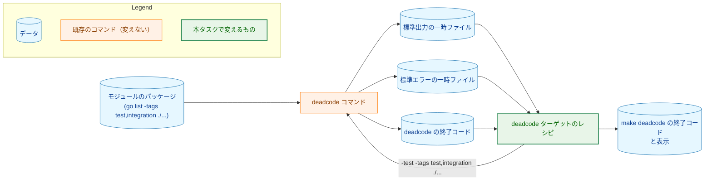
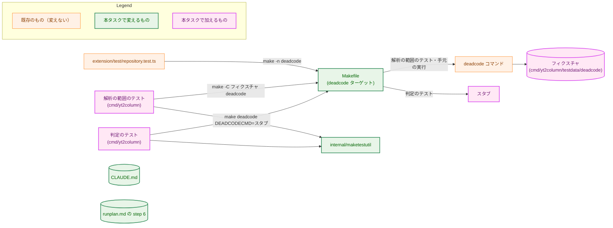
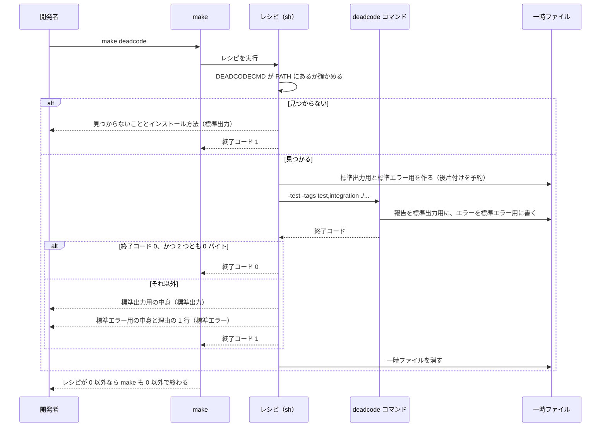
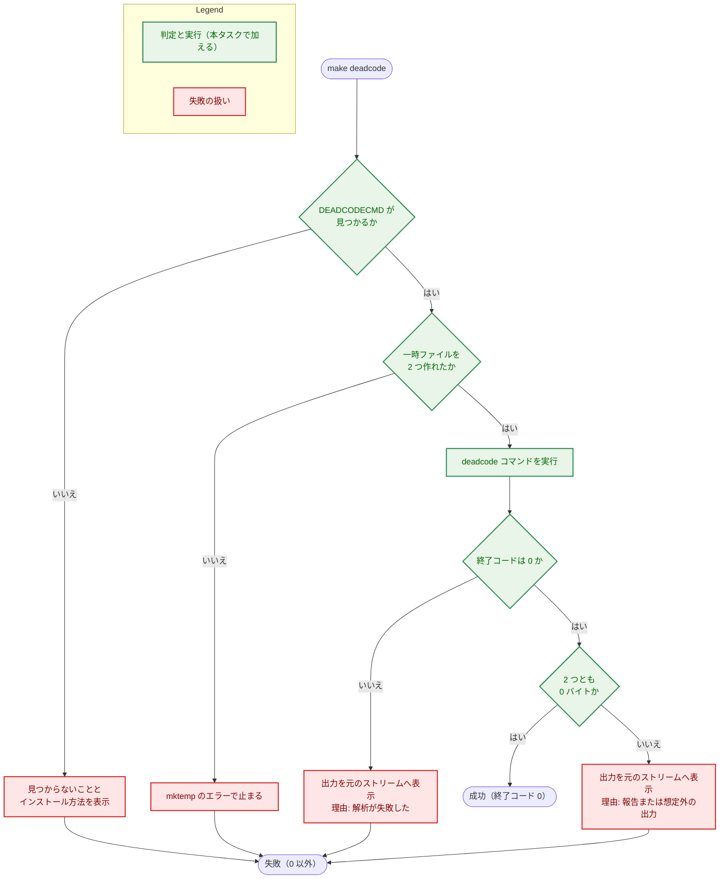

# アーキテクチャ設計書：`make deadcode` の解析の範囲をモジュール全体にする

## Document Status

| Item | Value |
|---|---|
| Status | `draft` |
| Created | 2026-10-28 |
| Review date | - |
| Reviewer | - |
| Comments | - |

本書は [01_requirements.md](01_requirements.md)（要件定義書。以下、要件書）の設計である。このリポジトリのファイルについての記述は、コミット `9dbc1f4` のファイルで確かめた。`file:line` はこのコミットの行番号を指す。`deadcode` についての記述は、`golang.org/x/tools` v0.47.0 のソース（Go のモジュールキャッシュにあるもの）と、手元の macOS で v0.47.0 を実行した結果で確かめた。F-NNN・AC-NN は要件書の項番を指す。要件のレビューで設計に申し送られた事項（[design_handoff.md](design_handoff.md) の H-01〜H-04）への対応は、付録 A にまとめる。

本書は、要件書 6 章の用語（到達できない関数、届く、報告、意図した足場、完了条件）を同じ意味で使う。ほかに次の用語を使う。

-   **レシピ:** `Makefile` の `deadcode` ターゲットが実行するシェルのコマンド。
-   **`deadcode` コマンド:** `golang.org/x/tools/cmd/deadcode` をビルドした実行ファイル。`Makefile` のターゲット名と区別するときにこう書く。
-   **出力:** `deadcode` コマンドが標準出力と標準エラーに書いたバイト列。改行だけでも出力とみなす。
-   **判定:** レシピが、`deadcode` コマンドの終了コードと出力の有無から、`make deadcode` を成功させるか失敗させるかを決めること。
-   **スタブ:** テストで `deadcode` コマンドの代わりに置く小さなシェルスクリプト。決めた内容を出力し、決めた終了コードで終わり、受け取った引数を記録する。
-   **フィクスチャ:** 本物の `deadcode` コマンドで解析の範囲を確かめるための、小さな Go のモジュール。テストの `testdata` の下に置く。

## 1. 設計の全体像 (Design Overview)

### 1.1. 設計原則

-   **変えるのは `deadcode` ターゲットのレシピだけにする。** 解析の範囲は、`deadcode` コマンドに渡す引数（`-test -tags test,integration ./...`）で決まる。どの関数が届くかの判定は `deadcode` コマンドに任せ、レシピでは解析しない（`CLAUDE.md`「Delegate the fragile part」）。
-   **判定は、終了コードと出力のバイト数だけで行う。** レシピは出力の中身を読まない。報告の形かどうか、どんなエラーかを見分けずに、何か 1 バイトでも出力されたら失敗とする（F-002）。中身で振る舞いを選ばないので、`CLAUDE.md` の「Declare, don't infer」の例外を設ける必要はない。`deadcode` コマンドの出力の形が将来変わっても、判定は変わらない。
-   **失敗する側に倒す。** 一時ファイルを作れない、`deadcode` コマンドが見つからない、`deadcode` コマンドが失敗した、出力があった、のどれでも `make deadcode` は失敗する。成功するのは、`deadcode` コマンドが終了コード 0 で終わり、出力が 0 バイトだった場合だけである。
-   **パイプを使わない。** `deadcode` コマンドの出力は一時ファイルに受ける。パイプでは、`sh` が最後のコマンドの終了コードを返すので、`deadcode` コマンド自身の失敗が失われる。POSIX の `sh` では `pipefail` を使えるとは限らない（H-01）。
-   **判定と確認はレシピの中に置く。** `deadcode` コマンドの有無の確認も判定も、`make` が `Makefile` を読むときではなく、レシピの実行時に行う。`make -n` はレシピを表示するだけで実行しないので、`deadcode` コマンドがない環境でも `make -n deadcode` は何も実行せず、標準エラーにも何も出ない（H-02）。
-   **既存の形に揃える。** `deadcode` コマンドの名前は `GOFUMPTCMD`（`Makefile:9`）と同じく変数 `DEADCODECMD` に置き、見つからないときの表示は `check_gofumpt`（`Makefile:20-26`）と同じ形にする。一時ファイルの作り方と後片付けも `format_files_from_list` と同じく `mktemp` と `trap ... EXIT` にする（`Makefile:32-33`）。

### 1.2. 設計の際に決めたこと（2026-10-28）

人間のレビュアーが決めたもの:

-   **解析の範囲（F-001）は、本物の `deadcode` コマンドとフィクスチャで確かめ、`deadcode` コマンドがなければテストをスキップする（H-03）:** 判定（F-002）はスタブで CI でも確かめる。一方、どの関数が届くと数えるか（AC-02〜AC-09）は `deadcode` コマンド自身の判定なので、本物が要る。CI には `deadcode` コマンドが入っておらず、CI への組み込みは要件書 2.3 でスコープ外である。`deadcode` コマンドがなければ失敗させる案は、CI に `deadcode` コマンドのインストールを加えることになるので採らない。テストを一回限りのスクリプトにする案は、レシピを後で変えたときに手元で気づけないので採らない。`runplan.md` の step 6 で `make deadcode` を実行する手元の環境には `deadcode` コマンドがあるので、そこでは毎回確かめられる。
-   **標準出力と標準エラーは分けたまま扱う（H-01）:** 2 つを別々の一時ファイルに受け、失敗のときは、標準出力の分を標準出力に、標準エラーの分を標準エラーに出す。最後に、失敗の理由を 1 行、標準エラーに出す（4.2）。2 つのストリームの間の順序は失われる。しかし `deadcode` コマンドは、解析に失敗すると報告を出さずに終わる（v0.47.0 の `cmd/deadcode/deadcode.go:123-131` は、読み込みの失敗やコンパイルエラーで `log.Fatalf` を呼び、報告を書く処理（`:373-443`）に進まない）。そのため、順序が失われても読み取りに困らない。
-   **インストール方法は `go install golang.org/x/tools/cmd/deadcode@latest` と表示する（H-04）:** `gofumpt` の表示（`Makefile:23`）と同じ形である。`deadcode` コマンドの版は固定しない（要件書 2.3）。そのため、特定の版を表示すると、固定したかのように読めてしまう。本書が前提にした版（v0.47.0）は 9 章に記録する。

設計で決めたもの（人間のレビュアーに諮らず、理由とともに記す）:

-   **`deadcode` コマンドの名前を変数 `DEADCODECMD` に置く:** 既定値は `deadcode` である。テストは `make deadcode DEADCODECMD=<スタブの絶対パス>` でスタブに差し替える。`maketestutil.RunTarget` が `GOTEST` をスタブに差し替えるのと同じ方法である（`internal/maketestutil/make.go:131`）。この変数が変えるのは、実行するコマンドだけである。レシピの副作用（3.3）は変わらない。
-   **AC-01（今の木で報告が 0 件）は、恒久的なテストにしない:** `make test` の中で、このリポジトリ自身に `make deadcode` を走らせるテストは書かない。そうすると、`make test` が手元でだけ到達できない関数の検査を兼ねることになり、CI（`deadcode` コマンドがない）との差が大きくなる。AC-01 は、実装計画の完了条件として `make deadcode` を実行し、その結果を記録して確かめる。本タスクの後は、`runplan.md` の step 6（AC-15）が、フェーズ群ごとに同じ確認を求める。
-   **子プロセスの環境は `maketestutil` と共有する:** スタブや本物の `deadcode` コマンドで `make` を走らせるテストは、外側の `make test` の `MAKEFLAGS` などを子に渡してはならない。この条件は `maketestutil` の `childEnvAllowlist`（`internal/maketestutil/make.go:40-43`）がすでに満たしている。`RunTarget` は `make` が失敗するとテストを失敗させ（`make.go:134-137`）、`GOTEST` しか差し替えないので、`make deadcode` の失敗を確かめるテストには使えない。そこで、許可した変数だけからなる環境を返す関数を `maketestutil` に公開し、`RunTarget` と新しいテストの両方がそれを使う。許可する変数の一覧は 1 か所に保つ（`CLAUDE.md`「DRY」）。
-   **失敗の理由の行は、終了コードを優先する:** `deadcode` コマンドが 0 以外で終わったときは、出力があっても「解析が失敗した」とその終了コードを示す。終了コードが 0 で出力があったときは、「到達できない関数を報告したか、想定外の出力をした」と示す。後者は出力の中身を読まないので、報告とそれ以外を区別しない。

### 1.3. 概念モデル

`make deadcode` の入力と出力を示す。矢印 A → B は、A が B に渡されること（A がデータなら、B がそれを読むこと）を表す。



解析の起点は次のとおりである。`deadcode` コマンドは `-test` のとき、各パッケージのテストの実行ファイルの `main` も起点に数える。

| 起点 | 今のレシピ（`Makefile:244-245`） | 本書のレシピ |
|---|---|---|
| `cmd/yt2column` の `main` | 起点 | 起点 |
| ほかの `main` パッケージ（`cmd/yt2column-server`・`cmd/yt2column-nmhost`・`cmd/fixprguard`・`cmd/mergepr`、今後加わるもの） | 起点でない | 起点 |
| `cmd/yt2column` のテスト | 起点 | 起点 |
| ほかのパッケージのテスト | 起点でない | 起点 |
| ビルドタグ `integration` のファイル | 解析しない | 解析し、テストなら起点 |
| `go list` が列挙しないディレクトリ（`_` か `.` で始まるもの、`testdata`） | 起点でない | 起点でない |

## 2. システム構成 (System Structure)

### 2.1. 全体の構成

本タスクで変えるファイルと、それを確かめるテストの関係を示す。矢印 A → B は、A が B を読む、または実行することを表す。



`CLAUDE.md` と `runplan.md` は、開発者とエージェントが読む説明であり、どのコードからも読まれない。そのため矢印を持たない。

### 2.2. コンポーネント配置

-   **`Makefile`:** `deadcode` ターゲットのレシピと、変数 `DEADCODECMD`。`MAIN_PKG`（`Makefile:14`）は `build` などがまだ使うので残す。
-   **`cmd/yt2column/` のテスト:** `Makefile` のターゲットを確かめるテストは、すでにこのパッケージにある（`cmd/yt2column/makefile_test.go`。`repositoryRoot` は `:27`）。`deadcode` ターゲットのテストも、ここに置く。
-   **`cmd/yt2column/testdata/deadcode/`:** フィクスチャ。`go.mod` を持つ独立したモジュールにする。リポジトリのモジュールからは `testdata` の下なので `go list ./...` に入らず、`make deadcode`・`make lint`・`make test` の対象にならない。
-   **`internal/maketestutil/`:** 子プロセスの環境を作る関数を公開する（1.2）。

### 2.3. データの流れ

`make deadcode` を実行したときの流れを示す。



## 3. コンポーネント設計 (Component Design)

### 3.1. 型とインターフェース

本タスクは Go の本番のコードを変えない。Go の型を加えるのは、テスト用の `internal/maketestutil` の関数 1 つだけである（ビルドタグ `test`）。

```go
// ChildEnv returns the environment a make child receives: only the
// variables on the allowlist that are set in this process, so the outer
// make's MAKEFLAGS, MFLAGS, MAKELEVEL, and secrets never reach the child.
func ChildEnv() []string
```

### 3.2. `Makefile` の契約

| 項目 | 内容 |
|---|---|
| 変数 | `DEADCODECMD`。既定値は `deadcode`。`PATH` から探すコマンド名か、実行ファイルのパス |
| 実行する引数 | `-test -tags test,integration ./...`。`make` を実行したディレクトリのモジュールを解析する |
| 成功の条件 | `deadcode` コマンドが終了コード 0 で終わり、標準出力にも標準エラーにも 0 バイトを書いたこと |
| 失敗のときの終了コード | レシピは 1 で終わる。`make` 自身は 2 で終わる（GNU Make の規則） |
| 表示 | 4.2 のとおり |

`ext-` で始まらないほかのターゲットと同じく、`Makefile` を読むときに評価される式（`$(shell ...)` など）を `deadcode` ターゲットのために加えない（要件書 4.4、H-02）。

### 3.3. 副作用

`make deadcode` の副作用は次のものだけである。`DEADCODECMD` を変えても、これは変わらない。

-   `mktemp` が作る一時ファイル 2 つ。`trap ... EXIT` で、レシピのシェルが終わるときに消す。シグナルで `make` が止まったときは残ることがある（`format_files_from_list` と同じ）。
-   `deadcode` コマンドが使う Go のビルドキャッシュ（`go list` が書く）。

ネットワークへの送信は行わない。ただし、`deadcode` コマンドが呼ぶ `go list` は、モジュールの依存やツールチェーンが手元になければダウンロードしうる。このリポジトリのモジュールは外部の依存を持たない（`go.mod`）。

### 3.4. コンポーネントの責務と、変えるファイル

| ファイル | 変更 | 責務 |
|---|---|---|
| `Makefile` | 変える | `DEADCODECMD` を加え、`deadcode` ターゲットのレシピを 1.1・3.2 のとおりにする（F-001・F-002） |
| `CLAUDE.md` | 変える | 「Code Quality」の `make deadcode` の説明（`CLAUDE.md:80`）に、解析の範囲（モジュール全体と、そのテスト。ビルドタグ `test`・`integration`）と、報告が 1 件以上あれば失敗することを書く（AC-14） |
| `.claude/commands/runplan.md` | 変える | step 6（`runplan.md:117`）に、`make deadcode` が通ること、意図した足場を残すならテストから届くようにすること（届かないなら、使う PR まで加えないこと）を書く（AC-15） |
| `internal/maketestutil/make.go` | 変える | `ChildEnv` を公開し、`RunTarget` もそれを使う（3.1） |
| `docs/dev/developer_guide/package_reference.md` | 変える | `internal/maketestutil` の行（`package_reference.md:49`）に `ChildEnv` を加える |
| `cmd/yt2column/` の新しいテストファイル | 加える | 判定のテストと解析の範囲のテスト（7 章） |
| `cmd/yt2column/testdata/deadcode/` | 加える | フィクスチャのモジュール（7.2） |

今の振る舞いを前提にしたテストは次のとおりである。

-   `extension/test/repository.test.ts:230-258` は、`node` と `npm` のない `PATH` で `make -n build test lint deadcode` を実行し、終了コード 0、標準エラーが空、出力に `node`・`npm`・`npx` がないことを確かめる。本書のレシピは `make -n` では実行されず（1.1）、これらの名前を含まないので、このテストは変えずに通る。`Makefile` を変えるので、実装では `make ext-test` を実行して確かめる（`CLAUDE.md`、Development Notes）。
-   `deadcode` ターゲットのレシピ、`CLAUDE.md:80`、`runplan.md:117` の今の文面を確かめるテストはない（コミット `9dbc1f4` で、`*_test.go` と `*.test.ts` に `deadcode` の語を含むものは上の 1 つだけである）。

## 4. エラーハンドリング設計 (Error Handling Design)

### 4.1. 失敗の分類

本タスクは Go のエラー型を加えない。レシピが区別する失敗は次の 4 つである。どれも `make deadcode` を 0 以外で終わらせる。

| 失敗 | 判定の材料 | 対応する AC |
|---|---|---|
| `deadcode` コマンドが見つからない | `command -v "$(DEADCODECMD)"` が失敗する | AC-13 |
| 一時ファイルを作れない | `mktemp` が失敗する | 要件書 4.3 |
| 解析が失敗した | `deadcode` コマンドの終了コードが 0 でない | AC-12 |
| 報告または想定外の出力がある | 終了コードは 0 だが、どちらかの一時ファイルが 1 バイト以上 | AC-11、F-002 |

### 4.2. 表示

-   **見つからないとき:** `check_gofumpt` と同じく標準出力に 2 行出す。`Error: deadcode is required but not found in PATH` と `Please install deadcode: go install golang.org/x/tools/cmd/deadcode@latest` である（1 行目のコマンド名は `DEADCODECMD` の値）。
-   **`deadcode` コマンドが失敗したか、出力があったとき:** 受けた出力を、加工せずにすべて元のストリームへ出す（AC-11・AC-12）。続けて、標準エラーに理由を 1 行出す。
    -   終了コードが 0 でないとき: `Error: deadcode failed with exit status <N>`
    -   終了コードが 0 で出力があったとき: `Error: deadcode reported unreachable functions or produced unexpected output`
-   **成功したとき:** 何も出さない。`deadcode` コマンドが何も出さなかったときと同じである。

理由の行は、出力の中身から選ばない（1.1）。

## 5. セキュリティ考慮事項 (Security Considerations)

N/A。要件書 4.2 のとおり、本タスクは開発用のターゲットだけを変え、`docs/dev/security.md` を適用する条件に当たらない。

外部コマンドの出力の扱いは次のとおりである。レシピは `deadcode` コマンドの出力を、判定の材料としてはバイト数しか使わない。表示するときは、端末にそのまま書く。この出力は手元のソースのファイル名と関数名から作られ、信頼できない第三者の入力は含まない。脅威モデルの図は省く。

## 6. 処理の流れの詳細 (Processing Flow Details)

レシピの判定の流れを示す。矢印 A → B は、処理が A から B へ進むことを表す。ラベルは判定の結果である。



改行だけの出力も 1 バイト以上なので、失敗になる。出力を文字列として取り込んで空かどうかを見る方法（コマンド置換）は、末尾の改行を取り除くので使わない。一時ファイルの大きさで判定する。

## 7. テスト戦略 (Test Strategy)

### 7.1. 判定のテスト（スタブ。CI でも走る）

`make deadcode DEADCODECMD=<スタブ>` を、`maketestutil.ChildEnv` の環境で実行する。スタブは、テストが決めたバイト列を標準出力と標準エラーに書き、決めた終了コードで終わり、受け取った引数をファイルに記録する。

| ケース | スタブ | 期待 | AC |
|---|---|---|---|
| 報告なし | 終了コード 0、出力なし | `make` が 0 で終わり、何も表示しない | AC-10 |
| 報告あり | 終了コード 0、標準出力に報告の形の行を 2 行 | 0 以外。2 行とも標準出力に出て、理由の行が標準エラーに出る | AC-11 |
| 解析の失敗 | 終了コード 1、標準エラーにエラーのメッセージ | 0 以外。メッセージが標準エラーに出て、理由の行が終了コードを示す | AC-12 |
| 標準エラーだけ | 終了コード 0、標準エラーに 1 行 | 0 以外 | F-002 |
| 改行だけ | 終了コード 0、標準出力に改行 1 つ | 0 以外 | F-002 |
| 見つからない | `DEADCODECMD` を変えず、`deadcode` のない `PATH` で実行 | 0 以外。見つからないこととインストール方法を表示する | AC-13 |
| 引数 | 報告なしのケースで記録した引数 | ちょうど `-test`・`-tags`・`test,integration`・`./...` | F-001 |

### 7.2. 解析の範囲のテスト（本物の `deadcode` コマンド。手元で走る）

`PATH` に `deadcode` コマンドがなければ、理由を示してスキップする（1.2）。あれば、フィクスチャに対して `make -C <フィクスチャ> -f <リポジトリの Makefile> deadcode` を実行し、報告を確かめる。フィクスチャは次の関数を持つ。

| 関数の置き場所と呼ばれ方 | 期待 | AC |
|---|---|---|
| `internal` の関数で、CLI 以外の `main` パッケージの本番のコードからだけ呼ばれ、テストからは届かない | 報告されない | AC-02・AC-09 |
| ビルドタグ `test` のヘルパーで、ほかのパッケージのテストだけが使う | 報告されない | AC-03 |
| 本番のコードの関数で、テストからだけ呼ばれる | 報告されない | AC-04 |
| ビルドタグ `integration` のテストからだけ呼ばれる | 報告されない | AC-08 |

報告されるべき関数は、フィクスチャを一時ディレクトリに写し、そこに加えて確かめる。報告に、加えた関数のファイル、行、名前が含まれることを確かめる（AC-05〜AC-07）。

| 加える関数 | AC |
|---|---|
| `internal` のパッケージの、どこからも参照されないパッケージ水準の関数 | AC-05 |
| CLI 以外の `main` パッケージの、同じ条件の関数 | AC-06 |
| ビルドタグ `integration` のファイルの、同じ条件の関数 | AC-07 |
| コンパイルできないファイル | AC-12（本物のエラーが標準エラーに出ること） |

**入力の分離（H-03）:** 「報告されない」の行は、確かめたい起点だけが届く入力でなければ何も証明しない（`CLAUDE.md`「A layered path needs inputs only one layer can handle」）。そこでテストは、先に前提を確かめる。

-   AC-02・AC-03・AC-09 の関数は、今のレシピと同じ引数（`-test -tags test` と、CLI に当たる `main` パッケージだけ）で `deadcode` コマンドを直接実行すると報告される。
-   AC-08 の関数は、`-test -tags test ./...`（`integration` なし）では報告される。
-   AC-04 の関数は `-test` なしでは報告される。

AC-09 は「`deadcode` ターゲットを変えずに、新しい `main` パッケージを加えたとき」の振る舞いである。フィクスチャには `Makefile` が名前を知らない `main` パッケージしかないので、そこからだけ届く関数が報告されないことで確かめる。

### 7.3. 既存のテストとほかの確認

-   `extension/test/repository.test.ts` の `make -n` の検査は変えずに通ること（3.4）。`make ext-test` で確かめる。
-   AC-01 は、実装の完了条件として `make deadcode` を実行し、結果を実装計画に記録する（1.2）。
-   AC-14・AC-15 は文面の要件なので、PR のレビューで読んで確かめる（`manual`）。`CLAUDE.md` の「Document tests check values, structure, and executable examples, never prose」のとおり、文面を照合するテストは書かない。
-   セキュリティのテストは N/A（5 章）。
-   各テストが言っている理由で失敗できることは、実装でレシピを壊して確かめる（例: 判定を終了コードだけにする、`-test` を外す）。本書はその結果を述べない（`CLAUDE.md`、Testing Strategy）。

## 8. 実装の優先順位 (Implementation Priorities)

1.  `internal/maketestutil` に `ChildEnv` を公開し、`RunTarget` をそれに切り替える。`package_reference.md` を直す。
2.  判定のテストとスタブを書き、`Makefile` のレシピと `DEADCODECMD` を変える（F-002、F-001 の引数）。
3.  フィクスチャと解析の範囲のテストを書く（F-001）。
4.  `CLAUDE.md` と `runplan.md` の step 6 を直す（F-003）。
5.  `make deadcode`（AC-01）、`make test`、`make lint`、`make ext-test` を実行する。

1〜3 は互いに依存するが、合わせても小さい。PR の分け方は実装計画で決める。

## 9. 将来の拡張 (Future Extensibility)

-   **前提にした版:** 本書は `golang.org/x/tools` v0.47.0 の `deadcode` コマンドで確かめた。判定は出力の中身を読まないので、報告の形が変わっても判定は変わらない。到達できるかの判定が版で変わった場合は、解析の範囲のテスト（7.2）が手元で失敗して知らせる。
-   **CI への組み込み:** CI で `make deadcode` を走らせるには、`deadcode` コマンドの版の固定とインストールの手順が要る（要件書 2.3）。そのときは `DEADCODECMD` に、固定した版を `go run` するコマンドを入れられる（`GOLINT` が `golangci-lint` を `go run ...@$(GOLANGCI_VERSION)` で実行するのと同じ形。`Makefile:8-9`）。解析の範囲のテストも CI で走るようになる。
-   **環境による差:** 解析は、実行した環境の `GOOS`・`GOARCH` と `GOFLAGS` の下で行う（要件書 F-001）。レシピはこれらの環境変数を消さない。ほかのターゲット（`make test`・`make lint`）と同じ扱いである。

## 付録 A. 設計への申し送り（design_handoff.md）への対応

| 項目 | 対応 |
|---|---|
| H-01 出力からの判定方法 | パイプを使わず、2 つの一時ファイルに受ける（1.1）。ストリームは分けたまま表示し、理由の行を加える（1.2・4.2）。害のない標準エラーへの出力: `deadcode` コマンドが呼ぶ `go list` の標準エラーは、`go/packages` が取り込み、成功のときには表示しない（v0.47.0 の `go/packages/golist.go:912-944`。標準出力だけを返す）。そのため `go: downloading ...` は `deadcode` コマンドの標準エラーに出ない。また、このリポジトリのモジュールは外部の依存を持たない。F-002 は変えない。「Declare, don't infer」: 判定は出力の中身を読まず、終了コードとバイト数だけを使うので、例外は要らない（1.1） |
| H-02 `make -n` の検査との両立 | 判定と確認はレシピの中に置き、`Makefile` を読むときに評価される式を加えない（1.1・3.2）。`make ext-test` で確かめる（7.3） |
| H-03 受け入れ基準の確かめ方 | 判定はスタブのテスト（7.1）、解析の範囲は本物の `deadcode` コマンドとフィクスチャのテストで確かめ、`deadcode` コマンドがなければスキップする（1.2・7.2）。CI ではスキップされることを 1.2 に記す。入力の分離は 7.2 の前提の確認で行う |
| H-04 `deadcode` の版とインストール方法 | 前提にした版は v0.47.0（9 章）。表示するインストール方法は `@latest`（1.2・4.2） |

## 付録 B. 受け入れ基準と設計の対応

| AC | 設計 | 確かめ方 |
|---|---|---|
| AC-01 | 3.2 の引数 | 完了条件として `make deadcode` を実行し記録（7.3） |
| AC-02 | 1.3 の起点の表 | 7.2 |
| AC-03 | 1.3 | 7.2 |
| AC-04 | 1.3 | 7.2 |
| AC-05 | 3.2 | 7.2 |
| AC-06 | 1.3 | 7.2 |
| AC-07 | 1.3 | 7.2 |
| AC-08 | 1.3 | 7.2 |
| AC-09 | 1.3（`./...`） | 7.2 |
| AC-10 | 3.2 の成功の条件 | 7.1 |
| AC-11 | 4.2 | 7.1 |
| AC-12 | 4.1・4.2 | 7.1・7.2 |
| AC-13 | 4.2 | 7.1 |
| AC-14 | 3.4 の `CLAUDE.md` | PR のレビューで読む（7.3） |
| AC-15 | 3.4 の `runplan.md` | PR のレビューで読む（7.3） |
