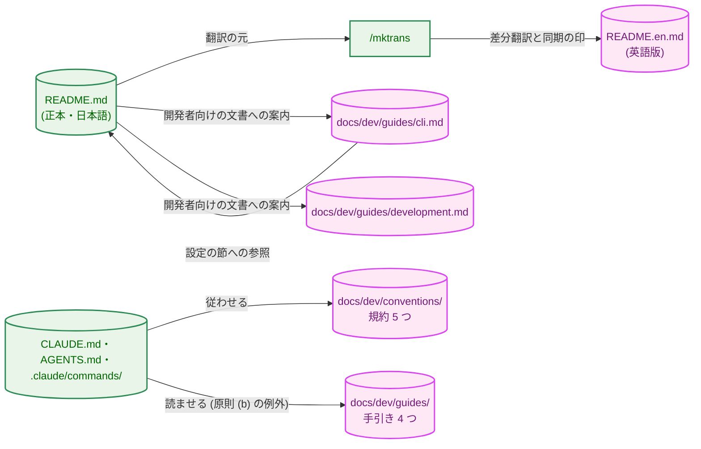
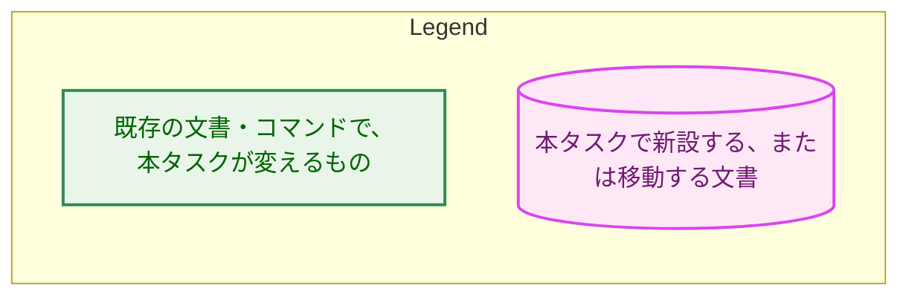
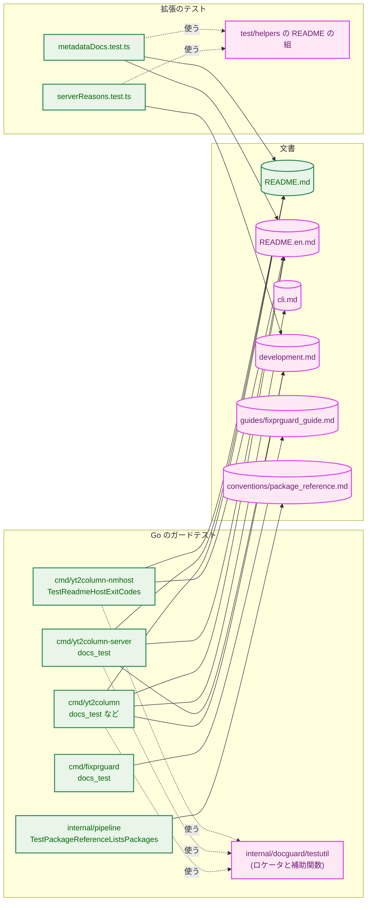
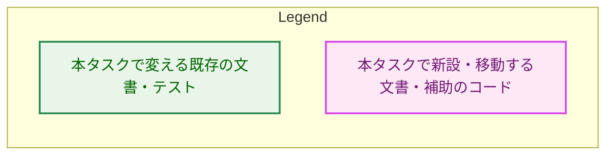
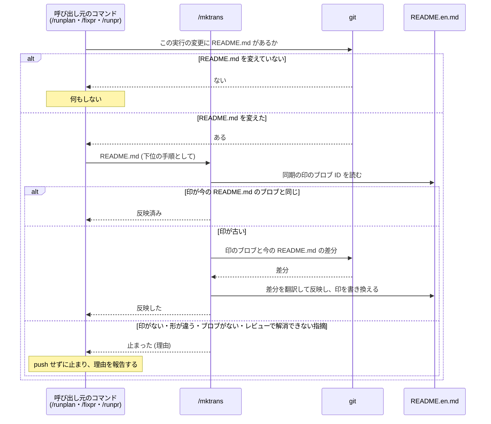
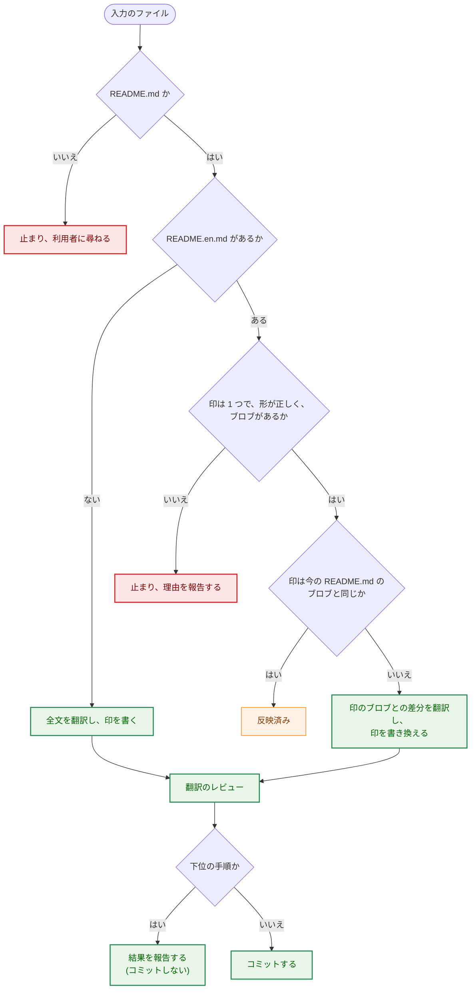

# 設計書：文書の言語を読み手で決める方針への整理と、README の日英二言語化

## Document Status

| Item | Value |
|---|---|
| Status | `draft` |
| Created | 2026-10-28 |
| Review date | - |
| Reviewer | - |
| Comments | - |

本書は [01_requirements.md](01_requirements.md)（`approved`）の設計である。要件定義から申し送られた設計事項は [design_handoff.md](design_handoff.md) にあり、各項目への対応は 10 章にまとめる。本書が引用するファイルの行番号は、特に断らない限り、コミット `364c95b8`（本書の作成時の `main`）のものである。

## 1. 設計の全体像 (Design Overview)

### 1.1. 設計原則

-   **言語は読み手と承認者で決まる。** 文書の言語は、場所ごとの例外ではなく、要件 AC-01 の 3 つの原則で決める。置き場所の規則（`docs/dev/conventions/` は英語、`docs/dev/guides/` は日本語）は、原則を当てはめた結果である。例外は、二言語で持つ README と、コマンドの定義が日本語の手引きを読ませることの 2 つだけで、どちらも CLAUDE.md に範囲と理由とともに書く。
-   **正本は 1 つ。** 二言語の README では `README.md`（日本語）が正本であり、`README.en.md` はその翻訳である。翻訳の元にした `README.md` の版は、`README.en.md` の先頭の同期の印（2.4 節）が示す。手引きは日本語版に一本化し、英語版は持たない。
-   **値と構造はテストで、文の意味は読み合わせで確かめる。** ガードテストは、値（変数名、終了コード、`reason` など）と構造（見出しの並び、コードブロックの数）を、その値を持つ文書で検査する。振り分けや翻訳の内容など文の意味は、PR のレビューの読み合わせ（`manual`）で確かめる（要件 §5）。
-   **ロケータは言語ごとに 1 度だけ定義する。** ガードテストが節や表を探すための見出しと列名（以下「ロケータ」）は、日本語と英語の組として、Go ではテスト専用の共有パッケージに、TypeScript では拡張のテストの補助ファイルに、1 度だけ定義する。
-   **既存の仕組みを使う。** リンクの検査は既存の `anchorFromHeading`（`cmd/yt2column/docs_test.go:70`）を使う。範囲の判定は `fixprguard` の既存の規則のままで足りる（2.5 節）。CI の判定は既存の `extension/scripts/has-extension-changes.sh` に行を加えるだけにする。新しい CI のジョブは作らない。

### 1.2. 概念モデル

図 1-1 は、本タスクの後の文書の分類と、文書どうしの関係を示す。矢印 A → B は「A の内容が B から作られる、または B を参照する」を表す。ラベルで関係の種類を示す。



**図 1-1 の凡例**



文書の分類と言語は、要件 AC-06 の表のとおりである。本タスクが CLAUDE.md に書く原則と、その当てはめは次のとおりである。

| 原則 | 当てはまる文書 | 言語 |
|---|---|---|
| (a) 人間が判断・承認する文書と、人間向けの手引き | `docs/dev/` の直下の文書、`docs/tasks/`、`docs/translation_glossary.md`、`docs/dev/guides/`、`prompts/README.md`、`testdata/README.md` | 日本語 |
| (b) エージェントの実行を制御する指示と、リポジトリ内のコード | CLAUDE.md、AGENTS.md、`.claude/commands/`、`docs/dev/conventions/`、ソースコードとコメント | 英語 |
| (c) エンドユーザー（拡張の利用者）向けの文書 | `README.md`（正本）、`README.en.md`（英語版） | 日本語を正本とし、英語版を同期する |

例外は次の 2 つである（AC-04・AC-04a）。

-   **二言語の README:** 二言語で持つ文書は README だけである。`README.en.md` は、`README.md` と同じくリポジトリの直下に置く（「Documents should be placed under docs」の例外）。GitHub がリポジトリの直下の README を表示し、英語の読み手が `README.md` の先頭のリンクから同じ階層で移れるようにするためである。
-   **エージェントが読む日本語の手引き:** コマンドの定義は、`docs/dev/guides/` の日本語の手引きを参照してエージェントに読ませてよい（原則 (b) の例外）。範囲は、コマンドの定義が `docs/dev/guides/` の手引きを参照することに限る。今の参照は `.claude/commands/fixpr.md:34-35` の `fixprguard_guide` と `.claude/commands/mergepr.md:20-21` の `mergepr_guide` である。理由は要件 §1「エージェントが読む手引き」のとおりで、同じ内容を英語でも持つと二重管理に戻るためである。

### 1.3. 設計の際に決めたこと（2026-10-28）

-   **`/mktrans` の同期点はブロブの ID で持つ（H-10）。** `README.en.md` の先頭に、翻訳の元にした `README.md` のブロブの ID を書いた HTML のコメント（同期の印）を置く。`/mktrans` は、その ID のブロブと今の `README.md` の差分を翻訳し、終わったら印を今の `README.md` のブロブの ID に書き換える。今の方式（出力のファイルを最後に変えたコミット、`.claude/commands/mktrans.md:73-79`）では、`README.md` に未反映の変更があるときに `README.en.md` だけを直すコミットができると、同期点が先へ進み、未反映の変更が差分から落ちる（AC-38 に反する）。ブロブの ID なら、`README.en.md` だけを直しても印は翻訳の元を指したまま残る。不変条件を規約ではなく仕組みで守るためである（CLAUDE.md、"Enforce invariants with the type, not with convention"）。
-   **README に残す節の中の Job API の記述は `development.md` に移す（振り分けの A6）。** Localhost server の冒頭、Running the server、Stopping the server にある Job API の文と句を `development.md` に移し、README には `development.md` への短い案内を残す。拡張は #503 まで Job API を使わず、要件 §1 の決定（サーバの API は拡張の利用者の操作に影響しないので開発者向けの文書に移す）に合うためである。AC-19 の「各小節」を、文の単位で境界の規則を当てはめる F-003 の規則と合わせて読んだ結果である。
-   **日本語の見出しのアンカーを、本書の作成時に GitHub の表示で確かめた（H-01）。** 結果は 3.4 節にある。
-   **ロケータと Markdown の補助関数は、テスト専用の共有パッケージ `internal/docguard/testutil` に置く（H-02）。** 英日のロケータの組を Go の中で 1 度だけ定義し、`cmd/yt2column-server/docs_test.go:363-522` にある補助関数のコピーもなくすためである。TypeScript は `extension/test/helpers/` に自分の組を持つ。Go と TypeScript で共有するデータファイル（JSON など）は作らない。TypeScript のテストが使うロケータは 3 つ（3.5 節）だけで、データファイルの読み込みと検査を両方の言語に加える費用に見合わないためである。

## 2. システム構成 (System Structure)

### 2.1. 全体の構成

図 2-1 は、本タスクの後に、どのガードテストがどの文書を読むかを示す。矢印 A → B は「テスト A が文書 B を読んで検査する」を表す。



点線の矢印は「補助のコードを使う」を表す。

**図 2-1 の凡例**



### 2.2. コンポーネントの配置

| 置き場所 | 置くもの | 言語 |
|---|---|---|
| `docs/dev/conventions/` | `requirements_process.md`・`test_organization.md`・`mermaid_reference.md`・`package_reference.md`・`task_identification.md`（`git mv` で移す。内容は相対リンクのほかは変えない） | 英語 |
| `docs/dev/guides/` | `mergepr_guide.md`・`fixprguard_guide.md`（今の `.ja.md` を移して改名する）、`pricing_update.md`・`claude_output_limit.md`（日本語に翻訳する）、`cli.md`・`development.md`（新設） | 日本語 |
| リポジトリの直下 | `README.md`（日本語の正本）、`README.en.md`（新設の英語版） | 日本語・英語 |
| `internal/docguard/testutil/` | 新設のテスト専用パッケージ `docguardtestutil`（3.3 節） | Go |
| `extension/test/helpers/` | README の版とロケータの組（3.5 節） | TypeScript |
| `docs/tasks/0048_doc_language_policy/_checks/` | AC-08〜AC-14 の差分の検査のスクリプト（7.3 節） | シェルまたは Go |

`docs/dev/developer_guide/` は削除する（AC-12）。

### 2.3. README の振り分け

境界の規則（要件 F-003）を、今の README（1,387 行）の各節に当てはめた結果を 3.6 節に示す。規則は文の単位で当てはめる。

### 2.4. README の同期のデータフロー

図 2-2 は、`README.md` を変えたときに、変更が `README.en.md` に反映される流れを示す。矢印は呼び出しと応答を表す。



**同期の印の形。** `README.en.md` の 1 行目に、次の形の HTML のコメントを 1 つだけ置く。`<object-id>` は、翻訳の元にした `README.md` の内容に対して `git hash-object README.md` が返す ID（16 進の小文字）である。GitHub の表示には現れず、見出しやコードブロックではないので、構造の一致（AC-29）にも影響しない。

```text
<!-- translated-from: README.md <object-id> -->
```

### 2.5. `fixprguard` の範囲の判定（H-07）

`/fixpr` が `README.md` のスレッドへの対応で `README.en.md` も変えると、`README.en.md` はスレッドの `path` とは別のファイルになる。`fixprguard` の範囲の規則 2（同じディレクトリのファイル。`internal/fixprguard/scope.go:16-21`）と許可リストの `*.md`（同 `:76`）により、`README.en.md` は `README.md` のスレッドに対して範囲に入る。`README.en.md` は実行関連ファイル（同 `:50-53` の `instructionFileNames` など）に当たらない。逆に、`README.en.md` のスレッドに対しては `README.md` が範囲に入る。そのため、`/fixpr` の Phase 3（修正）の中で同期の手順を実行してよく、別のコミットや `/runpr` への委任は要らない。`fixprguard` の変更は要らない。

## 3. コンポーネント設計 (Component Design)

### 3.1. コンポーネントの責務

次の表は、本タスクで新設・変更・移動・削除するファイルの全体である。過去のタスク文書は数が多い（`docs/dev/developer_guide/` を含むのは、本タスクを除いて 92 ファイルである。`364c95b8` で `git grep -l`）ので、1 行にまとめる。

| ファイル | 責務・変更の内容 | 種類 |
|---|---|---|
| `CLAUDE.md` | "Documents" 節に 3 つの原則（AC-01）、ディレクトリごとの言語（AC-02）、2 つの例外（AC-04・AC-04a）を書き、`CLAUDE.md:25` の例外の列挙を消す。"Language" 節を原則と合わせる（AC-03）。"Translation Guidelines" 節を README の組の同期に改める（AC-40）。Quick Links と本文のパスを新しいパスにする。`CLAUDE.md:212-213` を、サーバの API は `development.md`、起動は README に書くと改める（AC-07）。Go Idioms の例外（`CLAUDE.md:507-516`）が Go のテストにも適用されると明記する（AC-05）。Development Notes の文書を読むガードテストの説明（`CLAUDE.md:431-448`）を 3.7 節の対応に合わせる（AC-41） | 変更 |
| `AGENTS.md` | `requirements_process.md`・`test_organization.md` のリンクを `docs/dev/conventions/` に改める | 変更 |
| `.claude/commands/_context.md` | 規約のパスの行（`:38-42`）と Guard tool の行（`:188`）を新しいパスにする。「Translation language pair」の行（`:54`）を、README の組だけを扱う `/mktrans` に合わせる（AC-40） | 変更 |
| `.claude/commands/mktrans.md` | 3.8 節のとおり改訂する（AC-38・AC-39） | 変更 |
| `.claude/commands/runplan.md`・`fixpr.md`・`runpr.md` | 4.3 節の同期の手順を加える（AC-37）。旧パスを新しいパスにする | 変更 |
| `.claude/commands/` のほかのコマンド（`mkarch.md`・`mkplan.md`・`mkplan2.md`・`mkreq.md`・`mergepr.md`・`weakreview.md`） | 旧パスを新しいパスにする | 変更 |
| `docs/dev/developer_guide/` の 11 ファイル | 2.2 節のとおり移す。`mergepr_guide.md`・`fixprguard_guide.md`（英語版）は、AC-11 の確かめ（7.3 節）の後に削除する | 移動・削除 |
| `docs/dev/guides/pricing_update.md`・`claude_output_limit.md` | 全文を日本語に翻訳する（AC-10）。README の節の参照（`pricing_update.md:55-67`、`claude_output_limit.md:61`・`:104`）を移った先の文書と見出しにする（AC-26） | 移動・翻訳 |
| `docs/dev/guides/cli.md` | 新設。AC-20 と 3.6 節の内容 | 新設 |
| `docs/dev/guides/development.md` | 新設。AC-21 と 3.6 節の内容 | 新設 |
| `README.md` | 3.6 節で README に残す内容を日本語にする（AC-27）。先頭に `README.en.md` へのリンク（AC-28）、開発者向けの文書へのリンク（AC-23）を置く。Browser extension を最上位の節にする（AC-19） | 変更 |
| `README.en.md` | 新設。改訂した `/mktrans` で `README.md` から全文を翻訳する。1 行目に同期の印、先頭に `README.md` へのリンク | 新設 |
| `docs/translation_glossary.md` | AC-34 の訳語を加える。`:53`（推奨構成）の README の節の名前を日本語の見出しにする（AC-26） | 変更 |
| `docs/dev/project_overview.md` | `:5` のリンクを `conventions/` にする。`:157` の「Migrating from the retired LLM variables」を移った後の見出しにする（AC-26） | 変更 |
| `docs/dev/production_profile.md` | `:5` の「Recommended configuration」を移った後の見出しにする（AC-26） | 変更 |
| `docs/tasks/*/`（本タスクを除く 92 ファイル） | 移動した文書を指すパスだけを置き換える（AC-13・AC-14。7.3 節） | 変更 |
| `Makefile` | コメントのパス（`:71`・`:77`）を改める | 変更 |
| `cmd/fixprguard/main.go` | `guidePath`（`:132`）を `docs/dev/guides/fixprguard_guide.md` にする（AC-16） | 変更 |
| `cmd/yt2column/run.go` | ヘルプの参照先（`:225` の `--slack`、`:259`）を `docs/dev/guides/cli.md` にする（AC-36） | 変更 |
| `cmd/yt2column-server/run.go` | 診断の参照先（`:145`）を `README.en.md` にする（AC-35a） | 変更 |
| `extension/src/core/i18n/en.ts` | ソケットのディレクトリの権限の説明の参照先（`:83`。要件の作成時の `:77` から移った）を `README.en.md` にする（AC-35）。`ja.ts:81` は変えない | 変更 |
| `internal/config/config.go:595`、`internal/llm/claude/request.go:29`、`internal/llm/provider/provider.go:22`、`internal/llm/provider/provider_test.go:406`、`internal/pricing/rates.go:2` | コメントのパスを `docs/dev/guides/` にする | 変更 |
| `internal/docguard/testutil/`（新設） | ロケータの組、README の版の一覧、Markdown の補助関数、構造の抽出（3.3 節） | 新設 |
| `docs/dev/conventions/package_reference.md` | `internal/docguard/testutil` の行を加える（`TestPackageReferenceListsPackages` が要求する） | 変更 |
| `cmd/yt2column/*_test.go`、`cmd/yt2column-server/docs_test.go`、`cmd/yt2column-nmhost/main_test.go` | 3.7 節のとおり、読む文書とロケータを改める。サーバのパッケージの補助関数のコピー（`docs_test.go:363-522`）と、その一致を固定する `TestSectionByHeading`（同 `:213`）は、共有パッケージに移して消す | 変更 |
| `cmd/yt2column/readme_structure_test.go`（新設、名前は計画で決める） | 構造の一致のテスト（AC-29。4.1 節） | 新設 |
| `cmd/fixprguard/docs_test.go` | `guideFiles`（`:27-30`）を 1 つのファイル `docs/dev/guides/fixprguard_guide.md` にし、英語の手引きの印（`"**Execution-related files.**"` など）の行を消す（AC-17） | 変更 |
| `internal/pipeline/pipeline_test.go` | `:707` のパスを `docs/dev/conventions/package_reference.md` にする（AC-17） | 変更 |
| `extension/test/serverReasons.test.ts`・`metadataDocs.test.ts`、`extension/test/helpers/` | 3.7 節のとおり改める | 変更 |
| `extension/scripts/has-extension-changes.sh`、`extension/test/ciChanges.test.ts` | `README.en.md` と `docs/dev/guides/development.md` を判定に加え、その行の検査を加える（AC-33） | 変更 |

### 3.2. 先のタスクの方針の置き換え（方針の例外）

本タスクは、先のタスクで承認された次の決定を置き換える（要件 §1「先のタスクの決定の置き換え」）。置き換えるたびに、元の方針、置き換える理由、古い振る舞いを検査しているテストを挙げる。

| 元の方針（記載箇所） | 置き換え | 理由 | 古い振る舞いを検査しているテスト |
|---|---|---|---|
| Job API の値を README の表に書く（`docs/tasks/0044_article_job_api/01_requirements.md:235`、AC-29） | 表を `development.md` に置く | サーバの API は拡張の利用者の操作に影響しない（要件 §1） | `TestServerDocsContract` の `api_codes` サブテスト（`cmd/yt2column-server/docs_test.go:124`）。README の `## Localhost server` の節で表を探す。`README.md` サブテスト（`:42`）の Job API の curl の例（`POST /jobs` など） |
| README の拒否の理由の表がサーバと一致する（同 `:299`、AC-42） | ステータスコードを含む完全な表は `development.md`、`reason` と拡張での表示の対応は README の両版 | 同上。ただし、ポップアップが拒否の理由を表示するので、利用者が意味を README で調べられるようにする | `TestServerDocsContract` の `rejection_reasons` サブテスト（`:96`）、`extension/test/serverReasons.test.ts:44` |
| README が引用するポップアップの英語の文言が英語の文言の表と一致する（`docs/tasks/0046_popup_redesign/01_requirements.md:196`、AC-31） | `README.en.md` は英語の、`README.md` は日本語の文言を引用する | 日本語の README の読み手は日本語のポップアップを見る | `extension/test/metadataDocs.test.ts:24-35`。0046 の PR-4 が加える `catalogs.en.primaryButton` の確認（`docs/tasks/0046_popup_redesign/03_implementation_plan.md:340`）も含む |
| 手引きは英語版と日本語版の両方を持つ（`docs/tasks/0033_multiple_trusted_reviewers/02_architecture.md:189`） | 日本語版に一本化する | issue #537 の決定（要件 §1） | `cmd/fixprguard/docs_test.go:27-30` の `guideFiles` と、英語の印を使う各テスト |
| サーバの API と起動は README に書く（`CLAUDE.md:212-213`） | API は `development.md`、起動は README | 要件 §1「サーバの API」 | なし（CLAUDE.md のこの文を読むテストはない） |

### 3.3. 共有パッケージ `internal/docguard/testutil`

テスト専用のパッケージ（すべてのファイルに `//go:build test`。パッケージ名は `docguardtestutil`。`docs/dev/conventions/test_organization.md` の分類 A）である。親のディレクトリ `internal/docguard/` には本番のコードを置かない。置くものは次の 3 つである。

-   README の版の一覧と、ロケータの組。
-   今 `cmd/yt2column/docs_test.go` にある Markdown の補助関数（`anchorFromHeading`・`headingsOutsideBlocks`・`sectionOutsideBlocks`・`sectionByHeading`・`findTable`・`markdownTables` など。`docs_test.go:53-700`）。`cmd/yt2column-server` のコピーと `cmd/yt2column-nmhost` の行の走査を、これに置き換える。
-   構造の抽出（4.1 節）。

型の定義は次のとおりである。

```go
// Lang is the language of one version of a bilingual document. The zero
// value is not a language: a Locator asked for it fails the test.
type Lang int

const (
	LangUnknown Lang = iota
	LangJA
	LangEN
)

// ReadmeVersion is one version of the README: its path from the repository
// root and its language.
type ReadmeVersion struct {
	Path string
	Lang Lang
}

// ReadmeVersions returns README.md (LangJA) and README.en.md (LangEN), in
// that order.
func ReadmeVersions() []ReadmeVersion

// Locator is a heading line or a table column name that a guard test looks
// for, spelled once per language.
type Locator struct {
	JA string
	EN string
}

// In returns the spelling for lang. It fails t for LangUnknown and for an
// empty spelling, so a missing translation fails instead of matching
// nothing silently.
func (l Locator) In(t testing.TB, lang Lang) string

// Structure is the shape that README.md and README.en.md must share.
type Structure struct {
	// HeadingLevels lists the level (1-6) of every ATX heading outside a
	// fenced code block, in document order.
	HeadingLevels []int
	// CodeBlocks counts the fenced code blocks.
	CodeBlocks int
}

// ParseStructure extracts the Structure of doc, or returns an error wrapping
// one of the sentinel errors below.
func ParseStructure(doc string) (Structure, error)
```

ロケータの組は、このパッケージの 1 つの表（変数の一覧）として定義する。ガードテストは、README の両版を `ReadmeVersions()` で回し、各版でロケータを `In` で引く。失敗のメッセージには版のパス（`README.md` か `README.en.md`）を含める（AC-31）。日本語の見出しと列名は、`README.md` の日本語化と同じ PR で表に加える。

Go のテストに日本語のリテラルを置くのは、CLAUDE.md の Go Idioms の例外（日本語の文書の見出しや表のセルに一致させるガードテストのリテラル）に当たり、本タスクでその例外が Go のテストにも適用されると明記する（AC-05）。

### 3.4. 日本語の見出しのアンカー（H-01）

GitHub のアンカーの作り方を、本書の作成時に確かめた。日本語の見出しを持つ 4 つの文書（`docs/tasks/0048_doc_language_policy/01_requirements.md`・`docs/dev/developer_guide/fixprguard_guide.ja.md`・`docs/dev/production_profile.md`・`docs/dev/security.md`、`364c95b8`）を、GitHub の API（`repos/isseis/yt2column/contents/<path>`、`Accept: application/vnd.github.html`）で描画した。その `id="user-content-…"` の 68 個を、`anchorFromHeading`（`cmd/yt2column/docs_test.go:70-83`）がコードブロックの外の見出しから作るアンカーと順に比べた。結果は、68 個すべてが一致した（2026-10-28）。

-   確かめた見出しに含まれていた ASCII でも文字・数字でもない文字は、`（` `）` `・` `、` `：` と、ASCII の `.` `` ` `` `(` `)` `[` `]` `:` `=` `_` `/` である。GitHub はどれも落とし、日本語の文字（漢字・かな・長音の記号）はそのまま残す。`anchorFromHeading` も同じである。
-   確かめていない文字は、`「` `」`、全角の空白（U+3000）、全角の英数字である。`README.md` の見出しにこれらを使う場合は、同じ方法で確かめ、結果を実装計画に記録する。確かめた文字だけで書けるなら、使わない。
-   Markdown の API（`POST /markdown`）は、今は見出しに `id` を付けないので、確かめる手段にならない。

この結果から、リンクの検査は `anchorFromHeading` をそのまま使う。`TestAnchorFromHeading`（`cmd/yt2column/docs_test.go:1154`）に、確かめた日本語の見出しの行を加える。`cli.md` と `development.md` のリンクも、同じ補助関数で確かめる（4.2 節）。

### 3.5. 拡張のテストの補助（TypeScript）

`extension/test/helpers/` に、README の版（パスと言語）と、拡張のテストが使う 3 つのロケータの組を置く。3 つは、ブラウザ拡張の節の見出し（今の `"### Browser extension"`、`extension/test/metadataDocs.test.ts:25`）、`development.md` の拒否の理由の表の列名（今の README の `reason | status code | extension shows`、`serverReasons.test.ts:17`）、その表の「固定のメッセージ」のセルの書き方である。言語は文字列のユニオン型（`"ja" | "en"`）で表し、`switch` の `default` で失敗させる。

### 3.6. README の振り分け（H-12）

境界の規則を今の README に当てはめた結果である。`364c95b8` の `README.md`（0044 の PR-7 がマージされた後）に対して作った。0046 の PR-4 は Browser extension の節のポップアップの説明（`README.md:1238-1252` の付近）だけを変え、その節は README に残るので、この振り分けは PR-4 の後も変わらない。実装は、PR-4 のマージの後の README で、この表の行と照らし合わせて確かめる。

**節の単位の振り分け。** R は README の両版、C は `cli.md`、D は `development.md` である。

| 行 | 見出し | 行き先 |
|---|---|---|
| 1-49 | `# yt2column`（概要・図・状態） | R |
| 51-77 | Quick start | R |
| 79-97 | Requirements | R と C に分ける（表 3-2） |
| 99-136 | Usage | C |
| 138-144 | Exit codes | C |
| 146-199 | Post-generation steps | R と C に分ける（表 3-2） |
| 201-266 | Token usage | C |
| 268-273 | Output format の冒頭 | R と C の両方（AC-22 の「両方の出力に関わる説明」） |
| 275-320 | The `--out` file | C |
| 322-351 | The Slack post | R |
| 353-440 | Estimated cost | R と C に分ける（表 3-2） |
| 442-468 | Cache and concurrency | C |
| 470-524 | Webhook publishing | R と C に分ける（表 3-2） |
| 526-554 | Localhost server の冒頭 | R。Job API の句は D（表 3-2） |
| 556-592 | Running the server | R。Job API の文は D |
| 594-603 | Stopping the server | R。Job API の句は D |
| 605-676 | Installing the native messaging host | R |
| 678-720 | Checking the server with curl | D。`reason` と拡張での表示の対応は R にも置く |
| 722-814 | The job API | D（下の注） |
| 816-865 | Job API codes | D |
| 867-929 | Troubleshooting | R。curl の項目は D、CLI の終了の句は C |
| 931-945 | Upgrading from the shared-token version | R |
| 947-974 | Setting up yt-dlp | C |
| 976-1044 | Configuration | R と C に分ける（表 3-2） |
| 1046-1067 | Recommended configuration | R |
| 1069-1113 | Migrating from the retired LLM variables | R |
| 1115-1134 | Development | D |
| 1136-1177 | Running a separate server for development | D |
| 1179-1304 | Browser extension | R（最上位の節にする）。`make ext-check` の行（`:1199`）は D |
| 1306-1387 | Integration test と 5 つの統合テストの節 | D |

注：「The job API」の節は、要件の作成の後に 0044 の PR-7 が加えたので、AC-21 の表に名前がない。境界の規則の「サーバの API」に当たるので D に置く（要件 §1「サーバの API」）。

**表 3-2：文の単位の振り分け（分ける節）**

| 節 | R に残す | C に移す | D に移す |
|---|---|---|---|
| Requirements | 主経路の要件（`:81-87`）、選んだプロバイダの API キー（`:95-97`）、CLI の要件への案内 | 「For the CLI only」の一覧（`:89-93`。`#setting-up-yt-dlp` へのリンクを含む） | - |
| Post-generation steps | 2 段階が何をするか（`:148-161`。字数の調整の失敗で記事を書き出しも投稿もしないことを含む）、費用が増えること（`:163-165` の前半）、C への案内 | `--no-shorten`・`--no-review` から後の段落のすべて（`:165` の後半-`:199`） | - |
| Estimated cost | 両方の出力が料金を持つことと脚注の形（`:404-411` のうち一般の句と Slack の脚注）、Output format への参照（`:413`）、推定と請求額が異なりうる理由（`:415-432` の前半）、サーバの投稿では料金が不明な理由を示せないこと（`:437-439` の前半）、C への案内 | `cost:`・`cost-total:` の行の説明と例（`:355-402`）、`--out` の `estimated_cost_usd`、再開した実行の料金（`:432` の後半-`:435`）、理由を CLI で調べる方法（`:439` の後半-`:440`） | - |
| Webhook publishing | 投稿先が `SLACK_WEBHOOK_URL` の Webhook であること、URL の規則（`:473-478`。終了コード `2` はサーバにも当てはまるので残す）、分割、`silent`、メンションの検査と拒否（`:481-519` のうち CLI の句を除く）、分割した投稿の途中の失敗（`:521-524`） | `--slack` で投稿すること、URL の拒否で `--out` の実行も止まること、`--out` のファイルが変わらないこと、行番号が `--out` のファイルと異なること、`--out` で確かめる方法 | - |
| Localhost server の冒頭と小節 | Job API の句を除くすべて。`YT2COLUMN_CACHE_DIR`・`YT2COLUMN_YTDLP_PATH` を読まないこと（`:543-544`）も残す（AC-22 の、今の README の中ですでに重複している記述） | - | Job API の句と文（`:530-532` の Job API の句、`:541` の括弧、`:568-570`、`:598-600` の生成のキャンセル、`:601` の「and the publish jobs」）。R に D への案内を残す |
| Checking the server with curl | `reason` と拡張での表示の 2 列の表（13 行すべて）と D への案内 | - | 節の全体（ステータスコードを含む 3 列の表、`v` を持たないメッセージの説明を含む） |
| Troubleshooting | curl の項目と CLI の句を除くすべて | 「A CLI run exits with `2` before it starts;」（`:889`） | 「The server is not running. `curl` reports …」の項目（`:869-872`）の全体 |
| Configuration | 表の見出しの行、主経路の変数の行（`:980-986`。`SLACK_WEBHOOK_URL` の「未設定のとき」はサーバでの扱い）、主経路の注記、C への案内 | 表の見出しの行、`YT2COLUMN_CACHE_DIR`・`YT2COLUMN_YTDLP_PATH` の行（`:987-988`）、`SLACK_WEBHOOK_URL` の `--slack`・`--out` での扱い、サーバがこの 2 つを読まない注記（`:991-993`）、CLI がクライアントを作る時点（`:1007`）、再開した実行での設定の読み方（`:1012-1014`・`:1021-1022`）、README の設定の節への参照 | - |
| Development | - | - | 全体（`make` のターゲットの一覧、開発の進め方への案内） |
| Browser extension | `make ext-check` の行を除くすべて | - | `make ext-check` の行 |

振り分けの判断が分かれうる箇所は、次のとおり決める。

-   **CLI を主語にした料金の理由（`:418-426`）:** 「The CLI judges…」などの文は、サーバでも同じ理由が当てはまるが、CLI を主語にしている。README に残し、文言は変えない。主語を書き換えると内容を加えることになり、AC-27 に反するためである。
-   **The Slack post の「or a disabled review」（`:343-344`）:** 検証・推敲を外せるのは CLI の `--no-review` だけだが、利用者が見る脚注の規則の例なので R に残す。
-   **リンクの付け替え（AC-25）:** 移る文の中のリンク（`:92`・`:103`・`:171`・`:188`・`:199`・`:312`・`:413` の C の写し・`:1309`）は、移った先の文書の見出しか、文書をまたぐリンク（例：`../../../README.md#<アンカー>`）にする。README に残る文の中のリンクは、どれも README に残る見出しを指す。D に移る文の中の相対リンク（`:1131`・`:1132`・`:1134`）は、`development.md` からの相対パスにする。

**AC-22 で 2 つの文書に置いてよい重複**は、Output format の冒頭（R・C）、Estimated cost の一般の句と Output format への参照（R・C）、`reason` と表示の対応（R・D）、旧変数で実行が止まること（C の `:196-199`、R の `:885-897`・`:1018-1022`）、チャンネル名が `invalid_body` で拒否されること（C の `:467-468`、R の `:1256-1258`）、サーバがキャッシュと yt-dlp の変数を読まないこと（R の `:543-544`、C の `:991-993`）、投稿先の Webhook を示す句（R・C）だけである。

### 3.7. ガードテストの振り分け（H-11、AC-31・AC-32）

本書の作成時に README を読むガードテストと、本タスクの後にそれぞれが読む文書は次のとおりである（`364c95b8` で調べた。0044 の PR-7 のマージ後）。「両版」は `README.md` と `README.en.md` で、ロケータを 3.3 節の組で引く。実装計画は、この表をもとに、テストごとに検査する値の前後の表を作る（AC-32、`manual`）。

| テスト（ファイル:行） | 今読むもの | 本タスクの後に読むもの |
|---|---|---|
| `TestREADMEDocumentsFlags`（`cmd/yt2column/docs_test.go:173`） | README のフラグの表 | `cli.md` |
| `TestSlackDocsContract`（`:191`） | README の `16,383` と、統合テストの変数・`make` のターゲット | `16,383` は両版、統合テストの値は `development.md`（分かれる） |
| `TestClaudeDocsContract`（`:239`） | README の Claude の統合テストの変数 | `development.md` |
| `TestDeepSeekDocsContract`（`:261`） | README の 3 つの統合テストの節 | `development.md` |
| `TestLLMDefaultsDocsContract`（`:302`） | README の設定の表（`Variable`・`When unset`） | 両版（日本語の列名は `変数`・`未設定のとき` とし、`project_overview.md` の列名と同じにする） |
| `TestProductionProfileDocsContract`（`:934`） | README の Recommended configuration | 両版 |
| `TestMigrationDocsContract`（`:976`） | README の Migrating | 両版 |
| `TestQuickStartLinks`（`:1036`） | README の Quick start | 両版 |
| `TestProductionProfileLinks`（`:1079`） | README の Recommended configuration ほか | 両版（README 以外は今のまま） |
| `TestReadmeLinks`（`:1119`） | README のリンク | 両版・`cli.md`・`development.md`（4.2 節） |
| `TestTokenUsageDocsContract`（`:1255`） | README の Token usage | `cli.md` |
| `TestCostDocsContract`（`:1313`） | README の Estimated cost（CLI の料金の行） | `cli.md`。README に残る推定の料金の節は読まない（脚注の形は `TestOutputLayoutDocsContract` が Slack の投稿の例で検査する） |
| `TestOutputLayoutDocsContract`（`output_layout_docs_test.go:92`） | README の 2 つの出力の例 | `--out` の例は `cli.md`、Slack の投稿の例は両版（分かれる） |
| `TestExtensionDocumentation`（`extension_docs_test.go:52`） | README の拡張の ID | 両版（CLAUDE.md と `security.md` は今のまま） |
| `TestServerDocsContract` の `README.md`（`cmd/yt2column-server/docs_test.go:42`） | README の Localhost server の節 | `SLACK_WEBHOOK_URL`・ソケットのパス・終了コードの表は両版。curl の例（`POST /articles` と Job API の 3 つ）は `development.md`（分かれる） |
| 同 `rejection_reasons`（`:96`） | README の拒否の理由の 3 列の表 | `development.md` の 3 列の表をサーバの定義と照らす。加えて、両版の 2 列の表の `reason` の集合がサーバの定義と一致し、各行の表示が `development.md` の表の表示と一致することを検査する（H-03） |
| 同 `api_codes`（`:124`） | README の Job API codes の 6 つの表 | `development.md` |
| `TestReadmeHostExitCodes`（`cmd/yt2column-nmhost/main_test.go:436`） | README のホストの終了コードの表 | 両版 |
| `serverReasons.test.ts:44` | README の 3 列の表の「固定のメッセージ」の行 | `development.md` の 3 列の表 |
| `metadataDocs.test.ts:24-35` | README の Browser extension の節と英語のカタログ | `README.md` は日本語のカタログ（`ja.ts`）、`README.en.md` は英語のカタログ（`en.ts`）と比べる（AC-31a） |

README を読まない、次のテストも本タスクの影響を受ける。

-   **CLAUDE.md とコマンドの文書を読むテスト（H-08）:** `TestProductionProfileLinks`（CLAUDE.md の `## Quick Links`）、`TestExtensionDocumentation`（CLAUDE.md の `make ext-` の一覧）、`cmd/yt2column/fixpr_docs_test.go` と `codex_review_docs_test.go` の各テスト（`fixpr.md`・`runpr.md`・`_context.md`・`_lib/task-pr-handoff.md` の見出し、行、`fixprguard` の呼び出し、メンションの位置）。本タスクは、これらが固定する見出しと行を変えず、`fixprguard` の新しい呼び出しも Codex のメンションも書かない。Quick Links の見出しと、`production_profile.md` へのリンクは残す。同期の手順（4.3 節）は、テストが区切りに使う見出しや番号付きの項目（例：`_lib/task-pr-handoff.md` の「3. Push and create the PR for the current branch.」と「4. Run AFTER_CREATE」）を変えない場所に加える。
-   **`fixprguard` の手引きのテスト（`cmd/fixprguard/docs_test.go`）:** 1 つのファイルだけを読む。日本語の印（`"**実行関連ファイル。**"` など）を使う行は残り、英語の印の行はなくなる。
-   **`TestPackageReferenceListsPackages`（`internal/pipeline/pipeline_test.go:671`）:** 移動後のパスを読み、新設の `internal/docguard/testutil` の行を要求する。

### 3.8. `/mktrans` の改訂

改訂後の `/mktrans` が扱う翻訳の組は、`README.md`（日本語）から `README.en.md`（英語）への 1 組だけである。

| 入力 | 振る舞い |
|---|---|
| `README.md`、`README.en.md` がない | 全文を翻訳し、1 行目に同期の印を書く |
| `README.md`、`README.en.md` があり、印が今の `README.md` のブロブと同じ | 反映済みとして何も変えずに終わる |
| `README.md`、`README.en.md` があり、印が古い | 印のブロブと今の `README.md` の差分（`git diff <印の ID> <今の README.md のブロブ>` に当たるもの）を翻訳して反映し、印を書き換える |
| `README.md`、印がない・形が違う・2 つある、または印のブロブがリポジトリにない | 翻訳せずに止まり、理由を報告する |
| それ以外のファイル（`README.en.md` を含む） | 翻訳せずに止まり、利用者に尋ねる（AC-39） |

-   `.ja.md` の組を前提にした方向の規則（`.claude/commands/mktrans.md:27-35`）と、developer_guide の翻訳の組への言及（同 `:20-22`）を消す（AC-39）。
-   用語集の読み込み、翻訳の原則、翻訳のレビュー（同 `:114-144`）は、今のまま使う。
-   **下位の手順としての呼び出し:** 別のコマンドの手順として呼ばれたときは、コミットしない（`japrose.md:127` と同じ形）。呼び出し元が、自分のコミットに `README.en.md` を含める。単独で呼ばれたときは、今の手順どおりにコミットする。
-   **結果:** 呼び出し元が分岐できるよう、結果を「反映した」「反映済み」「止まった（理由）」の 3 つのどれかで報告する。

差分翻訳の同期点がコミットからブロブに変わるので、`README.md` と `README.en.md` を同じコミットで変えても、`README.en.md` だけを直すコミットがあっても、未反映の変更は印のブロブとの差分に必ず含まれる（H-10）。

## 4. エラーハンドリング設計 (Error Handling Design)

本タスクは yt2column の実行時のエラーを変えない（要件 §4.1・§4.3）。設計するのは、ガードテストの失敗と `/mktrans` の止まり方である。

### 4.1. 構造の一致のテスト（AC-29・H-04）

`ParseStructure`（3.3 節）は、文書を次のように読む。

-   **見出し:** フェンスで囲んだコードブロックの外にある ATX 形式の見出し（行頭の 1〜6 個の `#` と空白）だけを数える。Mermaid のブロックやコードの中の `#` で始まる行（`README.md:293`・`:299`・`:328`・`:332`）は数えない。
-   **フェンス:** 行頭の ```` ``` ```` または `~~~` で始まり、同じ文字の同じ長さ以上の行で閉じる。既存の `scanDocLines`・`isClosingFence`・`fencedBlocks`（`cmd/yt2column/docs_test.go:657-700`）の規則を共有パッケージに移して使う。
-   **拒否する形:** 閉じていないフェンスと、Setext 形式の見出し（文の行の直後の、`=` または `-` だけの行）を見つけたら、エラーを返す。README はどちらも使っておらず、黙って数え方を決めると、両版の構造が違うのに一致と判定しうるためである（CLAUDE.md、"Reject, don't normalize"）。字下げしたフェンスも、同じ理由でエラーにする。

```go
// ErrUnclosedFence reports a fenced code block with no closing fence.
var ErrUnclosedFence = errors.New("unclosed fenced code block")

// ErrSetextHeading reports a Setext heading, which the README does not use.
var ErrSetextHeading = errors.New("setext heading")

// ErrIndentedFence reports a fence opened after leading white space.
var ErrIndentedFence = errors.New("indented code fence")
```

テストは、両版の `Structure` を比べ、一致しないときに次を示して失敗する（AC-29）。

-   一致しなかった項目（見出しの並び、またはコードブロックの数）。
-   見出しの並びが違うときは、最初に食い違った見出しの位置（何番目の見出しか、両版のその見出しの行番号とレベル）。
-   どちらかのファイルがないときは、読めなかったファイルのパス（スキップしない）。

テストの検査は `errors.Is` で行い、エラーの文言は比べない（CLAUDE.md、Testing Strategy）。表の数や行の数は比べない（H-04 の最後の点。比べると要件の変更になる）。

あわせて、`README.en.md` の 1 行目が同期の印の形（2.4 節）であり、印が 1 つだけであることを検査する。印のブロブが今の `README.md` と一致することは検査しない（AC-29 が求めるのは構造の一致だけで、内容の対応は AC-37 の手順とレビューで保つ。要件 §4.5）。

### 4.2. リンクの検査（AC-15・AC-25）

`TestReadmeLinks` を、`README.md`・`README.en.md`・`cli.md`・`development.md` の 4 つに広げる。各文書のリンクについて次を確かめ、失敗のメッセージで文書とリンクを示す。

-   相対リンクのファイルが、リンク元の文書のディレクトリからの相対パスで存在する。
-   `#…` のリンクと、`<file>#…` のリンクの見出しが、リンク先の文書の、コードブロックの外の見出しから `anchorFromHeading` で作ったアンカーにある。今のテストは同じ文書の中の見出しだけを確かめるので、文書をまたぐアンカーの検査を加える。

### 4.3. 同期の手順の止まり方（AC-37）

`/runplan`・`/fixpr`・`/runpr` は、`README.md` を変えた実行で `/mktrans README.md` を下位の手順として呼ぶ。「`README.md` を変えた」は、その実行の変更（コミットの範囲と作業ツリー）に `README.md` があることで判定する。`/mktrans` の結果ごとの振る舞いは次のとおりである。

| `/mktrans` の結果 | 呼び出し元の振る舞い |
|---|---|
| 反映した | `README.en.md` を自分のコミットに含めて、手順を続ける |
| 反映済み | 何もせずに続ける |
| 止まった（理由） | push せずに止まり、理由を報告する |

各コマンドで手順を置く場所は次のとおりである。

-   **`/runplan`:** PR に push する前（PR の作成ポイントの手順 5a と、PR の作成ポイントを持たない計画の手順 8 で `_lib/task-pr-handoff.md` の Part B を呼ぶ前）。フェーズのグループの範囲（`${PHASE_START}..HEAD`）と作業ツリーで判定する。
-   **`/fixpr`:** Phase 3（修正）の終わり、Phase 3.5（範囲の検査）の前。`README.en.md` の変更は、2.5 節のとおり範囲に入り、Phase 4 の `fixprguard` のコミットに含まれる。
-   **`/runpr`:** 単独の変更の PR を作る手順 1 で、push（`.claude/commands/runpr.md:131`）の前。`/runpr` が呼ぶ `/fixpr` の中の変更は、`/fixpr` の手順が扱う。

## 5. セキュリティ考慮事項 (Security Considerations)

N/A。本タスクは、外部コマンドの起動、API キーや Webhook の URL の扱い、キャッシュの読み書き、ネットワークへの送信、信頼できない文字列のプロンプトや記事への埋め込みを変えない（要件 §4.2。条件付きの指針 `docs/dev/security.md` の適用条件に当たらない）。脅威モデルの図は作らない。

補足として、次の 3 点は変わらないことを確かめた。

-   `fixprguard` の変更は、診断で示す手引きのパスの文字列（`cmd/fixprguard/main.go:132`）だけである。範囲の判定とメンションの検査は変えない（2.5 節）。
-   同期の手順は、`fixprguard` の新しい呼び出しも、GitHub に投稿する新しい文も加えない。そのため、メンションの検査の位置を固定するテスト（`TestPostingPathsCheckMention` など）の前提は変わらない。
-   `/mktrans` が読む `README.md` と差分は、リポジトリの中の文書であり、翻訳の結果は `README.en.md` にだけ書く。

## 6. 処理フローの詳細 (Processing Flow Details)

### 6.1. `/mktrans` の振る舞いの判定

図 6-1 は、改訂後の `/mktrans` が入力から振る舞いを決める流れである。矢印は判定の順序を表す。



**図 6-1 の凡例**


### 6.2. 旧パスの一括置換（H-05）

移動した文書を指す参照は、ファイル名を含む形で現れる（`364c95b8` のリポジトリ全体で、`requirements_process.md` が 49 か所、`package_reference.md` が 165 か所など、11 ファイルで計 354 か所）。置換は、旧パスごとに新しいパスを決めた対応表で行う。

| 旧パス（`docs/dev/developer_guide/` の下） | 新しいパス |
|---|---|
| `requirements_process.md`・`test_organization.md`・`mermaid_reference.md`・`package_reference.md`・`task_identification.md` | `docs/dev/conventions/` の同名のファイル |
| `mergepr_guide.md`・`mergepr_guide.ja.md` | `docs/dev/guides/mergepr_guide.md` |
| `fixprguard_guide.md`・`fixprguard_guide.ja.md` | `docs/dev/guides/fixprguard_guide.md` |
| `pricing_update.md`・`claude_output_limit.md` | `docs/dev/guides/` の同名のファイル |

-   相対リンク（例：過去のタスク文書の `../../dev/developer_guide/…`）は、ディレクトリの部分だけを置き換えるので、相対の深さは変わらない。
-   英語版と日本語版の手引きを並べて挙げていた行は、同じパスが 2 度並ぶ形のままにする（AC-13・AC-14）。
-   **ファイルを指さず、ディレクトリだけを指す記述は置き換えない。** 過去のタスク文書には、`docs/dev/developer_guide/` や `docs/dev/developer_guide/*.md` のように、ディレクトリだけを述べる箇所がある（`docs/tasks/0033_multiple_trusted_reviewers/02_architecture.md:189`、`docs/tasks/0037_runpr_merge_recommendation/01_requirements.md:114`、同 `02_architecture.md:297`、`docs/tasks/0041_claude_effort_max_tokens/01_requirements.md:55`・`:127`、同 `design_handoff.md:71`）。これらは当時の言語の方針を述べた経緯の記録で、移動した特定の文書を指していない。新しいディレクトリは 2 つに分かれるので、1 つの置換先を決められない。AC-13 の対象は「移動した文書を旧パスで指している参照」なので、この 6 か所は対象外とする。CLAUDE.md の `:25` と `mktrans.md:21` のディレクトリへの言及は、AC-01・AC-39 の改訂で消える。
-   見出しへのアンカー付きのリンク（`developer_guide/…md#…`）は、`364c95b8` にもない。

## 7. テスト戦略 (Test Strategy)

### 7.1. 単体テスト（ガードテスト）

-   **構造の一致（AC-29・AC-30）:** 4.1 節のテストを `cmd/yt2column` に置く。`doc-guard` の CI ジョブが走らせるパッケージ（`.github/workflows/ci.yml:187`）なので、README だけを変えた PR でも走る。`make test` にも含まれる。`ParseStructure` 自体のテストは、共有パッケージに、見出しの数の違い、レベルの違い、コードブロックの数の違い、コードブロックの中の `#`、閉じていないフェンス、Setext の見出し、字下げしたフェンスの各行を持つ表で置く。
-   **README の両版（AC-31）:** 3.7 節の振り分けに従う。各テストは版ごとのサブテスト（`t.Run` の名前に版のパス）で回し、片方の版が値を欠くと、その版の名前で失敗する。
-   **移った値（AC-32）:** 3.7 節の振り分けに従う。
-   **拒否の理由の表（H-03）:** 3.7 節の `rejection_reasons` の行のとおり。両版の表示のセルは、言語ごとのロケータ（「固定のメッセージ」と `fixed message` など）で、`development.md` の表示と対応させる。
-   **UI が示すパス（H-09）:** CLI のヘルプ（`newFlagSet` と使い方の文）が `docs/dev/guides/cli.md` を示し、そのファイルが存在すること、サーバの診断が `README.en.md` を示し、そのファイルが存在すること、`fixprguard` の `guidePath` のファイルが存在すること（AC-16）を確かめるテストを加える。どれも文書の値（パス）の検査であり、文の意味は確かめない。拡張の英語のメッセージ（AC-35）は、`en.ts` の文字列が `README.en.md` を含むことを `static` で確かめる。
-   **CI の判定（AC-33）:** `ciChanges.test.ts` の、拡張のジョブを走らせるパスの表に、`README.en.md` と `docs/dev/guides/development.md` を加える。走らせないパスの表に、`docs/dev/guides/cli.md` を加える（拡張のテストは `cli.md` を読まない）。

各テストは、守る対象を壊して失敗することを確かめてからコミットする（CLAUDE.md、Testing Strategy）。例：`README.en.md` の見出しを 1 つ消す、`README.md` だけにコードブロックを加える、`README.en.md` を消す。

### 7.2. 統合テスト

N/A。本タスクは外部のサービスを呼ぶ振る舞いを変えない。

### 7.3. 差分の検査（`_checks/`）

変更そのものの性質を確かめる AC は、本タスクの `_checks/` のスクリプトで、マージベースと PR の先頭のコミットを比べて確かめる（`docs/dev/conventions/requirements_process.md` §4）。スクリプトは PR ごとに 1 度走らせ、出力と 2 つのコミットの ID を実装計画に記録する。

| AC | 確かめること |
|---|---|
| AC-08 | `docs/dev/conventions/` の 5 ファイルが、移動前の同名のファイルと、リンクのパスの違いを除いて同じである |
| AC-09（の一部） | `mergepr_guide.md`・`fixprguard_guide.md` が、移動前の `.ja.md` と、リンクのパス、AC-11 で加えた段落、AC-26 の参照先の違いを除いて同じである。残った差分の行を一覧で出力し、レビューで読む |
| AC-12・AC-13 | `docs/dev/developer_guide/` がない。移動した 11 ファイルの旧パス（ファイル名を含む形）が、本タスクの文書のほかにない |
| AC-14 | 過去のタスク文書の変更された行が、6.2 節の対応表を旧の行に当てはめた結果と一致する（パス以外の変更がない） |

**AC-11（H-06）:** 英語版の手引きを削除する前に、英語版と日本語版を節ごとに読み比べる。本書の作成時に確かめた事実は次のとおりである。

-   2 つの組とも、両版を最後に変えたコミットは同じである（`mergepr_guide` は `778317f3`、`fixprguard_guide` は `6022d4b5`）。
-   見出しの数は両版で同じである。`fixprguard_guide` は見出しのレベルの並びも同じである。
-   `mergepr_guide` の 1 行の差（238 行と 237 行）は、英語版の 140 行目の付近から見出しの行の位置が 1 行ずれることによる。段落の折り返しの違いの可能性があるが、内容の違いかどうかは確かめていない。

節ごとの読み比べの結果と、英語版にだけあった記述を日本語版に加えたかどうかは、実装計画に記録する。

### 7.4. セキュリティのテスト

N/A（5 章）。

## 8. 実装の優先順位 (Implementation Priorities)

要件 §1「進行中のタスクとの順序」により、F-001・F-002・F-006 は先に進めてよく、README の作業（F-003・F-004、README を読むガードテストの変更）は 0044 の PR-7（マージ済み、#550）と 0046 の PR-4（本書の作成時に未マージ）の後に始める。

| フェーズ | 内容 | 要件 | 前提 |
|---|---|---|---|
| 1 | developer_guide の分割。英語版の手引きの確かめと削除、`pricing_update.md`・`claude_output_limit.md` の翻訳、旧パスの一括置換、`fixprguard` と 2 つのガードテストのパスの変更、`_checks/` の AC-08〜AC-14 | F-002 | なし |
| 2 | 言語の原則。CLAUDE.md・`_context.md`・AGENTS.md の改訂（README と開発者向けの文書に関わる記述は、それらを作るフェーズ 4 の後に合わせる） | F-001 | フェーズ 1（新しいパスを書くため） |
| 3 | `/mktrans` の改訂と、`/runplan`・`/fixpr`・`/runpr` の同期の手順 | F-006 | なし |
| 4 | 共有パッケージ `internal/docguard/testutil` と、既存の補助関数の移動 | F-004 の準備 | なし |
| 5 | README の振り分け。`cli.md`・`development.md` の新設と、移った値を読むガードテストの付け替え | F-003 | 0046 の PR-4 のマージ、フェーズ 4 |
| 6 | README の日本語化、`README.en.md` の作成、両版のガードテスト、構造の一致のテスト、CI の判定、用語集、UI の参照先の変更、CLAUDE.md の Development Notes | F-004・F-005 | フェーズ 3・5 |

-   **英語から日本語への翻訳（H-13）:** 改訂後の `/mktrans` は `README.md` から `README.en.md` への翻訳だけを扱う。そのため、`README.md` の日本語化、`pricing_update.md`・`claude_output_limit.md`・`cli.md`・`development.md` の日本語の内容は、`/mktrans` を使わずに書き、`/japrose` で整え、翻訳の正確さを `/mktrans` のレビューの手順（`.claude/commands/_lib/review-subagent-pattern.md` と `mktrans.md` の Accuracy checklist）で確かめる。改訂前の `/mktrans` は使わない（`README.ja.md` を出力してしまうため）。具体的な手段と順序は実装計画で決める。
-   **途中の PR での README（H-02）:** フェーズ 5 の後、フェーズ 6 の前は、`README.md` は英語のままで、`README.en.md` はない。この間のガードテストは英語の `README.md` だけを読む。英語のロケータを `README.en.md` に向け、日本語のロケータを加えるのは、`README.md` を日本語にする PR である。PR の分け方は実装計画で決める。
-   **`make install-fixprguard`（AC-18）:** フェーズ 1 を含む PR の本文に、マージの後で入れ直しが必要であることを書く。

## 9. 将来の拡張 (Future Extensibility)

-   **二言語の文書を増やすとき:** `/mktrans` の組の表と、共有パッケージの版の一覧に行を加え、構造の一致のテストをその組にも当てる。同期の印は文書ごとに置く。ただし、二言語で持つのは README だけとする方針（AC-04）を変えることになるので、要件の変更として扱う。
-   **#503 の後:** 拡張が Job API を使うようになると、Job API の一部が利用者の観測するものになる。そのときは、境界の規則に従って、利用者が観測する部分を README に戻す。`development.md` の表と、それを読むガードテスト（3.7 節）はそのまま使える。
-   **内容の同期の検査:** 同期の印のブロブと今の `README.md` のブロブの一致は、テストで検査できる形にしてある（4.1 節）。CI で検査すると、`README.md` を変えた PR はすべて `README.en.md` の反映を求められる。要件 §4.5 の範囲を超えるので、本タスクでは入れない。

## 10. 設計への申し送りへの対応 (Design Handoff)

| 項目 | 対応 |
|---|---|
| H-01 | GitHub の表示で確かめ、68 個の見出しで `anchorFromHeading` と一致した（3.4 節）。確かめていない文字の扱い、`cli.md`・`development.md` も同じ補助関数で確かめることを決めた（3.4 節・4.2 節） |
| H-02 | ロケータの組は Go の共有パッケージと TypeScript の補助に 1 度ずつ定義する（3.3 節・3.5 節）。失敗のメッセージに版のパスを含める（7.1 節）。途中の PR での README の扱いの原則を 8 章に書き、PR の分け方は実装計画に任せる。日本語のリテラルは AC-05 の例外に入れる（3.3 節） |
| H-03 | `development.md` の 3 列の表をサーバと拡張の定義と照らし、README の両版の 2 列の表を `development.md` の表と照らす（3.7 節・7.1 節）。`has-extension-changes.sh` に `development.md` を加える（3.1 節） |
| H-04 | ATX の見出しだけを数え、閉じていないフェンス・Setext の見出し・字下げしたフェンスを拒否する。既存の補助関数を共有パッケージに移して使う。テストは `cmd/yt2column` に置き、`doc-guard` で走らせる。表は比べない（4.1 節・7.1 節） |
| H-05 | 6.2 節の対応表で置き換え、`_checks/` で AC-13・AC-14 を確かめる（7.3 節）。並んだ同じパスはそのままにする。ディレクトリだけを指す 6 か所は対象外とする（6.2 節） |
| H-06 | 本書の作成時の事実を 7.3 節に記録した。節ごとの読み比べの結果は実装計画に記録する |
| H-07 | 範囲に入ることを `internal/fixprguard/scope.go` で確かめた（2.5 節）。`/fixpr` の Phase 3 で同期する（4.3 節） |
| H-08 | CLAUDE.md とコマンドの文書を読むテストが固定する見出しと行を変えない（3.7 節） |
| H-09 | ヘルプ・サーバの診断・`fixprguard` の診断が示すパスが存在することを確かめるテストを加える（7.1 節） |
| H-10 | 同期点をコミットからブロブの ID に変え、両方の場合（同じコミットでの変更、`README.en.md` だけの修正）で未反映の変更が落ちないようにした（1.3 節・3.8 節） |
| H-11 | `364c95b8` で一覧を作り直し、テストごとに読む文書を決めた（3.7 節）。前後の表は実装計画で作る |
| H-12 | `364c95b8` の README で振り分けの一覧を作った（3.6 節）。0046 の PR-4 の後の README で照らし合わせる |
| H-13 | 改訂前の `/mktrans` を使わず、日本語の内容は直接書いて `/japrose` と翻訳のレビューで確かめる（8 章）。具体的な手段と順序は実装計画で決める |

## 11. 受け入れ基準と設計の対応 (AC Traceability)

検査の種類は、実装計画で最終的に決める。ここでは設計の該当箇所と、想定する検査の種類を示す。

| AC | 設計の該当箇所 | 想定する検査 |
|---|---|---|
| AC-01〜AC-04a | 1.2 節、3.1 節（CLAUDE.md） | `manual` |
| AC-05 | 3.3 節 | `manual` |
| AC-06 | 1.2 節の表 | `manual` |
| AC-07 | 3.1 節、3.2 節 | `manual` |
| AC-08 | 2.2 節、7.3 節 | `diff` |
| AC-09 | 2.2 節、7.3 節 | `diff` と `manual`（日本語であること） |
| AC-10 | 3.1 節、8 章 | `manual` |
| AC-11 | 7.3 節 | `manual` |
| AC-12・AC-13 | 6.2 節、7.3 節 | `diff` |
| AC-14 | 6.2 節、7.3 節 | `diff` |
| AC-15 | 4.2 節 | `test`（移動した文書へのリンクを読む文書）と `diff` |
| AC-16 | 3.1 節、7.1 節 | `test` |
| AC-17 | 3.7 節 | `test` |
| AC-18 | 8 章 | `manual`（PR の本文） |
| AC-19〜AC-22 | 3.6 節 | `manual` |
| AC-23 | 3.1 節 | `test`（リンクの存在）と `manual` |
| AC-24 | 2.2 節 | `manual` と `static`（英語版のファイルがない） |
| AC-25 | 4.2 節 | `test` |
| AC-26 | 3.1 節 | `manual` |
| AC-27 | 3.6 節、8 章 | `manual` |
| AC-28 | 3.1 節 | `test`（リンクの存在） |
| AC-29・AC-30 | 4.1 節、7.1 節 | `test` |
| AC-31・AC-31a | 3.7 節 | `test` |
| AC-32 | 3.7 節 | `manual`（実装計画の前後の表） |
| AC-33 | 3.1 節、7.1 節 | `test` |
| AC-34 | 3.1 節 | `manual` |
| AC-35・AC-35a・AC-36 | 3.1 節、7.1 節 | `test` と `static` |
| AC-37 | 4.3 節 | `manual` |
| AC-38・AC-39 | 3.8 節、6.1 節 | `manual` |
| AC-40 | 3.1 節 | `manual` |
| AC-41 | 3.1 節、3.7 節 | `manual` |
