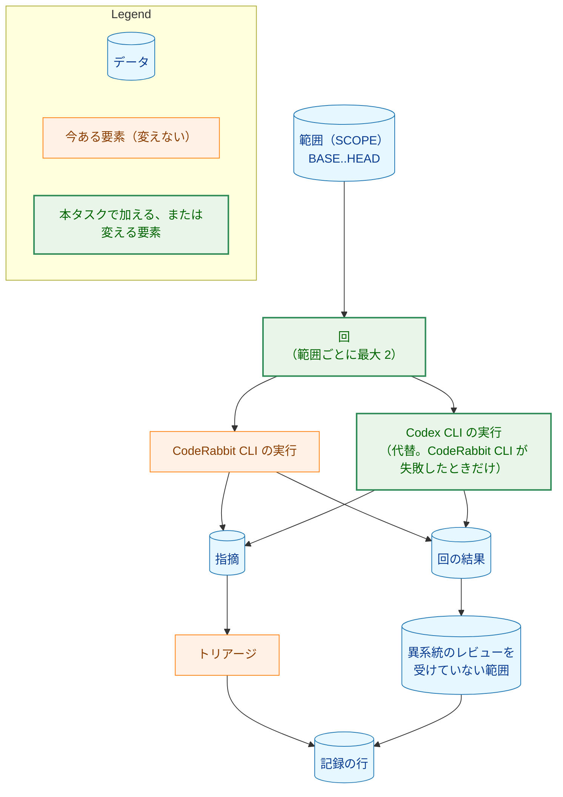
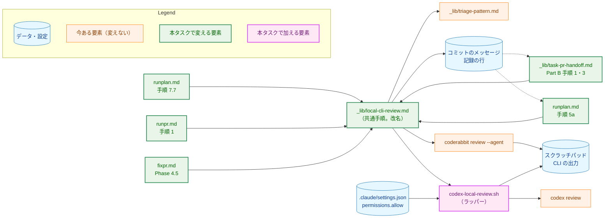
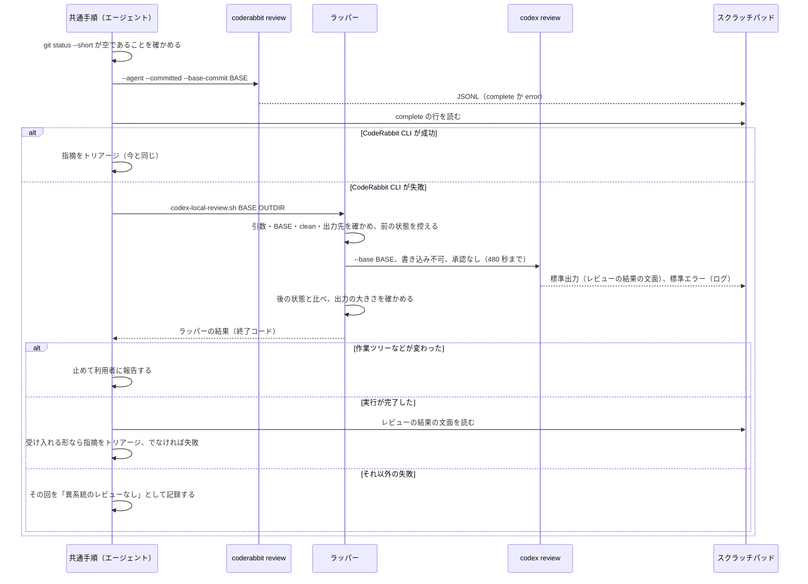
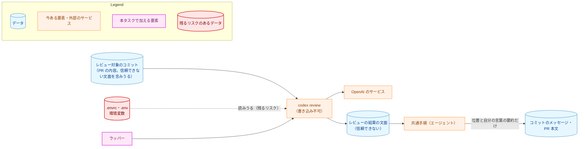
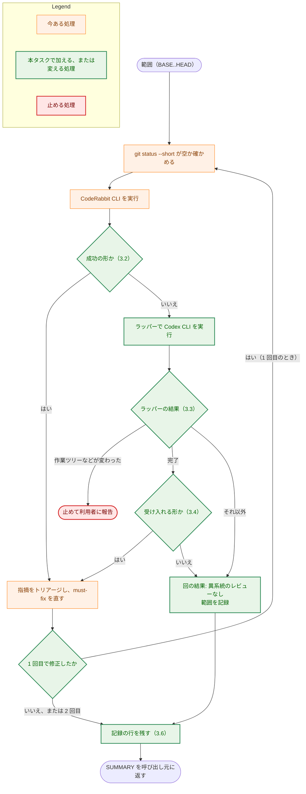

# アーキテクチャ設計書：CodeRabbit CLI が失敗したときに Codex CLI でローカルの CLI レビューを行う

## Document Status

| Item | Value |
|---|---|
| Status | `draft` |
| Created | 2026-10-28 |
| Review date | - |
| Reviewer | - |
| Comments | - |

本書は [01_requirements.md](01_requirements.md)（要件定義書。以下、要件書）の設計である。既存のファイルに関する記述は、コミット `c76eec2` のファイルで確かめた。`file:line` はこのコミットの行番号を指す。F-NNN・AC-NN は要件書の項番を、H-NN は [design_handoff.md](design_handoff.md) の項番を指す。`codex` CLI の振る舞いに関する記述は、[observations.md](observations.md)（試験運用の観測の記録。以下、観測の記録）の項目番号と実行の番号（R1〜R5）で根拠を示す。申し送りへの対応は付録 A に、受け入れ基準との対応は付録 B にまとめる。

本書は次の用語を、要件書 6 節と同じ意味で使う: ローカルの CLI レビュー、回、代替、異系統のレビュー、異系統のレビューを受けていない範囲、範囲（SCOPE）、フェーズ群、PR レビュー、割り当て、指摘。ほかに次の用語を使う。

-   **共通手順:** ローカルの CLI レビューの手順を 1 か所に定めたコマンドの文書。今は `.claude/commands/_lib/coderabbit-local-review.md` であり、本タスクで `.claude/commands/_lib/local-cli-review.md` に名前を変える（3.1）。
-   **呼び出し元:** 共通手順を呼ぶ 5 か所。`/runplan` の手順 7.7 と手順 5a、`/runpr` の手順 1、`_lib/task-pr-handoff.md` の Part B 手順 1、`/fixpr` の Phase 4.5 である（要件書 1 節）。
-   **ラッパー:** 本タスクで加えるシェルスクリプト `.claude/scripts/codex-local-review.sh`。`codex review` を、固定した引数と、時間・大きさの上限と、前後の比較の下で 1 回だけ実行する（3.3）。共通手順は `codex` をこのラッパーを通してだけ実行する。
-   **ラッパーの結果:** ラッパーが終了コードで返す、実行の結果の種類（3.3 の表）。
-   **レビューの結果の文面:** ラッパーが保存する、`codex review` の標準出力。Codex の最終的なレビュー結果だけが入る（観測の記録の 5、R2）。
-   **回の結果:** 1 回のローカルの CLI レビューが、どの CLI のレビューで終わったか。「CodeRabbit CLI のレビュー」「Codex CLI のレビュー（代替）」「異系統のレビューなし」のどれかである（3.6）。
-   **記録の行:** コミットのメッセージと SUMMARY に残す、ローカルの CLI レビューの記録の行。`CodeRabbit local review:`、`Codex local review:`、`Local CLI review: not run` の 3 種がある（3.6）。

## 1. 設計の全体像 (Design Overview)

### 1.1. 設計原則

-   **代替は共通手順の中に 1 か所だけ置く（AC-10、要件書 4.5）。** 呼び出し元は今と同じ入力（BASE、SCOPE、SUMMARY）で共通手順を呼ぶ。代替を行うかどうかの判断も、Codex CLI の実行とトリアージも、共通手順の中で閉じる。呼び出し元が変わるのは、共通手順が返す回の結果と記録の行を読む部分だけである（3.7）。
-   **成否は、CLI が自分で示した値で判定する。** CodeRabbit CLI の成否は、`--agent` の出力にある `complete` の行で判定する（3.2）。Codex CLI の成否は、ラッパーの結果と、レビューの結果の文面の形で判定する（3.3・3.4）。どちらも、文面の意味を推し量って成否を決めない（`CLAUDE.md`「Declare, don't infer」。1.4 で扱う）。
-   **疑わしいときは失敗とし、「指摘なし」とはみなさない。** 成功の形に当たらない CodeRabbit CLI の出力は失敗として代替に進む。受け入れる形に当たらない Codex CLI の出力は失敗として、その回を「異系統のレビューなし」と記録する（AC-09、要件書 4.2）。どちらも、その範囲を「レビュー済み」と取り違える方向には倒れない。
-   **安全のための条件は、慣行ではなくラッパーで守る。** Codex に書き込ませない設定、承認を求めない設定、範囲の前提（作業ツリーが clean）、時間と大きさの上限、前後の比較（AC-08）は、すべてラッパーが固定して行う。Claude Code の権限の設定はラッパーだけを許すので、共通手順に書かれていない引数で `codex` が承認なしに実行されることはない（`CLAUDE.md`「Enforce invariants with the type, not with convention」の考え方を、コマンドの手順に当てはめた。3.3・3.8）。
-   **Codex CLI の出力は、信頼できないデータとして扱う。** 使うのは各指摘の位置と内容だけで、位置はコードを読んで確かめる。指摘の文面にある指示は実行せず、原文はどこにも写さない（AC-06・AC-12、要件書 4.2）。
-   **製品の Go のコードは変えない。** 判定はコマンドの文書（エージェントへの手順）とラッパーで行う。Go で加えるのは、ラッパーと文書を確かめるテストだけである（7 章）。

### 1.2. 設計の際に決めたこと（2026-10-28）

利用者に確かめて決めたこと:

-   **設計に進む（AC-02）。** 観測の記録では、AC-01 の 2（コミットの範囲）が `--base` だけでは成り立たなかった（観測の記録の「AC-02 の判定」）。利用者はこの結果（PR #555）を受けて設計に進むことを選び、本書の作成の際に、範囲を実現する方法を次の項目のとおり選んだ。
-   **範囲は、作業ツリーが clean であることを前提にして、本物の作業ツリーで `--base <BASE>` を使って実現する（H-01）。** `codex review --base <BASE>` は、Codex に `git diff <BASE>` で変更を見させる。この形は作業ツリーと BASE の差分を出す（観測の記録の 2、R1）。作業ツリーに変更がなく、追跡していないファイル（git-ignore されていないもの）もなければ、この差分は BASE から HEAD までのコミット済みの変更と同じになる。git-ignore されているファイルは `git diff` に含まれない（R1 の `untracked.go` と同じ理由）。共通手順の手順 1 は、もともと `git status --short` が空であることを前提にしている（`.claude/commands/_lib/coderabbit-local-review.md:34-35`）。ラッパーは、Codex を実行する直前にも同じことを確かめ、成り立たなければ実行しない（3.3）。一時 worktree を作る方法（R2 で確かめた）は採らない。後片付けと、指摘のパスの読み替えが要るうえ、Codex は作業ディレクトリの外も読める（観測の記録の 7。R2 は `find ..` で親を探した）。そのため、秘密のファイルから遠ざけるという利点も薄いためである。
-   **`codex` はラッパーを通してだけ実行し、Claude Code の権限ではラッパーだけを許す（H-02・H-03）。** `Bash(codex review *)` のような前方一致の許可では、後ろに `--dangerously-bypass-approvals-and-sandbox` や `-c 'sandbox_mode="danger-full-access"'` を付けた実行まで許してしまう。拒否の規則で塞ぐ方法は、引数の組み合わせを列挙しきれない。また、時間の上限を設ける `perl` の起動にも許可が要る。ラッパーは、受け取る引数を BASE と出力先のディレクトリの 2 つに限り、それ以外を拒否する（3.3）。
-   **Codex CLI の結果は、素の `codex review` の標準出力（レビューの結果の文面）から読む（H-05）。** 文面の形は R1・R2・R3 で観測した。受け入れる形を 3.4 の文法で定め、文法に当たらない部分があれば失敗とする。セッションの記録（`~/.codex/sessions/.../rollout-*.jsonl`）にある構造化された `review_output` は使わない。公開された仕様ではなく、実行ごとに 2 つできるファイルから、`--json` の `thread_id` を手がかりに 1 つを選ぶ手順が要るためである（観測の記録の 5、「構造化された結果」）。
-   **記録の行は、CLI ごとに接頭辞を分ける（H-06）。** CodeRabbit CLI の指摘は今と同じ `CodeRabbit local review:`、Codex CLI の指摘は `Codex local review:`、異系統のレビューを受けていない範囲は `Local CLI review: not run <BASE>..<HEAD>` とする。前のセッションが残した `CodeRabbit local review: not run` も、引き続き読む（3.6、要件書 4.4）。
-   **共通手順のファイル名を `.claude/commands/_lib/local-cli-review.md` に変える（H-07）。** 本タスクの後、この手順は CodeRabbit CLI だけを扱うものではなくなるためである。参照を直すのは、コマンドの文書の 6 つ（`runplan.md`・`runpr.md`・`fixpr.md`・`_lib/task-pr-handoff.md`・`_lib/triage-pattern.md`・`_lib/pr-review-escalation.md`）である。2026-10-28 に、`git grep -l coderabbit-local-review -- ':!docs/tasks'` で確かめた。今のファイル名を参照するテストはない（同じ日に `git grep` で確かめた）。`docs/tasks/` の下の過去のタスクの文書にある参照は、当時の記録なので直さない。

設計で決めたこと:

-   **CodeRabbit CLI の成否は、`--agent` の出力の `complete` の行で判定する（H-04）。** 2026-10-28 に、ローカルのスクラッチパッドに残っていた過去のセッションの `coderabbit review --agent` の出力 40 件を調べた。どれも、1 行目の案内（`Tip: …`）の後に JSONL が続いていた。成功した 35 件は `{"type":"complete","status":"review_completed","findings":N,…}` の行で終わっていた。失敗した 5 件は、どれも利用の上限で、`{"type":"error","errorType":"rate_limit",…}` の行で終わっていた。終了コードは、これらのファイルには記録されていない。そこで、終了コードが 0 で、かつ成功の行がちょうど 1 つあるときだけを成功とし、それ以外はすべて失敗とする（3.2）。CLI が自分で示した欄で判定するので、文面を推し量る必要はない。
-   **Codex にはレビューの指示（PROMPT）もプロジェクトの規則の指定も渡さない（H-05）。** Codex は、指示しなくても `AGENTS.md` と `CLAUDE.md` を読み、`AGENTS.md` の内容をレビューの指示に入れていた（観測の記録の 7、R1〜R3）。`AGENTS.md` は `CLAUDE.md` とレビューの規則を挙げている。CodeRabbit CLI の `-c CLAUDE.md` に当たるものは、これで足りる。`--base` と PROMPT を同時に使えるかは確かめていない（観測の記録の「AC-02 の判定」）。
-   **`codex review`（`codex exec review` ではない）を、`--json` も `-o` も付けずに使う。** 標準出力が最終的なレビュー結果だけになり、失敗したときは空になる。この形は R2・R4 で観測した。`codex review` には `-o` も `--json` もない（2026-10-28 の `codex review --help`）。
-   **時間の上限は 480 秒とする（AC-09 の 3）。** 観測では 15〜36 秒で終わったが、どの差分も数十行だった（観測の記録の 8）。大きな差分の例として、0031 で観測した Codex の PR レビューは、完了まで最長 3 分 14 秒だった（`docs/tasks/0031_codex_pr_review/02_architecture.md` の 1.2、「待つ時間」）。480 秒はその約 2.5 倍である。また、エージェントが前景で実行する Bash ツールの時間の上限（600 秒）より短いので、ラッパーが先に打ち切り、結果の種類を返せる。
-   **大きさの上限は、レビューの結果の文面で 64 KiB とする（AC-09 の 5）。** 観測した文面は最大 1,079 バイトだった（観測の記録の 5、R1）。64 KiB は、指摘が数十件あっても収まる大きさであり、エージェントが一度に読める大きさでもある。Codex が読んだファイルの中身が出る標準エラー（R2 で約 130KB）は、レビューの結果としては読まないので、上限の対象にしない（3.3）。
-   **Codex のシェルに環境変数を引き継がない設定（H-08）は採らない。** 効くかどうかは観測していない。確かめるには割り当てを使う実行が要る。また、採っても `.envrc` のファイルを読む経路は残るので、要件書 4.2 の残るリスクは変わらない。9 章で扱う。
-   **`--ephemeral` と `--ignore-user-config` は付けない。** どちらも観測していない。`--ignore-user-config` を付けると、利用者が `~/.codex/config.toml` で選んだモデルと推論の強さが使われなくなる（R4 では推論の強さが `none` と表示された）。書き込みと承認の設定は `-c` で明示するので、利用者の設定ファイルの値には左右されない（3.3）。
-   **ラッパーは `.claude/scripts/` に置く。** `.claude/commands/` の下は、コマンドの文書（`.md`）だけを置く場所である。Claude Code の設定（`.claude/settings.json`）と同じ `.claude/` の下に置けば、開発用のエージェントの道具であることが分かる。

### 1.3. なぜ今の仕組みのままでは足りないか

今の共通手順は、CodeRabbit CLI が失敗すると、残りを飛ばして失敗を SUMMARY に記録するだけである（`.claude/commands/_lib/coderabbit-local-review.md:42-44`）。利用の上限は実際に起きている（1.2 の 40 件のうち 5 件）。`/runplan` の手順 5a の再レビューも CodeRabbit CLI なので（`.claude/commands/runplan.md:84-90`）、CodeRabbit CLI の割り当てが尽きている間は、異系統のレビューを受けないまま PR に進む。CodeRabbit CLI を再試行する方法では、利用の上限が数分から 30 分以上続くことがあり（調べた 5 件の `waitTime` は 1 分から 32 分）、無人の実行が止まる。別の CLI で代替するほかに、要件書の目的（2.1）を満たす方法はない。

### 1.4. 他の文書の方針との関係

-   **`CLAUDE.md`「Tool Execution Safety」（`CLAUDE.md:532-542`）。** 今は、ネットワークに触れる外部のツールのうち、`coderabbit review` だけを承認なしに実行してよいとしている（`CLAUDE.md:540-542`）。本書は、ラッパーを通した `codex review` を同じ扱いに加える（AC-16、3.8）。これは要件書が決めた変更であり、例外ではない。この記述を読むテストはない（2026-10-28 に `git grep -n 'Tool Execution' -- '*_test.go'` で確かめた）。
-   **`CLAUDE.md`「Declare, don't infer」。** この規則は、呼び出し元から渡された文字列の中身を調べて処理を選ぶコードを禁じている。本書では、エージェントが Codex CLI の文面を読み、「指摘あり」「指摘なし」「読み取れない」を区別する（3.4）。これはコードではなくエージェントへの手順なので、この規則の例外を `CLAUDE.md` には加えない。ただし、規則の考え方には次のように従う。
    -   **区別の根拠:** 区別には文面の構造（見出しの行と、指摘の行の形）だけを使い、要約の文の意味は使わない。
    -   **宣言された値がない理由:** 標準出力には、レビューの成否や指摘の数を示す欄がない。そうした欄を持つのはセッションの記録だけだが、それは使わないと決めた（1.2）。
    -   **境界:** 文法に当たらない部分を含む文面は、補って読まず、失敗とする（「Reject, don't normalize」）。
-   **0031 の設計書の「ローカルの CLI レビューは変えない」。** 0031 は PR レビューを Codex の GitHub 連携に切り替えたタスクで、ローカルの CLI レビューには触れなかった（`docs/tasks/0031_codex_pr_review/02_architecture.md` の 2.2）。本タスクは、その後の別のタスクとしてローカルの CLI レビューを変える。0031 の方針の例外ではない。ただし、0031 の際に書かれた「ローカルの CLI レビューの割り当ては PR レビューと別である」という記述は、代替の Codex CLI には当てはまらない（観測の記録の 1）。要件書 AC-18 のとおり、これを改める（3.9）。この記述を読むテストは `cmd/yt2column/codex_review_docs_test.go:351-356`（`TestCodeRabbitConfigStopsReview`）であり、`.coderabbit.yaml` の注釈の文 `The local CLI review (`coderabbit review`) is still used` が含まれることを確かめている。注釈を改めるので、このテストの文も改める（7.1）。
-   **`_lib/pr-review-escalation.md` の基準。** 2 回目以降の PR レビューを依頼する基準は変えない（要件書 2.3）。この文書の、ローカルの CLI レビューの割り当てが別だと述べる文（`.claude/commands/_lib/pr-review-escalation.md:10-12`）だけを改める（3.9）。

### 1.5. 概念モデル

矢印 A → B は「A が B を持つ、または A から B が決まる」を表す。



-   1 つの範囲につき、回は最大 2 回である（AC-07）。各回は CodeRabbit CLI の実行 1 回と、それが失敗したときの Codex CLI の実行 1 回から成る。
-   回の結果は、「CodeRabbit CLI のレビュー」「Codex CLI のレビュー（代替）」「異系統のレビューなし」のどれかである。最後のものになった回があると、異系統のレビューを受けていない範囲ができる（3.6）。
-   指摘は、どちらの CLI のものでも同じトリアージを受ける（AC-05）。

## 2. システム構成 (System Structure)

### 2.1. 全体構成

矢印 A → B は「A が B を呼ぶ、実行する、または読む」を表す。点線は、記録を後で読む関係を表す。



-   `SETTINGS --> WRAP` は、Claude Code の権限の設定がラッパーの実行を許すことを表す（3.8）。
-   `codex review` を直接実行する呼び出し元はない。共通手順だけが、ラッパーを通して実行する。

### 2.2. コンポーネント配置

| ファイル | 変更 | 内容 | AC | 改めるテスト |
|---|---|---|---|---|
| `.claude/scripts/codex-local-review.sh` | 新規 | ラッパー（3.3） | AC-03・AC-08・AC-09・AC-17 | — |
| `.claude/commands/_lib/coderabbit-local-review.md` → `_lib/local-cli-review.md` | 改名と変更 | 代替、成否の判定、出力の受け入れ、トリアージ、回数、記録の行（3.1〜3.6） | AC-03〜AC-12・AC-18 | — |
| `.claude/commands/runplan.md` | 変更 | 手順 7.7 の記録、手順 5a の再レビューのきっかけ、手順 8 の要約、参照（3.7） | AC-10・AC-11・AC-15・AC-18 | — |
| `.claude/commands/runpr.md` | 変更 | 手順 1 の参照と最終報告、承認の記述（3.7・3.8） | AC-10・AC-14・AC-16 | — |
| `.claude/commands/fixpr.md` | 変更 | Phase 4.5 の見出しと本文、最終報告、承認の記述（3.7・3.8） | AC-10・AC-14・AC-16・AC-18 | — |
| `.claude/commands/_lib/task-pr-handoff.md` | 変更 | Part B 手順 1・3、承認の記述、参照（3.7・3.8） | AC-10・AC-13・AC-16 | — |
| `.claude/commands/_lib/triage-pattern.md` | 変更 | 呼び出し元の列挙と参照（3.9） | AC-18 | — |
| `.claude/commands/_lib/pr-review-escalation.md` | 変更 | 割り当てが別だと述べる文と参照（3.9） | AC-18 | — |
| `.claude/settings.json` | 変更 | ラッパーの許可を加える（3.8） | AC-17 | — |
| `CLAUDE.md` | 変更 | 「Tool Execution Safety」、Claude Commands の節の記述（3.8・3.9） | AC-16・AC-18 | — |
| `.coderabbit.yaml` | 変更 | 注釈（3.9） | AC-18 | `cmd/yt2column/codex_review_docs_test.go:351-356` `TestCodeRabbitConfigStopsReview` の文 |
| `cmd/yt2column/` の文書のガード | 新規 | ラッパーのテストと、許可とラッパーの一致のガード（7.1） | AC-08・AC-09・AC-17 | — |

変えないもの:

-   `coderabbit review` の呼び出し方（`--agent --committed --base-commit "<BASE>" -c CLAUDE.md`、`.claude/commands/_lib/coderabbit-local-review.md:37-38`）と、CodeRabbit CLI が成功したときのトリアージと記録（AC-04、要件書 4.4）。
-   PR レビュー（Codex の GitHub 連携）の依頼と判定、エスカレーションの基準（要件書 2.3）。
-   `/runplan` の手順 7 と 7.5 のサブエージェントのレビュー（要件書 2.3）。
-   `/runpr` の手順 1 の単独の変更の PR 本文（要件書 2.3）。

### 2.3. データフロー: 1 回のローカルの CLI レビュー



### 2.4. 既存の挙動の確認

コミット `c76eec2` で、次を確かめた。

-   共通手順は、実行の前に `git status --short` が空であることを確かめる（`.claude/commands/_lib/coderabbit-local-review.md:34-35`）。CodeRabbit CLI が失敗したときは、残りを飛ばして SUMMARY に記録する（同 `:42-44`）。回数は範囲ごとに最大 2 回で、2 回目は 1 回目で修正したときだけ行う（同 `:71-77`）。記録の行は `CodeRabbit local review:` で、修正のコミットか、なければブランチの次のコミットのメッセージに残す（同 `:79-87`）。
-   `/runplan` の手順 7.7 は、CodeRabbit CLI が失敗したとき、次のコミットのメッセージに `CodeRabbit local review: not run` を残す（`.claude/commands/runplan.md:212`）。手順 5a は、`git log origin/main..HEAD` にこの行があれば、ブランチ全体を改めてレビューする（同 `:84-90`）。
-   `_lib/task-pr-handoff.md` の Part B 手順 3 は、このセッションと、前のセッションがコミットのメッセージに残した `CodeRabbit local review:` の行から、`unclear` と `deferred` の指摘を PR 本文に載せる（`.claude/commands/_lib/task-pr-handoff.md:199-204`）。
-   `/runpr` の手順 1 は、単独の変更のとき、checkout しているブランチを共通手順でレビューし、SUMMARY を最終報告とする（`.claude/commands/runpr.md:115-119`）。
-   `/fixpr` の Phase 4.5 は、修正のコミットの親を BASE として共通手順を呼び、SUMMARY を Final report とする（`.claude/commands/fixpr.md:581-590`）。
-   Claude Code の権限の設定が許しているのは `Bash(coderabbit review *)` だけである（`.claude/settings.json:4`）。

## 3. コンポーネント設計 (Component Design)

### 3.1. 共通手順 `_lib/local-cli-review.md`（H-07・AC-07・AC-10）

ファイル名を変え、次を受け持つ。入力（BASE、SCOPE、SUMMARY）は今と同じである。

| 受け持つこと | 節 |
|---|---|
| 各回で、CodeRabbit CLI を先に実行し、その成否を判定する | 3.2 |
| CodeRabbit CLI が失敗したときだけ、ラッパーで Codex CLI を実行する | 3.3 |
| Codex CLI のレビューの結果の文面を、受け入れる形と照らす | 3.4 |
| どちらの CLI の指摘も、同じ規則でトリアージする。回数を数える | 3.5 |
| 回の結果と記録の行を、SUMMARY とコミットのメッセージに残す | 3.6 |

共通手順が呼び出し元に返すもの（SUMMARY に書くもの）は、次のとおりである。

-   各回の回の結果と、失敗した CLI ごとの失敗の種類（AC-11）。
-   異系統のレビューを受けていない範囲があれば、その範囲（`<BASE>..<HEAD>`。3.6）。
-   今と同じ、修正・却下・`deferred`・`unclear` の指摘。どちらの CLI の指摘かを付ける（AC-12 の 1）。

回数の数え方は今と変えない。1 回目のレビュー（どちらの CLI でも）で修正したときだけ 2 回目を行い、2 回目も CodeRabbit CLI から試す（AC-07）。1 回目が「異系統のレビューなし」なら、修正がないので 2 回目は行わない。

### 3.2. CodeRabbit CLI の成否の判定（H-04・AC-03・AC-04）

`coderabbit review --agent` の出力は、案内の行の後に、1 行に 1 つの JSON のオブジェクトが続く形である（1.2）。共通手順は、出力を今と同じくスクラッチパッドのファイルに保存し、次のときだけを成功とする。

-   終了コードが 0 である。
-   `type` が `complete` で `status` が `review_completed` の行が、ちょうど 1 つある。
-   `type` が `error` の行がない。

これ以外（コマンドが見つからない、終了コードが 0 でない、成功の行がない、成功の行が 2 つ以上ある、`error` の行がある）は、すべて失敗とし、同じ回の中で代替に進む（AC-03）。失敗の種類は、`error` の行の `errorType` の値（観測した値は `rate_limit`）をそのまま示し、その行がなければ終了コードを示す（AC-11）。この値は報告にだけ使い、振る舞いを選ぶのには使わない。どの失敗でも振る舞いは同じだからである。

成功したときは、指摘が 0 件でも Codex CLI を実行しない（AC-04）。`complete` の行に `reused: true` が付く場合（前回の確認点を使い、新たにレビューしなかったと CodeRabbit CLI が示すもの。1.2 の 40 件のうち 2 件）も、今と同じく成功とする。この扱いは本タスクで変えない。

### 3.3. ラッパー `.claude/scripts/codex-local-review.sh`（H-01・H-02・H-03・AC-08・AC-09）

**呼び出しの形:** 共通手順は、リポジトリのルートで、次の形だけでラッパーを実行する。

```text
.claude/scripts/codex-local-review.sh <BASE> <OUTDIR>
```

-   `<BASE>`: 範囲の始まりのコミット。40 桁の 16 進数（`git rev-parse` で得た完全な SHA）でなければならない。
-   `<OUTDIR>`: 出力先のディレクトリ。すでにあり、空で、作業ツリーの外にあるものでなければならない。共通手順はスクラッチパッドの下に回ごとに作る。

**ラッパーが固定する `codex` の実行:**

```text
codex review --base <BASE> -c 'sandbox_mode="read-only"' -c 'approval_policy="never"'
```

-   標準入力は `/dev/null`、標準出力は `<OUTDIR>/result.txt`（レビューの結果の文面）、標準エラーは `<OUTDIR>/log.txt` に保存する。この形は R2 で観測した。認証の失敗で終了コードが 1 になり、標準出力が空になることは R4 で観測した。
-   `sandbox_mode="read-only"` は書き込みを止める（観測の記録の 3）。`approval_policy="never"` は承認を求めて止まらないようにする（観測の記録の 4）。どちらも `-c` で明示するので、利用者の `~/.codex/config.toml` の値に左右されない（H-02）。
-   時間の上限は 480 秒である（1.2）。上限に達したら `codex` のプロセスを終わらせる。R5 では、`SIGALRM` で打ち切った後に `codex` のプロセスは残らなかった。
-   ラッパーは、`codex --version` の出力も `<OUTDIR>/version.txt` に残す。出力の形が変わって失敗したとき、どの版だったかを後で確かめるためである（5.4）。

**ラッパーが行う確かめ（実行の前）:**

-   引数がちょうど 2 つで、上の形に合う。
-   `<BASE>` が HEAD の祖先である（`git merge-base --is-ancestor`）。`--base` は BASE と HEAD のマージベースとの差分を見るので、BASE が祖先でなければ、範囲が BASE..HEAD と食い違うためである（観測の記録の 2）。
-   `git status --short` の出力が空である（1.2、H-01）。
-   `codex` が `PATH` にある。

**ラッパーが行う確かめ（実行の後）:** 次の 4 つを実行の前と後で比べる（AC-08）。ラッパーは一時的な参照を作らないので、比較から除くものはない。git-ignore されているファイルは比べず、書き込みを止める設定で守る（AC-08、観測の記録の 3）。

-   `git status --short` の出力
-   `HEAD`
-   ローカルのブランチとタグの一覧（`git for-each-ref refs/heads refs/tags`。各参照の指すコミットも含む）
-   stash の一覧（`git stash list`）

**ラッパーの結果:** ラッパーは、次の種類を、それぞれ別の終了コードで返す。数値は実装計画で決める。種類は排他的で、上の行ほど優先する。たとえば、時間切れで打ち切ったうえに作業ツリーも変わっていれば「作業ツリーなどが変わった」を返す。

| ラッパーの結果 | 条件 | 共通手順の扱い |
|---|---|---|
| 作業ツリーなどが変わった | 実行の後の比較で違いがある | 止めて利用者に報告する。元に戻さず、コミットもしない（AC-08） |
| 引数が不正 | 引数の数や形が合わない、BASE が HEAD の祖先でない、OUTDIR が空でないか作業ツリーの中にある | Codex CLI のレビューの失敗 |
| 作業ツリーが clean でない | 実行の前の `git status --short` が空でない | Codex CLI のレビューの失敗 |
| `codex` が見つからない | `PATH` にない | Codex CLI のレビューの失敗（AC-09 の 1） |
| 時間切れ | 480 秒で終わらなかった | Codex CLI のレビューの失敗（AC-09 の 3） |
| `codex` が失敗した | `codex` の終了コードが 0 でない | Codex CLI のレビューの失敗（AC-09 の 2） |
| 出力が空 | `result.txt` が空 | Codex CLI のレビューの失敗（AC-09 の 4） |
| 出力が大きすぎる | `result.txt` が 64 KiB を超える | Codex CLI のレビューの失敗（AC-09 の 5） |
| 完了 | 上のどれにも当たらない | レビューの結果の文面を 3.4 で読む |

「作業ツリーなどが変わった」を除くどの種類も、ラッパーは何も変えずに終わる。Codex CLI のレビューの失敗の種類（AC-11）は、この表の種類で示す。「`codex` が失敗した」のときは、`log.txt` の最後の `ERROR:` の行から、認証やネットワークといった原因を自分の言葉で書いてよい（R4 の最後の行は `ERROR: unexpected status 401 Unauthorized: …` だった）。この行は報告にだけ使い、振る舞いは変えない。`log.txt` の全体は読まない。Codex が読んだファイルの中身がそのまま出るためである（観測の記録の 5）。

**副作用の契約:**

-   **書き込み:** `<OUTDIR>` の下の 3 つのファイル（`result.txt`・`log.txt`・`version.txt`）だけ。作業ツリー、git の参照、stash は変えない。`<OUTDIR>` は消さない（後で調べられるように残す。5.4）。
-   **ネットワーク:** `codex` が、差分と Codex が読んだ内容を OpenAI のサービス（ChatGPT のプランでログインしていれば `chatgpt.com/backend-api/codex/responses`。観測の記録の 1）に送る。ラッパー自身は送らない。
-   **割り当て:** 1 回の実行で、ChatGPT のプランに付く Codex の割り当て（`limit_id: "codex"`）を消費する。PR レビューと同じ割り当てである（観測の記録の 1）。

### 3.4. Codex CLI の出力の受け入れる形（H-05・AC-06・AC-09 の 4・6）

ラッパーの結果が「完了」のとき、共通手順は `result.txt` を読み、次の形に当たるかを確かめる。形は観測の記録の 5（R1・R2・R3）による。

| 部分 | 形 |
|---|---|
| 要約 | 先頭の 1 つ以上の段落。どんな文でもよいが、行頭が `- [P` の行を含まない。要約の中身は使わない |
| 見出し | 要約の後の、`Full review comments:` か `Review comment:` だけから成る 1 行。ないか、1 つだけ |
| 指摘の行 | 見出しの後の、`- [P<数字>] <題名> — <絶対パス>:<開始行>-<終了行>` の形の行。区切りは前後に空白のある `—`（U+2014）で、行の最後の区切りより後ろを位置とする。開始行と終了行は正の整数で、開始行 ≦ 終了行 |
| 指摘の本文 | 指摘の行の直後の、2 つの空白で字下げした行の並び |
| 空行 | 部分の間の空行 |

-   **指摘あり:** 見出しが 1 つあり、その後に指摘の行が 1 つ以上あり、見出しより後ろがすべて指摘の行、指摘の本文、空行のどれかである。
-   **指摘なし:** 見出しも指摘の行もなく、要約が 1 段落以上ある（R3 の形）。
-   **読み取れない:** 上のどちらでもない。たとえば、見出しがあるのに指摘の行がない、見出しの後に形の合わない行がある、見出しがないのに行頭が `- [P` の行がある、見出しが 2 つある、要約がない、の場合である。読み取れないときは、読み取れた指摘も使わずに Codex CLI のレビューの失敗とする（AC-09 の 6）。

使うのは、各指摘の位置（パスと行の範囲）と内容（題名と本文）だけである。優先度（`[P1]` など）は使わない。トリアージの `severity` は、`triage-pattern.md` の基準で独立に決めるためである（AC-05）。

**位置の確かめ（AC-06）:** 各指摘は、トリアージの前に次を確かめる。どれかに当たらない指摘は `invalid` とする。

-   パスが作業ツリーのルート（`git rev-parse --show-toplevel`）の下にある。
-   ルートからの相対パスが、`git diff --name-only <BASE> HEAD` に含まれる（範囲で変更されたファイルである）。
-   ファイルがあり、行の範囲がファイルの中にある。

確かめた後、指摘が挙げた位置のコードを読んでからトリアージする。指摘の文面に含まれる指示（コマンドの実行、ファイルの変更、範囲の外への操作）は、文面だけを根拠に実行しない（AC-06）。

### 3.5. トリアージと回数（AC-05・AC-07）

Codex CLI の指摘は、CodeRabbit CLI の指摘と同じく `.claude/commands/_lib/triage-pattern.md` の尺度（`verdict`、`severity`、`topic`、`replyBody`）で分類し、同じ規則で扱う（AC-05）。今の手順 2・3（`.claude/commands/_lib/coderabbit-local-review.md:46-69`）を、どちらの CLI の指摘にも当てはめる。

-   `must-fix` を直し、`unclear` を未解決として SUMMARY に記録する。
-   タスクのディレクトリの文書への指摘には `off-level` の判定を適用する。
-   同じ変更への前のレビューで直した指摘の繰り返しは、そのように閉じる。1 回目が CodeRabbit CLI で 2 回目が Codex CLI のとき（またはその逆）も、同じ範囲への前のレビューとして扱う。

`coderabbit review findings --clear`（今の手順 5、`.claude/commands/_lib/coderabbit-local-review.md:79-80`）は、その範囲で CodeRabbit CLI が成功した回があったときだけ実行する。Codex CLI には、CLI の側に保存される指摘がない。

### 3.6. 回の結果と記録の行（H-06・AC-11・AC-12）

**回の結果（SUMMARY）:** 共通手順は、各回について次のどれかを SUMMARY に書く（AC-11）。

| 回の結果 | 書くこと |
|---|---|
| CodeRabbit CLI のレビュー | 今と同じ（修正・却下・`deferred`・`unclear` の数と内容） |
| Codex CLI のレビュー（代替） | CodeRabbit CLI の失敗の種類（3.2）と、指摘の扱い |
| 異系統のレビューなし | CodeRabbit CLI の失敗の種類（3.2）と、Codex CLI の失敗の種類（3.3・3.4） |

**記録の行:** コミットのメッセージと SUMMARY に、次の 3 種の行を残す。

| 行 | 形 | 書くとき |
|---|---|---|
| `CodeRabbit local review:` | 今と同じ（却下した指摘とその理由、`deferred`・`unclear` の指摘） | CodeRabbit CLI の指摘について（変えない） |
| `Codex local review:` | `Codex local review: <ルートからの相対パス>:<開始行>-<終了行> <扱い>: <エージェントが自分の言葉で書いた要約>`。`<扱い>` は `rejected (<理由>)`・`deferred`・`unclear (<不確かな理由>)` のどれか | Codex CLI の指摘のうち、却下・`deferred`・`unclear` のもの |
| `Local CLI review: not run` | `Local CLI review: not run <BASE>..<HEAD>`。SHA は 12 桁に縮める | 異系統のレビューを受けていない範囲ができたとき |

-   **異系統のレビューを受けていない範囲:** 1 回目が「異系統のレビューなし」なら、範囲の全体（BASE から、そのときの HEAD まで）である。1 回目が成功して修正し、2 回目が「異系統のレビューなし」なら、1 回目の後の修正のコミット（1 回目のときの HEAD から、2 回目のときの HEAD まで）である（要件書 6 節）。
-   **残す場所（AC-12 の 2）:** 今と同じく、修正のコミットがあればそのメッセージに、なければ呼び出し元が同じ実行の中で次に作るコミットのメッセージに残す。次のコミットがなければ SUMMARY にだけ残す。2 回目の結果は修正のコミットより後に分かるので、2 回目の記録は次のコミットか SUMMARY に入る。
-   **原文を写さない（AC-12 の 3）:** `Codex local review:` の行の要約は、Codex の文面を引用せず、エージェントが自分の言葉で書く。Codex へのメンションを含めない。SUMMARY と PR 本文でも同じである。
-   **前のセッションの行（要件書 4.4）:** 前のセッションが残した `CodeRabbit local review: not run` の行（範囲を持たない）は、`Local CLI review: not run` と同じく「異系統のレビューを受けていない範囲がある」ことを示すものとして読む。範囲が分からないので、ブランチ全体を範囲とみなす。

### 3.7. 呼び出し元の変更（AC-10・AC-13・AC-14・AC-15）

| 呼び出し元 | 変えること |
|---|---|
| `runplan.md` 手順 7.7 | 共通手順の SUMMARY に異系統のレビューを受けていない範囲があれば、`Local CLI review: not run <BASE>..<HEAD>` を次のコミット（チェックボックスのコミット）のメッセージに残す。CodeRabbit CLI が失敗しても Codex CLI で代替できたときは、この行を残さない（AC-15）。手順の見出しの「CodeRabbit review」を、ローカルの CLI レビューに改める |
| `runplan.md` 手順 5a | `git log origin/main..HEAD` に `Local CLI review: not run` か `CodeRabbit local review: not run` の行があるときだけ、ブランチ全体を共通手順でレビューする（AC-15） |
| `runplan.md` 手順 8 | 要約の「CodeRabbit result」を、各回の回の結果に改める（AC-11） |
| `_lib/task-pr-handoff.md` Part B 手順 1 | 参照と「local CodeRabbit CLI」の記述を改める |
| `_lib/task-pr-handoff.md` Part B 手順 3 | PR 本文に、`Codex local review:` の `unclear` と `deferred` の指摘を、`CodeRabbit local review:` と同じく、このセッションのものと前のセッションのものの両方から載せる（AC-13 の 1）。異系統のレビューを受けていない範囲を載せる（AC-13 の 2。下記） |
| `runpr.md` 手順 1 | 参照を改める。異系統のレビューを受けていない範囲が残ったときは、最終報告に示す（AC-14）。PR 本文は変えない |
| `fixpr.md` Phase 4.5 | 見出しと本文を、ローカルの CLI レビューに改める。異系統のレビューを受けていない範囲が残ったときは、Final report に示す（AC-14） |

**PR 本文に載せる、異系統のレビューを受けていない範囲（AC-13 の 2・AC-15）:** Part B 手順 3 は、次のとおりに決める。

-   このセッションでブランチ全体のレビューを行ったとき（Part B 手順 1、または `/runplan` の手順 5a の再レビュー）は、そのレビューの SUMMARY にある範囲だけを載せる。ブランチ全体のレビューが成功した範囲は、前のセッションのコミットのメッセージに `not run` の行があっても、異系統のレビューを受けたものとする（AC-15）。
-   このセッションでブランチ全体のレビューを行わなかったときは、`git log origin/main..HEAD` の `Local CLI review: not run` の行の範囲を載せる。`/runplan` の手順 5a は、そうした行があれば必ず再レビューするので、この場合は行がないときに限られる。

### 3.8. 承認と権限（H-03・AC-16・AC-17）

-   **`.claude/settings.json`:** `permissions.allow` に `Bash(.claude/scripts/codex-local-review.sh *)` を加える。`codex` そのものの許可は加えない。ラッパーは 2 つの引数のほかを拒否するので（3.3）、この許可で承認なしに実行できるのは、ラッパーが固定した形の `codex review` だけである。共通手順は、ラッパーをこの相対パスで、リポジトリのルートから実行する。`./` を付けた形や絶対パスの形はこの許可に当たらないので、共通手順はその形を使わない。
-   **`CLAUDE.md`「Tool Execution Safety」:** `coderabbit review` の項目の後に、ラッパー（`.claude/scripts/codex-local-review.sh`）を承認なしに実行してよい項目を加える。その実行が `codex review` を起動し、差分と Codex が読んだ内容を OpenAI のサービスに送ること、CodeRabbit CLI が失敗したときの代替であることを述べる（AC-16）。
-   **共通手順の「Authorization」:** 同じことを述べる。
-   **承認の記述:** `runpr.md:82-83`、`fixpr.md:97-98`、`_lib/task-pr-handoff.md:65-67` の `coderabbit review` の承認の記述に、ラッパーを加える（AC-16）。`/runplan` には承認の記述がないので変えない。

### 3.9. 文書の更新（AC-18）

要件書 AC-18 の一覧に、本書を書く際に `git grep -n -i coderabbit -- ':!docs/tasks'` で見つけたものを加えて、次をすべて改める。

| 記述 | 改め方 |
|---|---|
| `CLAUDE.md:101`（「local CodeRabbit」） | ローカルの CLI レビュー（CodeRabbit CLI、失敗したときは Codex CLI） |
| `CLAUDE.md:115-117` | 同上。CodeRabbit CLI の割り当ては PR レビューと別だが、代替の Codex CLI は PR レビューと同じ割り当てを使う |
| `.claude/commands/_lib/pr-review-escalation.md:10-12` | 同上 |
| `.claude/commands/fixpr.md:581-590` | 見出しと本文。割り当ての記述は上と同じ |
| `.claude/commands/_lib/coderabbit-local-review.md:1-11` | 改名したファイルの説明、見出し、呼び出し元の列挙（5 か所） |
| `.claude/commands/runplan.md:85-90`・`:212`・`:215` | 3.7 のとおり |
| `.claude/commands/runpr.md:9-10`・`:116` | 参照 |
| `.claude/commands/_lib/task-pr-handoff.md:17`・`:175-177`・`:203` | 参照と記述 |
| `.claude/commands/_lib/triage-pattern.md:7` | 参照と呼び出し元の列挙（5 か所） |
| `.coderabbit.yaml:9-12` | ローカルの CLI レビュー（`coderabbit review`、失敗したときは Codex CLI）は、PR を開いた後の変更にも使う |

割り当てについての記述は、観測の記録の 1 の結論（PR レビューと同じ割り当てを消費する）と一致させる。

## 4. エラーハンドリング設計 (Error Handling Design)

Go のエラーの型は持たない（要件書 4.2 の「センチネルエラー」）。失敗の種類と扱いは、ラッパーの結果（3.3）と共通手順の判定（3.2・3.4）で定める。扱いは 3 つに分かれる。

| 扱い | 当たるもの | 振る舞い |
|---|---|---|
| 代替に進む | CodeRabbit CLI の失敗（3.2） | 同じ回の中で Codex CLI を実行する。再試行しない |
| 記録して先へ進む | Codex CLI のレビューの失敗（3.3 の表の「止める」以外と、3.4 の「読み取れない」） | その回を「異系統のレビューなし」とし、範囲を記録して先へ進む（AC-09）。再試行しない |
| 止める | ラッパーの結果が「作業ツリーなどが変わった」 | 共通手順を止め、呼び出し元も止めて、利用者に報告する。違いを元に戻さず、コミットもしない（AC-08） |

**メッセージの形（SUMMARY と報告）:**

-   失敗ごとに、どの CLI か、どの種類か（3.2 の `errorType` または終了コード、3.3 の表の種類、3.4 の「読み取れない」）を示す。
-   「止める」ときは、ラッパーが比べた 4 つのうち、どれが変わったかと、`<OUTDIR>` の場所を示す。変わった内容は利用者が確かめる。
-   Codex の文面は引用しない（AC-12 の 3）。

## 5. セキュリティ考慮事項 (Security Considerations)

### 5.1. 脅威モデル

矢印は、データの流れを表す。



| 脅威 | 守り |
|---|---|
| Codex が作業ツリー、コミット、ブランチを変え、レビューの範囲や後のコミットの内容が変わる | 書き込みを止める設定をラッパーが固定する。前後の比較で違いがあれば止める（3.3、AC-08） |
| 承認なしの許可を使って、書き込みやサンドボックスの解除を許す引数で `codex` が実行される | 許可はラッパーだけに出す。ラッパーは引数を 2 つに限る（3.8） |
| コミットしていない変更が範囲に入り、OpenAI に送られる | ラッパーが実行の直前に clean を確かめる（3.3）。実行の間に作業ツリーが変われば、後の比較で止める |
| レビュー対象の文面に影響された指摘が、エージェントに操作をさせる | 位置と内容だけを使い、指示を実行しない。位置はコードを読んで確かめる（3.4、AC-06） |
| 指摘の原文にある秘密の値やメンションが GitHub に公開される | 原文を写さず、自分の言葉で要約する（3.6、AC-12 の 3）。PR 本文には今のメンションの確認がかかる（`_lib/task-pr-handoff.md` Part B 手順 3） |
| 形の変わった出力を「指摘なし」と取り違え、レビュー済みとして進む | 受け入れる形に当たらなければ失敗とする（3.4） |
| `codex` が終わらず、無人の実行が止まったままになる | 480 秒で打ち切る（3.3、R5） |
| 巨大な出力でエージェントの文脈があふれる | 64 KiB を超えれば失敗とする。標準エラーの全体は読まない（3.3） |

### 5.2. 残るリスク

-   **秘密のファイルと環境変数:** 書き込みを止める設定でも、読み取りはファイルシステム全体に許される（観測の記録の 3）。Codex は `.envrc`・`.env` や、それらから読み込まれた環境変数を読み、OpenAI に送りうる。観測では `.env` を読んだ跡はなかった（観測の記録の 7）。本タスクでは対策を求めない（要件書 1 節の決定・4.2）。
-   **コミットのメッセージのメンション:** コミットのメッセージには、PR 本文のようなメンションの確認がかからない。`Codex local review:` の行の要約は自分の言葉で書き、メンションを含めない規則に頼る（3.6）。コミットのメッセージのメンションで Codex が動くかどうかは、本書では確かめていない。
-   **`codex` の版による出力の形の変化:** レビューの結果の文面の形は公開された仕様ではない。版が変われば変わりうる。変わったときは「読み取れない」として失敗に倒れ、異系統のレビューを受けていない範囲として記録される（3.4）。代替が働かなくなるが、レビュー済みと取り違えることはない。
-   **同じ作業ツリーでの、ほかのプロセスの変更:** 実行の間に、利用者やほかのプロセスが同じ作業ツリーを変えると、その変更が Codex に見えて OpenAI に送られうる。後の比較で違いとして見つかり、止まる（3.3）が、送られた後である。共通手順を実行している間に同じ作業ツリーを変えないのは、今の CodeRabbit CLI と同じ前提である。

### 5.3. 観測のしやすさと手動の介入

-   `<OUTDIR>` には、レビューの結果の文面、ログ、`codex` の版が残る（3.3）。失敗の原因は、SUMMARY の種類と、これらのファイルから調べられる。
-   「止める」ときは、利用者が `git status`・`git log`・`git stash list` で違いを確かめ、元に戻すかどうかを決める。共通手順は自分で戻さない（AC-08）。
-   代替を一時的に止めたいときは、`.claude/settings.json` からラッパーの許可を外せばよい。許可がなければ、ラッパーの実行は Claude Code の権限の確認で止まり、利用者が承認するか断るかを選べる。

## 6. 処理フロー詳細 (Processing Flow Details)

### 6.1. 1 つの範囲のローカルの CLI レビュー

矢印は処理の順序を表す。



-   2 回目は、1 回目で修正したときだけ行い、`must-fix` だけに対応する（AC-07）。2 回目の後は修正しても 3 回目を行わない。
-   1 回目が「異系統のレビューなし」なら、修正がないので 2 回目は行わない。

### 6.2. `/runplan` のフェーズ群から PR を開くまで

1.  各フェーズ群の手順 7.7 で、共通手順が回の結果を返す。代替が成功した回は、異系統のレビューを受けたものとする。
2.  異系統のレビューを受けていない範囲があれば、チェックボックスのコミットに `Local CLI review: not run <BASE>..<HEAD>` を残す（3.7）。
3.  手順 5a で、`git log origin/main..HEAD` に `not run` の行（新しい形か、前のセッションの形）があれば、ブランチ全体を共通手順でレビューする（AC-15）。
4.  Part B 手順 3 で、3 の結果をもとに、異系統のレビューを受けていない範囲を PR 本文に載せる（3.7）。

## 7. テスト戦略 (Test Strategy)

単体テストは `codex` も CodeRabbit CLI も実行しない（`CLAUDE.md`「Testing Strategy」）。

### 7.1. 単体テスト

-   **ラッパーのテスト:** `cmd/yt2column` の文書のガードと同じ場所に Go のテストを置く。一時的な git のリポジトリと、`PATH` の先頭に置いた偽の `codex` を使って、ラッパーを実行する。確かめることは次のとおりである。
    -   偽の `codex` に渡る引数が、3.3 の固定した形と一致する。
    -   3.3 の表の各種類が、それぞれの条件で返る。偽の `codex` は、引数を記録する、指定した終了コードで終わる、何も出力しない、64 KiB を超えて出力する、作業ツリーのファイルを変える（AC-08 の「変わった」を起こす）、終わらない、のどれかを行う。
    -   引数が 2 つでないとき、BASE が 40 桁の 16 進数でないか HEAD の祖先でないとき、OUTDIR が空でないか作業ツリーの中にあるとき、作業ツリーが clean でないとき、偽の `codex` が一度も起動されない。
    -   時間切れの種類を短い時間で確かめる方法（上限を差し替える手段の有無と、その手段が共通手順から使えないこと）は、実装計画で決める。
-   **許可とラッパーの一致のガード:** `.claude/settings.json` の `permissions.allow` に、ラッパーの相対パスから作った `Bash(<パス> *)` の項目があり、ラッパーのファイルがそのパスにあることを確かめる。設定の値とファイルの場所を比べるテストである（`CLAUDE.md`「Document tests check values, structure, and executable examples」）。
-   **`codex` を直接実行しないことのガード:** `.claude/commands/` の下の文書が、`codex review` や `codex exec` をラッパーの外で実行する形で書いていないことを確かめる。エージェントが信頼の境界で実行するコマンドに当たり、間違いがラッパーの守りを外すので、文書のテストの例外として残す価値がある（`CLAUDE.md`「Testing Strategy」の 2 つの例外と同じ理由）。
-   **改めるテスト:** `TestCodeRabbitConfigStopsReview`（`cmd/yt2column/codex_review_docs_test.go:351-356`）が求める `.coderabbit.yaml` の文を、改めた注釈の文に合わせる（3.9）。

どのテストも、ラッパーの確かめを 1 つずつ外して失敗することを確かめる（`CLAUDE.md`「Every test must be able to fail for its stated reason」）。

### 7.2. 手動の確かめ

-   **文書の記述（AC-05〜AC-07・AC-10〜AC-16・AC-18）:** コマンドの文書の手順と記述は、PR のレビューで読んで確かめる（`manual`）。
-   **権限の確認で止まらないこと（AC-17）:** 実装の際に、リポジトリのルートから、不正な引数を付けてラッパーを 1 回実行し、Claude Code の権限の確認で止まらず、ラッパーが「引数が不正」を返すことを確かめる。`codex` は起動されないので、割り当ては使わない。
-   **本物の `codex` での 1 回の実行:** 実装の際に、利用者の承認を得て、ラッパーを本物の `codex` で 1 回実行し、「完了」が返り、レビューの結果の文面が 3.4 の形に当たることを確かめる。割り当てを 1 回分使う。

### 7.3. セキュリティテスト

-   7.1 のラッパーのテストのうち、引数の拒否、clean でないときの拒否、前後の比較、大きさの上限が、5.1 の守りを確かめる。
-   3.4 の受け入れる形は、エージェントの手順であり、Go のテストでは確かめない。PR のレビューで、読み取れない例（3.4 に挙げたもの）がすべて失敗になる書き方かを読む。

## 8. 実装の優先順位 (Implementation Priorities)

ラッパーが先にあれば、文書は存在するラッパーを参照できる。次の順に実装する。PR の区切りは実装計画で決める。

1.  ラッパーと、そのテスト（3.3、7.1）。
2.  `.claude/settings.json` の許可と、許可とラッパーの一致のガード（3.8、7.1）。
3.  共通手順の改名と書き換え（3.1〜3.6）。参照の付け替えを同じ変更で行う（3.9）。
4.  呼び出し元の変更（3.7）と承認の記述（3.8）。
5.  `CLAUDE.md`、`.coderabbit.yaml`、`_lib/pr-review-escalation.md`、`_lib/triage-pattern.md` の記述（3.9）と、`TestCodeRabbitConfigStopsReview` の文の更新。`codex` を直接実行しないことのガード（7.1）。
6.  手動の確かめ（7.2）。

## 9. 将来の拡張 (Future Extensibility)

-   **環境変数を引き継がない設定（H-08）:** `-c shell_environment_policy.inherit=...` が効くことを観測で確かめられれば、ラッパーの固定した引数に加えられる。ラッパーの中だけの変更で済む。
-   **構造化された結果:** `codex review` が標準出力か公開された仕様で構造化された結果を出すようになれば、3.4 の文法をそれに置き換えられる。
-   **CodeRabbit CLI の廃止や、常に併用すること:** 要件書 2.3 のとおり対象外である。共通手順の回の構造（CLI を順に試す）は変えずに、試す順を変えることで対応できる。
-   **利用の上限での `codex` の振る舞い:** 観測していない（観測の記録の 6）。上限に当たって終了コードが 0 のまま空の出力になれば「出力が空」、終了コードが 0 でなければ「`codex` が失敗した」として、どちらも失敗に倒れる。終了コード 0 で、受け入れる形に当たる文面を返す場合だけは区別できない。そのときは観測して、ラッパーに確かめを加える。

## 付録 A: 申し送り（design_handoff.md）への対応

| 項目 | 対応 |
|---|---|
| H-01 レビューの範囲の指定 | 作業ツリーが clean であることを前提に、本物の作業ツリーで `--base <BASE>` を使う。ラッパーが clean と、BASE が HEAD の祖先であることを実行の直前に確かめる（1.2、3.3） |
| H-02 書き込ませない設定と非対話の実行 | `-c 'sandbox_mode="read-only"' -c 'approval_policy="never"'` と標準入力の `/dev/null` を、ラッパーが固定する（3.3） |
| H-03 Claude Code の権限の許可 | `Bash(.claude/scripts/codex-local-review.sh *)` だけを許す。`codex` そのものは許さない（3.8） |
| H-04 CodeRabbit CLI の失敗の判定 | 終了コード 0 と、`complete`／`review_completed` の行がちょうど 1 つあり、`error` の行がないときだけ成功とする。文面は調べない（3.2） |
| H-05 Codex CLI の出力の取り込み | 標準出力を `result.txt` に保存し、3.4 の文法で読む。時間の上限は 480 秒、大きさの上限は 64 KiB。プロジェクトの規則は Codex が `AGENTS.md` から読むので、別に渡さない（1.2、3.3、3.4） |
| H-06 コミットのメッセージの記録の形式 | `CodeRabbit local review:`、`Codex local review:`、`Local CLI review: not run <BASE>..<HEAD>` の 3 種。前のセッションの `CodeRabbit local review: not run` も読む（3.6） |
| H-07 共通手順のファイル名 | `_lib/local-cli-review.md` に変える。今の名前を参照するテストはない（1.2、3.9） |
| H-08 環境変数の引き継ぎ（任意） | 採らない。観測していないうえ、`.envrc` のファイルを読む経路は残るため（1.2、9 章） |

## 付録 B: 受け入れ基準との対応

| AC | 設計 |
|---|---|
| AC-01・AC-02 | 観測の記録（PR #555）で満たした。AC-02 の判断は 1.2 |
| AC-03 | 3.2（失敗の判定）、3.3（代替の実行） |
| AC-04 | 3.2 |
| AC-05 | 3.5 |
| AC-06 | 3.4（位置の確かめ）、5.1 |
| AC-07 | 3.1、3.5、6.1 |
| AC-08 | 3.3（前後の比較）、4 章（止める） |
| AC-09 | 3.3 の表（1〜5）、3.4（6）、4 章 |
| AC-10 | 3.1、3.7 |
| AC-11 | 3.2、3.3、3.6 |
| AC-12 | 3.6 |
| AC-13 | 3.7 |
| AC-14 | 3.7 |
| AC-15 | 3.7、6.2 |
| AC-16 | 3.8 |
| AC-17 | 3.8、7.2 |
| AC-18 | 3.9 |
