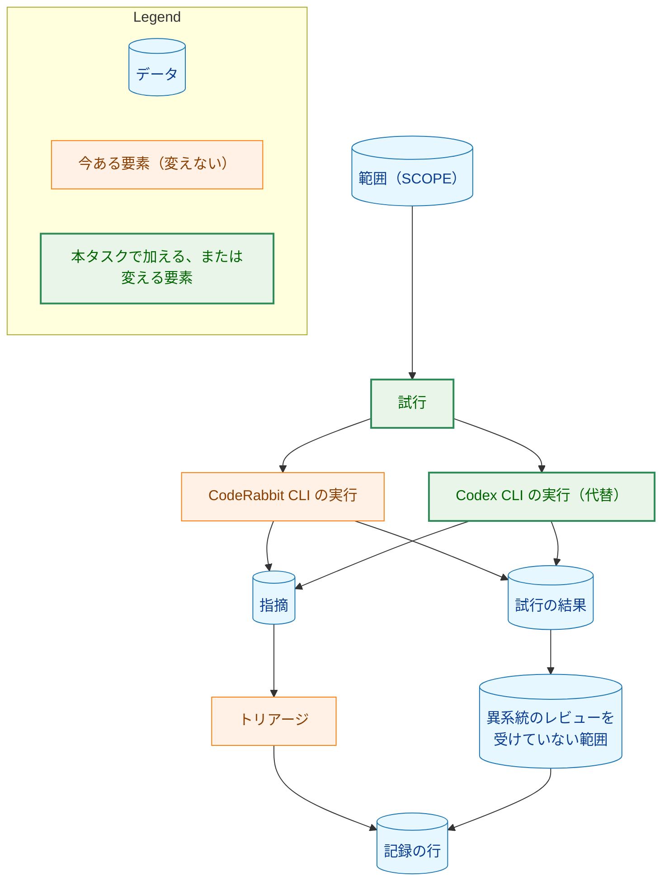
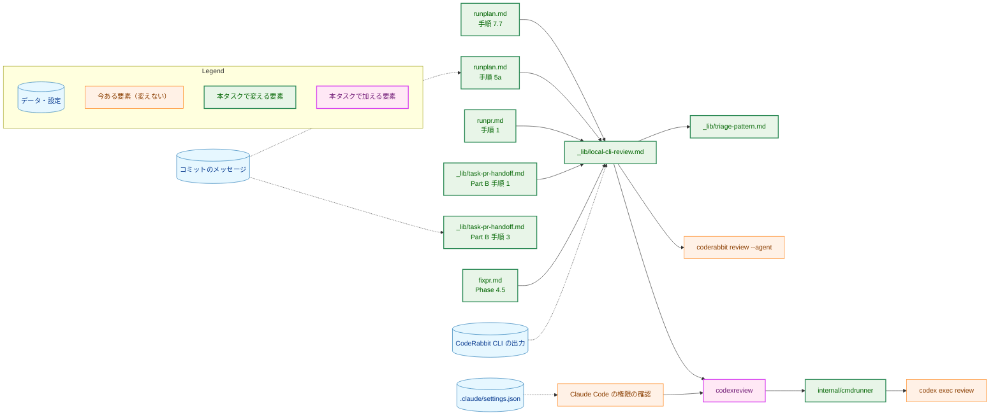
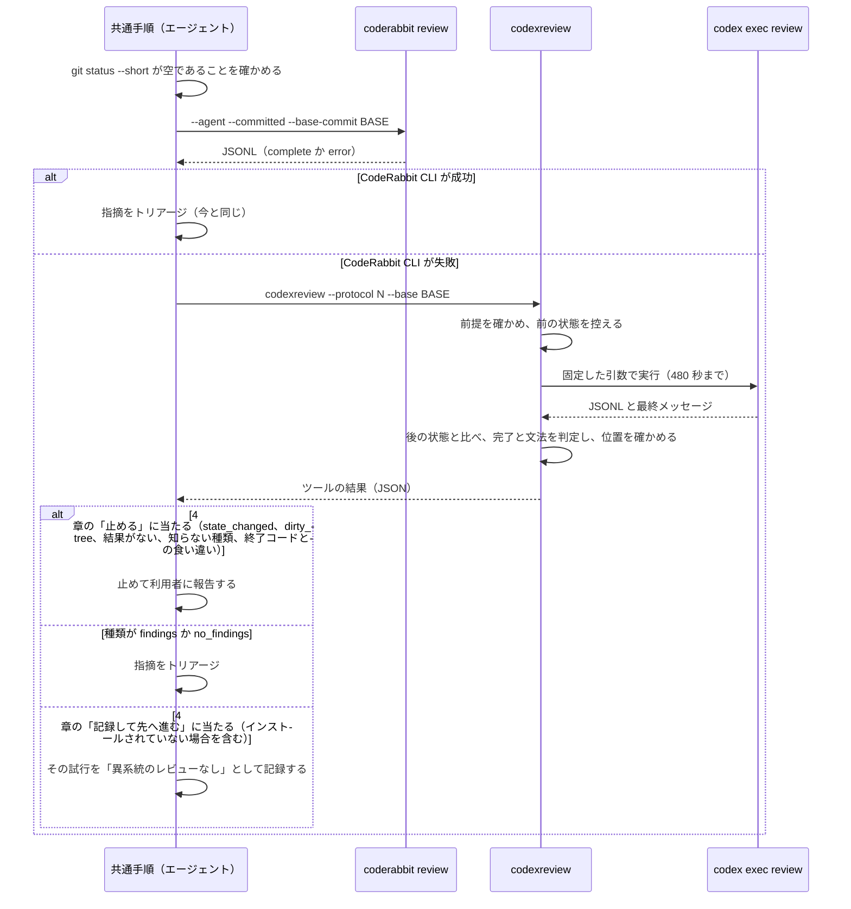
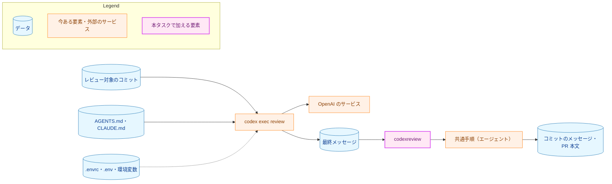
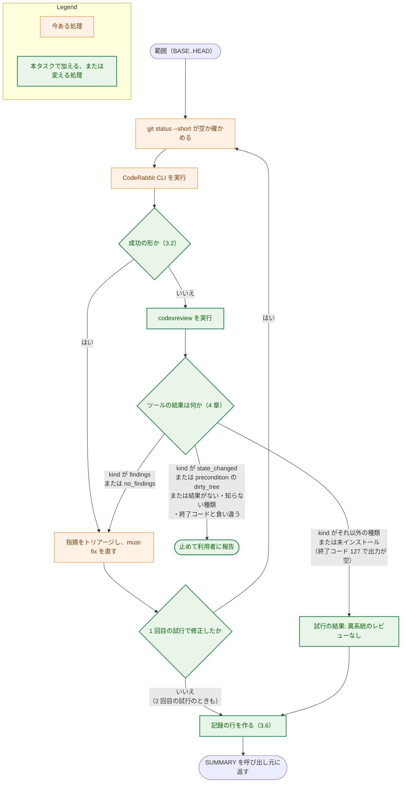

# アーキテクチャ設計書：CodeRabbit CLI が失敗したときに Codex CLI でローカルの CLI レビューを行う

## Document Status

| Item | Value |
|---|---|
| Status | `approved` |
| Created | 2026-10-28 |
| Review date | 2026-10-28 |
| Reviewer | isseis |
| Comments | 2026-10-29（実装計画の作成の際の編集上の訂正。決定の変更はない）: 3.3 が実装計画に委ねた共有の場所を、実装計画（`03_implementation_plan.md` の 1.2）が `internal/cmdrunner` に決めた。それに伴う `fixprguard` の参照の付け替えと、`cmd/fixprguard/docs_test.go` の `TestDocumentedProtocolMatches` の変更を 2.2 の表と 7.1 の改めるテストに加え、「変えないもの」の `fixprguard` の項目と 3.3 の該当の文をそれに合わせた。8 章の 1 に共有の移動を加え、7 に、3.9 の項目のうちテストや方針の上で前の項目で書くもの（`package_reference.md` の行、`CLAUDE.md` の 2 つの例外と Commands の節と `doc-guard` の列挙）を書き添えた。どの項目を書くかは変えていない。2026-10-29（決定の変更。isseis がこのセッションで承認した）: Codex のシェルに環境変数を引き継がせない対策を採ることにした。環境変数を引き継ぐと、Codex が実行するどのコマンドも秘密の値を持ち、`env` の実行や環境を含むエラーの出力から、ファイルを読まなくても暗黙のうちに OpenAI に送られうる。`.envrc` を読む経路とは別の経路であり、「採っても残るリスクは変わらない」という設計書 1.2 の判断は誤りだった（PR #573 の CodeRabbit の指摘と利用者の指摘による）。1.2、3.3、5.1、5.2、9 章、付録 A を改めた。状態は `approved` のままとする。2026-10-30（実装の際の編集上の訂正。決定の変更はない）: 1.2 の確かめの後に加わった `cmd/yt2column/fixpr_docs_test.go` の `TestReadmeSyncStepPlacement` が、共通手順を今のファイル名で探していた。2.2 の表の共通手順の行の「改めるテスト」に加えた |

本書は [01_requirements.md](01_requirements.md)（要件定義書。以下、要件書）の設計である。要件書の 1 節の決定の 1 つ、AC-09、4.2 の「センチネルエラー」、4.3 は、本書を書く際に改めた（要件書の Comments、本書の 1.2）。本書は改めた後の要件書に従う。既存のファイルに関する記述は、コミット `c76eec2` のファイルで確かめた。`file:line` はこのコミットの行番号を指す。F-NNN・AC-NN は要件書の項番を、H-NN は [design_handoff.md](design_handoff.md) の項番を指す。`codex` CLI と CodeRabbit CLI の振る舞いに関する記述は、[observations.md](observations.md)（観測の記録）の項目番号と実行の番号（R1〜R5、O1・O2）で根拠を示す。申し送りへの対応は付録 A に、受け入れ基準との対応は付録 B にまとめる。

本書は次の用語を、要件書 6 節と同じ意味で使う: ローカルの CLI レビュー、試行、代替、異系統のレビュー、異系統のレビューを受けていない範囲、範囲（SCOPE）、フェーズ群、PR レビュー、割り当て、指摘。ほかに次の用語を使う。

-   **共通手順:** ローカルの CLI レビューの手順を 1 か所に定めたコマンドの文書。今は `.claude/commands/_lib/coderabbit-local-review.md` であり、本タスクで `.claude/commands/_lib/local-cli-review.md` に名前を変える（3.1）。
-   **呼び出し元:** 共通手順を呼ぶ 5 か所。`/runplan` の手順 7.7 と手順 5a、`/runpr` の手順 1、`_lib/task-pr-handoff.md` の Part B 手順 1、`/fixpr` の Phase 4.5 である（要件書 1 節）。
-   **`codexreview`:** 本タスクで加える Go の開発用ツール（`cmd/codexreview`、`internal/codexreview`）。`codex` を固定した引数で 1 回だけ実行し、前後の状態を比べ、出力が受け入れる形かを判定して、結果を JSON で返す（3.3・3.4）。`fixprguard` と同じく `main` から `make install-codexreview` でインストールして使う。共通手順は `codex` をこのツールを通してだけ実行する。
-   **ツールの結果:** `codexreview` が標準出力に書く 1 つの JSON のオブジェクト。結果の種類（以下、種類）と、指摘の一覧などを持つ（3.3）。
-   **最終メッセージ:** `codex exec review` が `-o` のファイルに書く、Codex の最終的なレビュー結果の文面（観測の記録の 5、O1・O2）。
-   **試行の結果:** 1 つの試行が、どの CLI のレビューで終わったか。「CodeRabbit CLI のレビュー」「Codex CLI のレビュー（代替）」「異系統のレビューなし」のどれかである（3.6）。「異系統のレビューなし」は、要件書の「異系統のレビューを受けなかった試行」（AC-09・AC-11）と同じものを指す。
-   **記録の行:** コミットのメッセージと SUMMARY に残す、ローカルの CLI レビューの記録の行。`CodeRabbit local review:`、`Codex local review:`、`Local CLI review: not run` の 3 種がある（3.6）。

## 1. 設計の全体像 (Design Overview)

### 1.1. 設計原則

-   **代替は共通手順の中に 1 か所だけ置く（AC-10、要件書 4.5）。** 呼び出し元は今と同じ入力（BASE: 範囲の始まりのコミット、SCOPE: 範囲の呼び名、SUMMARY: 結果を報告する先）で共通手順を呼ぶ。代替を行うかどうかの判断も、Codex CLI の実行とトリアージも、共通手順の中で閉じる。呼び出し元が変わるのは、共通手順が返す試行の結果と記録の行を扱う部分だけである（3.7）。
-   **決定的に判定できることは、テストのあるコードで判定する。** Codex CLI の実行、前後の状態の比較、完了の判定、最終メッセージの文法の判定、指摘の位置の確かめは、`codexreview` が行う。エージェントが行うのは、CodeRabbit CLI の成否の読み取り（宣言された 1 行を見るだけ。3.2）と、指摘のトリアージ（判断）だけである。
-   **成否は、CLI が自分で示した値で判定する。** CodeRabbit CLI は `--agent` の出力の `complete` の行で（3.2）、Codex CLI は `--json` の出力の `turn.completed` の行で（3.3）、完了を判定する。
-   **疑わしいときは、レビュー済みの方向に倒さない。** 成功の形に当たらない CodeRabbit CLI の出力は失敗として代替に進む。完了の印がない、または受け入れる形に当たらない Codex CLI の出力は失敗として、その試行を「異系統のレビューなし」と記録する（AC-09、要件書 4.2）。ツールの結果が得られないとき、または知らない種類のときは、作業ツリーが変わったかどうかが分からないので、止める（4 章）。ただし、完了したと CLI が示した後の最終メッセージが 1 段落の文だけの場合は、「指摘なし」の形に当たってしまう。本当の「指摘なし」とは、文の意味を見ないと区別できない（5.2）。
-   **安全のための条件は、レビュー対象のブランチが変えられない場所で守る。** 承認なしの許可を出すのは、`main` からインストールしたツールだけである。作業ツリーの中のファイルではないので、レビュー対象のブランチのコミットで中身が変わることはない。インストールは利用者が行い、コマンドの文書は `make install-codexreview` を実行しない（3.8、5.2）。
-   **Codex CLI の出力は、信頼できないデータとして扱う。** 使うのは各指摘の位置と内容だけで、位置はツールとエージェントの両方で確かめる。指摘の文面にある指示は実行せず、原文はどこにも写さない（AC-06・AC-12、要件書 4.2）。

### 1.2. 設計の際に決めたこと（2026-10-28）

利用者に確かめて決めたこと:

-   **設計に進む（AC-02）。** 観測の記録では、AC-01 の 2（コミットの範囲）が `--base` だけでは成り立たなかった（観測の記録の「AC-02 の判定」）。利用者はこの結果（PR #555）を受けて設計に進むことを選び、本書の作成の際に、範囲を実現する方法を次の項目のとおり選んだ。
-   **範囲は、作業ツリーが clean であることを前提にして、本物の作業ツリーで `--base <BASE>` を使って実現する（H-01）。** `codex exec review --base <BASE>` は、Codex に `git diff <BASE>` で変更を見させる。この形は作業ツリーと BASE の差分を出す（観測の記録の 2、R1）。作業ツリーに変更がなく、追跡していないファイル（git-ignore されていないもの）もなければ、この差分は BASE から HEAD までのコミット済みの変更と同じになる。git-ignore されているファイルは `git diff` に含まれない（R1 の `untracked.go` と同じ理由）。共通手順の手順 1 は、もともと `git status --short` が空であることを前提にしている（`.claude/commands/_lib/coderabbit-local-review.md:34-35`）。`codexreview` は、Codex を実行する直前にも同じことを確かめ、成り立たなければ実行しない（3.3）。一時 worktree を作る方法（R2 で確かめた）は採らない。後片付けと、指摘のパスの読み替えが要るうえ、Codex は作業ディレクトリの外も読めるので（観測の記録の 7。R2 は `find ..` で親を探した）、秘密のファイルから遠ざけるという利点も薄いためである。
-   **`codex` は、`main` からインストールする Go のツール `codexreview` を通してだけ実行し、Claude Code の権限ではこのツールだけを許す（H-02・H-03）。** `Bash(codex review *)` のような前方一致の許可では、後ろに `--dangerously-bypass-approvals-and-sandbox` や `-c 'sandbox_mode="danger-full-access"'` を付けた実行まで許してしまう。作業ツリーの中にシェルスクリプトを置いて許す方法では、レビュー対象のブランチのコミットでスクリプトを書き換えれば、承認なしの実行の中身が変わる。`fixprguard` も、エージェントが手順を読んで行う判断を決定的なコードに移したツールで、`main` から `make install-fixprguard` でインストールして使う（`docs/dev/guides/fixprguard_guide.md` の冒頭と 3）。`codexreview` はこれにならう。Go のツールにすれば、時間切れのときにプロセスグループごと止めること、上限をテストのときだけ差し替えられ、外からは差し替えられない形にすること、結果を構造化して返すことも、テストのあるコードで行える。
-   **最終メッセージが受け入れる形かは、`codexreview` が判定する（H-05）。** 判定は文法だけで決まる機械的なものなので、エージェントではなくテストのあるコードで行う。これに合わせて、要件書 4.2 の「センチネルエラー」の「判定はコマンドの文書で行い、Go のコードを持たない」を改めた。あわせて、Codex CLI の実行の結果を確かめられないとき（結果がない、種類が分からない、実行の直前に作業ツリーが変わっていた）も、AC-08 に当たるおそれがあるとして止めることにし、要件書の 1 節の決定、AC-09、4.3 を改めた（4 章）。要件書は `draft` に戻り、本書と同じ PR で再び承認を受ける。
-   **Codex CLI の完了は、`codex exec review --json` の `turn.completed` の行で判定し、文面は `-o` のファイル（最終メッセージ）から読む（H-05）。** 素の `codex review` の標準出力には、完了を示す欄がない。`--json` と `-o` の組み合わせは R1・R3・O1・O2 で確かめた。セッションの記録（`~/.codex/sessions/.../rollout-*.jsonl`）にある構造化された `review_output` は使わない。公開された仕様ではなく、実行ごとに 2 つできるファイルから、`thread_id` を手がかりに 1 つを選ぶ手順が要るためである（観測の記録の 5、「構造化された結果」）。
-   **利用者の設定、規則のファイル、プラグインやコネクタの機能を外して実行する（H-02）。** 利用者の `~/.codex/config.toml` では、GitHub のプラグインが有効である。プラグインやコネクタのツールはシェルのコマンドではないので、`sandbox_mode="read-only"` の制限を受けない可能性がある。そのうえ `approval_policy="never"` なので、レビュー対象の文面に誘導された Codex が GitHub に書き込むおそれがある。また、利用者の設定の profile が `-c` の指定より優先されるかも確かめていない。そこで設計の前に O1・O2 を観測した（観測の記録の「設計の際の追加の観測」）。`--ignore-user-config` で利用者の設定ファイルを読まずに実行できた。`--disable` で機能を外すと、アカウントの側から入るプラグインのスキルも指示から消えた（O2）。この 2 つと `--ignore-rules` を、`codexreview` が固定する引数に入れる（3.3）。モデルが使えるツールの一覧は記録に残らないので、コネクタのツールが使えなくなったことは直接には確かめられていない（5.2）。
-   **記録の行は、CLI ごとに接頭辞を分ける（H-06）。** CodeRabbit CLI の指摘は今と同じ `CodeRabbit local review:`、Codex CLI の指摘は `Codex local review:`、異系統のレビューを受けていない範囲は `Local CLI review: not run <BASE>..<HEAD> (<失敗の種類>)` とする。前のセッションが残した `CodeRabbit local review: not run` も、引き続き読む（3.6、要件書 4.4）。
-   **共通手順のファイル名を `.claude/commands/_lib/local-cli-review.md` に変える（H-07）。** 本タスクの後、この手順は CodeRabbit CLI だけを扱うものではなくなるためである。参照を直すのは、コマンドの文書の 6 つ（`runplan.md`・`runpr.md`・`fixpr.md`・`_lib/task-pr-handoff.md`・`_lib/triage-pattern.md`・`_lib/pr-review-escalation.md`）である。2026-10-28 に、`git grep -l coderabbit-local-review -- ':!docs/tasks'` で確かめた。今のファイル名を参照するテストはない（同じ日に `git grep` で確かめた）。`docs/tasks/` の下の過去のタスクの文書にある参照は、当時の記録なので直さない。

設計で決めたこと:

-   **CodeRabbit CLI の成否は、`--agent` の出力の `complete` の行で判定する（H-04）。** 過去のセッションの出力 40 件では、成功した 35 件が `complete`／`review_completed` の行で、失敗した 5 件（どれも利用の上限）が `error`／`rate_limit` の行で終わっていた。終了コードは記録されていない（観測の記録の「CodeRabbit CLI の出力」）。そこで、終了コードが 0 で、成功の行がちょうど 1 つあり、`error` の行がないときだけを成功とする（3.2）。CLI が自分で示した欄で判定するので、文面を推し量る必要はない。この判定は 1 行を見るだけであり、今もエージェントが CodeRabbit CLI の出力を読んでいるので、共通手順に置く。
-   **Codex にはレビューの指示（PROMPT）もプロジェクトの規則の指定も渡さない（H-05）。** Codex は、指示しなくても `AGENTS.md` と `CLAUDE.md` を読み、`AGENTS.md` の内容をレビューの指示に入れていた（観測の記録の 7）。`AGENTS.md` は `CLAUDE.md` を参照しており、レビューの規則も挙げている。CodeRabbit CLI の `-c CLAUDE.md` が担う役割は、これで足りる。`--ignore-rules` を付けた O2 でも、`AGENTS.md` の段落は指示に入っていた。`--ignore-rules` が外すのは execpolicy の `.rules` ファイルである（観測の記録の「設計の際の追加の観測」）。`--base` と PROMPT を同時に使えるかは確かめていない（観測の記録の「AC-02 の判定」）。
-   **モデルと推論の強さは指定しない。** `--ignore-user-config` を付けると、利用者の設定の推論の強さ（`medium`）は使われず、`null`（既定）になった。モデルは同じだった（O1）。モデルの名前をツールに書くと、名前が変わるたびにツールを直すことになる。代替は CodeRabbit CLI が失敗したときだけ動くので、既定の推論の強さで足りるとした。
-   **時間の上限は 480 秒とする（AC-09 の 3）。** 観測では 15〜36 秒で終わったが、どの差分も数十行だった（観測の記録の 8）。大きな差分の例として、0031 で観測した Codex の PR レビューは、完了まで最長 3 分 14 秒だった（`docs/tasks/0031_codex_pr_review/02_architecture.md` の 1.2、「待つ時間」）。480 秒はその約 2.5 倍である。エージェントの Bash ツールは、既定では 120 秒で、最大でも 600 秒でコマンドを打ち切る。共通手順は `codexreview` をフォアグラウンドで、時間の上限を 600 秒に指定して実行する。こうすれば、Bash ツールより先に `codexreview` が `codex` を打ち切り、結果を返せる（3.1）。
-   **大きさの上限は、最終メッセージで 64 KiB、`--json` の出力で 16 MiB とする（AC-09 の 5）。** 観測した最終メッセージは最大 1,079 バイト、`--json` の出力は最大約 127 KB だった（観測の記録の 5）。`--json` の出力の大きさのほとんどは、Codex が読んだファイルの中身である。どちらの上限も、観測の数十倍以上の余裕がある。
-   **作業ツリーのルートに `.codex/` があるときは、Codex を実行しない。** プロジェクトの `.codex/` の設定を `codex` が読むか、`--ignore-user-config` がそれも外すかは観測していない。レビュー対象のブランチが `.codex/` を加えれば、設定を変えられるおそれがある。今のリポジトリには `.codex/` がないので、この確かめで代替が動かなくなることはない。
-   **Codex に渡す環境は、決めた名前の変数だけにする。あわせて、Codex のシェルに環境変数を引き継がない設定（H-08）も固定する（2026-10-29 に改めた）。** 環境変数を引き継ぐと、Codex が実行するどのコマンドも秘密の値を持ち、`env` の実行や環境を含むエラーの出力から、ファイルを読まなくても暗黙のうちに OpenAI に送られうる。これは `.envrc` のファイルを読む経路とは別の経路であり、塞げばリスクは小さくなる。主な守りは、`codexreview` が `codex` に渡す環境を絞ることである。`codex` の設定に頼らず、ツール自身のコードとテストで守れる。`-c 'shell_environment_policy.inherit="core"'` は多重の防御で、効くかどうかは実装計画のステップ 8-2 で確かめる。`.envrc` のファイルを読む経路は残る（5.2）。
-   **`--ephemeral` は付けない。** 観測していない。セッションの記録は、利用者が普段 `codex` を使うときにも残るものであり、本タスクで新たに増えるリスクではない。

### 1.3. なぜ今の仕組みのままでは足りないか

今の共通手順は、CodeRabbit CLI が失敗すると、残りを飛ばして失敗を SUMMARY に記録するだけである（`.claude/commands/_lib/coderabbit-local-review.md:42-44`）。利用の上限は実際に起きている（観測の記録の「CodeRabbit CLI の出力」で 40 件のうち 5 件）。`/runplan` の手順 5a の再レビューも CodeRabbit CLI なので（`.claude/commands/runplan.md:84-90`）、CodeRabbit CLI の割り当てが尽きている間は、異系統のレビューを受けないまま PR に進む。CodeRabbit CLI を再試行する方法では、利用の上限が 1 分から 32 分続いており（同じ 5 件の `waitTime`）、無人の実行が止まる。別の CLI で代替するほかに、要件書の目的（2.1）を満たす方法はない。

### 1.4. 他の文書の方針との関係

-   **`CLAUDE.md`「Tool Execution Safety」（`CLAUDE.md:532-542`）。** 今は、ネットワークに触れる外部のツールのうち、`coderabbit review` だけを承認なしに実行してよいとしている（`CLAUDE.md:540-542`）。本書は、`codexreview` を同じ扱いに加える（AC-16、3.8）。これは要件書が決めた変更である。この記述を読むテストはない（2026-10-28 に `git grep -n 'Tool Execution' -- '*_test.go'` で確かめた）。
-   **`CLAUDE.md`「Declare, don't infer」の例外。** この規則は、呼び出し元から渡された文字列の中身を調べて処理を選ぶコードを禁じている。`codexreview` は、最終メッセージの中身を調べて、「指摘あり」「指摘なし」「読み取れない」を選ぶ（3.4）。これはこの規則の例外であり、`CLAUDE.md` の例外の一覧に、既存の例外（コピーした字幕の解析、拡張機能の言語の解決、Native Messaging のメッセージの形）と同じ形で加える（3.9）。
    -   **範囲:** `internal/codexreview` の最終メッセージの解析だけ。要約の段落、見出しの行、指摘の行の形を見て、指摘の境界と種類を決める。JSONL の解析は、`type` という宣言された欄で分けるので、例外に含まない。
    -   **理由:** 最終メッセージは `codex` が書く外部の値であり、型で表せない。完了と指摘の数を示す構造化された欄は、公開された出力にはない（1.2）。
    -   **境界:** どちらの形にも当たらない文面は、補って読まず、「読み取れない」とする（「Reject, don't normalize」）。
    -   **古い振る舞いを確かめるテスト:** ない。新しいパッケージだからである。
-   **`CLAUDE.md`「Testing Strategy」の文書のテストの例外。** 文書のテストは値と構造だけを確かめ、文章を確かめない。例外として、エージェントが信頼の境界で実行するコマンド（`fixprguard` の呼び出し、それを迂回するコマンドなど）は確かめてよい。本書は、`codexreview` の呼び出しの `--protocol` の値と、`codex` を直接実行する形がないことを確かめるテストを加える（7.1）。これは、同じ理由（間違いがあると実行時にガードが外れる）による同じ種類のテストである。`CLAUDE.md` の例外の一覧に `codexreview` を加える（3.9）。この例外に含めるのは、`--protocol` の値と、`codex` を直接実行する形がないことの 2 つだけである。`.claude/settings.json` の許可と `Makefile` のターゲットの確かめは、値を比べる普通の文書のテストなので、例外に含めない。
-   **0031 の設計書の「ローカルの CLI レビューは変えない」。** 0031 は PR レビューを Codex の GitHub 連携に切り替えたタスクで、ローカルの CLI レビューには触れなかった（`docs/tasks/0031_codex_pr_review/02_architecture.md` の 2.2）。本タスクは、その後の別のタスクとしてローカルの CLI レビューを変える。0031 の方針の例外ではない。ただし、0031 の際に書かれた「ローカルの CLI レビューの割り当ては PR レビューと別である」という記述は、代替の Codex CLI には当てはまらない（観測の記録の 1）。要件書 AC-18 のとおり、これを改める（3.9）。この記述を読むテストは `cmd/yt2column/codex_review_docs_test.go:351-356`（`TestCodeRabbitConfigStopsReview`）であり、`.coderabbit.yaml` の注釈の文 ``The local CLI review (`coderabbit review`) is still used`` が含まれることを確かめている。注釈を改めるので、このテストの文も改める（7.1）。
-   **`_lib/pr-review-escalation.md` の基準。** 2 回目以降の PR レビューを依頼する基準は変えない（要件書 2.3）。この文書の、ローカルの CLI レビューの割り当てが別だと述べる文（`.claude/commands/_lib/pr-review-escalation.md:10-12`）だけを改める（3.9）。

### 1.5. 概念モデル

矢印 A → B は「A が B を持つ、または A から B が決まる」を表す。



-   1 つの範囲につき、試行は最大 2 回である（AC-07）。各試行は CodeRabbit CLI の実行 1 回と、それが失敗したときだけ行う Codex CLI の実行 1 回から成る。
-   試行の結果は、「CodeRabbit CLI のレビュー」「Codex CLI のレビュー（代替）」「異系統のレビューなし」のどれかである。最後のものになった試行があると、異系統のレビューを受けていない範囲ができる（3.6）。
-   指摘は、どちらの CLI のものでも同じトリアージを受ける（AC-05）。

## 2. システム構成 (System Structure)

### 2.1. 全体構成

矢印 A → B は「A が B を呼ぶ、実行する、または実行を許す」を表す。点線の矢印 A -.-> B は「B が A を読む」を表す。



-   `PERM --> TOOL` は、Claude Code の権限の確認が `.claude/settings.json` を読み、`codexreview` の実行を承認なしに許すことを表す（3.8）。
-   `codex` を直接実行する呼び出し元はない。共通手順だけが、`codexreview` を通して実行する。
-   共通手順の書き込み（記録の行をコミットのメッセージに残すこと）は、3.6 で定める。

### 2.2. コンポーネント配置

| ファイル | 変更 | 内容 | AC | 改めるテスト |
|---|---|---|---|---|
| `cmd/codexreview/` | 新規 | `codexreview` の入口。引数の検査、`--protocol` の照合、結果の JSON の出力 | AC-03・AC-09・AC-17 | — |
| `internal/codexreview/` | 新規 | 前提の確かめ、`codex` の実行、前後の比較、完了の判定、最終メッセージの解析、位置の確かめ（3.3・3.4） | AC-06・AC-08・AC-09 | — |
| `internal/cmdrunner/` | 変更 | 時間切れのときに、子のプロセスグループごと止めるオプションを加える。`internal/fixprguard` から `GitEnv` と git の設定の上書きを移す（3.3） | AC-09 | `internal/fixprguard/gitstate_test.go` の `TestGitEnvDropsInheritedGitVariables`（`internal/cmdrunner` に移す） |
| `internal/fixprguard/`・`cmd/fixprguard/main.go` | 変更 | `GitEnv` と git の設定の上書きの参照を `internal/cmdrunner` に付け替える。振る舞いは変えない | — | — |
| `cmd/fixprguard/docs_test.go` | 変更 | `--protocol` の照合から、`codexreview` の呼び出しを除く（7.1） | AC-17 | `TestDocumentedProtocolMatches` |
| `Makefile` | 変更 | `install-codexreview` を加える | AC-17 | — |
| `.claude/commands/_lib/coderabbit-local-review.md` → `_lib/local-cli-review.md` | 改名と変更 | 代替、CodeRabbit CLI の成否の判定、ツールの結果の扱い、トリアージ、回数、記録の行（3.1〜3.6） | AC-03〜AC-12・AC-18 | `cmd/yt2column/fixpr_docs_test.go` の `TestReadmeSyncStepPlacement`（Part B 手順 1 をファイル名で探す） |
| `.claude/commands/runplan.md` | 変更 | 手順 4.5・7.7・5a・8 の記述と参照（3.7・3.9） | AC-10・AC-11・AC-15・AC-18 | — |
| `.claude/commands/runpr.md` | 変更 | 手順 1 の参照と最終報告、承認の記述（3.7・3.8） | AC-10・AC-14・AC-16 | — |
| `.claude/commands/fixpr.md` | 変更 | Phase 4.5 の見出しと本文、Final report、承認の記述（3.7・3.8） | AC-10・AC-14・AC-16・AC-18 | — |
| `.claude/commands/_lib/task-pr-handoff.md` | 変更 | Part B 手順 1・3、承認の記述、参照（3.7・3.8） | AC-10・AC-13・AC-16 | — |
| `.claude/commands/_lib/triage-pattern.md` | 変更 | 呼び出し元の列挙と参照（3.9） | AC-18 | — |
| `.claude/commands/_lib/pr-review-escalation.md` | 変更 | 割り当てが別だと述べる文と参照（3.9） | AC-18 | — |
| `.claude/settings.json` | 変更 | `codexreview` の許可を加える（3.8） | AC-17 | — |
| `CLAUDE.md` | 変更 | 「Tool Execution Safety」、Claude Commands と Commands の節、「Declare, don't infer」と「Testing Strategy」の例外、Development Notes の `doc-guard` の対象の列挙（1.4・3.8・3.9） | AC-16・AC-18 | — |
| `.github/workflows/ci.yml` | 変更 | `doc-guard` の job の対象に `./cmd/codexreview` を加える（7.1） | AC-17 | — |
| `docs/dev/conventions/package_reference.md` | 変更 | `cmd/codexreview` と `internal/codexreview` を加える | — | — |
| `.coderabbit.yaml` | 変更 | 注釈（3.9） | AC-18 | `cmd/yt2column/codex_review_docs_test.go:351-356` `TestCodeRabbitConfigStopsReview` の文 |
| `cmd/codexreview/` と `internal/codexreview/` のテスト | 新規 | ツールの単体テスト、文書の呼び出しのガード（7.1） | AC-06・AC-08・AC-09・AC-17 | — |

変えないもの:

-   `coderabbit review` の呼び出し方（`--agent --committed --base-commit "<BASE>" -c CLAUDE.md`、`.claude/commands/_lib/coderabbit-local-review.md:37-38`）と、CodeRabbit CLI が成功したときのトリアージと記録（AC-04、要件書 4.4）。
-   PR レビュー（Codex の GitHub 連携）の依頼と判定、エスカレーションの基準（要件書 2.3）。
-   `/runplan` の手順 7 と 7.5 のサブエージェントのレビュー（要件書 2.3）。
-   `/runpr` の手順 1 の単独の変更の PR 本文（要件書 2.3）。
-   `fixprguard` と `mergepr` の振る舞い。`fixprguard` は、`GitEnv` と git の設定の上書きの参照を `internal/cmdrunner` に付け替えるだけである。`codexreview` は `internal/cmdrunner` を共有するだけで、これらに依存しない。

### 2.3. データフロー: 1 回のローカルの CLI レビュー

実線の矢印は呼び出しや実行を、点線の矢印は結果の返却を表す。



### 2.4. 既存の挙動の確認

コミット `c76eec2` で、次を確かめた。

-   共通手順は、実行の前に `git status --short` が空であることを確かめる（`.claude/commands/_lib/coderabbit-local-review.md:34-35`）。CodeRabbit CLI が失敗したときは、残りを飛ばして SUMMARY に記録する（同 `:42-44`）。回数は範囲ごとに最大 2 回で、2 回目は 1 回目で修正したときだけ行う（同 `:71-77`）。記録の行は `CodeRabbit local review:` で、修正のコミットか、なければブランチの次のコミットのメッセージに残す（同 `:79-87`）。
-   `/runplan` の手順 7.7 は、CodeRabbit CLI が失敗したとき、次のコミットのメッセージに `CodeRabbit local review: not run` を残す（`.claude/commands/runplan.md:212`）。手順 5a は、`git log origin/main..HEAD` にこの行があれば、ブランチ全体を改めてレビューする（同 `:84-90`）。手順 8 の、PR の区切りのない計画で PR を開く経路も、「手順 5a と同じく」Part B を使う（同 `:217`）。
-   `_lib/task-pr-handoff.md` の Part B 手順 3 は、このセッションと、前のセッションがコミットのメッセージに残した `CodeRabbit local review:` の行から、`unclear` と `deferred` の指摘を PR 本文に載せる（`.claude/commands/_lib/task-pr-handoff.md:199-204`）。
-   `/runpr` の手順 1 は、単独の変更のとき、checkout しているブランチを共通手順でレビューし、SUMMARY を最終報告とする（`.claude/commands/runpr.md:115-119`）。
-   `/fixpr` の Phase 4.5 は、修正のコミットの親を BASE として共通手順を呼び、SUMMARY を Final report とする（`.claude/commands/fixpr.md:581-590`）。
-   Claude Code の権限の設定が許しているのは `Bash(coderabbit review *)` だけである（`.claude/settings.json:4`）。
-   `internal/cmdrunner` は、`exec.CommandContext` で直接の子プロセスだけを止める。子のプロセスグループは止めない（`internal/cmdrunner/runner.go:89-93`）。

## 3. コンポーネント設計 (Component Design)

### 3.1. 共通手順 `_lib/local-cli-review.md`（H-07・AC-07・AC-10）

ファイル名を変え、次を受け持つ。入力（BASE、SCOPE、SUMMARY）は今と同じである。

| 受け持つこと | 節 |
|---|---|
| 各試行で、CodeRabbit CLI を先に実行し、その成否を判定する | 3.2 |
| CodeRabbit CLI が失敗したときだけ、`codexreview` を実行し、ツールの結果の種類に応じて扱う | 3.3、4 章 |
| どちらの CLI の指摘も、同じ規則でトリアージする。回数を数える | 3.5 |
| 試行の結果と記録の行を作り、SUMMARY とコミットのメッセージに残す | 3.6 |

**`codexreview` の実行の仕方:** 共通手順は、作業ツリーのルートで `codexreview --protocol <N> --base <BASE>` を実行する。`<N>` はツールの `Protocol` の値、`<BASE>` は `git rev-parse` で得た 40 桁の SHA である。Bash ツールの時間の上限を 600 秒に指定し、フォアグラウンドで実行する。バックグラウンドでは実行しない。バックグラウンドで実行すると、Codex が作業ツリーを読んでいる間に、エージェントが作業ツリーを変えうるためである。

共通手順が呼び出し元に返すもの（SUMMARY に書くもの）は、次のとおりである。

-   試行ごとの結果と、失敗した CLI ごとの失敗の種類（AC-11）。
-   この範囲で Codex CLI を実行した回数。割り当てが PR レビューと共有なので、PR レビューが始まらないときに原因を追えるようにする。
-   異系統のレビューを受けていない範囲があれば、その範囲（3.6）。
-   今と同じ、修正・却下・`deferred`・`unclear` の指摘。どちらの CLI の指摘かを付ける（AC-12 の 1）。
-   ツールの結果が、範囲で指示ファイル（`AGENTS.md`・`AGENTS.override.md`・`CLAUDE.md`）が変わったことを示すとき、そのこと（3.3、5.2）。

回数の数え方は今と変えない。1 回目のレビュー（どちらの CLI でも）で修正したときだけ 2 回目を行い、2 回目も CodeRabbit CLI から試す（AC-07）。1 回目が「異系統のレビューなし」なら、修正がないので 2 回目は行わない。

### 3.2. CodeRabbit CLI の成否の判定（H-04・AC-03・AC-04）

`coderabbit review --agent` の出力は、案内の行の後に、1 行に 1 つの JSON のオブジェクトが続く形である（観測の記録の「CodeRabbit CLI の出力」）。共通手順は、出力を今と同じくスクラッチパッドのファイルに保存し、次のときだけを成功とする。

-   終了コードが 0 である。
-   `type` が `complete` で `status` が `review_completed` の行が、ちょうど 1 つある。
-   `type` が `error` の行がない。

これ以外（コマンドが見つからない、終了コードが 0 でない、成功の行がない、成功の行が 2 つ以上ある、`error` の行がある）は、すべて失敗とし、同じ試行の中で代替に進む（AC-03）。失敗の種類は、`error` の行の `errorType` の値（観測した値は `rate_limit`）で示し、その行がなければ終了コードで示す（AC-11）。記録の行に入れるときの形は 3.6 で定める。この値は報告にだけ使い、振る舞いを選ぶのには使わない。どの失敗でも振る舞いは同じだからである。

成功したときは、指摘が 0 件でも Codex CLI を実行しない（AC-04）。`complete` の行に `reused: true` が付く場合（前回の確認点を使い、新たにレビューしなかったと CodeRabbit CLI が示すもの）も、今と同じく成功とする。この扱いは本タスクで変えない。

### 3.3. `codexreview`（H-01・H-02・H-03・AC-08・AC-09）

**呼び出しの形:**

```text
codexreview --protocol <N> --base <BASE>
```

-   `--protocol`: 文書とインストールしたツールの版が合っていることを確かめる番号。`fixprguard` の `--protocol` と同じ役割である（`docs/dev/guides/fixprguard_guide.md` の 3）。合わなければ実行しない。
-   `--base`: 範囲の始まりのコミット。40 桁の 16 進数でなければならない。
-   ほかの引数、フラグ、位置引数は受け付けない。出力先や時間の上限を変える引数もない。

**ツールの結果の型:** 標準出力に、次の形の JSON のオブジェクトを 1 つ書く。

```go
// Kind is the result of one codexreview run. The zero value is not a valid kind.
type Kind string

const (
	KindFindings       Kind = "findings"         // the review completed and reported one or more findings
	KindNoFindings     Kind = "no_findings"      // the review completed and reported none
	KindStateChanged   Kind = "state_changed"    // the compared git state differs after the run; the caller stops
	KindUsage          Kind = "usage"            // the arguments are malformed or the protocol does not match
	KindPrecondition   Kind = "precondition"     // the repository is not in a state to run the review
	KindCodexNotFound  Kind = "codex_not_found"  // codex is not on PATH
	KindTimeout        Kind = "timeout"          // codex did not finish within the limit and was stopped
	KindCodexFailed    Kind = "codex_failed"     // codex exited unsuccessfully
	KindIncomplete     Kind = "incomplete"       // codex exited successfully without declaring a completed turn
	KindOutputTooLarge Kind = "output_too_large" // an output exceeded its size limit
	KindOutputEmpty    Kind = "output_empty"     // the final message is empty
	KindUnreadable     Kind = "unreadable"       // the final message matches neither accepted form
)

// Result is the JSON object codexreview writes to standard output.
type Result struct {
	Protocol            int       `json:"protocol"`
	Kind                Kind      `json:"kind"`
	Detail              string    `json:"detail"`               // a fixed token naming the cause within Kind, never codex's text
	Changed             []string  `json:"changed"`              // for KindStateChanged: which compared items differ
	ChangedRefs         []string  `json:"changed_refs"`         // for KindStateChanged: refs that differ, with the worktree each is checked out in
	CodexVersion        string    `json:"codex_version"`
	RunDir              string    `json:"run_dir"`              // where the final message is kept
	InstructionsChanged bool      `json:"instructions_changed"` // BASE..HEAD touches a file named AGENTS.md, AGENTS.override.md or CLAUDE.md
	Findings            []Finding `json:"findings"`             // for KindFindings only
}

// Finding is one finding parsed from the final message. Title and Body are
// codex's text: untrusted data, never to be copied into a record.
type Finding struct {
	Path    string `json:"path"` // relative to the worktree root
	Start   int    `json:"start"`
	End     int    `json:"end"`
	InRange bool   `json:"in_range"` // the file changed in BASE..HEAD and the lines exist
	Title   string `json:"title"`
	Body    string `json:"body"`
}
```

終了コードは、種類が `findings` か `no_findings` のとき 0、`state_changed` のとき専用の値、それ以外の種類のとき別の 1 つの値とする。具体的な数値は実装計画で決めるが、シェルが使う値（126、127）と重ねない。共通手順は種類の値で振る舞いを選び、終了コードと種類が食い違うときは、結果がないときと同じく止める（4 章）。結果はレビューした HEAD を持たない。共通手順が `codexreview` を実行する直前に `git rev-parse HEAD` で控え、記録の行（3.6）に使う。

**実行の前の確かめ:** 次のどれかが成り立たなければ、`codex` を実行せずに結果を返す。

| 確かめ | 当たらないときの種類と `Detail` |
|---|---|
| 引数の形、`--protocol` の値 | `usage`（`bad_arguments`・`protocol_mismatch`） |
| 作業ディレクトリが worktree のルートである | `precondition`（`not_worktree_root`） |
| `<BASE>` が HEAD の祖先である（`--base` は BASE と HEAD のマージベースとの差分を見るので、祖先でなければ範囲が食い違う） | `precondition`（`base_not_ancestor`） |
| `git status --short` が空である（1.2） | `precondition`（`dirty_tree`） |
| ルートに `.codex/` がない（1.2） | `precondition`（`project_codex_config`） |
| `codex` が `PATH` にある | `codex_not_found` |

**固定する `codex` の実行:**

```text
codex exec review --base <BASE>
  --ignore-user-config --ignore-rules
  --disable apps --disable plugins --disable remote_plugin --disable hooks
  --disable browser_use --disable computer_use --disable image_generation
  --disable multi_agent --disable tool_suggest --disable skill_mcp_dependency_install
  -c 'sandbox_mode="read-only"' -c 'approval_policy="never"'
  -c 'shell_environment_policy.inherit="core"'
  --json -o <RUN_DIR>/last-message.txt
```

-   この形は O2 で観測した。`sandbox_mode="read-only"` は書き込みを止め（観測の記録の 3）、`approval_policy="never"` は承認を求めて止まらないようにする（観測の記録の 4）。`--ignore-user-config` で、利用者の設定ファイルの profile、プラグイン、MCP のサーバの設定を読まない。`--disable` で、アカウントの側から入るプラグインとコネクタの機能を外す（O2）。
-   標準入力は空にする。標準出力（JSONL）はメモリに読み込み、上限は 16 MiB である。`--json` のときの標準エラーは空だった（O1・O2）。標準エラーもメモリに読み込み、上限を超えれば `output_too_large` とする。
-   `codex` に渡す環境変数は、決めた名前のものだけにする。`codex` がプログラムとログインの情報を見つけ、一時ファイルを書き、文字を読み、プロキシを通って OpenAI に届くための変数（`PATH`・`HOME`・`CODEX_HOME`・`TMPDIR`・ロケール・`XDG_*`・プロキシ・証明書の変数など）である。これに `GIT_OPTIONAL_LOCKS=0` と `GIT_TERMINAL_PROMPT=0` を加える。秘密の値（API キー、Webhook の URL）と、継承した `GIT_DIR` などは渡らない（1.2）。`-c 'shell_environment_policy.inherit="core"'` は、`codex` がシェルのコマンドに渡す環境をさらに絞る（多重の防御）。`codexreview` 自身の git の実行は、`fixprguard.GitEnv`（`internal/fixprguard/gitstate.go:96-110`）と同じ環境（`GIT_` で始まる変数を除き、`GIT_OPTIONAL_LOCKS=0` と `GIT_TERMINAL_PROMPT=0` を加える）と、`fixprguard` と同じ git の設定の上書き（`gitHardening`、`internal/fixprguard/gitstate.go:85-94`）の下で行う。これらを共有する場所は、実装計画で `internal/cmdrunner` に決めた。
-   時間の上限は 480 秒である（1.2）。`codex` を自分のプロセスグループで起動し、上限に達したら、グループごと止める（まず終了を求め、少し待っても残れば強制的に止める）。`codex` が実行中のシェルのコマンドも止めるためである。時間切れかどうかは、ツール自身の時計で判定し、終了コードからは推し量らない。`internal/cmdrunner` に、プロセスグループごと止めるオプションを加えて使う。
-   `codexreview` 自身が終了のシグナル（利用者の中断、Bash ツールの打ち切りなど）を受けたときも、`codex` のプロセスグループを同じように止めてから終わる。`codex` は別のプロセスグループにいるので、そうしなければシグナルが届かず、ネットワークの障害のときには終わらないまま残る（R5）。シグナルの扱いは `internal/signalrun` を使う。`codex --version` の実行にも短い時間の上限を設ける。
-   `<RUN_DIR>` は、ツールが実行ごとに一時ディレクトリの下に新しく作る、所有者だけが読み書きできるディレクトリである。共通手順は場所を指定しない。ここに残すのは最終メッセージ（上限 64 KiB）だけで、`--json` の出力は残さない。`--json` の出力には、Codex が読んだファイルの中身がそのまま入るためである（観測の記録の 5）。`codex --version` の出力は、ツールの結果の `CodexVersion` に入れる。

**完了の判定:** `codex` の終了コードが 0 で、JSONL の中に `type` が `turn.completed` の行がちょうど 1 つあり、`type` が `error` か `turn.failed` の行がないときだけ、完了とする（O1・O2）。終了コードが 0 でなければ `codex_failed` とし、`Detail` に終了コード（`exit_status_<n>`）を入れる。終了コードが 0 でも完了の行がないか、`error` の行があれば `incomplete` とする。完了したのに `last-message.txt` がないときは `output_empty` とする。`error` の行の `message` は、ツールの結果には入れない。失敗の原因（認証、ネットワーク）は、利用者が手で `codex` を確かめて調べる（5.3）。

**実行の後の確かめ（AC-08）:** 次の 4 つを、実行の前と後で比べる。ツールは一時的な参照を作らないので、比較から除くものはない。git-ignore されているファイルは比べず、書き込みを止める設定で守る（AC-08、観測の記録の 3）。

-   `git status --short` の出力（`status`）
-   `HEAD`（`head`）
-   ローカルのブランチとタグの一覧。各参照の指すコミットも含む（`refs`）
-   stash の一覧（`stash`）

違いがあれば、ほかのどの結果よりも優先して `state_changed` とし、違った項目を `Changed` に入れる。違った参照は `ChangedRefs` に、その参照を checkout している worktree（`git worktree list --porcelain`）とともに入れる。ブランチ、タグ、stash は、同じリポジトリのすべての worktree が共有する。そのため、ほかのセッションが別の worktree で行った操作でも違いが出る（5.2）。worktree を併記するのは、利用者が止まった理由を確かめるためで、振る舞いは変えない（AC-08）。

**最終メッセージの判定:** 完了したときだけ、`last-message.txt` を 3.4 の形と照らす。空なら `output_empty`、64 KiB を超えれば `output_too_large` とする。

**範囲の中の指示ファイルの変更:** `git diff --name-only <BASE> HEAD` に、ファイル名（ディレクトリを除いた名前）が `AGENTS.md`・`AGENTS.override.md`・`CLAUDE.md` のどれかであるファイルがあれば、`InstructionsChanged` を真にする。Codex は下のディレクトリの `AGENTS.md` と `AGENTS.override.md` も探していた（観測の記録の 7、O2）。Codex はこれらから自分の指示を読むので（1.2）、範囲がそれらを変えたかどうかを報告に残す（5.2）。

**副作用の契約:**

-   **書き込み:** `<RUN_DIR>` の下の `last-message.txt` だけ。作業ツリー、git の参照、stash は変えない。`<RUN_DIR>` は消さない（後で調べられるように残す。5.3）。標準出力に結果の JSON を書く。
-   **ネットワーク:** `codex` が、差分と Codex が読んだ内容を OpenAI のサービス（ChatGPT のプランでログインしていれば `chatgpt.com/backend-api/codex/responses`。観測の記録の 1）に送る。ツール自身は送らない。
-   **割り当て:** `codex` を実行したときだけ、1 回分の Codex の割り当て（`limit_id: "codex"`）を消費する。PR レビューと同じ割り当てである（観測の記録の 1）。実行の前の確かめで返ったときは消費しない。

### 3.4. 最終メッセージの受け入れる形（H-05・AC-06・AC-09 の 4・6）

`codexreview` は、完了したときの最終メッセージを、次の形と照らす。形は観測の記録の 5（R1〜R3）と O1・O2 による。

| 部分 | 形 |
|---|---|
| 要約 | 先頭の段落 |
| 見出し | 要約の後の、`Full review comments:` か `Review comment:` だけから成る 1 行 |
| 指摘の行 | 見出しの後の、`- [P<数字>] <題名> — <絶対パス>:<開始行>-<終了行>` の形の行。区切りは前後に空白のある `—`（U+2014）で、行の最後の区切りより後ろを位置とする。開始行と終了行は正の整数で、開始行 ≦ 終了行 |
| 指摘の本文 | 指摘の行の直後の、2 つの空白で字下げした行の並び |
| 空行 | 部分の間の空行 |

-   **指摘あり（`findings`）:** 要約が 1 段落以上あり、その後に見出しがちょうど 1 つあり、その後に指摘の行が 1 つ以上ある。見出しより後ろは、すべて指摘の行、指摘の本文、空行のどれかである。要約の中には、見出しの行も指摘の行もない。
-   **指摘なし（`no_findings`）:** 段落がちょうど 1 つだけで、見出しがない（R3 の形）。その段落は、次のどれかに当たる行を含まない。
    -   行頭がリストの記号（`-`、`*`、`+`、数字と `.`）である。
    -   `[P<数字>]` を含む。
    -   `:` で終わる。
-   **読み取れない（`unreadable`）:** 上のどちらでもない。たとえば、見出しがあるのに指摘の行がない、見出しの後に形の合わない行がある、見出しが 2 つある、指摘の形が変わった（`* [P1]` など）、見出しがないのに段落が 2 つ以上ある、のどれかである。読み取れないときは、読み取れた指摘も返さない（AC-09 の 6）。

**位置の確かめ（AC-06）:** 指摘ありのとき、ツールは各指摘について次を行う。

-   パスと作業ツリーのルートを、シンボリックリンクを解いた形にそろえて比べる（macOS の `/var` と `/private/var` のような違いで、正しい指摘を落とさないため）。
-   パスがルートの下になければ、その最終メッセージ全体を `unreadable` とする。Codex はこのリポジトリをレビューしたので、ルートの外を挙げる指摘は、出力の形が想定と違うことを示すからである。
-   ルートからの相対パスを `Path` に入れる。
-   相対パスが `git diff --name-only <BASE> HEAD` に含まれ、ファイルがあり、行の範囲がファイルの中にあるときだけ、`InRange` を真にする。

共通手順は、`InRange` が偽の指摘を `invalid` とする（AC-06）。真の指摘は、挙げた位置のコードを読んでからトリアージする。使うのは位置と内容（`Title`・`Body`）だけである。優先度（`[P1]` など）は返さない。トリアージの `severity` は、`triage-pattern.md` の基準で独立に決めるためである（AC-05）。指摘の文面に含まれる指示（コマンドの実行、ファイルの変更、範囲の外への操作）は、文面だけを根拠に実行しない（AC-06）。

### 3.5. トリアージと回数（AC-05・AC-07）

Codex CLI の指摘は、CodeRabbit CLI の指摘と同じく `.claude/commands/_lib/triage-pattern.md` の尺度（`verdict`、`severity`、`topic`、`replyBody`）で分類し、同じ規則で扱う（AC-05）。今の手順 2・3（`.claude/commands/_lib/coderabbit-local-review.md:46-69`）を、どちらの CLI の指摘にも当てはめる。

-   `must-fix` を直し、`unclear` を未解決として SUMMARY に記録する。
-   タスクのディレクトリの文書への指摘には `off-level` の判定を適用する。
-   同じ変更への前のレビューで直した指摘の繰り返しは、繰り返しであるとして閉じ、二度は直さない。1 回目が CodeRabbit CLI で 2 回目が Codex CLI のとき（またはその逆）も、同じ範囲への前のレビューとして扱う。

`coderabbit review findings --clear`（今の手順 5、`.claude/commands/_lib/coderabbit-local-review.md:79-80`）は、その範囲で CodeRabbit CLI が成功した試行があったときだけ実行する。Codex CLI には、CLI の側に保存される指摘がない。

### 3.6. 試行の結果と記録の行（H-06・AC-11・AC-12）

**試行の結果（SUMMARY）:** 共通手順は、各試行について次のどれかを SUMMARY に書く（AC-11）。

| 試行の結果 | 書くこと |
|---|---|
| CodeRabbit CLI のレビュー | 今と同じ（修正・却下・`deferred`・`unclear` の数と内容） |
| Codex CLI のレビュー（代替） | CodeRabbit CLI の失敗の種類（3.2）と、指摘の扱い |
| 異系統のレビューなし | CodeRabbit CLI の失敗の種類（3.2）と、Codex CLI の失敗の種類（ツールの結果の `kind` と `Detail`） |

**記録の行:** 次の 3 種の行を残す。

| 行 | 形 | 書くとき |
|---|---|---|
| `CodeRabbit local review:` | 今と同じ（却下した指摘とその理由、`deferred`・`unclear` の指摘） | CodeRabbit CLI の指摘について（変えない） |
| `Codex local review:` | `Codex local review: <Path>:<Start>-<End> <扱い>: <エージェントが自分の言葉で書いた要約>`。`<扱い>` は `rejected (<理由>)`・`deferred`・`unclear (<不確かな理由>)` のどれか | Codex CLI の指摘のうち、却下・`deferred`・`unclear` のもの |
| `Local CLI review: not run` | `Local CLI review: not run <BASE>..<HEAD> (coderabbit: <種類>; codex: <種類>)`。SHA は 12 桁に縮める。codex の種類はツールの結果の `kind`（必要なら `/<Detail>`）であり、`codexreview` がインストールされていないときは `not_installed` とする。coderabbit の種類は `errorType` の値が `[a-z_]{1,32}` に当たるときだけその値とし、当たらなければ `other`、`error` の行がなければ `exit_status_<n>` とする。いずれの種類も、CLI が出力した文面そのものではない | 異系統のレビューを受けていない範囲ができたとき |

-   **異系統のレビューを受けていない範囲:** 1 回目が「異系統のレビューなし」なら、範囲の全体（BASE から、そのときの HEAD まで）である。1 回目が成功して修正し、2 回目が「異系統のレビューなし」なら、1 回目の後の修正のコミット（1 回目のときの HEAD から、2 回目のときの HEAD まで）である（要件書 6 節）。
-   **作る役割と残す場所（AC-12 の 2）:** 記録の行を作るのは共通手順だけである。共通手順は、修正のコミットを自分で作るときは、そのメッセージに入れる。入れる先のコミットがないとき（2 回目の結果は修正のコミットの後に分かる。修正がない試行もある）は、SUMMARY に入れて呼び出し元に返す。呼び出し元は、SUMMARY の記録の行を、3.7 の表の「記録の行の写し先」に写す。表で「なし」の呼び出し元（ブランチ全体のレビュー）は、SUMMARY を Part B 手順 3 に渡し、記録は PR 本文に残る。その後に作るコミット（PR を作った後の記録のコミットなど）には写さない。
-   **原文を写さない（AC-12 の 3）:** `Codex local review:` の行の要約は、Codex の文面を引用せず、エージェントが自分の言葉で書く。Codex へのメンションを含めない。SUMMARY と PR 本文でも同じである。
-   **メンションの確認:** `Codex local review:` の行を含むコミットのメッセージは、コミットの前にファイルに書き、メンションの確認（`_lib/task-pr-handoff.md` の Part B 手順 3 と同じ `grep -qiF -- '<review-mention>' <file>`）を行う。メンションが見つかったら、その行の要約を消し、位置と扱いだけを残す。要約はエージェント自身の文なので、消すことは「確認を通すために書き直す」ことには当たらない。
-   **前のセッションの行（要件書 4.4）:** 前のセッションが残した `CodeRabbit local review: not run` の行（範囲を持たない）は、`Local CLI review: not run` と同じく「異系統のレビューを受けていない範囲がある」ことを示すものとして読み、範囲はブランチ全体とみなす。この行は `CodeRabbit local review:` で始まるが、指摘の行としては読まない。

### 3.7. 呼び出し元の変更（AC-10・AC-13・AC-14・AC-15）

| 呼び出し元 | 変えること | 記録の行の写し先 |
|---|---|---|
| `runplan.md` 手順 7.7 | 手順の名前を、ローカルの CLI レビューに改める。CodeRabbit CLI が失敗しても Codex CLI で代替できたときは、`not run` の行は作られない（AC-15） | 次のコミット（チェックボックスのコミット）のメッセージ |
| `runplan.md` 手順 5a | `git log origin/main..HEAD` に `Local CLI review: not run` か `CodeRabbit local review: not run` の行があるときだけ、ブランチ全体を共通手順でレビューする（AC-15）。手順 8 の、PR の区切りのない計画で PR を開く経路も、手順 5a と同じくこの規則に従う | なし（SUMMARY を Part B 手順 3 に渡す） |
| `runplan.md` 手順 8 | 要約の「CodeRabbit result」を、試行ごとの結果と Codex CLI の実行回数に改める（AC-11） | — |
| `_lib/task-pr-handoff.md` Part B 手順 1 | 参照と「local CodeRabbit CLI」の記述を改める | なし（SUMMARY を手順 3 に渡す） |
| `_lib/task-pr-handoff.md` Part B 手順 3 | 下記のとおり、PR 本文に指摘と範囲を載せる（AC-13） | PR 本文 |
| `runpr.md` 手順 1 | 参照を改める。異系統のレビューを受けていない範囲が残ったときは、最終報告に示す（AC-14）。PR 本文は変えない | 最終報告 |
| `fixpr.md` Phase 4.5 | 見出しと本文を、ローカルの CLI レビューに改める。異系統のレビューを受けていない範囲が残ったときは、Final report に示す（AC-14） | Final report |

**Part B 手順 3 が PR 本文に載せるもの（AC-13・AC-15）:**

-   **指摘（AC-13 の 1）:** `CodeRabbit local review:` と `Codex local review:` の行のうち、`unclear` と `deferred` のもの。このセッションの SUMMARY と、`git log origin/main..HEAD` のコミットのメッセージの両方から集める。`not run` の行は指摘として扱わない。
-   **異系統のレビューを受けていない範囲（AC-13 の 2）:** このセッションでブランチ全体のレビュー（Part B 手順 1、または `/runplan` の手順 5a の再レビュー）を行ったときは、そのレビューの SUMMARY にある範囲だけを載せる。ブランチ全体のレビューが成功した範囲は、コミットのメッセージに `not run` の行（どちらの形でも）があっても、異系統のレビューを受けたものとする（AC-15）。ブランチ全体のレビューを行わなかったときは、コミットのメッセージの `not run` の行（どちらの形でも）の範囲を載せる。
-   **Codex CLI の実行回数:** このセッションの SUMMARY にある回数。

### 3.8. 承認と権限（H-03・AC-16・AC-17）

-   **`.claude/settings.json`:** `permissions.allow` に `Bash(codexreview *)` を加える。`codex` そのものの許可は加えない。`codexreview` は `--protocol` と `--base` のほかを拒否するので（3.3）、この許可で承認なしに実行できるのは、ツールが固定した形の `codex exec review` だけである。
-   **インストール:** `make install-codexreview`（`go install ./cmd/codexreview`）で入れる。`fixprguard` と同じく、`main` からインストールし、ツールを変える PR のマージの後に入れ直す。インストールしていなければ、シェルがコマンドを見つけられず、共通手順はそれを Codex CLI のレビューの失敗として記録して先へ進む（4 章）。インストールは利用者が行う。コマンドの文書は `make install-codexreview` も `go build` も実行しない。インストールしたものがどのコミットから作られたかは、`go version -m` の `vcs.revision` で確かめられる（`fixprguard_guide.md` の 3 と同じ）。
-   **`CLAUDE.md`「Tool Execution Safety」:** `coderabbit review` の項目の後に、`codexreview` を承認なしに実行してよい項目を加える。その実行が `codex exec review` を起動し、差分と Codex が読んだ内容を OpenAI のサービスに送ること、CodeRabbit CLI が失敗したときの代替であることを述べる（AC-16）。
-   **要件書との対応:** 要件書の AC-16・AC-17 は、承認なしに実行するものを「`codex review`（ローカルの CLI レビューの代替としての Codex CLI）」と書いている。本書では、それを `codexreview` を通した `codex exec review` の実行として満たす。`codex` そのものは承認なしにしない。
-   **共通手順の「Authorization」:** 同じことを述べる。
-   **承認の記述:** `runpr.md:82-83`、`fixpr.md:97-98`、`_lib/task-pr-handoff.md:65-67` の `coderabbit review` の承認の記述に、`codexreview` を加える（AC-16）。`/runplan` には承認の記述がないので変えない。

### 3.9. 文書の更新（AC-18）

要件書 AC-18 の一覧に、本書を書く際に `git grep -n -i coderabbit -- ':!docs/tasks'` で見つけたものと、本書の設計で必要になったものを加えて、次をすべて改める。

| 記述 | 改め方 |
|---|---|
| `CLAUDE.md:101`（「local CodeRabbit」） | ローカルの CLI レビュー（CodeRabbit CLI、失敗したときは Codex CLI） |
| `CLAUDE.md:115-117` | 同上。CodeRabbit CLI の割り当ては PR レビューと別だが、代替の Codex CLI は PR レビューと同じ割り当てを使う |
| `CLAUDE.md` の Commands の節 | `make install-codexreview` を加える |
| `CLAUDE.md`「Declare, don't infer」と「Testing Strategy」 | 1.4 の 2 つの例外を加える |
| `.claude/commands/_lib/pr-review-escalation.md:10-12` | 割り当ての記述を `CLAUDE.md:115-117` と同じに改める |
| `.claude/commands/fixpr.md:581-590` | 見出しと本文。割り当ての記述は上と同じ |
| `.claude/commands/_lib/coderabbit-local-review.md:1-11` | 改名したファイルの説明、見出し、呼び出し元の列挙（5 か所） |
| `.claude/commands/runplan.md:50`（「`coderabbit` takes it as `--base-commit`」） | どちらの CLI にも BASE として渡す、という記述に改める |
| `.claude/commands/runplan.md:84-90`・`:212`・`:215`・`:217` | 3.7 のとおり |
| `.claude/commands/runpr.md:9-10`・`:116` | 参照 |
| `.claude/commands/_lib/task-pr-handoff.md:17`・`:175-177`・`:203` | 参照と記述 |
| `.claude/commands/_lib/triage-pattern.md:7` | 参照と呼び出し元の列挙（5 か所） |
| `.coderabbit.yaml:9-12` | ローカルの CLI レビュー（`coderabbit review`、失敗したときは Codex CLI）は、PR を開いた後の変更にも使う |
| `docs/dev/conventions/package_reference.md` | `cmd/codexreview` と `internal/codexreview` を加える |
| `.github/workflows/ci.yml` の `doc-guard` と、`CLAUDE.md` の Development Notes のその対象の列挙 | `./cmd/codexreview` を加える |

割り当てについての記述は、観測の記録の 1 の結論（PR レビューと同じ割り当てを消費する）と一致させる。

## 4. エラーハンドリング設計 (Error Handling Design)

`codexreview` の拒否と失敗は、Go のエラーとしてツールの外には出さず、3.3 の `Kind` の値として返す（要件書 4.2 の「センチネルエラー」）。ツールの中のエラーの型（パッケージの内部の番兵の値など）は、実装計画で決める。共通手順の扱いは 3 つに分かれる。

| 扱い | 当たるもの | 振る舞い |
|---|---|---|
| 代替に進む | CodeRabbit CLI の失敗（3.2） | 同じ試行の中で `codexreview` を実行する。再試行しない |
| 記録して先へ進む | 種類が `usage`・`precondition`（`dirty_tree` を除く）・`codex_not_found`・`timeout`・`codex_failed`・`incomplete`・`output_too_large`・`output_empty`・`unreadable` のとき。`codexreview` がインストールされておらず、シェルがコマンドを見つけられないとき（終了コード 127 で、標準出力が空） | その試行を「異系統のレビューなし」とし、範囲を記録して先へ進む（AC-09）。再試行しない |
| 止める | 種類が `state_changed` のとき。`precondition` の `dirty_tree` のとき。上の場合を除いて、ツールの結果がない（Bash ツールに打ち切られた、JSON として読めない）とき。知らない種類のとき。終了コードと種類が食い違うとき | 共通手順を止め、呼び出し元も止めて、利用者に報告する。違いを元に戻さず、コミットもしない（AC-08） |

結果がないときと知らない種類のときを止めるのは、`codex` が動いた後かどうか、作業ツリーが変わったかどうかが分からないためである。「記録して先へ進む」に倒すと、作業ツリーの変化を見逃すおそれがある。インストールされていないときは、`codex` が動いていないことがシェルの終了コードで分かるので、先へ進む。

**メッセージの形（SUMMARY と報告）:**

-   失敗ごとに、どの CLI か、どの種類か（3.2 の `errorType` または終了コード、3.3 の `kind` と `Detail`）を示す。
-   `precondition` の `dirty_tree` は、共通手順の手順 1 で clean を確かめた後に、何かが作業ツリーを変えたことを示す。`codex` は動いていないが、正体の分からない変更が後のコミットに入るおそれがあるので、止める。
-   止めるときは、`Changed` と `ChangedRefs`、`RunDir` を示す。違いを確かめて元に戻すかどうかは、利用者が決める。
-   Codex の文面は引用しない（AC-12 の 3）。

## 5. セキュリティ考慮事項 (Security Considerations)

### 5.1. 脅威モデル

矢印 A → B は「A の内容が B に渡る」を表す。点線の矢印は、起こりうるが守りで止めていない流れを表す。



| 脅威 | 守り |
|---|---|
| レビュー対象のブランチのコミットが、承認なしに実行されるものの中身を変える | 許可は `main` からインストールした `codexreview` だけに出す。作業ツリーの中のファイルは許可しない。インストールは利用者だけが行う（3.8） |
| 承認なしの許可を使って、書き込みやサンドボックスの解除を許す引数で `codex` が実行される | `codexreview` は `--protocol` と `--base` のほかを拒否し、`codex` の引数を固定する（3.3） |
| 利用者の設定の profile やプラグインが、サンドボックスと承認の設定を上書きする、またはシェルの外のツールで GitHub などに書き込む | `--ignore-user-config`・`--ignore-rules`・`--disable` を固定する（3.3、O1・O2）。ルートに `.codex/` があれば実行しない |
| Codex が作業ツリー、コミット、ブランチを変え、レビューの範囲や後のコミットの内容が変わる | 書き込みを止める設定を固定する。前後の比較で違いがあれば止める（3.3、AC-08） |
| コミットしていない変更が範囲に入り、OpenAI に送られる | `codexreview` が実行の直前に clean を確かめる（3.3）。実行の間に作業ツリーが変われば、後の比較で止める。共通手順はフォアグラウンドで実行する（3.1） |
| レビュー対象の文面に影響された指摘が、エージェントに操作をさせる | 位置と内容だけを使い、指示を実行しない。位置はツールとエージェントが確かめる（3.4、AC-06） |
| 指摘の原文にある秘密の値やメンションが GitHub に公開される | 原文を写さず、自分の言葉で要約する。コミットのメッセージと PR 本文にはメンションの確認がかかる（3.6） |
| 形の変わった出力を「指摘なし」と取り違え、レビュー済みとして進む | 完了の行を求め、「指摘なし」の形を 1 段落の文に限る（3.3・3.4） |
| `codex` が終わらず、無人の実行が止まったままになる | 480 秒でプロセスグループごと止める（3.3） |
| 巨大な出力でエージェントの文脈やディスクがあふれる | 出力ごとに上限を設け、`--json` の出力はディスクに残さない（3.3） |
| 秘密の環境変数が、Codex の実行するコマンドの出力に混じって OpenAI に送られる | `codexreview` が `codex` に渡す環境を決めた名前の変数だけにし、`shell_environment_policy.inherit="core"` を固定する（1.2、3.3） |

### 5.2. 残るリスク

-   **秘密のファイル:** 書き込みを止める設定でも、読み取りはファイルシステム全体に許される（観測の記録の 3）。Codex は `.envrc`・`.env` のファイルを読み、OpenAI に送りうる。観測では `.env` を読んだ跡はなかった（観測の記録の 7）。本タスクではこの経路への対策を求めない（要件書 1 節の決定・4.2）。秘密の環境変数は `codex` に渡さないので、ファイルを読まずに見える経路は塞いでいる（1.2、3.3）。
-   **完了した後の、文だけの最終メッセージ:** Codex が完了を示したうえで、1 段落の文（レビューできなかった旨の文、拒否の文、レビュー対象に誘導された「問題なし」の文など）を最終メッセージにすると、「指摘なし」になる。文の意味を見ないと区別できない。利用の上限がこの形になる見込みは低い。公開されている報告では、上限はサーバーのエラーとして `error` か `turn.failed` の行に出て、終了コード 1 で終わるか、終わらずに止まり続ける（観測の記録の「利用の上限での振る舞い」）。前者は `codex_failed` か `incomplete`、後者は `timeout` になる。
-   **指示ファイルの変更:** Codex は `AGENTS.md` と `CLAUDE.md` から自分の指示を読む。範囲がそれらを変えると、レビュー対象のブランチが、自分自身をレビューする際の指示を変えられる。`codexreview` は範囲がそれらを変えたことを示し、共通手順は SUMMARY に書く（3.1・3.3）が、レビューは止めない。
-   **コネクタのツール:** モデルが使えるツールの一覧は記録に残らないので、`--disable` でコネクタのツールが使えなくなったことは直接には確かめていない（観測の記録の「設計の際の追加の観測」）。
-   **共有の参照による停止:** ブランチ、タグ、stash は、同じリポジトリのすべての worktree が共有する。`codex` の実行の間に、ほかのセッションが別の worktree でコミットや stash を行うと、`state_changed` で止まる。利用者は複数の worktree でセッションを同時に動かすことが多いので、この停止は実際に起こりうる。それでも、比べる項目は要件書 AC-08 が定めたものであり、本書では変えない。無人の実行が止まるが、作業ツリーの変化を見逃すことはない。`ChangedRefs` は、利用者がほかの worktree の操作によるものだと確かめられるように、各参照を checkout している worktree を示す。
-   **`codex` の版による変化:** 最終メッセージの形と、`--json` の行の種類は、公開された仕様ではない。版が変われば変わりうる。変わったときは `unreadable` か `incomplete` として失敗に倒れ、異系統のレビューを受けていない範囲として記録される。代替が働かなくなるが、レビュー済みと取り違えることはない（上の「完了した後の、文だけの最終メッセージ」を除く）。`--disable` で外す機能の名前が変わったときは、`codex` が引数を拒否すれば `codex_failed` になる。新しく加わった機能は、外れずに残る。
-   **インストールの経路:** 承認なしの許可は `PATH` の上の `codexreview` に効く。エージェントが自分でレビュー対象のブランチから `make install-codexreview` を実行すれば、中身が変わる。コマンドの文書はインストールを指示せず、インストールは利用者が行うという前提に頼る（`fixprguard` と同じ）。
-   **同じ作業ツリーでの、ほかのプロセスの変更:** 実行の間に、利用者やほかのプロセスが同じ作業ツリーを変えると、その変更が Codex に見えて OpenAI に送られうる。後の比較で見つかり、止まるが、送られた後である。共通手順を実行している間に同じ作業ツリーを変えないのは、今の CodeRabbit CLI と同じ前提である。

### 5.3. 観測のしやすさと手動の介入

-   SUMMARY には、試行ごとの結果と、失敗の種類（`kind`・`Detail`・CodeRabbit CLI の `errorType`）、Codex CLI の実行回数が残る。`not run` の行には失敗の種類が入るので、後のセッションと PR のレビュアーも、範囲がレビューされなかった理由が分かる（3.6）。
-   `RunDir` には最終メッセージが残る。ツールの結果には `codex` の版が入る。`codex_failed` の原因（認証、ネットワーク）は、利用者が `codex login status` などで確かめる。
-   止まったときは、利用者が `Changed`・`ChangedRefs` と `git status`・`git log`・`git stash list` で違いを確かめ、元に戻すかどうかを決める。共通手順は自分で戻さない（AC-08）。
-   代替を止めたいときは、`codexreview` をアンインストールする（`PATH` から外す）。共通手順はそれを失敗として記録して先へ進むので、無人の実行は止まらない。`.claude/settings.json` から許可を外す方法は、実行のたびに権限の確認で止まるので、止める方法としては使わない。
-   インストールしたツールが文書と合わないときは、`usage`（`protocol_mismatch`）が SUMMARY に出るので、入れ直せばよい。

## 6. 処理フロー詳細 (Processing Flow Details)

### 6.1. 1 つの範囲のローカルの CLI レビュー

矢印は処理の順序を表す。分岐の矢印のラベルは、その矢印を辿る条件を表す。



-   2 回目は、1 回目で修正したときだけ行い、`must-fix` だけに対応する（AC-07）。2 回目の後は修正しても 3 回目を行わない。
-   1 回目が「異系統のレビューなし」なら、修正がないので 2 回目は行わない。

### 6.2. `/runplan` のフェーズ群から PR を開くまで

1.  各フェーズ群の手順 7.7 で、共通手順が試行の結果を返す。代替が成功した試行は、異系統のレビューを受けたものとする。
2.  異系統のレビューを受けていない範囲があれば、共通手順が作った `Local CLI review: not run` の行を、チェックボックスのコミットのメッセージに写す（3.7）。
3.  手順 5a（または手順 8 の、PR の区切りのない計画で PR を開く経路）で、`git log origin/main..HEAD` に `not run` の行（新しい形か、前のセッションの形）があれば、ブランチ全体を共通手順でレビューする（AC-15）。
4.  Part B 手順 3 で、3 の結果をもとに、異系統のレビューを受けていない範囲を PR 本文に載せる（3.7）。

## 7. テスト戦略 (Test Strategy)

単体テストは `codex` も CodeRabbit CLI も実行しない（`CLAUDE.md`「Testing Strategy」）。

### 7.1. 単体テスト

-   **`internal/codexreview` のテスト:** 一時的な git のリポジトリと、偽の `codex` を使う。偽の `codex` の作り方（テストのときだけビルドする小さなプログラムか、`internal/cmdrunner/testutil` の偽の実行か）は、実装計画で決める。確かめることは次のとおりである。
    -   偽の `codex` に渡る引数が、3.3 の固定した形と一致する。
    -   3.3 の各種類が、それぞれの条件で返る。偽の `codex` は、引数を記録する、指定した終了コードで終わる、`turn.completed` を出さない、`error` の行を出す、何も書かない、上限を超えて書く、作業ツリーのファイルを変える、ブランチを作る、stash を作る、終わらない、のどれかを行う。
    -   引数が不正なとき、`--protocol` が合わないとき、BASE が 40 桁の 16 進数でないか HEAD の祖先でないとき、作業ツリーが clean でないとき、ルートに `.codex/` があるとき、偽の `codex` が一度も起動されない。
    -   時間切れのときと、`codexreview` が終了のシグナルを受けたとき、偽の `codex` が起動した子のプロセスも止まる。時間の上限は、テストのときだけビルドされるファイルで短くする。この差し替えは、コマンドの引数や環境変数からは使えない。
    -   3.4 の文法: R1・R2・R3・O1・O2 の最終メッセージの形（指摘 1 件、2 件、指摘なし）が受け入れられ、3.4 の「読み取れない」の各例が `unreadable` になる。ルートの外のパス、シンボリックリンクを経たパス、範囲の外のファイル、ファイルの外の行が、それぞれ 3.4 のとおりに扱われる。
-   **`internal/cmdrunner` のテスト:** プロセスグループごと止めるオプションで、時間切れのときに孫のプロセスも止まること。オプションがないときは今と同じであること。
-   **文書のガード（`cmd/codexreview` に置く。`cmd/fixprguard/docs_test.go` にならう）:**
    -   `.claude/settings.json` の `permissions.allow` に、`Bash(<ツールの名前> *)` の項目があり、ツールの名前が `cmd/` の下のディレクトリの名前と一致する。
    -   コマンドの文書の `codexreview` の呼び出しが渡す `--protocol` の値が、ツールの `Protocol` の値と一致する。
    -   コマンドの文書のコードの中（コードブロックと、コマンドとして書いたコードスパン）に、コマンドの位置にある `codex` の語（`codexreview` を除く。`env codex` や引用符で囲んだ `"codex"` も含む）がない。
    -   `Makefile` に `install-codexreview` があり、`CLAUDE.md` の Commands の節の記述と一致する。
-   **CI:** `cmd/codexreview` の文書のガードは、`doc-guard` の job でも実行する。文書だけを変える PR（共通手順や `.claude/settings.json` の変更）こそ、このガードが守る対象だからである。
-   **改めるテスト:** `TestCodeRabbitConfigStopsReview`（`cmd/yt2column/codex_review_docs_test.go:351-356`）が求める `.coderabbit.yaml` の文を、改めた注釈の文に合わせる（3.9）。`cmd/fixprguard/docs_test.go` の `TestDocumentedProtocolMatches` は、`codexreview` の呼び出しの `--protocol` を照合から除く。`internal/fixprguard/gitstate_test.go` の `TestGitEnvDropsInheritedGitVariables` のうち、環境の変数の確かめは `internal/cmdrunner` に移す。

どのテストも、確かめる対象を 1 つずつ外して失敗することを確かめる（`CLAUDE.md`「Every test must be able to fail for its stated reason」）。

### 7.2. 手動の確かめ

-   **文書の記述（AC-05〜AC-07・AC-10〜AC-16・AC-18）:** コマンドの文書の手順と記述は、PR のレビューで読んで確かめる（`manual`）。
-   **権限の確認で止まらないこと（AC-17）:** 実装の際に、インストールした `codexreview` を、不正な引数を付けて 1 回実行し、Claude Code の権限の確認で止まらず、`usage` が返ることを確かめる。`codex` は起動されないので、割り当ては使わない。あわせて、`$(...)` やリダイレクトを含む呼び出しは、権限の確認で止まることを確かめる。
-   **本物の `codex` での 1 回の実行:** 実装の際に、利用者の承認を得て、`codexreview` を本物の `codex` で 1 回実行し、`findings` か `no_findings` が返ることを確かめる。割り当てを 1 回分使う。

### 7.3. セキュリティテスト

-   7.1 の `internal/codexreview` のテストのうち、引数の拒否、clean でないときと `.codex/` があるときの拒否、前後の比較、時間切れのプロセスグループの停止、大きさの上限、文法の拒否、位置の確かめが、5.1 の守りを確かめる。
-   引数の固定（`--ignore-user-config`・`--disable` を含む）は、偽の `codex` に渡る引数で確かめる。それらが本物の `codex` で効くことは、O1・O2 の観測による。

## 8. 実装の優先順位 (Implementation Priorities)

ツールが先にあれば、文書は存在するツールを参照できる。また、`main` からインストールするツールは、文書が参照する前にマージされている必要がある。次の順に実装する。PR の区切りは実装計画で決める。

1.  `internal/cmdrunner` のプロセスグループのオプション（3.3、7.1）と、`GitEnv` と git の設定の上書きの移動（3.3）。
2.  `internal/codexreview` と `cmd/codexreview`、`Makefile` の `install-codexreview`（3.3・3.4、7.1）。
3.  `.claude/settings.json` の許可と、文書のガード、`doc-guard` の job の対象（3.8、7.1）。
4.  ツールのマージの後、利用者が `make install-codexreview` で入れる。
5.  共通手順の改名と書き換え（3.1〜3.6）。参照の付け替えを同じ変更で行う（3.9）。
6.  呼び出し元の変更（3.7）と承認の記述（3.8）。
7.  `CLAUDE.md`、`.coderabbit.yaml`、`_lib/pr-review-escalation.md`、`_lib/triage-pattern.md`、`package_reference.md` の記述（3.9）と、`TestCodeRabbitConfigStopsReview` の文の更新。このうち、`package_reference.md` の行（パッケージと同じコミットでテストが求める）、`CLAUDE.md` の 2 つの例外と Commands の節と `doc-guard` の列挙（それに頼るコードやガードと同じ変更で読めるようにする）は、1〜3 で書く。
8.  手動の確かめ（7.2）。

## 9. 将来の拡張 (Future Extensibility)

-   **構造化された結果:** `codex` が公開された仕様で構造化された結果（完了と指摘の一覧）を出すようになれば、3.4 の文法をそれに置き換えられる。5.2 の「完了した後の、文だけの最終メッセージ」のリスクもなくなる。
-   **CodeRabbit CLI の廃止や、常に併用すること:** 要件書 2.3 のとおり対象外である。共通手順の試行の構造（CLI を順に試す）は変えずに、試す順を変えることで対応できる。
-   **利用の上限での `codex` の振る舞い:** 観測していない。公開されている報告から推測した振る舞いは、どれも `codex_failed`・`incomplete`・`timeout` のどれかとして失敗に倒れる（5.2、観測の記録の「利用の上限での振る舞い」）。`codex exec --json` は利用の上限と認証の失敗を区別する型のある値を出さないので、今は `Detail` で利用の上限を示せない。`codex` がその値を `error` か `turn.failed` の行に出すようになれば（[#22570](https://github.com/openai/codex/issues/22570)）、`Detail` に加えられる。

## 付録 A: 申し送り（design_handoff.md）への対応

| 項目 | 対応 |
|---|---|
| H-01 レビューの範囲の指定 | 作業ツリーが clean であることを前提に、本物の作業ツリーで `--base <BASE>` を使う。`codexreview` が clean と、BASE が HEAD の祖先であることを実行の直前に確かめる（1.2、3.3） |
| H-02 書き込ませない設定と非対話の実行 | `-c 'sandbox_mode="read-only"' -c 'approval_policy="never"'`、空の標準入力、`--ignore-user-config`・`--ignore-rules`・`--disable` を、`codexreview` が固定する。利用者の設定に左右されない（1.2、3.3、O1・O2） |
| H-03 Claude Code の権限の許可 | `Bash(codexreview *)` だけを許す。`codexreview` は `main` からインストールし、`--protocol` と `--base` のほかを拒否する。`codex` そのものは許さない（3.8） |
| H-04 CodeRabbit CLI の失敗の判定 | 終了コード 0 と、`complete`／`review_completed` の行がちょうど 1 つあり、`error` の行がないときだけ成功とする。文面は調べない（3.2） |
| H-05 Codex CLI の出力の取り込み | `codex exec review --json -o` を使い、完了は `turn.completed` で、文面は最終メッセージで判定する。判定は `codexreview` が行う。時間の上限は 480 秒、大きさの上限は最終メッセージで 64 KiB、`--json` の出力で 16 MiB。プロジェクトの規則は Codex が `AGENTS.md` から読むので、別に渡さない。申し送りは「出力の区別はエージェントが行う判断であり、Go のコードではない」としていたが、利用者の決定で Go のツールに移し、要件書 4.2 を改めた（1.2、3.3、3.4） |
| H-06 コミットのメッセージの記録の形式 | `CodeRabbit local review:`、`Codex local review:`、`Local CLI review: not run <BASE>..<HEAD> (<種類>)` の 3 種。前のセッションの `CodeRabbit local review: not run` も読む（3.6） |
| H-07 共通手順のファイル名 | `_lib/local-cli-review.md` に変える。今の名前を参照するテストはない（1.2、3.9） |
| H-08 環境変数の引き継ぎ（任意） | 採る。`codexreview` が `codex` に渡す環境を決めた名前の変数だけにし、`shell_environment_policy.inherit="core"` も固定する。`.envrc` のファイルを読む経路は残る（1.2、3.3、5.2）。当初は採らないとしたが、2026-10-29 に改めた |

## 付録 B: 受け入れ基準との対応

| AC | 設計 |
|---|---|
| AC-01・AC-02 | 観測の記録（PR #555）で満たした。AC-02 の判断は 1.2 |
| AC-03 | 3.2（失敗の判定）、3.3（代替の実行） |
| AC-04 | 3.2 |
| AC-05 | 3.4（優先度を使わない）、3.5 |
| AC-06 | 3.4（位置の確かめ）、5.1 |
| AC-07 | 3.1、3.5、6.1 |
| AC-08 | 3.3（前後の比較）、4 章（止める） |
| AC-09 | 3.3（1〜5 の種類）、3.4（6）、4 章 |
| AC-10 | 3.1、3.7 |
| AC-11 | 3.2、3.3、3.6 |
| AC-12 | 3.6 |
| AC-13 | 3.7 |
| AC-14 | 3.7 |
| AC-15 | 3.7、6.2 |
| AC-16 | 3.8 |
| AC-17 | 3.8、7.1、7.2 |
| AC-18 | 3.9 |
