# 設計書：拡張を新しい API に移し、ビューアのタブで記事を表示・投稿・保存する

## Document Status

| Item | Value |
|---|---|
| Status | `draft` |
| Created | 2026-10-31 |
| Review date | - |
| Reviewer | - |
| Comments | - |

本書は [01_requirements.md](01_requirements.md)（以下「要件」）を満たす設計を定める。要件の用語（新しい API、ビューア、ビューアの URL、送信の時刻、やり取りの結果、結果不明など）は要件 6 章の定義に従う。既存のコードの行番号は、コミット `577e7b51` で確かめた。

## 1. 設計の全体像 (Design Overview)

### 1.1. 設計原則

-   **状態の正しい値はサーバにある。** Service Worker（以下 SW）は生成の開始を 1 回送り、結果を配るだけで、ポーリングもしない。ポップアップとビューアは、記事のキーで状態の取得を自分で送る。SW が止まっても、キーを受け取った後の表示は失われない（要件 4.3）。
-   **拡張は何も保存しない。** 送信ごとの値は、ビューアの URL と、各ページのメモリにだけある。SW のメモリにある値は、ビューアに届けるまでの短い間だけのものである。
-   **3 つの操作は 1 つのやり取りの経路を共有する。** ホストへの 1 回のやり取り（25 秒の上限、ホストの応答の外側の検査）は、生成の開始・状態の取得・投稿の操作で同じ関数を通る。操作ごとに違うのは、送るメッセージと、サーバの応答の本文の検査だけである（要件 4.5「DRY」）。
-   **受け取る値は、厳格に検査してから型にする。** サーバの応答の本文、ビューアの URL、拡張の中のメッセージは、どれも検査を通るまで信頼しない。検査は補正せずに拒否し（[CLAUDE.md](../../../CLAUDE.md)「Reject, don't normalize」）、通った値だけを判別共用体の型にする。表示・ポーリング・投稿のボタンは、その型の `switch` で振る舞いを選ぶ（「Declare, don't infer」）。
-   **判断は純粋な関数に、ブラウザの API は薄いラッパーに置く。** 今の拡張と同じく、`src/core/` は DOM とブラウザの API を使わない純粋な関数だけを持ち、`src/browser/chromeDeps.ts` だけがブラウザの API を呼ぶ。経路の処理（SW・ポップアップ・ビューア）は、依存を注入して組み立て、fake でテストする。
-   **記事は文字として扱う。** 記事の文字列は、`textContent` で表示し、Blob で保存し、クリップボードにそのまま書く。HTML として解釈する経路を作らない（要件 4.2）。本文の表示は 1 つの部品にまとめ、#504 でそこだけを差し替える。

### 1.2. 設計の際に決めたこと（2026-10-31）

-   **同じキーのビューアの再利用は、SW が調整する。** SW は、生成の開始が受け付けられてキーを受け取ると、`BroadcastChannel` でビューアに同じキーを表示しているかを尋ねる。答えたビューアがあれば、そのビューアに引き継ぎを頼み、新しいビューアのタブを `chrome.tabs.remove` で閉じる。そして、引き継いだタブをポップアップへの応答で返す。理由: 調整が 1 か所に集まる。また、ポップアップは「ビューアを開く」で前面に出すべきタブを、推測ではなく SW の応答で知る。要件 F-002 は閉じる主体を「新しいビューア」と書くが、要件は内部の構成を設計に委ねており（要件 1 章「本書の記述範囲」）、利用者から見える振る舞い（AC-08）は同じである。権限は加えない。
-   **確かめていないブラウザの振る舞いは、Chrome の文書に基づいて設計し、実装の最初のフェーズで試作を使って手動で確かめる。** 対象と、崩れた場合の代わりの方法は 3.15 に挙げる。理由: どの振る舞いも Chrome の公開の文書に書かれており、設計の前に試作で確かめる手間（利用者の手作業）に見合うほど、崩れる見込みが高くない。代わりの方法を先に決めておけば、崩れても設計の骨格は変わらない。
-   **`minimum_chrome_version` を 103 から 110 に上げる。** 理由: 生成の開始のやり取りは最大 25 秒かかり、その後に再利用の問い合わせ（最大 1 秒）が続く。Chrome 109 以前の SW は、イベントから 30 秒たつと止められうる。Chrome 110 以降は、拡張の API の呼び出しがアイドルのタイマーを延ばす。README に書く（要件 4.4）。
-   **ポーリングの間隔は 2 秒の固定とし、ページが見えるようになったら、待たずに 1 回取得する。** 理由: 状態の取得のたびにホストのプロセスが 1 つ起動するので、要件の下限（1 秒）の倍にする。Chrome は背面のタブのタイマーを間引く（5 分を超えて隠れたタブでは、つないだタイマーが 1 分ごとになる）。このため、隠れていたビューアが見えたときに古い表示が残らないよう、見えた時点で取得する。これは間隔を広げる仕組みでも取得を省く仕組みでもない（要件 4.1）。

### 1.3. 概念モデル

送信 1 回の値と、それを持つ場所の関係を示す。矢印 A → B は「A が B を作る、または B に値を渡す」を表す。

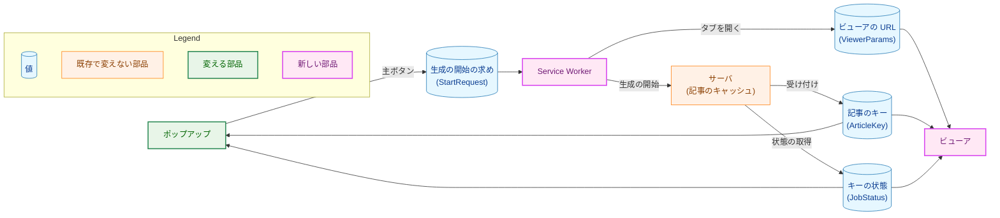

-   **生成の開始の求め**は、ポップアップが SW に渡す。生成の開始の入力（今の本文と同じ値）と、ビューアの URL に入れる値（ビューアの種）を持つ。
-   **ビューアの URL** は、見出し・チャンネル名・動画タイトル・収集した URL・送信の時刻と、受け付けの後は記事のキーを持つ（3.5）。
-   **記事のキー**は、サーバが返す不透明な文字列である。拡張は空でないことだけを確かめ、形を検査しない（要件 3.2）。
-   **キーの状態**は、状態の取得の応答を検査して作る値で、ジョブの状態ごとに持つメンバが決まる（3.3）。

### 1.4. 既存のコードとの関係

-   **送信の経路**: 今のポップアップは、主ボタンの押下で `sendArticle` を 1 回呼び（`extension/src/launch.ts:203-233`）、今の形のメッセージを `chrome.runtime.sendNativeMessage` で送る（`extension/src/browser/chromeDeps.ts:191-213`）。本タスクでは、生成の開始を SW が送り、状態の取得と投稿の操作をポップアップとビューアが送る。`sendNativeMessage` を呼ぶのは今と同じ `chromeDeps.ts` だけで（lint の規則、`extension/eslint.config.js:87-92`・`:251-258`）、3 つのページ（SW・ポップアップ・ビューア）がそれぞれ同じラッパーを使う。
-   **応答の検査**: 今の `classifyResponse`（`extension/src/core/response.ts:158-223`）は、バックスラッシュを拒否し（`:177-181`）、引用符の数でメンバの重複を見つける（`:194-199`）。これが成り立つのは、受け付ける値がすべて ASCII だからである。記事を含む応答は、Go の `encoding/json` が `<`・`>`・`&` を `<` などにエスケープして書く（`internal/server/status.go:111-119` の `json.Marshal`）ので、バックスラッシュを含む。そのため、厳格な JSON の解析を新しく作る（3.2）。ホストの応答の外側の検査（`extension/src/core/native.ts:114-171`）は、そのまま 3 つの操作で共有する（3.1）。
-   **画面の内容**: ポップアップの `PopupView`（`extension/src/core/popupView.ts:106`）と `renderPopup`（`extension/src/ui/render.ts:293-318`）は、`0046` の設計 9 章が想定したとおり、種類を加えて状態を描く（3.7）。
-   **文言**: `Catalog`（`extension/src/core/i18n/catalog.ts:21-62`）は、理由ごとの節を `Record` で持つので、値を加えると文言の欠けが型の検査で分かる。本タスクの文言もこの形で加える（3.12）。

## 2. システム構成 (System Structure)

### 2.1. 実行時の配置

拡張の 3 つの実行の場所と、ホスト・サーバとの間のやり取りを示す。矢印 A → B は「A が B にメッセージを送る」を表し、ラベルはその経路である。点線は、本タスクの前からある経路である。

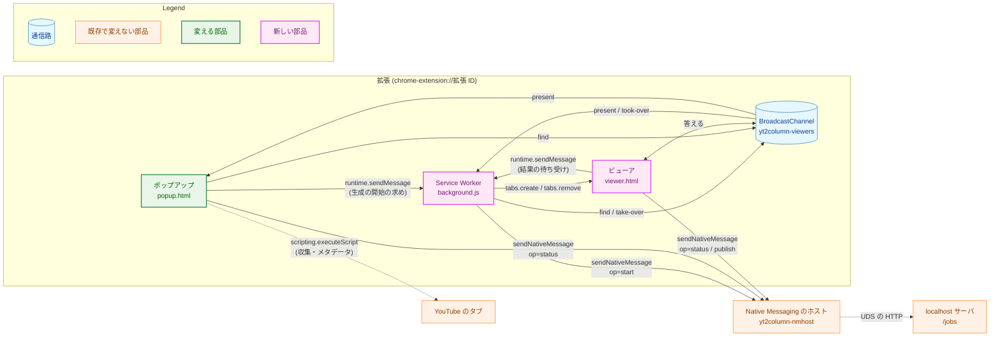

-   **ポップアップ**は、送る前の確認（`0046`）をそのまま行う。主ボタンで生成の開始の求めを SW に送り、応答で受け取ったキーで状態の取得をポーリングする。「ビューアを開く」でタブを前面に出し、「やり直す」で同じ求めをもう一度送る。
-   **SW** は、生成の開始の求めを受け、ビューアのタブを背面で開き、生成の開始を 1 回送る。キーを受け取ったら、同じキーのビューアの再利用を調整し、結果をビューアとポップアップに配る。ポーリングはしない。
-   **ビューア**は、URL の値を検査して表示する。キーがなければ SW から生成の開始の結果を待ち、キーがあれば状態の取得をポーリングする。投稿・保存・コピーの操作を持ち、`BroadcastChannel` の問い合わせに答える。
-   **ホストとサーバ**は変えない（要件 2.3）。ホストは、版のメンバ `v` を持つメッセージを、`op` ごとに決めた送り先へ中継する（`internal/nmhost/relay.go:389-436`）。

### 2.2. ディレクトリ構成とモジュールの依存関係

`extension/` の中の、加えるファイルと変えるファイルを示す。矢印 A → B は「A が B を import する」を表す。`src/core/` は DOM とブラウザの API を使わない（`tsconfig.core.json` が `DOM` の型を持たないので、型の検査が守る）。

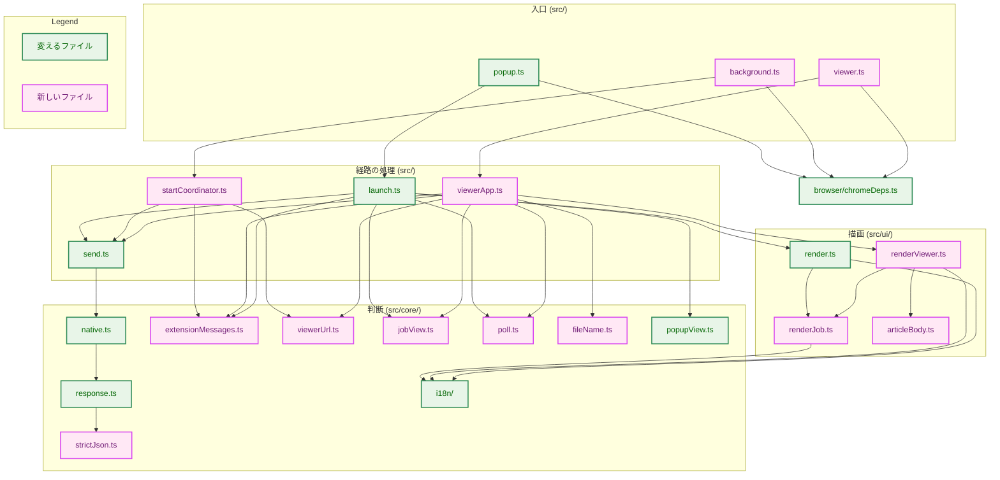

拡張の中のメッセージの型と検査は `src/core/extensionMessages.ts` に置く。今の `src/core/messages.ts`（収集の拒否の理由の文言を選ぶ関数。`extension/src/core/messages.ts:1-24`）とは別のファイルである。図は主な依存だけを示し、ファイルの一覧の正は 3.17 の責務表である。

### 2.3. データの流れ

主ボタンから記事の表示までの流れを示す（同じキーのビューアがない場合）。再利用の流れは 6.2 に示す。

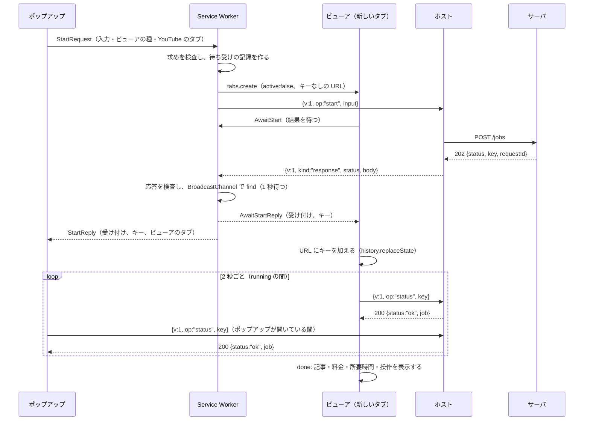

## 3. コンポーネント設計 (Component Design)

### 3.1. ホストとのやり取り（F-001・F-003・F-006、4.5、H-11）

1 回のやり取り（ホストを 1 回起動し、1 つのメッセージを送って 1 つの応答を受け取る）を、3 つの操作で共有する。

-   **送るメッセージ**は、ホストの新しい形（`{"v":1,"op":…}`）だけである。今の形のメッセージを作る関数は残さない（AC-01）。メッセージの型は次のとおりで、ほかの形を作る手段を持たない。

```ts
// src/core/response.ts — the job API's messages and results.

declare const articleKeyBrand: unique symbol;
/** A non-empty string the server returned as a key. Its form is never checked (requirements 3.2). */
export type ArticleKey = string & { readonly [articleKeyBrand]: true };

/** The generation start's input: the members of today's request body. */
export interface StartInput {
  readonly videoUrl: string;
  readonly transcript: string;
  readonly title?: string;
  readonly channelName?: string;
  readonly description?: string;
}

/** The only messages the extension sends to the host. */
export type HostMessage =
  | { readonly v: 1; readonly op: "start"; readonly input: StartInput }
  | { readonly v: 1; readonly op: "status"; readonly key: ArticleKey }
  | { readonly v: 1; readonly op: "publish"; readonly key: ArticleKey };
```

-   **やり取りの関数**: 今の `sendArticle`（`extension/src/send.ts:29-55`）を、メッセージを受け取る関数に改め、同じ `send.ts` に置く。`sendTimeoutMs`（25 秒、`send.ts:21`）はそのまま使い、宣言の形も変えない（Go のガード `cmd/yt2column/extension_docs_test.go:120` と `:192-206` が読む）。関数は、ホストに 1 回だけ送り、25 秒を過ぎたら結果不明とし、送り直さない（要件 4.2「自動で再送しない」）。`SendDeps.sendNative` の引数の型は `Readonly<Record<string, string>>`（`send.ts:16`）から `HostMessage` に改める。
-   **ホストの応答の外側**: `classifyNativeReply`（`native.ts:114-171`）の検査の順と内容（版、`kind`、`kind` ごとのメンバの集合、正規の base64）は変えない。変えるのは返す値だけである。今は応答の本文を `/articles` の形で解釈するが、本文のバイト列と状態コードを返すように改め、本文の解釈を操作ごとの関数に任せる。

```ts
// src/core/native.ts — what the outside of one host reply became.
export type HostOutcome =
  | { readonly kind: "response"; readonly status: number; readonly bytes: Uint8Array }
  | ExchangeFailure;

/** The results that are not a server response; shared by the three operations. */
export type ExchangeFailure =
  | { readonly kind: "not-sent"; readonly cause: NotSentCause }
  | { readonly kind: "no-response" }
  | { readonly kind: "host-failed" }
  | { readonly kind: "unexpected"; readonly check: UnexpectedCheck };
```

-   **やり取りの結果の分類**は要件 F-001 のとおり、受け付け・拒否・未送信・応答なし・ホストの失敗・想定外の応答である。ホストのエラーの対応（`server_unavailable`・`message_too_large` は未送信、`server_timeout` は応答なし、`protocol_error` は想定外の応答。`native.ts:72-87`）は変えない。開発者向けのログだけに使う値（想定外の応答の状態コード、ホストの失敗のブラウザの文字列）は、今の `SendResult` と `SendOutcome`（`response.ts:102-142`）と同じく、ログ用の型に持たせる。表示に使う型へは 1 つの関数だけで変える。

### 3.2. 厳格な JSON の解析（3.2、AC-41、H-03）

サーバの応答の本文を、外部のライブラリを使わずに厳格に解析する部品 `src/core/strictJson.ts` を作る。`JSON.parse` は、重複したメンバを後勝ちで受理し、対になっていないサロゲートのエスケープを受理し、数の表記を区別しない。そのため、`JSON.parse` の前後に検査を足すのではなく、バイト列から木を作る解析器を自分で持つ。Go 側の `internal/strictjson` と同じ規則を、拡張の側に持つことになる。共有はできない（言語が違う）ので、規則の一覧を 3.2 の表に固定し、テストで両方の規則が同じ入力を拒否することを確かめる（7.1）。

```ts
// src/core/strictJson.ts
/** A parsed JSON value. Numbers keep their source text; nothing is converted here. */
export type JsonValue =
  | { readonly kind: "object"; readonly members: ReadonlyMap<string, JsonValue> }
  | { readonly kind: "array"; readonly items: readonly JsonValue[] }
  | { readonly kind: "string"; readonly value: string }
  | { readonly kind: "number"; readonly text: string }
  | { readonly kind: "boolean"; readonly value: boolean }
  | { readonly kind: "null" };

/** Why the bytes are not one strict JSON value; for the developer log only. */
export type StrictJsonError =
  | "encoding"           // not valid UTF-8
  | "bom"                // starts with U+FEFF
  | "syntax"             // not JSON
  | "duplicate-member"   // a name repeated in one object, at any depth
  | "unpaired-surrogate" // a \uD800-\uDFFF escape without its pair
  | "trailing-data"      // anything but whitespace after the value
  | "too-deep";          // nesting beyond the limit

export type StrictJsonResult =
  | { readonly ok: true; readonly value: JsonValue }
  | { readonly ok: false; readonly error: StrictJsonError };

export function parseStrictJson(bytes: Uint8Array): StrictJsonResult;
```

| 規則 | 扱い |
|---|---|
| 符号化 | `TextDecoder` の `fatal: true` で復号し、正しくない UTF-8 を拒否する。`ignoreBOM: true` で BOM を文字として残し、先頭が U+FEFF なら拒否する（今の `response.ts:170-175` と同じ組み合わせ） |
| 最上位 | 値は 1 つだけで、後ろには JSON の空白（U+0020・U+0009・U+000A・U+000D）だけを許す |
| オブジェクト | どの階層でも、同じ名前のメンバ（エスケープを復号した後の文字列で比べる）を拒否する |
| 文字列 | エスケープは JSON の 8 種と `\uXXXX` だけ。上位サロゲートの `\uXXXX` の直後に下位サロゲートの `\uXXXX` がなければ拒否する。下位サロゲートだけのものも拒否する。エスケープしない制御文字（U+0000〜U+001F）を拒否する |
| 数 | JSON の文法の数だけを受理し、元の表記を `text` に残す。値への変換は、受け取る側が表記の形を確かめてから行う（3.3） |
| 深さ | 入れ子は 16 段まで。応答の形は 4 段なので、それを超えるものは正しい応答ではない。再帰の深さに上限を置き、悪意のある深い入れ子でスタックを使い切らない |

### 3.3. サーバの応答の検査（3.2、AC-13・AC-14・AC-41・AC-42、H-03）

`src/core/response.ts` を書き換え、3 つの操作の応答の本文を、`docs/dev/guides/development.md`「ジョブの API」「ジョブの API のコード」の形と過不足なく一致するものだけ受理する。拡張可能と宣言するメンバはない。どの検査に落ちても想定外の応答にし、記事・コード・数値の一部だけを使うことはしない。

**本文の上限**は 512 KiB とする。これはホストが中継する上限（`internal/nmhost/relay.go:43`）と同じ値で、サーバの状態の取得の上限（256 KiB、`internal/server/status.go:20`）を下回らない。ホストが中継できる応答を、拡張が大きさだけで拒否することはない。上限を超える本文は、解析せずに想定外の応答にする（今の `body-over-limit`、`native.ts:160-162`）。Go のガード（`TestNativeHostContract`）に、この値がホストの値と等しいことの確かめを加える。

**操作ごとの受理する形**（状態コードと `status` の組）:

| 操作 | 状態コード | `status` | メンバの集合 |
|---|---|---|---|
| 生成の開始 | 202 | `accepted` | `status`・`key`・`requestId` |
| 状態の取得 | 200 | `ok` | `status`・`requestId`・`webhookConfigured`・`job` |
| 投稿の操作 | 202 | `accepted` | `status`・`requestId` |
| どれも | 拒否の理由の表の値 | `rejected` | `status`・`reason`・`requestId` |

**拒否の理由**は、操作ごとに閉じた集合を `Record<…, number>`（理由から状態コード）で持つ。サーバのコード（`internal/server/jobs_api.go`・`status.go`・`publish.go`）の、その操作の経路が返しうる理由だけを集合に入れる。ホストは状態の取得と投稿の操作に本文を付けない（`relay.go:418-427`）ので、`invalid_body` は拒否の理由の集合に入れず、想定外の応答とする。`not_found` と `method_not_allowed` も、拡張が正しい操作だけを送るので想定外の応答とする（要件 F-009）。

| 理由 | 状態コード | 生成の開始 | 状態の取得 | 投稿の操作 |
|---|---|---|---|---|
| `too_many_requests` | 429 | ○ | - | - |
| `body_too_large` | 413 | ○ | - | - |
| `invalid_body` | 400 | ○ | - | - |
| `invalid_video_url` | 400 | ○ | - | - |
| `invalid_transcript` | 400 | ○ | - | - |
| `invalid_key` | 400 | - | ○ | ○ |
| `webhook_not_configured` | 503 | - | - | ○ |
| `article_not_ready` | 409 | - | - | ○ |
| `article_not_found` | 404 | - | - | ○ |
| `article_not_postable` | 409 | - | - | ○ |
| `internal_error` | 500 | ○ | ○ | ○ |

`requestId` は、今と同じく 16 進の小文字 16 文字だけを受理する（`parseRequestId`、`response.ts:46-53`）。`internal_error` で `requestId` が空のもの（サーバが ID を作れなかった場合）は想定外の応答とする（今の振る舞い。`development.md` の表の「`requestId` が空のときは想定外の応答」）。`key` は、空でない JSON の文字列であることだけを確かめる。

**状態の取得の `job`**:

| `job.state` | メンバの集合 | 値の検査 |
|---|---|---|
| `unknown` | `state` | - |
| `running` | `state`・`steps` | `steps` は `draft`・`shorten`・`review` の 3 つのメンバを持ち、それぞれ工程の状態の集合（`pending`・`running`・`done`・`skipped`・`failed`）の値 |
| `done` | `state`・`steps`・`article`・`publish` | `steps` の値は `done` か `skipped` だけ（`development.md`「ジョブの API」）。`article` と `publish` は下の表 |
| `failed` | `state`・`steps`・`failure` | `steps` は `running` と同じ。`failure` は失敗の理由の集合の値 |

`running` と `failed` の工程の状態は、文書が値の組み合わせを定めていないので、集合の値であることだけを確かめる。文書にない組み合わせの規則を拡張が足すと、サーバが正しく返した応答を想定外の応答にして、ポーリングを止めてしまうためである。

| メンバ | 受理する形 |
|---|---|
| `article` | `markdown`・`file`・`cost`・`durationMs` の 4 つ。`markdown` と `file` は空でない文字列 |
| `article.cost` | `{"state":"known","usd":…}` か `{"state":"unknown"}`。`usd` は `^[0-9]+\.[0-9]{4}$` の文字列（`internal/publisher/format.go:26-31` の書式） |
| `article.durationMs` | JSON の数で、表記が `^(0|[1-9][0-9]*)$`（符号・小数点・指数なし）、値が 2^53−1 以下。表記を確かめてから数に変える |
| `publish` | `not_posted`・`posting`・`posted` は `state` だけ。`failed` は `state` と `reason`（`webhook`・`internal`）。`unpostable` は `state` と `reason`（`mention`・`other`） |
| `webhookConfigured` | JSON の真偽値 |

検査を通った値の型を次に示す。どの集合も `Record<…, true>` の定数とともに宣言し、`switch` の網羅性と、文書との突き合わせのテスト（7.1）に使う。

```ts
// src/core/response.ts
export type StepName = "draft" | "shorten" | "review";
export type StepState = "pending" | "running" | "done" | "skipped" | "failed";
export type Steps = Readonly<Record<StepName, StepState>>;
export type FailureCode =
  | "internal" | "transcript_too_long" | "llm_timeout" | "llm_empty"
  | "llm_truncated" | "llm_failed" | "article_invalid" | "article_too_large";

declare const usdBrand: unique symbol;
/** Digits, ".", four digits: the server's cost text, passed unchanged to Intl.NumberFormat. */
export type UsdAmount = string & { readonly [usdBrand]: true };

export type Cost =
  | { readonly state: "known"; readonly usd: UsdAmount }
  | { readonly state: "unknown" };

export interface Article {
  readonly markdown: string; // the display Markdown, shown and copied unchanged
  readonly file: string;     // the file content, saved unchanged
  readonly cost: Cost;
  readonly durationMs: number;
}

export type PublishStatus =
  | { readonly state: "not_posted" | "posting" | "posted" }
  | { readonly state: "failed"; readonly reason: "webhook" | "internal" }
  | { readonly state: "unpostable"; readonly reason: "mention" | "other" };

export type JobStatus =
  | { readonly state: "unknown" }
  | { readonly state: "running"; readonly steps: Steps }
  | { readonly state: "done"; readonly steps: Steps; readonly article: Article; readonly publish: PublishStatus }
  | { readonly state: "failed"; readonly steps: Steps; readonly failure: FailureCode };

export type StartRejectReason =
  | "too_many_requests" | "body_too_large" | "invalid_body"
  | "invalid_video_url" | "invalid_transcript" | "internal_error";
export type StatusRejectReason = "invalid_key" | "internal_error";
export type PublishRejectReason =
  | "invalid_key" | "webhook_not_configured" | "article_not_ready"
  | "article_not_found" | "article_not_postable" | "internal_error";

/** The displayed result of each operation; log-only members live in the log type. */
export type StartOutcome =
  | { readonly kind: "accepted"; readonly key: ArticleKey; readonly requestId: RequestId }
  | { readonly kind: "rejected"; readonly reason: StartRejectReason; readonly requestId: RequestId }
  | ExchangeFailure;
export type StatusOutcome =
  | { readonly kind: "ok"; readonly requestId: RequestId; readonly webhookConfigured: boolean; readonly job: JobStatus }
  | { readonly kind: "rejected"; readonly reason: StatusRejectReason; readonly requestId: RequestId }
  | ExchangeFailure;
export type PublishOutcome =
  | { readonly kind: "accepted"; readonly requestId: RequestId }
  | { readonly kind: "rejected"; readonly reason: PublishRejectReason; readonly requestId: RequestId }
  | ExchangeFailure;

export function classifyStart(received: HostOutcome): StartOutcome;   // log variants omitted here
export function classifyStatus(received: HostOutcome): StatusOutcome;
export function classifyPublish(received: HostOutcome): PublishOutcome;
```

想定外の応答の検査の種類（`UnexpectedCheck`、`response.ts:73-87`）は、`escape`（バックスラッシュの拒否）と `duplicate-member`（引用符の数）を、`StrictJsonError` の種類と、メンバの集合・値の形・状態コードの組の種類に置き換える。種類は開発者向けのログだけに使い、表示はどれも同じ想定外の応答の文言である（今の `unexpectedMessage`、`extension/src/core/sendMessages.ts:30-54` と同じ）。

### 3.4. 拡張の中のメッセージ（F-001・F-002・F-004・3.2、AC-02・AC-05・AC-08・AC-10・AC-21・AC-22、H-01・H-07）

拡張の中のメッセージは 2 つの通信路を使う。

-   **`chrome.runtime.sendMessage` と `onMessage`**: ポップアップから SW への生成の開始の求めと、ビューアから SW への結果の待ち受け。受け取る側は `sender`（ブラウザが付ける送り手の情報）で送り手を確かめられる。
-   **`BroadcastChannel`（名前 `yt2column-viewers`）**: 同じキーのビューアの問い合わせと引き継ぎ。1 つの問いに複数のビューアが答えられる。`runtime.sendMessage` では、最初に応答した 1 つの答えしか送り手に届かないので、使わない。`BroadcastChannel` は同じオリジン（`chrome-extension://<ID>`）の文脈の間でだけ届く。ウェブページ、ページに注入したスクリプト（ページのオリジンで動く）、ほかの拡張は、この通信路に送れない。

```ts
// src/core/extensionMessages.ts — messages inside the extension, and their checks.

/** The values the viewer URL is built from; the popup fills them from its own view. */
export interface ViewerSeed {
  readonly heading: string;
  readonly channelName?: string;
  readonly title?: string;
  readonly url: string;
  readonly sentAt: number;
}

/** Where the YouTube tab is, so the viewer opens next to it. */
export interface SourceTab {
  readonly tabId: number;
  readonly windowId: number;
  readonly index: number;
}

/** A tab and its window: what is brought to the front. */
export interface TabRef {
  readonly tabId: number;
  readonly windowId: number;
}

/** popup → SW, chrome.runtime.sendMessage. */
export interface StartRequest {
  readonly type: "start";
  readonly input: StartInput;
  readonly viewer: ViewerSeed;
  readonly source: SourceTab;
}

/** SW → popup, the sendResponse of a StartRequest. */
export interface StartReply {
  readonly outcome: StartOutcome;
  /** The viewer that shows this send: the one it opened, or the one that took over. */
  readonly viewer?: TabRef;
}

/** viewer → SW, chrome.runtime.sendMessage; the tab is the sender's, never a member. */
export interface AwaitStart {
  readonly type: "await-start";
}

/** SW → viewer, the sendResponse of an AwaitStart. */
export type AwaitStartReply =
  | { readonly kind: "result"; readonly outcome: StartOutcome }
  | { readonly kind: "none" }; // the SW holds no send for this tab

/** BroadcastChannel "yt2column-viewers". */
export type ViewerChannelMessage =
  | { readonly type: "find"; readonly queryId: string; readonly key: string }
  | { readonly type: "present"; readonly queryId: string; readonly tab: TabRef; readonly sentAt: number }
  | { readonly type: "take-over"; readonly queryId: string; readonly tabId: number; readonly sentAt: number }
  | { readonly type: "took-over"; readonly queryId: string; readonly tabId: number };

export function parseStartRequest(value: unknown): StartRequest | undefined;
export function parseStartReply(value: unknown): StartReply | undefined;
export function parseAwaitStartReply(value: unknown): AwaitStartReply | undefined;
export function parseViewerChannelMessage(value: unknown): ViewerChannelMessage | undefined;
```

**送り手の確かめ（AC-05）**: SW は、次のすべてを満たす `StartRequest` だけを受け付ける。満たさないものには応答せず、何も送らず、タブも開かない。

1.  `sender.id` が `chrome.runtime.id` と等しい（ほかの拡張からのメッセージは `onMessage` にそもそも届かず、`onMessageExternal` も登録しないので、2 つ目の防御である）。
2.  `sender.tab` がない（ページに注入したスクリプトとタブで開いた拡張のページには `sender.tab` があり、ツールバーのポップアップにはない）。
3.  `sender.url` が `chrome.runtime.getURL("popup.html")` と完全に等しい（クエリ・フラグメントを含めて比べる）。
4.  メッセージが `parseStartRequest` の検査を通る: メンバの集合が過不足なく一致し、`input` が今の本文と同じ形（`videoUrl`・`transcript` は文字列、ほかは空でない文字列で任意）、UTF-8 で測った `input` の JSON の大きさが 4 MiB（`maxBodyBytes`、`extension/src/core/prepare.ts:46`）以下、`viewer` がビューアの URL の規則（3.5）を満たし、`source` の 3 つが 0 以上の整数。

SW は、`AwaitStart` を、`sender.id` が等しく、`sender.tab.id` があり、`sender.url` の `?` より前が `chrome.runtime.getURL("viewer.html")` と等しいものだけ受け付ける。ビューアのタブの特定には、メッセージのメンバではなく `sender.tab.id` を使う。ビューアが別のタブの結果を求めることはできない。

`BroadcastChannel` のメッセージは、送り手の情報を持たない。同じオリジンの文脈だけが送れることを前提に、受け取る側は形を `parseViewerChannelMessage` で検査し、合わないものを無視する（要件 3.2 の表）。`queryId` は、問い合わせのたびに `crypto.getRandomValues` で作る 128 ビットの 16 進の文字列で、答えを問いに対応づける。`key` は空でない文字列で、長さはビューアの URL の上限（256 コードポイント）以下とする。

### 3.5. ビューアの URL（F-002・3.2、AC-07・AC-09・AC-43、H-02）

ビューアの URL は `chrome-extension://<ID>/viewer.html?<クエリ>` とする。フラグメントは使わない。

| 名前 | 値 | 必須 | 上限 | 検査 |
|---|---|---|---|---|
| `h` | 見出し（ポップアップの動画のセクションに出す文字列。切り詰めた場合は末尾の `…` を含む） | 必須 | 1,001 コードポイント | 空でない |
| `c` | チャンネル名（切り詰めた表示の値） | 任意 | 201 コードポイント | 空でない |
| `t` | 動画タイトル（ファイル名に使う） | 任意 | 1,000 コードポイント | 空でない |
| `u` | 収集した URL | 必須 | 2,048 コードポイント | `isAcceptedWatchUrl`（`extension/src/core/acceptedUrl.ts:7-25`）を通る |
| `s` | 送信の時刻（UNIX 時刻のミリ秒） | 必須 | 16 桁 | `^(0|[1-9][0-9]*)$`、2^53−1 以下、ページを読み込んだ時刻以下 |
| `k` | 記事のキー | 任意 | 256 コードポイント | 空でない。形は検査しない |

-   **作り方**: 値は `encodeURIComponent` で符号化し、名前を表の順に並べ、`&` でつなぐ。`h`・`c` の上限は、ポップアップの表示の上限（`titleLimit` 1,000 と `metadataDisplayLimit` 200、`extension/src/core/popupView.ts:19-22`）に、切り詰めの印 `…` の 1 つを足したものである。ポップアップが表示した文字列をそのまま入れるので、ビューアの見出しはポップアップの見出しと同じになる（要件 F-002）。`t` は、ファイル名の上限（3.9）より長い部分を使わないので、1,000 コードポイントで切り詰める。
-   **読み方**: `location.search` から先頭の `?` を除き、`&` で分け、それぞれを最初の `=` で名前と値に分ける。値は `decodeURIComponent` で復号する。次のものは拒否し、補正しない（AC-43）。
    -   表にない名前、同じ名前が 2 回以上、`=` のない組、空の組（`&&` や末尾の `&`）、必須の値の欠け。
    -   `decodeURIComponent` が例外を投げる値: 不正なパーセントエンコーディングと、正しくない UTF-8 になるバイト列。どちらも `URIError` になる。サロゲートの符号点を UTF-8 にしたバイト列も正しくない UTF-8 なので拒否され、復号した値は常に正しい Unicode の文字列になる。
    -   空でないフラグメント。
    -   上の表の上限と検査に合わない値。
    -   `+` は `decodeURIComponent` で空白にならず、`+` のまま読む。作る側は `+` を `%2B` に符号化するので、`+` を空白に補正する必要はない（要件 3.2 の「`+` を空白として読む補正を受理しない」）。
-   **見出し・チャンネル名・動画タイトルに対になっていないサロゲートがある場合**: ページから読んだ文字列（タブのタイトルなど）は、対になっていないサロゲートを含みうる。`encodeURIComponent` は、それを含む文字列に例外を投げる。そこで、ビューアの種を作るポップアップが、表示用の写しの中の対になっていないサロゲートを U+FFFD に置き換える。これは呼び出し側の入力の補正ではない。サーバに送る生成の開始の入力は変えず、表示とファイル名に使う写しを、決めた規則で作る出力である（要件 5 章のファイル名の扱いと同じ理由）。
-   **キーを加える**: ビューアは、生成の開始の受け付けを受け取ると、`k` を加えた URL に `history.replaceState` で書き換える。引き継ぎで送信の時刻を改めるときも、同じ方法で `s` を書き換える。どちらも履歴の項目を増やさない。
-   **履歴に残る値**は、この表の 6 つだけである（要件 4.2）。コピーした字幕と概要欄は、URL を作る関数の引数の型（`ViewerSeed`）が持たないので、URL に入りようがない（AC-09）。

```ts
// src/core/viewerUrl.ts
export interface ViewerParams {
  readonly heading: string;
  readonly channelName?: string;
  readonly title?: string;
  readonly url: string;
  readonly sentAt: number;
  readonly key?: ArticleKey;
}

/** Which rule a viewer URL broke; for the developer log only. */
export type ViewerUrlError =
  | "unknown-name" | "duplicate-name" | "malformed-pair" | "missing-name"
  | "encoding" | "empty-value" | "too-long" | "url-not-accepted"
  | "sent-at" | "fragment";

export function viewerQuery(params: ViewerParams): string;
export function parseViewerUrl(
  search: string,
  hash: string,
  loadedAt: number,
): { readonly ok: true; readonly params: ViewerParams } | { readonly ok: false; readonly error: ViewerUrlError };
```

### 3.6. ビューアの状態とポーリング（F-002・F-003、AC-07・AC-10〜AC-19・AC-52、H-01・H-04）

ビューアの表示は、次の 2 つの値の組で決まる。

```ts
// src/core/jobView.ts
/** What the viewer's main area shows. */
export type ViewerState =
  | { readonly kind: "invalid-link" }                         // the URL failed parseViewerUrl
  | { readonly kind: "sending" }                              // no key yet, waiting for the start result
  | { readonly kind: "start-failed"; readonly outcome: StartFailure } // rejected, not sent, or unknown
  | { readonly kind: "loading" }                              // a key, waiting for the first status
  | { readonly kind: "job"; readonly job: JobDisplay };

export type StartFailure = Exclude<StartOutcome, { kind: "accepted" }> | { readonly kind: "no-result" };

/** The job as displayed; built from a StatusOutcome by one pure function. */
export type JobDisplay =
  | { readonly kind: "running"; readonly steps: Steps }
  | { readonly kind: "done"; readonly steps: Steps; readonly article: Article; readonly publish: PublishStatus; readonly webhookConfigured: boolean }
  | { readonly kind: "failed"; readonly steps: Steps; readonly failure: FailureCode }
  | { readonly kind: "lost"; readonly kept?: Article }; // unknown; kept when a done article was shown

/** The notice beside the state when a status exchange failed; the state itself is kept. */
export type PollNotice =
  | { readonly kind: "none" }
  | { readonly kind: "retrying"; readonly cause: "server-unavailable" | "no-response" | "host-failed" }
  | { readonly kind: "stopped"; readonly cause: "invalid-key" | "rejected" | "unexpected" | "message-too-large" };
```

**生成の開始の結果を待つ（`sending`）**: キーのない URL のビューアは、SW に `AwaitStart` を送り、応答を待つ。待つ期限は、URL の送信の時刻から 35 秒後とする。SW のやり取りの上限が 25 秒で、その前のタブの作成と、その後の再利用の問い合わせ（1 秒）と引き継ぎの確認（1 秒）を足しても、35 秒あれば足りる。

-   応答が `result` なら、その結果を表示する。受け付けなら URL にキーを加え、`loading` からポーリングを始める（AC-07）。
-   応答が `none` のとき（SW が止まってメモリを失った後に起動し直した場合など）、送信が失敗したとき（受け取る SW がない場合など）、期限を過ぎたときは、`start-failed`（`no-result`）を表示する。表示するのは、結果不明と、ポップアップから送り直す手順である。状態の取得は送らない（AC-10）。
-   再読み込みの後も、期限は URL の送信の時刻から数える。期限の前なら、もう一度 `AwaitStart` を送る。SW は、結果をビューアに届けた後も、送信の時刻から 35 秒までは結果を持ち続けるので、結果を受け取る前の再読み込みでも結果は届く。期限を過ぎていれば、すぐに `no-result` を表示する。
-   期限の後に届いた結果は無視する（H-01）。期限の後に結果を表示すると、ビューアがポップアップからの送り直しを案内した後に、表示が変わることになるためである。受け付けられていれば、送り直しはキャッシュに当たるので、失われるものはない（要件 F-002）。

**ポーリング**: キーのある URL のビューアは、`loading` から状態の取得を始める。次の取得は、前の取得の結果を受け取ってから 2 秒後に送る。1 つのページが同時に送る状態の取得は 1 つまでとなる（AC-19）。1 回の取得の結果から、表示の更新と、続けるか止めるかを、純粋な関数 `afterStatus` で決める。

| 状態の取得の結果 | 表示 | 次 |
|---|---|---|
| `ok`、`running` | `job`（`running`） | 続ける |
| `ok`、`done`、投稿の状態が `posting` | `job`（`done`） | 続ける（AC-18） |
| `ok`、`done`、ほかの投稿の状態 | `job`（`done`） | 止める（AC-13） |
| `ok`、`failed` | `job`（`failed`） | 止める（AC-14） |
| `ok`、`unknown` | `job`（`lost`）。直前が `done` なら、その記事を `kept` に残す | 止める（AC-15） |
| 未送信（`server-unavailable`）・応答なし・ホストの失敗 | 直前の表示を残し、`retrying` の案内を出す | 続ける（AC-16） |
| 未送信（`message-too-large`） | 直前の表示を残し、`stopped` の案内を出す | 止める |
| 拒否（`invalid_key`・`internal_error`）・想定外の応答 | 直前の表示を残し、`stopped` の案内を出す | 止める（AC-16） |

-   `message-too-large` は、状態の取得のメッセージ（キーだけ）では起きないはずの結果で、繰り返しても直らない。そのため止める側に分ける（要件 F-003 の「繰り返しても変わらない結果ではポーリングを止める」）。
-   成功した取得は `retrying` の案内を消す。表示の更新（`job` の中身）は、前と同じ値なら描き直さない。工程と状態の変化だけを、状態の領域に伝えるためである（3.13）。
-   **見えたときの取得**: `document` の `visibilitychange` で見える状態になったとき、ポーリングを続けていて、取得の最中でなければ、待っている次の取得の時刻を待たずにすぐ取得する。最中なら何もしない（1 つまでの規則を守る）。
-   **時刻とタイマー**は注入する（`now()` と `schedule(ms, callback)`。今の `SendDeps.schedule`、`send.ts:17-18` と同じ形）。ポーリングの判断と時刻の扱いを、fake の時計でテストできる。

```ts
// src/core/poll.ts
export const pollIntervalMs = 2_000;
export const startResultDeadlineMs = 35_000;

export type PollStep = { readonly decision: "continue" | "stop"; readonly job?: JobDisplay; readonly notice: PollNotice };

/** The display update and the decision after one status exchange. Pure. */
export function afterStatus(previous: JobDisplay | undefined, outcome: StatusOutcome): PollStep;
```

**経過時間と所要時間**: 経過時間は `now() − 送信の時刻` を表示する。`running` の表示の間、タブが見えていれば 1 秒ごとに描き直す（AC-12）。完了の後は、`durationMs` を所要時間として表示する（AC-13）。

**引き継ぎ（`take-over` を受けたとき、AC-08・AC-22）**: ビューアの振る舞いは、そのときの表示で決まる。

| そのときの表示 | 振る舞い |
|---|---|
| `job` の `running` か `done` で、ポーリングを止めていない（`stopped` の案内がない）。または `loading` | 何も変えない。送信の時刻も変えない |
| `job` の `failed` か `lost`。または `stopped` の案内がある | URL の `s` を引き継ぎの送信の時刻に改め、表示を `loading` に戻し、ポーリングを始め直す |

どちらの場合も、ビューアは `took-over` を答える。タブを前面に出すことはしない（要件 F-002）。

**問い合わせへの答え（`find` を受けたとき）**: URL のキーが問いのキーと等しく、自分のタブの ID を知っているビューアだけが `present` を答える。タブの ID は、起動のときに `chrome.tabs.getCurrent()` で得る（3.15 の確認の対象）。得られなければ答えない。その場合は再利用されないだけで、表示には影響しない。表示が `invalid-link` のビューアと、キーを持たないビューアは答えない。

### 3.7. ポップアップの状態（F-004、AC-20〜AC-24、H-08）

`0046` の設計 9 章の方針どおり、`PopupView` に種類 `job` を加える。動画のセクションと詳細は `collected` と同じ値で描き、確認のセクションの位置に状態を描き、主ボタンの操作を状態ごとに決める。

```ts
// src/core/popupView.ts
export type PopupView = CollectedView | RejectedView | JobPopupView;

export interface JobPopupView {
  readonly kind: "job";
  readonly video: VideoView;
  readonly details: DetailsView;
  readonly state: PopupJobState;
  readonly primary: PrimaryAction;
}

export type PopupJobState =
  | { readonly kind: "sending" }
  | { readonly kind: "start-failed"; readonly outcome: StartFailure }
  | { readonly kind: "job"; readonly job: JobDisplay; readonly notice: PollNotice };

/** What the primary button does; declared, never inferred from the state's text. */
export type PrimaryAction =
  | { readonly kind: "none" }         // disabled: sending, start-failed
  | { readonly kind: "open-viewer" }  // running, done
  | { readonly kind: "retry" };       // failed, lost
```

-   **主ボタンを押した後**: ポップアップは、`collected` の画面から `job` の `sending` に描き替え、`StartRequest` を SW に送る。`sentAt` はこの時点の時刻である。SW の応答（`StartReply`）を検査し、受け付けならキーで状態の取得のポーリングを始める（規則は 3.6 と同じ `afterStatus`）。応答が検査を通らない場合と、送信が失敗した場合（SW が応答の前に止まった場合など）は、`start-failed`（`no-result`）にする。
-   **主ボタンの操作**: `running` と `done` は「ビューアを開く」（6.6）、`failed` と `lost` は「やり直す」、それ以外は押せない（AC-20・AC-22・AC-23）。「やり直す」は、ポップアップが持っている同じ `PreparedRequest` から `StartRequest` を作り、新しい送信の時刻で送る。そして `sending` から同じ流れをたどる（AC-22）。
-   **状態の領域への最初の変化**: `0046` の設計 9 章のとおり、操作のセクションを表示してから状態の領域の中身を変えるまでの間を空ける。`collected` の画面ですでに状態の領域は見えているので、主ボタンを押した後の `sending` の描画が最初の変化になり、この条件を満たす。
-   **ポップアップを閉じる**と、ページとともにポーリングも止まる。開き直すと、今と同じく送る前の画面から始まる（AC-24）。ポップアップは送信の記録を持たない。

### 3.8. 投稿のボタン（F-006、AC-28〜AC-32）

投稿のボタンの状態は、要件 F-006 の表を、上の行から順に見る純粋な関数で決める。行の順は関数の中の `if` の並びとし、表の行と 1 対 1 に対応させてテストする（AC-28）。

```ts
// src/core/jobView.ts
export type PublishNotice =
  | { readonly kind: "lost" }
  | { readonly kind: "posted" }
  | { readonly kind: "posting" }
  | { readonly kind: "unpostable"; readonly reason: "mention" | "other" }
  | { readonly kind: "webhook-not-configured" }
  | { readonly kind: "post-failed"; readonly reason: "webhook" | "internal" }
  | { readonly kind: "none" };

export interface PublishControl {
  readonly enabled: boolean;
  readonly notice: PublishNotice;
}

/** Rows 1-7 of the requirements' table, in order; `sending` disables the button too. */
export function publishControl(job: Extract<JobDisplay, { kind: "done" | "lost" }>, sending: boolean): PublishControl;

/** The result of the last publish operation, shown beside the button until the next press. */
export type PublishOpNotice =
  | { readonly kind: "none" }
  | { readonly kind: "rejected"; readonly reason: PublishRejectReason }
  | { readonly kind: "unknown" }; // no response, host failed, unexpected, not sent
```

-   押すと、投稿の操作を 1 回だけ送る。送っている間は押せない（`sending`）。受け付けられたら、ポーリングを始める（止まっていた場合）。サーバは、受け付けの応答の前に投稿の状態を `posting` にする（`internal/server/publish.go:71-83`）。そのため、次の取得は `posting` を返し、`posting` でなくなるまで続く（3.6 の表、AC-29）。
-   拒否は理由の文言を表示する。`article_not_found` は、記事が失われたこととして、表示を `lost` に変える（要件 F-006）。結果不明は、自動では送り直さず、ポーリングで投稿の状態を確かめる（止まっていれば始める。AC-31）。
-   押せない行では、ボタンを `disabled` にするので、投稿の操作を送る手段はない（AC-32）。`lost` の記事（`kept` を含む）も 1 行目で押せない。

### 3.9. `.md` ファイルへの保存（F-007、AC-33・AC-34、H-05）

-   **保存の方法**: `Blob([article.file], { type: "text/markdown;charset=utf-8" })` から `URL.createObjectURL` で URL を作る。そして、`download` 属性にファイル名を設定した `<a>` を、文書に加えずにクリックする。拡張のページと Blob の URL は同じオリジンなので、ブラウザは `download` 属性に従って保存する。`downloads` の権限は要らない（3.15 の確認の対象）。保存先とダイアログは、ブラウザの設定に従う。
-   **バイト列**: `Blob` は文字列を UTF-8 で符号化し、BOM を付けない。`endings` を指定しない（既定の `transparent`）ので、改行も変えない。対になっていないサロゲートは、厳格な JSON の解析が拒否するので（3.2）、`Blob` が U+FFFD に置き換える文字は届かない。保存したバイト列は `article.file` の UTF-8 と一致する（AC-33）。
-   **URL の解放**: クリックの後、60 秒たってから `URL.revokeObjectURL` で解放する。クリックの直後に解放すると、ブラウザがダウンロードを始める前に URL が無効になりうるためである。ページを閉じれば URL も解放される。
-   **ファイル名**（純粋な関数 `articleFileName`）:

| 手順 | 規則 |
|---|---|
| 1. 元の文字列 | URL の `t`（動画タイトル）。`t` がないか、Unicode の空白（`\s`）だけなら、動画 ID |
| 2. 置き換え | 次の文字をそれぞれ `_` にする: U+0000〜U+001F・U+007F〜U+009F（制御文字）、`/`・`\`（パスの区切り）、`:`・`*`・`?`・`"`・`<`・`>`・`|`（Windows と macOS の Finder で使えない文字）、U+200E・U+200F・U+202A〜U+202E・U+2066〜U+2069（表示の向きを変える文字。拡張子を偽って見せることに使えるため） |
| 3. 先頭 | 先頭に続く `.` をそれぞれ `_` にする（隠しファイルにしない） |
| 4. 長さ | UTF-8 で 200 バイトを超えれば、コードポイントの境目で 200 バイト以下に切り詰める。`.md` を足しても、多くのファイルシステムの名前の上限（255 バイト）に収まる |
| 5. 拡張子 | `.md` を足す |

-   **動画 ID** は、URL の `u` を `new URL` で解析した `searchParams.get("v")` の値である。`u` は `isAcceptedWatchUrl` を通っているので、`v` はちょうど 1 つあり、空でない。動画 ID にも手順 2〜5 を同じく当てる。
-   これらの手順の後、ファイル名はパスの区切りと制御文字を含まず、`.` で始まらず、`.md` で終わる（AC-34）。ブラウザは、保存するときにさらにファイル名を整えることがある（Windows の予約名など）。それは拡張の関数の外の振る舞いで、手順の結果を広げる方向にだけ働く。

### 3.10. Markdown のコピー（F-008、AC-35・AC-36、H-06）

-   コピーのボタンのクリックの処理の中で、`navigator.clipboard.writeText(article.markdown)` を呼ぶ。利用者の操作の中で、フォーカスのある拡張のページから呼ぶので、`clipboardWrite` の権限は要らない（3.15 の確認の対象）。
-   成功と失敗（Promise の拒否と、呼び出しの例外）を、ボタンの横の状態の領域に固定の文言で表示する。フォーカスは動かさない（AC-36・AC-47）。

### 3.11. 記事の本文の表示（F-005、AC-25、H-14）

本文の表示は、次の 1 つの関数だけが行う。#504 では、この関数（と、その CSS の規則）だけを、Markdown の描画に差し替える。状態の表示・ポーリング・保存・コピーは、この関数の外にあり、受け取る値（`article.markdown` と `article.file`）を変えずに使うので、差し替えの影響を受けない。

```ts
// src/ui/articleBody.ts
/** The article body as text: markdown is set with textContent and never parsed. */
export function renderArticleBody(doc: Document, markdown: string): HTMLElement;
```

-   返す要素は `<div class="article-body" dir="auto">` で、`textContent` に表示用の Markdown をそのまま入れる。CSS の `white-space: pre-wrap` で改行と空白を保ち、`unicode-bidi: plaintext` で、右から左に書く文字が周りの表示の向きを変えないようにする（今のポップアップの値の表示と同じ扱い）。
-   記事の中の HTML のタグ・リンクの記法は文字のまま表示し、要素や属性を作らない。表示した `textContent` は表示用の Markdown と一致する（AC-25）。lint の規則（`innerHTML` などの HTML を解釈する API の禁止、`extension/eslint.config.js:152-195`）と、拡張のページの既定の CSP が、2 つ目と 3 つ目の防御である。
-   **見出し・チャンネル名・元動画へのリンク**: URL の `h` と `c` を `textContent` で表示する（AC-27）。ページのタイトルは `<見出し> - yt2column` とする。元動画へのリンクは、`u` が `isAcceptedWatchUrl` を通るときだけ（URL の検査で通らなければビューアは `invalid-link` なので、表示する場合は常に通っている）、`<a href=u target="_blank" rel="noopener noreferrer">` で出す（AC-26）。`href` は `u` の文字列そのもので、記事の中身から URL を作ることはない。

### 3.12. 文言と書式（F-009、AC-04・AC-31・AC-37、H-09）

`Catalog`（`catalog.ts:21-62`）に、次の節を `Record` で加える。`en.ts` と `ja.ts` の両方が型の検査で揃う（AC-37）。

| 節 | キーの型 |
|---|---|
| 生成の開始の拒否 | `StartRejectReason` |
| 状態の取得の拒否 | `StatusRejectReason`（`PollNotice` の `stopped` の文言を含む） |
| 投稿の操作の拒否 | `PublishRejectReason` |
| 失敗の理由 | `FailureCode`（8 つすべて互いに違う文言。AC-14） |
| 工程の名前 | `StepName` |
| 工程の状態 | `StepState`（支援技術に伝える語） |
| 投稿の状態と理由 | `PublishNotice` の種類と理由 |
| やり取りの結果 | 未送信の原因・応答なし・ホストの失敗・想定外の応答を、操作ごとに（生成の開始・状態の取得・投稿の操作） |
| ビューア | 送信中・読み込み中・リンクが正しくない・記事が失われた・`no-result`・保存・コピーとその結果・元動画へのリンク |
| ポップアップ | 主ボタンの名前（ビューアを開く・やり直す）・送信中の案内 |

-   **Slack に触れない**: 生成の開始のどの結果の文言と、送信中の文言も、Slack を確かめる手順を含まない（AC-04）。生成の開始の結果不明の文言は、「同じ入力を送り直しても、その記事が処理中か完了していれば生成し直さない」ことを、断定しすぎずに示す（要件 1 章「導いた振る舞い」）。今の文言の Slack の案内（`extension/src/core/i18n/en.ts:51-122`）は、すべてなくなる。
-   **投稿の操作の結果不明の文言**は、要件 F-006 の 2 つの点（投稿中か投稿済みならもう一度押しても二重に投稿されないこと、失敗の後のやり直しでは確かめられなかった 1 通が重複しうること）を示し、二重に投稿されないとは言い切らない（AC-31）。
-   **工程の名前**は、`docs/translation_glossary.md` と `development.md` の工程の表に合わせ、日本語は「下書きの生成」「字数の調整」「検証・推敲」、英語は "Draft" "Shorten" "Review" とする。
-   **経過時間と所要時間**: `Intl.NumberFormat`（`style: "unit"`、`unit: "minute"` と `"second"`、`unitDisplay: "short"`）で、分と秒を選んだ言語で書く（例: `1 min 5 sec`、`1 分 5 秒`）。1 時間を超えるものも分で書く。生成は最長でも数分なので、時間の単位は使わない。
-   **推定の料金**: `Intl.NumberFormat`（`style: "currency"`、`currency: "USD"`、小数 4 桁）の `format` に、`usd` の文字列をそのまま渡す。Chrome 106 以降の `format` は 10 進の文字列を浮動小数にせずに書くので（`minimum_chrome_version` 110 の範囲）、サーバの値（`0.1234`）と表示の桁が一致する。`unknown` なら、料金が分からないことの文言を出す。
-   数の書式は、今の `formatCount`（`extension/src/core/i18n/locale.ts:35-38`）と同じく、表示の言語の `Intl` を使う（#506 の決定）。

### 3.13. アクセシビリティ（4.6、AC-44〜AC-52、H-12）

| 点 | 設計 |
|---|---|
| 要素 | 投稿・保存・コピー・ビューアを開く・やり直すは `<button type="button">`、元動画へのリンクは `<a>`、見出しは `<h1>`、工程のチェックリストは `<ol>` と `<li>`（AC-46）。押せないボタンは `disabled` で表し、支援技術に伝わる |
| 工程の表示 | 各 `<li>` は、記号（`aria-hidden="true"`）・工程の名前・状態の語（`visually-hidden`）の順に並べる。今の確認の行（`extension/src/ui/render.ts:119-145`）と同じ作りである。記号の形は状態ごとに違う: `pending` は白抜きの円、`running` は回る弧、`done` はチェック、`skipped` は横線、`failed` はバツ。色だけに頼らない（AC-46・AC-48） |
| ロード中の印 | 回る弧の SVG（`aria-hidden`）と、どちらの待ちかを示す文言（「送信しています」「記事の状態を読み込んでいます」）を並べる（AC-52）。印は点滅しない。`prefers-reduced-motion: reduce` で、印と `running` の工程の記号の `animation` を止める（AC-51） |
| 状態の領域 | ビューアは、状態の表示の要約（ロード中になった・ロード中が終わった・工程の変化・完了・失敗・状態を取得できない）を 1 つの `role="status"` の要素に書く。投稿・保存・コピーの結果は、操作の近くの別の `role="status"` の要素に書く。フォーカスは動かさない（AC-47） |
| 経過時間 | 経過時間の要素は状態の領域の外に置き、`aria-live` を持たせない。毎秒の更新は読み上げられない（AC-47） |
| 読み上げの頻度 | 状態の領域には、表示が変わったときだけ書く。同じ結果のポーリングでは書き直さない（3.6） |
| フォーカス | 状態が変わってもフォーカスを動かさない。投稿のボタンが押せなくなるとき、フォーカスがそのボタンにあれば、ブラウザがフォーカスを文書に戻す。これは避けられないので、操作の結果を状態の領域に書いて伝える |
| 順序 | 見た目の順（見出し、チャンネル名、元動画へのリンク、状態、記事、操作）と DOM の順を同じにする（AC-44） |
| 大きさ | 押せる要素はどれも 44×44 CSS ピクセル以上（AC-50）。リンクは `display: inline-flex` と `min-height` で満たす |
| 配色 | ポップアップの色の変数（`extension/static/style.css:1-45`）を共有し、ビューアに要る色（失敗の色など）を変数として加える。ライトとダークの両方で、文字は 4.5:1、記号とフォーカスの印は 3:1 以上（AC-45・AC-48） |
| 言語 | `applyPageLocale`（`extension/src/ui/pageLocale.ts`）で、`<html lang>` を表示の言語にする（AC-49） |

CSS は次のように分ける。今の `style.css` は `body` の幅を 360 px に固定している（`style.css:52-55`）ので、ビューアはそのまま使えない。色の変数と共有の規則（フォーカスの印、ボタン、メッセージ、工程のチェックリスト、ロード中の印、`prefers-reduced-motion`）を `static/theme.css` に移す。ポップアップの配置は `style.css` に残し、ビューアの配置は `static/viewer.css` に置く。ポップアップとビューアは、`theme.css` を先に読み込む。

### 3.14. manifest とビルド（4.2・4.4、H-10）

```json
{
  "manifest_version": 3,
  "minimum_chrome_version": "110",
  "background": { "service_worker": "background.js", "type": "module" },
  "permissions": ["activeTab", "scripting", "nativeMessaging"]
}
```

（変える部分だけを示す。ほかのキーは今の `extension/static/manifest.json` のまま。）

-   `background.type` を `"module"` にする。`tsc` は ES のモジュールを出力し（`tsconfig.json` の `"module": "nodenext"`）、SW の入口は `src/core/` を `import` するためである。バンドラは加えない。
-   `permissions` は変えない。`host_permissions`・`content_scripts`・`web_accessible_resources` を持たない（要件 4.2）。`viewer.html` は `web_accessible_resources` にないので、ウェブページはビューアを開けない（`<iframe>` やリンクで拡張のページを開けない）。
-   `static/viewer.html` と `static/theme.css`・`static/viewer.css` を加える。ビルドは今の `tsc -p tsconfig.build.json` と `copy-static.ts` のままで、`src/background.ts`・`src/viewer.ts` が `dist/background.js`・`dist/viewer.js` になる。
-   `scripts/check-dist.ts` の参照の検査（`referenceViolations`）に、manifest の `background.service_worker` を加える。`viewer.html` の `<script>`・`<link>` の参照は、今の HTML の検査がそのまま確かめる。
-   `test/manifest.test.ts` の「Chrome 103」の確かめと、キーの一覧の確かめ（`background` を加える）を改める。権限の確かめ（`:91-100`）と、Go のガード（`cmd/yt2column/extension_docs_test.go` の権限の突き合わせ）は、権限が変わらないので通り続ける。`web_accessible_resources`・`content_scripts`・`host_permissions` を持たないことは、キーの一覧の確かめが守る。

### 3.15. 確かめていないブラウザの振る舞い（H-05・H-06・H-07・H-10）

1.2 の決定のとおり、次の振る舞いは Chrome の文書に基づく。実装の最初のフェーズで、試作の拡張を読み込み、Chrome（110 以降の今の版）と Brave で手動で確かめる。確かめた結果は実装計画の記録に残す。崩れた場合は、右の列の方法に切り替える。どの切り替えも権限を加えない。

| 振る舞い | 文書の記述 | 崩れた場合の方法 |
|---|---|---|
| `tabs` の権限なしで `tabs.create({active:false, index, openerTabId})`・`tabs.update(id,{active:true})`・`tabs.remove`・`tabs.get` が使える（`tabs` の権限は `Tab` の `url`・`title`・`favIconUrl` を読むためのもの） | `chrome.tabs` の API の文書 | なし（使えなければ、ビューアのタブを開くこと自体ができない。要件の前提が崩れるので、レビュアーと扱いを決める） |
| 拡張のページで `tabs.getCurrent()` が自分のタブを返す | 同上 | ビューアの起動のときに SW に自分のタブを尋ねる（SW は `sender.tab` で知る） |
| `windows.update(windowId,{focused:true})` が権限なしで使える | `chrome.windows` の API の文書 | ウィンドウを前面に出さず、タブを選ぶだけにする（同じウィンドウの場合は違いがない） |
| SW で `BroadcastChannel` が使え、拡張のページとの間で届く | Service Worker で使える Web の API | SW の問い合わせを `runtime.sendMessage` に替え、答えをビューアから SW への別のメッセージで集める |
| Chrome 110 以降、拡張の API の呼び出し（`sendNativeMessage`）が SW のアイドルのタイマー（30 秒）を延ばし、1 回の呼び出しが 5 分を超えない限り止められない | 「拡張の Service Worker の寿命」の文書 | 応答を待つ間、SW がポップアップとビューアの `runtime.connect` のポートを開いておき、寿命を延ばす |
| 拡張のページで、`<a download>` と Blob の URL が `downloads` の権限なしに保存する | HTML の `download` 属性（同じオリジンの URL） | なし（要件 F-007 の前提が崩れるので、レビュアーと扱いを決める） |
| 拡張のページで、利用者の操作の中の `navigator.clipboard.writeText` が `clipboardWrite` の権限なしに動く | Clipboard API の文書 | `document.execCommand("copy")` は使わない（非推奨）。失敗の表示（AC-36）で利用者に知らせ、レビュアーと扱いを決める |
| `Intl.NumberFormat.prototype.format` が 10 進の文字列を正確に書く（Chrome 106） | ECMA-402 の Intl.NumberFormat v3 | `usd` の文字列を `.` で分け、整数の部分だけを `formatCount` で書き、小数の部分をそのまま付ける |

### 3.16. 既存の方針からの変更と、更新するテスト

-   **`chrome.windows` の禁止の例外。** 方針: タスク `0027_remove_context_menu` は、`chrome.windows` などの参照を lint で禁止した（`docs/tasks/0027_remove_context_menu/02_architecture.md:362-364`、`extension/eslint.config.js:94-101` の `menuPathNames`）。理由は、メニューの経路が使った API が、権限なしで使えるために戻ってきやすいことだった。例外: 「ビューアを開く」は、タブのウィンドウを前面に出す（要件 F-004）ので、`chrome.windows.update` を使う。lint の規則から `windows` を外すのではなく、`src/browser/chromeDeps.ts` だけで `windows` を許す。ほかの名前（`contextMenus`・`session`・`setBadgeText`）の禁止はそのまま残す。規則のメッセージ「the extension sends only from the popup」は、SW とビューアも送るようになるので改める。更新するテスト: `extension/test/lintRules.test.ts:382` の `windows` の行（ほかのファイルでは禁止され、`chromeDeps.ts` では許されることを確かめる形にする）。
-   **`docs/dev/security.md` §8.1 の 3 つの方針**（Slack を確かめる案内、応答の本文の文字列を表示しない、1 回の送信でホストを 1 回起動する）は、要件 5 章で変更が決まっている。本設計はそれを 3.12（文言）・3.3 と 3.11（記事だけを表示に使う）・3.6（ポーリング）で実現する。更新するテスト: Slack の案内を確かめる `extension/test/sendMessages.test.ts` と `extension/test/launch.test.ts`。今の `/articles` の応答の検査のテスト `extension/test/response.test.ts`・`native.test.ts`・`send.test.ts`・`renderSend.test.ts` は、新しい API の検査のテストに書き換える。
-   **今の形のメッセージの中継を拡張が使わない。** ホストの経路の選択（`internal/nmhost/relay.go:389-394`、[CLAUDE.md](../../../CLAUDE.md)「Declare, don't infer」の例外）は、拡張から今の形が届かなくなる。ホストのコードとその例外の削除は #526 で行う（要件 2.3）。本タスクでは Go のコードもその例外の記述も変えない。
-   **拒否の理由の表のガード。** `extension/test/serverReasons.test.ts` は、`development.md` の拒否の理由の表で「固定のメッセージ」の行の集合が、`serverRejectStatus`（`response.ts:22-29`）と一致することを確かめる。本タスクで拡張は、新しい理由（`invalid_key`・`webhook_not_configured`・`article_not_ready`・`article_not_found`・`article_not_postable`）も固定の文言で表示する。そこで表の「拡張の表示」の列を改め（要件 F-009）、テストの突き合わせの相手を、3 つの操作の拒否の理由の集合の和（3.3）に改める。`not_found`・`method_not_allowed` は「想定外の応答」のまま残す（AC-38）。
-   **`0046` の「送信の経路と文言を変えない」**は、本タスクで変える前提の決定で、方針の変更ではない（要件 5 章）。

### 3.17. コンポーネント責務表

| ファイル | 区分 | 責務 | 変更の内容・更新するテスト |
|---|---|---|---|
| `extension/static/manifest.json` | 変更 | manifest | `background` を加え、`minimum_chrome_version` を 110 に（3.14）。`test/manifest.test.ts` を更新 |
| `extension/static/viewer.html` | 新規 | ビューアの骨格 | 見出し・状態・記事・操作の各要素、2 つの `role="status"` |
| `extension/static/theme.css` | 新規 | 色の変数と共有の規則 | `style.css` から移す（3.13）。`test/style.test.ts` が読むファイルを改める |
| `extension/static/style.css` | 変更 | ポップアップの配置 | 色の変数を `theme.css` に移す |
| `extension/static/viewer.css` | 新規 | ビューアの配置 | 本文の `pre-wrap`、操作の配置 |
| `extension/static/popup.html` | 変更 | ポップアップの骨格 | `theme.css` を読み込む。`test/popupHtml.test.ts` を更新 |
| `extension/src/background.ts` | 新規 | SW の入口 | `chromeDeps.ts` から依存を作り、`startCoordinator` に渡す |
| `extension/src/startCoordinator.ts` | 新規 | 生成の開始の調整 | 求めの検査、タブを開く、生成の開始、再利用の問い合わせと引き継ぎ、結果の配布（6.1・6.2） |
| `extension/src/viewer.ts` | 新規 | ビューアの入口 | `chromeDeps.ts` から依存を作り、`startViewer` に渡す |
| `extension/src/viewerApp.ts` | 新規 | ビューアの経路の処理 | URL の検査、結果の待ち受け、ポーリング、引き継ぎ、問い合わせへの答え、投稿・保存・コピー |
| `extension/src/launch.ts` | 変更 | ポップアップの経路の処理 | `runPopupSend` を、SW への求め・ポーリング・ビューアを開く・やり直すに改める（3.7）。`test/launch.test.ts` を更新 |
| `extension/src/popup.ts` | 変更 | ポップアップの入口 | 新しい依存を渡す |
| `extension/src/send.ts` | 変更 | 1 回のやり取り | `HostMessage` を受け取る形に改める（3.1）。`test/send.test.ts` を更新 |
| `extension/src/browser/chromeDeps.ts` | 変更 | ブラウザの API のラッパー | `runtime.sendMessage`・`onMessage`、`tabs.create/update/remove/get/getCurrent`、`windows.update`、`BroadcastChannel`、クリップボード、ダウンロード。`test/chromeDeps.test.ts` を更新 |
| `extension/src/core/strictJson.ts` | 新規 | 厳格な JSON の解析 | 3.2 |
| `extension/src/core/response.ts` | 変更 | サーバの応答の検査と型 | `/articles` の検査を、3 つの操作の検査に書き換える（3.3）。`test/response.test.ts` を書き換え |
| `extension/src/core/native.ts` | 変更 | ホストの応答の外側の検査 | 本文のバイト列と状態コードを返す（3.1）。`test/native.test.ts` を更新 |
| `extension/src/core/extensionMessages.ts` | 新規 | 拡張の中のメッセージの型と検査 | 3.4 |
| `extension/src/core/viewerUrl.ts` | 新規 | ビューアの URL | 3.5 |
| `extension/src/core/jobView.ts` | 新規 | 表示の状態と投稿のボタン | `ViewerState`・`JobDisplay`・`publishControl`（3.6・3.8） |
| `extension/src/core/poll.ts` | 新規 | ポーリングの規則 | `afterStatus`、間隔と期限の定数（3.6） |
| `extension/src/core/fileName.ts` | 新規 | ファイル名 | `articleFileName`（3.9） |
| `extension/src/core/popupView.ts` | 変更 | ポップアップの画面の内容 | `JobPopupView` を加える（3.7）。`test/popupView.test.ts` を更新 |
| `extension/src/core/sendMessages.ts` | 変更 | やり取りの結果の文言の選択 | 3 つの操作の結果と理由の文言を選ぶ。`test/sendMessages.test.ts` を更新 |
| `extension/src/core/i18n/catalog.ts`・`en.ts`・`ja.ts` | 変更 | 文言 | 3.12 の節を加え、Slack の案内を除く。`test/catalog.test.ts` を更新 |
| `extension/src/ui/render.ts` | 変更 | ポップアップの描画 | `job` の種類を描く |
| `extension/src/ui/renderJob.ts` | 新規 | 状態の描画（ポップアップとビューアが共有） | 工程のチェックリスト、経過時間、料金、所要時間、ロード中の印 |
| `extension/src/ui/renderViewer.ts` | 新規 | ビューアの描画 | 見出し・リンク・状態・操作 |
| `extension/src/ui/articleBody.ts` | 新規 | 記事の本文の表示 | 3.11（#504 の差し替えの境界） |
| `extension/src/ui/renderSend.ts` | 削除 | 今の送信の結果の描画 | `renderJob.ts` に役割を移す。`test/renderSend.test.ts` を削除し、`renderJob.ts` のテストに移す |
| `extension/src/ui/icons.ts` | 変更 | 記号 | 工程の状態の記号とロード中の印を加える |
| `extension/eslint.config.js` | 変更 | lint の規則 | `chromeDeps.ts` だけで `windows` を許す（3.16）。`test/lintRules.test.ts` を更新 |
| `extension/scripts/check-dist.ts` | 変更 | `dist/` の検査 | `background.service_worker` の参照を加える。`test/checkDist.test.ts` を更新 |
| `extension/scripts/popup-preview.ts` | 変更 | 手動確認のプレビュー | ポップアップの新しい状態と、ビューアの各状態のページを書き出す。`test/popupPreview.test.ts` を更新 |
| `extension/test/serverReasons.test.ts` | 変更 | 拒否の理由の表のガード | 3.16 |
| `extension/test/jobCodes.test.ts` | 新規 | コードの表のガード | `development.md`「ジョブの API のコード」の表と、拡張の `Record<…, true>` の集合を突き合わせる（7.1） |
| `cmd/yt2column/extension_docs_test.go` | 変更 | Go のガード | 応答の上限がホストの `maxResponseBytes` と等しいことを確かめる（3.3）。`sendTimeoutMs` の読み取りは変えない |
| `README.md`・`README.en.md` | 変更 | 利用者向けの文書 | 「ブラウザ拡張」節・「localhost サーバ」節・拒否の理由の表、Chrome 110（F-010）。`README.en.md` は `/mktrans` で |
| `docs/dev/guides/development.md` | 変更 | 開発の手順 | 「ジョブの API」の今の拡張の記述と、拒否の理由の表の「拡張の表示」の列 |
| `docs/dev/security.md` | 変更 | セキュリティ | §8.1・§8.2（F-010、5 章） |
| `docs/dev/project_overview.md`・`CLAUDE.md`・`docs/translation_glossary.md` | 変更 | 文書 | 要件 F-010 のとおり |

## 4. エラーハンドリング設計 (Error Handling Design)

### 4.1. エラーの表し方

拡張は、例外ではなく判別共用体で失敗を表す（今の `SendResult` と同じ方針）。主な失敗の型は 3 章で定めた。

| 型 | 場所 | 表すもの |
|---|---|---|
| `ExchangeFailure` | `native.ts` | 1 回のやり取りの、サーバの応答でない結果 |
| `StartOutcome`・`StatusOutcome`・`PublishOutcome` | `response.ts` | 操作ごとの結果（受け付け・拒否・`ExchangeFailure`） |
| `UnexpectedCheck`・`StrictJsonError` | `response.ts`・`strictJson.ts` | 想定外の応答の検査の種類（ログだけ） |
| `ViewerUrlError` | `viewerUrl.ts` | ビューアの URL の検査の種類（ログだけ） |
| `StartFailure`・`PollNotice`・`PublishOpNotice` | `jobView.ts` | 表示する失敗 |

公開する関数はどれも例外を投げない（今の `classifyNativeReply` などの契約を保つ）。ブラウザの API の Promise の拒否と例外は、`chromeDeps.ts` のラッパーが「失敗」の値に変える。

### 4.2. 失敗時の扱いの原則

-   **分からないものは、成功として扱わない。** 検査を通らない応答・メッセージ・URL は、どれも想定外か無視にし、成功の表示も、キーの採用もしない。
-   **自動で送り直すのは、状態の取得だけである。** 生成の開始と投稿の操作は、どの失敗でも送り直さない（AC-03・AC-31）。状態の取得は、繰り返せば直りうる結果でだけ続ける（3.6）。
-   **答えがなければ、閉じない側に倒す。** 同じキーのビューアの問い合わせと引き継ぎで、決めた時間（1 秒）のうちに答えがなければ、SW は新しいタブを閉じない（要件 F-002）。閉じた後に表示が失われることはない。代わりに、同じキーのビューアが 2 つ残ることがある。
-   **表示した記事は失わない。** 状態の取得の失敗と `unknown` は、表示中の記事を消さない（`kept`。AC-15・AC-16）。

### 4.3. 副作用の契約

それぞれの利用者の操作と自動の処理が起こす外部への副作用（ホストへの送信、タブ、URL、ダウンロード、クリップボード）を定める。表にない副作用は起こさない。

| きっかけ | ホストへの送信 | タブ | ビューアの URL | ほか |
|---|---|---|---|---|
| 主ボタン・「やり直す」 | 生成の開始を 1 回（SW） | 背面のタブを 1 つ開く。再利用されれば、そのタブを閉じる | 引き継いだビューアが、表示によって `s` を改める（3.6） | - |
| 求めの検査に落ちる（AC-05） | なし | なし | なし | - |
| ビューアの起動（キーなし） | なし | なし | 受け付けで `k` を加える | - |
| ビューアの起動（キーあり）・ポーリング・見えたときの取得 | 状態の取得だけ | なし | なし | - |
| ビューアの URL が正しくない | なし | なし | なし | - |
| 投稿のボタン | 投稿の操作を 1 回 | なし | なし | - |
| 保存のボタン | なし | なし | なし | ブラウザのダウンロードを 1 回 |
| コピーのボタン | なし | なし | なし | クリップボードへの書き込み |
| 「ビューアを開く」 | なし | タブを前面に出す。なければ新しいタブを開いて前面に出す | なし | - |
| 問い合わせへの答え（`present`）・引き継ぎ（`took-over`） | なし（引き継ぎの後のポーリングを除く） | なし | 引き継ぎで `s` を改めることがある | - |

## 5. セキュリティ考慮事項 (Security Considerations)

本タスクは、記事（untrusted なテキスト）を拡張のページに表示し、データをホスト経由でサーバに送るので、`docs/dev/security.md` を適用する（要件 4.2）。

### 5.1. 脅威モデル

矢印 A → B は「A が B に値を届けうる」を表す。ラベルは届く経路と、それを抑える防御である。

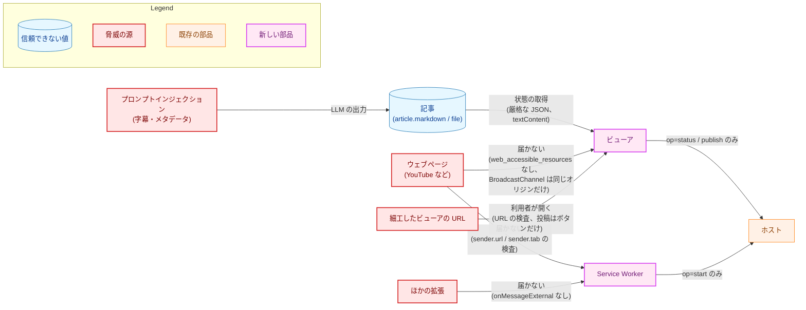

| 脅威 | 防御 | 残余 |
|---|---|---|
| 記事に仕込まれた HTML・スクリプト・リンクが、ビューアで動く（ビューアは `nativeMessaging` を呼べる） | 記事は `textContent` だけで表示し、HTML を解釈する API を lint で禁止し、既定の CSP を緩めない（3.11）。記事の中のリンクはリンクにしない | 利用者が、記事の中の URL の文字列をコピーして開くこと |
| 厳格でない解析による、記事の取り違え（重複したメンバの後勝ちで別の記事を表示する、など） | 厳格な JSON の解析（3.2）と、過不足のないメンバの集合（3.3） | なし |
| ウェブページが SW に生成の開始を求める（料金がかかる） | ページの文脈には拡張の `chrome.runtime` がない。注入したスクリプトからの送信は `sender.tab` で拒否し、ほかの拡張のページは `sender.url` で拒否する（3.4、AC-05） | なし |
| ウェブページがビューアを開く・埋め込む | `web_accessible_resources` を持たない（3.14） | なし |
| 細工したビューアの URL を利用者に開かせる | URL の値は検査し（3.5）、`textContent` で表示する。開いただけで送るのは状態の取得だけで、投稿は利用者のボタンの操作でだけ送る。キーはサーバのプロセスごとの秘密から計算するので、他人が今のサーバの記事のキーを知る手段はない | 細工した見出しの文字列で利用者を誤解させること（ビューアの見出しは URL の値だと README に書く） |
| ポーリングによるホストの起動の繰り返し | 間隔は 2 秒、1 ページに 1 つまで、直らない結果で止める（3.6） | ビューアを多く開くと、その数だけホストが起動する（要件 4.1 で許容） |
| ブラウザの履歴に残る値 | 履歴に残るのは 3.5 の 6 つの値だけで、字幕と概要欄は入らない（AC-09） | 見出し・チャンネル名・動画タイトル・キーが履歴に残る（要件 4.2 で許容。キーはサーバの再起動の後は使えない） |
| 開発者向けのログからの漏えい | ログには、固定のラベル・結果の種類・検査の種類・経過時間だけを出す。字幕・記事・メタデータの値・キー・URL の値は出さない（要件 4.2） | なし |

### 5.2. 信頼できない入力の境界

要件 3.2 の表の境界と、本設計の対応を示す。

| 境界 | 検査する場所 | 拒否したときの扱い |
|---|---|---|
| ホストの応答（外側） | `native.ts` の今の検査（3.1） | 想定外の応答 |
| サーバの応答の本文 | `strictJson.ts` と `response.ts`（3.2・3.3） | 想定外の応答 |
| ビューアの URL | `viewerUrl.ts`（3.5） | `invalid-link` を表示し、何も送らない |
| SW が受け取る生成の開始の求め | `sender` の検査と `parseStartRequest`（3.4） | 応答せず、何も送らず、タブも開かない |
| ビューアが受け取る生成の開始の結果 | `parseAwaitStartReply`（3.4） | 無視し、期限で `no-result` |
| ポップアップが受け取る SW の応答 | `parseStartReply`（3.4） | `no-result` |
| `BroadcastChannel` のメッセージ | `parseViewerChannelMessage`（3.4） | 無視する。答えがなければ閉じない・新しいタブを開く |

### 5.3. 権限

権限は `activeTab`・`scripting`・`nativeMessaging` のままで（3.14）、要件 4.2 の加えない権限のどれも加えない。使う API のうち、権限が要らないもの（`chrome.tabs` のタブの作成・選択・削除・取得、`chrome.windows.update`、`BroadcastChannel`、Blob のダウンロード、Clipboard API）は、3.15 で確かめる。

## 6. 処理フロー詳細 (Processing Flow Details)

### 6.1. 生成の開始（SW）

SW が生成の開始の求めを受けてから応答するまでを示す。

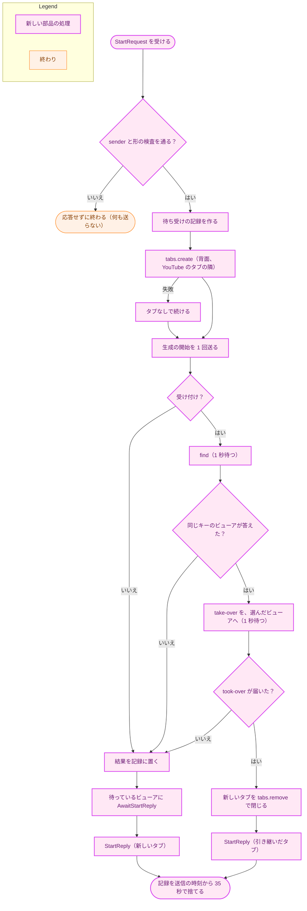

矢印は処理の順を表す。

-   **ビューアを開く位置**は、`source` の YouTube のタブの隣（`index + 1`、同じウィンドウ、`openerTabId` に YouTube のタブ）とする（H-07）。タブを開けなかった場合も、生成の開始は送る。結果はポップアップにだけ届き、ポップアップの「ビューアを開く」は新しいタブを開く。
-   **選ぶビューア**（同じキーのビューアが 2 つ以上答えた場合、H-01）: 送信の時刻が最も古いもの、同じならタブの ID が最も小さいものを選ぶ。最も古いビューアは、利用者が最初に開いた記事のタブである。ポップアップの「ビューアを開く」も同じ規則で選ぶ（6.6）ので、2 つの選び方は一致する。
-   **ポップアップへの応答**は、ポップアップが閉じていれば届かない。SW は届いたかを確かめず、送り直さない。

### 6.2. 同じキーのビューアの再利用

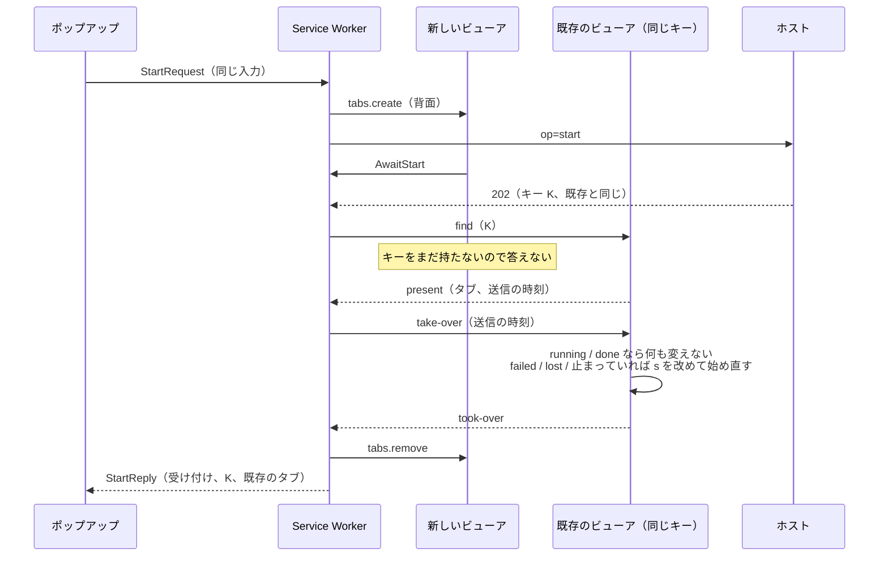

矢印 A → B は「A が B にメッセージを送る、または API を呼ぶ」を表す。破線は応答である。

### 6.3. ビューアの起動

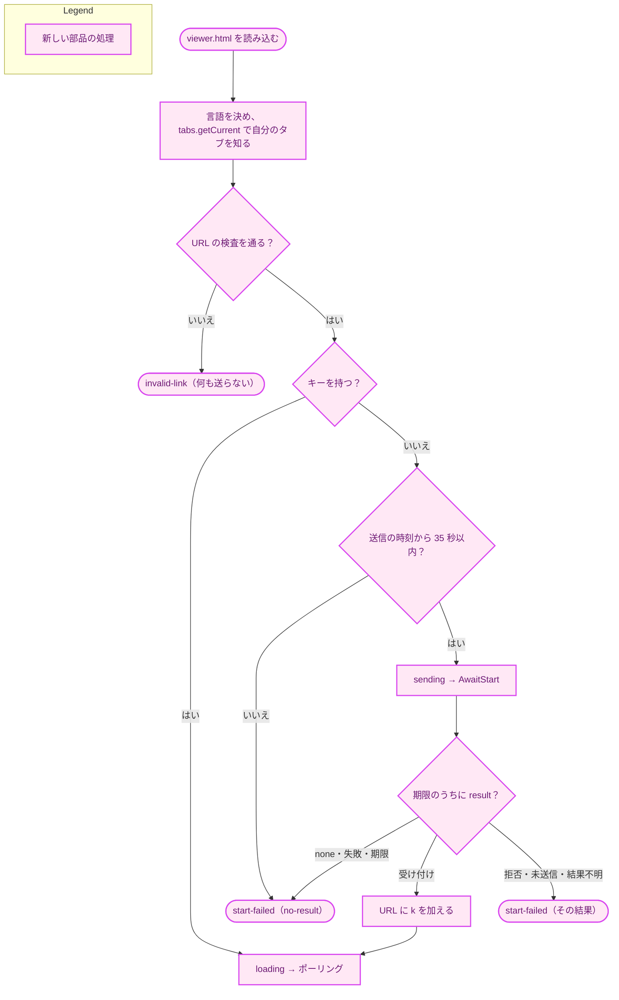

矢印は処理の順を表す。どの状態でも、見出し・チャンネル名・元動画へのリンクは、URL の検査を通った時点で描く（AC-27）。

### 6.4. ポーリングの状態

ビューアとポップアップに共通の、ポーリングの状態の移り変わりを示す。矢印 A → B は「出来事によって A から B に移る」を表す。

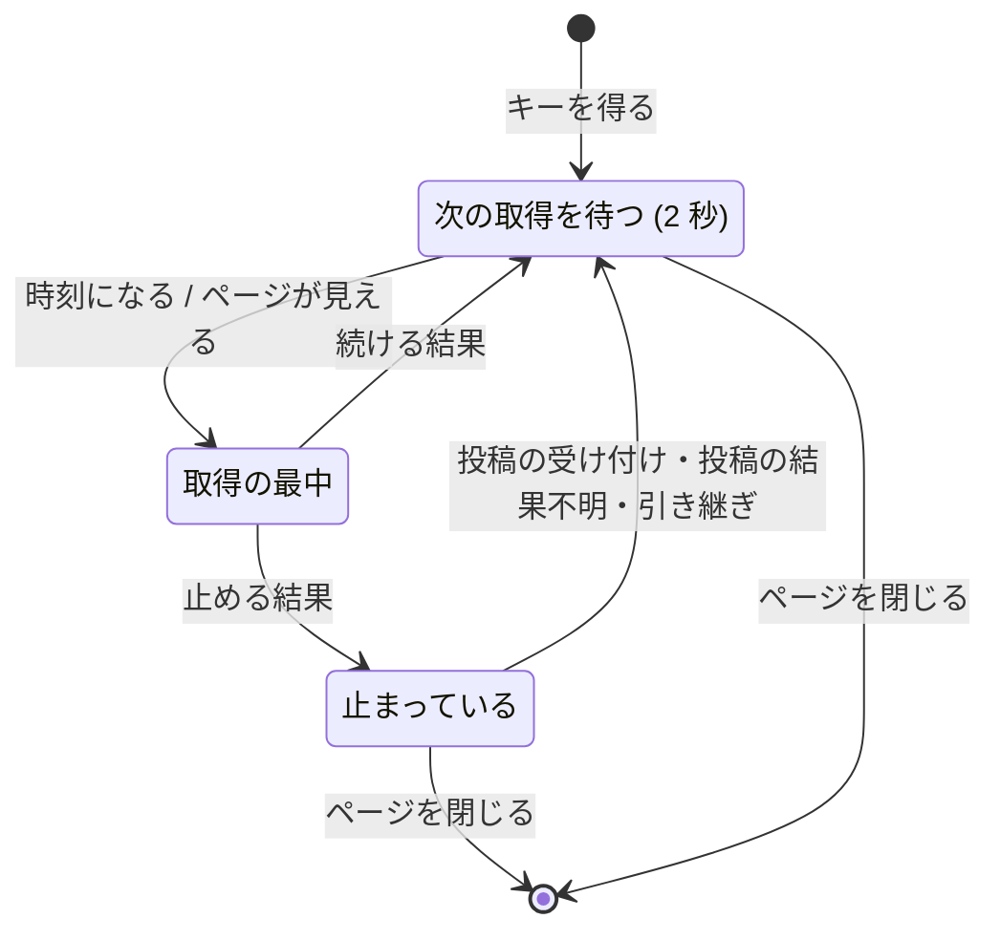

### 6.5. 投稿

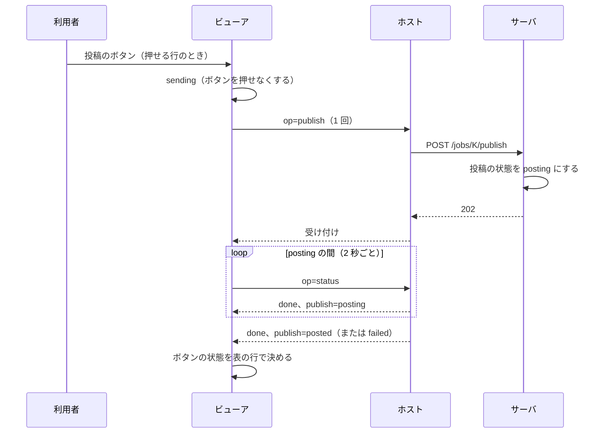

矢印 A → B は「A が B にメッセージを送る、または操作する」を表す。破線は応答である。拒否と結果不明では、投稿の操作を送り直さない（3.8）。

### 6.6. ビューアを開く（ポップアップ）

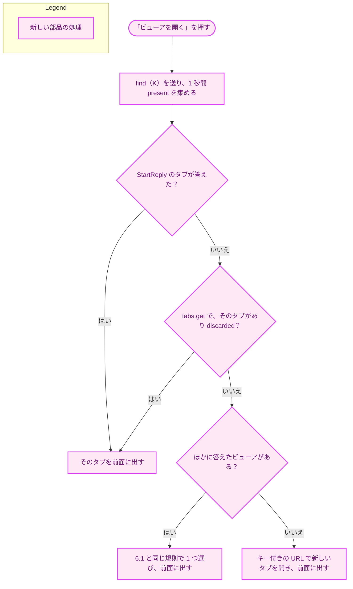

矢印は処理の順を表す。

-   **前面に出す**とは、`tabs.update(tabId, {active: true})` と `windows.update(windowId, {focused: true})` を呼ぶことである（要件 F-004）。ウィンドウを前面に出すと、ポップアップは閉じる。
-   ブラウザがメモリを空けるために破棄した（`discarded`）タブは問い合わせに答えない。それでも、選べば元の URL を読み込み直すので、`tabs.get` の `discarded` で見分けて前面に出す。`Tab.discarded` は `tabs` の権限なしで読める（`url` と `title` だけが権限を要する）。
-   新しいタブの URL は、ポップアップが持つビューアの種に、キーを加えて作る。送信の時刻は、この送信の時刻である。
-   どの場合も、生成の開始は送らない（AC-21）。

## 7. テスト戦略 (Test Strategy)

### 7.1. ユニットテスト

今の作り方（`node --test`、jsdom、`test/helpers/` の fake。`extension/test/launch.test.ts:1-60`・`test/helpers/native.ts`）に合わせる（H-13）。実際のブラウザ・ホスト・サーバは呼ばない（要件 5 章）。

-   **fake**: `chrome.runtime`（`sendMessage`・`onMessage` と `sender`）、`chrome.tabs`、`chrome.windows`、`BroadcastChannel`（同じテストの中の複数の端点の間で届く fake）、クリップボード、ダウンロード（`<a>` の `click` を記録する）を、`chromeDeps.ts` のインタフェースの形で作る。`sendNative` は今の `recordingNative`・`deferredNative` を、新しい形のメッセージに広げる。
-   **時刻とタイマー**: `now()` と `schedule()` を注入し、fake の時計で、ポーリングの間隔・1 つまでの規則・見えたときの取得・結果を待つ期限（35 秒）・問い合わせの 1 秒を確かめる。
-   **厳格な JSON**: 3.2 の表の各規則に、拒否する入力と受理する入力の両方を置く。`internal/strictjson` のテストが拒否する入力の代表（重複したメンバ、対になっていないサロゲート、後続のデータ、BOM、正しくない UTF-8）を、拡張の側でも拒否することを確かめる。
-   **応答の検査**: AC-41 の各項目に 1 つ以上の入力を置く。AC-42 は、256 KiB いっぱいの完了した記事の応答（Go の `json.Marshal` と同じエスケープを含む本文）を受理し、記事が一致することを確かめる。
-   **文書との突き合わせ**: `test/jobCodes.test.ts` が、`development.md`「ジョブの API のコード」の各表の値の集合と、拡張の `Record<…, true>` の集合（ジョブの状態・工程・工程の状態・失敗・投稿の状態・投稿の理由）が等しいことを確かめる。`test/serverReasons.test.ts` は 3.16 のとおり改める。どちらも値と構造だけを比べ、文の意味を確かめない（[CLAUDE.md](../../../CLAUDE.md)「Document tests check values, structure…」）。表の見出しと列の名前は、ガードのテストの日本語のリテラルの例外に当たる。
-   **描画**: jsdom で、ビューアの骨格（`static/viewer.html`）に各状態を描き、要素・属性・文言・`disabled`・状態の領域を確かめる。`renderArticleBody` には AC-25 の入力（`` など）を与え、子の要素が 1 つもできず、`textContent` が一致することを確かめる。
-   **CSS**: 今の `test/style.test.ts` のコントラストの計算を、`theme.css` の変数と新しい組に広げる。`prefers-reduced-motion` の規則が印と `running` の記号の `animation` を止めること、押せる要素の最小の大きさの規則を確かめる（AC-45・AC-48・AC-50・AC-51）。

### 7.2. 統合テスト（手動）

実装の最初のフェーズで、3.15 の振る舞いを試作で確かめる。完成の後、ビルドした拡張をサーバ・ホストとともに動かし、次を確かめる。手順と結果は実装計画に残す。

-   主ボタンを押してすぐポップアップを閉じ、ビューアに記事が出る（AC-02）。
-   同じ入力をもう一度送り、新しいタブが閉じて、最初のビューアが残る（AC-08）。既存のビューアのタブを破棄（`chrome://discards`）した状態で送ると、新しいタブが残る。
-   保存したファイルを `cmp` で `--out` のファイルと比べる（AC-33）。コピーした文字列を貼り付けて比べる（AC-35）。
-   背面に 5 分以上置いたビューアを前面に出し、すぐに状態が更新される（1.2 の決定）。
-   VoiceOver で、状態の変化が読み上げられ、経過時間が読み上げられないことを確かめる（AC-47）。
-   ライトとダーク、`prefers-reduced-motion` の切り替えでの見え方を、`popup-preview.ts` が書き出すページで確かめる。

### 7.3. セキュリティテスト

-   AC-05: `onMessage` の fake に、`sender.tab` を持つもの、`sender.url` が `viewer.html` のもの、`sender.id` が違うもの、形の違うもの、4 MiB を超えるものを渡し、`sendNative` も `tabs.create` も呼ばれないことを確かめる。
-   AC-25: 3.11 のとおり。
-   AC-43: 3.5 の拒否の各項目に 1 つ以上の URL を置き、状態の取得が送られないことを確かめる。
-   AC-09: `ViewerSeed` から作った URL に、字幕と概要欄の文字列が含まれないことを、両方に目印の文字列を入れた入力で確かめる。
-   lint: `windows` が `chromeDeps.ts` の外で禁止されたままであること（3.16）。

### 7.4. 受け入れ基準と設計の対応

| AC | 設計の節 | 検証の種類 |
|---|---|---|
| AC-01 | 3.1 | test（ホストが受け取るメッセージの形と、`v` のないメッセージを作る経路がないこと） |
| AC-02 | 3.4・6.1 | test（ポップアップの終了の後も SW が送り、ビューアに届く）・手動 |
| AC-03 | 3.1・4.2 | test |
| AC-04 | 3.12 | manual（文言を PR で読む） |
| AC-05 | 3.4 | test |
| AC-06 | 6.1 | test（`tabs.create` の `active:false`）・手動 |
| AC-07 | 3.5・3.6 | test |
| AC-08 | 3.6・6.1・6.2 | test |
| AC-09 | 3.5 | test |
| AC-10 | 3.6 | test |
| AC-11〜AC-19 | 3.6 | test |
| AC-20〜AC-24 | 3.7・6.6 | test |
| AC-25〜AC-27 | 3.11 | test |
| AC-28〜AC-30・AC-32 | 3.8 | test |
| AC-31 | 3.8・3.12 | test（送り直さないこと）と manual（文言） |
| AC-33・AC-34 | 3.9 | test |
| AC-35・AC-36 | 3.10 | test |
| AC-37 | 3.12 | test（型の検査と catalog のテスト） |
| AC-38 | 3.16 | test（`serverReasons.test.ts`） |
| AC-39 | 3.17 の文書の行 | manual |
| AC-40 | 3.16・3.17 | test（既存のガードが通る） |
| AC-41・AC-42 | 3.2・3.3 | test |
| AC-43 | 3.5 | test |
| AC-44〜AC-51 | 3.13 | test・static（CSS の規則）と手動の確認 |
| AC-52 | 3.6・3.13 | test |

## 8. 実装優先順位 (Implementation Priorities)

1.  **確認の試作**（3.15）: 試作の拡張で、権限なしのタブ・ウィンドウの操作、SW の `BroadcastChannel`、Blob の保存、クリップボード、SW の寿命、`Intl.NumberFormat` の文字列の書式を確かめる。崩れたものは、3.15 の代わりの方法に切り替えてから先に進む。
2.  **やり取りと検査**: `strictJson.ts`、`response.ts` の書き換え、`native.ts` と `send.ts` の一般化、Go のガードの上限の確かめ。
3.  **純粋な判断**: `viewerUrl.ts`、`poll.ts`、`jobView.ts`（`publishControl` を含む）、`fileName.ts`、`extensionMessages.ts`、文言の節。
4.  **SW と manifest**: `background.ts`・`startCoordinator.ts`、manifest、ビルドと `check-dist.ts`、`chromeDeps.ts` のラッパー、lint の規則の例外。
5.  **ビューア**: `viewer.html`・CSS（`theme.css` への移動を含む）・`viewerApp.ts`・描画・アクセシビリティ。
6.  **ポップアップ**: `JobPopupView`、`launch.ts` の経路、ビューアを開く・やり直す。
7.  **古いコードの削除と文書**: `/articles` の検査と Slack の文言の削除、`renderSend.ts` の削除、ガードの更新、README（と `/mktrans`）・`development.md`・`security.md`・`project_overview.md`・`CLAUDE.md`・用語集。

2 と 3 は、ほかの段階から独立しているので先に作れる。4 は 2 に、5 と 6 は 2〜4 に依る。

## 9. 将来の拡張性 (Future Extensibility)

-   **#504 の Markdown の描画**: `renderArticleBody`（3.11）とその CSS の規則だけを差し替える。描画の安全性の規則（リンクの扱い、HTML を作らない方法）は #504 で決める。保存とコピーは、表示用の Markdown とファイルの中身を変えずに使い続ける。
-   **#526 の今の形の削除**: 拡張はすでに今の形を送らないので、拡張の変更は要らない。ホストの経路の選択と、サーバの `/articles` を削除する。
-   **#505 の統計**: 状態の取得が返す値（料金・所要時間・工程）は `JobDisplay` にあるので、表示を加えるときは `renderJob.ts` に足す。
-   **応答のメンバが増える場合**: 3.3 の検査は拡張可能なメンバを持たないので、サーバがメンバを加えると、拡張は想定外の応答にする。サーバ・ホスト・拡張を同じ版にそろえる前提（要件 4.4）を、README で案内し続ける。

## 付録 A. design_handoff の各項目への対応

| 項目 | 対応 |
|---|---|
| H-01 | SW が生成の開始を送り、状態の取得と投稿の操作はポップアップとビューアが自分で送る（2.1）。ポップアップの求めの形と送り手の確かめ（3.4）。ビューアへの結果の渡し方（`AwaitStart` を `sender.tab.id` で対応づけ、再読み込みでも期限まで受け取れる）、期限は送信の時刻から 35 秒、期限の後の結果は無視（3.6）。SW の寿命は 1.2 の Chrome 110 の決定と 3.15。再利用は SW が `BroadcastChannel` で調整し（1.2・6.1・6.2）、答えを 1 秒待ち、2 つ以上なら送信の時刻が最も古いもの、引き継いだタブは `StartReply` でポップアップに渡す。「ビューアを開く」で探す方法は 6.6 |
| H-02 | クエリの 6 つの名前、`encodeURIComponent`、上限、拒否の規則、送信の時刻はミリ秒の整数、`history.replaceState` で書き換える（3.5） |
| H-03 | 外部のライブラリなしの厳格な JSON の解析（3.2）。上限は 512 KiB、操作と状態ごとのメンバの集合、`cost.usd` の形、状態コードとの組（3.3）。文書との突き合わせのガードを設ける（7.1） |
| H-04 | 間隔 2 秒、止める条件と続け方（3.6 の表）、背面のタブの間引きへの対処として見えたときの取得（1.2）、ポップアップとビューアは独立にポーリングし、1 ページに 1 つまで |
| H-05 | 使えない文字の集合・UTF-8 で 200 バイトの上限・先頭の `.`（3.9）。`<a download>` と Blob、MIME の型、60 秒後の解放、動画 ID の取り出し（3.9）。権限なしで保存できることは 3.15 で確かめる |
| H-06 | `navigator.clipboard.writeText` をクリックの処理の中で呼び、失敗を状態の領域に表示する（3.10）。権限なしで動くことは 3.15 で確かめる |
| H-07 | `tabs.create`（背面、YouTube のタブの隣）・`tabs.update`・`windows.update`・`tabs.remove`・`tabs.getCurrent`・`tabs.get` の `discarded`（6.1・6.6）。閉じたことは問い合わせの答えと `tabs.get` で知る。自分のタブを閉じるのは SW の `tabs.remove` で、`window.close` は使わない。破棄・凍結されたタブが答えない影響は 4.2 と 6.6。権限なしで動くことは 3.15 で確かめる |
| H-08 | `PopupView` に `job` を加え、状態と主ボタンの操作を判別共用体で持つ（3.7）。状態の領域の最初の変化の時機（3.7） |
| H-09 | 文言の節（3.12）、経過時間と所要時間は `Intl.NumberFormat` の単位、料金は `Intl.NumberFormat` の通貨に文字列を渡す、工程の名前は用語集に合わせる（3.12） |
| H-10 | `background.service_worker` を `type: "module"`、`viewer.html` と CSS の配置、`check-dist.ts` と `manifest.test.ts` の更新、権限と `web_accessible_resources` のガード、`minimum_chrome_version` は 110（1.2・3.14） |
| H-11 | `/articles` の応答の検査・Slack の文言・`ServerRejectReason` を、3 つの操作の検査と理由の集合に置き換える（3.3・3.16）。`serverReasons.test.ts` と `metadataDocs.test.ts` などのガードを、書き直す文書に合わせる（3.16・3.17） |
| H-12 | ロード中の印・状態の領域・読み上げの頻度・フォーカス・工程のチェックリストの要素・`disabled`・配色、各 AC の検証の方法（3.13・7.1） |
| H-13 | fake・jsdom・時刻とタイマーの注入（7.1） |
| H-14 | `renderArticleBody` を境界とし、ほかの表示と分ける（3.11・9 章） |
