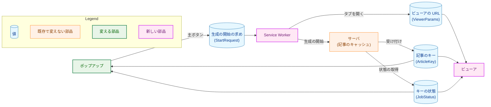
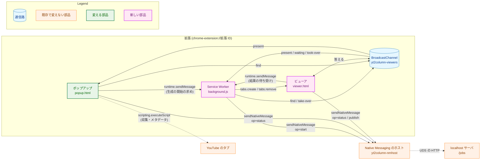
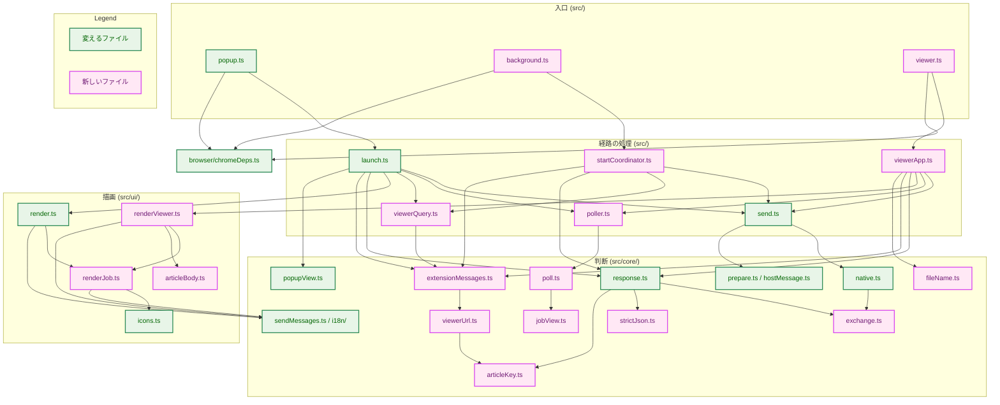
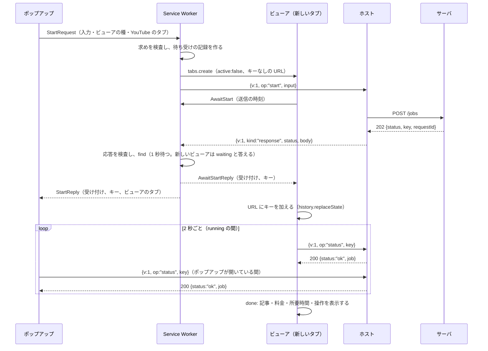
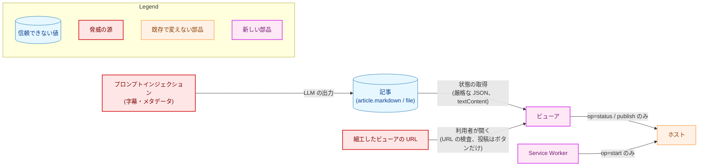
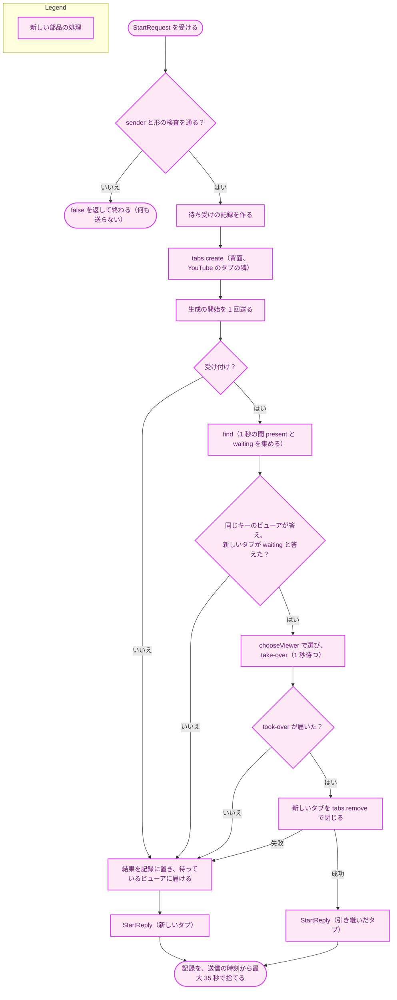
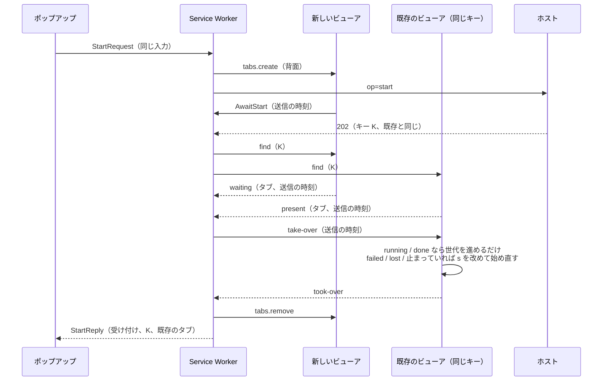
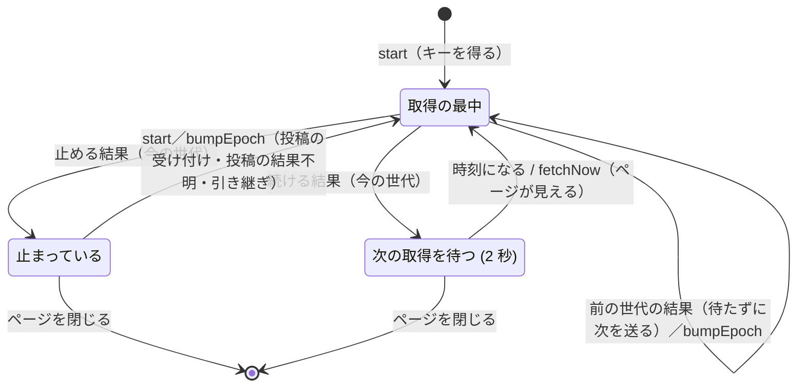
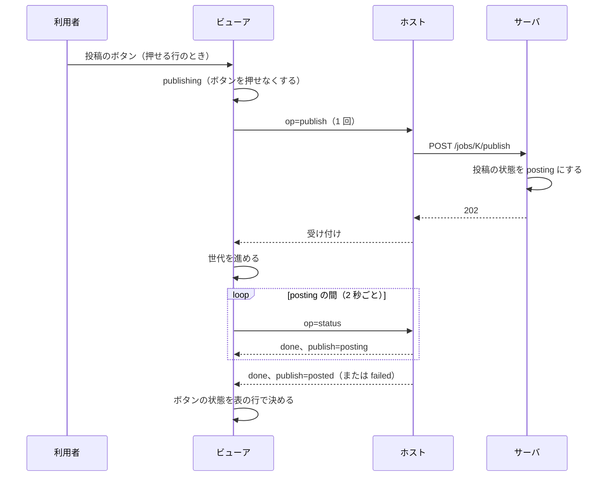
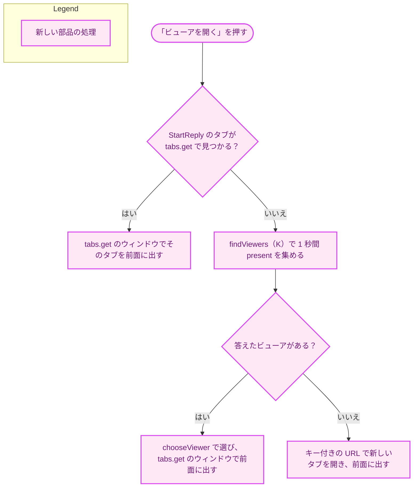

# 設計書：拡張を新しい API に移し、ビューアのタブで記事を表示・投稿・保存する

## Document Status

| Item | Value |
|---|---|
| Status | `approved` |
| Created | 2026-10-31 |
| Review date | 2026-11-01 |
| Reviewer | isseis |
| Comments | 2026-10-31 (decision, approved in session): `/mkplan` の調査で、`extension/test/secretsAbsent.test.ts` が `webhook` と `SLACK_WEBHOOK_URL` の語を禁じ、本設計の応答のメンバ・拒否と投稿の理由・文言と両立しないことが分かった。3.17 に「秘密情報の語のガード」の項目を、3.18 に同じテストの行を加えた。ガードの狭め方は、レビュアー（isseis）が `/mkplan` のセッションの中で選び、承認した。その時点では状態を `approved` のままとした（その後、下の項目のとおり `draft` に戻した）。ほかの決定は変えていない。<br>2026-10-31 (decision, approved in session): `/mkplan` のレビューで、`extension/eslint.config.js` のブランドの型の別名の規則が、本設計の判別共用体を lint で拒否することが分かった。3.17 に「ブランドの型の別名の lint の規則」の項目を加えた。規則の狭め方は、レビュアー（isseis）が `/mkplan` のセッションの中で選び、承認した。その時点では状態を `approved` のままとした（その後、下の項目のとおり `draft` に戻した）。ほかの決定は変えていない。<br>2026-10-31 (editorial): ローカルの CLI のレビューの指摘で、上の 2 つの項目の書き方を、レビュアーが選んだ原則（オブジェクトの型の中の参照だけを許す、文言の中の `SLACK_WEBHOOK_URL` だけを許す）に合わせて正確にした。交差型の別名と、文言のファイルのコードの中の語を、許さないことを明記した。決定は変えていない。<br>2026-10-31 (decision, approved in session): 3.17「README を読むガード」を改めた。`extension/test/metadataDocs.test.ts:64-78` の socket directory の確認は README を読まず、英語の未送信の文言が `README.en.md` を名指すことと、そのファイルの存在を確かめるので、記述を実際の確認に合わせた。この確認は付け替えずに消す（直書きのリテラルで、タスク 0048 の 1 回の変更を確かめるだけであるため）。レビュアー（isseis）が `/mkplan` のセッションの中で承認した。その時点では状態を `approved` のままとした（その後、下の項目のとおり `draft` に戻した）。ほかの決定は変えていない。<br>2026-10-31 (decision, reset to draft): 上の 3 つの「セッションの中で承認した」は、決定変更を `approved` のまま残した点で誤りであった。`docs/dev/conventions/requirements_process.md`「Editing an approved document」が `approved` のままの再承認を許すのは、`/runplan` の実装中に見つかった決定変更を、その場でレビュアーが承認した場合だけである。3.17 のガードの緩和と、既存のテストの削除は決定変更であり、`/mkplan` での承認はこの例外に当たらない。そこで状態を `draft` に戻し、`Review date` と `Reviewer` を `-` にした。再承認は `/runpr` のマージの質問で受ける。決定の内容（3.17 の 3 つの項目と、テストの削除）は変えていない。<br>2026-11-01 (decision, approved in session): `/runplan` のステップ 1-1 で、3.16 の振る舞いを試作で確かめた（Chrome 156.0.8078.74・Brave 1.98.62。実装計画 4.3.1）。違ったのは行 10 で、凍結されたタブは問いに答え、破棄されたタブには新しいタブの ID が付く。凍結されたタブについては、4.2・6.6・7.2 の期待を観察に合わせた。破棄されたタブについては、「ビューアを開く」が同じキーの新しいタブを開くことを制約として受け入れ、6.6 に残余として書いた（要件 F-004・AC-21 の例外）。どちらも作りは変えない。この扱いは、レビュアー（isseis）がセッションの中で選び、承認した。<br>2026-11-01 (editorial): 同じ確認で、行 6 は、止まっていた SW が、送った直後にスクリプトが同期的に閉じたポップアップからのメッセージを受け取らないことが分かった。100 ms の後に閉じた場合と、利用者が手で閉じた場合は届いた。本設計のポップアップは送った後に自分では閉じないので、送り方は `runtime.sendMessage` のまま変えない（レビュアーがセッションの中で選んだ）。この前提を 3.4.1 の項目 5 に、確かめた条件を 3.16 に書いた。決定は変えていない。<br>2026-11-01 (editorial): レビュアー（isseis）の依頼で、付録 B「決定の履歴」を加えた。ビューアの開き方、ポップアップを閉じるかどうか、引き継ぎを調整する部品について、採らなかった案とその理由を記録した。理由は、要件の「要件定義の際に決めたこと」、本書 1.2・3.4.1・3.16、実装計画 4.3.1 にあるものと、タスク 0020・0027 の経緯である。決定は変えていない。主要な決定を ADR にまとめることは #602 で扱う。<br>2026-11-01 (editorial correction): PR-3 の実装で、3.17「秘密情報の語のガード」の語の書き方を改めた。レビューで、`webhook-url`（HTML の ID の形）と `webhook.url` が 3 つの語のどれにも当たらないことが分かったので、`webhook` と `url` の間に区切りを 1 つ挟む形も拒否するようにし、許す文字列リテラルを値の位置に限った（プロパティの名前・型などは拒否する）。目的（URL の設定の名前を持たないこと）は変えていない。<br>2026-11-01 (editorial correction): PR-4 の実装のレビューで、2 点を改めた。(1) 3.6 の `unknown` の行に、直前が `kept` を持つ `lost` の場合を加えた。3.7 の世代の規則では、前の世代の結果が `lost` を表示した後に、新しい世代の取得がもう一度 `unknown` を返しうる。そのとき記事を捨てると、要件 AC-15 の「表示中の記事と保存・コピーの操作を残す」を満たせない。(2) 3.9 の `PublishOpNotice` の `unknown` に、やり取りの結果を持たせた。3.13 は投稿の操作の応答なし・ホストの失敗・想定外の応答に別々の文言を置くので、3.9 の型がそれを選べるようにした。どちらも、要件と 3.13 が定めた振る舞いに型と表を合わせたもので、決定は変えていない。<br>2026-11-01 (editorial correction): PR-5 の実装で、3.4 の `parseStartRequest` の戻り値を改めた。4.4 の `yt2column start request` のログは、拒否した検査として `shape` と `size` を分けて書くが、`StartRequest | undefined` ではこの 2 つを区別できない。そこで、検査を通ったときは求めと `prepareStartInput` で測った `PreparedRequest` を、落ちたときは検査の種類を返す形にした。検査の内容（3.4.1 の項目 3 の 4）は変えていない。決定は変えていない。<br>2026-11-02 (editorial correction): PR-6 の実装のレビューで、3.14 の状態の表示の要約に「投稿の状態の変化」を加えた。投稿の状態はポーリングで変わり、投稿のボタンの横の表示は状態の領域でないため、AC-47 の「投稿の結果」を支援技術に伝えるためである。決定は変えていない。 |

本書は [01_requirements.md](01_requirements.md)（以下「要件」）を満たす設計を定める。要件の用語（新しい API、ビューア、ビューアの URL、送信の時刻、やり取りの結果、結果不明など）は要件 6 章の定義に従う。各節の見出しの括弧にある F-…・AC-…・H-… と、数字だけの節番号（3.2、4.5 など）は、要件の項目と章を指す。本文の「（3.3）」のような参照は、本書の節を指す。既存のコードの行番号は、コミット `577e7b51` で確かめた。

## 1. 設計の全体像 (Design Overview)

### 1.1. 設計原則

-   **状態の正しい値はサーバにある。** Service Worker（以下 SW）は生成の開始を 1 回送り、結果を配るだけで、ポーリングはしない。ポップアップとビューアは、記事のキーを使って自分で状態の取得を送る。SW が止まっても、キーを受け取った後の表示は失われない（要件 4.3）。
-   **拡張は何も保存しない。** 送信ごとの値は、ビューアの URL と各ページのメモリにだけある。SW のメモリにある値は、ビューアに届けるまでの短い間だけのものである。
-   **3 つの操作は 1 つのやり取りの経路を共有する。** ホストとの 1 回のやり取り（25 秒の上限、ホストの応答の外側の検査）は、生成の開始・状態の取得・投稿の操作で同じ関数を通る。操作ごとに違うのは、送るメッセージと、サーバの応答の本文の検査だけである（要件 4.5「DRY」）。
-   **受け取る値は、厳格に検査してから型にする。** 次の値は、どれも検査を通るまで信頼しない。
    -   サーバの応答の本文
    -   ビューアの URL
    -   拡張の中のメッセージ

    検査は補正せずに拒否し（[CLAUDE.md](../../../CLAUDE.md)「Reject, don't normalize」）、通った値だけを判別共用体の型にする。表示・ポーリング・投稿のボタンは、その型の `switch` で振る舞いを選ぶ（「Declare, don't infer」）。検査済みであることを型で示す値（記事のキー・料金の金額・送ってよい本文）は、それぞれを作れる関数を 1 つに限る（「Enforce invariants with the type」）。
-   **判断は純粋な関数に、ブラウザの API は薄いラッパーに置く。** 今の拡張と同じく、`src/core/` は DOM とブラウザの API を使わない純粋な関数だけを持つ。ブラウザの API を呼ぶのは `src/browser/chromeDeps.ts` だけである。経路の処理（SW・ポップアップ・ビューア）は、依存を注入して組み立て、fake でテストする。
-   **記事は文字として扱う。** 記事の文字列は、`textContent` で表示し、Blob で保存し、クリップボードにそのまま書く。HTML として解釈する経路は作らない（要件 4.2）。本文の表示は 1 つの部品にまとめ、#504 でそこだけを差し替える。

### 1.2. 設計の際に決めたこと（2026-10-31）

-   **同じキーのビューアの再利用は、SW が調整する。**
    -   流れ: SW は、生成の開始が受け付けられてキーを受け取ると、`BroadcastChannel` を通じてビューアに、同じキーを表示しているかを尋ねる。答えたビューアがあれば、そのビューアに引き継ぎを頼み、新しいビューアのタブを `chrome.tabs.remove` で閉じる。そして、引き継いだタブをポップアップへの応答で返す。
    -   理由: 調整が 1 か所に集まる。また、ポップアップは「ビューアを開く」で前面に出すタブを、推測ではなく SW の応答で知ることができる。
    -   要件との関係: 要件 F-002 は閉じる主体を「新しいビューア」と書く。しかし要件は内部の構成を設計に委ねており（要件 1 章「本書の記述範囲」）、利用者から見える振る舞い（AC-08）は同じである。権限は加えない。
    -   閉じる前の確認: 閉じるのは、閉じる時点でそのタブにまだ「この送信の結果を待っているビューア」があると確かめられた場合だけである（3.6）。待っていたタブを利用者が別のページに移していても、そのページを閉じることはない。
-   **確かめていないブラウザの振る舞いは、Chrome の文書に基づいて設計する。** 実装の最初のフェーズで、試作を使って手動で確かめる。対象と、崩れた場合の代わりの方法は 3.16 に挙げる。
    -   理由: どの振る舞いも Chrome の公開の文書に書かれている。設計の前に試作で確かめる手間（利用者の手作業）に見合うほど、崩れる見込みは高くない。代わりの方法を先に決めておけば、崩れても設計の骨格は変わらない。
-   **`minimum_chrome_version` を 103 から 110 に上げる。** README に書く（要件 4.4）。
    -   理由: 生成の開始のやり取りは、最大 25 秒かかる。その間、ブラウザの API の呼び出しはない。Chrome 109 以前の SW は、イベントから 30 秒たつと止められうる。Chrome 110 以降は、拡張の API の呼び出しとイベントが、アイドルのタイマーを延ばす。
    -   残る時間の見積もりは 3.4 に書く。
-   **ポーリングの間隔は 2 秒の固定とし、ページが見えるようになったら待たずに 1 回取得する。**
    -   2 秒にする理由: 状態の取得のたびにホストのプロセスが 1 つ起動するので、要件の下限（1 秒）の倍にする。
    -   見えたら取得する理由: Chrome は背面のタブのタイマーを間引く。5 分を超えて隠れたタブでは、タイマーを次々に張り直す処理が 1 分に 1 回に間引かれる。そのため、隠れていたビューアが見えたときに古い表示が残らないよう、見えた時点で取得する。
    -   これは間隔を広げる仕組みでも、取得を省く仕組みでもない（要件 4.1）。

### 1.3. 概念モデル

送信 1 回の値と、それを持つ場所の関係を示す。矢印 A → B は「A が B を作る、または B に値を渡す」を表す。



-   **生成の開始の求め**は、ポップアップが SW に渡す。次の 2 つを持つ。
    -   生成の開始の入力: 今の本文と同じ値。
    -   ビューアの種: ビューアの URL に入れる値。
-   **ビューアの URL** は、見出し・チャンネル名・動画タイトル・収集した URL・送信の時刻を持つ。受け付けの後は記事のキーも持つ（3.5）。
-   **記事のキー**は、サーバが返す不透明な文字列である。拡張は空でないことと長さの上限だけを確かめ、形は検査しない（要件 3.2）。
-   **キーの状態**は、状態の取得の応答を検査して作る値である。ジョブの状態ごとに、持つメンバが決まっている（3.3）。

### 1.4. 既存のコードとの関係

-   **送信の経路**: 今のポップアップは、主ボタンが押されると `sendArticle` を 1 回呼び（`extension/src/launch.ts:203-233`）、今の形のメッセージを `chrome.runtime.sendNativeMessage` で送る（`extension/src/browser/chromeDeps.ts:191-213`）。
    -   本タスクでは、生成の開始を SW が送り、状態の取得と投稿の操作をポップアップとビューアが送る。
    -   `sendNativeMessage` を呼ぶのは、今と同じ `chromeDeps.ts` だけである（lint の規則、`extension/eslint.config.js:86-91`・`:250-258`）。3 つのページは、どれも同じラッパーを使う。
-   **応答の検査**: 今の `classifyResponse`（`extension/src/core/response.ts:158-223`）が成り立つのは、受け付ける値がすべて ASCII だからである。
    -   今の検査は、バックスラッシュを拒否し（`:172-176`）、引用符の数でメンバの重複を見つける（`:191-196`）。
    -   記事を含む応答には、バックスラッシュが現れる。Go の `encoding/json` が、`<`・`>`・`&` を `\u003c` などにエスケープして書くためである（`internal/server/status.go:111-119` の `json.Marshal`）。そのため、厳格な JSON の解析を新しく作る（3.2）。
    -   ホストの応答の外側の検査（`extension/src/core/native.ts:114-171`）は、3 つの操作で共有する（3.1）。
-   **送ってよい本文**: 今は、4 MiB の検査を通った本文だけが `PreparedRequest` の型になり（`extension/src/core/prepare.ts:46-80`）、送る関数はこの型だけを受け取る。本タスクも、生成の開始のメッセージをこの型からだけ作る（3.1）。
-   **画面の内容**: ポップアップの `PopupView`（`extension/src/core/popupView.ts:106`）と `renderPopup`（`extension/src/ui/render.ts:293-318`）に種類を加えて、状態を描く（3.8）。これは `0046` の設計 9 章が想定したとおりである。
-   **文言**: `Catalog`（`extension/src/core/i18n/catalog.ts:21-62`）は、理由ごとの節を `Record` で持つ。このため値を加えると、文言の欠けが型の検査で分かる。本タスクの文言もこの形で加える（3.13）。

## 2. システム構成 (System Structure)

### 2.1. 実行時の配置

拡張の 3 つの実行の場所と、ホスト・サーバとの間のやり取りを示す。矢印 A → B は「A が B にメッセージを送る、またはブラウザの API で操作する」を表し、ラベルはその経路である。点線は、本タスクの前からある経路である（Legend はノードの色だけを示す）。



-   **ポップアップ**の役割:
    -   送る前の確認（`0046`）を、今のまま行う。
    -   主ボタンが押されると、生成の開始の求めを SW に送る。
    -   応答で受け取ったキーで、状態の取得をポーリングする。
    -   「ビューアを開く」でタブを前面に出し、「やり直す」で同じ求めをもう一度送る。
-   **SW** の役割:
    -   生成の開始の求めを受けると、ビューアのタブを背面で開き、生成の開始を 1 回送る。
    -   キーを受け取ったら、同じキーのビューアの再利用を調整し、結果をビューアとポップアップに配る。
    -   ポーリングはしない。
-   **ビューア**の役割:
    -   URL の値を検査して表示する。
    -   キーがなければ、SW から生成の開始の結果を待つ。キーがあれば、状態の取得をポーリングする。
    -   投稿・保存・コピーの操作を持つ。
    -   `BroadcastChannel` の問い合わせに答える。
-   **ホストとサーバ**は変えない（要件 2.3）。ホストは、版のメンバ `v` を持つメッセージを、`op` ごとに決めた送り先へ中継する（`internal/nmhost/relay.go:399-410` の `parseOperation`、`:467-510` の `route`）。
-   **`chrome.runtime.onMessage` を登録するのは SW だけである。** `runtime.sendMessage` は、リスナーを持つ拡張のすべてのページに届く。ポップアップとビューアがリスナーを持つと、その一方が SW 宛ての求めに答えうる。そのため、ポップアップとビューアは `onMessage` を登録しない。

### 2.2. ディレクトリ構成とモジュールの依存関係

`extension/src/` の主なモジュールの依存を示す。矢印 A → B は「A が B を import する」を表す。

- この図は主な依存だけを示す。ファイルの一覧（静的なファイルとテストを含む）は、3.18 の責務表のほうが正である。
- `src/core/` は DOM とブラウザの API を使わない（`tsconfig.core.json` が `DOM` の型を持たないので、型の検査が守る）。



依存は一方向である。

-   `exchange.ts` は、どのモジュールも import しない。
-   `native.ts` と `response.ts` は、どちらも `exchange.ts` を import する。互いには import しない。
-   `C11` の 2 つのファイルの役割は次のとおりである。
    -   `prepare.ts`: 送ってよい本文の型を作る、今のファイル。
    -   `hostMessage.ts`: ホストへのメッセージの型を作る、新しいファイル。

### 2.3. データの流れ

主ボタンから記事の表示までの流れを示す（同じキーのビューアがない場合）。再利用の流れは 6.2 に示す。矢印 A → B は「A が B にメッセージを送る、または API を呼ぶ」を表し、破線は応答である。



## 3. コンポーネント設計 (Component Design)

### 3.1. ホストとのやり取り（F-001・F-003・F-006、4.5、H-11）

1 回のやり取りとは、ホストを 1 回起動し、1 つのメッセージを送って 1 つの応答を受け取ることである。これを 3 つの操作で共有する。

**送るメッセージ**は、ホストの新しい形（`{"v":1,"op":…}`）だけである。

-   今の形のメッセージを作る関数は残さない（AC-01）。
-   生成の開始の入力は、4 MiB の検査を通った `PreparedRequest` からだけ作る。
-   `StartInput` は、今の `ArticleBody.message`（`prepare.ts:13-17`。型は `Record<string, string>`）を置き換える型である。`buildArticleBody`（`prepare.ts:25-42`）が作る。
-   SW は、ポップアップから受け取った入力を、`prepare.ts` の新しい関数 `prepareStartInput` で測り直して、`PreparedRequest` にする（3.4）。`buildArticleBody` は `CollectedInput`（`collect.ts` だけが作る型）を受け取るので、`prepareStartInput` からは呼べない。そこで、`StartInput` の UTF-8 の大きさを測る関数を `prepare.ts` に 1 つ置き、`buildArticleBody` と `prepareStartInput` の両方がそれを使う。本文の大きさの測り方は、この 1 か所だけにある。

```ts
// src/core/prepare.ts — the body the extension may send (existing file).
/** The generation start's input: the members of today's request body. */
export interface StartInput {
  readonly videoUrl: string;
  readonly transcript: string;
  readonly title?: string;
  readonly channelName?: string;
  readonly description?: string;
}
export interface ArticleBody {
  readonly message: StartInput;
  readonly byteLength: number;
}
/** The SW's check of an input received from the popup; the only other creator of PreparedRequest. */
export function prepareStartInput(input: StartInput): PrepareOutcome;

// src/core/articleKey.ts — the only creator of ArticleKey.
declare const articleKeyBrand: unique symbol;
/** A non-empty string of at most maxKeyLength code points. Its form is never checked (requirements 3.2). */
export type ArticleKey = string & { readonly [articleKeyBrand]: true };
export const maxKeyLength = 256;
export function parseArticleKey(value: unknown): ArticleKey | undefined;

// src/core/hostMessage.ts — the only messages the extension sends to the host.
export type HostMessage =
  | { readonly v: 1; readonly op: "start"; readonly input: StartInput }
  | { readonly v: 1; readonly op: "status"; readonly key: ArticleKey }
  | { readonly v: 1; readonly op: "publish"; readonly key: ArticleKey };
export function startMessage(request: PreparedRequest): HostMessage;
export function statusMessage(key: ArticleKey): HostMessage;
export function publishMessage(key: ArticleKey): HostMessage;
```

**記事のキー**は、どこで受け取っても `parseArticleKey` だけで型にする。受け取る場所は次の 4 つで、上限（256 コードポイント）はどの場所でも同じである。

-   サーバの応答
-   ビューアの URL
-   SW の応答
-   `BroadcastChannel`

この上限は、サーバのキー（64 文字）より大きい値である。サーバが返したキーを受理した後に、そのキーを加えた URL が、キーの上限を超えて拒否されることはない。`ArticleKey` と、3.3 の `UsdAmount` を lint の `brandNames`（`extension/eslint.config.js:149`）に加え、作れるファイルをそれぞれ `articleKey.ts` と `response.ts` に限る（`creatorConfig`、`:197-208`）。

**やり取りの関数**: 今の `sendArticle`（`extension/src/send.ts:29-55`）を、`HostMessage` を受け取る関数 `exchange` に改める。同じ `send.ts` に置く。

-   `sendTimeoutMs`（25 秒、`send.ts:21`）はそのまま使う。宣言の形も変えない（Go のガード `cmd/yt2column/extension_docs_test.go:120` と `:192-206` が読むため）。
-   関数は、ホストに 1 回だけ送る。25 秒を過ぎたら応答なしとし、送り直さない（要件 4.2「自動で再送しない」）。
-   `SendDeps.sendNative` の引数の型は、`Readonly<Record<string, string>>`（`send.ts:16`）から `HostMessage` に改める。

**ホストの応答の外側**の検査では、`classifyNativeReply`（`native.ts:114-171`）の検査の順と内容（版、`kind`、`kind` ごとのメンバの集合、正規の base64）を変えない。変えるのは次の 2 点だけである。

-   **返す値**: 今は本文を `/articles` の形で解釈するが、本文のバイト列と状態コードを返すように改める。本文の解釈は、操作ごとの関数に任せる。
-   **拡張自身の時間切れ**: 今は想定外の応答（`extension-timeout`、`native.ts:115-117`）に分類する。これを応答なし（`no-response`）に改める。
    -   理由: どちらも結果不明なので、生成の開始の表示の意味は変わらない。違いが出るのは状態の取得である。要件 F-003 は、応答なしでポーリングを続け、想定外の応答では止めると定める。25 秒のうちに答えがなかったことは、繰り返せば直りうる結果である。
    -   この変更で、`sendMessages.ts:36` の `extension-timeout` の行と、`test/native.test.ts` の対応するテストを改める。

ホストのエラーの対応は変えない（`native.ts:69-87`）。

| ホストのエラー | やり取りの結果 |
|---|---|
| `server_unavailable`・`message_too_large` | 未送信 |
| `server_timeout` | 応答なし |
| `protocol_error` | 想定外の応答 |

```ts
// src/core/exchange.ts — the results of one exchange that are not a server response.
export type NotSentCause = "server-unavailable" | "message-too-large";

/** As displayed and as passed between extension pages. */
export type ExchangeFailure =
  | { readonly kind: "not-sent"; readonly cause: NotSentCause }
  | { readonly kind: "no-response" }
  | { readonly kind: "host-failed" }
  | { readonly kind: "unexpected"; readonly check: UnexpectedCheck };

/** As logged: also the server's status of an unexpected reply and the browser's error text. */
export type ExchangeFailureLog =
  | Exclude<ExchangeFailure, { kind: "unexpected" | "host-failed" }>
  | { readonly kind: "unexpected"; readonly check: UnexpectedCheck; readonly status?: number }
  | { readonly kind: "host-failed"; readonly lastError: string | undefined };

/** What the outside of one host reply became. */
export type HostOutcome =
  | { readonly kind: "response"; readonly status: number; readonly bytes: Uint8Array }
  | ExchangeFailureLog;

export const maxResponseBytes = 524_288;
```

**表示の型とログの型**は、今の `SendOutcome` と `SendResult`（`response.ts:91-128`）と同じ形で分ける。ブラウザのエラーの文字列と想定外の応答の状態コードは、ログの型（`…Log`）にだけ持たせる。ログの型から表示の型への変換は、操作ごとに 1 つの関数（今の `toSendOutcome` と同じ役割）だけが行う。

拡張のページの間で渡すのも、表示の型だけである（3.4）。そのため、ブラウザのエラーの文字列は、それが起きたページの開発者向けのログにだけ残る。

### 3.2. 厳格な JSON の解析（3.2、AC-41、H-03）

サーバの応答の本文を、外部のライブラリを使わずに厳格に解析する部品 `src/core/strictJson.ts` を作る。

`JSON.parse` は、次のものを黙って受理する。

-   重複したメンバ（後の値が勝つ）
-   対になっていないサロゲートのエスケープ
-   区別のつかない数の表記（`1.0` と `1` など）

そのため、`JSON.parse` の前後に検査を足すのではなく、バイト列から木を作る解析器を自分で持つ。これは、Go 側の `internal/strictjson` と同じ規則を、拡張の側に持つことになる。言語が違うので、コードは共有できない。そこで規則の一覧を下の表に固定し、両方の規則が同じ代表の入力を拒否することをテストで確かめる（7.1）。

```ts
// src/core/strictJson.ts
/** A parsed JSON value. Numbers keep their source text; nothing is converted here. */
export type JsonValue =
  | { readonly kind: "object"; readonly members: ReadonlyMap<string, JsonValue> }
  | { readonly kind: "array"; readonly items: readonly JsonValue[] }
  | { readonly kind: "string"; readonly value: string }
  | { readonly kind: "number"; readonly text: string }
  | { readonly kind: "boolean"; readonly value: boolean }
  | { readonly kind: "null" };

/** Why the bytes are not one strict JSON value; for the developer log only. */
export type StrictJsonError =
  | "encoding"           // not valid UTF-8
  | "bom"                // starts with U+FEFF
  | "syntax"             // not JSON
  | "duplicate-member"   // a name repeated in one object, at any depth
  | "unpaired-surrogate" // a \uD800-\uDFFF escape without its pair
  | "trailing-data"      // anything but whitespace after the value
  | "too-deep";          // nesting beyond the limit

export type StrictJsonResult =
  | { readonly ok: true; readonly value: JsonValue }
  | { readonly ok: false; readonly error: StrictJsonError };

export function parseStrictJson(bytes: Uint8Array): StrictJsonResult;
```

| 規則 | 扱い |
|---|---|
| 符号化 | 正しくない UTF-8 を拒否する。先頭の BOM を取り除かずに文字として残し、先頭が U+FEFF なら拒否する（今の `response.ts:164-171` の `TextDecoder` の設定と同じ規則） |
| 最上位 | 値は 1 つだけで、後ろには JSON の空白（U+0020・U+0009・U+000A・U+000D）だけを許す |
| オブジェクト | どの階層でも、同じ名前のメンバ（エスケープを復号した後の文字列で比べる）を拒否する |
| 文字列 | 受理するエスケープは、JSON の 8 種と `\uXXXX` だけ。次のものは拒否する。<br>・下位サロゲートの `\uXXXX` が直後に続かない、上位サロゲートの `\uXXXX`<br>・対になる上位サロゲートのない、下位サロゲートの `\uXXXX`<br>・エスケープしていない制御文字（U+0000〜U+001F） |
| 数 | JSON の文法の数だけを受理し、元の表記を `text` に残す。値への変換は、受け取る側が表記の形を確かめてから行う（3.3） |
| 深さ | 入れ子は 16 段までとする。正しい応答の入れ子は 4 段なので、それを超えるものは正しい応答ではない。上限を置くのは、悪意のある深い入れ子で再帰がスタックを使い切らないためである |

### 3.3. サーバの応答の検査（3.2、AC-13・AC-14・AC-41・AC-42、H-03）

`src/core/response.ts` を書き換え、3 つの操作の応答の本文を検査する。受理するのは、`docs/dev/guides/development.md` の「ジョブの API」と「ジョブの API のコード」が定める形と、過不足なく一致するものだけである。

-   拡張可能と宣言するメンバはない。
-   どの検査に落ちても想定外の応答にする。記事・コード・数値の一部だけを使うことはしない。

**本文の上限**は 512 KiB（`maxResponseBytes`、3.1）とする。

-   これは、ホストが中継する上限（`internal/nmhost/relay.go:43`）と同じ値である。サーバの状態の取得の上限（256 KiB、`internal/server/status.go:20`）を下回らない。
-   ホストが中継した応答を、拡張が大きさだけで拒否することはない。
-   上限を超える本文は、解析せずに想定外の応答にする（今の `body-over-limit`、`native.ts:162-164`）。
-   Go のガード `TestNativeHostContract` に、次のことの確かめを加える: `exchange.ts` の宣言 `export const maxResponseBytes = 524_288;` を、今の `sendTimeoutMs` と同じ固定の形で読み、`nmhost.MaxResponseBytesForTest`（`internal/nmhost/test_helpers.go:80`）と等しいこと。

**操作ごとの受理する形**（状態コードと `status` の組）:

| 操作 | 状態コード | `status` | メンバの集合 |
|---|---|---|---|
| 生成の開始 | 202 | `accepted` | `status`・`key`・`requestId` |
| 状態の取得 | 200 | `ok` | `status`・`requestId`・`webhookConfigured`・`job` |
| 投稿の操作 | 202 | `accepted` | `status`・`requestId` |
| どれも | 拒否の理由の表の値 | `rejected` | `status`・`reason`・`requestId` |

**拒否の理由**は、操作ごとに閉じた集合とし、理由から状態コードへの `Record<…, number>` で持つ。集合に入れるのは、サーバのコード（`internal/server/jobs_api.go`・`status.go`・`publish.go`）のうち、その操作の経路が返しうる理由だけである。

-   ホストは、状態の取得と投稿の操作に本文を付けない（`relay.go:535-540`）。そのため、この 2 つの操作では `invalid_body` を拒否の理由の集合に入れず、想定外の応答とする。
-   `not_found` と `method_not_allowed` も、拡張が正しい操作だけを送るので、想定外の応答とする（要件 F-009）。

| 理由 | 状態コード | 生成の開始 | 状態の取得 | 投稿の操作 |
|---|---|---|---|---|
| `too_many_requests` | 429 | ○ | - | - |
| `body_too_large` | 413 | ○ | - | - |
| `invalid_body` | 400 | ○ | - | - |
| `invalid_video_url` | 400 | ○ | - | - |
| `invalid_transcript` | 400 | ○ | - | - |
| `invalid_key` | 400 | - | ○ | ○ |
| `webhook_not_configured` | 503 | - | - | ○ |
| `article_not_ready` | 409 | - | - | ○ |
| `article_not_found` | 404 | - | - | ○ |
| `article_not_postable` | 409 | - | - | ○ |
| `internal_error` | 500 | ○ | ○ | ○ |

-   `requestId` は、今と同じく小文字の 16 進数 16 文字だけを受理する（`parseRequestId`、`response.ts:46-53`）。
-   `requestId` が空の `internal_error`（サーバが ID を作れなかった場合）は、想定外の応答とする。これは今の振る舞いで、`development.md` の表の「`requestId` が空のときは想定外の応答」に当たる。
-   `key` は `parseArticleKey` で検査する（3.1）。

**古いホストからの応答**: 要件 4.4 のとおり、古いホストは新しい形の生成の開始を `/articles` へ中継する。サーバは知らないメンバを無視し、`videoUrl` がないので、`400` の `invalid_body` を返す（`internal/server/request.go:66-73`）。この応答は、生成の開始の正しい拒否の形をしている。そのため、生成の開始の `invalid_body` の文言は、最初の手順として「拡張・ホスト・サーバを同じ版にそろえる」を示す（3.13）。一方、状態の取得と投稿の操作は、`invalid_body` を集合に持たないので、想定外の応答になる。

**状態の取得の `job`**:

| `job.state` | メンバの集合 | 値の検査 |
|---|---|---|
| `unknown` | `state` | - |
| `running` | `state`・`steps` | `steps` は `draft`・`shorten`・`review` の 3 つのメンバを持ち、それぞれの値は工程の状態の集合（`pending`・`running`・`done`・`skipped`・`failed`）のいずれか |
| `done` | `state`・`steps`・`article`・`publish` | `steps` の値は `done` か `skipped` だけ（`development.md`「ジョブの API」）。`article` と `publish` は下の表のとおり |
| `failed` | `state`・`steps`・`failure` | `steps` は `running` と同じ。`failure` は失敗の理由の集合の値 |

`running` と `failed` の工程の状態については、集合の値であることだけを確かめる。文書は、これらの状態での値の組み合わせを定めていない。文書にない組み合わせの規則を拡張が足すと、サーバが正しく返した応答を想定外の応答として扱い、ポーリングを止めてしまう。

| メンバ | 受理する形 |
|---|---|
| `article` | `markdown`・`file`・`cost`・`durationMs` の 4 つ。`markdown` と `file` は空でない文字列 |
| `article.cost` | `{"state":"known","usd":…}` か `{"state":"unknown"}`。`usd` は `^[0-9]{1,6}\.[0-9]{4}$` の文字列（`internal/publisher/format.go:26-31` の書式）。整数の部分は 6 桁まで |
| `article.durationMs` | 表記が `^(0|[1-9][0-9]*)$`（符号・小数点・指数なし）の JSON の数で、値が 2^53−1 以下。表記を確かめてから数に変える |
| `publish` | `not_posted`・`posting`・`posted` は `state` だけ。`failed` は `state` と `reason`（`webhook`・`internal`）。`unpostable` は `state` と `reason`（`mention`・`other`） |
| `webhookConfigured` | JSON の真偽値 |

`usd` の整数の部分を 6 桁までに限るのは、要件 3.2 の書式（数字の並び・`.`・4 桁の数字）を満たしたうえで、1 本の記事の料金としてありえない長さの数字の並びを、整形に渡さないためである。6 桁あれば、100 万ドル未満の料金を表せる。

検査を通った値の型を次に示す。

-   どの集合も、`Record<…, true>` の定数とともに宣言する。
-   これらの定数は、`switch` の網羅性の確認と、文書との突き合わせのテスト（7.1）に使う。

```ts
// src/core/response.ts
export type StepName = "draft" | "shorten" | "review";
export type StepState = "pending" | "running" | "done" | "skipped" | "failed";
export type Steps = Readonly<Record<StepName, StepState>>;
export type FailureCode =
  | "internal" | "transcript_too_long" | "llm_timeout" | "llm_empty"
  | "llm_truncated" | "llm_failed" | "article_invalid" | "article_too_large";

declare const usdBrand: unique symbol;
/** One to six digits, ".", four digits: the server's cost text. Only response.ts creates it. */
export type UsdAmount = `${number}` & { readonly [usdBrand]: true };

export type Cost =
  | { readonly state: "known"; readonly usd: UsdAmount }
  | { readonly state: "unknown" };

export interface Article {
  readonly markdown: string; // the display Markdown, shown and copied unchanged
  readonly file: string;     // the file content, saved unchanged
  readonly cost: Cost;
  readonly durationMs: number;
}

export type PublishState = "not_posted" | "posting" | "posted" | "failed" | "unpostable";
export type PublishReason = "mention" | "other" | "webhook" | "internal";
export type PublishStatus =
  | { readonly state: "not_posted" | "posting" | "posted" }
  | { readonly state: "failed"; readonly reason: "webhook" | "internal" }
  | { readonly state: "unpostable"; readonly reason: "mention" | "other" };

export type JobStatus =
  | { readonly state: "unknown" }
  | { readonly state: "running"; readonly steps: Steps }
  | { readonly state: "done"; readonly steps: Steps; readonly article: Article; readonly publish: PublishStatus }
  | { readonly state: "failed"; readonly steps: Steps; readonly failure: FailureCode };

export type StartRejectReason =
  | "too_many_requests" | "body_too_large" | "invalid_body"
  | "invalid_video_url" | "invalid_transcript" | "internal_error";
export type StatusRejectReason = "invalid_key" | "internal_error";
export type PublishRejectReason =
  | "invalid_key" | "webhook_not_configured" | "article_not_ready"
  | "article_not_found" | "article_not_postable" | "internal_error";
/** Every reason the extension shows with a fixed message; the catalog is keyed by it. */
export type ServerRejectReason = StartRejectReason | StatusRejectReason | PublishRejectReason;

/** Displayed results; each has a ...Log counterpart that widens ExchangeFailure to ExchangeFailureLog. */
export type StartOutcome =
  | { readonly kind: "accepted"; readonly key: ArticleKey; readonly requestId: RequestId }
  | { readonly kind: "rejected"; readonly reason: StartRejectReason; readonly requestId: RequestId }
  | ExchangeFailure;
export type StatusOutcome =
  | { readonly kind: "ok"; readonly requestId: RequestId; readonly webhookConfigured: boolean; readonly job: JobStatus }
  | { readonly kind: "rejected"; readonly reason: StatusRejectReason; readonly requestId: RequestId }
  | ExchangeFailure;
export type PublishOutcome =
  | { readonly kind: "accepted"; readonly requestId: RequestId }
  | { readonly kind: "rejected"; readonly reason: PublishRejectReason; readonly requestId: RequestId }
  | ExchangeFailure;

export type StartOutcomeLog = Exclude<StartOutcome, ExchangeFailure> | ExchangeFailureLog;
export type StatusOutcomeLog = Exclude<StatusOutcome, ExchangeFailure> | ExchangeFailureLog;
export type PublishOutcomeLog = Exclude<PublishOutcome, ExchangeFailure> | ExchangeFailureLog;

export function classifyStart(received: HostOutcome): StartOutcomeLog;
export function classifyStatus(received: HostOutcome): StatusOutcomeLog;
export function classifyPublish(received: HostOutcome): PublishOutcomeLog;
/** Drops the log-only members; the only way a ...Log value becomes a displayed one. */
export function toStartOutcome(log: StartOutcomeLog): StartOutcome;
export function toStatusOutcome(log: StatusOutcomeLog): StatusOutcome;
export function toPublishOutcome(log: PublishOutcomeLog): PublishOutcome;
```

**想定外の応答の検査の種類**（`UnexpectedCheck`、`response.ts:72-85`）は、次のように改める。

-   `exchange.ts` に移す。`exchange.ts` はどのモジュールも import しない。そのため、`StrictJsonError` の各種類は、文字列の値として `exchange.ts` にも並べる。`strictJson.ts` が `exchange.ts` の型を使う向きにして、両者が一致することを型の検査で確かめる。
-   `extension-timeout` は応答なしになるので除く（3.1）。
-   `escape`（バックスラッシュの拒否）と `duplicate-member`（引用符の数）を、次の種類に置き換える。
    -   `StrictJsonError` の各種類
    -   メンバの集合・値の形・状態コードの組の種類

種類は開発者向けのログだけに使う。表示は、どれも同じ想定外の応答の文言である（今の `unexpectedMessage`、`extension/src/core/sendMessages.ts:30-54` と同じ）。

### 3.4. 拡張の中のメッセージ（F-001・F-002・F-004・3.2、AC-02・AC-05・AC-08・AC-10・AC-21・AC-22、H-01・H-07）

拡張の中のメッセージは、2 つの通信路を使う。

**`chrome.runtime.sendMessage` と `onMessage`** は、次の 2 つに使う。

-   ポップアップから SW への、生成の開始の求め
-   ビューアから SW への、結果の待ち受け

受け取る側は、`sender`（ブラウザが付ける送り手の情報）で送り手を確かめられる。

**`BroadcastChannel`（名前 `yt2column-viewers`）** は、同じキーのビューアの問い合わせと引き継ぎに使う。

-   1 つの問いに、複数のビューアが答えられる。`runtime.sendMessage` では、最初に応答した 1 つの答えしか送り手に届かないので、この用途には使わない。
-   `BroadcastChannel` のメッセージは、同じオリジン（`chrome-extension://<ID>`）の文脈の間でだけ届く。次のものは、この通信路にメッセージを送れない。
    -   ウェブページ
    -   ページに注入したスクリプト（ページのオリジンで動く）
    -   ほかの拡張

```ts
// src/core/viewerUrl.ts
/** The values a viewer URL holds before the key is known; the popup builds it. */
export interface ViewerSeed {
  readonly heading: string;
  readonly channelName?: string;
  readonly title?: string; // the video title from the read metadata, not the heading
  readonly url: string;
  readonly sentAt: number;
}
export interface ViewerParams extends ViewerSeed {
  readonly key?: ArticleKey;
}

// src/core/extensionMessages.ts — messages inside the extension, and their checks.
/** Where the YouTube tab is, so the viewer opens next to it. */
export interface SourceTab {
  readonly tabId: number;
  readonly windowId: number;
  readonly index: number;
}

/** popup → SW, chrome.runtime.sendMessage. */
export interface StartRequest {
  readonly type: "start";
  readonly input: StartInput;
  readonly viewer: ViewerSeed;
  readonly source: SourceTab;
}

/** SW → popup, the sendResponse of a StartRequest. */
export interface StartReply {
  readonly outcome: StartOutcome;
  /** The tab that shows this send: the one the SW opened, or the one that took over. */
  readonly viewerTabId?: number;
}

/** viewer → SW, chrome.runtime.sendMessage. The tab is the sender's; sentAt correlates the send. */
export interface AwaitStart {
  readonly type: "await-start";
  readonly sentAt: number;
}

/** SW → viewer, the sendResponse of an AwaitStart. */
export type AwaitStartReply =
  | { readonly kind: "result"; readonly outcome: StartOutcome }
  | { readonly kind: "none" }; // the SW holds no send for this tab and sentAt

/** BroadcastChannel "yt2column-viewers". */
export type ViewerChannelMessage =
  | { readonly type: "find"; readonly queryId: string; readonly key: ArticleKey }
  | { readonly type: "present"; readonly queryId: string; readonly tabId: number; readonly windowId: number; readonly sentAt: number }
  | { readonly type: "waiting"; readonly queryId: string; readonly tabId: number; readonly sentAt: number }
  | { readonly type: "take-over"; readonly queryId: string; readonly tabId: number; readonly sentAt: number }
  | { readonly type: "took-over"; readonly queryId: string; readonly tabId: number };

/** The viewer to use among those that answered present: the oldest sentAt, then the smallest tabId. */
export function chooseViewer(
  answers: readonly Extract<ViewerChannelMessage, { type: "present" }>[],
): Extract<ViewerChannelMessage, { type: "present" }> | undefined;

/** Which check a start request failed; for the developer log only (4.4). */
export type StartRequestCheck = "shape" | "size";
export type ParsedStartRequest =
  | { readonly ok: true; readonly request: StartRequest; readonly prepared: PreparedRequest }
  | { readonly ok: false; readonly check: StartRequestCheck };
export function parseStartRequest(value: unknown, now: number): ParsedStartRequest;
export function parseStartReply(value: unknown): StartReply | undefined;
export function parseAwaitStart(value: unknown): AwaitStart | undefined;
export function parseAwaitStartReply(value: unknown): AwaitStartReply | undefined;
export function parseViewerChannelMessage(value: unknown): ViewerChannelMessage | undefined;
```

#### 3.4.1. SW のリスナーの契約（AC-02・AC-05）

1.  **登録の時機**: `background.ts` は、`runtime.onMessage` のリスナーを、スクリプトの最上位で同期的に登録する。登録の前に `await` を置かない。止まっていた SW を起こしたイベントは、最初の実行で登録されたリスナーにしか配られない。依存の組み立ては同期の処理だけで行う。この規則は、静的な確かめで守る（7.1）。
2.  **応答の返し方**: 受け付けた求めにだけ、リスナーから `true` を返し、後で `sendResponse` を呼ぶ。検査に落ちた求めには `false` を返し、`sendResponse` を呼ばない。このときポップアップの `sendMessage` は、SW が止まるのを待たずにすぐ失敗する。
3.  **送り手の確かめ（AC-05）**: SW は、次のすべてを満たす `StartRequest` だけを受け付ける。満たさないものには応答せず、何も送らず、タブも開かない。
    1.  `sender.id` が `chrome.runtime.id` と等しい。ほかの拡張からのメッセージは、そもそも `onMessage` に届かない。`onMessageExternal` も登録しない。この確かめは、この 2 つに次ぐ、2 つ目の防御である。
    2.  `sender.tab` がない。ツールバーのポップアップには `sender.tab` がなく、次のものにはある。
        -   ページに注入したスクリプト
        -   タブで開いた拡張のページ
    3.  `sender.url` が、`chrome.runtime.getURL("popup.html")` と完全に等しい（クエリとフラグメントも含めて比べる）。
    4.  メッセージが `parseStartRequest` の検査を通る。検査の内容は次のとおりである。
        -   メンバの集合が過不足なく一致する。
        -   `input` が今の本文と同じ形である。`videoUrl` と `transcript` は文字列で、ほかのメンバは空でない文字列で任意。
        -   `input` を `prepareStartInput` に通して 4 MiB を超えない（3.1）。
        -   `viewer` が、ビューアの URL の規則（3.5）を満たし、`viewer.sentAt` が SW の今の時刻以下である。この検査が、送る前の確認を通った入力からポップアップが作った求めを拒否しないことは、3.5 の上限の規則による。
        -   `viewer` のどの文字列も、正しい Unicode の文字列（対になっていないサロゲートを含まない）である。この確かめは、自分で書いた検査で行う（`String.prototype.isWellFormed` は Chrome 111 からなので使わない）。
        -   `source` の 3 つの値が、0 以上の整数である。

        検査の中で例外が起きた場合も、拒否として扱う。
4.  **`AwaitStart` の受け付け**: SW は、次のすべてを満たすものだけを受け付ける。
    -   `sender.id` が等しい。
    -   `sender.tab.id` がある。
    -   `sender.url` の `?` より前が、`chrome.runtime.getURL("viewer.html")` と等しい。

    ビューアのタブの特定には、メッセージのメンバではなく `sender.tab.id` を使う。ビューアが別のタブの結果を求めることはできない。

    タブと `sentAt` が、どの記録とも合わないものには、`none` と答える。例: そのタブを、別の送信のビューアの URL に移した場合。

    ただし、タブの作成（`tabs.create`）がまだ終わっていない記録がある間は、`none` と答えずに保留し、作成が終わったら記録と照らし直す。ビューアのスクリプトが、SW がタブの ID を知るより先に `AwaitStart` を送ることがあるためである。

    検査に落ちた `AwaitStart` には、`false` を返す（項目 2 と同じ）。
5.  **ポップアップは自分では閉じない**: ポップアップは、`StartRequest` を送った後に `window.close` を呼ばず、`StartReply` を待つ。ポップアップを閉じるのは利用者である。止まっていた SW は、送った直後にスクリプトが同期的に閉じたポップアップからのメッセージを受け取らない。一方、100 ms の後に閉じた場合と、利用者が押した直後に手で閉じた場合は受け取ることを、試作で確かめた（3.16）。AC-02 は、この前提に頼る。

#### 3.4.2. `BroadcastChannel` のメッセージ

`BroadcastChannel` のメッセージは、送り手の情報を持たない。同じオリジンの文脈だけが送れることを前提に、受け取る側は形を `parseViewerChannelMessage` で検査し、合わないものを無視する（要件 3.2 の表）。

-   `queryId` は、問い合わせのたびに `crypto.getRandomValues` で作る 128 ビットの値（16 進の文字列）である。答えを問いに対応づけるのに使う。
-   ビューアは `take-over` を、自分が同じ `queryId` に `present` を答えた場合だけ受け入れる。
-   `find` を受けたビューアは、次のように答える。
    -   URL のキーが問いのキーと等しいビューアは、`present` を答える。
    -   キーをまだ持たずに生成の開始の結果を待っているビューア（`sending`）は、`waiting` を答える。
    -   ほかのビューアは答えない。
-   問い合わせは、SW とポップアップで共有する 1 つの関数（`src/viewerQuery.ts` の `findViewers`）で行う。この関数は `find` を送り、1 秒の間、答えを集める。答えから 1 つを選ぶのは、`chooseViewer` である（6.1・6.6）。

#### 3.4.3. SW の時間の見積もり

SW が処理の途中で止められない（アイドルのタイマーが切れない）ことは、次の見積もりで示す。

| 時刻（送信から） | SW の中の出来事 |
|---|---|
| 約 0 秒 | `onMessage` のイベント、`tabs.create`、`sendNativeMessage` の呼び出し（どれもアイドルのタイマーを延ばす）。続けてビューアの `AwaitStart` のイベント |
| 最大 20 秒 | ホストがサーバを待つのをあきらめる（`RelayTimeout`、`internal/nmhost/relay.go:31`） |
| 最大 25 秒 | 拡張がホストを待つのをあきらめる（`sendTimeoutMs`） |
| 最大 26 秒 | `find` の答えを集め終える（1 秒） |
| 最大 27 秒 | `took-over` を待ち終え（1 秒）、`tabs.remove` を呼ぶ |

待ちに入る前の最後の API の呼び出し（約 0 秒）から最後の処理（約 27 秒）までは 27 秒で、30 秒のアイドルのタイマーが切れるまで、少なくとも 3 秒の余裕がある。

-   `BroadcastChannel` の送信は拡張の API ではないので、タイマーを延ばさない。
-   **規則**: ホストの応答の後に処理を加えるときは、待ちに入る前の最後の API の呼び出しから最後の処理までが、30 秒に収まるようにする。

`sendNativeMessage` の呼び出しが応答を待つ間に SW を生かし続けるかは、文書に明記がない。そのため、この見積もりは、呼び出しの時点でタイマーが延びることだけに頼る。確かめる方法は 3.16 に書く。

### 3.5. ビューアの URL（F-002・3.2、AC-07・AC-09・AC-43、H-02）

ビューアの URL は `chrome-extension://<ID>/viewer.html?<クエリ>` とする。フラグメントは使わない。

| 名前 | 値 | 必須 | 上限 | 検査 |
|---|---|---|---|---|
| `h` | 見出し（ポップアップの動画のセクションに出す文字列。切り詰めた場合は末尾の `…` を含む） | 必須 | 1,001 コードポイント | 空でない |
| `c` | チャンネル名（切り詰めた表示の値） | 任意 | 201 コードポイント | 空でない |
| `t` | 動画タイトル（読み取ったメタデータの値。ファイル名に使う） | 任意 | 1,000 コードポイント | 空でない |
| `u` | 収集した URL | 必須 | 2,097,152 コードポイント（2 MiB） | `isAcceptedWatchUrl`（`extension/src/core/acceptedUrl.ts:7-25`）を通る |
| `s` | 送信の時刻（UNIX 時刻のミリ秒） | 必須 | 16 桁 | `^(0|[1-9][0-9]*)$`、2^53−1 以下、ページを読み込んだ時刻以下 |
| `k` | 記事のキー | 任意 | 256 コードポイント | `parseArticleKey`（3.1） |

-   **値の出どころと上限**:
    -   `h` と `c` には、ポップアップが表示した文字列をそのまま入れる。そのため、ビューアの見出しはポップアップの見出しと同じになる（要件 F-002）。上限は、ポップアップの表示の上限（`titleLimit` 1,000 と `metadataDisplayLimit` 200、`extension/src/core/popupView.ts:19-22`）に、切り詰めの印 `…` の 1 文字を足したものである。
    -   `t` には、読み取ったメタデータの動画タイトル（`metadata.values.title`）を入れる。ファイル名に使うのは、その上限（3.10）までの部分なので、1,000 コードポイントで切り詰める。
    -   `u` には、収集した URL をそのまま入れ、切り詰めない。上限は、Chrome のタブが持てる URL の最大の長さ（Chrome の URL の長さの上限、2 MiB、2,097,152 コードポイント）である。収集した URL はタブの URL から取るので、`isAcceptedWatchUrl` を通る収集した URL は、どれもこの上限に収まる。送る前の確認は URL 単体の長さを制限しないので、これより小さい上限にすると、その確認が受け付けた入力を拒否してしまう。
-   **上限の規則（要件 F-001）**: ビューアの URL の規則は、送る前の確認を通った入力の生成の開始を妨げない。
    -   `h`・`c`・`t` の上限は、ポップアップが値を作るときに既に当てている上限（表示の切り詰めの 1,000 と 200 コードポイント、`t` の 1,000 コードポイントの切り詰め）である。`u` の上限は、どのタブの URL も収める。そのため、ポップアップが作る `ViewerSeed` は、必ずビューアの URL の規則を通る。3.4.1 の `viewer` の検査が、送る前の確認を通った入力からポップアップが作った `StartRequest` を拒否することはない。
    -   符号化したビューアの URL 全体がブラウザにとって長すぎて `tabs.create` が失敗した場合は、6.1 の「タブを開けなかった場合」の経路による。生成の開始は送り、結果はポップアップにだけ届き、「ビューアを開く」は新しいタブを開く。
    -   残余（AC-06）: この場合、主ボタンで開くはずのビューアのタブは開かず、「ビューアを開く」で開く新しいタブも同じ理由で開けない。符号化した URL がブラウザの上限を超えるのは、収集した URL が数百 KB を超える場合だけで、YouTube の動画ページの URL では起きないものとして受け入れる。
-   **作り方の規則**: 値は `encodeURIComponent` で符号化し、名前は表の順に並べる。作った URL は、読み方の規則を必ず通る。この往復の性質を、テストで確かめる。
-   **読み方の規則（AC-43）**: 次のものを拒否し、補正しない。
    -   表にない名前、2 回以上現れる名前、`=` のない組、空の組、必須の値の欠け。
    -   不正なパーセントエンコーディングと、復号すると正しくない UTF-8 になるバイト列。
        -   `decodeURIComponent` は、どちらにも例外を投げる。
        -   サロゲートの符号点を UTF-8 にしたバイト列も、正しくない UTF-8 なので拒否される。そのため、復号した値は常に正しい Unicode の文字列になる。
    -   空でないフラグメント。
    -   上の表の上限と検査に合わない値。
-   **`+` の扱い**: `+` は空白として読まず、`+` のまま読む。作る側は `+` を `%2B` に符号化するので、`+` を空白に補正する必要は生じない（要件 3.2 の「`+` を空白として読む補正を受理しない」）。
-   **対になっていないサロゲート**: ページから読んだ文字列（タブのタイトルなど）は、対になっていないサロゲートを含みうる。`encodeURIComponent` は、それを含む文字列に例外を投げる。
    -   そこで、ビューアの種を作るポップアップが、表示用の写しに含まれる対になっていないサロゲートを U+FFFD に置き換える。
    -   これは呼び出し側の入力の補正ではない。サーバに送る生成の開始の入力は変えない。表示とファイル名に使う写しを、決めた規則で作る処理である（要件 5 章のファイル名の扱いと同じ理由）。
    -   SW は、それでも正しくない文字列が届いたら、求めを拒否する（3.4.1）。
-   **キーと送信の時刻の書き換え**: ビューアは、生成の開始の受け付けを受け取ると、`k` を加えた URL に `history.replaceState` で書き換える。引き継ぎで送信の時刻を改めるときも、同じ方法で `s` を書き換える。どちらも、戻る・進むの履歴の項目を増やさない。
-   **履歴に残る値**: 履歴に残る値の名前は、この表の 6 つだけである（要件 4.2）。
    -   コピーした字幕と概要欄は、URL を作る関数の引数の型（`ViewerSeed`）が持たない。そのため、URL に入りようがない（AC-09）。
    -   一方、閲覧の履歴（`chrome://history`）は、戻る・進むの履歴とは別である。`replaceState` は戻る・進むの項目を置き換えるだけだが、閲覧の履歴には、書き換えの前の URL（キーのない URL と、送信の時刻を改める前の URL）も残ることがあるものとして扱う（5.1）。どちらの URL も、この表の名前の値だけを持つ。
-   **互換性の規則**: 名前は加えるだけで、加える名前は任意とする。後の版も、今の版が作った URL を読めなければならない。今の版が作った URL は、閉じたタブの復元と履歴から開かれるためである。

```ts
// src/core/viewerUrl.ts
/** Which rule a viewer URL broke; for the developer log only. */
export type ViewerUrlError =
  | "unknown-name" | "duplicate-name" | "malformed-pair" | "missing-name"
  | "encoding" | "empty-value" | "too-long" | "url-not-accepted"
  | "sent-at" | "key" | "fragment";

export function viewerQuery(params: ViewerParams): string;
export function parseViewerUrl(
  search: string,
  hash: string,
  loadedAt: number,
): { readonly ok: true; readonly params: ViewerParams } | { readonly ok: false; readonly error: ViewerUrlError };
```

### 3.6. ビューアの状態（F-002・F-003、AC-07・AC-08・AC-10〜AC-18・AC-22・AC-52、H-01）

ビューアの表示は、次の型の値で決まる。

```ts
// src/core/jobView.ts
/** What the viewer's main area shows. */
export type ViewerState =
  | { readonly kind: "invalid-link" }                                 // the URL failed parseViewerUrl
  | { readonly kind: "sending" }                                      // no key yet, waiting for the start result
  | { readonly kind: "start-failed"; readonly failure: StartFailure } // rejected, not sent, or unknown
  | { readonly kind: "loading" }                                      // a key, waiting for the first status
  | { readonly kind: "job"; readonly job: JobDisplay; readonly notice: PollNotice };

export type StartFailure = Exclude<StartOutcome, { kind: "accepted" }> | { readonly kind: "no-result" };

/** The job as displayed; built from a StatusOutcome by one pure function. */
export type JobDisplay =
  | { readonly kind: "running"; readonly steps: Steps }
  | { readonly kind: "done"; readonly steps: Steps; readonly article: Article; readonly publish: PublishStatus; readonly webhookConfigured: boolean }
  | { readonly kind: "failed"; readonly steps: Steps; readonly failure: FailureCode }
  | { readonly kind: "lost"; readonly kept?: Article }; // unknown; kept when a done article was shown

/** Status results that leave the state shown; derived from StatusOutcome, never re-listed. */
export type RetryingStatus = Extract<StatusOutcome, { kind: "no-response" | "host-failed" }>
  | { readonly kind: "not-sent"; readonly cause: "server-unavailable" };
export type StoppingStatus = Extract<StatusOutcome, { kind: "rejected" | "unexpected" }>
  | { readonly kind: "not-sent"; readonly cause: "message-too-large" };

/** The notice beside the state when a status exchange failed; the state itself is kept. */
export type PollNotice =
  | { readonly kind: "none" }
  | { readonly kind: "retrying"; readonly outcome: RetryingStatus }
  | { readonly kind: "stopped"; readonly outcome: StoppingStatus }; // a rejection keeps its requestId
```

**生成の開始の結果を待つ（`sending`）**: キーのない URL のビューアは、SW に `AwaitStart` を送り、応答を待つ。

-   **期限**: URL の送信の時刻から 35 秒後（`startResultDeadlineMs`）。3.4.3 の見積もり（最大 27 秒）に、タブの作成と、ページの読み込みの時間を足しても、35 秒あれば足りる。
-   **`result` が届いたとき**: その結果を表示する。受け付けなら、URL にキーを加え、`loading` からポーリングを始める（AC-07）。
-   **`no-result` の場合**: 次のどれかのとき、`start-failed`（`no-result`）にする。画面には、結果不明であることと、ポップアップから送り直す手順を出す。状態の取得は送らない（AC-10）。
    -   応答が `none` のとき。例: SW が止まってメモリを失い、起動し直した後。
    -   送信が失敗したとき。
    -   期限を過ぎたとき。
-   **再読み込みの後**: 期限は、URL の送信の時刻から数える。
    -   期限の前なら、もう一度 `AwaitStart` を送る。SW は、結果をビューアに届けた後も、最大で送信の時刻から 35 秒まで結果を持つ。そのため、結果を受け取る前に再読み込みしても、結果は届きうる。ただし、SW がそれより早く止まれば、記録は失われ、答えは `none` になる。
    -   期限を過ぎていれば、すぐに `no-result` を表示する。
-   **期限の後に届いた結果**は無視する（H-01）。期限の後に結果を表示すると、ポップアップからの送り直しを案内した後に表示が変わってしまうためである。受け付けられていれば、送り直しはキャッシュに当たるので、失われるものはない（要件 F-002）。

**状態の取得の結果**ごとの表示の更新と、ポーリングを続けるか止めるかは、純粋な関数 `afterStatus`（`src/core/poll.ts`）で決める。ポーリングを回す仕組みは 3.7 に書く。

| 状態の取得の結果 | 表示 | 次 |
|---|---|---|
| `ok`、`running` | `job`（`running`） | 続ける |
| `ok`、`done`、投稿の状態が `posting` | `job`（`done`） | 続ける（AC-18） |
| `ok`、`done`、ほかの投稿の状態 | `job`（`done`） | 止める（AC-13） |
| `ok`、`failed` | `job`（`failed`） | 止める（AC-14） |
| `ok`、`unknown` | `job`（`lost`）。直前が `done` ならその記事を、直前が `kept` を持つ `lost` ならその `kept` を、`kept` に残す | 止める（AC-15） |
| 未送信（`server-unavailable`）・応答なし（拡張の時間切れを含む）・ホストの失敗 | 直前の表示を残し、`retrying` の案内を出す | 続ける（AC-16） |
| 未送信（`message-too-large`） | 直前の表示を残し、`stopped` の案内を出す | 止める |
| 拒否（`invalid_key`・`internal_error`）・想定外の応答 | 直前の表示を残し、`stopped` の案内を出す。拒否の `requestId` を案内とログに残す | 止める（AC-16） |

-   **`message-too-large`**: 状態の取得のメッセージ（キーだけ）では、起きないはずの結果である。繰り返しても直らないので、止める側に分ける（要件 F-003 の「繰り返しても変わらない結果ではポーリングを止める」）。
-   **成功した取得**は、`retrying` の案内を消す。
-   **描き直さない場合**: 表示の更新（`job` の中身）が前と同じ値なら、描き直さない。状態の領域には、工程や状態が変わったときだけ書くためである（3.14）。

**経過時間と所要時間**:

-   経過時間は、`now() − 送信の時刻` を表示する。`running` を表示している間は、タブが見えていれば 1 秒ごとに描き直す（AC-12）。
-   完了の後は、`durationMs` を所要時間として表示する（AC-13）。

**引き継ぎ（`take-over` を受けたとき、AC-08・AC-22）**: ビューアの振る舞いは、そのときの表示で決まる。

| そのときの表示 | 振る舞い |
|---|---|
| `job` の `running` か `done` で、`stopped` の案内がない。または `loading` | 表示も送信の時刻も変えない。ポーリングの世代を進める（3.7） |
| `job` の `failed` か `lost`。または `stopped` の案内がある | URL の `s` を引き継ぎの送信の時刻に改め、表示を `loading` に戻し、ポーリングを新しい世代で始め直す |

-   どちらの場合も、ビューアは `took-over` を答える。
-   タブを前面に出すことはしない（要件 F-002）。

**問い合わせへの答え（`find` を受けたとき）**: 答えるには、自分のタブの ID とウィンドウの ID が要る。

-   ビューアは、起動のときに `chrome.tabs.getCurrent()` で、自分のタブの ID とウィンドウの ID を得る（3.16 の確認の対象）。
-   得られなければ答えない。その場合は再利用されないだけで、表示には影響しない。
-   答えの種類は、3.4.2 のとおりである。

**閉じる前の確認（1.2 の決定）**:

-   SW が新しいビューアのタブを閉じるのは、次の両方を満たす場合だけである。
    -   同じ `find` の問いに、そのタブの ID と、この送信の時刻を持つ `waiting` が届いた。
    -   引き継ぐビューアから `took-over` が届いた。
-   `waiting` が届かない場合は、閉じずに結果をそのタブへ届ける。例: 利用者が新しいタブを別のページに移した場合や、タブを閉じた場合。
-   `tabs.remove` が失敗した場合も、結果をそのタブへ届ける。そのタブが `sending` のまま期限まで待つことはない。
-   閉じると決めたタブには、結果を届けない。届けた後で閉じることもない。そのため、結果を受け取ったタブが閉じられる競合は起きない。
-   残余: `waiting` の答えから `tabs.remove` までの間（`took-over` を待つ最大 1 秒）に、利用者が背面で開いたばかりのそのタブを別のページに移すと、そのページが閉じられる。`tabs` の権限なしではタブの URL を確かめられないので、この 1 秒の間は確かめない。

### 3.7. ポーリング（F-003・F-004・F-006、4.1、AC-16・AC-18・AC-19、H-04）

ポーリングを回す仕組みを、`src/poller.ts` の 1 つの部品にまとめ、ポップアップとビューアの両方が使う。部品は、時刻とタイマー（`now()` と `schedule(ms, callback)`）を注入で受け取る。これは、今の `SendDeps.schedule`（`send.ts:17-18`）と同じ形である。

```ts
// src/poller.ts
export interface Poller {
  /** Starts or restarts polling in a new epoch; fetches at once. */
  start(): void;
  /** Fetches at once when not in flight and not stopped; used on visibilitychange. */
  fetchNow(): void;
  /** Starts a new epoch: while a fetch is in flight, its reply cannot stop polling and a new fetch follows at once; when stopped, starts polling. Used after a take-over and a publish. */
  bumpEpoch(): void;
  stop(): void;
}
export function createPoller(deps: PollerDeps, onStep: (step: PollStep) => void): Poller;
```

**部品の契約**:

1.  **取得の数**: 1 つのページが同時に送る状態の取得は 1 つまでとする（AC-19）。
2.  **タイマー**: 部品は、次の取得のタイマーを 1 つだけ持つ。
    -   どのきっかけで取得を始めても、そのタイマーを取り消す。きっかけは、時刻、`fetchNow`、`start` のどれかである。
    -   新しいタイマーを置くのは、取得の結果を受け取って、続けると決めたときだけである。置くのは、2 秒後（`pollIntervalMs`）。
    -   そのため、ページが見えたときの取得を何度繰り返しても、取得の連鎖は 1 つのままである。
3.  **世代**: 次の出来事が起きると、世代を進める。
    -   引き継ぎ
    -   投稿の操作の受け付け
    -   投稿の操作の結果不明

    前の世代に送った取得の結果は、表示を更新してよいが、ポーリングを止める理由にはしない。その結果を受け取ったら、新しい世代の取得を、すぐに 1 回送る。

    世代を設ける理由は、出来事より前に送った取得の結果が、出来事の後の判断を誤らせないためである。例を 2 つ挙げる。
    -   送り直しの受け付けの前に送った取得が `failed` を返しても、生成し直している記事のポーリングを止めない。
    -   投稿のボタンを押す前に送った取得が `not_posted` を返しても、投稿中の記事のポーリングを止めない。
4.  **見えたときの取得**: `document` の `visibilitychange` で見える状態になったら、`fetchNow` を呼ぶ。ポーリングを止めている場合と、取得の最中の場合は、何もしない（1.2 の決定）。
5.  **止める・続ける**: 取得の結果を受け取るたびに `afterStatus` を呼び、返った `PollStep` を `onStep` に渡す。続けるか止めるかも、`afterStatus` の判断に従う。

```ts
// src/core/poll.ts
export const pollIntervalMs = 2_000;
export const startResultDeadlineMs = 35_000;
export const viewerQueryWindowMs = 1_000;

export interface PollStep {
  readonly decision: "continue" | "stop";
  readonly job?: JobDisplay;
  readonly notice: PollNotice;
}

/** The display update and the decision after one status exchange. Pure. */
export function afterStatus(previous: JobDisplay | undefined, outcome: StatusOutcome): PollStep;
```

ポップアップとビューアは、それぞれ自分の取得を回す。2 つのポーリングは互いに調整しない。どちらも 1 つのページに 1 つまでという規則を守り、直らない結果では止まる（要件 4.1）。

### 3.8. ポップアップの状態（F-004、AC-20〜AC-24、H-08）

`0046` の設計 9 章の方針どおり、`PopupView` に種類 `job` を加える。

-   動画のセクションと詳細は、`collected` と同じ値で描く。
-   確認のセクション（`#checks`）の位置に状態を描く。
-   主ボタンの操作は、状態から 1 つの関数で決める。

```ts
// src/core/popupView.ts
export type PopupView = CollectedView | RejectedView | JobPopupView;

export interface JobPopupView {
  readonly kind: "job";
  readonly video: VideoView;
  readonly details: DetailsView;
  readonly state: PopupJobState;
}

export type PopupJobState =
  | { readonly kind: "sending" }
  | { readonly kind: "start-failed"; readonly failure: StartFailure }
  | { readonly kind: "loading" }                                     // accepted, waiting for the first status
  | { readonly kind: "job"; readonly job: JobDisplay; readonly notice: PollNotice };

/** What the primary button does; total over PopupJobState, never stored beside it. */
export type PrimaryAction = "none" | "open-viewer" | "retry";
export function primaryAction(state: PopupJobState): PrimaryAction;
```

**主ボタンを押した後**の流れは、次のとおりである。

1.  ポップアップは、`collected` の画面から `job` の `sending` に描き替える。
2.  `StartRequest` を SW に送る。`sentAt` は、この時点の時刻である。
3.  SW の応答（`StartReply`）を検査する。待つ期限は、ビューアと同じく送信の時刻から 35 秒とする。
4.  受け付けなら、表示を `loading` にし、キーでポーリングを始める（3.7）。
5.  次のどれかのときは、`start-failed`（`no-result`）にする。
    -   応答が検査を通らない。
    -   送信が失敗した（SW が応答の前に止まった場合など）。
    -   期限を過ぎた。

**主ボタンの操作**（`primaryAction`）:

| 状態 | 操作 |
|---|---|
| `job` の `running` と `done` | 「ビューアを開く」（6.6） |
| `loading` | 「ビューアを開く」 |
| `job` の `failed` と `lost` | 「やり直す」 |
| `sending` と `start-failed` | 押せない（AC-20・AC-22・AC-23） |

「やり直す」は、ポップアップが持っている同じ `PreparedRequest` から `StartRequest` を作り、新しい送信の時刻で送る。そして、`sending` から同じ流れをたどる（AC-22）。

**状態ごとの文言**（3.13）:

| 状態 | 文言 |
|---|---|
| `sending` | 送信中であること、ポップアップを閉じてもよいこと、結果がビューアのタブに表示されること |
| `loading` と `running` | ポップアップを閉じてもよいことと、結果がビューアのタブに表示されること |
| `done` | 記事ができたこと |
| `start-failed`・`failed`・`lost` | 理由と手順 |

**描く場所とアクセシビリティ**:

-   工程のチェックリスト・経過時間・料金・所要時間は、`#checks` の位置に、ビューアと同じ部品（`renderJob.ts`）で描く。
-   状態の変化の要約は、今の操作のセクションの `#status`（`role="status"`、`extension/static/popup.html:12-15`）に書く。
-   経過時間は `#checks` の中にあり、`aria-live` を持たないので、毎秒の更新は読み上げられない。
-   記号の形、状態の語、`prefers-reduced-motion` の規則は、ビューアと共有する（3.14）。

**状態の領域の最初の変化**: `0046` の設計 9 章は、操作のセクションを表示してから状態の領域の中身を変えるまでの間を空けることを求める。`collected` の画面ですでに状態の領域は見えている。そのため、主ボタンを押した後の `sending` の描画が最初の変化になり、この条件を満たす。

**ポップアップを閉じる**と、ページとともにポーリングも止まる。開き直すと、今と同じく送る前の画面から始まる（AC-24）。ポップアップは送信の記録を持たない。

**送る前の画面は変わらない**: 色の変数を `theme.css` に移しても（3.14）、送る前の画面の値は変わらない。このことは、次の 2 つで確かめる。

-   `test/style.test.ts` のコントラストと値のテスト
-   `popup-preview.ts` の手動の確認

### 3.9. 投稿のボタン（F-006、AC-28〜AC-32）

投稿のボタンの状態は、要件 F-006 の表の行を上から順に見て、最初に当てはまった行で決める。これを純粋な関数 `publishControl` にし、表の 7 つの行のそれぞれと、2 つの行が同時に当てはまる組み合わせをテストする（AC-28）。

```ts
// src/core/jobView.ts
/** Which row of the requirements' F-006 table applies. */
export type PublishRow =
  | { readonly row: "lost" }
  | { readonly row: "posted" }
  | { readonly row: "posting" }
  | { readonly row: "unpostable"; readonly reason: "mention" | "other" }
  | { readonly row: "webhook-not-configured" }
  | { readonly row: "failed"; readonly reason: "webhook" | "internal" }
  | { readonly row: "not-posted" };

export interface PublishControl {
  readonly enabled: boolean;
  readonly row: PublishRow;
}

/** publishing: a publish operation is in flight or waits for its first status (3.7). */
export function publishControl(job: Extract<JobDisplay, { kind: "done" | "lost" }>, publishing: boolean): PublishControl;

/** The result of the last publish operation, shown beside the button until the next press. */
export type PublishOpNotice =
  | { readonly kind: "none" }
  | { readonly kind: "rejected"; readonly reason: PublishRejectReason; readonly requestId: RequestId }
  | { readonly kind: "not-sent"; readonly cause: NotSentCause }
  | { readonly kind: "unknown"; readonly outcome: Extract<PublishOutcome, { kind: "no-response" | "host-failed" | "unexpected" }> }; // each kind has its own message (3.13)
```

-   **押せない期間**: 押すと、投稿の操作を 1 回だけ送る。次の 2 つの間はボタンを押せない（`publishing`）。
    -   操作を送っている間
    -   受け付けの後、新しい世代の最初の状態の取得の結果が届くまで（3.7）
-   **受け付けられたとき**: 世代を進め、ポーリングを始める（止まっていた場合）。サーバは、受け付けの応答を返す前に、投稿の状態を `posting` にする（`internal/server/publish.go:71-83`）。そのため、新しい世代の取得は `posting` を返し、ポーリングは `posting` でなくなるまで続く（3.6 の表、AC-29）。
-   **拒否されたとき**: 理由の文言を表示する。`article_not_found` は、記事が失われたこととして扱い、表示を `lost` に変える（要件 F-006）。
-   **未送信のとき**: 届いていないことが確かなので、未送信の文言（サーバを起動する手順など）を表示する。結果不明の文言は出さない。
-   **結果不明のとき**: 自動では送り直さない。世代を進め、ポーリングで投稿の状態を確かめる。止まっていれば、ポーリングを始める（AC-31）。
-   **押せない行**では、ボタンを `disabled` にするので、投稿の操作を送る手段はない（AC-32）。`lost` の記事（`kept` を含む）は、1 行目に当たるので押せない。

### 3.10. `.md` ファイルへの保存（F-007、AC-33・AC-34、H-05）

-   **保存の方法**:
    1.  `Blob([article.file], { type: "text/markdown;charset=utf-8" })` から、`URL.createObjectURL` で URL を作る。
    2.  `download` 属性にファイル名を設定した `<a>` を、文書に加えずにクリックする。

    拡張のページと Blob の URL は同じオリジンなので、ブラウザは `download` 属性に従って保存する。`downloads` の権限は要らない（3.16 の確認の対象）。保存先とダイアログは、ブラウザの設定に従う。
-   **バイト列**: `Blob` は、文字列を UTF-8 で符号化し、BOM を付けない。`endings` を指定しない（既定は `transparent`）ので、改行も変えない。
    -   対になっていないサロゲートは、`Blob` が U+FFFD に置き換える。しかし、厳格な JSON の解析がそれを含む応答を拒否するので（3.2）、そのような文字は保存まで届かない。
    -   そのため、保存したバイト列は `article.file` の UTF-8 と一致する（AC-33）。
-   **URL の解放**: クリックの 60 秒後に、`URL.revokeObjectURL` で解放する。クリックの直後に解放すると、ブラウザがダウンロードを始める前に URL が無効になりうるためである。ページを閉じれば、URL も解放される。
-   **ファイル名**: 純粋な関数 `articleFileName` が、次の規則で作る。

| 規則 | 内容 |
|---|---|
| 元の文字列 | URL の `t`（動画タイトル）。`t` がないか、Unicode の空白（`\s`）だけなら、動画 ID |
| 置き換える文字 | 次の文字を、それぞれ `_` にする。<br>・制御文字: U+0000〜U+001F、U+007F〜U+009F<br>・パスの区切り: `/`・`\`<br>・Windows と macOS の Finder で使えない文字: `:`・`*`・`?`・`"`・`<`・`>`・`\|`<br>・表示の向きを変える文字: U+061C・U+200E・U+200F・U+202A〜U+202E・U+2066〜U+2069（拡張子を偽って見せることに使えるため）<br>・幅のない文字: U+200B〜U+200D・U+FEFF（見えない文字で名前を偽ることに使えるため） |
| 先頭 | 先頭に続く `.` を、それぞれ `_` にする（隠しファイルにしない） |
| 末尾 | 末尾の `.` と空白は扱わない。名前は常に `.md` で終わるので、Windows が名前の末尾の `.` と空白を取り除いても、拡張子は残る |
| 長さ | UTF-8 で 200 バイト以下にする。超える場合は、コードポイントの境目で切り詰める。`.md` を足しても、多くのファイルシステムの名前の上限（255 バイト）に収まる |
| 拡張子 | `.md` を足す |

-   **動画 ID**: `acceptedUrl.ts` に加える関数 `watchVideoId(url)` が、URL の `v` の値を返す。この関数は、`isAcceptedWatchUrl` と同じ解析（`searchParams.getAll("v")`、`types/core-url.d.ts:9`）を使う。`u` は `isAcceptedWatchUrl` を通っているので、`v` はちょうど 1 つあり、空でない。動画 ID にも、置き換え・先頭・長さ・拡張子の規則を同じく当てる。
-   **結果の性質**: これらの規則の後、ファイル名はパスの区切りと制御文字を含まず、`.` で始まらず、`.md` で終わる（AC-34）。
-   **ブラウザの整形**: ブラウザは、保存するときに、さらにファイル名を整えることがある（Windows の予約名など）。これは拡張の関数の外の振る舞いである。

### 3.11. Markdown のコピー（F-008、AC-35・AC-36、H-06）

-   コピーのボタンのクリックの処理の中で、`navigator.clipboard.writeText(article.markdown)` を呼ぶ。利用者の操作の中で、フォーカスのある拡張のページから呼ぶので、`clipboardWrite` の権限は要らない（3.16 の確認の対象）。
-   成功と失敗を、ボタンの横の状態の領域に、固定の文言で表示する。失敗には、Promise の拒否と、呼び出しが投げた例外の両方を含める。フォーカスは動かさない（AC-36・AC-47）。

### 3.12. 記事の本文の表示（F-005、AC-25〜AC-27、H-14）

本文の表示は、次の 1 つの関数だけが行う。#504 では、この関数と、その CSS の規則だけを、Markdown の描画に差し替える。

状態の表示・ポーリング・保存・コピーは、この関数の外にあり、受け取る値（`article.markdown` と `article.file`）を変えずに使う。そのため、差し替えの影響を受けない。

```ts
// src/ui/articleBody.ts
/** The article body as text: markdown is set with textContent and never parsed. */
export function renderArticleBody(doc: Document, markdown: string): HTMLElement;
```

-   **返す要素**: `<div class="article-body" dir="auto">` で、表示用の Markdown をそのまま `textContent` に入れる。
    -   CSS の `white-space: pre-wrap` で、改行と空白を保つ。
    -   CSS の `unicode-bidi: plaintext` で、右から左に書く文字が、周りの表示の向きを変えないようにする。今のポップアップの値の表示と同じ扱いである。
-   **記事の中のタグとリンク**: HTML のタグとリンクの記法は、文字のまま表示し、要素も属性も作らない。表示した `textContent` は、表示用の Markdown と一致する（AC-25）。HTML を解釈する経路をふさぐ防御は、次の 3 つである。
    -   1 つ目: この関数が `textContent` だけを使うこと
    -   2 つ目: `innerHTML` など、HTML を解釈する API を禁止する lint の規則（`extension/eslint.config.js:152-195`）
    -   3 つ目: 拡張のページの既定の CSP
-   **見出しとチャンネル名**: URL の `h` と `c` を `textContent` で表示する（AC-27）。ページのタイトルは `<見出し> - yt2column` とする。
-   **元動画へのリンク**: `<a href=u target="_blank" rel="noopener noreferrer">` で出す（AC-26）。
    -   出すのは、`u` が `isAcceptedWatchUrl` を通るときだけである。通らなければ、URL の検査でビューアは `invalid-link` になる。そのため、リンクを表示する場合、`u` は常に通っている。
    -   `href` は `u` の文字列そのもので、記事の中身から URL を作ることはない。

### 3.13. 文言と書式（F-009、AC-04・AC-31・AC-37、H-09）

`Catalog`（`catalog.ts:21-62`）を次の節に改める。キーの型を持つ節は `Record` で持つので、`en.ts` と `ja.ts` に欠けがあれば型の検査が知らせる（AC-37）。

| 節 | キーの型 | 置き換える今の節 |
|---|---|---|
| サーバの拒否の理由 | `ServerRejectReason`（3 つの操作の理由の和。11 個） | `serverReject`（`catalog.ts:27`） |
| やり取りの結果（操作ごと） | 生成の開始・状態の取得・投稿の操作のそれぞれに、`NotSentCause` の `Record`、応答なし、ホストの失敗、想定外の応答 | `notSent`・`noResponse`・`hostFailed`・`unexpected`（`catalog.ts:29-37`） |
| 生成の開始の受け付けと `no-result` | - | `accepted`（`catalog.ts:33`） |
| 失敗の理由 | `FailureCode`（8 つすべてに互いに違う文言。AC-14） | なし |
| 工程の名前 | `StepName` | なし |
| 工程の状態 | `StepState`（支援技術に伝える語） | なし |
| 投稿の状態 | `PublishState`（`not_posted` を含む 5 つ） | なし |
| 投稿の理由 | `PublishReason`（4 つ） | なし |
| ビューア | 送信中・読み込み中・リンクが正しくない・記事が失われた・Webhook が設定されていない・保存・コピーとその結果・元動画へのリンク | なし |
| ポップアップ | 主ボタンの名前（記事を生成する・ビューアを開く・やり直す）・送信中・ビューアに表示される案内・記事ができた | `sending`・`primaryButton`（`catalog.ts:39`・`:61`） |

-   **拒否の理由の文言**は、どの操作でも理由ごとに 1 つとする。`invalid_key` と `internal_error` は 2〜3 つの操作で返りうるが、利用者がすることは操作によらず同じである。
    -   `invalid_key` では、拡張・ホスト・サーバを同じ版にそろえるか、送り直す。
    -   `internal_error` では、サーバのログを見る。

    違いが要るのは、やり取りの結果（未送信・応答なし・ホストの失敗・想定外の応答）である。生成の開始と投稿の操作では、送り直しの意味が違うので、この節だけを操作ごとに分ける。
-   **生成の開始の `invalid_body`**: 最初の手順は「拡張・ホスト・サーバを同じ版にそろえる」とする。古いホストが新しい形を `/articles` へ中継した場合に、この理由になるためである（3.3）。
-   **投稿の表示**: 投稿のボタンの横の表示（`PublishRow`、3.9）は、投稿の状態と理由の節の文言を使う。Webhook が設定されていない行と記事が失われた行には、ビューアの節の文言を使う。
-   **Slack に触れない**: 生成の開始のどの結果の文言も、送信中の文言も、Slack を確かめる手順を含まない（AC-04）。
    -   生成の開始の結果不明の文言は、同じ入力を送り直しても、その記事が処理中か完了していれば生成し直さないことを、断定しすぎずに示す（要件 1 章「導いた振る舞い」）。
    -   今の文言の Slack の案内は、すべてなくなる。対象は次のとおりである。
        -   `extension/src/core/i18n/en.ts:44`・`:52`・`:57`・`:61`・`:67`・`:74`・`:92`・`:98`・`:106`・`:113`・`:120`
        -   `ja.ts` の対応する行（`:42`・`:50`・`:55`・`:59`・`:65`・`:72`・`:90`・`:96`・`:104`・`:111`・`:118`）
    -   Slack の方針を書いたコメント（`catalog.ts:29-32`、`sendMessages.ts:25`）も改める。
-   **投稿の操作の結果不明の文言**は、要件 F-006 の次の 2 つの点を示し、二重に投稿されないとは言い切らない（AC-31）。
    -   投稿中か投稿済みなら、もう一度押しても二重には投稿されないこと
    -   失敗の後にやり直すと、届いたことを確かめられなかった 1 通が重複しうること
-   **工程の名前**は、`development.md` の工程の表に合わせ、日本語は「下書きの生成」「字数の調整」「検証・推敲」、英語は "Draft" "Shorten" "Review" とする。`docs/translation_glossary.md` の「工程」の項（今は「生成・字数の調整・検証・推敲」と書く）を、F-010 の用語集の更新で、この 3 つの名前に改める。
-   **経過時間と所要時間**: `Intl.NumberFormat`（`style: "unit"`、`unit` は `"minute"` と `"second"`、`unitDisplay: "short"`）で、分と秒を、選んだ言語で整形する。例: `1 min 5 sec`、`1 分 5 秒`。生成は長くても数分なので、時間の単位は使わない。1 時間を超えるものも分で書く。
-   **推定の料金**: `Intl.NumberFormat`（`style: "currency"`、`currency: "USD"`、小数 4 桁）の `format` に、`usd` の文字列をそのまま渡す。
    -   ECMA-402 の Intl.NumberFormat v3（Chrome 106 以降）の `format` は、10 進の文字列を浮動小数に変えずに整形する。そのため、サーバの値（`0.1234`）と表示の桁が一致する。
    -   型の検査のために、`tsconfig.json` と `tsconfig.core.json` の `lib` に `ES2023.Intl` を加える。`ES2023.Intl` の `format` は、`` `${number}` `` の形の文字列を受け取る。`UsdAmount` はその形のブランドである（3.3）。
    -   `unknown` なら、料金が分からないことの文言を出す。
-   **数の書式**は、今の `formatCount`（`extension/src/core/i18n/locale.ts:35-38`）と同じく、表示の言語の `Intl` を使う（#506 の決定）。

### 3.14. アクセシビリティ（4.6、AC-44〜AC-52、H-12）

ビューアの設計を示す。ポップアップの新しい状態にも、同じ部品と同じ規則を当てる。ポップアップで違う点は、表の「ポップアップ」の行に書く。

| 点 | 設計 |
|---|---|
| 要素 | 次のネイティブの要素で作る（AC-46）。<br>・投稿・保存・コピー・ビューアを開く・やり直す: `<button type="button">`<br>・元動画へのリンク: `<a>`<br>・見出し: `<h1>`<br>・工程のチェックリスト: `<ol>` と `<li>`<br>押せないボタンは `disabled` で表すので、押せないことが支援技術に伝わる |
| 工程の表示 | 各 `<li>` は、次の順に並べる。今の確認の行（`extension/src/ui/render.ts:111-137` の `checkRow`）と同じ作りである。<br>・記号（`aria-hidden="true"`）<br>・工程の名前<br>・状態の語（`visually-hidden`）<br>記号の形は状態ごとに違うので、色だけに頼らない（AC-46・AC-48）。<br>・`pending`: 白抜きの円<br>・`running`: 回る弧<br>・`done`: チェック<br>・`skipped`: 横線<br>・`failed`: バツ |
| ロード中の印 | 回る弧の SVG（`aria-hidden`）と、どちらの待ちかを示す文言（「送信しています」「記事の状態を読み込んでいます」）を並べる（AC-52）。印は点滅しない |
| 動き | `prefers-reduced-motion: reduce` では、ロード中の印と、`running` の工程の記号の `animation` を止める（AC-51） |
| 状態の領域 | 次の 2 つの `role="status"` の要素に分ける。どちらに書くときも、フォーカスは動かさない（AC-47）。<br>・状態の表示の要約: ロード中になったこと、ロード中が終わったこと、工程の変化、完了、失敗、投稿の状態の変化、状態を取得できないこと<br>・操作の結果: 投稿・保存・コピーの結果。操作の近くに置く |
| 経過時間 | 経過時間の要素は、状態の領域の外に置き、`aria-live` を持たせない。そのため、毎秒の更新は読み上げられない（AC-47） |
| 読み上げの頻度 | 状態の領域には、表示が変わったときだけ書く。同じ結果が続くポーリングでは書き直さない（3.6） |
| フォーカス | 状態が変わってもフォーカスを動かさない。<br>投稿のボタンが押せなくなるとき、フォーカスがそのボタンにあれば、ブラウザがフォーカスを文書に戻す。これは避けられないので、操作の結果を状態の領域に書いて伝える |
| 順序 | 見た目の順と DOM の順を同じにする（AC-44）。順は、見出し、チャンネル名、元動画へのリンク、状態、記事、操作である |
| 大きさ | 押せる要素は、どれも 44×44 CSS ピクセル以上にする（AC-50）。リンクは、`display: inline-flex` と `min-height`・`min-width` で、幅と高さの両方を満たす。テストも幅と高さの両方の規則を確かめる |
| 配色 | ポップアップの色の変数（`extension/static/style.css:1-45`）を共有し、ビューアに要る色（失敗の色など）を変数として加える。ライトとダークの両方で、次の比を満たす（AC-45・AC-48）。<br>・文字: 4.5:1 以上<br>・記号とフォーカスの印: 3:1 以上 |
| 言語 | `applyPageLocale`（`extension/src/ui/pageLocale.ts`）で、`<html lang>` を表示の言語にする（AC-49） |
| ポップアップ | ・工程のチェックリストと経過時間: `#checks` に描く<br>・状態の要約: 今の `#status` に書く<br>・押せる要素: 主ボタンだけ。今の 44 px の高さの規則（`test/style.test.ts` の「keeps it 44px tall」）が守る<br>・記号の形、状態の語、`prefers-reduced-motion` の規則: ビューアと共有する（3.8） |

**CSS のファイルの分け方**: 今の `style.css` は、`body` の幅を 360 px に固定している（`style.css:52-55`）。そのため、ビューアは `style.css` をそのまま使えない。

-   `static/theme.css`: 色の変数と共有の規則を、`style.css` から移す。共有の規則は、フォーカスの印、ボタン、メッセージ、工程のチェックリスト、ロード中の印、`prefers-reduced-motion` である。
-   `style.css`: ポップアップの配置を残す。
-   `static/viewer.css`: ビューアの配置を置く。

ポップアップとビューアは、どちらも `theme.css` を先に読み込む。

### 3.15. manifest とビルド（4.2・4.4、H-10）

```json
{
  "manifest_version": 3,
  "minimum_chrome_version": "110",
  "background": { "service_worker": "background.js", "type": "module" },
  "permissions": ["activeTab", "scripting", "nativeMessaging"]
}
```

（変える部分だけを示す。ほかのキーは、今の `extension/static/manifest.json` のままである。）

-   **`background.type`**: `"module"` にする。`tsc` は ES のモジュールを出力し（`tsconfig.json` の `"module": "nodenext"`）、SW の入口は `src/core/` を `import` するためである。バンドラは加えない。
-   **権限**: `permissions` は変えない。次のものも持たない（要件 4.2）。
    -   `host_permissions`
    -   `content_scripts`
    -   `web_accessible_resources`

    `viewer.html` は `web_accessible_resources` にないので、ウェブページは拡張のページを開けない（`<iframe>` でもリンクでも開けない）。
-   **加える静的なファイル**: `static/viewer.html`、`static/theme.css`、`static/viewer.css`。
-   **ビルド**: 今の `tsc -p tsconfig.build.json` と `copy-static.ts` のままである。`src/background.ts` は `dist/background.js` に、`src/viewer.ts` は `dist/viewer.js` になる。
-   **`scripts/check-dist.ts`**: 参照の検査（`referenceViolations`）に、manifest の `background.service_worker` を加える。次のものは、今の検査がそのまま確かめる。
    -   SW のモジュールが静的に import するファイルが `dist/` にあること（今の `.js` の import の検査）
    -   `viewer.html` の `<script>` と `<link>` の参照
-   **`test/manifest.test.ts`**: 次の 2 つの確かめを改める。
    -   「Chrome 103」の確かめ（`:124-126`）
    -   キーの一覧の確かめ（`:102-118`。`background` を加える）

    次のものは、権限が変わらないので、通り続ける。
    -   権限の確かめ（`:91-100`）
    -   Go のガード（`cmd/yt2column/extension_docs_test.go` の権限の突き合わせ）

    `web_accessible_resources`・`content_scripts`・`host_permissions` を持たないことは、キーの一覧の確かめが守る。
-   **拡張の更新**: 拡張を更新するか読み込み直すと、開いているビューアとポップアップは閉じられ、SW も止まる。その時点で送っている生成の開始の結果は、拡張には届かない。回復する手段は次のとおりで、README に書く（F-010）。
    -   閉じたタブを復元し、履歴から開き直す。
    -   同じ入力を送り直す（キャッシュに当たる）。

### 3.16. 確かめていないブラウザの振る舞い（H-05・H-06・H-07・H-10）

1.2 の決定のとおり、次の振る舞いは Chrome の文書に基づく。実装の最初のフェーズで、試作の拡張を読み込み、Chrome（110 以降の今の版）と Brave で手動で確かめる。確かめた結果は、実装計画に記録する。崩れた場合は、右の列の方法に切り替える。どの切り替えも、権限を加えない。

| 振る舞い | 文書の記述 | 確かめ方 | 崩れた場合の方法 |
|---|---|---|---|
| `tabs` の権限なしで、`tabs.create({active:false, index, openerTabId})`・`tabs.update(id,{active:true})`・`tabs.remove`・`tabs.get` が使える。`tabs` の権限は、`Tab` の `url`・`title`・`favIconUrl` を読むためのものである | `chrome.tabs` の API の文書 | 試作で呼ぶ | なし。使えなければ、ビューアのタブを開くこと自体ができず、要件の前提が崩れる。レビュアーと扱いを決める |
| 拡張のページで、`tabs.getCurrent()` が自分のタブを返す | 同上 | 同上 | ビューアの起動のときに、SW に自分のタブを尋ねる。SW は `sender.tab` で知る |
| `windows.update(windowId,{focused:true})` が、権限なしで使える | `chrome.windows` の API の文書 | 同上 | ウィンドウを前面に出さず、タブを選ぶだけにする。同じウィンドウの場合は違いがない |
| SW で `BroadcastChannel` が使え、拡張のページとの間でメッセージが届く | Service Worker で使える Web の API | 同上 | SW の問い合わせを `runtime.sendMessage` に替え、答えをビューアから SW への別のメッセージで集める |
| Chrome 110 以降、拡張の API の呼び出しとイベントが、SW のアイドルのタイマー（30 秒）を延ばす。3.4.3 の見積もりは、これに頼る | 「拡張の Service Worker の寿命」の文書 | 次の 2 つの条件で 1 回ずつ送り、SW が止まらず結果がビューアに届くことを確かめる。<br>・応答を約 19 秒遅らせるテスト用のサーバ（UDS で待ち受け、`/jobs` の受け付けの応答を遅らせる）。ホストの上限（20 秒）の直前に受け付けが届くので、受け付けの後の処理（`find`・`took-over`・`tabs.remove`）をすべて通る<br>・25 秒応答しないテスト用のホスト。見積もりで最も長い時間を確かめる。拡張の 25 秒の上限は、ホスト自身が応答しない場合にだけ効く<br>どちらでも、SW の DevTools は閉じる（開いていると SW が生き続けるため）。SW の停止は `chrome://serviceworker-internals` で見る | 応答を待つ間、ポップアップとビューアの `runtime.connect` のポートを SW に開いておき、寿命を延ばす |
| 止まっていた SW が、`runtime.sendMessage` の直後に閉じたポップアップからのメッセージも受け取る（AC-02） | 拡張のメッセージの文書 | SW が止まった後（30 秒の後）に主ボタンを押し、すぐにポップアップを閉じる | ポップアップは、SW が求めを受け取ったことの短い確認を受けてから、閉じてもよいことを示す。確認は `runtime.connect` のポートで受ける |
| 拡張のページで、`<a download>` と Blob の URL が、`downloads` の権限なしに保存する | HTML の `download` 属性（同じオリジンの URL） | 試作で保存する | なし。要件 F-007 の前提が崩れるので、レビュアーと扱いを決める |
| 拡張のページで、利用者の操作の中の `navigator.clipboard.writeText` が、`clipboardWrite` の権限なしに動く | Clipboard API の文書 | 試作でコピーする | `document.execCommand("copy")` は非推奨なので使わない。失敗の表示（AC-36）で利用者に知らせ、レビュアーと扱いを決める |
| `Intl.NumberFormat.prototype.format` が、10 進の文字列を正確に書く | ECMA-402 の Intl.NumberFormat v3（Chrome 106） | 試作で `"0.1234"` などを整形する | `usd` の文字列を `.` で分け、整数の部分だけを `formatCount` で書き、小数の部分をそのまま付ける。整数の部分は 6 桁までなので、精度は落ちない |
| 凍結されたタブ・破棄されたタブが、`BroadcastChannel` の問いに答えない。ただし、`tabs.get` では見つかる | ページのライフサイクルの文書 | `chrome://discards` でタブを凍結し、また破棄して確かめる | 4.2 と 6.6 の扱い（閉じない・前面に出す）を保つ |

**確かめた結果（2026-11-01、Chrome 156.0.8078.74・Brave 1.98.62）。** 記録は実装計画 4.3.1 にある。行 1〜5 と行 7〜9 は、表のとおりだった。違ったのは次の 2 行で、どちらも作りは変えない。

-   **行 6:** 止まっていた SW は、送った直後にスクリプトが同期的に `window.close` を呼んだポップアップからのメッセージを受け取らない（`runtime.connect` のポートで送っても同じ）。100 ms の後に閉じた場合と、利用者が押した直後に手で閉じた場合は受け取る。本設計のポップアップは自分では閉じないので（3.4.1 の項目 5）、`runtime.sendMessage` のままにする。
-   **行 10:**
    -   凍結されたタブは、`BroadcastChannel` の問いに答える。そのため、凍結された既存のビューアも、引き継ぎで残る（7.2）。
    -   破棄されたタブは、問いに答えない。破棄されたタブには新しいタブの ID が付き、`tabs.get` は前の ID では見つけられない。そのため、「ビューアを開く」は破棄されたビューアを見つけられない（6.6 の残余。要件 F-004 の例外）。
    -   Brave の `brave://discards` は、`chrome-extension://` のページを破棄しない（「URL のスキームが http・https・chrome・data でない」と表示された）。破棄は、両方のブラウザで `tabs.discard` で確かめた。

### 3.17. 既存の方針からの変更と、更新するテスト

-   **`chrome.windows` の禁止の例外。**
    -   方針: タスク `0027_remove_context_menu` は、`chrome.windows` などの参照を lint で禁止した（`docs/tasks/0027_remove_context_menu/02_architecture.md:362-364`、`extension/eslint.config.js:93-100` の `menuPathNames`）。理由は、メニューの経路が使った API は権限なしで使えるので、戻ってきやすいことだった。
    -   例外: 「ビューアを開く」は、タブのウィンドウを前面に出す（要件 F-004）。そのため、`chrome.windows.update` を使う。
    -   規則の変え方: lint の規則から `windows` を外すのではなく、`src/browser/chromeDeps.ts` でだけ `windows` を許す。ほかの名前（`contextMenus`・`session`・`setBadgeText`）の禁止は、そのまま残す。規則のメッセージ「the extension sends only from the popup」は、SW とビューアも送るようになるので改める。
    -   更新するテスト: `extension/test/lintRules.test.ts:382` の `windows` の行。ほかのファイルでは禁止され、`chromeDeps.ts` では許されることを確かめる形にする。
-   **送る場所を限る静的な確かめの例外。**
    -   方針: `0027` の AC-05a（`docs/tasks/0027_remove_context_menu/02_architecture.md:350-357`）は、次のことを静的に確かめると決めた。
        -   `sendArticle` を呼ぶのは、`runPopupSend` の `click` の処理の中の 1 か所だけである。
        -   `createSendDeps` を呼ぶ入口のモジュールは、`popup.ts` だけである。
        -   `runtime.onMessage` を使わない（`0007` の設計 §5.1 を保つ）。
    -   例外: 本タスクでは、SW とビューアもホストに送る（要件 F-001・F-003・F-006）。生成の開始の求めを受けるために、SW は `runtime.onMessage` を使う。
    -   代わりの確かめ: 送ってよいきっかけを限る、という目的は保つ。次の静的な確かめに置き換え、実装計画に記録する。
        -   `createSendDeps` を呼ぶ入口のモジュールは、`popup.ts`・`background.ts`・`viewer.ts` の 3 つだけである。
        -   `startMessage` を呼ぶのは、`startCoordinator.ts` の、検査を通った求めの処理の中だけである。
        -   `publishMessage` を呼ぶのは、ビューアの投稿のボタンの `click` の処理の中だけである。
        -   `runtime.onMessage` を登録するのは、`background.ts` だけである。
        -   `onMessageExternal` と `externally_connectable` を使わない。
-   **`docs/dev/security.md` §8.1 の 3 つの方針**は、要件 5 章で変更が決まっている。本設計は、それぞれを次の節で実現する。
    -   Slack を確かめる案内: 文言（3.13）
    -   応答の本文の文字列を表示しない: 記事だけを表示に使う（3.3・3.12）
    -   1 回の送信でホストを 1 回起動する: ポーリング（3.7）

    更新するテストは、次のとおりである。
    -   Slack の案内を確かめるテスト: `extension/test/sendMessages.test.ts` と `extension/test/launch.test.ts`
    -   今の `/articles` の応答の検査のテスト: `extension/test/response.test.ts`・`native.test.ts`・`send.test.ts`・`renderSend.test.ts` は、新しい API の検査のテストに書き換える。
-   **今の形のメッセージの中継を、拡張が使わなくなる。**
    -   ホストの経路の選択（`internal/nmhost/relay.go:467-510`、[CLAUDE.md](../../../CLAUDE.md)「Declare, don't infer」の例外）には、拡張から今の形が届かなくなる。
    -   ホストのコードと、その例外の削除は、#526 で行う（要件 2.3）。本タスクでは、Go のコードも、その例外の記述も変えない。
-   **拒否の理由の表のガード。**
    -   今のテスト: `extension/test/serverReasons.test.ts` は、`development.md` の拒否の理由の表で「固定のメッセージ」の行の集合が、`serverRejectStatus`（`response.ts:22-29`）と一致することを確かめる。
    -   変わること: 本タスクで拡張は、新しい理由（`invalid_key`・`webhook_not_configured`・`article_not_ready`・`article_not_found`・`article_not_postable`）も固定の文言で表示する。
    -   改め方: 表の「拡張の表示」の列を改める（要件 F-009）。テストの突き合わせの相手は、`ServerRejectReason` の集合と、理由から状態コードへの `Record` に改める（3.3）。`not_found`・`method_not_allowed` は、「想定外の応答」のまま残す（AC-38）。
-   **README を読むガード。**
    -   `extension/test/metadataDocs.test.ts` は、README の「ブラウザ拡張」節が、展開の促しと、画面の名前（主ボタンの名前 `catalog.primaryButton` など）を引用していることを確かめる。主ボタンの名前は 3 つ（記事を生成する・ビューアを開く・やり直す）になる。README がその 3 つを引用し、テストもその 3 つを確かめる形にする。
    -   同じファイルの「socket directory documentation reference」の確認（`:64-78`）は、README を読まない。英語の未送信の文言（`catalogs.en.notSent["server-unavailable"]`）が `README.en.md` を名指していることと、そのファイルが存在することを確かめる。タスク `0048` の AC-35 のために加えたものである。この確認は、生成の開始の節に付け替えずに消す。
        -   理由: 期待する値の `"README.en.md"` はテストに直書きしたリテラルで、コードから導いていない。また、`0048` の 1 回の変更が入ったことだけを確かめている。
        -   ほかの守り: `README.en.md` がなくなれば、`cmd/yt2column::TestReadmeVersionsShareStructure` と `cmd/yt2column-server::TestStartupFailures` が失敗する（`TestReadmeSyncMarker` は、そのファイルがないときは skip する）。
-   **秘密情報の語のガード（2026-10-31 の実装計画で加えた）。**
    -   今のテスト: `extension/test/secretsAbsent.test.ts:10-18` は、`src/` と `static/` のすべてのファイルで、`webhook` と `SLACK_WEBHOOK_URL` の語を、大文字と小文字を区別せずに禁じる。目的は、拡張が API キーや Webhook の URL の設定・入力欄・保存の名前を持たないことである。
    -   変わること: 本設計では、拡張のソースに次のものが入る。
        -   応答のメンバ `webhookConfigured`、拒否の理由 `webhook_not_configured`、投稿の理由 `webhook`（3.3）
        -   要件 F-006 の表の 5 行目の、`SLACK_WEBHOOK_URL` を設定してサーバを起動し直す手順の文言（3.13）
    -   改め方: 単独の語 `webhook` の禁止をやめ、URL の設定を指す語（`webhook` と `url` が、間に何もないか、空白・`_`・`-`・`.` のどれか 1 つを挟んで続くもの。例: `webhook url`・`webhookurl`・`webhook_url`・`webhook-url`）の禁止に置き換える。`SLACK_WEBHOOK_URL` は、文言の 2 つのファイル（`src/core/i18n/en.ts`・`ja.ts`）の、値として書いた文字列リテラルの中でだけ許す。その 2 つのファイルは、走査の前にその文字列リテラルの中のこの語だけを取り除いてから調べるので、同じファイルのコード（識別子・コメント・プロパティの名前・型など）に現れれば拒否する。API キーの語と、トークン・ポートの語の禁止は変えない。拡張が Webhook の URL を持たないこと（要件 4.2）は、この狭めた語の禁止と、拡張が `chrome.storage` を使わないこと（lint の規則）で保つ。
-   **ブランドの型の別名の lint の規則（2026-10-31 の実装計画で加えた）。**
    -   今の規則: `extension/eslint.config.js:110-147` の `brandSelectors` は、作り手のファイルの外で、ブランドの名前を右辺のどこかに含む型の別名を禁じる。例えば `type X = { readonly id: RequestId } | …` も禁じる。目的は、`type R = RequestId; x as R` のように、別名を通して型の断定の検出をすり抜けることを防ぐことである。一方、`interface Y { readonly id: RequestId }` は今も許されている。
    -   変わること: 本設計の判別共用体（`StartOutcome`・`HostMessage`・`ViewerChannelMessage`・`PublishOpNotice` など）は、作り手でないファイルで、オブジェクトの型の中に `RequestId`・`ArticleKey` を持つ。
    -   改め方: 型の別名の右辺で、オブジェクトの型のメンバの型の中にある参照だけを、`interface` と同じく許す。それ以外の位置の参照（ブランドそのもの、共用体・交差型の要素、条件型・添字のアクセスの型の中など）は、今と同じく禁じる。そのため、守りは今より弱まらない。`extension/test/lintRules.test.ts` に、許す例と禁じる例（`type A = RequestId & {}` などの交差型を含む）の両方を置く。
-   **`0046` の「送信の経路と文言を変えない」**は、本タスクで変える前提の決定であり、方針の変更ではない（要件 5 章）。

### 3.18. コンポーネント責務表

| ファイル | 区分 | 責務 | 変更の内容・更新するテスト |
|---|---|---|---|
| `extension/static/manifest.json` | 変更 | manifest | `background` を加え、`minimum_chrome_version` を 110 にする（3.15）。`test/manifest.test.ts` を更新 |
| `extension/static/viewer.html` | 新規 | ビューアの骨格 | 見出し・状態・記事・操作の各要素と、2 つの `role="status"` |
| `extension/static/theme.css` | 新規 | 色の変数と共有の規則 | `style.css` から移す（3.14）。`test/style.test.ts` が読むファイルを改める |
| `extension/static/style.css` | 変更 | ポップアップの配置 | 色の変数を `theme.css` に移す |
| `extension/static/viewer.css` | 新規 | ビューアの配置 | 本文の `pre-wrap`、操作の配置 |
| `extension/static/popup.html` | 変更 | ポップアップの骨格 | `theme.css` を読み込む。`test/popupHtml.test.ts` を更新 |
| `extension/tsconfig.json`・`tsconfig.core.json` | 変更 | 型の検査 | `lib` に `ES2023.Intl` を加える（3.13） |
| `extension/src/background.ts` | 新規 | SW の入口 | 同期的にリスナーを登録し（3.4.1）、`startCoordinator` に依存を渡す |
| `extension/src/startCoordinator.ts` | 新規 | 生成の開始の調整 | 求めの検査、タブを開く、生成の開始、再利用の問い合わせと引き継ぎ、閉じる前の確認、結果の配布（3.4・3.6・6.1・6.2） |
| `extension/src/viewer.ts` | 新規 | ビューアの入口 | `chromeDeps.ts` から依存を作り、`startViewer` に渡す |
| `extension/src/viewerApp.ts` | 新規 | ビューアの経路の処理 | URL の検査、結果の待ち受け、ポーリング、引き継ぎ、問い合わせへの答え、投稿・保存・コピー |
| `extension/src/poller.ts` | 新規 | ポーリングの部品 | 3.7 の契約（1 つまで、1 つのタイマー、世代、見えたときの取得） |
| `extension/src/viewerQuery.ts` | 新規 | 同じキーのビューアの問い合わせ | `find` を送り、1 秒の間、答えを集める（SW とポップアップが共有。3.4.2） |
| `extension/src/launch.ts` | 変更 | ポップアップの経路の処理 | `runPopupSend` を、SW への求め・ポーリング・ビューアを開く・やり直すに改める（3.8）。`logSend` を 4.4 のログに改める。`test/launch.test.ts` を更新 |
| `extension/src/popup.ts` | 変更 | ポップアップの入口 | 新しい依存を渡す |
| `extension/src/send.ts` | 変更 | 1 回のやり取り | `HostMessage` を受け取る `exchange` に改める（3.1）。`test/send.test.ts` を更新 |
| `extension/src/browser/chromeDeps.ts` | 変更 | ブラウザの API のラッパー | `runtime.sendMessage`・`onMessage`、`tabs.create/update/remove/get/getCurrent`、`windows.update`、`BroadcastChannel`、クリップボード、ダウンロード。`test/chromeDeps.test.ts` を更新 |
| `extension/src/core/exchange.ts` | 新規 | やり取りの結果の共有の型 | `ExchangeFailure`・`HostOutcome`・`UnexpectedCheck`・`maxResponseBytes`（3.1） |
| `extension/src/core/strictJson.ts` | 新規 | 厳格な JSON の解析 | 3.2 |
| `extension/src/core/articleKey.ts` | 新規 | 記事のキー | `ArticleKey` を作れる唯一の関数（3.1） |
| `extension/src/core/hostMessage.ts` | 新規 | ホストへのメッセージ | `HostMessage` と、それを作る 3 つの関数（3.1） |
| `extension/src/core/prepare.ts` | 変更 | 送ってよい本文 | `StartInput` と `prepareStartInput`（3.1）。`test/prepare.test.ts` を更新 |
| `extension/src/core/response.ts` | 変更 | サーバの応答の検査と型 | `/articles` の検査を、3 つの操作の検査に書き換える（3.3）。`test/response.test.ts` を書き換え |
| `extension/src/core/native.ts` | 変更 | ホストの応答の外側の検査 | `HostOutcome` を返し、拡張の時間切れを応答なしにする（3.1）。`test/native.test.ts` を更新 |
| `extension/src/core/extensionMessages.ts` | 新規 | 拡張の中のメッセージの型と検査 | 3.4 |
| `extension/src/core/viewerUrl.ts` | 新規 | ビューアの URL | 3.5 |
| `extension/src/core/jobView.ts` | 新規 | 表示の状態と投稿のボタン | `ViewerState`・`JobDisplay`・`PollNotice`・`publishControl`（3.6・3.9） |
| `extension/src/core/poll.ts` | 新規 | ポーリングの規則 | `afterStatus`、間隔・期限・問い合わせの時間の定数（3.6・3.7） |
| `extension/src/core/fileName.ts` | 新規 | ファイル名 | `articleFileName`（3.10） |
| `extension/src/core/acceptedUrl.ts` | 変更 | 動画ページの URL | `watchVideoId` を加える（3.10）。`test/acceptedUrl.test.ts` を更新 |
| `extension/src/core/popupView.ts` | 変更 | ポップアップの画面の内容 | `JobPopupView` と `primaryAction` を加える（3.8）。`test/popupView.test.ts` を更新 |
| `extension/src/core/sendMessages.ts` | 変更 | やり取りの結果の文言の選択 | 3 つの操作の結果と理由の文言を選ぶ。`test/sendMessages.test.ts` を更新 |
| `extension/src/core/i18n/catalog.ts`・`en.ts`・`ja.ts` | 変更 | 文言 | 3.13 の節に改め、Slack の案内を除く。`test/catalog.test.ts` を更新 |
| `extension/src/ui/render.ts` | 変更 | ポップアップの描画 | `job` の種類を描く。`test/render.test.ts` を更新 |
| `extension/src/ui/renderJob.ts` | 新規 | 状態の描画（ポップアップとビューアが共有） | 工程のチェックリスト、経過時間、料金、所要時間、ロード中の印 |
| `extension/src/ui/renderViewer.ts` | 新規 | ビューアの描画 | 見出し・リンク・状態・操作 |
| `extension/src/ui/articleBody.ts` | 新規 | 記事の本文の表示 | 3.12（#504 の差し替えの境界） |
| `extension/src/ui/renderSend.ts` | 削除 | 今の送信の結果の描画 | 役割を `renderJob.ts` に移す。`test/renderSend.test.ts` を削除し、`renderJob.ts` のテストに移す |
| `extension/src/ui/icons.ts` | 変更 | 記号 | 工程の状態の記号とロード中の印を加える |
| `extension/eslint.config.js` | 変更 | lint の規則 | `chromeDeps.ts` でだけ `windows` を許し、`ArticleKey`・`UsdAmount` のブランドを加え、ブランドの型の別名の規則を狭める（3.1・3.17）。`test/lintRules.test.ts` を更新 |
| `extension/scripts/check-dist.ts` | 変更 | `dist/` の検査 | `background.service_worker` の参照を加える。`test/checkDist.test.ts` を更新 |
| `extension/scripts/popup-preview.ts` | 変更 | 手動確認のプレビュー | ポップアップの新しい状態と、ビューアの各状態のページを書き出す。`test/popupPreview.test.ts` を更新 |
| `extension/test/helpers/native.ts`・`dom.ts` | 変更 | テストの補助 | 新しい形のメッセージの fake と、ビューアの骨格（7.1） |
| `extension/test/helpers/chrome.ts` | 新規 | テストの補助 | `runtime`・`tabs`・`windows`・`BroadcastChannel`・クリップボード・ダウンロードの fake（7.1） |
| `extension/test/` の新しいテスト | 新規 | 新しいモジュールのテスト | `strictJson`・`viewerUrl`・`extensionMessages`・`poll`・`poller`・`jobView`・`fileName`・`startCoordinator`・`viewerApp`・`renderJob`・`renderViewer`・`articleBody` |
| `extension/test/serverReasons.test.ts` | 変更 | 拒否の理由の表のガード | 3.17 |
| `extension/test/metadataDocs.test.ts` | 変更 | README のガード | 3.17 |
| `extension/test/secretsAbsent.test.ts` | 変更 | 秘密情報の語のガード | 3.17 |
| `extension/test/jobCodes.test.ts` | 新規 | コードの表のガード | `development.md`「ジョブの API のコード」の表と、拡張の `Record<…, true>` の集合を突き合わせる（7.1） |
| `cmd/yt2column/extension_docs_test.go` | 変更 | Go のガード | 応答の上限がホストの上限と等しいことを確かめる（3.3）。`sendTimeoutMs` の読み取りは変えない |
| `README.md`・`README.en.md` | 変更 | 利用者向けの文書 | 「ブラウザ拡張」節（Chrome 110、拡張の更新、ビューアの見出しは URL の値であること）、「localhost サーバ」節、拒否の理由の表（F-010）。`README.en.md` は `/mktrans` で更新する |
| `docs/dev/guides/development.md` | 変更 | 開発の手順 | 「ジョブの API」の今の拡張の記述と、拒否の理由の表の「拡張の表示」の列 |
| `docs/dev/security.md` | 変更 | セキュリティ | §8.1・§8.2（F-010、要件 5 章、本書 5 章の残余） |
| `docs/dev/project_overview.md`・`CLAUDE.md`・`docs/translation_glossary.md` | 変更 | 文書 | 要件 F-010 のとおり。用語集の「工程」は 3.13 の名前にする |

## 4. エラーハンドリング設計 (Error Handling Design)

### 4.1. エラーの表し方

拡張は、例外ではなく判別共用体で失敗を表す。これは、今の `SendResult` と同じ方針である。主な失敗の型は、3 章で定めた。

| 型 | 場所 | 表すもの |
|---|---|---|
| `ExchangeFailure`・`ExchangeFailureLog` | `exchange.ts` | 1 回のやり取りの結果のうち、サーバの応答でないもの |
| `StartOutcome`・`StatusOutcome`・`PublishOutcome` と、それぞれの `…Log` | `response.ts` | 操作ごとの結果（受け付け・拒否・`ExchangeFailure`） |
| `UnexpectedCheck`・`StrictJsonError` | `exchange.ts`・`strictJson.ts` | 想定外の応答の検査の種類（ログだけ） |
| `ViewerUrlError` | `viewerUrl.ts` | ビューアの URL の検査の種類（ログだけ） |
| `StartFailure`・`PollNotice`・`PublishOpNotice` | `jobView.ts` | 表示する失敗 |

-   公開する関数は、どれも例外を投げない。これは、今の `classifyNativeReply` などの契約を保つためである。
-   ブラウザの API の Promise の拒否と例外は、`chromeDeps.ts` のラッパーが「失敗」の値に変える。

### 4.2. 失敗時の扱いの原則

-   **分からないものは、成功として扱わない。** 検査を通らない応答・メッセージ・URL は、どれも想定外の応答として扱うか、無視する。成功の表示もしないし、キーも採用しない。
-   **自動で送り直すのは、状態の取得だけである。**
    -   生成の開始と投稿の操作は、どの失敗でも送り直さない（AC-03・AC-31）。
    -   状態の取得は、繰り返せば直りうる結果でだけ続ける（3.6）。
-   **確かめられなければ、閉じない側に倒す。** 同じキーのビューアの問い合わせと引き継ぎで、決めた時間（1 秒）のうちに答えがなければ、SW は新しいタブを閉じない（要件 F-002）。新しいタブがこの送信を待っていることを確かめられない場合も、閉じない（3.6）。
    -   この扱いでは、閉じた後に表示が失われることはない。
    -   代わりに、同じキーのビューアが 2 つ残ることがある。
-   **確かめられなければ、前面に出す側に倒す。** 「ビューアを開く」では、覚えているタブが `tabs.get` で見つかれば、問いに答えなくても前面に出す（6.6）。決めた時間のうちに問いに答えないタブのために、重複したビューアを開かないためである。破棄されたタブは、この規則でも見つからない（6.6 の残余）。
-   **表示した記事は失わない。** 状態の取得の失敗と `unknown` は、表示中の記事を消さない（`kept`。AC-15・AC-16）。
-   **前の出来事の結果で、後の判断をしない。** ポーリングの世代（3.7）が、引き継ぎと投稿の前に送った取得の結果で、ポーリングを止めることを防ぐ。

### 4.3. 副作用の契約

利用者の操作と自動の処理が起こす、外部への副作用を定める。副作用とは、ホストへの送信、タブ、ビューアの URL、ダウンロード、クリップボードである。表にない副作用は起こさない。

| きっかけ | ホストへの送信 | タブ | ビューアの URL | ほか |
|---|---|---|---|---|
| 主ボタン・「やり直す」 | 生成の開始を 1 回（SW） | 背面のタブを 1 つ開く。再利用されれば、そのタブを閉じる（閉じる前の確認を通った場合だけ） | 引き継いだビューアが、表示によって `s` を改める（3.6） | - |
| 求めの検査に落ちる（AC-05） | なし | なし | なし | - |
| ビューアの起動（キーなし） | なし | なし | 受け付けで `k` を加える | - |
| ビューアの起動（キーあり）・ポーリング・見えたときの取得 | 状態の取得だけ | なし | なし | - |
| ビューアの URL が正しくない | なし | なし | なし | - |
| 投稿のボタン | 投稿の操作を 1 回 | なし | なし | - |
| 保存のボタン | なし | なし | なし | ブラウザのダウンロードを 1 回 |
| コピーのボタン | なし | なし | なし | クリップボードへの書き込み |
| 「ビューアを開く」 | なし | タブを前面に出す。なければ新しいタブを開いて前面に出す | なし | - |
| 問い合わせへの答え（`present`・`waiting`）・引き継ぎ（`took-over`） | なし（引き継ぎの後のポーリングを除く） | なし | 引き継ぎで `s` を改めることがある | - |

### 4.4. 開発者向けのログ

ログは、それぞれのページの開発者向けのコンソールに書く。

-   SW のログは、`chrome://extensions` の SW の検査のコンソールにある。
-   ポップアップとビューアのログは、それぞれのページの DevTools にある。

**ログに書いてよい値**: 次のものだけを書く（要件 4.2）。

-   固定のラベル
-   結果の種類と検査の種類
-   数
-   経過時間
-   状態コード
-   `requestId`
-   ブラウザのエラーの文字列（今と同じく、ホストの失敗のとき）

**ログに書かない値**: 次のものは書かない。

-   コピーした字幕
-   記事
-   動画メタデータの値
-   キー
-   URL の値

今の `logSend`（`extension/src/launch.ts:133-150`）は、結果の値をそのまま書く。新しい結果は、キー（`StartOutcome`）と記事（`StatusOutcome`）を含むので、同じ書き方をするとこれらが漏れる。そこで、結果の型ごとに、ログに書く値を作る関数を 1 つずつ置く。

| 関数 | ログに書く値 |
|---|---|
| `startLogView` | 結果の種類、理由、`requestId`、検査の種類、状態コード、ブラウザのエラー |
| `statusLogView` | 上の値に加え、ジョブの状態、工程の状態、投稿の状態、失敗の理由、料金が分かるか |
| `publishLogView` | 上の値と同じ |

これらの関数は、キーと記事を持たない型を返す。ログは、この型の値だけを受け取る。

| ラベル | 場所 | 書く値 |
|---|---|---|
| `yt2column start request` | SW | 受け付けたか。拒否した場合は、どの検査で拒否したか（`sender-id`・`sender-tab`・`sender-url`・`shape`・`size`） |
| `yt2column start result` | SW | `startLogView`、経過時間 |
| `yt2column viewer tab` | SW | `tabs.create`・`tabs.remove` の成否、`find` の答えの数（`present`・`waiting`）、引き継ぎの確認の成否、閉じたか |
| `yt2column await start` | SW・ビューア | 記録に当たったか（`hit`・`held`・`none`）、ビューアが受け取った結果の種類（`result`・`none`・`deadline`・`failed`） |
| `yt2column viewer url` | ビューア | `ViewerUrlError` の種類 |
| `yt2column status result` | ポップアップ・ビューア | `statusLogView`、続けるか止めるか、世代を進めたか、見えたときの取得か |
| `yt2column publish result` | ビューア | `publishLogView` |
| `yt2column take over` | ビューア | 受け入れたか、送信の時刻を改めたか |

**確かめ方**: キー・記事・メタデータに目印の文字列を入れた結果をログの関数に通し、記録したログに目印が現れないことを、テストで確かめる（7.3）。

## 5. セキュリティ考慮事項 (Security Considerations)

本タスクは、記事（信頼できないテキスト）を拡張のページに表示し、データをホスト経由でサーバに送る。そのため、`docs/dev/security.md` を適用する（要件 4.2）。

### 5.1. 脅威モデル

矢印 A → B は「A が B に値を届けうる」を表し、ラベルは、届く経路とそれを抑える防御である。ウェブページやほかの拡張のように、拡張に値を届ける経路がないものは、図に描かず、下の表に書く。



| 脅威 | 防御 | 残余 |
|---|---|---|
| 記事に仕込まれた HTML・スクリプト・リンクが、ビューアで動く。ビューアは `nativeMessaging` を呼べるので、動けばホストへの任意の送信につながる | 記事は `textContent` だけで表示する。HTML を解釈する API を lint で禁止し、既定の CSP を緩めない（3.12）。記事の中のリンクは、リンクにしない | 利用者が、記事の中の URL の文字列をコピーして開くこと |
| 厳格でない解析によって、記事を取り違える（重複したメンバの後の値が勝ち、別の記事を表示する、など） | 厳格な JSON の解析（3.2）と、過不足のないメンバの集合（3.3） | なし |
| ウェブページが SW に生成の開始を求める（料金がかかる） | ページの文脈には、拡張の `chrome.runtime` がない。注入したスクリプトからの送信は `sender.tab` で拒否し、ほかの拡張のページからの送信は `sender.url` で拒否する（3.4.1、AC-05） | なし |
| ほかの拡張が SW に求める | `onMessage` には自分の拡張のメッセージだけが届く。`onMessageExternal` と `externally_connectable` を持たない | なし |
| ウェブページが、`BroadcastChannel` に偽の答えを送る | `BroadcastChannel` は同じオリジンの文脈の間でだけ届く。ページと注入したスクリプトは、ページのオリジンで動く | なし |
| ウェブページが、ビューアを開く・埋め込む | `web_accessible_resources` を持たない（3.15） | なし |
| 細工したビューアの URL を、利用者に開かせる | URL の値を検査し（3.5）、`textContent` で表示する。開いただけで送るのは、状態の取得だけである。投稿は、利用者がボタンを押したときだけ送り、送るのはキーだけである。URL の見出しは Slack に届かない。キーはサーバのプロセスごとの秘密から計算するので、他人が今のサーバの記事のキーを知る手段はない | 細工した見出しの文字列で、利用者を誤解させること。README に、ビューアの見出しは URL の値であると書く |
| ポーリングで、ホストの起動を繰り返す | 間隔は 2 秒、1 ページに 1 つまで、直らない結果で止める（3.7） | ビューアを多く開くと、その数だけホストが起動する。止まったサーバに対して `retrying` のビューアを開いたままにすると、2 秒ごとに起動を続ける。隠れたタブでは、間引かれて 1 分ごとになる。どちらも要件 4.1 で許容している |
| ブラウザの履歴に値が残る | 履歴に残る値の名前は、3.5 の 6 つだけで、字幕と概要欄は入らない（AC-09） | 次のことは、要件 4.2 で許容する。`security.md` §8.1 に書く（F-010）。<br>・見出し・チャンネル名・動画タイトル・キーが履歴に残る<br>・`replaceState` の前後の URL が、それぞれ履歴の項目になりうる<br>・Chrome の同期で、履歴がほかの端末に渡りうる<br>・`tabs` や `history` の権限を持つほかの拡張が、これらの URL を読める<br>ただし、キーはそのサーバのプロセスでしか使えず、再起動の後は使えない。タイトルは、YouTube の履歴にすでにある値である |
| 開発者向けのログから漏れる | 4.4 のとおり、結果の型ごとのログの関数を通し、値を書かない | なし |

### 5.2. 信頼できない入力の境界

要件 3.2 の表の境界と、本設計の対応を示す。

| 境界 | 検査する場所 | 拒否したときの扱い |
|---|---|---|
| ホストの応答（外側） | `native.ts` の今の検査（3.1） | 想定外の応答 |
| サーバの応答の本文 | `strictJson.ts` と `response.ts`（3.2・3.3） | 想定外の応答 |
| ビューアの URL | `viewerUrl.ts`（3.5） | `invalid-link` を表示し、何も送らない |
| SW が受け取る生成の開始の求め | `sender` の検査と `parseStartRequest`（3.4.1） | 応答せず、何も送らず、タブも開かない |
| SW が受け取る結果の待ち受け | `sender` の検査と `parseAwaitStart`（3.4.1） | 応答しない |
| ビューアが受け取る生成の開始の結果 | `parseAwaitStartReply`（3.4） | 無視し、期限で `no-result` |
| ポップアップが受け取る SW の応答 | `parseStartReply`（3.4） | `no-result` |
| `BroadcastChannel` のメッセージ | `parseViewerChannelMessage`（3.4.2） | 無視する。答えがなければ、SW は閉じず、ポップアップは新しいタブを開く |

### 5.3. 権限

権限は `activeTab`・`scripting`・`nativeMessaging` のままで（3.15）、要件 4.2 の「加えない権限」のどれも加えない。

使う API のうち、次のものは権限が要らない。3.16 で確かめる。

-   `chrome.tabs` のタブの作成・選択・削除・取得
-   `chrome.windows.update`
-   `BroadcastChannel`
-   Blob のダウンロード
-   Clipboard API

## 6. 処理フロー詳細 (Processing Flow Details)

### 6.1. 生成の開始（SW）

SW が生成の開始の求めを受けてから、応答するまでを示す。矢印は処理の順を表す。



-   **ビューアを開く位置**は、`source` の YouTube のタブの隣である（`index + 1`、同じウィンドウ、`openerTabId` に YouTube のタブ）（H-07）。
-   **タブを開けなかった場合**も、生成の開始は送る。このとき、結果はポップアップにだけ届く。ポップアップの「ビューアを開く」は、新しいタブを開く。
-   **選ぶビューア**（同じキーのビューアが 2 つ以上答えた場合、H-01）は、`chooseViewer` で決める。
    -   送信の時刻が最も古いもの、同じならタブの ID が最も小さいものを選ぶ。最も古いビューアは、利用者が最初に開いた記事のタブである。
    -   ポップアップの「ビューアを開く」も、同じ関数で選ぶ（6.6）。
-   **ポップアップへの応答**は、ポップアップが閉じていれば届かない。SW は、届いたかを確かめず、送り直さない。
-   **利用者が新しいタブを見ていた場合**: 新しいタブを前面にして `sending` を見ていた場合も、確認を通れば閉じる。ブラウザは、隣のタブか、開いた元のタブを前面に出す。引き継いだビューアのタブを前面に出すことはしない（要件 F-002）。これは受け入れる振る舞いである。

### 6.2. 同じキーのビューアの再利用

矢印 A → B は「A が B にメッセージを送る、または API を呼ぶ」を表し、破線は応答である。



### 6.3. ビューアの起動

矢印は処理の順を表す。どの状態でも、見出し・チャンネル名・元動画へのリンクは、URL の検査を通った時点で描く（AC-27）。


### 6.4. ポーリングの状態

ビューアとポップアップに共通の、ポーリングの部品（3.7）の状態の移り変わりを示す。矢印 A → B は「出来事によって A から B に移る」を表す。



前の世代の結果を受け取ったときは、待たずに次の取得を送る（3.7 の契約 3）。`bumpEpoch` は、取得の最中なら世代だけを進め、止まっていれば `start` と同じく取得を始める。

### 6.5. 投稿

矢印 A → B は「A が B にメッセージを送る、または操作する」を表し、破線は応答である。拒否・未送信・結果不明のときは、投稿の操作を送り直さない（3.9）。



### 6.6. ビューアを開く（ポップアップ）

矢印は処理の順を表す。



-   **前面に出す**とは、次の 2 つを呼ぶことである（要件 F-004）。ウィンドウを前面に出すと、ポップアップは閉じる。
    -   `tabs.update(tabId, {active: true})`
    -   `windows.update(windowId, {focused: true})`

    ウィンドウの ID は、前面に出す直前の `tabs.get` の値を使う。利用者がタブを別のウィンドウに移していても、正しいウィンドウを前面に出すためである。
-   **覚えているタブを優先する理由**: `StartReply` のタブは、ポップアップが覚えているタブである。このタブは、問い合わせに答えなくても、`tabs.get` で見つかれば前面に出す。決めた時間のうちに問いに答えないタブでも、重複したビューアを開かないためである（AC-21 の 1 つ目の規則）。凍結されたタブも問いに答えることを、試作で確かめた（3.16）。
    -   残余: ブラウザが破棄したタブには新しいタブの ID が付き、そのタブは問いにも答えない（3.16）。そのため、覚えているタブも、答えるビューアも見つからず、同じキーのビューアを新しいタブで開く。`tabs` の権限なしでは破棄されたタブを探せないので、この重複を許す（要件 F-004 の例外・AC-21）。
    -   残余: 利用者がそのタブで別のページを開いていた場合も、そのタブを前面に出す。`tabs` の権限なしでは、そのタブの URL を確かめられないためである。
-   **新しいタブの URL**は、ポップアップが持つビューアの種にキーを加えて作る。送信の時刻は、この送信の時刻である。
-   どの場合も、生成の開始は送らない（AC-21）。

## 7. テスト戦略 (Test Strategy)

### 7.1. ユニットテスト

今の作り方に合わせる（H-13）。今のテストは、`node --test` と jsdom を使い、`test/helpers/` の fake で組み立てている（`extension/test/launch.test.ts:1-60`・`test/helpers/native.ts`）。実際のブラウザ・ホスト・サーバは呼ばない（要件 5 章）。

-   **fake**: `test/helpers/chrome.ts` に、`chromeDeps.ts` のインタフェースの形で、次の fake を作る。
    -   `chrome.runtime`（`sendMessage`・`onMessage` と `sender`）
    -   `chrome.tabs`
    -   `chrome.windows`
    -   `BroadcastChannel`（同じテストの中の、複数の端点の間で届く）
    -   クリップボード
    -   ダウンロード（`<a>` の `click` を記録する）

    `sendNative` の fake は、今の `recordingNative`・`deferredNative` を、新しい形のメッセージに広げる。
-   **時刻とタイマー**: `now()` と `schedule()` を注入し、fake の時計で次のことを確かめる。
    -   ポーリングの間隔
    -   1 つまでの規則
    -   ページが見えたときの取得を N 回繰り返しても、取得が間隔ごとに 1 回のままであること
    -   世代: 引き継ぎの前に送った取得が `failed` を返しても止まらない。投稿の前に送った取得が `not_posted` を返しても止まらない
    -   結果を待つ期限（35 秒）
    -   問い合わせの 1 秒
-   **SW の順序**: 次の順序の組み合わせを、fake で確かめる。
    -   `AwaitStart` が、`tabs.create` の完了より先に届く順序（保留の後に結果が届く）
    -   新しいタブが `waiting` を答えない場合（閉じない）
    -   `tabs.remove` が失敗する場合（結果が届く）
    -   `took-over` が届かない場合（閉じない）
-   **SW のリスナーの登録**: `background.ts` が `runtime.onMessage.addListener` をモジュールの最上位で呼ぶことを、静的に確かめる。確かめ方は、`check-dist.ts` と同じく TypeScript の構文木を読む。その呼び出しが、関数の中や `await` の後にないことを見る。
-   **厳格な JSON**: 3.2 の表の各規則に、拒否する入力と受理する入力の両方を置く。`internal/strictjson` のテストが拒否する入力の代表を、拡張の側でも拒否することを確かめる。代表は次のとおりである。
    -   重複したメンバ
    -   対になっていないサロゲート
    -   後続のデータ
    -   BOM
    -   正しくない UTF-8
-   **応答の検査**:
    -   AC-41 の各項目に、1 つ以上の入力を置く。
    -   AC-42: 256 KiB いっぱいの完了した記事の応答を受理し、記事が一致することを確かめる。本文には、Go の `json.Marshal` と同じエスケープを含める。
    -   古いホストの応答（`/articles` の `invalid_body`）を `classifyStart` に通し、生成の開始の `invalid_body` の拒否になることを確かめる（3.3）。
-   **文書との突き合わせ**: どちらのテストも、値と構造だけを比べ、文の意味は確かめない（[CLAUDE.md](../../../CLAUDE.md)「Document tests check values, structure…」）。表の見出しと列の名前は、ガードのテストの日本語のリテラルの例外に当たる。
    -   `test/jobCodes.test.ts`: `development.md`「ジョブの API のコード」の各表の値の集合が、拡張の `Record<…, true>` の集合と等しいことを確かめる。対象は、ジョブの状態・工程・工程の状態・失敗・投稿の状態・投稿の理由である。
    -   `test/serverReasons.test.ts`: 3.17 のとおり改める。
-   **描画**: jsdom で、ビューアの骨格（`static/viewer.html`）とポップアップの骨格に各状態を描き、次のものを確かめる。
    -   要素・属性・文言・`disabled`・状態の領域
    -   `renderArticleBody` に AC-25 の入力（`` など）を与えると、子の要素が 1 つもできず、`textContent` が一致すること
-   **CSS**: 今の `test/style.test.ts` のコントラストの計算を、`theme.css` の変数と新しい組に広げる。次の規則があることも確かめる（AC-45・AC-48・AC-50・AC-51）。
    -   `prefers-reduced-motion` で、印と `running` の記号の `animation` を止める規則
    -   押せる要素の最小の大きさの規則

### 7.2. 統合テスト（手動）

実装の最初のフェーズで、3.16 の振る舞いを試作で確かめる。確かめ方は、3.16 の表の列のとおりである。SW の寿命は、応答を遅らせるテスト用のサーバで確かめる。

完成の後、ビルドした拡張をサーバ・ホストとともに動かし、次のことを確かめる。手順と結果は、実装計画に残す。

-   主ボタンを押してすぐにポップアップを閉じても、ビューアに記事が出る（AC-02）。SW が止まった後の、最初の送信でも確かめる。
-   同じ入力をもう一度送ると、新しいタブが閉じて、最初のビューアが残る（AC-08）。
    -   既存のビューアのタブを破棄した状態で送ると、新しいタブが残る。
    -   既存のビューアのタブを凍結した状態で送ると、新しいタブが閉じて、凍結したタブが残る。凍結されたタブも問いに答えるためである（3.16）。
    -   凍結には `chrome://discards` を使う。`chrome://discards` は拡張のページを破棄しないことがある（Brave で確かめた。3.16）ので、破棄には、別のビューアのタブの DevTools のコンソールで `chrome.tabs.discard(<タブの ID>)` を呼ぶ。
-   保存したファイルを `cmp` で `--out` のファイルと比べる（AC-33）。コピーした文字列を貼り付けて比べる（AC-35）。
-   背面に 5 分以上置いたビューアを前面に出すと、すぐに状態が更新される（1.2 の決定）。
-   VoiceOver で、状態の変化が読み上げられ、経過時間が読み上げられないことを確かめる（AC-47）。
-   ライトとダーク、`prefers-reduced-motion` の切り替えでの見え方を、`popup-preview.ts` が書き出すページで確かめる。送る前のポップアップの画面が変わっていないことも、同じページで確かめる（3.8）。

### 7.3. セキュリティテスト

-   **AC-05**: `onMessage` の fake に、次のものを渡す。どの場合も、`sendNative` と `tabs.create` が呼ばれず、リスナーが `false` を返すことを確かめる。
    -   `sender.tab` を持つもの
    -   `sender.url` が `viewer.html` のもの
    -   `sender.id` が違うもの
    -   形の違うもの
    -   4 MiB を超えるもの
    -   対になっていないサロゲートを含むもの
    -   未来の送信の時刻を持つもの
-   **AC-25**: 3.12 と 7.1 のとおり。
-   **AC-43**: 3.5 の拒否の各項目に、1 つ以上の URL を置き、状態の取得が送られないことを確かめる。
-   **AC-09**: `ViewerSeed` から作った URL に、字幕と概要欄の文字列が含まれないことを確かめる。字幕と概要欄の両方に目印の文字列を入れた入力を使う。
-   **ログ**: キー・記事・メタデータに目印の文字列を入れた結果を、4.4 のログの関数に通し、記録したログに目印が現れないことを確かめる。
-   **lint**: `windows` が、`chromeDeps.ts` の外では禁止されたままであることを確かめる（3.17）。
-   **静的な確かめ**: 3.17 の送る場所の確かめを行う。

### 7.4. 受け入れ基準と設計の対応

| AC | 設計の節 | 検証の種類 |
|---|---|---|
| AC-01 | 3.1 | test（ホストが受け取るメッセージの形と、`HostMessage` のほかに送るメッセージを作る経路がないこと） |
| AC-02 | 3.4・6.1 | test（ポップアップが閉じた後も、SW が送り、ビューアに届く）・手動（3.16） |
| AC-03 | 3.1・4.2 | test |
| AC-04 | 3.13 | manual（文言を PR で読む） |
| AC-05 | 3.4.1 | test |
| AC-06 | 6.1 | test（`tabs.create` の `active:false`）・手動 |
| AC-07 | 3.5・3.6 | test |
| AC-08 | 3.6・6.1・6.2 | test |
| AC-09 | 3.5 | test |
| AC-10 | 3.6 | test |
| AC-11〜AC-18 | 3.6・3.7 | test |
| AC-19 | 3.7 | test |
| AC-20〜AC-24 | 3.8・6.6 | test |
| AC-25〜AC-27 | 3.12 | test |
| AC-28〜AC-30・AC-32 | 3.9 | test |
| AC-31 | 3.9・3.13 | test（送り直さないこと）と manual（文言） |
| AC-33・AC-34 | 3.10 | test |
| AC-35・AC-36 | 3.11 | test |
| AC-37 | 3.13 | test（型の検査と catalog のテスト） |
| AC-38 | 3.17 | test（`serverReasons.test.ts`） |
| AC-39 | 3.18 の文書の行 | manual |
| AC-40 | 3.17・3.18 | test（既存のガードが通る） |
| AC-41・AC-42 | 3.2・3.3 | test |
| AC-43 | 3.5 | test |
| AC-44〜AC-51 | 3.14 | test・static（CSS の規則）と手動の確認 |
| AC-52 | 3.6・3.14 | test |

## 8. 実装優先順位 (Implementation Priorities)

1.  **確認の試作**（3.16）: 試作の拡張で、3.16 の振る舞いを確かめる。崩れたものは、3.16 の代わりの方法に切り替えてから先に進む。
2.  **やり取りと検査**:
    -   `exchange.ts`・`strictJson.ts`・`articleKey.ts`・`hostMessage.ts` を作る。
    -   `response.ts` を書き換える。
    -   `native.ts`・`send.ts`・`prepare.ts` を一般化する。
    -   Go のガードに、上限の確かめを加える。
3.  **純粋な判断**: `viewerUrl.ts`・`poll.ts`・`jobView.ts`（`publishControl` を含む）・`fileName.ts`・`extensionMessages.ts` と、文言の節を作る。
4.  **SW と manifest**:
    -   `background.ts`・`startCoordinator.ts`・`viewerQuery.ts` を作る。
    -   manifest、ビルド、`check-dist.ts` を改める。
    -   `chromeDeps.ts` のラッパーを加える。
    -   lint の規則の例外を加える。
5.  **ビューア**: `viewer.html` と CSS（`theme.css` への移動を含む）、`viewerApp.ts`・`poller.ts`、描画、アクセシビリティ。
6.  **ポップアップ**: `JobPopupView`、`launch.ts` の経路、「ビューアを開く」と「やり直す」。
7.  **古いコードの削除と文書**:
    -   `/articles` の検査と Slack の文言を削除する。
    -   `renderSend.ts` を削除する。
    -   ガードを更新する。
    -   文書を改める: README（と `/mktrans`）、`development.md`、`security.md`、`project_overview.md`、`CLAUDE.md`、用語集。

上の番号の間の依存は次のとおりである。

-   2 と 3 は、ほかの番号から独立しているので、先に作れる。
-   4 は 2 に依存する。
-   5 と 6 は 2〜4 に依存する。

## 9. 将来の拡張性 (Future Extensibility)

-   **#504 の Markdown の描画**: `renderArticleBody`（3.12）と、その CSS の規則だけを差し替える。
    -   描画の安全性の規則（リンクの扱い、HTML を作らない方法）は #504 で決める。
    -   保存とコピーは、表示用の Markdown とファイルの中身を、変えずに使い続ける。
-   **#526 の今の形の削除**: 拡張はすでに今の形を送らないので、拡張の変更は要らない。ホストの経路の選択と、サーバの `/articles` を削除する。
-   **#505 の統計**: 状態の取得が返す値（料金・所要時間・工程）は、`JobDisplay` にある。表示を加えるときは、`renderJob.ts` に足す。
-   **応答のメンバが増える場合**: 3.3 の検査は拡張可能なメンバを持たない。そのため、サーバがメンバを加えると、拡張はその応答を想定外の応答として扱う。サーバ・ホスト・拡張を同じ版にそろえる前提（要件 4.4）を、README で案内し続ける。
-   **ビューアの URL の名前を加える場合**: 3.5 の互換性の規則に従う。

## 付録 A. design_handoff の各項目への対応

| 項目 | 対応 |
|---|---|
| H-01 | ・分担: SW が生成の開始を送る。状態の取得と投稿の操作は、ポップアップとビューアが自分で送る（2.1）<br>・ポップアップの求めの形と送り手の確かめ、リスナーの登録と応答の契約（3.4.1）<br>・ビューアへの結果の渡し方: `AwaitStart` を、`sender.tab.id` と送信の時刻で対応づける。タブの作成の前に届いたら保留する。再読み込みしても、期限まで受け取れる（3.4.1・3.6）<br>・待つ期限: 送信の時刻から 35 秒。期限の後の結果は無視する（3.6）<br>・SW の寿命: 1.2 の Chrome 110 の決定、3.4.3 の見積もり、3.16<br>・再利用: SW が `BroadcastChannel` で調整する（1.2・6.1・6.2）。答えを 1 秒待ち、2 つ以上なら `chooseViewer` で選ぶ。引き継いだタブは `StartReply` でポップアップに渡す。新しいタブを閉じる前に `waiting` で確かめる<br>・「ビューアを開く」で探す方法: 6.6 |
| H-02 | ・形: クエリの 6 つの名前、`encodeURIComponent` で符号化する<br>・上限と拒否の規則、互換性の規則<br>・送信の時刻: ミリ秒の整数<br>・書き換え: `history.replaceState`<br>（すべて 3.5） |
| H-03 | ・解析: 外部のライブラリを使わない、厳格な JSON の解析（3.2）<br>・上限: 512 KiB（3.3）<br>・形: 操作と状態ごとのメンバの集合、`cost.usd` の形、状態コードとの組（3.3）<br>・ガード: 文書との突き合わせのテストを設ける（7.1） |
| H-04 | ・間隔: 2 秒<br>・止める条件と続け方: 3.6 の表<br>・背面のタブの間引き: 見えたときに取得する（1.2）<br>・ポップアップとビューアは独立にポーリングし、1 ページに 1 つまで、1 つのタイマー、世代を持つ（3.7） |
| H-05 | ・ファイル名: 使えない文字の集合、UTF-8 で 200 バイトの上限、先頭の `.`、末尾の `.` と空白を扱わない理由（3.10）<br>・保存の方法: `<a download>` と Blob、MIME の型、60 秒後の解放（3.10）<br>・動画 ID: `watchVideoId` で取り出す（3.10）<br>・権限なしで保存できることは、3.16 で確かめる |
| H-06 | ・コピー: `navigator.clipboard.writeText` を、クリックの処理の中で呼ぶ（3.11）<br>・失敗: 状態の領域に表示する（3.11）<br>・権限なしで動くことは、3.16 で確かめる |
| H-07 | ・タブの操作: `tabs.create`（背面、YouTube のタブの隣）・`tabs.update`・`windows.update`・`tabs.remove`・`tabs.getCurrent`・`tabs.get`（6.1・6.6）<br>・閉じたことを知る方法: `tabs.get`<br>・自分のタブを閉じる方法: SW の `tabs.remove`。`window.close` は使わない。閉じる前に `waiting` で確かめる（3.6）<br>・破棄されたタブが答えない影響: 4.2 と 6.6<br>・権限なしで動くことは、3.16 で確かめる |
| H-08 | ・構造: `PopupView` に `job` を加え、状態を判別共用体で持つ。主ボタンの操作は `primaryAction` で決める（3.8）<br>・状態の領域の最初の変化の時機（3.8） |
| H-09 | ・文言の節（3.13）<br>・経過時間と所要時間: `Intl.NumberFormat` の単位で書く<br>・料金: `Intl.NumberFormat` の通貨に文字列を渡す<br>・工程の名前: `development.md` に合わせ、用語集を改める（3.13） |
| H-10 | ・SW: `background.service_worker` を `type: "module"` にする<br>・配置: `viewer.html` と CSS<br>・テストとガード: `check-dist.ts` と `manifest.test.ts` の更新、権限と `web_accessible_resources` のガード<br>・版: `minimum_chrome_version` は 110<br>（1.2・3.15） |
| H-11 | ・置き換え: `/articles` の応答の検査・Slack の文言・`ServerRejectReason` を、3 つの操作の検査と、理由の集合の和に置き換える（3.3・3.13・3.17）<br>・ガード: `serverReasons.test.ts` と `metadataDocs.test.ts` を、書き直す文書に合わせる（3.17） |
| H-12 | ・アクセシビリティの設計: ロード中の印・状態の領域・読み上げの頻度・フォーカス・工程のチェックリストの要素・`disabled`・配色、ポップアップの扱い（3.14）<br>・各 AC の検証の方法（7.1） |
| H-13 | fake・jsdom・時刻とタイマーの注入（7.1） |
| H-14 | `renderArticleBody` を境界とし、ほかの表示と分ける（3.12・9 章） |

## 付録 B. 決定の履歴

本付録は、ビューアの開き方とポップアップの閉じ方について、採らなかった案とその理由を記録する。本体（1〜9 章）は、今の設計だけを述べる。主要な決定を ADR として `docs/dev` の下にまとめることは、#602 で扱う。そのときに、本付録の内容を ADR に移す。

### B.1. ビューアの開き方

採った方式: 主ボタンを押すと、SW が `StartRequest` を受けた処理の中で `tabs.create` を呼び、ビューアを背面のタブとして、YouTube のタブの隣に開く。開くのは生成の開始を送る前で、キーを受け取るのを待たない（1.2・6.1）。

-   **前面のタブで開く案を採らなかった。** 前面で開くとポップアップがすぐに閉じ、ポップアップの状態（生成中・生成済み・失敗）が表示されない（要件「要件定義の際に決めたこと」）。
-   **キーを受け取ってから開く案を採らなかった。** 生成の開始の応答は最大で約 20 秒かかる（ホストの上限）。その間に利用者がポップアップを閉じると、拒否の理由がどこにも表示されず、「ポップアップを閉じても結果は失われない」を満たせない（要件「要件定義の際に決めたこと」）。
-   **ポップアップがタブを開く案を採らなかった。** ポップアップは、利用者がいつでも閉じられる（3.4.1 の項目 5）。ポップアップがタブを開いてから SW に送ると、その間に閉じられた場合、タブだけが開いて生成の開始が送られない。また、SW は、ビューアの `AwaitStart` を `sender.tab.id` で記録と対応づけ、引き継ぎの後に新しいタブを `tabs.remove` で閉じる（3.4.1・6.1）。タブを開く処理と送る処理を SW の 1 つの処理に置けば、タブの ID を知る部品と、送信を記録する部品が同じになる。
-   **`windows.create` で別のウィンドウを開く案を採らなかった。** 要件は、記事をビューアのタブで表示すると定める（要件 F-002）。また、別のウィンドウで結果を表示する方式（タスク 0020 の結果のウィンドウ）は、タスク 0027 で右クリックメニューの経路と一緒に削除した。

### B.2. ポップアップを閉じるかどうか

採った方式: ポップアップは、`StartRequest` を送った後に自分では閉じず、`StartReply` を待つ。閉じるのは利用者である（3.4.1 の項目 5）。送り方は `runtime.sendMessage` のままである。

次の案は、3.16 の行 6 の確認（実装計画 4.3.1）で比べた。

-   **送った直後に `window.close` を呼ぶ案を採らなかった。** 止まっていた SW は、送った直後にスクリプトが同期的に閉じたポップアップからのメッセージを受け取らなかった（Chrome・Brave の両方）。タブが開かず、生成の開始も送られない。
-   **`runtime.connect` のポートで送り、すぐに閉じる案を採らなかった。** ポートで送っても、同期的に閉じた場合は、止まっていた SW に届かなかった（Brave で確かめた）。
-   **ポートで SW の受け取りの確認を受けてから閉じる案を採らなかった。** 確認は 22〜31 ms で届き、閉じても生成の開始は送られた（Brave で確かめた）。採らなかった理由は、要件がポップアップを開いたままにして状態を表示すると定めるため（要件「要件定義の際に決めたこと」）、自分で閉じる仕組みそのものが要らないことである。閉じなければ、確認のためのポートの仕組みも要らない。
-   **決めた時間（100 ms など）の後に閉じる案を採らなかった。** 100 ms の後に閉じた場合は届いたが（Chrome・Brave の両方）、閉じる理由がないことは上の案と同じである。また、待つ時間が足りることを保証する根拠がない。

利用者が押した直後に手で閉じた場合は、止まっていた SW にも届いた（3.16）。AC-02 は、この観察に頼る。

### B.3. 同じキーのビューアの引き継ぎを調整する部品

採った方式: SW が `BroadcastChannel` で同じキーのビューアを探し、引き継ぎを頼み、新しいタブを `tabs.remove` で閉じる（1.2・6.2）。

-   **新しいビューアが自分で調べ、自分のタブを閉じる案を採らなかった。** 要件 F-002 の書き方に近い案である。採らなかった理由は 1.2 のとおりで、調整が 1 か所に集まり、ポップアップは「ビューアを開く」で前面に出すタブを、推測ではなく SW の応答で知ることができる。また、拡張のページが自分のタブを閉じるのに `window.close` を使わない（H-07）。
