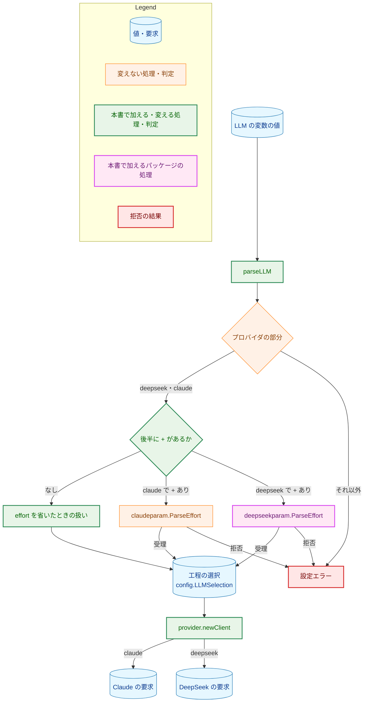
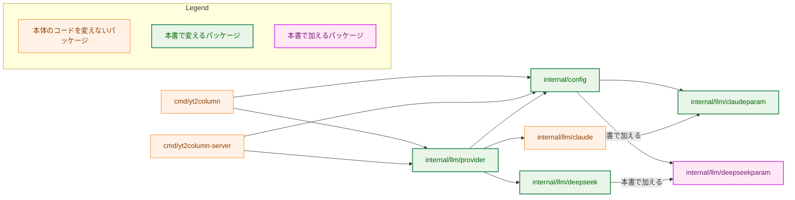
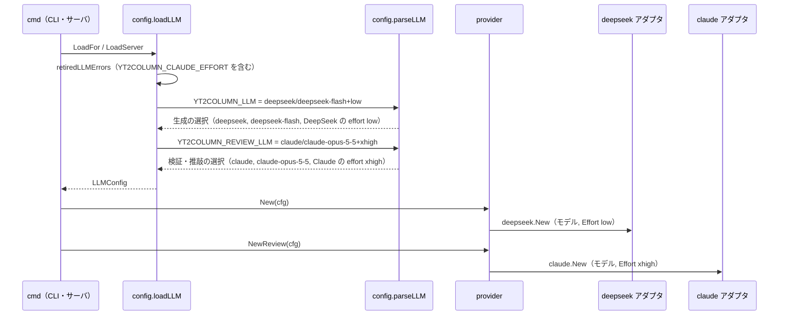
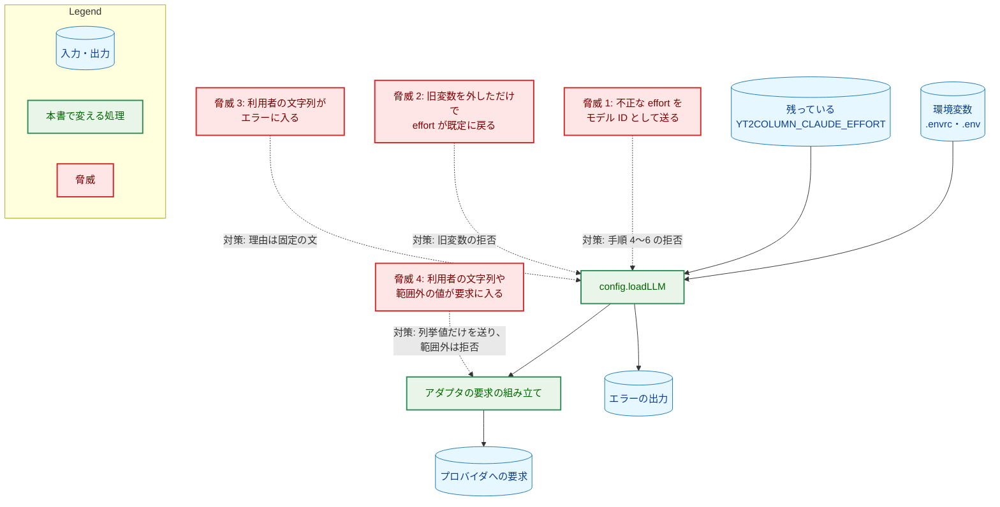
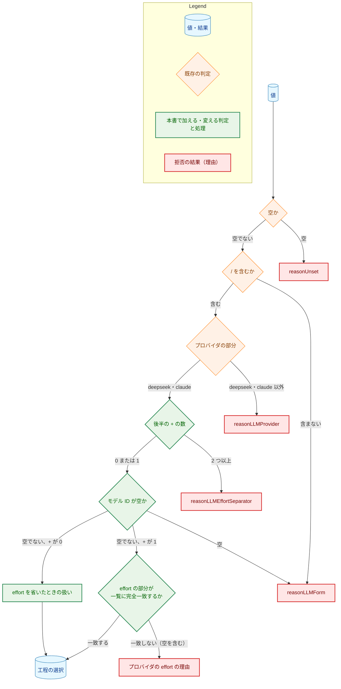

# アーキテクチャ設計書：`YT2COLUMN_LLM` に effort を含め、`YT2COLUMN_CLAUDE_EFFORT` を廃止する

## Document Status

| Item | Value |
|---|---|
| Status | `approved` |
| Created | 2026-10-30 |
| Review date | 2026-10-30 |
| Reviewer | isseis |
| Comments | 2026-10-30（編集上の訂正。実装の PR-1 のレビューで判明）: 執筆後に 66222946 で `README.en.md` が入った。3.7 の `README.en.md` の行と 7.4 の README のガードの記述を、2 つの版を版ごとに検査する現状に合わせた。あわせて 3.7 の `docs/dev/project_overview.md` の行に、想定ディレクトリ構成への `internal/llm/deepseekparam` の追加を含めた。設計の判断は変えていない。 |

本書は [01_requirements.md](01_requirements.md)（要件定義書。以下、要件書）の設計である。既存のファイルについての記述は、コミット `be657abc` のファイルで確かめた。`file:line` はこのコミットの行番号を指す。F-NNN・AC-NN は要件書の項番を指す。要件のレビューで設計に申し送られた事項（[design_handoff.md](design_handoff.md) の H-01〜H-09）への対応は、付録 A にまとめる。

本書は、要件書 6 章の用語（プロバイダの部分、後半、モデル ID、effort の部分、effort を省いたときの扱い、旧変数、設定エラー、生成の設定・検証・推敲の設定）と、要件書 3.1 の「実行を止める」を同じ意味で使う。ほかに次の用語を使う。

-   **LLM の変数:** `YT2COLUMN_LLM` と `YT2COLUMN_REVIEW_LLM`。
-   **設定されている:** 変数が環境にあること。空の値を含む（`lookup` の 2 つ目の戻り値が真）。その反対を「未設定」という。
-   **工程の選択:** 設定の読み込みが 1 つの工程について決める、プロバイダ・モデル ID・effort の組。生成の選択（生成と字数の調整が使う）と、検証・推敲の選択の 2 つがある。今のコードでは非公開の `llmSelection`（`internal/config/config.go:157-160`）がプロバイダとモデル ID だけを持つ。本書はこれを公開の型 `config.LLMSelection` にし、effort を加える（3.1）。
-   **プロバイダが決まる:** 値のプロバイダの部分が、受理する値（`deepseek`・`claude`）に完全に一致すること。モデル ID や effort の部分が不正でも、プロバイダは決まる（AC-28）。
-   **パラメータのパッケージ:** `config` とアダプタの両方が参照する、プロバイダごとの effort の型を置くパッケージ。`internal/llm/claudeparam`（既存）と `internal/llm/deepseekparam`（新規）の 2 つ。

## 1. 設計の全体像 (Design Overview)

### 1.1. 設計原則

-   **effort は工程の選択の一部として運ぶ。** effort を、LLM の変数の値から、プロバイダ・モデル ID と同時に 1 回の解析で取り出し、同じ工程の選択に入れる。クライアントを作る `internal/llm/provider` は、工程の選択を 1 つ受け取り、その中の effort をアダプタに渡す。生成の effort を検証・推敲のクライアントに渡すような取り違えは、工程の選択を 1 単位で渡すことで、構造の上で起きなくなる。
-   **受理する effort の値は、プロバイダごとに 1 つのパッケージに置く。** Claude の値は今と同じく `claudeparam` に置く（`internal/llm/claudeparam/claudeparam.go:26-34`）。DeepSeek の値は、新しい `deepseekparam` に置く。値の一覧を書くのは各パッケージの 1 か所だけで、設定エラーの理由が示す一覧もそこから作る（要件書 4.5、AC-41）。
-   **値の解析は、今と同じく `parseLLM` の 1 か所で行う。** `YT2COLUMN_LLM`・`YT2COLUMN_REVIEW_LLM`・既定値は、どれも同じ `parseLLM`（`config.go:509-530`）を通す。effort の部分をどちらのプロバイダの値で検査するかは、プロバイダが決まった後の `switch` で選ぶ。`default` の枝は拒否である（`CLAUDE.md`「Declare, don't infer」）。
-   **不正な effort を補わない。** effort の部分が空・不正・`+` が 2 つ以上のどれでも、既定の effort で補ったり、モデル ID の一部とみなしたりせず、設定エラーにする（`CLAUDE.md`「Reject, don't normalize」、AC-05・AC-08）。
-   **effort を省いたときの扱いは、プロバイダごとに表す。** Claude は、今と同じく設定の読み込みが既定の定数 `defaultClaudeEffort`（`config.go:596`）を当てる。DeepSeek は、`deepseekparam` の型のゼロ値を「指定なし」とし、アダプタはこのときに `reasoning_effort` を送らない。ゼロ値は、入力について最も少なく仮定する解釈（今と同じ要求を送る）である（`CLAUDE.md`「Declare, don't infer」）。範囲外の値は、アダプタの構築と要求本文の組み立ての両方で拒否する（3.5）。
-   **`YT2COLUMN_CLAUDE_EFFORT` は旧変数の一覧に加える。** 既存の旧変数の仕組み（`retiredLLMVars`。`config.go:113-118`）をそのまま使い、新しい検査の仕組みを作らない。
-   **既存の拒否の型を保つ。** 設定の読み込みの拒否はすべて `*VarError`（`config.go:135-149`）で返し、番兵は既存の `ErrMissing`・`ErrInvalid`（`config.go:127-130`）だけを使う。アダプタが範囲外の effort を拒否するエラーは、今のアダプタの構築のエラーと同じく、アダプタの非公開の番兵で返す（3.5）。理由（`Reason`）は固定の文から選び、利用者の値を含めない（要件書 5 章）。

### 1.2. 設計の際に決めたこと（2026-10-30）

人間のレビュアーが決めたもの:

-   **DeepSeek の effort の型は、新しいパッケージ `internal/llm/deepseekparam` に置く（H-08）:** `claudeparam` と同じ形（型・変換・一覧・`String`・`Valid` の名前と意味）にする（3.1）。`config` はアダプタのパッケージを import できない（`internal/pipeline/pipeline_test.go:879-922` の `TestConfigImports` が、`claudeparam` 以外の `internal/llm/` の import を禁じている）。そのため、`config` とアダプタの両方が参照する型は、アダプタの外の小さなパッケージに置く必要がある。`claudeparam` を `llmparam` に改名して 2 つのプロバイダの型をまとめる案は採らない。改名の差分が大きく、プロバイダの詳細をそのプロバイダのところに置く境界（`CLAUDE.md`「Provider details stay in their adapter package」）もぼやけるためである。
-   **工程の選択を公開の型 `config.LLMSelection` にする（H-02）:** `LLMConfig.Generation()` と `LLMConfig.Review()` が工程の選択を返し、`provider.newClient` は工程の選択を 1 つ受け取る（3.1・3.5）。`LLMConfig` に平たいアクセサを 4 つ（Claude と DeepSeek の effort を、生成と検証・推敲のそれぞれについて）足す案は採らない。工程を区別する引数がもう 1 つ増え、取り違えを型で防げないためである。この決定は、タスク 0045 の設計の決定を変える（1.4 (1)）。
-   **DeepSeek の `reasoning_effort` が実際の API で受け付けられるかは、実装の段階で確かめる（H-09）:** 実装の段階で、実際の DeepSeek の API に要求を送って確かめ、結果を実装計画に記録する。実際の API を呼ぶ確認は課金されるので、その前に人間の承認を得る（`CLAUDE.md`「Tool Execution Safety」）。確かめる時期と合格の条件は 7.6 と 8 章に、それまでのリスクは 5.2 に記す。

設計で決めたもの（人間のレビュアーに諮らず、理由とともに記す）:

-   **effort の部分の拒否は、空の場合も含めて `ErrInvalid` に分類する（H-01）:** 変数そのものは空でないので、空の変数を表す `ErrMissing` とは揃えない。今の「モデル ID が空の値（`claude/`）」も `ErrInvalid` である（`config.go:526-527`）。`YT2COLUMN_CLAUDE_EFFORT` の拒否も、ほかの旧変数と同じく `ErrInvalid` にする。新しい番兵は作らない。番兵で拒否を区別して扱う呼び出し側がないためである（CLI もサーバも、設定エラーを 1 行ずつ出して終了コード `2` で止まるだけである。タスク 0045 の設計書 1.2）。
-   **拒否の理由は 4 種類を加える（H-01・AC-06）:** 「`+` は 1 つまで」「Claude の effort の値の一覧」「DeepSeek の effort の値の一覧」「`YT2COLUMN_CLAUDE_EFFORT` の移行」である。あわせて「値の形」の理由を直す（4.1）。effort の値の一覧はプロバイダごとに異なるので、プロバイダごとに 1 つの理由にする。
-   **検査の順序は「`+` の数 → モデル ID が空か → effort の部分」にする（H-01・AC-07）:** 1 つの値は、最初に当たった規則の理由だけで報告する（3.2）。`+` の数を最初に見るのは、`+` が 2 つ以上ある値では、どこまでがモデル ID でどこからが effort かが決まらず、後の 2 つの検査の対象が定まらないためである。
-   **既定値 `defaultLLMValue` に `+high` を含めない（H-04）:** `defaultLLMValue`（`config.go:67`）は `claude/claude-opus-5-5` のまま保つ。既定値に `+high` を含めても、利用者が設定した `claude/<モデル ID>`（`+` なし）のための Claude の既定の effort は別に要る。既定の effort を 2 か所に書くことになるので、`defaultClaudeEffort` の 1 か所に置く。既定値は `+` を含まない値として `parseLLM` を通り、Claude の既定の effort を受け取る（AC-18）。
-   **`defaultClaudeEffort` は名前も置き場所も変えない（H-04）:** `docs/dev/guides/claude_output_limit.md:10` は、既定の effort の所在を `internal/config/config.go` の `defaultClaudeEffort` と書いている。名前と置き場所を変えなければ、この記述はそのまま正しい（AC-38）。
-   **`YT2COLUMN_CLAUDE_EFFORT` の定数と、そのテスト用のアクセサをなくす（H-05）:** 旧変数の一覧のほかの 4 つは、一覧に名前を直接書いている（`config.go:114-117`）。`YT2COLUMN_CLAUDE_EFFORT` も同じく一覧の末尾に書き、定数 `claudeEffortEnv`（`config.go:36`）と `ClaudeEffortEnvForTest`（`internal/config/test_helpers.go`）は消す。テストと文書のガードは、旧変数の名前を `RetiredLLMVarsForTest` から得る。末尾に加えるのは、一覧を位置で引くテスト（`cmd/yt2column/docs_test.go:616-617` の `retired[0]`・`retired[1]`）があるためである。
-   **4 つのアクセサを消し、`Generation()`・`Review()` に一本化する:** `LLMConfig` の `Provider()`・`Model()`・`ReviewProvider()`・`ReviewModel()`（`config.go:179-201`）は消す。残すと、同じ値を読む方法が 2 つになり、effort だけが工程の選択からしか読めない非対称も残る。呼び出し側は、本番のコードではサーバの起動のログ（`cmd/yt2column-server/run.go:188-189`）と `provider.New`・`NewReview`（`provider.go:35`・`:42`）だけで、後者は本設計でもともと書き換える。ほかはテスト（`internal/config/config_test.go`、`cmd/yt2column/docs_test.go`・`integration_env_test.go`・`run_test.go`、`internal/llm/provider/provider_test.go`）で、どれも本タスクで変えるファイルである。`.Provider()` を `.Generation().Provider()` に、`.ReviewModel()` を `.Review().Model()` に置き換えるだけで済む（3.6）。なお、同じパッケージに `Need.Generation`・`Need.Review`（`bool`。`config.go:397-401`）があるが、型が異なり取り違えはコンパイルで止まるので、名前は変えない。
-   **DeepSeek のアダプタのエラーに、送った `reasoning_effort` を含める:** 要件書 2.3 のとおり、effort はログにも記事にも成果物にも出ない。そのため、ある工程が失敗したときに、その工程がどの effort を送ったかを示せる場所はエラーの行だけである。Claude のアダプタは、HTTP の状態のエラー・打ち切り・想定外の終了理由のエラーに effort を含めている（`internal/llm/claude/claude.go:134-141`、`internal/llm/claude/response.go:69-74`・`:300-316`）。DeepSeek のアダプタも同じく、HTTP の状態のエラー（今はモデルと `max_tokens` だけを示す。`internal/llm/deepseek/deepseek.go:131-137`）、打ち切り（`finish_reason` が `length`）・想定外の終了理由・空の応答のエラーに、送った `reasoning_effort`（または送らなかったこと）を含める。effort は秘密情報ではない。時間切れ（`LLMTimeout`）のエラーは `internal/llm/llmhttp` が作る共通のもので、今の Claude のアダプタも effort を含めていないので、本書でも変えない（5.2 の残るリスク）。
-   **`YT2COLUMN_CLAUDE_EFFORT` の拒否の理由は、既定値を使っていた利用者が書くべき値を示す:** この変数で effort だけを変え、`YT2COLUMN_LLM` を設定していなかった利用者が、最も多く拒否に当たると考えられる。そうした利用者は、「`YT2COLUMN_LLM` の値に `+<effort>` を付ける」と言われても、付け足す先の値がない。理由に、`YT2COLUMN_LLM` が未設定なら `defaultLLMValue` に `+<effort>` を付けた値を設定すること、`YT2COLUMN_REVIEW_LLM` は設定していれば付けることを含める（4.1）。サーバでは、標準エラー出力のこの 1 行が唯一の手がかりである。今の旧変数の理由も、1 行だけで直し方が分かることを狙っている（`config.go:88-91`）。
-   **`docs/dev/security.md` §3 のモデル ID の定義を直す:** `docs/dev/security.md:53` は、モデル ID を「`YT2COLUMN_LLM`・`YT2COLUMN_REVIEW_LLM` の最初の `/` より後ろ」と定義している。本書の変更後は、後半に `+` があれば `+` より前がモデル ID なので、この括弧の中を要件書 6 章の定義に合わせる。要件書 2.2 の文書の一覧にはないが、定義が古いまま残ると、`/` の扱いを確かめる人がモデル ID の範囲を取り違える。文の意味（モデル ID は要求本文にだけ入れる）は変えない。
-   **生成と検証・推敲の継承は、工程の選択をまるごと写す:** `YT2COLUMN_REVIEW_LLM` が未設定なら、検証・推敲の選択は生成の選択と同じ値になる（`config.go:465-469` の今の写し方のまま）。effort は工程の選択の中にあるので、継承の規則を書き換えなくても effort が受け継がれる（AC-15・AC-20）。

### 1.3. 概念モデル

LLM の変数の値が、どう工程の選択になり、どのプロバイダの要求に何を載せるかを示す。矢印 A → B は、A が B に値を渡すこと（判定から出る矢印は、そのラベルの結果のときに進むこと）を表す。



この図と 5.1・6.1 の図では、`problem`（赤）を、拒否の結果と脅威を示すのに使う（`docs/dev/conventions/mermaid_reference.md` の表の「Before の図の問題のある既存のコード」とは使い方が異なる）。`+` の数とモデル ID が空かの検査は `parseLLM` の中で行い、この図では省く（3.2・6.1 に示す）。effort を省いたときの扱いは、Claude なら `defaultClaudeEffort`（`high`）、DeepSeek なら「指定なし」を工程の選択に入れることである。この effort は、Claude の要求では `output_config.effort` として、DeepSeek の要求では `reasoning_effort` として送られる。DeepSeek の「指定なし」の要求は `reasoning_effort` を含まない。

### 1.4. 先行タスクの決定の変更と、既存の方針の例外

本書は、3 つの先行の決定を変える。そのうち 2 つは要件書が変えたもの（要件書 1 章「先行タスクの決定の変更」、5 章）で、1 つは本書が変えるものである。

**(1) タスク 0045 の設計: 公開の選択の型を作らない（本書が変える）**

-   **元の方針と所在:** タスク 0045 の設計書は、`LLMConfig` の 4 つのアクセサを保ち、「公開の組の型を作り、`Generation()`・`Review()` で返す案は採らない」と決めた（`docs/tasks/0045_llm_env_var/02_architecture.md` §1.2 の最初の項目）。理由は、組を 1 つの値として扱う呼び出し側がなかったことである。
-   **例外にする理由:** 本タスクで、工程ごとに異なる effort をクライアントに届ける必要が生まれた。`provider.newClient` は、プロバイダ・モデル・effort を 1 つの工程からそろえて受け取る呼び出し側になる。値を読む方法を 1 つにするため、4 つのアクセサは消す（1.2）。
-   **古い振る舞いを確かめている既存のテスト:** 4 つのアクセサを消すので、それを呼ぶテスト（`internal/config/config_test.go`、`cmd/yt2column/docs_test.go:448-456`・`:544-548`・`:660-662`、`cmd/yt2column/integration_env_test.go:59-68`、`cmd/yt2column/run_test.go:2019-2022`、`internal/llm/provider/provider_test.go:187`・`:241`・`:315-319`・`:505`）は、`Generation()`・`Review()` の値のアクセサを呼ぶ形に書き換える。確かめる内容は変わらない。`LLMConfig.ClaudeEffort()` も消すので、これを呼ぶテスト（`cmd/yt2column/docs_test.go:452-457`・`:554-556`、`internal/config/config_test.go` の `TestLoadClaude`・`TestLoadClaudeEffortDefault` など。3.6 の表）は、工程の選択の `ClaudeEffort()` を呼ぶ形に書き換える。

**(2) タスク 0045 の要件: `YT2COLUMN_CLAUDE_EFFORT` は Claude を使う工程があるときだけ読む（要件書が変えた）**

-   **元の方針と所在:** `YT2COLUMN_CLAUDE_EFFORT` は、Claude を使う工程があるときだけ読むプロバイダ固有の変数だった（タスク 0045 の要件書 AC-18、`config.go:548-556`）。その上位の方針「実行に使わない変数は読まない」の所在は、`docs/dev/guides/cli.md:72`、`docs/dev/project_overview.md:155`、`LoadServer` のコメント（`config.go:319-322`）、`LoadFor` のコメント（`config.go:405-412`）である。タスク 0045 は、旧変数 4 つが設定されているかどうかの検査を、この方針の例外にした（タスク 0045 の設計書 1.4）。
-   **例外の内容:** `YT2COLUMN_CLAUDE_EFFORT` を旧変数の一覧（`retiredLLMVars`）に加える。そのため、`loadLLM` は、`Need` によらず、この変数が設定されているかどうかだけを調べる（`config.go:478-487` の `retiredLLMErrors`）。値は使わない（AC-23）。ホストは `loadLLM` を呼ばないので、調べない（AC-26。`config.go:363-383`）。
-   **例外にする理由:** 要件書 5 章のとおり、古い設定が残っていることに、いつ実行しても気づけるようにするためである。effort が知らないうちに既定の `high` に戻ることを防ぐ（要件書 2.1）。
-   **古い振る舞いを確かめている既存のテスト（変更が必要）:**
    -   `cmd/yt2column/integration_env_test.go:76`。両方の工程が DeepSeek の実行が `YT2COLUMN_CLAUDE_EFFORT` を読まないことを確かめている。本書の変更後は、この変数を必ず `lookup` に渡すので、読まない変数の一覧から外す。Claude のプロバイダ固有の変数（`ANTHROPIC_API_KEY`・`ANTHROPIC_WORKSPACE_ID`）を読まないことの確認は残す。この変更は `make test` を通すためにも要る。`TestRetiredModelEnvIsGone`（`cmd/yt2column/makefile_test.go:184-`）は、`cmd/yt2column` の結合テストのファイルに旧変数の名前の文字列がないことを確かめている。旧変数になった `YT2COLUMN_CLAUDE_EFFORT` の文字列が `:76` に残ると、このテストが失敗する。同じファイルにこの変数の名前を新たに書かない（3.6）。
    -   `internal/config/config_test.go` の `TestLoadFor` の部分テスト「no stage reads no LLM variable」（`:1258-1300` のあたり）。
        -   読まない変数の一覧 `llmVars`（`:1269-1272`）が `claudeEffortEnv` を含む。一覧から外す。旧変数を読むことの確認は `retiredLLMVars` を直接回しており（`:1285`）、加わった変数も自動で対象になる。
        -   環境「invalid values」（`:1262`）が `claudeEffortEnv: "High"` を与え、`LoadFor(…, Need{})` がエラーを返さないことを確かめている。本書の変更後は旧変数の拒否になるので、この行を消す。
    -   共通の環境 `validClaudeEnv`（`config_test.go:43-`）は `claudeEffortEnv: "high"`（`:47`）を含み、20 ほどのテストが使う。この行を消し、effort が要るテストは LLM の変数に `+<effort>` を付ける。
    -   `internal/config/config_test.go` の `TestLoadIgnoresOtherProviderVars`・`TestLoadProviderVarsFollowSelection` など、DeepSeek だけの実行で `YT2COLUMN_CLAUDE_EFFORT` の不正な値を無視することを確かめる行。本書の変更後は設定エラーになるので、その行を消し、旧変数の拒否のテスト（7.1）に移す。

**(3) タスク 0003 の要件: DeepSeek の要求に thinking の指定を含めない（要件書が変えた）**

-   **元の方針と所在:** `docs/tasks/0003_deepseek_llm_client/01_requirements.md` 2.3。コードでは、要求本文の型 `chatRequest` のコメントが「要件の外のパラメータ（thinking など）のフィールドを持たない」としている（`internal/llm/deepseek/request.go:20-22`）。
-   **例外の内容:** `chatRequest` に `reasoning_effort` のフィールドを 1 つ加える。effort を付けた値のときだけ送り、省いた値では要求本文に現れない（AC-12・AC-13）。`thinking` のフィールドは、今と同じく持たない。
-   **例外にする理由:** 要件書 1 章「要件定義の際に決めたこと」のとおり、DeepSeek でも effort を指定できるようにするためである。
-   **古い振る舞いを確かめている既存のテスト:** `internal/llm/deepseek/deepseek_test.go:216-` の `TestGenerateSendsRequest`。要求本文に `thinking` がないことを確かめている（`:279-280`）。この確認は残し、effort を指定しないクライアントでは `reasoning_effort` もないことを加える。effort を指定したときの確認は新しいテストにする（7.2）。

## 2. システム構成 (System Structure)

### 2.1. 全体の構成

パッケージの依存を示す。矢印 A → B は、A が B を import することを表す。



`internal/config` は、今と同じくネットワークのパッケージとアダプタを import しない。`deepseekparam` も `claudeparam` と同じく標準ライブラリだけに依存する。この 2 つは `TestConfigImports` で強制する。今のテストは `internal/config` と `claudeparam` のファイルだけを調べている（`internal/pipeline/pipeline_test.go:886`）。本書では `deepseekparam` のファイルも調べる対象に加え、`config` からの import を許す（3.6）。`cmd/yt2column` と `cmd/yt2column-server` の本体のコードは変えない。変えるのはテストと文書のガードだけである（3.6）。

### 2.2. コンポーネント配置

| 置き場所 | 担うこと |
|---|---|
| `internal/llm/deepseekparam`（新規） | DeepSeek の `reasoning_effort` の型、受理する値の一覧、文字列からの変換 |
| `internal/llm/claudeparam` | 受理する effort の値の一覧を返す関数を加える。型と変換は変えない |
| `internal/config` | LLM の変数の effort の部分の解析と検査、工程の選択（`LLMSelection`）、旧変数の一覧への追加、理由の文 |
| `internal/llm/provider` | 工程の選択から、その工程の effort をアダプタに渡す |
| `internal/llm/deepseek` | `reasoning_effort` を、指定があるときだけ要求本文に入れる。エラーに送った値を加える |
| `internal/llm/claude` | 変えない（今と同じく `claudeparam.Effort` を受け取って送る） |

### 2.3. データの流れ

生成と検証・推敲で effort が異なる設定（AC-14 の後半の例）で、値がクライアントに届くまでを示す。実線の矢印 A → B は A が B を呼ぶこと、点線の矢印は呼び出しの戻り値を表す。



`provider.New` は `cfg.Generation()` を、`provider.NewReview` は `cfg.Review()` を、それぞれ `newClient` に渡す。字数の調整は、今と同じく生成のクライアントを使う（`config.go:397-401` の `Need` のコメント、AC-17）。

## 3. コンポーネント設計 (Component Design)

### 3.1. 型と定数

**`internal/llm/deepseekparam`（新規）**

```go
// Package deepseekparam holds the DeepSeek adapter's parameter type: the
// reasoning_effort value. Both the adapter (internal/llm/deepseek) and the
// configuration loader (internal/config) use it, so the list of values lives
// here alone.
package deepseekparam

// Effort is the reasoning_effort value. The zero value is EffortUnspecified,
// which means no value was specified: the request carries no
// reasoning_effort member.
type Effort int

const (
	EffortUnspecified Effort = iota
	EffortNone
	EffortLow
	EffortHigh
	EffortMax
)

// ParseEffort returns the Effort for one of "none", "low", "high", "max". Any
// other string, the empty string and differently cased or padded ones
// included, returns an error.
func ParseEffort(value string) (Effort, error)

// String returns the wire value; EffortUnspecified and unknown values return
// a fixed placeholder that ParseEffort rejects.
func (e Effort) String() string

// Valid reports whether e is one of the four accepted values. It is false for
// EffortUnspecified.
func (e Effort) Valid() bool

// EffortValues returns the accepted wire values in a fixed order.
func EffortValues() []string
```

名前と意味は `claudeparam` に揃える（`Effort`・`ParseEffort`・`String`・`Valid`・`EffortValues`。`Valid` はどちらもゼロ値で偽）。違いは 1 つだけで、`claudeparam` のゼロ値 `EffortUnset` はどの構築も受け付けない値であるのに対し、`deepseekparam` のゼロ値 `EffortUnspecified` は「指定なし」を表す正しい値である。DeepSeek では effort を省くことに「何も送らない」という意味があり（要件書 3.1 の表）、それを表す値が要るためである。アダプタは、ゼロ値か `Valid` が真の値だけを受け付ける（3.5）。

**`internal/llm/claudeparam`（関数を 1 つ加える）**

```go
// EffortValues returns the accepted wire values in a fixed order.
func EffortValues() []string
```

`Effort`・`ParseEffort`・`String`・`Valid` は変えない。

2 つの `EffortValues` は、`ParseEffort` の `switch` が使うのと同じ定数から一覧を作る。一覧と変換が食い違わないことは、テストで確かめる（7.2）。

**`internal/config`**

```go
// LLMSelection is one stage's provider, model ID, and effort. Its fields are
// unexported, so a non-zero LLMSelection can only come from Load, LoadFor, or
// LoadServer. Exactly one of the two efforts is meaningful: the one of
// Provider.
type LLMSelection struct {
	provider       Provider
	model          string
	claudeEffort   claudeparam.Effort
	deepSeekEffort deepseekparam.Effort
}

func (s LLMSelection) Provider() Provider
func (s LLMSelection) Model() string

// ClaudeEffort is not claudeparam.EffortUnset exactly when Provider is
// ProviderClaude: the effort part of the value, or defaultClaudeEffort when
// the value has none.
func (s LLMSelection) ClaudeEffort() claudeparam.Effort

// DeepSeekEffort is the effort part of the value when Provider is
// ProviderDeepSeek and the value has one; otherwise it is
// deepseekparam.EffortUnspecified.
func (s LLMSelection) DeepSeekEffort() deepseekparam.Effort

// Generation returns the selection of the generation and the shorten step. It
// is the zero LLMSelection unless the run needs the generation stage.
func (c LLMConfig) Generation() LLMSelection

// Review returns the selection of the review step. It is the zero
// LLMSelection unless the run needs the review stage.
func (c LLMConfig) Review() LLMSelection
```

`LLMConfig` は、`generation`・`review` のフィールドの型を `LLMSelection` にし、フィールド `claudeEffort`（`config.go:170`）とアクセサ `ClaudeEffort()`（`config.go:215-220`）を消す。`Provider()`・`Model()`・`ReviewProvider()`・`ReviewModel()`（`config.go:179-201`）も消し、値は `Generation()`・`Review()` から読む（1.2）。

定数と変数:

| 名前 | 変更 |
|---|---|
| `effortSeparator`（新規） | `"+"`。後半の中で、モデル ID と effort の部分を区切る |
| `claudeEffortEnv` | 消す（1.2） |
| `defaultLLMValue` | 変えない（`claude/claude-opus-5-5`。1.2） |
| `defaultClaudeEffort` | 変えない。コメントを「LLM の変数の値に effort の部分がないとき」に直す |
| `retiredLLMVars` | `{"YT2COLUMN_CLAUDE_EFFORT", reasonRetiredClaudeEffort}` を末尾に加える |
| 理由 | 4.1 の表 |

### 3.2. 値の解析（`parseLLM`）

`parseLLM(name, value string) (LLMSelection, error)` は、次の順に検査する。最初に当たった規則で 1 つの `*VarError` を返し、後の規則は見ない（AC-07）。

| 順 | 条件 | 結果 | 返す選択のプロバイダ |
|---|---|---|---|
| 1 | 値が空 | `ErrMissing`・`reasonUnset`（今と同じ） | 未設定 |
| 2 | `/` を含まない | `ErrInvalid`・`reasonLLMForm` | 未設定 |
| 3 | プロバイダの部分が `deepseek`・`claude` でない | `ErrInvalid`・`reasonLLMProvider`（今と同じ） | 未設定 |
| 4 | 後半に `+` が 2 つ以上ある | `ErrInvalid`・`reasonLLMEffortSeparator` | 決まったプロバイダ |
| 5 | モデル ID（後半の `+` より前、`+` がなければ後半の全体）が空 | `ErrInvalid`・`reasonLLMForm` | 決まったプロバイダ |
| 6 | 後半に `+` が 1 つあり、effort の部分がプロバイダの値の一覧に完全一致しない（空を含む） | `ErrInvalid`・プロバイダの effort の理由 | 決まったプロバイダ |
| 7 | 上のどれでもない | 受理 | 決まったプロバイダ |

-   手順 6 で effort の部分を検査する関数は、プロバイダの `switch` で選ぶ（`claude` は `claudeparam.ParseEffort`、`deepseek` は `deepseekparam.ParseEffort`）。`default` の枝は拒否である。手順 3 を通った値は `default` に来ないが、`switch` の網羅を型で守るために置く。
-   手順 6 の変換の関数が返すエラーは捨てる。`*VarError` の `Err` にも `Reason` にも包まない。`claudeparam.ParseEffort` のエラーは入力を引用する（`claudeparam.go:73`）ので、包むと値がエラーの出力に出る。今の `loadClaudeEffort` も捨てている（`config.go:611-614`）。
-   手順 7 で effort の部分がなければ、`claude` は `defaultClaudeEffort` を、`deepseek` は `EffortUnspecified` を工程の選択に入れる（AC-03・AC-13）。
-   空白の除去、大文字・小文字の変換はしない（AC-05）。effort の部分は、受理する値の一覧と完全一致で比べる。
-   手順 4〜6 で拒否しても、選択にはプロバイダを入れて返す。これにより、そのプロバイダの変数も検査できる（AC-28）。今の「モデル ID だけが空の値でもプロバイダを返す」契約（`config.go:506-508`）を、`+` と effort の拒否に広げる形である。この選択は `loadLLM` の外に出ない（`loadLLM` はエラーを返し、`LoadFor`・`LoadServer` はゼロ値の設定を返す。`config.go:422-424`・`:336-338`）。
-   モデル ID の中の `/` は、今と同じく保つ（AC-04）。`+` を探すのは後半だけなので、プロバイダの部分に `+` があれば、手順 3 でプロバイダの拒否になる。
-   モデル ID の前後の空白と UTF-8 として不正なモデル ID は、今と同じく、その工程のクライアントを作るときにアダプタが拒否する（AC-09。`internal/llm/claude/claude.go:57-65`・`internal/llm/deepseek/deepseek.go:57-65`）。

### 3.3. 工程の選択の決め方と継承

`loadLLM`（`config.go:443-472`）の流れは変えない。変わるのは、`parseLLM` が返す工程の選択に effort が入ることだけである。

-   `YT2COLUMN_REVIEW_LLM` が未設定なら、検証・推敲の選択は生成の選択をそのまま写す（`config.go:465-469`）。effort も写る（AC-15・AC-20）。
-   `YT2COLUMN_REVIEW_LLM` が設定されていれば、その値だけから検証・推敲の選択を決める。effort を省いた値なら、生成の effort を受け継がず、そのプロバイダの「effort を省いたときの扱い」になる（AC-16）。`parseLLM` は生成の選択を参照しないので、この性質は構造から決まる。
-   生成の選択の拒否は、受け継ぐ実行でも 1 回だけ報告する（AC-19。今の `resolveGeneration` を 1 回だけ呼ぶ構造のまま。`config.go:455-460`）。

### 3.4. 旧変数の検査

`YT2COLUMN_CLAUDE_EFFORT` を `retiredLLMVars` の末尾に加える。`retiredLLMErrors`（`config.go:478-487`）は変えない。これで次の性質が、今の旧変数と同じ仕組みで成り立つ。

-   `Need` によらず、CLI のどの実行でも、サーバでも検査する（AC-21・AC-22。`loadLLM` の最初で呼ぶ。`config.go:445`）。
-   値は読まず、設定されているかだけを見る（AC-23）。拒否された実行は、ゼロ値の設定を返すので、クライアントを作らず、何も送らない。
-   ほかの拒否と合わせて 1 回で報告する（AC-25）。
-   ホストは `loadLLM` を呼ばないので止まらない（AC-26）。

`loadProviderVars`（`config.go:541-559`）からは `loadClaudeEffort` の呼び出しを消し、`loadClaudeEffort`（`config.go:598-617`）と `reasonClaudeEffort`（`config.go:84`）を消す。Claude のプロバイダ固有の変数は `ANTHROPIC_API_KEY`・`ANTHROPIC_WORKSPACE_ID` の 2 つになる（AC-27）。

`retiredLLMVar` のコメント（「プロバイダかモデルを選んでいた変数」。`config.go:103-105`）と、`reason` のフィールドのコメント（`:108`）は、effort の変数と新しい理由を含む形に直す。

### 3.5. プロバイダへの送信

**`internal/llm/provider`**

```go
func newGeneration(cfg config.LLMConfig, build builders) (llm.LLMClient, error)
func newReview(cfg config.LLMConfig, build builders) (llm.LLMClient, error)
func newClient(sel config.LLMSelection, cfg config.LLMConfig, build builders) (llm.LLMClient, error)
```

-   `newGeneration` は `cfg.Generation()` を、`newReview` は `cfg.Review()` を `newClient` に渡す。`New` と `NewReview` は、本番のアダプタの構築関数（`deepseek.New`・`claude.New`）を `builders` に入れて、それぞれ `newGeneration`・`newReview` を呼ぶだけにする。今の `New`・`NewReview` は `builders` を自分の中で固定しており（`provider.go:34-43`）、テストからループバックへ送る構築関数を渡せない。今のループバックのテストは `newClient` を直接呼んでいる（`provider_test.go:177-206`）。そのため、工程の選択を取り出す部分を通らず、`Generation()` と `Review()` の取り違えを検出できない。工程の選択を取り出す部分を `newGeneration`・`newReview` に置けば、テストは `builders` だけを差し替えて、その部分を通せる（7.2）。
-   `config.ProviderClaude` の枝は、`claude.Options.Effort` に `sel.ClaudeEffort()` を入れる（AC-11）。
-   `config.ProviderDeepSeek` の枝は、`deepseek.Options.Effort` に `sel.DeepSeekEffort()` を入れる（AC-12・AC-13）。
-   API キーと workspace ID は、今と同じく `cfg` から取る（2 つの工程で共有する変数だからである）。
-   未知のプロバイダの拒否（`errUnknownProvider`）は変えない。テストは、ゼロ値の `LLMSelection{}`（プロバイダは `ProviderUnset`）を渡して、この枝を通す。今のテスト `TestNewUnknownProvider`（`internal/llm/provider/provider_test.go:227-`）は `ProviderUnset` と `Provider(99)` の 2 つを渡しているが、どちらも同じ `default` の枝に入る。`Provider(99)` を持つ `LLMSelection` は `config` の外では作れないので、この行は消す。消した後に `go tool cover -func` の結果が関数ごとに変わらないことを確かめる（`CLAUDE.md`「Testing Strategy」）。
-   `newClient` のコメント（`provider.go:52-58`。プロバイダを直接受け取る理由を述べている）は、工程の選択を受け取る形に合わせて直す。

**`internal/llm/deepseek`**

```go
// Options configures the DeepSeek adapter. APIKey, Model, and Timeout are
// required. The zero Effort sends no reasoning_effort member.
type Options struct {
	APIKey  secret.Secret
	Model   string
	Effort  deepseekparam.Effort
	Timeout time.Duration
}
```

-   `New` は、`Effort` がゼロ値でも `Valid()` が真でもない値なら拒否する（新しい非公開の番兵。Claude の `errInvalidEffort` と同じ扱い。`claude.go:66-68`）。
-   要求本文の型 `chatRequest` に、`reasoning_effort` のフィールドを 1 つ加える。`Valid()` が真の値なら `String()` の値を入れ、ゼロ値なら要求本文に現れない（AC-12・AC-13）。`none` も値として送る。どちらでもない値なら、要求本文を作らずにエラーを返す。`New` の検査を通らない値がここに来ることは今はないが、来ても API の既定に黙って切り替わらず、送らずに止まる。`thinking` のフィールドは加えない（要件書 2.3）。`chatRequest` のコメント（`request.go:20-22`）は、`reasoning_effort` だけを例外として持つことを述べる形に直す。
-   HTTP の状態のエラー（`statusError`）と、応答の解釈が返す打ち切り・想定外の終了理由・空の応答のエラーに、送った `reasoning_effort`（または送らなかったこと）を加える（1.2）。そのために、応答の解釈の関数（`parseResponse`。`internal/llm/deepseek/response.go`）は、Claude の `requestSummary`（`internal/llm/claude/response.go:69-74`）と同じく、送った要求の要約を受け取る。
-   応答の解釈の規則は変えない。今の解釈は、使わないメンバー（`reasoning_content` を含む）を無視し、`content` だけを記事に使う（`response.go:13-16`、タスク 0003 の AC-14）。`none` で thinking を無効にした応答でも同じである。

**`internal/llm/claude`** は変えない。

### 3.6. コンポーネントの責務と変えるファイル

| ファイル | 変更 | 関わる AC・H |
|---|---|---|
| `internal/llm/deepseekparam/deepseekparam.go`（新規） | 3.1 の型と関数 | AC-02・AC-12・AC-41、H-08 |
| `internal/llm/deepseekparam/deepseekparam_test.go`（新規） | 変換・一覧・`Valid` のテスト | AC-05・AC-41 |
| `internal/llm/claudeparam/claudeparam.go` | `EffortValues` を加える | AC-41 |
| `internal/llm/claudeparam/claudeparam_test.go` | 一覧と変換の一致のテストを加える | AC-41 |
| `internal/config/config.go` | `LLMSelection`、`parseLLM` の手順 4〜7、理由、旧変数の追加、`claudeEffortEnv`・`loadClaudeEffort`・`reasonClaudeEffort`・`ClaudeEffort()`・`Provider()`・`Model()`・`ReviewProvider()`・`ReviewModel()` を消す。コメントを直す: 理由の定数の前置き（`:77-79`。一覧を含む理由はパッケージの変数になる。4.1）、`retiredLLMVar`（`:103-108`）、`parseLLM`（`:501-508`）、`defaultClaudeEffort`（`:592-595`）、`LoadFor`・`LoadServer`（旧変数の例外の説明） | AC-01〜AC-10・AC-14〜AC-29、H-01〜H-05 |
| `internal/config/test_helpers.go` | `ClaudeEffortEnvForTest` を消す | H-05 |
| `internal/config/config_test.go` | 共通の環境 `validClaudeEnv`（`:43-`）から `claudeEffortEnv` を消す。`YT2COLUMN_CLAUDE_EFFORT` で effort を与えている行を LLM の変数の `+<effort>` に置き換え、旧変数の拒否のテストに加える。対象: `TestLoadClaude`・`TestLoadClaudeEffortDefault`・`TestLoadClaudeInvalid`・`TestLoadClaudeMissing`・`TestLoadClaudeReportsAllInvalid`・`TestLoadDefaultProviderVariables`・`TestLoadErrorsOmitValues`・`TestLoadFor`（1.4 (2)）・`TestLoadIgnoresOtherProviderVars`・`TestLoadProductionDefaults`・`TestLoadProviderVarsFollowSelection`・`TestLoadReportsAllInvalid`・`TestLoadReviewProviderRequiresItsKey`・`TestLoadServerLLMDefaults`。4 つのアクセサの呼び出しを `Generation()`・`Review()` の値のアクセサに置き換える（1.2）。effort の部分の解析のテストを加える（7.1） | H-06 |
| `internal/llm/provider/provider.go` | `newGeneration`・`newReview` を加え、`newClient` が工程の選択を受け取り、工程の effort を渡す。`New`・`NewReview` のコメント（`:31`・`:38-39`）の 4 つのアクセサの名前を直す | AC-11〜AC-14・AC-17 |
| `internal/llm/provider/provider_test.go` | `TestNewClaudeSendsConfiguredRequest`・`TestNewClaudeDefaultEffort`・`TestNewDeepSeekIgnoresClaudeVars`・`TestNewReviewUsesReviewModel`・`TestNewUnknownProvider`（3.5）を追従させ、工程ごとの effort と DeepSeek の `reasoning_effort` のテストを加える（7.2）。4 つのアクセサの呼び出し（`:187`・`:241`・`:315-319`・`:505`）を置き換える（1.2） | AC-09・AC-11〜AC-17、H-06 |
| `internal/llm/deepseek/deepseek.go` | `Options.Effort`、`New` の検査、`statusError` | AC-12・AC-13 |
| `internal/llm/deepseek/request.go` | `chatRequest` に `reasoning_effort` を加え、範囲外の値を拒否する。コメントを直す | AC-12・AC-13、H-08 |
| `internal/llm/deepseek/response.go` | 打ち切り・想定外の終了理由・空の応答のエラーに、送った要求の要約を加える | - |
| `internal/llm/deepseek/deepseek_test.go`・`response_test.go` | `TestGenerateSendsRequest` に「指定なしでは `reasoning_effort` がない」を加え、指定ありのテスト、範囲外の値の拒否、エラーに effort が出ることのテストを加える | AC-12・AC-13 |
| `internal/pipeline/pipeline_test.go` | `TestConfigImports`（`:879-922`）で、調べるファイルに `../llm/deepseekparam/*.go` を加え、`config` からの `deepseekparam` の import を許す。テストのコメントとエラーの文を合わせる | H-08 |
| `cmd/yt2column/run_test.go` | `:635`・`:1985-2007` の `YT2COLUMN_CLAUDE_EFFORT` を LLM の変数の `+<effort>` に置き換え、旧変数として止まることを確かめる行を加える。不正な effort の部分で止まり、LLM の偽物が呼ばれないことを確かめる行を加える。`:2019-2022` の 4 つのアクセサの呼び出しを置き換える（1.2） | AC-08・AC-21・AC-23、H-06 |
| `cmd/yt2column/integration_env_test.go` | `:76` の一覧から `YT2COLUMN_CLAUDE_EFFORT` を外す（1.4 (2)）。このファイルにこの変数の名前の文字列を書かない。`:59-68` の 4 つのアクセサの呼び出しを置き換える（1.2） | H-06 |
| `cmd/yt2column/makefile_test.go` | 変えない。`TestMakeTargetsDoNotReadRetiredModelEnv`（`:115-`）は旧変数を設定して DeepSeek の make の対象を動かし、旧変数からモデルを取らないことを確かめる。加わった `YT2COLUMN_CLAUDE_EFFORT` についても同じ確認が走り、通る。`TestRetiredModelEnvIsGone`（`:184-`）は 1.4 (2) のとおり | - |
| `cmd/yt2column-nmhost/main_test.go` | 変えない。`:144` が `RetiredLLMVarsForTest` を回すので、加わった変数でもホストが止まらないことが確かめられる | AC-26 |
| `cmd/yt2column-server/run.go` | 起動のログ（`:188-189`）の `Model()`・`ReviewModel()` を `Generation().Model()`・`Review().Model()` にする。ログのキーと値は変えない | - |
| `cmd/yt2column-server/run_test.go` | `:334` を LLM の変数の `+<effort>` に置き換え、旧変数で待ち受ける前に止まることを確かめる行を加える | AC-22、H-06 |
| `cmd/yt2column/docs_test.go` | 本番の構成のガード（`:428-565`）と移行の節のガード（`:600-667`）を追従させ、effort の値の一覧のガードを加える（7.4）。4 つのアクセサの呼び出し（`:448-456`・`:544-548`・`:660-662`）を置き換える（1.2） | AC-34・AC-35・AC-40、H-07 |
| 文書 | 3.7 | AC-30〜AC-40 |

`internal/llm/claude/testutil` の結合テストの変数 `YT2COLUMN_TEST_CLAUDE_EFFORT` は変えない（要件書 2.3）。

### 3.7. 文書の変更

| 文書 | 変更 | AC |
|---|---|---|
| README の設定の節 | 表から `YT2COLUMN_CLAUDE_EFFORT` の行を消し、`YT2COLUMN_LLM` の行に `+<effort>` を加える。表の下に、effort の部分の規則と、プロバイダごとの受理する値・省いたときの扱いの表（要件書 3.1 の表と同じ列）を置く。継承の文・プロバイダの変数の検査の文・旧変数の文・`max` と既定の effort の注記を直す | AC-30〜AC-33・AC-39・AC-40 |
| README の推奨構成の節 | 設定のブロックを `export YT2COLUMN_LLM=claude/claude-opus-5-5+high` の 1 行にし、変数の数を述べる文を合わせる | AC-34・AC-40 |
| README の旧変数からの移行の節 | `YT2COLUMN_CLAUDE_EFFORT` から移る例を加える（変更前の `text` ブロックと変更後の `sh` ブロック）。`YT2COLUMN_REVIEW_LLM` にも effort を付ける必要を述べる。`YT2COLUMN_LLM` を設定していなかった場合の書き方（既定値に `+<effort>` を付ける）を述べる。`+<effort>` を含む値は本書より前の版では受理されず、その版ではモデル ID の一部として API に送られて失敗することを述べる | AC-35 |
| README のトラブルシューティング | 旧変数を名指しする設定エラーの項目（`README.md:446-457`）に `YT2COLUMN_CLAUDE_EFFORT` を加え、移行の節へ案内する | AC-36 |
| `README.en.md` | `/mktrans README.md` で `README.md` の変更を反映し、同じコミットに入れる（`CLAUDE.md`「Translation Guidelines」）。同期の印（`TestReadmeSyncMarker`）と 2 つの版の構造の一致（`TestReadmeVersionsShareStructure`）が `make test` で検査される | 要件書 2.2 |
| `docs/dev/project_overview.md` | 「設定（環境変数）」の表と規則の文（README と同じ内容）、DeepSeek の thinking の記述（`:88`）、想定ディレクトリ構成への `internal/llm/deepseekparam` の行 | AC-30〜AC-33・AC-37・AC-39・AC-40 |
| `docs/dev/production_profile.md` | 「本番の構成」の設定のブロックを 1 行にし、「次の 2 つ」「上の 2 つの変数」を直す。「effort は 3 つの段階で共通である」（`:39`）を、工程ごとに指定でき、本番の構成では 3 つとも `high` である、と直す。文書の見出しの「段階」の表は、今の列（プロバイダ・モデル・effort）を保つ | AC-34・AC-40 |
| `docs/dev/guides/cli.md` | `--no-review` の段落の effort の文（`:72`）、旧変数の列挙と例外の文（`:72-74`・`:276-278`）、継承の文（`:273`） | AC-32・AC-33・AC-39 |
| `docs/dev/conventions/package_reference.md` | `internal/config`・`internal/llm/provider`・`internal/llm/deepseek` の行を直し、`internal/llm/deepseekparam` の行を加える。`internal/llm/claudeparam` の行に `EffortValues` を加える | AC-38 |
| `docs/dev/guides/claude_output_limit.md` | 変えない。`:10` が指す `defaultClaudeEffort` は名前も置き場所も変わらない（1.2） | AC-38 |
| `docs/dev/security.md` | §3 のモデル ID の定義（`:53`）を要件書 6 章に合わせる（1.2） | - |

## 4. エラーハンドリング設計 (Error Handling Design)

### 4.1. エラーの型と理由

エラーの型は今の `*VarError`（`Name`・`Reason`・`Err`）のままで、加えない。番兵は `ErrMissing`・`ErrInvalid` だけを使う。

| 理由 | 番兵 | 使う場面 | 文の内容 |
|---|---|---|---|
| `reasonLLMForm`（直す） | `ErrInvalid` | `/` がない値、モデル ID が空の値（3.2 の手順 2・5） | 値の形が `<provider>/<model ID>` の後ろに省略できる `+<effort>` を付けたものであること、モデル ID は空でないこと（AC-06） |
| `reasonLLMEffortSeparator`（新規） | `ErrInvalid` | 後半に `+` が 2 つ以上（手順 4） | `+` は 1 つまでで、モデル ID と effort を区切ること（AC-06） |
| `reasonClaudeEffortPart`（新規） | `ErrInvalid` | `claude` で effort の部分が空か不正（手順 6） | `+` の後ろの effort が受理されないことと、`claude` が受理する値の一覧（AC-06） |
| `reasonDeepSeekEffortPart`（新規） | `ErrInvalid` | `deepseek` で effort の部分が空か不正（手順 6） | 同上、`deepseek` の一覧 |
| `reasonRetiredClaudeEffort`（新規） | `ErrInvalid` | `YT2COLUMN_CLAUDE_EFFORT` が設定されている | 外す必要があること（空の値も設定されているとみなす）、代わりに `YT2COLUMN_LLM` の値に `+<effort>` を付けること（未設定なら既定値 `claude/claude-opus-5-5` に付けた値を設定すること）、`YT2COLUMN_REVIEW_LLM` も設定していればその値に付けること、省けばプロバイダの既定（`claude` なら `high`）を使うこと（AC-24、1.2） |
| `reasonClaudeEffort`（消す） | - | - | - |

-   effort の値の一覧を含む 2 つの理由は、`claudeparam.EffortValues()`・`deepseekparam.EffortValues()` から、パッケージの初期化のときに 1 回だけ組み立てる。一覧は、文の中の固定の前置き（4.2 の例では `accepted values: `）の後に、値を固定の区切り文字でつないで置く。この文は実行時に組み立てるので Go の定数にはできず、パッケージの変数にする。組み立てに使うのはパッケージの値の一覧だけであり、利用者の値は入らない（要件書 4.2）。一覧を文に二重に書かないので、値を足したときに文が古くならない（AC-41）。
-   `reasonRetiredClaudeEffort` の既定値と既定の effort は、`defaultLLMValue` と `defaultClaudeEffort.String()` から作る。既定を変えたときに文が古くならないようにするためである。
-   理由の文の正確な言い回しは実装で決める。上の表の内容を含むことは、テストが理由の文を確かめることで保つ（7.1）。

### 4.2. 利用者が見るもの

CLI もサーバも、今と同じく、設定エラーを 1 件ずつ `<変数名>: <理由>` の 1 行で出し、終了コード `2` で止まる。たとえば `YT2COLUMN_CLAUDE_EFFORT=low` と `YT2COLUMN_LLM=claude/claude-opus-5-5+ultra` を両方設定し、`ANTHROPIC_API_KEY` が未設定なら、次の 3 行が出る（文は例）。

```text
YT2COLUMN_CLAUDE_EFFORT: is no longer supported and must be unset (an empty value counts as set); append +<effort> to YT2COLUMN_LLM (while it is unset, set YT2COLUMN_LLM=claude/claude-opus-5-5+<effort>) and to YT2COLUMN_REVIEW_LLM if it is set; without +<effort>, each stage uses its provider's default (high for claude)
YT2COLUMN_LLM: the effort after "+" is not accepted for provider claude; accepted values: low, medium, high, xhigh, max
ANTHROPIC_API_KEY: is unset or empty
```

どの行も、利用者が設定した値をそのまま含まない。2 行目の `accepted values:` の後の値は、パッケージの固定の一覧であり、設定した値ではない。

DeepSeek の API が `reasoning_effort` を拒否した場合は、設定エラーではなく、今と同じ HTTP の状態のエラーとして、工程の失敗になる（要件書 4.4）。その行は、モデル・`max_tokens`・`reasoning_effort` を示す。thinking を有効にした結果の打ち切りや空の応答のエラーも、`reasoning_effort` を示す（3.5）。

## 5. セキュリティ考慮事項 (Security Considerations)

本タスクは、API キーを読む処理と、字幕などを LLM のプロバイダへ送る要求の内容を変えるので、`docs/dev/security.md` を当てはめる（要件書 4.2）。

### 5.1. 脅威モデル

赤のノードは、本書が防ぐ誤りである。点線の矢印 T → X は、脅威 T への対策を X が担うことを表す。実線の矢印 A → B は、A が B に値を渡すことを表す。



### 5.2. 対策と残る範囲

-   **送る内容を利用者が選んだものに限る（脅威 1）:** effort の部分の誤りを、既定の effort で補わず、モデル ID の一部ともみなさない（3.2）。拒否した実行は、ゼロ値の設定を返し、クライアントを作らないので、何も送らない（AC-08）。
-   **旧変数を使わずに止める（脅威 2）:** `YT2COLUMN_CLAUDE_EFFORT` が残っていれば、値によらず止まる。理由は、`YT2COLUMN_REVIEW_LLM` にも effort を付ける必要を示す（AC-24）。
-   **値をメッセージに出さない（脅威 3）:** 理由は固定の文で、値の一覧もパッケージの定数から組み立てる（4.1）。変換の関数のエラーは捨てる（3.2）。秘密情報を誤って LLM の変数の effort の部分に書いても、エラーの出力に出ない。
-   **要求に加えるのは列挙値だけ（脅威 4）:** DeepSeek の要求の `reasoning_effort` は、`deepseekparam.Effort` の `String()` が返す 4 つの固定の文字列のどれかである。利用者の文字列をそのまま要求に入れる経路はない（AC-12）。範囲外の値は、`New` と要求本文の組み立ての両方で拒否し、API の既定に黙って切り替えない（3.5）。Claude の effort も、今と同じく `claudeparam.Effort.String()` の固定の文字列である。
-   **送り先は変わらない:** effort はプロバイダとモデルを変えないので、字幕などの送り先は今と同じく、プロバイダの部分で決まる。
-   **秘密情報の扱いは変えない:** API キーの読み込み、`secret.Secret`、`internal/redact` は変えない。DeepSeek のエラーに加える `reasoning_effort` は秘密情報ではない。

残るリスク:

-   **DeepSeek の値の実際の受け付け（H-09）:** DeepSeek が受理する 4 つの値は、2026-10-29 の公式文書に基づき、実際の API ではまだ確かめていない。API がある値を受け付けなかった場合は、その工程が HTTP の状態のエラーで失敗し、記事を出さない（`CLAUDE.md`「Empty is an error」）。誤った内容を送ったり、別の送り先に送ったりはしない。この確認は、設定がその値を受理するようになる前に行う（7.6・8 章）。
-   **DeepSeek の effort の取りこぼしは構築の時点では検出できない:** Claude では、effort が途中で落ちてゼロ値になると `claude.New` が拒否する（`claude.go:66-68`）。DeepSeek では、ゼロ値が「指定なし」という正しい値なので、配線の誤りで effort が落ちると、利用者が `+none` と指定しても API の既定（thinking を有効）で動く。この非対称は、ゼロ値に意味を持たせる設計（1.1）の代償として受け入れる。配線の誤りは、設定の文字列から要求本文までを通すテスト（7.2）で検出する。
-   **成功した実行の effort は記録されない:** 要件書 2.3 のとおり、effort はサーバの起動のログ・記事・成果物に出ない。そのため、中断した実行の再開（`--after shorten`・`--after review`）が、成果物を書いた実行と異なる effort を使っても記録に残らず、サーバの起動のログから工程ごとの effort を確かめることもできない。effort が見えるのは失敗したときのエラーの行だけである（1.2）。要件書が範囲外とした事項（要件書 2.3）として受け入れる。
-   **時間切れのエラーは effort を示さない:** 時間切れのエラーは `internal/llm/llmhttp` が作る共通のもので、Claude のアダプタも effort を示していない。`max` のような大きい effort で時間切れになった場合、エラーの行からは effort が分からない。今の Claude と同じ扱いとして受け入れる。
-   **古い版に戻したとき:** `+<effort>` を含む値を設定したまま本書より前の版に戻すと、その版は `+` を含む値をモデル ID として受理し（`config.go:509-530`）、最初の API の呼び出しでモデルの誤りとして失敗する。送り先は変わらないので漏洩ではない。README の移行の節にこのことを書く（3.7）。

## 6. 処理フローの詳細 (Processing Flow Details)

### 6.1. `parseLLM` の流れ

矢印 A → B は、処理が A から B へ進むことを表す。判定から出る矢印のラベルは、判定の結果である。



`MODEL` は、今の「モデル ID が空か」の判定（`config.go:526-527`）に、`+` より前をモデル ID とする規則を加えたものである。`OMIT` は、Claude なら `defaultClaudeEffort` を、DeepSeek なら `EffortUnspecified` を入れる（3.2）。

### 6.2. 代表的な設定の結果

生成と検証・推敲の両方の設定を検査する実行（サーバ、または `--after` のない CLI）で、`ANTHROPIC_API_KEY` と `DEEPSEEK_API_KEY` はどちらも設定されているとする。

| `YT2COLUMN_LLM` | `YT2COLUMN_REVIEW_LLM` | 生成と字数の調整 | 検証・推敲 | AC |
|---|---|---|---|---|
| 未設定 | 未設定 | `claude`・`claude-opus-5-5`・`high` | 同左 | AC-18 |
| `claude/claude-sonnet-5-5+low` | 未設定 | `claude`・`claude-sonnet-5-5`・`low` | 同左 | AC-01・AC-15 |
| `claude/claude-sonnet-5-5` | 未設定 | `claude`・`claude-sonnet-5-5`・`high` | 同左 | AC-03 |
| `claude/vendor/model-x+medium` | 未設定 | `claude`・`vendor/model-x`・`medium` | 同左 | AC-04 |
| `claude/claude-opus-5-5+low` | `claude/claude-opus-5-5+xhigh` | `claude`・`low` | `claude`・`xhigh` | AC-14 |
| `deepseek/deepseek-flash+low` | `claude/claude-opus-5-5+xhigh` | `deepseek`・`reasoning_effort` `low` | `claude`・`xhigh` | AC-14 |
| `claude/claude-opus-5-5+low` | `claude/claude-opus-5-5` | `claude`・`low` | `claude`・`high` | AC-16 |
| `deepseek/deepseek-flash` | 未設定 | `deepseek`・`reasoning_effort` なし | 同左 | AC-13 |
| `deepseek/deepseek-flash+none` | 未設定 | `deepseek`・`reasoning_effort` `none` | 同左 | AC-12 |
| `claude/claude-opus-5-5+ultra` | 未設定 | 設定エラー（`YT2COLUMN_LLM` の 1 件） | - | AC-05・AC-08・AC-19 |
| `claude/+high` | 未設定 | 設定エラー（`reasonLLMForm`） | - | AC-05・AC-06 |
| `deepseek/deepseek-flash+a+b` | 未設定 | 設定エラー（`reasonLLMEffortSeparator`） | - | AC-07 |

## 7. テスト戦略 (Test Strategy)

ユニットテストは、LLM の API を呼ばない（`CLAUDE.md`「Testing Strategy」）。テストを加えるときは、対象の仕組みを壊して失敗することを確かめる。

### 7.1. ユニットテスト（`internal/config`）

-   **effort の部分の解析:** 要件書 AC-01〜AC-10 の例の値を、`YT2COLUMN_LLM` と `YT2COLUMN_REVIEW_LLM` のそれぞれについて表で与え、工程の選択（`Generation()`・`Review()` のプロバイダ・モデル・`ClaudeEffort`・`DeepSeekEffort`）または `*VarError` の `Name`・`Reason`・番兵（`errors.Is`）を確かめる。拒否の例は、AC-05 の各値と AC-07 の値をすべて含める。
-   **理由の一覧:** effort の 2 つの理由から、固定の前置きの後ろの一覧の部分を取り出し、固定の区切り文字で分けた値の並びが、`claudeparam.EffortValues()`・`deepseekparam.EffortValues()` の並びと等しいことを確かめる（AC-41）。部分文字列で探す形にはしない。`high` は `xhigh` の部分文字列なので、`high` が一覧から落ちても部分文字列の検査は通ってしまうためである。比べる一覧はコードから得て、テストに値を写さない。
-   **継承:** AC-15・AC-16・AC-19・AC-20 を、`LoadFor` の `Need` の組み合わせごとに確かめる。
-   **旧変数:** `YT2COLUMN_CLAUDE_EFFORT` が設定されていれば（空の値を含む、両方の工程が DeepSeek でも、`Need{}` でも）、`LoadFor`・`LoadServer` がその変数を名指しする `ErrInvalid` を返すことと、ほかの拒否と合わせて返すことを確かめる（AC-21〜AC-25）。
-   **プロバイダの変数:** AC-28 の例（`claude/claude-opus-5-5+ultra` と `ANTHROPIC_API_KEY` が未設定）で 2 件のエラーを返すことを確かめる。

### 7.2. ユニットテスト（パラメータのパッケージ・アダプタ・`provider`）

-   **`deepseekparam`・`claudeparam`:** 一覧の各値が変換で受理され、変換の結果の `String()` が元の値に戻ることと、`Valid` が真になるすべての列挙値の文字列が一覧にあることを、両方向で確かめる（AC-41）。大文字、前後の空白、空、`medium`・`xhigh`・`ultra`（DeepSeek）を拒否することを確かめる（AC-05）。
-   **`deepseek` アダプタ:** 指定なしのクライアントの要求本文に `reasoning_effort` と `thinking` がないこと（AC-13）、4 つの値のそれぞれで `reasoning_effort` がその値であり `thinking` がないこと（AC-12）を、`httptest` のサーバが受けた本文から確かめる。範囲外の `Effort` を `New` が拒否すること、要求本文の組み立てが範囲外の値で失敗することを確かめる。HTTP の状態のエラー・打ち切り・想定外の終了理由・空の応答のエラーが、送った `reasoning_effort`（または送らなかったこと）を示すことを確かめる。
-   **`provider`（設定の文字列から要求本文まで）:** 設定の文字列を `config.LoadServer` で読み込む。次に、ループバックのサーバへ送る構築関数を `newGeneration`・`newReview`（3.5）に渡してクライアントを作る。そして、クライアントがサーバに送った本文から effort を確かめる。`newClient` を直接呼ぶ形にはしない。工程の選択を取り出す部分を通らず、生成と検証・推敲の選択の取り違えを検出できないためである。DeepSeek ではゼロ値が正しい値なので、effort が途中で落ちても構築は失敗しない（5.2）。そのため、次の組み合わせを網羅する。
    -   生成と検証・推敲で effort が異なる組（AC-14）: Claude 同士、DeepSeek と Claude、Claude と DeepSeek（`claude/…+low` と `deepseek/…+none`）。
    -   DeepSeek の生成を検証・推敲が受け継ぐ組（`deepseek/…+max`、`YT2COLUMN_REVIEW_LLM` は未設定）。
    -   DeepSeek の 4 つの値のそれぞれ（AC-12）。
    -   DeepSeek の `+high` と effort なし。前者は本文に `reasoning_effort` があり、後者はない（AC-12・AC-13）。
    -   Claude の effort なしで `high` を送ること（AC-11）。
-   **前後に空白があるモデル ID（AC-09）:** `claude/claude-opus-5-5 +high` を読み込んだ設定から `provider.New` でクライアントを作ると、何も送らずに失敗することを確かめる（今の `TestNewPaddedModel` と同じ形。`provider_test.go:539-`）。

### 7.3. CLI とサーバのテスト（`cmd/`）

-   `YT2COLUMN_CLAUDE_EFFORT` が設定された環境で、CLI が `--after review`・`--no-review` を含む各行で終了コード `2` で止まり、LLM の偽物が呼ばれないこと（AC-21・AC-23）、`-h` と使い方の誤りは今と同じく設定の前に報告すること（AC-21）を確かめる。
-   effort の部分が不正な値（`claude/claude-opus-5-5+ultra`）で、CLI が終了コード `2` で止まり、LLM の偽物が呼ばれないことを確かめる（AC-08）。
-   サーバが、`YT2COLUMN_CLAUDE_EFFORT` が設定された環境で、待ち受ける前に止まることを確かめる（AC-22）。
-   ホストのテストは変えない。旧変数を設定してもホストが止まらないことを確かめるテスト（`cmd/yt2column-nmhost/main_test.go:144`）は、旧変数の名前を `RetiredLLMVarsForTest` から得ているので、`YT2COLUMN_CLAUDE_EFFORT` も自動で対象になる（AC-26）。

### 7.4. 文書のテスト（H-07）

`CLAUDE.md`「Testing Strategy」の文書テストの規則に従い、値と構造だけを検査する。文の内容（AC-30〜AC-33・AC-36〜AC-39）は PR のレビューで読んで確かめる（`manual`）。

-   **本番の構成のガード（`cmd/yt2column/docs_test.go:428-565`）:** `productionProfileVars` は `YT2COLUMN_LLM` だけを返す。設定のブロックを読み込んだ工程の選択と、コードの既定の工程の選択を、プロバイダ・モデル・`ClaudeEffort`・`DeepSeekEffort` で比べる。文書の見出しの「段階」の表は、プロバイダ・モデル・effort のセルを `<プロバイダ>/<モデル>+<effort>` の 1 つの値につないで `LoadServer` で読み込み、その工程の選択を既定の工程の選択と比べる。effort の値は、設定を読み込む本物の処理で解釈する（AC-34・AC-40）。
-   **移行の節のガード（`:600-667`）:** 今のガードは、節に `text` ブロックと `sh` ブロックが 1 つずつあること（`checkExportBlock`。`:376-377`）、`text` ブロックのすべての行が旧変数であること（`:627-630`）、旧変数がちょうど 2 つであることを前提にしている。`YT2COLUMN_CLAUDE_EFFORT` の例（AC-35）を加えると、ブロックが 2 組になる。ガードを次のように直す。
    -   節の中の、変更前の `text` ブロックとそれに続く `sh` ブロックを組にして、組ごとに検査する。`checkExportBlock` の「`sh` ブロックは 1 つ」の前提は、この節では組ごとに当てる。
    -   今の「`text` ブロックのすべての行が旧変数である」という検査は、`YT2COLUMN_CLAUDE_EFFORT` の組では `YT2COLUMN_LLM` の行を許すように緩める。
    -   組の種類は、`text` ブロックが含む旧変数で決める。旧変数のうち一覧の先頭の 2 つ（プロバイダとモデル）を含む組は今の検査をそのまま行う。`YT2COLUMN_CLAUDE_EFFORT` を含む組は、`text` ブロックが `YT2COLUMN_CLAUDE_EFFORT` と `YT2COLUMN_LLM` のちょうど 2 行であることを確かめる。そのうえで、変更前の `YT2COLUMN_LLM` の値に `+` と変更前の effort をつないだ値と、変更後の値を、どちらも `LoadServer` で読み込み、工程の選択（プロバイダ・モデル・effort）が等しいことを比べる。
    -   旧変数の名前は `RetiredLLMVarsForTest` から得る。どちらの組も 1 つずつあることを確かめる。
-   **effort の値の一覧のガード（新規）:** README の 2 つの版（`README.md`・`README.en.md`）の設定の節と `docs/dev/project_overview.md`「設定（環境変数）」にある、プロバイダごとの effort の表を見出しの列名で探し、各プロバイダの行の受理する値のセルのコードスパンの集合が、`claudeparam.EffortValues()`・`deepseekparam.EffortValues()` と一致することを確かめる（AC-40）。README の列名は版の言語から得る（`doctestutil.ReadmeVersion`・`ReadmeVariableColumn.In` と同じ形）。
-   **既定値のガード（`TestLLMDefaultsDocsContract`）:** 変えない。`defaultLLMValue` を変えないので（1.2）、そのまま通る。

### 7.5. セキュリティのテスト

-   **値を出さない:** 今の `TestLoadErrorsOmitValues` の、拒否した値に他と重ならない目印を埋め込み、エラーの文にその目印がないことを確かめる形を保つ。effort の部分とモデル ID の部分のそれぞれに目印を埋め込んだ値（秘密情報の形をした値を含む）を、2 つの LLM の変数と 2 つのプロバイダについて与える（AC-05・AC-24）。拒否した値そのもので探すと、`claude/claude-opus-5-5+ high` の ` high` のように、理由の文が示す値の一覧と重なり、値が漏れていないのに失敗するためである。
-   **列挙値だけを送る:** 7.2 の `deepseek` アダプタのテスト（範囲外の値を構築と組み立ての両方で拒否する）。
-   **拒否した実行は何も送らない:** 7.3 の CLI のテスト（旧変数、不正な effort の部分）。

### 7.6. 実際の API での確認（H-09）

人間の承認を得てから、実際の DeepSeek の API に要求を送る。時期は、DeepSeek のアダプタができた後で、設定の読み込みが DeepSeek の effort を受理するようになる変更をマージする前である（8 章）。文書が、まだ確かめていない値を案内しないようにするためである。

確かめることは次のとおりで、結果を実装計画に記録する。モデルは、文書が案内する `deepseek-flash` とする。

-   4 つの値（`none`・`low`・`high`・`max`）のそれぞれで、API が `200` を返し、今のアダプタが応答を受理すること（`none` の応答を含む）。
-   `none` の応答に `reasoning_content` がないか空であり、thinking が実際に無効になっていること。API が値を別の値に読み替えていないかを見るためである。
-   `max` で、本番に近い長さの字幕から作ったプロンプト（`testdata/` の実データなど）を送ったとき、`LLMTimeout` の中で終わり、`max_tokens` を送らない今の要求（生成・字数の調整・検証・推敲のどれも `MaxOutputTokens` を 0 で呼ぶ）で打ち切りにならないこと。

確かめた結果、受け付けられない値や、`max` で時間切れや打ち切りになることが分かった場合は、設定の読み込みの変更をマージする前に、要件の変更（値を受理しない、または README に注意を書く）として人間に諮る。

手段（CLI の実行か、一時的な確認か）は実装計画で決める。恒久の結合テストに effort を指定する手段は加えない（要件書 2.3）。

### 7.7. 受け入れ基準と確かめ方の対応

| AC | 確かめ方 |
|---|---|
| AC-01〜AC-07・AC-10 | 7.1 の解析のテスト |
| AC-08 | 7.1 の解析のテストと 7.3 の CLI のテスト（何も送らない） |
| AC-09 | 7.1 の解析のテスト（モデル ID）と 7.2 の `provider` のテスト（構築で止まる） |
| AC-11 | 7.2 の `provider` のテスト（Claude の effort の送信） |
| AC-12・AC-13 | 7.2 の `deepseek` アダプタと `provider` のテスト |
| AC-14・AC-17 | 7.2 の `provider` のテスト（工程ごとの effort） |
| AC-15・AC-16・AC-18〜AC-20 | 7.1 の継承のテスト |
| AC-21〜AC-25 | 7.1 の旧変数のテストと 7.3 |
| AC-26 | 7.3（ホスト） |
| AC-27・AC-28 | 7.1 のプロバイダの変数のテスト |
| AC-29 | 今の `parseLLM` のテスト（`+` を含まない値）が変わらずに通ること。`reasonLLMForm` の文だけを直す |
| AC-30〜AC-33・AC-36〜AC-39 | `manual`（PR のレビューで読む） |
| AC-34・AC-35・AC-40 | 7.4 のガード。文の部分は `manual` |
| AC-41 | 7.1 の理由の一覧のテストと 7.2 の一覧のテスト |

## 8. 実装の優先順位 (Implementation Priorities)

1.  **パラメータの型:** `deepseekparam` を加え、`claudeparam` に `EffortValues` を加える。`TestConfigImports` を直す。`docs/dev/conventions/package_reference.md` に `deepseekparam` の行を加え、`claudeparam` の行を直す。`TestPackageReferenceListsPackages`（`internal/pipeline/pipeline_test.go:672-733`）が、本体のコードを持つパッケージに行がないと失敗するので、この行は同じ手順で加える必要がある。
2.  **DeepSeek のアダプタ:** `Options.Effort`、要求本文の `reasoning_effort`、エラーの要約。ゼロ値のときは今と同じ要求を送るので、この手順で今の振る舞いは変わらない。
3.  **実際の API での確認:** 7.6。人間の承認を得て行い、結果を実装計画に記録する。問題があれば、手順 4 に進む前に人間に諮る。
4.  **設定の読み込みと `provider`、文書:** `LLMSelection`、`parseLLM` の手順 4〜7、理由、旧変数の追加、`newClient`。`YT2COLUMN_CLAUDE_EFFORT` が旧変数になるのはこの手順であり、`cmd/` のテストと文書のガードもここで追従させないと `make test` が通らない。文書の変更も、この手順の変更と同じ PR に入れる。利用者は `main` の README を見て設定する。README が `YT2COLUMN_CLAUDE_EFFORT` を現行の設定として載せたまま、コードがそれを拒否する状態を作らないためである。対象は 3.7 の変更（README・`README.en.md`・`project_overview.md`・`production_profile.md`・`cli.md`・`package_reference.md` の残り・`security.md`）である。

手順 1〜2 と手順 4 を 1 つの PR にするか分けるかは、実装計画で決める。分ける場合も、手順 3 は手順 4 の PR のマージより前に終える。

## 9. 将来の拡張性 (Future Extensibility)

-   **OpenAI のプロバイダ（要件書 2.3）:** `internal/llm/openaiparam` のような型のパッケージを加え、`parseLLM` の手順 6 の `switch` に 1 つの枝を、`LLMSelection` に 1 つのフィールドを、理由の表に 1 行を加える。環境変数は増えない（要件書 4.5）。プロバイダが 3 つになって工程の選択のフィールドが増えすぎるなら、そのときに effort を 1 つのフィールドにまとめる形を考える。今は 2 つしかないので、まとめるための抽象を先回りして作らない（`CLAUDE.md`「YAGNI」）。
-   **effort 以外のパラメータ:** 要件書 2.3 のとおり範囲外である。値の文法は `+` を 1 つまでとするので、別のパラメータを値に載せるときは、文法を決め直す必要がある。

## 付録 A. 設計への申し送り（design_handoff.md）への対応

| 項目 | 採った方針 | 本書の箇所 |
|---|---|---|
| H-01: 番兵と理由、検査の順序、値の一覧の作り方 | 番兵は `ErrInvalid`（effort の部分が空でも）。理由は 4 種類を加え、`reasonLLMForm` を直す。検査は「`+` の数 → モデル ID → effort」の順で、最初に当たった規則の 1 件を報告する。値の一覧は、パラメータのパッケージの一覧から理由の文を組み立てる | 1.2、3.2、4.1 |
| H-02: effort を設定のどこに持たせるか | 公開の型 `config.LLMSelection` に持たせ、`Generation()`・`Review()` で返す。`ClaudeEffort()` と、`Provider()`・`Model()`・`ReviewProvider()`・`ReviewModel()` は消す。型は、`claudeparam` と新しい `deepseekparam` を `config` とアダプタが共有する | 1.2、1.4 (1)、3.1、3.5 |
| H-03: 分解の順序とプロバイダの変数の検査 | 最初の `/` で区切った後、後半で `+` を探す。手順 4〜6 の拒否でもプロバイダを返し、そのプロバイダの変数を検査する。effort の検査はプロバイダの `switch` で選ぶ | 3.2、6.1 |
| H-04: 既定の effort の表し方 | `defaultLLMValue` に `+high` を含めない。Claude は `defaultClaudeEffort` を当て、DeepSeek は型のゼロ値（指定なし）で表す。`defaultClaudeEffort` の名前と置き場所は変えないので、`claude_output_limit.md:10` は直さない | 1.2、3.1、3.2 |
| H-05: 旧変数の一覧への追加 | `retiredLLMVars` の末尾に加え、新しい理由 `reasonRetiredClaudeEffort` を使う。`claudeEffortEnv` と `ClaudeEffortEnvForTest` は消す | 1.2、3.4、4.1 |
| H-06: テストとテスト補助の `YT2COLUMN_CLAUDE_EFFORT` | LLM の変数の `+<effort>` に置き換え、旧変数の拒否のテストに移す。共通の環境 `validClaudeEnv` から消す。`integration_env_test.go:76` は一覧から外す | 1.4 (2)、3.6、7.1、7.3 |
| H-07: 文書のガードテスト | 本番の構成のガードは、値の effort の部分を `LoadServer` で解釈して工程の選択を比べる。移行の節のガードは例の組ごとに検査する。effort の値の一覧のガードを加える。文は `manual` | 7.4 |
| H-08: DeepSeek の effort の型と要求への載せ方 | `internal/llm/deepseekparam` を新設する。`chatRequest` に `reasoning_effort` を加え、指定があるときだけ入れ、範囲外の値は拒否する。`thinking` は加えない | 1.2、1.4 (3)、3.1、3.5 |
| H-09: 実際の API での確認 | 人間の承認を得て、DeepSeek のアダプタの後、設定が値を受理する変更のマージの前に確かめ、実装計画に記録する。それまでのリスクは 5.2 に記す | 1.2、5.2、7.6、8 |
