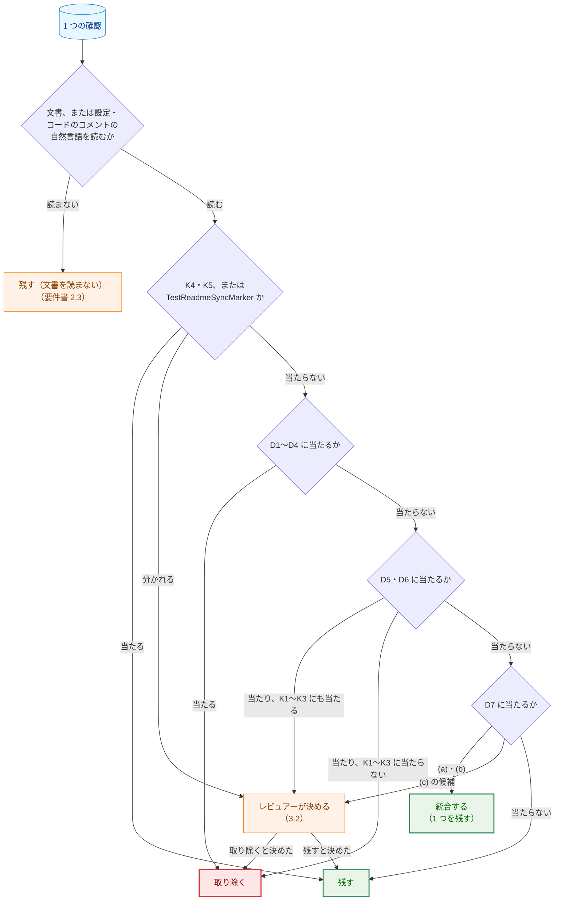
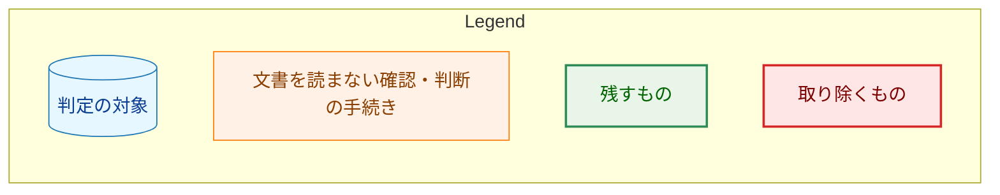
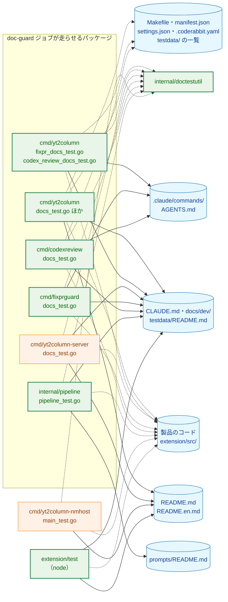
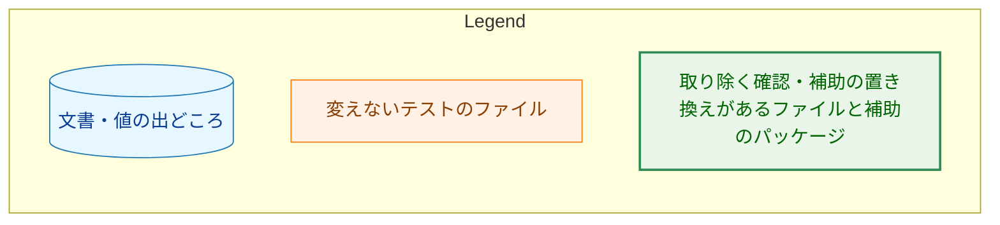
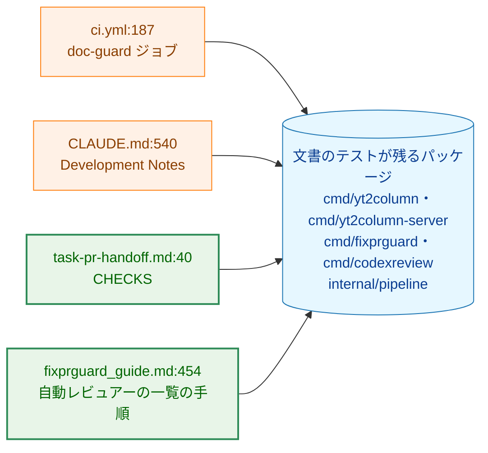
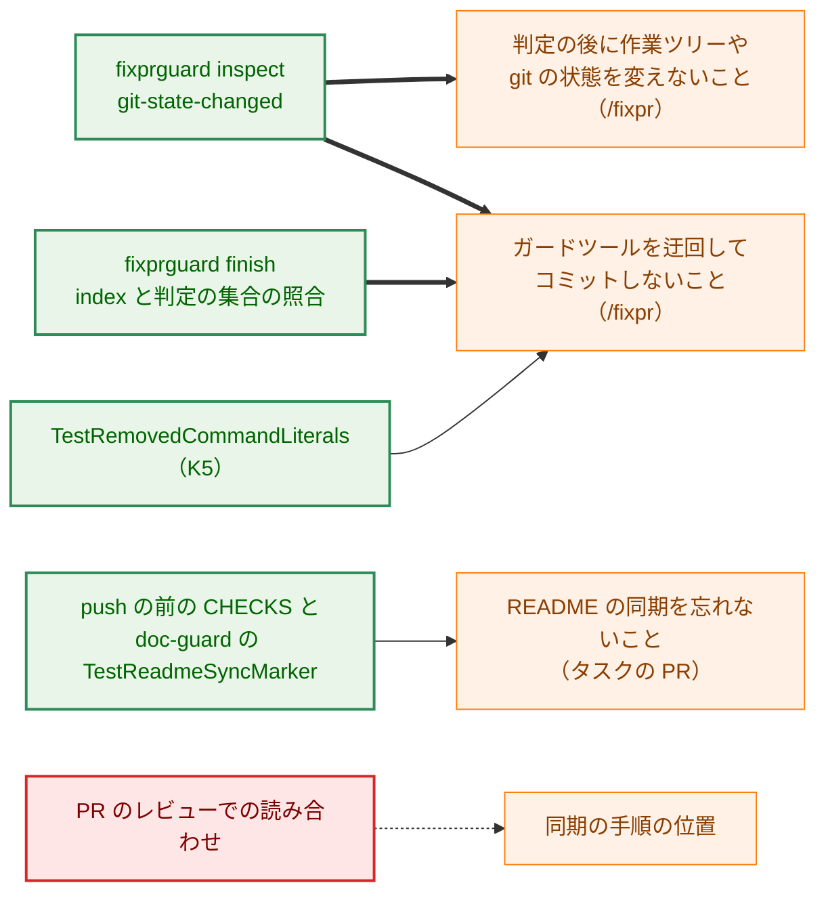
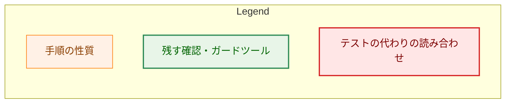
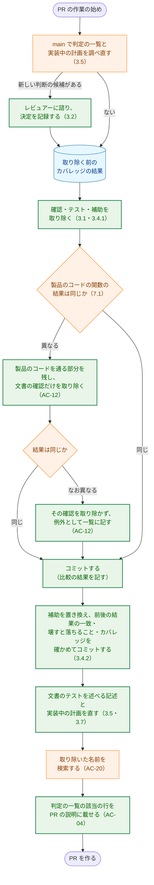
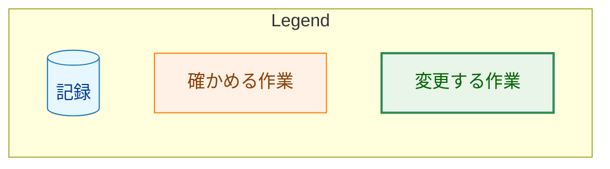

# アーキテクチャ設計書：文書のテストから、古い仕様・一度きりの確かめ・過剰な確認を取り除く

## Document Status

| Item | Value |
|---|---|
| Status | `draft` |
| Created | 2026-10-31 |
| Review date | - |
| Reviewer | - |
| Comments | - |

本書は [01_requirements.md](01_requirements.md)（要件定義書。以下、要件書）の設計である。既存のファイルについての記述は、コミット `bf314092`（2026-10-31 の `main`）のファイルで確かめた。`file:line` はこのコミットの行番号を指す。要件書が挙げる行番号は `66222946` のものなので、本書の行番号とずれている箇所がある。F-NNN・AC-NN・K1〜K5・D1〜D7 は要件書の項番と分類を指す。要件のレビューで設計に申し送られた事項（[design_handoff.md](design_handoff.md) の H-01〜H-08）への対応は 3.8 にまとめる。

**実装の開始の条件:** 要件書 5 章は、タスク 0051 の最後の PR のマージの後に実装を始めると定める。`bf314092` の時点で、0051 の計画の 2 つの PR はどちらもマージされている（PR-1 は #588、PR-2 は #590 で `3d4c6fdf`。`docs/tasks/0051_llm_effort/03_implementation_plan.md:206-207`・`:352-353`）。そのため、本書の判定の一覧は 0051 の後のテストに基準を当てはめたものである。実装の各 PR の始めに、`main` で一覧を調べ直す（3.5、AC-05）。

本書は、要件書 6 章の用語（文書のテスト、確認、値の照合、一部の削除、読み合わせ、カバレッジの比較、取り除く、古い仕様、1 回の変更の性質、統合、実装中の計画）を同じ意味で使う。ほかに次の用語を使う。

-   **判定:** 1 つのテストに要件書 F-001 の基準を当てはめた結果。「残す」「削除する」「一部を削除する」「統合する」のいずれかである（AC-04）。文書を読まないテストは「残す」とし、残す確認の欄に「文書を読まない」と記す（要件書 2.3）。
-   **判定の一覧:** テストごとの判定と、確認ごとの分類を記した表（3.1）。AC-04 の一覧に当たる。
-   **判断の一覧:** F-003 の判断を要する確認の一覧（3.2）。AC-06 の一覧に当たる。
-   **補助:** テストのためのコード。`_test.go` のファイルの型・関数・定数・正規表現と、`internal/doctestutil` と `//go:build test` のファイルにあるものを含む。
-   **補助の単体テスト:** 補助そのものを確かめるテスト（`TestSectionByHeading` など）。文書を読まない。
-   **補助の置き換え:** `internal/doctestutil` に同じ処理がある補助を取り除き、呼び出しを `doctestutil` の関数に置き換えること（1.2、3.4.2）。確認を取り除かないので、要件書 6 章の「統合」（重複する確認のうち 1 つを残すこと）とは別のものである。
-   **製品のコード:** `_test.go` と `//go:build test` のファイル以外の Go のファイル（要件書 AC-11）。拡張では `extension/src/` を指す。

## 1. 設計の全体像 (Design Overview)

### 1.1. 設計原則

-   **製品のコードは変えない。** 変えるのは、`_test.go` のファイル、`//go:build test` のファイル（`internal/doctestutil`、`internal/config/test_helpers.go`）、拡張の node のテスト、方針の記述、文書のテストを述べる記述だけである（要件書 4.4、AC-15）。文書の本文は変えない（F-005）。
-   **確認の単位で判定する。** 1 つのテストに残す確認と取り除く確認があるときは、テストを残し、取り除く確認だけを外す（要件書 F-001）。残す確認は、読む文書・範囲・値の出どころを変えない。
-   **K4・K5 と `TestReadmeSyncMarker` を最初に問う。** K4・K5 に当たる確認は、D1〜D7 のどれに当たっても取り除かない（要件書 F-001「重なるときの扱い」）。本書では、K4・K5 の確認に統合も行わない（3.3）。ただし、K5 のテストのうち、文書を読む補助を置き換えるもの（`TestPostingCommandsInventory`、`cmd/fixprguard` の K5 のテストなど）は、確認を変えずに入力の作り方だけが変わる（3.3、3.4.2）。
-   **判断を要する確認はレビュアーが決める。** D7 (c)、K1〜K3 にも当たる D5・D6、K4・K5 に当たるかが分かれる確認は、設計の際にレビュアーが一件ずつ決めた（1.2、3.2）。
-   **補助の置き換えは、残す確認が読む範囲を変えない形に限る。** 置き換える補助と呼び出しごとに、置き換えの前後で同じ文字列（同じファイルの集合）を返すことを確かめる（3.4.2、7.2）。
-   **確認を取り除くコミットと補助の置き換えのコミットを分ける。** 置き換えの誤りで残す確認が読む範囲が変わったとき、取り除いた確認のせいと区別できるようにするためである。どちらのコミットも Go のテストの補助を取り除くので、カバレッジの比較（AC-11）はどちらでも行う。
-   **取り除くことと、それを述べる記述の直しは同じ PR で行う。** マージされたどの時点でも、`docs/tasks/` の外の文書が、存在しないテストを今あるものとして述べないようにする（AC-18・AC-20）。

### 1.2. 設計の際に決めたこと（2026-10-31）

レビュアー（isseis）が決めたもの。判断の一覧（3.2）の各行の決定も、この日にレビュアーが決めた。

-   **D5 として取り除く:** `TestMigrationDocsContract` と `TestRunEvaluationProcedureFlags`。どちらも K1・K3 にも当たるが、古い仕様を確かめ続けている（3.2 の J-01・J-02）。
-   **D6 として取り除く:** `TestQuickStartLinks`、`TestProductionProfileLinks`、`TestReadmeVersionLinks`、`TestProductionProfileDocsContract` の推奨構成の小節の位置の確認、`TestGuideNamesGitStateParts` の `fixpr.md` の部分（J-03〜J-07）。
-   **`TestReadmeSyncStepPlacement` は全体を取り除く:** K5 として加えられたテストだが、手順の位置が誤ってずれても、ガードツールと `TestReadmeSyncMarker` が安全な側で止める（J-08、5.1）。設計のレビューで、最初に示した前提（迂回のコマンドの不在は `TestRemovedCommandLiterals` が確かめ続ける）が広すぎたことがわかった。`TestRemovedCommandLiterals` が確かめるのは `git add -A` と `git commit -m` だけで、同期の段落のそのほかの形の `git add`・`git commit` は、実行時にだけ止まる（5.1）。訂正した前提のもとで、レビュアーは同じ日に改めて、全体を取り除くと決めた。
-   **D7 (c) として取り除く:** `TestInstallTargetDocumented` の `CLAUDE.md` の部分と、`TestInterfaceDocComments` の全体（J-10・J-11）。`TestReadmeVersionsShareStructure` と `TestAgentsCodeReviewRules` は残す（J-12・J-13）。
-   **補助の重複は `internal/doctestutil` の関数に置き換える（H-02）:** `doctestutil` に同じ処理がある補助を、`doctestutil` の関数に置き換える。推奨は「置き換えず、使い手を失った補助を消すだけにする」だったが、レビュアーは置き換えを選んだ。置き換えは確認を取り除く書き換えではないので、要件書 2.3 の範囲外の項（代わりのテストを書くこと、直書きの期待値をコードから導く形に書き換えること）に当たらない。
-   **`cmd/fixprguard` の `cutSection` は置き換えない:** 設計のレビューで、置き換えると不都合が生じることがわかった。`doctestutil` の節を切り出す関数（`SectionByHeading`・`SectionOutsideBlocks`）は、どちらも見出しの行の全体の一致で探す。置き換えると、`fixprguard_guide.md` の 5 つの見出しの題を言い換えるだけで、5 つの K1・K3 のテストが落ちるようになる。今の `cutSection` は `### 8.1` のような番号の部分一致で探すので、題を変えても落ちない。これは要件書の目的 2.1（文書を直すときにテストを直す手間を減らす）に反するので、レビュアーは置き換えないと決めた。置き換えるのは 3.4.2 の 3 つである。
-   **PR は 3 つに分ける（H-06）:** PR-1 で方針とガードのコマンドの一覧を、PR-2 で `cmd/yt2column` の取り除きを、PR-3 でほかのパッケージと拡張の取り除きを扱う（8 章）。順序は PR-1 → PR-2 → PR-3 に固定する（8 章）。

設計で決めたもの（レビュアーに諮らず、理由とともに記す）:

-   **判断の一覧の「残す」の行は、設計で残すと判断した:** 3.2 のうち、決定が「残す」の行（J-09、J-12〜J-23）は、推奨のとおり残す。要件書 AC-07 がレビュアーの決定を求めるのは取り除く確認だけだからである。レビュアーは PR のレビューで覆せる。
-   **K4・K5 の確認には、D7 (a) の統合も行わない:** `TestFixprguardCallSites` と `TestRunprDocContract` の `head_before_checkout` は、どちらも `runpr.md` の step 1 に `fixprguard head` があることを確かめる（J-17）。後者は、それが `gh pr checkout` より前にあることも確かめるので、同じ確認ではない。統合すると、呼び出しの一覧の表から 1 行が欠ける。統合しても確認は減らないが、得るものもないので、行わない。
-   **補助の置き換えの範囲は、`doctestutil` に同じ処理がある補助に限る:** `doctestutil` に同じ処理がない補助（`itemSection`、code span の正規表現、`tablesByFirstHeader`、`--protocol` の正規表現など）を、新しい共有の補助として `doctestutil` に加えることはしない。意味が少しずつ違い（3.4.2）、寄せるには新しい補助と、その単体テストを書くことになるからである。

### 1.3. 概念モデル

文書のテストの各確認を判定する流れを示す。矢印 A → B は、「A の問いの答えに従って B へ進む」ことを表す。

Q0 で、設定ファイルやコードのコメントの自然言語も「読む」側に入れるのは、要件書 2.3 のただし書きに従うためである（`.coderabbit.yaml` のコメント、`rates.go` の冒頭のコメント、インターフェースの doc comment）。Q2 を Q3 より先に置くのは、D1〜D4 は 0038 の基準で機械的に取り除くもので、K1〜K3 との重なりを問わないからである。

### 1.4. 要件書の記述との差異

`bf314092` で確かめた事実のうち、要件書の記述と異なるものを記す。いずれも要件書の決定を変えないので、要件書は直さない。

-   **0051 の進み具合:** 要件書 1 章は、0051 の次の PR が `cmd/yt2column/docs_test.go` を変えると書く。`bf314092` の時点で、その PR（#590）はマージされている（本書の冒頭）。
-   **`TestGuideIgnoredCommands` の日英のブロックの一致:** 0038 の設計書（3.4）が削除すると見込んだ確認は、すでに `2f0c00f0`（#471）で消えている。今は K3 の確認だけが残る（3.1.4）。
-   **タスク 0048 の `_checks/` が `doctestutil` を使う:** `docs/tasks/0048_doc_language_policy/_checks/readme/main.go` と `split/main.go` は、`doctestutil` の `HeadingsOutsideBlocks`・`HeadingLevel`・`ScanDocLines`・`FencedBlocks`・`MarkdownTables`・`FindTable` を使う。`go list ./...` は `_` で始まるディレクトリを含まない（`bf314092` で `go list -tags test ./...` に `_checks` の行は 0 件）ので、`make test`・`make lint`・`make deadcode` はこれらをビルドしない。本書が取り除く補助は、どれもこれらの関数ではない（3.4）。
-   **タスク 0050 の計画の草稿:** `main` にはないが、ローカルのブランチ `isseis/0050-viewer-tab-03` に、0050 の計画の草稿（`b7d5e257`、2026-10-31 の時点で未 push）がある。その `03_implementation_plan.md:386` は、本書が取り除く確認を保つ作業を含む（3.5）。

## 2. システム構成 (System Structure)

### 2.1. 取り除いた後の文書のテストと、それが読むもの

取り除いた後に残る文書のテストのファイルと、それが読む文書・値の出どころ・補助の関係を示す。矢印 A → B は、「テストのファイル A が B を読む、または使う」ことを表す。実線は文書を読むこと、点線は値の出どころ（製品のコード・設定・ファイルの一覧）を読むこと、または `internal/doctestutil` の補助を使うことを表す。`package_reference.md` は `docs/dev/` の文書に含める。

`internal/pipeline` は、取り除いた後も `TestPackageReferenceListsPackages`（`pipeline_test.go:672`）と `TestPromptsREADMEMatchesContract`（`:756`）で文書を読む。そのため、`doc-guard` ジョブの対象の 5 つのパッケージ（`.github/workflows/ci.yml:187`）には、どれも文書のテストが残る（2.2）。

### 2.2. 文書のガードのコマンドと、拡張の CI ジョブの起動条件（F-007）

**文書のガードのコマンド（AC-19）。** 文書のガードのコマンドを書く箇所は 4 つある。矢印 A → B は、「A のコマンドの一覧を、B（本タスクの後に文書のテストが残るパッケージの集合）に合わせる」ことを表す。

-   `ci.yml:187` と `CLAUDE.md:540` は、5 つのパッケージを挙げていて、本タスクの後の集合と一致する。変えない。
-   `.claude/commands/_lib/task-pr-handoff.md:40` と `docs/dev/guides/fixprguard_guide.md:454` は、`./cmd/codexreview` を欠く（`go test -tags test ./cmd/yt2column ./cmd/yt2column-server ./cmd/fixprguard ./internal/pipeline`）。今すでに AC-19 と食い違っているので、PR-1 で `./cmd/codexreview` を加える。
-   `cmd/yt2column-nmhost` は加えない（要件書 2.3）。

**拡張の CI ジョブの起動条件（AC-21）。** 本タスクの後も、node のテストが読む文書は今と同じである。

-   `README.md`・`README.en.md`: `metadataDocs.test.ts` の 2 つの K1 の確認（展開の案内の文、ポップアップの名前）が読み続ける（3.1.7）。取り除く socket directory の確認（同 `:64-78`）は文書の本文を読まないので、取り除いても読む文書は変わらない。
-   `docs/dev/guides/development.md`: `serverReasons.test.ts` が拒否理由の表を読み続ける。そのため `internal/server/response.go` も起動条件に残る（要件書 AC-21）。

したがって、`extension/scripts/has-extension-changes.sh` のパターン（`:19`）と冒頭の説明（`:2-11`）、`extension/test/ciChanges.test.ts` の表（`:21-32`・`:62-89`）、`CLAUDE.md:521-526` の説明は、どれも変えない。実装の際は、PR-3 で、これらが取り除いた後の node のテストと一致することを読んで確かめる。

### 2.3. 変えるファイル

| 区分 | ファイル | PR |
|---|---|---|
| 方針 | `CLAUDE.md`「Testing Strategy」（F-008） | PR-1 |
| ガードのコマンドの一覧 | `.claude/commands/_lib/task-pr-handoff.md:40`、`docs/dev/guides/fixprguard_guide.md:454`（AC-19） | PR-1 |
| Go の文書のテスト（`cmd/yt2column`） | `docs_test.go`、`readme_structure_test.go`、`run_test.go`、`fixpr_docs_test.go`、`codex_review_docs_test.go` | PR-2 |
| テストの補助 | `internal/doctestutil/readme.go`、`internal/config/test_helpers.go` | PR-2 |
| Go の文書のテスト（そのほか） | `cmd/fixprguard/docs_test.go`、`cmd/codexreview/docs_test.go`、`internal/pipeline/pipeline_test.go` | PR-3 |
| node のテスト | `extension/test/metadataDocs.test.ts` | PR-3 |
| 文書のテストを述べる記述 | `CLAUDE.md`「Development Notes」（PR-2・PR-3） | PR-2・PR-3 |
| 実装中の計画・設計書 | タスク 0050 の設計書または計画（3.5。実装の時点の状態による） | PR-3（0050 の計画の PR で扱う場合は変えない） |
| 本タスクの文書 | `03_implementation_plan.md`（実装の記録） | 各 PR |

変えないもの: `.github/workflows/ci.yml`、`extension/scripts/has-extension-changes.sh`、`extension/test/ciChanges.test.ts`・`serverReasons.test.ts`・`markdownSection.test.ts`・`helpers/`、`cmd/yt2column-server/docs_test.go`、`cmd/yt2column-nmhost/main_test.go`、`cmd/yt2column` の `output_layout_docs_test.go`・`copied_transcript_docs_test.go`・`docpaths_test.go`・`readme_sync_test.go`・`extension_docs_test.go`、`internal/doctestutil/structure.go`、`docs/dev/conventions/package_reference.md`・`test_organization.md`（3.7）、完了したタスクの文書（AC-17）。

## 3. コンポーネント設計 (Component Design)

本タスクは、新しい型・インターフェース・エラー型を加えない。補助の置き換えも、`internal/doctestutil` にすでにある関数（`ReadDoc`・`SectionByHeading`・`CommandDocs`）に置き換えるだけで、新しい関数を加えない。そのため、本章にコードの例はない。

### 3.1. 判定の一覧（F-001・F-002、AC-04・AC-05、H-01）

テストごとの判定を、ファイルごとに示す。調べた時点は `bf314092` である（AC-05）。「製品のコード」の列は、取り除く確認が製品の関数を呼ぶかを示す。呼ぶものについては、ほかのテストも同じ関数を通るので、取り除いてもカバレッジが変わらないことを確かめた。確かめ方は、取り除く候補を `-skip` で飛ばして実行することである（7.1）。

**AC-05 の調べ:** 要件書 2.2 の一覧にないファイルに、文書を読むテストはない。`bf314092` で、テストのファイルのうち `doctestutil` を使う、または `.md` のパスを持つものを `git grep` で挙げ、一覧の外のものを読んだ。`cmd/yt2column/makefile_test.go`（`Makefile` を読む）、`internal/codexreview/run_test.go:713`（`.md` はパスの文字列）、`cmd/fixprguard/main_test.go`（一時的なリポジトリのファイル名）、`extension/test/repository.test.ts`（`ci.yml`・`Makefile` を読む）などは、設定とソースだけを読む。`internal/pipeline/relay_guard_test.go` の `TestSharedTokenRemoved` は文書を読まない（要件書 2.3）。

#### 3.1.1. `cmd/yt2column/docs_test.go`

| テスト | 判定 | 残す確認 | 取り除く確認 | 製品のコード |
|---|---|---|---|---|
| `TestREADMEDocumentsFlags`（`:152`） | 残す | `newFlagSet` のすべてのフラグを `cli.md` の表と照合（K1） | - | - |
| `TestSlackDocsContract`（`:171`） | 統合する | `development.md`・`security.md` を `publishertestutil` の定数と照合（K1。`development.md` の `CLISlackOptInEnv` を除く）。`16383` を `publisher.SlackMaxMessageRunesForTest` と照合し（`:175`）、`project_overview.md`・README の 2 つの版の `16,383` と照合（K1） | `development.md` の全体に `CLISlackOptInEnv` があること（`:180`・`:188`。D7 (a)）。統合先は `TestDeepSeekDocsContract` の `cli_slack`（`:255-258`）。同じ文書の同じ値を同じ定数と照合し、範囲も節に限るので、こちらを残す | なし |
| `TestClaudeDocsContract`（`:216`） | 残す | `development.md`・`security.md` を `claudetestutil` の 3 つの定数と照合（K1。J-18） | - | - |
| `TestDeepSeekDocsContract`（`:238`） | 残す | `development.md` の統合テストの 3 つの節を定数と照合（K1）。`TestSlackDocsContract` の統合先 | - | - |
| `TestLLMDefaultsDocsContract`（`:279`） | 残す | README の 2 つの版と `project_overview.md` の表を、`config.DefaultLLMValueForTest` と照合。各変数の行がちょうど 1 つあること（K1） | - | - |
| `TestEffortValuesDocsContract`（`:331`） | 残す | 3 つの文書の effort の表を `EffortValuesByProviderForTest`・`DefaultClaudeEffortForTest` と照合（K1） | - | - |
| `TestProductionProfileDocsContract`（`:661`） | 一部を削除する | `production_profile.md` と README の版ごとの sh のブロックを `config.LoadServer` で読み、既定と比べること（K1・K3）。段階の表（K1） | 推奨構成の小節が「設定」の節の中にあること（`:680-689`。D6、タスク 0040 の AC-13。J-06） | なし（`LoadServer` は残す部分が呼ぶ） |
| `TestMigrationDocsContract`（`:704`） | 削除する | - | README の「廃止した LLM の変数からの移行」の節の例を `LoadServer` で読み、退役した設定と同じ選択になること（K1・K3 にも当たる D5。仕様はタスク 0045 で廃止した `YT2COLUMN_LLM_PROVIDER`・`YT2COLUMN_MODEL` と、0051 で廃止した `YT2COLUMN_CLAUDE_EFFORT`（廃止した LLM の変数）。J-01） | あり（`config.LoadServer`）。ほかのテストも通り、変わらない |
| `TestQuickStartLinks`（`:786`） | 削除する | - | クイックスタートが「必要なもの」より前にあること、各項目に README の中へのリンクがあること、外部の URL がないこと（D6、タスク 0040 の AC-09。J-03）。リンクが解決することは `TestReadmeLinks` が確かめ続ける | なし |
| `TestProductionProfileLinks`（`:831`） | 削除する | - | `CLAUDE.md`・`project_overview.md`・README・`prompts/README.md` が `production_profile.md` へのリンクを持つこと（D6、タスク 0040 の AC-14・AC-19・AC-21・AC-23。J-04）。リンクが解決することは `TestReadmeLinks` と `TestInstructionDocPaths` が確かめ続ける | なし |
| `TestReadmeLinks`（`:879`） | 残す | README の 2 つの版・`cli.md`・`development.md` の相対リンクの先があること、アンカーが解決すること、リンクの開きの数（K1。出どころはリポジトリの構成と見出し）。すべてのリンクの一般的な性質を確かめるので、D6 に当たらない | - | - |
| `TestNumberedItems`（`:939`） | 削除する | - | 補助 `numberedItems` の単体テスト。使い手（`TestQuickStartLinks`）を削除するので、補助と一緒に削除する（AC-10） | なし |
| `TestTokenUsageDocsContract`（`:1000`） | 残す | `cli.md` の節を `run.go` の定数・`llm.UnknownReason` と照合、例の行（K1・K3） | - | - |
| `TestCostDocsContract`（`:1058`） | 一部を削除する | `cli.md` の「推定の料金」の節を定数・`costBasisWord`・`costReasonWord` と照合、例の行（K1・K3）。`project_overview.md` の `costPrefix`（K1。J-19） | `internal/pricing/rates.go` の冒頭のコメントが `pricing_update.md` を含むこと（`:1123-1127`。コードのコメントの文言をテストに直書きしたもの、D2） | なし（ファイルを読むだけ） |

#### 3.1.2. `cmd/yt2column` のそのほかの文書のテスト

| テスト | 判定 | 残す確認 | 取り除く確認 | 製品のコード |
|---|---|---|---|---|
| `TestOutputLayoutDocsContract`（`output_layout_docs_test.go:92`） | 残す | `cli.md` と README の版ごとの例を、`FilePublisher`・`SlackMessagesForTest` の出力と比べる（K3） | - | - |
| `TestFirstCodeBlockAfter`（`:138`） | 残す | 補助の単体テスト。呼び出し側に行の表がないので D7 (b) に当たらない | - | - |
| `TestCopiedTranscriptSurveyRecords`（`copied_transcript_docs_test.go:19`） | 残す | `testdata/*.transcript_copy.txt` の一覧と `testdata/README.md` の照合（K1） | - | - |
| `TestInstructionDocPaths`（`docpaths_test.go:140`） | 残す | 指示と規約の文書の相対リンクの先と、`docs/dev` のパスがあること、リンクの数（K1。一般的な性質なので D6 に当たらない） | - | - |
| `TestDocPathRefs`（`:163`） | 残す | 補助の単体テスト | - | - |
| `TestReadmeVersionsShareStructure`（`readme_structure_test.go:21`） | 残す | 2 つの版の見出しのレベルの並びと、コードブロックの数の一致（K2。J-12） | - | - |
| `TestReadmeVersionLinks`（`:42`） | 削除する | - | 最初の見出しより前にもう一方の版へのリンクがあること、2 つの手引きへのリンク、`cli.md` から設定の節へのリンク（D6、タスク 0048 の AC-23・AC-28・AC-36。J-05） | なし |
| `TestReadmeSyncMarker`（`readme_sync_test.go:79`） | 残す | 同期の印（要件書 F-001 により取り除かない。AC-03） | - | - |
| `TestCheckReadmeSync`（`:95`）・`TestGitBlobIDMatchesGit`（`:140`） | 残す | 同期の仕組みの補助の単体テスト | - | - |
| `TestExtensionDocumentation`（`extension_docs_test.go:53`） | 残す | 拡張機能の ID を README の 2 つの版・`security.md` と照合、`ext-` のターゲットを `CLAUDE.md` と照合、8.1 の権限を `manifest.json` と照合（K1。`security.md` の ID は J-22） | - | - |
| `TestNativeHostContract`（`:151`） | 残す | 文書を読まない（拡張のソースと `manifest.json`。変えない） | - | - |
| `TestExtensionIDFromManifestKeyRejectsUnparseableKey`（`:213`）・`TestDeclaredPermissions`（`:227`） | 残す | 補助の単体テスト。呼び出し側に行の表がない | - | - |
| `TestRunEvaluationProcedureFlags`（`run_test.go:2897`） | 削除する | - | タスク 0010 の `02_evaluation.md` 2.6 の手順からコマンドを取り出して実行すること（K3 にも当たる D5。仕様はタスク 0017 が加えた、中間生成物を固定した比較の手順。完了したタスクの文書を読むので D4 にも当たる。J-02） | あり（`run`）。`--artifacts`・`--after`・`--keep-cache` はほかの `run` のテストも通り、変わらない |

#### 3.1.3. `cmd/yt2column/fixpr_docs_test.go`・`codex_review_docs_test.go`

| テスト | 判定 | 残す確認 | 取り除く確認 | 製品のコード |
|---|---|---|---|---|
| `TestFixprDocContract`（`fixpr_docs_test.go:132`） | 残す | `round_counting`: 2 つの節が `fixprguard.CommitSubject` の件名を含む（K1）。`out_of_scope_stop`: Phase 3.5 が `StopDirtyWorkTree` を含む（K1） | - | - |
| `TestRunprDocContract`（`:153`） | 残す | `head_before_checkout`（K5）、`fixpr_stops`（K1）、`no_body_fetch`（K5）、`listings_print_no_body`（K5） | - | - |
| `TestHandoffListingPrintsNoBody`（`:189`） | 残す | Part B step 5 の一覧の `--jq` を `jq` で実行し、本文を出力しないこと（K5） | - | - |
| `TestFixprguardCallSites`（`:647`） | 残す | ガードツールの呼び出しの場所（K5。J-17） | - | - |
| `TestFixprBuildChecksMatchTool`（`:673`） | 残す | `fixpr.md`・`_context.md` の build checks を `fixprguard.BuildCheckTargets()` と照合（K1） | - | - |
| `TestContextAndCommandsAgree`（`:855`） | 残す | `checkContextReviewers` による解析と `wantReviewers` との照合、行の数の規則とその一部の `oldReviewerRow` の不在（D3 にも当たるが K4。J-14）、完了を待つ PR レビュアーの名前（K4）、コマンドの定義がレビュアーの名前を書かないこと（K4）、PR レビュー依頼の行の説明が `CodexMention` を含むこと（K1。J-15） | - | - |
| `TestContextReviewerRowsMalformed`（`:886`） | 残す | 壊した写しで照合が働くこと（K4） | - | - |
| `TestRemovedCommandLiterals`（`:970`） | 残す | ガードツールを迂回するコマンドがないこと（K5） | - | - |
| `TestReadmeSyncStepPlacement`（`:1027`） | 削除する | - | `fixpr.md` の Phase 3 の同期の手順の位置とその段落の `git add`・`git commit` の不在、`task-pr-handoff.md` の Part B 項目 1 の位置、`mktrans.md` の番号付きのコミットの手順の位置（D6、タスク 0048。K5 に当たるかが分かれる。J-08） | なし |
| `TestCodexMentionOnlyInRequestRow`（`codex_review_docs_test.go:92`） | 残す | `CodexMention` がコマンドの文書と `CLAUDE.md` で PR レビュー依頼の行にだけ現れること（K1。0038 4.2 が名指しで残す。J-16） | - | - |
| `TestPostingPathsCheckMention`（`:115`） | 残す | 投稿する各節の言及の確認がコマンドを含むこと（K5） | - | - |
| `TestPostingCommandsInventory`（`:196`） | 残す | 投稿のコマンドが言及の確認の後にあること（K5） | - | - |
| `TestIsPost`（`:256`） | 残す | 補助の単体テスト。呼び出し側に行の表がない | - | - |
| `TestCodeRabbitConfigStopsReview`（`:354`） | 一部を削除する | `autoReviewDisabled` の表で、`.coderabbit.yaml` の `reviews.auto_review.enabled: false` を読み、壊した写しで補助が働くこと（文書を読まない設定の確認。変えない） | `.coderabbit.yaml` のコメントの英文 3 句を `requirePhrases` で固定すること（`:356-360`。D1・D2。要件書 2.3 が名指しする） | なし |
| `TestAgentsCodeReviewRules`（`:396`） | 残す | `AGENTS.md` に `## Code Review Rules` がちょうど 1 つあること（K2。J-13） | - | - |

#### 3.1.4. `cmd/fixprguard/docs_test.go`・`cmd/codexreview/docs_test.go`

| テスト | 判定 | 残す確認 | 取り除く確認 | 製品のコード |
|---|---|---|---|---|
| `TestGuidePathExists`（`fixprguard/docs_test.go:36`） | 残す | 使い方の誤りの診断が示すパス（`run` の出力）にファイルがあること（K1。出どころはファイルの一覧。J-23） | - | - |
| `TestGuideCoversStopKindsAndScope`（`:56`） | 残す | 停止の種類を `StopKinds` と、6 章の 2 つの表を `ExecutionFilePatterns`・`AllowListPatterns` と照合（K1） | - | - |
| `TestGuideTable`（`:105`） | 残す | 補助の単体テスト | - | - |
| `TestDocumentedInvocationsParse`（`:188`） | 残す | 呼び出しを製品の `parse` で解析（K3）、必要なサブコマンドの呼び出しと `--reviewer` の形（K5） | - | - |
| `TestCheckDocumentedReviewer`（`:220`） | 残す | K5 の補助の単体テスト | - | - |
| `TestGuideDescribesReviewerList`（`:289`） | 残す | `--reviewer LOGIN ...` を持つ見出しの集合を `specs` と照合（K1） | - | - |
| `TestDocumentedProtocolMatches`（`:326`） | 残す | コマンドの文書とガイドの `--protocol` を `fixprguard.Protocol` と照合（K1・K5） | - | - |
| `TestFixprguardProtocolMismatches`（`:367`） | 残す | 補助の単体テスト。`TestProtocolFlags`（`doctestutil`）とは別の関数を確かめる | - | - |
| `TestGuideDescribesMentionCheck`（`:393`） | 残す | 7.1・7.2 が `fixprguard.CodexMention` を挙げること（K1） | - | - |
| `TestCutSection`（`:406`） | 残す | 補助 `section`・`subsection`・`cutSection` の単体テスト。補助は置き換えずに残す（1.2） | - | - |
| `TestGuideListsWatchList`（`:444`） | 残す | 7.1 の監視の一覧を `WatchListPatterns` と照合（K1） | - | - |
| `TestGuideNamesGitStateParts`（`:461`） | 一部を削除する | 8 章の `git-state-changed` の `parts` の一覧に `GitStateParts` の値がすべてあること（K1、`:462-474`） | `fixpr.md` の一覧に `` `ignored` `` があること（`:475-481`。K1 にも当たる D6、タスク 0034（#461）。J-07） | なし（定数 `PartIgnored` だけ） |
| `TestGuideDescribesIgnoredFiles`（`:488`） | 残す | 8.2 の表が `IgnoredFailureRules` のすべてを挙げること（K1）。`:489-494` は文書を読まないコードの性質の確認（変えない） | - | - |
| `TestGuideIgnoredCommands`（`:526`） | 残す | 8.1 の sh のブロックを、製品の `begin`・`inspect` が書いた記録に対して実行すること（K3） | - | - |
| `TestSettingsAllowsTool`（`codexreview/docs_test.go:80`） | 残す | 文書を読まない（`.claude/settings.json`。変えない） | - | - |
| `TestMayBypassTool`（`:108`） | 残す | 補助の単体テスト | - | - |
| `TestDocumentedProtocolMatches`（`:158`） | 残す | コマンドの文書の `codexreview` の呼び出しの `--protocol` を `codexreview.Protocol` と照合（K5） | - | - |
| `TestInvocations`（`:215`） | 残す | 補助の単体テスト | - | - |
| `TestDocumentedInvocationsParse`（`:255`） | 残す | 手順の文書の呼び出しを製品の `parse`・`ValidBase` で解析（K3）、許可なしで通る形であること（K5） | - | - |
| `TestProcedureNamesKinds`（`:311`） | 残す | 種類の表の列の見出し（K2）、`codexreview.Kinds()` と Detail の行（K1）、Exit code の列と `exitCode`（K1）、Handling の列（K5。J-09） | - | - |
| `TestCodexreviewProtocolMismatches`（`:376`） | 残す | K5 の補助の単体テスト | - | - |
| `TestNoDirectCodexInvocation`（`:554`） | 残す | コマンドの文書が `codex` を直接実行しないこと（K5） | - | - |
| `TestRunsCodex`（`:567`） | 残す | K5 の補助（`runsCodex` など）の単体テスト。表に同じ行はなく、呼び出し側に表もない | - | - |
| `TestInstallTargetDocumented`（`:656`） | 一部を削除する | `Makefile` の `install-codexreview:` の次の行が `$(GOCMD) install ./cmd/codexreview` であること（設定だけを読む。変えない） | `CLAUDE.md` の `## Commands` に `make install-codexreview` の項目があること（`:664-669`。K1 にも当たる D7 (c)。J-10） | なし |

`TestInstallTargetDocumented` は、取り除いた後は文書を読まない。名前を変えるかどうかは、実装計画で決める。

#### 3.1.5. `cmd/yt2column-server`・`cmd/yt2column-nmhost`・`internal/pipeline`

| テスト | 判定 | 残す確認 | 取り除く確認 | 製品のコード |
|---|---|---|---|---|
| `TestServerDocsContract`（`cmd/yt2column-server/docs_test.go:34`） | 残す | README: `SlackWebhookEnvForTest`、2 つのソケットのパス、終了コードの表（K1。`ReadmeUpgradeHeading` は範囲を狭める手がかりで、残す確認の一部）。`development.md`: `curl` の例とパスの定数（K1・K3）。`rejection_reasons`: 理由とステータス（K1）、README の表示の区分（K1。J-21）。`api_codes`（K1）。`project_overview.md` の 2 つの変数名（K1。J-20）。`security.md` 8.2 の値と `allowed_origins`（K1。J-22） | - | - |
| `TestHasCurlCommand`（`:305`） | 残す | 補助の単体テスト。呼び出し側の表は実際の文書に当てる 3 つ組で、同じ行はない | - | - |
| `TestReadmeHostExitCodes`（`cmd/yt2column-nmhost/main_test.go:435`） | 残す | README の 2 つの版の終了コードの表を `exitOK`・`exitFailure`・`exitUsage` と照合（K1） | - | - |
| `TestInterfaceDocComments`（`internal/pipeline/pipeline_test.go:512`） | 削除する | - | 4 つのインターフェースの doc comment が英文の節を含むこと（`:518-538`。コードのコメントの自然言語の固定、D1・D2）。doc comment に CJK の文字がないこと（`:547`。D7 (c)。J-11） | なし（`go/parser` で読むだけ） |
| `TestPackageReferenceListsPackages`（`:672`） | 残す | パッケージの一覧と `package_reference.md` の表の照合（K1）。文書の読み込みの置き換えを受ける（3.4.2） | - | - |
| `TestPromptsREADMEMatchesContract`（`:756`） | 残す | `internal/writer` のソースから導いた値と `prompts/README.md` の照合（K1）。文書の読み込みと補助 `markdownSections` の置き換えを受ける（3.4.2） | - | - |

#### 3.1.6. `internal/doctestutil` の単体テスト

`doctestutil` の単体テストは、どれも D7 (b) に当たらない。呼び出し側は実際の文書に補助を当てるだけで、合成した行の表を持たないからである。使い手が残る補助の単体テストは、すべて残す（AC-10）。

| テスト | 判定 | 理由 |
|---|---|---|
| `TestSectionByHeading`・`TestScanDocLines`・`TestFencedBlocks`・`TestAnchorFromHeading`・`TestHeadingsOutsideBlocks`・`TestSectionOutsideBlocks`（`markdown_test.go:14`・`:85`・`:106`・`:128`・`:152`・`:162`） | 残す | 補助が残る。`AnchorFromHeading` は `TestReadmeLinks` の `headingAnchors` が使い続ける |
| `TestReadDoc`（`read_test.go:15`） | 残す | 補助が残る |
| `TestLocatorIn`・`TestRejectionDisplayIn`（`readme_test.go:28`・`:59`）、`TestRejectionDisplayCategory`（`rejection_test.go:15`） | 残す | 補助が残る。`TestLocatorIn` は自分のリテラルで `Locator` を作るので、取り除くロケータに依らない |
| `TestMarkdownTables`・`TestFindTableAndTableRow`・`TestStripBackticks`・`TestColumnIndex`（`tables_test.go:13`・`:42`・`:82`・`:97`） | 残す | 補助が残る |
| `TestProtocolFlags`（`protocol_test.go:12`） | 残す | K5 の補助 `ProtocolFlags` が残る |
| `TestParseStructure`・`TestCompareStructures`・`TestStructureDiffString`（`structure_test.go:14`・`:238`・`:317`） | 残す | `TestReadmeVersionsShareStructure` を残すので、`structure.go` も残る（J-12） |

#### 3.1.7. 拡張の node のテスト

| テスト | 判定 | 残す確認・取り除く確認 | `extension/src/` を通るか（AC-13） |
|---|---|---|---|
| `metadataDocs.test.ts`「gives the expand prompt word for word」（`:41`） | 残す | README の各版の「ブラウザ拡張」の節が `expandPromptMessage(locale)` の文と手順を含むこと（K1） | 通る |
| 同「quotes the popup names the catalog defines」（`:50`） | 残す | `catalogs[locale]` の 4 つの名前が太字で書かれていること（K1） | 通る |
| 同「socket directory documentation reference」（`:64-78`） | 削除する | 英語のカタログの `notSent["server-unavailable"].steps` が、テストに直書きの `"README.en.md"` を含むことと、そのファイルがあること（D2・D6、タスク 0048 の AC-35）。文書の本文は読まない。期待するパスはテストに直書きのリテラルで、コードから導いていないので K1 に当たらない（`TestGuidePathExists` は、パスを製品の `run` の出力から取るので K1 に当たる。J-23） | `catalogs`（`extension/src/core/i18n/en.ts` のデータ）を読み込むが、関数は呼ばない。`catalogs` はほかに 7 つのテスト（`catalog`・`launch`・`manifest`・`messages`・`popupPreview`・`render`・`sendMessages`）が読み込むので、通る範囲は狭まらない |
| `serverReasons.test.ts`（`:63`） | 残す | 拒否理由の表の固定のメッセージの行を `serverRejectStatus` と照合（K1） | 通る |
| `markdownSection.test.ts`（`:6`） | 残す | 補助の単体テスト。補助は `metadataDocs.test.ts` の残す確認が使う | 通らない |
| `ciChanges.test.ts` | 残す | 文書を読まない（変えない）。起動条件は変わらない（2.2） | - |

### 3.2. 判断の一覧（F-003、AC-06・AC-07）

判断を要する確認と、その決定を示す。「種類」の列は、F-003 のどの判断かを示す。(i) K1〜K3 にも当たる確認を D5・D6 として取り除くか、(ii) K4・K5 に当たるかが分かれる確認、(iii) D7 (c) の候補である。(iii) の行には、起きにくい、害が小さい、保守の手間が見合わない、のどれに当たるかを記す（残す行では、どれにも当たらないことを記す）。「参考」の行は、D7 (a) に当たるかを確かめて、当たらないとしたもので、判断を要する確認ではない。決定は 2026-10-31 のものである（1.2）。

| ID | テストと確認 | 種類 | 防ぐ誤り | 決定 | 理由 |
|---|---|---|---|---|---|
| J-01 | `TestMigrationDocsContract` の全体 | (i) D5 | 移行の例のブロックが、退役した設定と違う構成を読み込むこと | 取り除く（レビュアー） | 節を消すとテストが落ちるので、仕様の後片付けを止める（要件書 1 章の分類 1 の例）。廃止した LLM の変数は config が拒否し続け、エラーが代わりの変数を示す（`internal/config/config.go:158-160` の `retiredLLMVars`） |
| J-02 | `TestRunEvaluationProcedureFlags` の全体 | (i) D5 | 評価の手順のコマンドが、CLI のフラグの変更で動かなくなること | 取り除く（レビュアー） | 手順の最後の使い手はタスク 0018 の評価で、完了している。残すと、フラグを変えるたびに完了したタスクの文書を直すことになり、要件書 1 章「完了したタスクの文書は変えない」と矛盾する |
| J-03 | `TestQuickStartLinks` の全体 | (i) D6（0040） | クイックスタートの項目から README の中へのリンクが消えること | 取り除く（レビュアー） | 0040 が加えたリンクと位置の確認である。リンクが解決することは `TestReadmeLinks` が確かめ続ける |
| J-04 | `TestProductionProfileLinks` の全体 | (i) D6（0040） | 4 つの文書から `production_profile.md` へのリンクが消えること | 取り除く（レビュアー） | 0040 が加えたリンクの確認である。リンクが解決することは `TestReadmeLinks`・`TestInstructionDocPaths` が確かめ続ける。`prompts/README.md` のリンクの解決を確かめるテストはなくなる（4.3） |
| J-05 | `TestReadmeVersionLinks` の全体 | (i) D6（0048） | README の版を切り替えるリンクや、手引きへのリンクが消えること | 取り除く（レビュアー） | 0048 が加えたリンクの確認である。リンクが解決することは `TestReadmeLinks` が確かめ続ける |
| J-06 | `TestProductionProfileDocsContract` の推奨構成の小節が「設定」の節の中にあること（`:680-689`） | (i) D6（0040 の AC-13） | 小節が「設定」の節の外へ移ること | 取り除く（レビュアー） | 決まった位置にあることの確認である。起きても害が小さい。ブロックの値の確認（K1・K3）は残る |
| J-07 | `TestGuideNamesGitStateParts` の `fixpr.md` の部分（`:475-481`） | (i) D6（0034） | `PartIgnored` の名前を変えたのに、`fixpr.md` の一覧が古いままになること | 取り除く（レビュアー） | 6 つの部分のうち、0034 が加えた 1 つだけを確かめている。誤っても停止の報告の文が古くなるだけで、ガードは働く。名前の変更は残す 8 章の照合で気づける |
| J-08 | `TestReadmeSyncStepPlacement` の全体 | (ii) K5 か D6（0048）か | README の同期の手順が誤った位置に置かれること、同期の段落で手でコミットすること、`mktrans` が sub-step でコミットすること | 取り除く（レビュアー。前提を訂正して改めて決めた。1.2） | 誤っても実行時に安全な側で止まるので、K5 の理由（誤ると信頼の境界が実行時に働かなくなる）に当たらない（5.1）。`TestRemovedCommandLiterals` が `fixpr.md` の全体で確かめるのは `git add -A` と `git commit -m` だけで、同期の段落のそのほかの形の `git add`・`git commit` は、テストではなく実行時のガードツールだけが止める |
| J-09 | `TestProcedureNamesKinds` の Handling の列（`:349-351`） | (ii) K5 か D2 か | 手順の文書が、作業ツリーが変わった場合などを `triage` と書き、結果を使ってしまうこと | 残す（設計） | 期待値は直書きの語彙だが、信頼の境界での止め方そのものを確かめる |
| J-10 | `TestInstallTargetDocumented` の `CLAUDE.md` の部分（`:664-669`） | (iii) 起きにくい・害が小さい | install target の名前を変えたのに、`CLAUDE.md` の案内が古いままになること | 取り除く（レビュアー） | ツールの名前はパッケージのディレクトリで決まり、変わりにくい。誤っても利用者は `Makefile` を見ればわかる。ほかのツールの install target には同じ確認がない |
| J-11 | `TestInterfaceDocComments` の CJK の確認（`:547`） | (iii) 起きにくい・害が小さい | 4 つのインターフェースの doc comment に日本語が入ること | 取り除く（レビュアー） | 4 つのインターフェースにだけ `CLAUDE.md` の英語の規則を当てていて、ほかのコメントは PR のレビューで見ている。節の英文の固定（D1・D2）を取り除くと、テストに残るのはこの確認だけになる |
| J-12 | `TestReadmeVersionsShareStructure` と `structure.go` | (iii) どれにも当たらない（起きやすく、気づきにくい） | `README.en.md` で節やコードブロックが欠けること | 残す（レビュアー） | `README.en.md` は `/mktrans` が作るので、欠けは起きやすく、ほかのテストでは気づけない。`mktrans.md:82` がこのテストを前提にしている |
| J-13 | `TestAgentsCodeReviewRules` | (iii) 起きにくいが、害は表に出ず、保守の手間はない | 見出しを言い換えて、Codex がレビューの規則を読まなくなること | 残す（レビュアー） | 誤りが表に出ず、レビューの質だけが落ちる。見出しは変わらないので、保守の手間はほぼない |
| J-14 | `checkContextReviewers` の `oldReviewerRow`（`fixpr_docs_test.go:51`・`:765`・`:770`）と `old_row_left` の行（`:911`） | (ii) K4 か D3・D5 か | 退役した単一のレビュアーの行が戻り、エージェントが一覧と取り違えること | 残す（設計） | 退役した記述が「ない」ことの確認で、D5（退役した記述が「ある」こと）に当たらず、文書の側の不在（D3）に当たる。ただし K4 の行の数の規則の一部であり（0038 の設計書 3.1.2）、K4 は D3 に当たっても残す。今の文書に該当の語はなく、保守の手間はない |
| J-15 | `TestContextAndCommandsAgree` の、依頼の行の説明が `CodexMention` を含むこと（`:863`） | (iii) 害が小さいが、保守の手間はない | 説明の中の言及が古くなること | 残す（設計） | 0038 が K1 として残した確認で、保守の手間はない |
| J-16 | `TestCodexMentionOnlyInRequestRow` の、依頼の行が 1 つだけあること（`:106`） | 参考（D7 (a) の部分的な重なり） | 依頼の行が 2 つになること | 残す（設計） | `checkContextReviewers` の行の数の規則と重なるが、行の書き方にも依るので同じ確認ではない |
| J-17 | `runpr.md` step 1 の `fixprguard head` の有無（`TestFixprguardCallSites` の `:660` と `TestRunprDocContract` の `head_before_checkout`） | 参考（K5 の D7 (a)） | `fixprguard head` が消えること | 残す（設計） | 1.2 のとおり、K5 の確認は統合しない |
| J-18 | `TestSlackDocsContract`・`TestClaudeDocsContract` の、同じ値を複数の文書で確かめること | (iii) どれにも当たらない（値の変更は起こりうる） | 値を変えたとき、一部の文書が古いままになること | 残す（設計） | 文書が違うので D7 (a) に当たらない。直すべき文書を挙げてくれる |
| J-19 | `TestCostDocsContract` の `project_overview.md` の `costPrefix`（`:1118-1121`） | (iii) 害が小さいが、保守の手間はほぼない | 書式の接頭辞を変えたのに、`project_overview.md` が古いままになること | 残す（設計） | 値はほとんど変わらず、保守の手間は小さい。`CLAUDE.md:529` もガードとして挙げる |
| J-20 | `TestServerDocsContract` の `project_overview.md` の 2 つの変数名（`cmd/yt2column-server/docs_test.go:230-236`） | (iii) 起きにくく害も小さいが、保守の手間はほぼない | 変数名を変えたのに、注記が古いままになること | 残す（設計） | 1 行の確認で、`CLAUDE.md:529` もガードとして挙げる |
| J-21 | `TestServerDocsContract` の、README の表示の区分を `development.md` と照らすこと | (ii) に近い（K1 か） | README と `development.md` で表示の区分が食い違うこと | 残す（設計） | 文書どうしの照合だが、`development.md` の側は `serverReasons.test.ts` が拡張のコードと照らすので、間接にコードとつながる。0038 も K1 とした |
| J-22 | `TestExtensionDocumentation` の `security.md` の拡張機能の ID（`extension_docs_test.go:64-66`）と、`TestServerDocsContract` の `allowed_origins` の行 | 参考（D7 (a) に近い） | `security.md` の ID が古くなること | 残す（設計） | 出どころが違う（`manifest.json` から導いた ID と `nmhost.ExtensionOrigin`）ので D7 (a) に当たらない。3 行で保守の手間はない |
| J-23 | `TestGuidePathExists` | 参考（D7 (a) に近い） | 使い方の誤りの診断が存在しないファイルを指すこと | 残す（設計） | 本文を読むほかのテストも同じファイルで落ちるが、診断の指す先を確かめるのはこのテストだけである |

設計の承認の後に判断を要する確認が新たに見つかった場合（たとえば、実装の始めの調べ直し（3.5）で加わったテスト）は、取り除く前にレビュアーに諮り、その決定を日付とともに本タスクの計画の `Comments` に記録する（AC-07）。

### 3.3. K4・K5 の確認の対応表（AC-02、H-04）

本タスクの前に K4・K5 に当たった確認と、本タスクの後にそれを確かめるテストを示す。本タスクは K4・K5 の確認を取り除かず、統合もしない（1.2）。そのため、すべての行でテストの名前は変わらない。補助の置き換え（3.4.2）で入力の作り方が変わるテストには、その旨を記す。

| 確認 | 分類 | 本タスクの後のテスト | 補助の置き換えの影響 |
|---|---|---|---|
| `_context.md` の自動レビュアーの一覧の解析と `wantReviewers` との照合、行の数の規則（`oldReviewerRow` を含む）、完了を待つ PR レビュアーの名前、コマンドの定義が名前を書かないこと | K4 | `TestContextAndCommandsAgree` | なし |
| 壊した写しで照合が働くこと | K4 | `TestContextReviewerRowsMalformed` | なし |
| ガードツールの呼び出しの場所 | K5 | `TestFixprguardCallSites`、`TestRunprDocContract`（`head_before_checkout`）、`cmd/fixprguard` の `TestDocumentedInvocationsParse`・`TestCheckDocumentedReviewer` | `cmd/fixprguard` の `TestDocumentedInvocationsParse` は、文書を `readRepoFile` で読む（`cmd/fixprguard/docs_test.go:196`）ので、その `doctestutil.ReadDoc` への置き換えを受ける |
| ガードツールを迂回するコマンドがないこと | K5 | `TestRemovedCommandLiterals`、`TestRunprDocContract`（`no_body_fetch`） | なし |
| `--jq` のフィルタが本文を出力しないこと | K5 | `TestRunprDocContract`（`listings_print_no_body`）、`TestHandoffListingPrintsNoBody` | なし |
| 言及の確認のコマンド、投稿のコマンドが言及の確認の後にあること、言及が依頼の行にだけ現れること | K5（後者は K1） | `TestPostingPathsCheckMention`、`TestPostingCommandsInventory`（`TestIsPost`）、`TestCodexMentionOnlyInRequestRow` | `commandDocs` を `doctestutil.CommandDocs` に置き換える（後の 2 つ） |
| `fixprguard` の `--protocol` | K1・K5 | `cmd/fixprguard` の `TestDocumentedProtocolMatches`（`TestFixprguardProtocolMismatches`） | `readRepoFile` を `doctestutil.ReadDoc` に置き換える |
| `codexreview` の `--protocol`、呼び出しの形、`codex` を直接実行しないこと、止め方 | K5 | `cmd/codexreview` の `TestDocumentedProtocolMatches`（`TestCodexreviewProtocolMismatches`）・`TestDocumentedInvocationsParse`（`TestInvocations`）・`TestNoDirectCodexInvocation`（`TestRunsCodex`）・`TestProcedureNamesKinds` の Handling の列、`internal/doctestutil` の `TestProtocolFlags` | なし |

`TestReadmeSyncStepPlacement` は、K5 に当たるかが分かれる確認として判断の一覧で扱い、取り除くと決めた（J-08）。K5 の確認としてこの表には載せない。

### 3.4. 補助の扱い（F-004、H-02・H-05）

#### 3.4.1. 使い手を失う補助

取り除いた後にどのテストからも使われない補助を取り除く。使い手は `bf314092` で `git grep -w` で数えた。`cmd/yt2column` の補助は、複数のファイルのテストが使うので、パッケージ全体で数えた。

| 補助 | 定義 | 使い手（取り除くもの） | PR |
|---|---|---|---|
| `checkMigrationSection` | `cmd/yt2column/docs_test.go:712` | `TestMigrationDocsContract` | PR-2 |
| `numberedItems`・`numberedItemRE` と `TestNumberedItems` | `docs_test.go:122`・`:117`・`:939` | `TestQuickStartLinks`（`:799`） | PR-2 |
| `promptsReadmePath` | `docs_test.go:36` | `TestProductionProfileLinks`（`:839`） | PR-2 |
| `reviewEvaluationPath` | `docs_test.go:37` | `TestRunEvaluationProcedureFlags`（`run_test.go:2940`） | PR-2 |
| `pricingRatesPath` | `docs_test.go:38` | `TestCostDocsContract` の `rates.go` の確認（`:1123`） | PR-2 |
| `beforeFirstHeading`・`linksTo` | `readme_structure_test.go:83`・`:97` | `TestReadmeVersionLinks` | PR-2 |
| `evaluationProcedureCommands`・`fencedCode`・`procedureArgs` | `run_test.go:2938`・`:2961`・`:2980` | `TestRunEvaluationProcedureFlags` | PR-2 |
| `readmeSyncIn`・`readmeSyncMarker`・`mktransPath`・`numbered` | `fixpr_docs_test.go:1002`・`:993`・`:997`・`:1075` | `TestReadmeSyncStepPlacement` | PR-2 |
| `doctestutil.ReadmeMigrationHeading` | `internal/doctestutil/readme.go:90` | `TestMigrationDocsContract`（`docs_test.go:706`） | PR-2 |
| `doctestutil.ReadmeQuickStartHeading`・`ReadmeRequirementsHeading` | `readme.go:81`・`:82` | `TestQuickStartLinks`（`:788`・`:794`） | PR-2 |
| `doctestutil.ReadmeConfigurationHeading` | `readme.go:88` | J-06 の確認（`docs_test.go:675`）と `TestReadmeVersionLinks`（`readme_structure_test.go:63`） | PR-2 |
| `config.DeepSeekAPIKeyEnvForTest` | `internal/config/test_helpers.go:75` | `checkMigrationSection`（`docs_test.go:725`） | PR-2 |
| `commandsDir` | `cmd/yt2column/codex_review_docs_test.go:18` | `commandDocs`（`:294`・`:301`。置き換えで取り除く。3.4.2） | PR-2 |
| `interfaceDoc`・`hasCJK` | `internal/pipeline/pipeline_test.go:1142`・`:1172` | `TestInterfaceDocComments` | PR-3 |

使い手が残る補助は残す。主なものは次のとおりである。

-   `config.RetiredLLMVarsForTest`: `makefile_test.go:48`、`run_test.go:549` ほか、`cmd/yt2column-server/run_test.go`、`cmd/yt2column-nmhost/main_test.go:143` が使う（H-05）。
-   `twoReadmeVersions`: `TestReadmeVersionsShareStructure` が使う。
-   `requirePhrases`: `TestCodeRabbitConfigStopsReview` の英文の部分を取り除いても、`TestFixprDocContract`・`TestRunprDocContract`・`TestContextAndCommandsAgree` が使う。
-   `itemSection`: `TestReadmeSyncStepPlacement` を取り除いても、`TestHandoffListingPrintsNoBody`（`:190`）と `postingSections`（`codex_review_docs_test.go:76`）が使う。
-   `doctestutil.AnchorFromHeading`・`HeadingsOutsideBlocks`・`HeadingLevel`・`FencedBlocks`・`ReadmeRecommendedConfigHeading`・`CLIEstimatedCostHeading`: 残す確認（`TestReadmeLinks`、`firstCodeBlockAfter`、`TestProductionProfileDocsContract`、`TestCostDocsContract` など）が使う。
-   `internal/doctestutil/structure.go` の全体: `TestReadmeVersionsShareStructure` を残すので残す（J-12）。

置き換えで取り除く補助（`cmd/yt2column` の `commandDocs`、`internal/pipeline` の `markdownSections`）は 3.4.2 に挙げる。`cmd/fixprguard` の `readRepoFile` は、`ReadDoc` を包む形に変えて残す。

**検出の限り（H-05）:** `make deadcode` が報告するのは、到達しない関数だけである。`make lint` の `unused` は、パッケージの外に公開しない補助のうち、どこからも使われないものを報告する。どちらも、公開されたロケータの変数（`doctestutil.ReadmeMigrationHeading` など）と、単体テストからだけ呼ばれる補助を報告しない。そのため実装の際は、上の表の各補助について、取り除いた後の使い手を `git grep -w` で数え、表と違えば PR の説明に記す。`config.DeepSeekAPIKeyEnvForTest` のような `//go:build test` のファイルのアクセサは、`make deadcode`（`-test -tags test,integration`）が関数として検出するので、取り除かなければ AC-14 で失敗する。`depguard` の規則（`.golangci.yml`）は import の許可だけを見るので、アクセサの削除の影響を受けない。

#### 3.4.2. 補助の置き換え

`internal/doctestutil` に同じ処理がある補助を、`doctestutil` の関数に置き換える（1.2）。対象は次の 3 つである。どれも、呼び出し側が渡す手がかり（パスや見出しの全文）は今と同じで、見出しの題の言い換えに弱くならない。

| 補助 | 定義 | 置き換え先 | 違いと、同じ結果にする方法 | 影響を受ける確認 | PR |
|---|---|---|---|---|---|
| `commandDocs` | `cmd/yt2column/codex_review_docs_test.go:291` | `doctestutil.CommandDocs`（`internal/doctestutil/protocol.go:85`） | 対象のファイルの集合は同じ（`.claude/commands` の下の `.md` のすべて）。違いは 2 つある。`CommandDocs` は `root` からの相対のパス（`/` 区切り）を返し、1 件もないときに失敗させる。呼び出し側でパスを使う箇所を、すべて相対のパスに合わせる。`:94` の `claudePath`（`repositoryRoot` を基点にしたパス）との連結、`:99` の `contextPath` との比較、`:212`・`:219` の `postingSections` のパス（`repositoryRoot` を基点にしたもの）との突き合わせ、`:95`・`:218` のファイルを読むときのパスの組み立てである | `TestCodexMentionOnlyInRequestRow`（K1）、`TestPostingCommandsInventory`（K5） | PR-2 |
| `readRepoFile`（`os.ReadFile`）と、文書を直接読む `os.ReadFile` | `cmd/fixprguard/docs_test.go:25`、`internal/pipeline/pipeline_test.go:708`・`:758` | `doctestutil.ReadDoc`（`read.go:13`） | 違いは失敗のメッセージだけで、返す文字列は同じ。`cmd/codexreview/docs_test.go:35` の `readRepoFile` はすでに `ReadDoc` を包む形なので、`cmd/fixprguard` も同じ形にする | `cmd/fixprguard` のすべての文書のテスト、`TestPackageReferenceListsPackages`・`TestPromptsREADMEMatchesContract`（いずれも K1・K3・K5） | PR-3 |
| `markdownSections` | `internal/pipeline/pipeline_test.go:1107` | `doctestutil.SectionByHeading`（`markdown.go:90`） | `markdownSections` は `## ` の見出しの題を鍵に、次の `## ` までを返す地図を作る。`SectionByHeading` は 1 つの見出しの節を返し、`#` の見出しでも終わる。呼び出し側は今も見出しの題の全文で節を引くので、手がかりは変わらない。`prompts/README.md` の `#` の見出しは冒頭（`:1`）の 1 つだけで、コードブロックもない（`bf314092` で確かめた） | `TestPromptsREADMEMatchesContract`（K1） | PR-3 |

`CommandDocs` が 1 件もないときに失敗させるので、置き換えの後は、`.claude/commands` を読めないときに `TestPostingCommandsInventory` が空の走査で通る余地がなくなる（今は投稿のコマンドの数が 0 であることの確認だけが、それを防いでいる）。

置き換えないもの（`doctestutil` に同じ処理がない、または意味が違う）:

-   `section`・`subsection`・`cutSection`（`cmd/fixprguard/docs_test.go:263-284`）: 見出しを番号の部分一致で探す。`doctestutil` の `SectionByHeading`・`SectionOutsideBlocks` は見出しの行の全体の一致で探すので、置き換えると見出しの題の言い換えでテストが落ちるようになる（1.2）。`guideTable`・`guideBlock` も、`cutSection` の結果の中で印を探す補助なので残す。
-   `itemSection`（`codex_review_docs_test.go:45`）: リスト項目を切り出す処理で、`doctestutil` に同じものはない。
-   `firstCodeBlockAfter`（`output_layout_docs_test.go:62`）: すでに `doctestutil.HeadingLevel` の上に作られていて、節の後の最初のコードブロックを返す処理は `doctestutil` にない。
-   code span の正規表現（`cmd/fixprguard` の `codeSpans`、`cmd/codexreview` の `codeSpan`、`cmd/yt2column` の `codeSpanRE`、`internal/pipeline` の `backtickPattern`）: 改行の扱いが違い、`doctestutil` に同じものはない。
-   `--protocol` の正規表現（`cmd/fixprguard` の `protocolFlag` と `doctestutil` の非公開の `protocolFlag`）: 数字だけを取るか、続く文字も取るかが違い、別の絞り込みを確かめる（3.1.4）。
-   `requireSection`・`headingSection`（`cmd/yt2column`）、`columnIndex`（`cmd/yt2column-server`）、`cmd/codexreview` の `readRepoFile`: すでに `doctestutil` の関数を包むだけで、処理は重複していない。
-   `tablesByFirstHeader`（`cmd/yt2column-server/docs_test.go:420`）: 一致するすべての表を返す。`doctestutil.FindTable` は最初の 1 つだけを返す。
-   拡張の `markdownSection`（`extension/test/helpers/repoFile.ts:15`）: TypeScript で、Go の `doctestutil` に寄せられない。

置き換えは、確認を取り除くコミットとは別のコミットで行う（1.1）。置き換えのコミットでは、置き換えた各呼び出しについて、置き換えの前後で同じ文字列（`commandDocs` は同じファイルの集合）を返すことを、一時的な比較で一度確かめる（コミットしない）。あわせて、影響を受ける確認の値を壊して落ちることを確かめ（7.2）、カバレッジを比べる（7.1）。

### 3.5. 実装中の計画（F-006、H-07）

**見つけ方（H-07）:** 実装の各 PR の始めと、PR-3 をマージに回す直前に、次の 3 つを調べる。

1.  `main` の `docs/tasks/*/03_implementation_plan.md` のうち、Status が `approved` で、未チェックの項目（`- [ ]`）が残るもの。未チェックの項目が後始末（マージの記録、ブランチの切り替え、issue を閉じること）だけのものは、文書のテストを加えないので対象にしない。
2.  `main` の `docs/tasks/*/02_architecture.md` のうち、Status が `approved` で、同じディレクトリに `03_implementation_plan.md` がないもの。
3.  開いている PR と、ローカル・`origin` のブランチのうち、`docs/tasks/*/02_architecture.md`・`03_implementation_plan.md` を変えるもの（`gh pr list` と `git branch -a`。ネットワークを使う操作はレビュアーの承認を得て行う）。これは、承認前の計画が、承認された後に、本書で取り除く確認を保つ作業を持ち込むのを防ぐためである。

見つけた文書が、本書の判定の一覧で取り除く確認を加える、または保つ作業を含むかを、テストの名前と確認の内容で調べる。

**`bf314092` の状態:**

-   承認済みの計画で未チェックの項目が残るのは、0038（`#440` を閉じること。`:655`）と 0047（マージの記録と次のブランチ。`:162-163`・`:229`）だけで、どちらも後始末である。
-   計画のない承認済みの設計書は、タスク 0050 の `02_architecture.md` だけである。その 3.17 は、`metadataDocs.test.ts` の socket directory の確認（3.1.7 で取り除く）について、`catalogs.en.notSent["server-unavailable"]`（`:1318`）を挙げ、「未送信の文言の場所を、3.13 の操作ごとの節に改める」（`:1320`）としている。これは、取り除く確認を保つ作業に当たる。
-   0050 の計画の草稿（ローカルのブランチ `isseis/0050-viewer-tab-03` の `b7d5e257`。未 push）の `03_implementation_plan.md:386` も、同じ作業（「`test/metadataDocs.test.ts` の未送信の文言の場所を生成の開始の節に改め」）を含む。

**0050 の扱い:** 最も手間が少ないのは、0050 の計画の草稿のレビューで、この作業を草稿から除くことである。そうすれば、承認済みの文書を改める必要がない。本書はそれをレビュアーに勧める。草稿で除かれなかった場合は、socket directory の確認を取り除く PR-3 の始めに、0050 の状態に応じて次のどれかを行う。

-   0050 に計画がまだない場合: 0050 の設計書 3.17 から、この確認を保つ作業（`:1318`・`:1320`）を除く。要件書 AC-16 のとおり、Status は `approved` のままとし、`Comments` に日付、`(decision)`、本タスク（0052）で改めたこと、改めた節を記録する。0050 の AC の検証の表（設計書 7 章）は、この確認を挙げていない（`:1850` は `serverReasons.test.ts` だけを挙げる）ので変えない。
-   0050 の計画があり、この作業がまだ実装されていない場合: 計画から当該の作業を除き、同じく `Comments` に記録する。
-   0050 の実装がこの確認をすでに書き換えている場合: 書き換えた後の確認に 3.1.7 の判定を当てはめ直す。0050 のすべての PR がマージ済みなら、0050 の文書は変えない（AC-17）。

0050 は作業中のブランチを持ちうるので、0050 の文書を変える前に、その担当（レビュアー）に確かめる。

### 3.6. 方針（F-008、AC-22〜AC-24）

`CLAUDE.md`「Testing Strategy」の「Document tests check values, structure, and executable examples, never prose」の項（`CLAUDE.md:492-511`）に、次の内容を加える。文言は実装の PR で書き、読み合わせで確かめる（AC-22〜AC-24 の検証は `manual`）。

-   **古い仕様（D5）:** 退役した環境変数や移行の手順など、退役した仕様の記述が文書にあることを確かめる確認と、その記述の中の値を確かめる確認を、恒久的なテストにしない。理由: 記述を消すとテストが落ちるので、仕様が変わった後も文書に記述を残させてしまう。退役した値をコードが拒否することは、コードのテストで確かめる。
-   **重複（D7 (a)）:** 同じ文書の同じ値を同じ出どころと照合する確認を、複数のテストに置かない。
-   **費用と効果（D7 (c)）:** 防ぐ誤りが起きにくい、起きても害が小さい、または保守の手間が防ぐ誤りに見合わない文書の確認を足さない。
-   **変えないもの（AC-24）:** 1 回の変更の性質は `_checks/` で確かめるという既存の規則（`CLAUDE.md:508-511`）と、K4・K5 の例外とその理由はそのまま残す。

加えるのは方針の項だけで、`mkplan.md`・`runplan.md`・`requirements_process.md` の手順の規則は変えない。新しい AC の検証方法を生む規則ではなく、文書のテストを足すときに当てはめる基準だからである。

### 3.7. 文書のテストを述べる記述（F-007、AC-18〜AC-21、H-08）

| 箇所 | 今の記述 | 本タスクの後 | PR |
|---|---|---|---|
| `CLAUDE.md:531-532` | text-sync guards の一覧の「the configuration block and Quick start links of both READMEs」 | 「Quick start links」を外す（`TestQuickStartLinks` を取り除く） | PR-2 |
| `CLAUDE.md:533-534` | 「the `codexreview` permission, install target, and command-document checks」 | 「install target」を外す（`TestInstallTargetDocumented` は `CLAUDE.md` を読まなくなり、残る部分は `Makefile` だけを読む） | PR-3 |
| `CLAUDE.md:521-526` | node のテストが読む文書 | 変えない（2.2） | - |
| `CLAUDE.md:529-530` | `project_overview.md` の注記（環境変数の名前、`costPrefix`、`16,383`） | 変えない（J-19・J-20 で残し、`16,383` も `TestSlackDocsContract` に残る） | - |
| `CLAUDE.md:540`、`.github/workflows/ci.yml:187` | `doc-guard` のパッケージ | 変えない（2.2） | - |
| `.claude/commands/_lib/task-pr-handoff.md:40`、`docs/dev/guides/fixprguard_guide.md:454` | 文書のガードのコマンド | `./cmd/codexreview` を加える（2.2） | PR-1 |
| `docs/dev/guides/pricing_update.md:33` | `TestCostDocsContract` が `cli.md` の節をコードの定数と照らすこと | 変えない。述べているのは残す K1 の確認で、`rates.go` のコメントの確認には触れていない | - |
| `.claude/commands/mktrans.md:82` | 構造のテスト | 変えない（J-12 で残す） | - |
| `docs/dev/conventions/package_reference.md:52` | `internal/doctestutil` の行 | 変えない。行が挙げる名前（`ParseStructure`・`AnchorFromHeading`・`HeadingsOutsideBlocks`・`FencedBlocks` など）は残り、取り除くロケータはもともと挙げていない。補助の置き換えは新しい関数を加えない | - |
| `docs/dev/conventions/test_organization.md` | - | 変えない（H-08）。文書のテストの補助の名前を挙げていない（`bf314092` で確かめた。挙げるのは `TestFakesCarryBuildTag`・`TestRenderGolden*` だけ） | - |
| `extension/scripts/has-extension-changes.sh`、`extension/test/ciChanges.test.ts` | 起動条件 | 変えない（2.2） | - |
| 残るテストと補助のコメント | - | 取り除くテスト・補助の名前を挙げるコメントは、それぞれ自身の doc comment のほかにない（`bf314092` で `git grep` した）。`TestCodeRabbitConfigStopsReview` の doc comment（`codex_review_docs_test.go:349-353`）の、英文を確かめる旨の部分は、確認と一緒に直す | PR-2 |

AC-20 の確かめ（`docs/tasks/` の外の文書、`.claude/commands/`、残るテストと補助のコメントに、取り除いた名前を今あるものとして述べる記述がないこと）は、各 PR の終わりに、その PR で取り除いた名前を `git grep -n -w` で検索して行う。

### 3.8. design_handoff の各項目への対応

| 項目 | 対応 |
|---|---|
| H-01 調査の起点 | 0051 のマージの後の `bf314092` で調べ直し、3.1 に判定、3.2 に判断を記した。候補のうち当たらなかったもの: `ReadmeUpgradeHeading` による除外は残す確認の範囲を狭める手がかり（要件書 F-001）、`oldReviewerRow` は K4（J-14）、`TestSlackDocsContract`・`TestClaudeDocsContract` の複数の文書は D7 (a) ではない（(a) に当たるのは `development.md` の `CLISlackOptInEnv` だけ）、`TestCostDocsContract` の `project_overview.md` の部分は残す（J-19）、節の切り出しの補助の重複は D7 ではなく補助の置き換えで扱う（3.4.2）、`TestDeclaredPermissions`・`TestIsPost`・`TestRunsCodex` は呼び出し側に表がないので D7 (b) ではない、`TestAgentsCodeReviewRules` は残す（J-13）、`TestInstallTargetDocumented` は D7 (c) の部分だけを取り除く（J-10）、`partsList` のロケータは値の確認の一部で、単独の D1〜D4 ではない（J-07 と一緒に取り除く）、`TestCodexMentionOnlyInRequestRow`・`TestContextAndCommandsAgree` の不在の確認は残す、`TestRunsCodex` の表は K5 の補助の単体テストとして残す |
| H-02 補助の整理の手段 | レビュアーの決定で、`doctestutil` に同じ処理がある 3 つの補助を `doctestutil` の関数に置き換える（1.2、3.4.2）。`cmd/fixprguard` の `cutSection` は、見出しの題の言い換えに弱くなるので置き換えない（1.2）。使い手を失った補助は 3.4.1 のとおり取り除く |
| H-03 カバレッジの比べ方 | 7.1 に、製品のコードの関数の絞り込み方と記録の形を記した |
| H-04 K4・K5 の確認の対応表 | 3.3 に記した。K4・K5 の確認は統合しないので、テストの名前は変わらない |
| H-05 `//go:build test` のアクセサの削除 | `config.DeepSeekAPIKeyEnvForTest` を取り除く。`config.RetiredLLMVarsForTest` は使い手が残る。`make deadcode` は関数のアクセサを検出し、`depguard` は影響を受けない（3.4.1） |
| H-06 PR の分け方 | レビュアーの決定で 3 つに分ける（1.2、8 章） |
| H-07 実装中の計画の確かめ方 | 3.5 に、見つけ方（`main` のほか、開いている PR とブランチの計画の草稿も調べる）と `bf314092` の状態、タスク 0050 の扱いを記した |
| H-08 `test_organization.md` の確認 | 取り除く補助の名前を挙げていないので変えない（3.7） |

### 3.9. コンポーネント責務表

| ファイル | 変更 | 責務・変更の内容 | 担当 |
|---|---|---|---|
| `CLAUDE.md` | 変更 | 「Testing Strategy」の方針（3.6）。「Development Notes」の text-sync guards の一覧（3.7） | PR-1・PR-2・PR-3 |
| `.claude/commands/_lib/task-pr-handoff.md` | 変更 | CHECKS の文書のガードのコマンドに `./cmd/codexreview` を加える | PR-1 |
| `docs/dev/guides/fixprguard_guide.md` | 変更 | 自動レビュアーの一覧の手順のコマンドに `./cmd/codexreview` を加える | PR-1 |
| `cmd/yt2column/docs_test.go` | 変更 | 3.1.1 の取り除きと、3.4.1 の補助の削除 | PR-2 |
| `cmd/yt2column/readme_structure_test.go` | 変更 | `TestReadmeVersionLinks` とその補助の削除 | PR-2 |
| `cmd/yt2column/run_test.go` | 変更 | `TestRunEvaluationProcedureFlags` とその補助の削除 | PR-2 |
| `cmd/yt2column/fixpr_docs_test.go` | 変更 | `TestReadmeSyncStepPlacement` とその補助の削除 | PR-2 |
| `cmd/yt2column/codex_review_docs_test.go` | 変更 | `TestCodeRabbitConfigStopsReview` の英文の部分の削除、`commandDocs`・`commandsDir` の置き換え | PR-2 |
| `internal/doctestutil/readme.go` | 変更 | 使い手を失うロケータ 4 つの削除 | PR-2 |
| `internal/config/test_helpers.go` | 変更 | `DeepSeekAPIKeyEnvForTest` の削除 | PR-2 |
| `cmd/fixprguard/docs_test.go` | 変更 | `TestGuideNamesGitStateParts` の一部の削除、`readRepoFile` の置き換え | PR-3 |
| `cmd/codexreview/docs_test.go` | 変更 | `TestInstallTargetDocumented` の `CLAUDE.md` の部分の削除 | PR-3 |
| `internal/pipeline/pipeline_test.go` | 変更 | `TestInterfaceDocComments` と `interfaceDoc`・`hasCJK` の削除、文書の読み込みと `markdownSections` の置き換え | PR-3 |
| `extension/test/metadataDocs.test.ts` | 変更 | socket directory の確認の削除 | PR-3 |
| `docs/tasks/0050_viewer_tab/` の設計書または計画 | 状態による | 取り除く確認を保つ作業を除き、`Comments` に記録する。0050 の計画の草稿のレビューで除かれていれば変えない（3.5） | PR-3 |
| `docs/tasks/0052_doc_test_pruning/03_implementation_plan.md` | 変更 | 実装の記録（カバレッジの比較、調べ直しの結果） | 各 PR |

## 4. エラーハンドリング設計 (Error Handling Design)

### 4.1. エラーの表し方

本タスクは、製品のコードのエラーを変えない。新しいエラー型も加えない。残す確認の失敗のメッセージは、補助の置き換えで失敗の文が `doctestutil` のもの（たとえば `ReadDoc` の読み込みの失敗）に変わる箇所を除き、変えない。

### 4.2. 副作用の契約

本タスクは、副作用の種類を変えるフラグやモードを加えない。CI の振る舞いの変化は、PR-1 で、タスクの文書を作るコマンドが push の前に走らせる文書のガードに `./cmd/codexreview` が加わることだけである（2.2）。これにより、タスクの文書の PR で、`cmd/codexreview` の文書のテストが push の前にも走る。`doc-guard` ジョブはすでに走らせているので、CI の結果は変わらない。拡張のジョブの起動条件は変わらない（2.2）。

### 4.3. 残るリスク

-   **取り除いた確認が守っていた記述は、テストでは検出されない。** たとえば、クイックスタートの項目のリンク、言語の切り替えのリンク、`prompts/README.md` から `production_profile.md` へのリンク（J-03〜J-05）が消えても、テストは落ちない。リンクが残っている限りは、その先が解決することを `TestReadmeLinks`・`TestInstructionDocPaths` が確かめる。ただし `prompts/README.md` のリンクの解決を確かめるテストはなくなる。これらは PR のレビューでの読み合わせで扱うものとして受け入れる（要件書 4.2）。
-   **README の移行の節の例が古くなっても検出されない（J-01）。** 節は文書の本文として残る（要件書 F-005）。節を消すかどうかは、別の issue で判断する（要件書 1 章）。
-   **補助の置き換えで、残す確認の読む範囲が変わりうる。** `markdownSections` を置き換えた後は、`prompts/README.md` の節の途中に `#` で始まる行が入ると、`SectionByHeading` はそこで節を終える。そうなっても、残す確認は値を見つけられずに落ちる側に倒れ、誤って通る側には倒れない。`commandDocs` と `readRepoFile` の置き換えは、読むファイルと文字列を変えない。
-   **範囲外で見つけた古い記述:** `docs/dev/guides/fixprguard_guide.md:461` は、`cmd/fixprguard/docs_test.go` が「本書（日英）に」すべての種類と項目があることを確かめると書く。英語版はタスク 0048 で取り除かれている。この記述は文書のガードのコマンドではなく、本タスクが取り除くテストの名前でもないので、AC-15 により本タスクでは変えない。別の issue で扱う。

## 5. セキュリティ考慮事項 (Security Considerations)

### 5.1. 脅威モデル

本タスクは、製品のコードの攻撃面を変えない（要件書 4.2）。変わるのは、エージェントが実行する手順（`.claude/commands/`）の性質を、どの確認で守るかである。K4・K5 の確認は 1 つも取り除かない（3.3）。K5 に当たるかが分かれ、取り除くと決めた `TestReadmeSyncStepPlacement`（J-08）について、その 3 つのサブテストが守っていた性質と、取り除いた後に何が守るかを示す。矢印 A → B は、「A が手順の性質 B を守る」ことを表す。実線は残す文書のテスト、太線は実行時に働くガードツールの確認、点線はテストの代わりの読み合わせを表す。

| 取り除くサブテスト | 守っていた性質 | 取り除いた後に止めるもの |
|---|---|---|
| `fixpr_in_phase_3_after_the_fix_agent`（`fixpr_docs_test.go:1028`） | `fixpr.md` の同期の手順が Phase 3 の中で、Fix agent の応答の後（Fix agent の外）にあること。その段落に `git add`・`git commit` のどの形もないこと | 同期が Phase 3.5 の後にずれ、判定の後にファイルが変わったときは、`fixprguard finish` が `judged-set-changed` で止める（`docs/dev/guides/fixprguard_guide.md:360`）。段落で手でコミットした、または `.git` の下が変わったときは、Phase 3.5 の `fixprguard inspect` が `git-state-changed` で止める（`internal/fixprguard/worktree.go:143`）。手でステージしただけのときは、`finish` が index を判定の集合と照らし、違えばステージを戻して止める（`worktree.go:209-218` の `Finish` の説明）。同期が Fix agent の中に移っても、agent の変更は Phase 3.5 で判定される。`git add -A`・`git commit -m` の不在は `TestRemovedCommandLiterals`（`:972`）が確かめ続けるが、そのほかの形（`git add README.en.md`、`git commit -F` など）はテストでは検出されず、上の実行時の確認だけが止める |
| `handoff_in_part_b_item_1_after_the_local_review`（`:1038`） | `task-pr-handoff.md` の同期の手順が Part B 項目 1 の中で、ローカルの CLI レビューの後にあること | 同期が抜けたまま `README.md` だけが変わると、push の前の CHECKS（`task-pr-handoff.md:40` の文書のガードは `./cmd/yt2column` を含む。`runplan.md` の green gate は `make test`）と CI の `doc-guard` ジョブで、`TestReadmeSyncMarker` が落ちる。pre-commit の hook も同じテストを走らせるが、ローカルに入れた場合だけ働く |
| `mktrans_commits_only_standalone`（`:1043`） | `mktrans.md` の番号付きのコミットの手順が、単独で実行したときの節にだけあること（sub-step としてはコミットしない） | `/fixpr` の中で sub-step がコミットすると、HEAD が動くので、Phase 3.5 の `fixprguard inspect` が `git-state-changed` で止める（`worktree.go:143`）。`task-pr-handoff.md`・`/runplan`・`/runpr` の中では `fixprguard` の境界の外だが、そこでは呼び出し側がもともと `README.en.md` を単独でコミットする手順なので（`task-pr-handoff.md` Part B 項目 1）、sub-step がコミットしても、迂回されるガードはない |

-   **守りが移るもの:** 同期の段落の `git add`・`git commit`（`-A`・`-m` 以外の形）は、テストの時点ではなく、実行時の `fixprguard inspect`・`finish` で止まる。どちらも、誤った手順を安全な側（止まる側）で扱い、信頼の境界は実行時に働き続ける。これは K5 を残す理由（誤ると信頼の境界が実行時に働かなくなる）に当たらない（1.2、J-08）。
-   **読み合わせに任せるもの（P4）:** 手順の中の同期の位置そのもの。誤っても上の表のとおり止まるので、PR のレビューでの読み合わせで扱う。

そのほかの取り除く確認（3.1）は、エージェントが実行する手順を読まない、または手順の安全の性質に関わらない。

### 5.2. 対象クライアント環境の検証

N/A。本タスクは、外部のサービスの新しい機能を使わず、Webhook への投稿も変えない。

## 6. 処理フロー詳細 (Processing Flow Details)

### 6.1. PR の作業の流れ

取り除きを含む PR（PR-2・PR-3）の作業の流れを示す。矢印 A → B は、「A を終えてから B を行う」ことを表す。

node のテストを取り除くコミット（PR-3）では、カバレッジの比較の代わりに `make ext-test` を通し、取り除いた確認が `extension/src/` の関数を通らないことを一覧に記す（AC-13、3.1.7）。

## 7. テスト戦略 (Test Strategy)

### 7.1. カバレッジの比較（AC-11・AC-12、H-03）

-   **コマンド:** リポジトリのルートで `go test -tags test -count=1 -coverpkg=./... -coverprofile=<file> ./...` を実行し、`go tool cover -func=<file>` の出力を取り除く前後で比べる。`-coverpkg=./...` を付けるのは、`cmd/yt2column` のテストが `internal/` のパッケージを通るので、テストのあるパッケージだけを測ると、ほかのパッケージのカバレッジの変化を見落とすからである（0038 の設計書 7.1 と同じ）。
-   **製品のコードへの絞り込み:** `go tool cover -func` の行のうち、ファイルが製品のコードであるものだけを比べる。`_test.go` のファイルはプロファイルに現れない。`//go:build test` で始まる制約（`test`、`test || integration`、`test && race` など）を持つファイルは、`git grep -l '^//go:build test' -- '*.go'` で挙げ、その行を除く（`internal/doctestutil` の全体、`test_helpers*.go`、`testutil` のパッケージなど）。`go tool cover -func` はファイルをモジュールのパス（`github.com/isseis/yt2column/` で始まる）で示すので、この接頭辞を外してリポジトリのパスと突き合わせる。`total:` の行も除く。`integration` のタグは付けない。`integration` だけで組まれるファイルはどれも `_test.go` で、取り除くテストや補助を使わないからである（`bf314092` で確かめた）。
-   **有効な結果:** 前後どちらの実行も、`FAIL` の行が出ずに通ったものに限る。前後の実行は、同じ機械・同じ OS で行う。関数の結果が前後で違ったときは、取り除くテストだけを同じコマンド（`-run` でそのテストに絞る）で取り除く前の状態で測り、その関数の文を 1 つでも通るかを見る。通らなければ、取り除いたことはその関数の結果を変えられないので、違いは時間に依存する揺れとみなす（`bf314092` の下調べでは、`internal/cmdrunner/runner.go:286` の `signalGroup` が、同じ状態で 100% と 66.7% の間で揺れた）。通る場合は、取り除いたことによる変化として扱い、AC-12 のとおり製品のコードを通る部分を残す。揺れとみなした関数は、取り除くテストだけの測定でその関数を通らなかったことと合わせて、記録に名前を挙げる。
-   **単位と記録:** Go のテストや補助を取り除く、または一部を取り除くコミットごとに比べる。比べたコマンドと、製品のコードの関数の結果が変わらなかったこと（揺れとみなした関数があればその名前）を、コミットメッセージとその PR の説明に記す（AC-11）。
-   **見込み:** 取り除く確認のうち製品の関数を呼ぶのは、`TestMigrationDocsContract`（`config.LoadServer`）と `TestRunEvaluationProcedureFlags`（`run`）だけで、どちらの関数もほかのテストが通る。`bf314092` の下調べで、`cmd/yt2column` の取り除く候補（`TestMigrationDocsContract`・`TestQuickStartLinks`・`TestProductionProfileLinks`・`TestReadmeVersionLinks`・`TestRunEvaluationProcedureFlags`・`TestNumberedItems`）を `-skip` で飛ばして上のコマンドで測り、製品のコードの関数の結果が、上の揺れを除いて変わらないことを確かめた。そのほかのテストとパッケージは、実装の際に実際の取り除きの後で測る。
-   **守る範囲:** この比較は、取り除きで製品のコードに届かなくなる箇所がないことだけを確かめる。製品のコードを通らない残す確認（K2・K4・K5 の多く）を誤って消しても、結果は変わらない。それは 7.2 で確かめる。

### 7.2. 残す確認が落ちうること

関数の中身を変えるテストでは、残す確認のそれぞれについて、確かめる値を一度壊して落ちることを確かめ、コミットメッセージに記す（`CLAUDE.md`「Every test must be able to fail for its stated reason」）。対象は次のとおりである。

-   一部を削除するテスト: `TestSlackDocsContract`（統合先の `TestDeepSeekDocsContract` の `cli_slack` も）、`TestProductionProfileDocsContract`、`TestCostDocsContract`、`TestCodeRabbitConfigStopsReview`、`TestGuideNamesGitStateParts`、`TestInstallTargetDocumented`。
-   補助の置き換えを受けるテスト（3.4.2 の「影響を受ける確認」の列）。とくに `commandDocs` の置き換えで、ファイルの集合が欠ける誤りと、`_context.md` のパスの比較が広がる誤りを検出できることを確かめる。K5 の `TestPostingCommandsInventory` は、`_lib/` の下の文書で、言及の確認の前に投稿のコマンドを置く写しで落ちることを確かめる。`TestCodexMentionOnlyInRequestRow` は、`_context.md` でないコマンドの文書に `| PR review request | ` で始まり言及を含む行を書き加えた写しで落ちることを確かめる。

中身を変えないテストは、改めて壊して確かめることを求めない。

### 7.3. 拡張の確認

`metadataDocs.test.ts` を変える PR-3 では、`make ext-check` を通す（AC-14）。`ciChanges.test.ts` と `has-extension-changes.sh` は変えないので、起動条件の確認は今のまま通る（2.2）。

### 7.4. セキュリティテスト

新しいセキュリティテストは加えない。K4・K5 の確認は変えずに残す（3.3）。補助の置き換えを受ける K5 の確認は、7.2 のとおり壊して落ちることを確かめる。

### 7.5. 受け入れ基準と設計の対応

| AC | 設計 | 確かめ方 |
|---|---|---|
| AC-01・AC-02 | 3.1・3.3 | 判定の一覧と K4・K5 の対応表（PR の説明）、残す確認の差分の読み合わせ |
| AC-03 | 3.1.2 | `readme_sync_test.go` の `TestReadmeSyncMarker` の差分がないこと |
| AC-04・AC-05 | 3.1 | 判定の一覧（本書と各 PR の説明）。PR の始めの調べ直し（3.5） |
| AC-06・AC-07 | 3.2 | 判断の一覧と、計画の `Comments` の記録 |
| AC-08 | 3.1・3.2 | 判定の一覧の D5・D6 の行の仕様とタスクの番号 |
| AC-09・AC-10 | 3.4 | `make deadcode`・`make lint`、補助の表と `git grep` の結果 |
| AC-11・AC-12 | 7.1 | コミットメッセージと PR の説明の比較の記録 |
| AC-13 | 3.1.7 | 判定の一覧 |
| AC-14 | 7.1〜7.3 | 各 PR の `make test`・`make lint`・`make deadcode`・`make ext-check` |
| AC-15 | 2.3 | 各 PR の差分のファイルの一覧の読み合わせ |
| AC-16・AC-17 | 3.5 | 0050 の文書の差分と、完了したタスクの文書の差分がないこと |
| AC-18〜AC-21 | 2.2・3.7 | 文書の差分の読み合わせ、取り除いた名前の検索 |
| AC-22〜AC-24 | 3.6 | `CLAUDE.md` の差分の読み合わせ（`manual`） |

## 8. 実装優先順位 (Implementation Priorities)

PR は次の順に作り、前の PR のマージの後に次の PR を始める（1.2）。各 PR の範囲の細目は、実装計画で決める。実装の開始の条件（0051 の完了）は満たされている（本書の冒頭）。

1.  **PR-1 方針とガードのコマンド:** `CLAUDE.md`「Testing Strategy」（3.6）、`task-pr-handoff.md:40`・`fixprguard_guide.md:454` に `./cmd/codexreview` を加える（2.2）。後の PR が取り除くとき、改めた方針に従った状態にするため、最初に置く。
2.  **PR-2 `cmd/yt2column`:** 3.1.1〜3.1.3 の取り除き、3.4.1 の補助の削除（`doctestutil` のロケータ、`config.DeepSeekAPIKeyEnvForTest` を含む）、`commandDocs` の置き換え、`CLAUDE.md` の「Quick start links」（3.7）。
3.  **PR-3 そのほかのパッケージと拡張:** 3.1.4〜3.1.7 の取り除き、`cmd/fixprguard`・`internal/pipeline` の補助の置き換え、`CLAUDE.md` の「install target」（3.7）、タスク 0050 の文書の扱い（3.5）、起動条件が一致することの確かめ（2.2）。最後の PR として、その時点の `main` のすべての文書のテストについて AC-05 の調べをやり直す。

順序を固定するのは、PR-2 と PR-3 が `CLAUDE.md` の同じ文（`:531-534`）を変えることと、PR-3 が最後の調べ直しを担うからである。コード上の依存はない（PR-2 が取り除く `doctestutil` のロケータを PR-3 のテストは使わず、PR-3 が置き換える補助を PR-2 のテストは使わない）。

## 9. 将来の拡張性 (Future Extensibility)

-   **新しい文書のテスト:** 3.6 で加えた方針に従い、K1〜K3（と K4・K5）だけを加え、D5・D7 (a)・D7 (c) に当たるものを足さない。
-   **README の古い仕様の記述:** 移行の節など、取り除いたテストが守っていた古い仕様の記述を文書から消すかは、記述ごとに別の issue で判断する（要件書 1 章）。
-   **残る補助の重複:** 3.4.2 で置き換えない補助（`cutSection`、code span の正規表現など）は、2 つ以上のパッケージで同じ意味のものが必要になったときに、`doctestutil` に共有の補助として加えることを検討する。
