# 設計書：タスク文書の Comments を今の状態の理由に絞り、編集上の訂正を PR 本文へ、状態の遷移を変更履歴へ移す

## Document Status

| Item | Value |
|---|---|
| Status | `draft` |
| Created | 2026-11-01 |
| Review date | - |
| Reviewer | - |
| Comments | - |

本書は [01_requirements.md](01_requirements.md) の設計である。要件定義から申し送られた設計事項は [design_handoff.md](design_handoff.md) にあり、各項目への対応は 10 章にまとめる。本書が引用するファイルの行番号は、特に断らない限り、コミット `8bcfd272`（本書の作成時の `main`）のものである。

本書でいう「規則」は `docs/dev/conventions/requirements_process.md`、「対象のコマンドの定義」は要件 2.2 に挙げた `.claude/commands/` 以下の 7 ファイル、「状態の遷移」は要件 3 章の 4 種類（承認・`draft` への戻し・セッション中の再承認・`withdrawn`）を指す。

## 1. 設計の全体像 (Design Overview)

### 1.1. 設計原則

-   **記録の置き場所は、読む人と読む時期で決める。** 文書が書き込まれる場所は 4 つある。状態表の `Comments` はレビュアーが今読み、文書の末尾の変更履歴は後から読む人全員が読む。PR 本文はその PR のレビュアーが一度読み、本文の「…で決めたこと」の節は決定の中身と理由を後から読む人が読む。状態の遷移、決定の変更、編集上の訂正を、この 4 つのどこに書くかを規則の 1 か所で定める（1.2 節の図 1-1）。
-   **書き方は規則の 1 か所で定め、コマンドの定義はそれを参照する。** `Comments` の値、変更履歴の行の書式、未記入の PR 番号の印、コミットメッセージの訂正の行の書式は、規則の「Editing an approved document」と「Document Status Format」だけに書く。対象のコマンドの定義は、いつ書くか（どの手順で、どの文書に）だけを書き、書式は規則の節を名指しして参照する（AC-20）。
-   **追記するのは変更履歴だけで、`Comments` は書き換える。** `Comments` は今の状態の理由だけを持ち、状態が変わるたびに前の内容を消して書き直す。過去の経緯は変更履歴に 1 件 1 行で、古い順に追記する。
-   **PR 番号は、マージの直前に 1 か所で埋める。** PR を作る前に書く変更履歴の行は、PR 番号の代わりに未記入の印 `#未記入` を持つ。マージの前に必ず通る `/runpr` の PRE_MERGE が、この PR が加えた行の印を PR 番号に置き換える（2.4 節）。
-   **編集上の訂正の記録は、コミットメッセージの行で PR 本文へ運ぶ。** 訂正を加えたコミットのメッセージに、決まった書き出しの 1 行（`Editorial correction: `）を書く。PR を作る手順は、ブランチのコミットメッセージからこの行を集めて PR 本文に書く。PR を作った後に訂正を加える `/fixpr` は、PR 本文の末尾に訂正の段落を追記する。`/fixpr` のコミットは `fixprguard finish` が作るので、`finish` にコミットメッセージの本文を渡す引数を加える（3.4 節）。
-   **既存の仕組みを使う。** PR 本文の書き換えは既存の `fixprguard edit-pr` を、コミットメッセージの行の読み方は局所の CLI レビューの記録の行の読み方（`.claude/commands/_lib/local-cli-review.md:270-277`）を、承認の二重の記録の防止は PRE_MERGE の既存の判定（`draft` の文書だけを承認する。`.claude/commands/runpr.md:207-213`）を使う。

### 1.2. 概念モデル

図 1-1 は、文書を編集する出来事と、その記録を書く場所を示す。矢印 A → B は「出来事 A が起きたとき、B に記録を書く」を表し、ラベルで書く内容を示す。

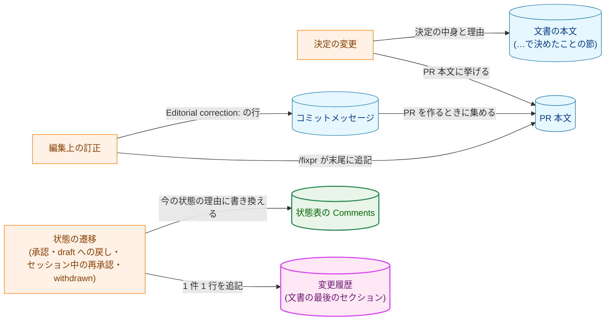

**図 1-1 の凡例**

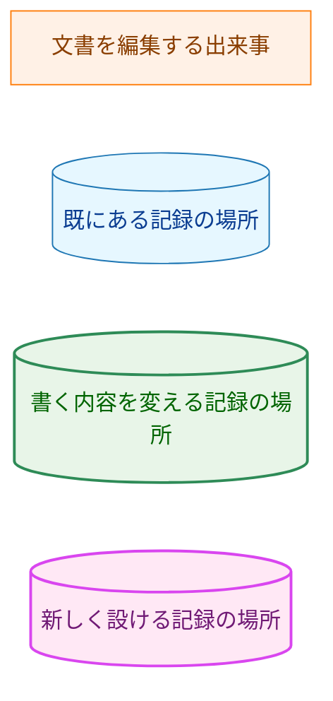

編集上の訂正は、`Comments` にも変更履歴にも書かない（AC-01・AC-06）。決定の変更が状態の遷移（`draft` への戻し、セッション中の再承認）を伴うときは、図の `DEC` と `TRANS` の両方の記録を書く。

### 1.3. 設計の際に決めたこと（2026-11-01）

-   **PR 番号は `/runpr` の PRE_MERGE で埋める（H-02）:** PR を作る前に書く変更履歴の行は、PR 番号の位置に未記入の印 `#未記入` を書く。`/runpr` の PRE_MERGE が、この PR が加えた行の印をこの PR の番号に置き換える。どの PR も、マージの前に `/runpr` の手順 4 を通る（`.claude/commands/runpr.md:522-660`）。そのため、置き換える場所が 1 か所で済み、PR を作った後の追加の push も要らない。PR を作った直後に置き換える案は、PR を作った後の push が失敗すると印が残るため、結局 PRE_MERGE にも同じ置き換えが要り、置き換える場所が 2 か所になる。
-   **変更履歴は箇条書きにする（H-03）:** 見出し `## 変更履歴` の下に、1 件を 1 つの箇条書きの項目で書く（3.2 節）。表にすると、`Comments` と同じく 1 つのセルに長い要旨が入り、読みにくくなるためである。
-   **`fixprguard finish` にコミットメッセージの本文を渡す引数を加える（AC-01）:** `/fixpr` のコミットは `fixprguard finish` が作り、件名は `fix: address PR #<PR> review comments` に固定で、本文を書く手段がない（`internal/fixprguard/worktree.go:40-43`、`worktree.go:272`）。要件 AC-01 は、訂正の説明を PR 本文とコミットメッセージの両方に書くよう求める。規則に `/fixpr` の例外を設けるより、ツールに任意の引数 `--message-file` を加えて、`/fixpr` のコミットにも訂正の行を書けるようにする（3.4 節）。要件 2.2 は対象を規則とコマンドの定義としているが、`fixprguard` の変更は AC-01 を満たすための手段であり、要件の変更ではない。本タスクのコードの変更はこの 1 点に限る。
-   **`/fixpr` は PR 本文の末尾に訂正の段落を機械的に追記する（H-01・H-07）:** 修正のフェーズ（Phase 3）の応答に訂正の一覧を加える。このセッションは、Phase 6 で今の PR 本文の末尾に、日付を付けた訂正の段落を足す。本文を解析せず、LLM に本文全体を書き直させないので、既にある内容を落としにくい。Phase 6 の「大きく古い」場合の書き直しと重なっても、`fixprguard edit-pr` の呼び出しは 1 回にする（6.2 節）。
-   **編集上の訂正はコミットメッセージの `Editorial correction: ` の行で運ぶ:** `/runplan` は、セッションをまたいで複数のフェーズのグループを実装してから PR を作る。PR を作る手順（`task-pr-handoff.md` Part B）が、PR 本文に書くべき訂正をセッションの記憶に頼らずに集められるように、訂正を加えたコミットのメッセージに決まった書き出しの行を書く。局所の CLI レビューの記録の行と同じ読み方（行の先頭から始まる行だけを数える）にそろえる。

## 2. システム構成 (System Structure)

### 2.1. 全体の構成

図 2-1 は、記録の場所ごとに、どのコマンドの定義が書き込むかを示す。矢印 A → B は「A が B に書き込む」を表し、ラベルで書き込む手順を示す。

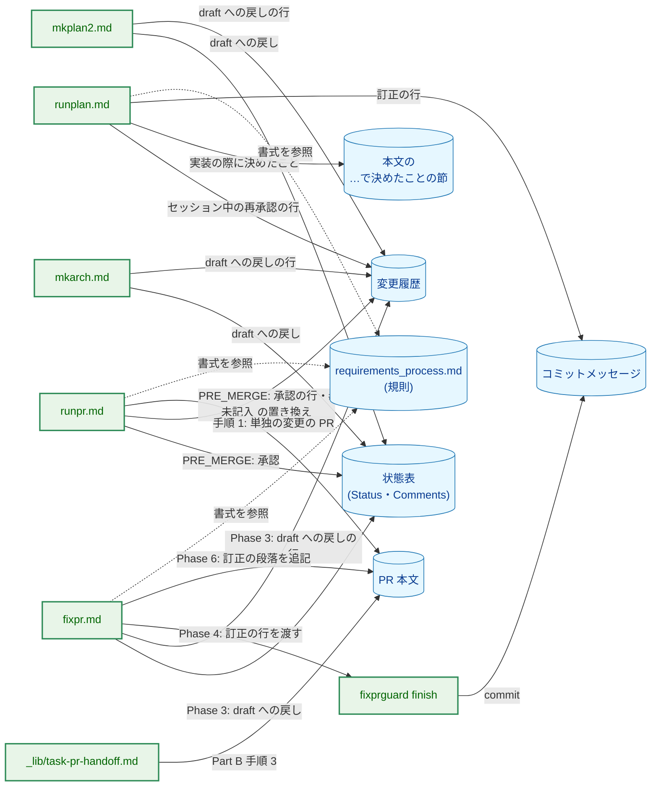

**図 2-1 の凡例**

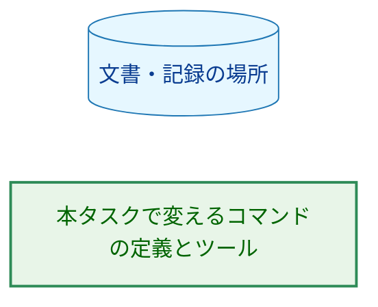

実線の矢印は本タスクの後の書き込みを、破線の矢印は書式の参照を表す。破線は図を読みやすくするため 3 つだけ描いたが、書き込むコマンドの定義はどれも規則の書式を参照する（AC-20）。`mkarch.md` と `mkplan2.md` の訂正の行（コミットメッセージへの書き込み）は、規則に従ってどのコマンドも書くので、矢印を省いた。

### 2.2. コンポーネントの配置

| 置き場所 | 変更 | 内容 |
|---|---|---|
| `docs/dev/conventions/requirements_process.md` | 変更 | 規則。`Comments` の値、変更履歴の書式と作る時期、未記入の印、訂正の行、旧規則で書かれた文書の移し方、`withdrawn` の記録（3.1〜3.3 節） |
| `.claude/commands/runpr.md` | 変更 | PRE_MERGE の承認の記録、未記入の印の置き換え、単独の変更の PR の本文（2.4 節、6.1 節） |
| `.claude/commands/_lib/task-pr-handoff.md` | 変更 | Part B 手順 3 の PR 本文に、編集上の訂正を挙げる |
| `.claude/commands/fixpr.md` | 変更 | Phase 3 の状態の記録と訂正の一覧、Phase 4 の `--message-file`、Phase 6 の追記、最終報告（6.2 節） |
| `.claude/commands/runplan.md` | 変更 | 編集上の訂正と決定の変更の記録（手順 5 の自己点検） |
| `.claude/commands/mkarch.md` | 変更 | 承認済みの文書を直すときの記録（72 行の項目） |
| `.claude/commands/mkplan2.md` | 変更 | 手順 8.5 の `draft` への戻しの記録 |
| `.claude/commands/_lib/settle-decisions.md` | 変更なし | 記録先（RECORD）は呼び出し元が渡す入力であり、本文に `Comments` への言及はない（3.6 節） |
| `cmd/fixprguard/main.go` | 変更 | `finish` に任意のフラグ `--message-file` を加える |
| `internal/fixprguard/worktree.go`・`write.go` | 変更 | コミットメッセージの本文の型と読み込み、`Finish` の commit（3.4 節） |
| `docs/dev/guides/fixprguard_guide.md` | 変更 | `finish` の節、終了コード `2` の説明（古いツールの診断と再インストールの案内） |
| `docs/dev/conventions/package_reference.md` | 変更 | `cmd/fixprguard`・`internal/fixprguard` の説明に `finish` のコミットメッセージの本文を加える |
| `docs/tasks/0053_status_comments_policy/_checks/` | 新規 | AC-19 の差分の確かめのスクリプト（7.3 節） |

### 2.3. 記録の場所と書き込む時期

| 出来事 | `Comments` | 変更履歴 | 本文 | PR 本文 | コミットメッセージ |
|---|---|---|---|---|---|
| 編集上の訂正 | 変えない | 変えない | 訂正を反映 | 訂正の説明 | `Editorial correction: ` の行 |
| 決定の変更（`draft` への戻し） | その旨と変更の要旨 | `draft` への戻しの行 | 決定の中身を反映 | 決定の変更を挙げる | 任意 |
| 本文を変えずに連鎖して `draft` に戻す | 戻した理由の文書 | `draft` への戻しの行（理由の文書を書く） | 変えない | 挙げる | 任意 |
| 承認（`/runpr`） | `-` | 承認の行 | 変えない | 変えない | PRE_MERGE の commit |
| セッション中の再承認（`/runplan`） | `-` | セッション中の再承認の行 | 決定の中身と「実装の際に決めたこと」の節 | 決定の変更を挙げる | 任意 |
| `withdrawn` | 日付と理由（またはリンク） | `withdrawn` の行 | 変えない | 挙げる | 任意 |

### 2.4. PR 番号の記入

図 2-2 は、変更履歴の行の PR 番号がいつ書かれるかを示す。矢印 A → B は「A の時点で書いた行が、B の時点で PR 番号を持つ」を表す。

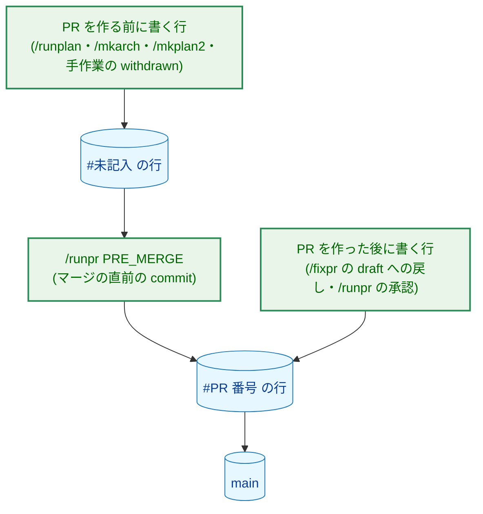

**図 2-2 の凡例**

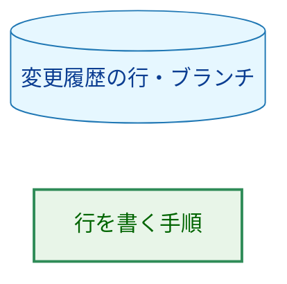

PR を作った後に行を書くコマンドは、PR 番号を知っているので、印を使わずに番号を書く。`/fixpr` は PR 番号を引数で受け取り（`.claude/commands/fixpr.md` の Phase 1）、`/runpr` は手順 1 で PR を解決する。

## 3. コンポーネント設計 (Component Design)

### 3.1. `Comments` の値（AC-07〜AC-09）

規則の「Document Status Format」の状態表の `Comments` の説明を「今の状態の理由（`-` if none）」に改め、値を次のとおり定める。

| 状態 | `Comments` の値 |
|---|---|
| `approved` | `-` |
| 作ったばかりの `draft` | `-` |
| 決定の変更で戻した `draft` | `決定の変更で draft に戻した：<変更の要旨>` |
| 本文を変えずに連鎖して戻した `draft` | `<文書のファイル名> の決定の変更に伴って draft に戻した` |
| `withdrawn` | `YYYY-MM-DD 取り下げ：<理由、または理由を記録した文書へのリンク>` |

-   状態が変わるたびに、前の内容を残さずに書き換える（AC-08）。承認で `-` に戻り、`draft` への戻しで上の値になる。
-   同じ `draft` の期間に決定の変更が 2 件以上重なったときは、要旨を `<br>` で区切って並べる（AC-09）。たとえば、`/fixpr` のある回で `draft` に戻した文書を、同じ PR の次の回でもう一度変えた場合である。この場合、状態は変わっていないので、変更履歴に新しい行は加えず、この PR が加えた `draft` への戻しの行の要旨に、`；` で区切って追記する。その行はまだ `main` に入っていないので、追記しても「古い順に追記する」規則を破らない。

### 3.2. 変更履歴の書式（AC-10〜AC-12、H-03）

規則に、変更履歴の書式を次のとおり定める。規則の本文は英語で、見出しと行の例は、タスク文書に書く日本語の値をそのままコードブロックに示す（規則が既に `PR を作成した` などの日本語の値を示しているのと同じ形）。

```markdown
## 変更履歴

- 旧規則の Comments：<移した旧 Comments の文、内容を変えずに>
- 2026-11-01 承認（isseis、#606）
- 2026-11-03 draft への戻し：<変更の要旨>（#610）
- 2026-11-04 draft への戻し：02_architecture.md の決定の変更に伴う（#610）
- 2026-11-05 セッション中の再承認：<変更の要旨>（isseis、#612）
- 2026-11-07 withdrawn：<理由、または理由を記録した文書へのリンク>（#615）
```

| 遷移の種類 | 行の形 |
|---|---|
| 承認 | `- YYYY-MM-DD 承認（<承認者>、#<PR 番号>）` |
| `draft` への戻し | `- YYYY-MM-DD draft への戻し：<変更の要旨>（#<PR 番号>）` |
| 連鎖した `draft` への戻し | `- YYYY-MM-DD draft への戻し：<文書のファイル名> の決定の変更に伴う（#<PR 番号>）` |
| セッション中の再承認 | `- YYYY-MM-DD セッション中の再承認：<変更の要旨>（<承認者>、#<PR 番号>）` |
| `withdrawn` | `- YYYY-MM-DD withdrawn：<理由、または理由を記録した文書へのリンク>（#<PR 番号>）` |

-   **置き場所:** 文書の最後のセクションとする。`02_architecture.md` に「決定の履歴」の付録があるときは、その後に置く。変更履歴は状態の遷移の記録で、決定の中身と理由を書く付録とは別のセクションである（要件 1 章「上の決定から導いたこと」）。
-   **作る時期:** 文書を作るときには設けず、最初の 1 行を書くときに文書の最後に作る（AC-11）。テンプレート（`docs/tasks/0000_template/requirements.md`）は変えない（要件 2.2）。
-   **承認者:** GitHub のユーザー名（`gh api user --jq .login` の値）を書く。`/runpr` の承認と `/runplan` のセッション中の再承認で同じ形にする（AC-15）。これは今の `/runpr` の `Reviewer` の値と同じ取り方である（`.claude/commands/runpr.md:209-210`）。
-   **未記入の印:** PR を作る前に書く行は、`#<PR 番号>` の位置に `#未記入` を書く。`main` に入った行は、旧規則の `Comments` を移した項目を除き、どれもその行を加えた PR の番号を持つ（AC-12）。`/runpr` の PRE_MERGE が印を置き換える（3.5 節）。
-   **移した項目:** 旧規則の `Comments` を移した項目は、印 `旧規則の Comments：` で始め、変更履歴の先頭に置く。日付・種類・PR 番号を求めない、1 件 1 行の規則の唯一の例外である（AC-10・AC-18）。表のセルから移した文は、`\|` や `<br>` を含め、バイト列を変えずに写す。

### 3.3. 旧規則で書かれた文書の移し方（AC-17・AC-18）

規則に、旧規則で書かれた文書を「`## 変更履歴` のセクションがなく、`Comments` が `-` でない文書」と定める。旧規則で書かれた文書に新しい規則で最初の状態の遷移を書くコマンドは、次の順に行う。

1. 文書の最後に `## 変更履歴` を作り、旧 `Comments` の文を印 `旧規則の Comments：` の項目として先頭に置く。
2. `Comments` を、遷移の後の状態の理由（3.1 節）に書き換える。
3. 遷移の行を追記する。

編集上の訂正だけを加えるときは、移さず、`Comments` を変えない。この手順は規則の 1 か所に書き、状態の遷移を書く各コマンドの定義（`runpr.md` の PRE_MERGE、`fixpr.md` の Phase 3、`runplan.md`、`mkarch.md`、`mkplan2.md`）は、遷移を書く前にこの手順を行うことを規則の節を名指しして参照する。

### 3.4. `fixprguard finish` のコミットメッセージの本文

`finish` に任意のフラグ `--message-file FILE` を加える。渡したときは、固定の件名の後に空行を挟んで、ファイルの内容を本文として commit する。渡さないときは、今までどおり件名だけで commit する。

```go
// CommitBody is the validated body of the commit Finish makes. The zero
// value means no body: the commit holds the fixed subject alone.
type CommitBody struct {
	text string
}

// ReadCommitBodyFile reads and validates the body file finish is given.
func ReadCommitBodyFile(name string) (CommitBody, error)

// FinishRequest names the PR the commit subject refers to and the body the
// commit carries after it.
type FinishRequest struct {
	PR   PRNumber
	Body CommitBody
}
```

-   **受け付ける内容:** `reply` と `edit-pr` の本文のファイルと同じ検査（通常のファイルであること、64 KiB 以下、空白だけでない、有効な UTF-8、NUL を含まない。`internal/fixprguard/write.go:18`、`write.go:28-50`）と、`@codex` のメンションの拒否（`write.go:73-82`）を、そのまま使う。違反は、今の本文のファイルと同じく `ErrInvalidInput`、メンションは今と同じ拒否で、終了コード `2` になる。
-   **読む時期:** `Finish` が build checks を実行する前に読んで検査する。ファイルに誤りがあれば、`make` も stage も commit もせずに止まる。
-   **commit の本文:** 件名は `CommitSubject` のまま変えない。`/fixpr` が回数を数えるのは件名だからである（`worktree.go:40-41`、`.claude/commands/fixpr.md` の Phase 4 の 1）。本文は、git がコメントの行や空白を取り除かずに、ファイルの内容のとおりに記録されることを要件とする。
-   **ファイルの置き場所:** 作業ツリーの外（scratchpad）に書く。作業ツリーの中に書くと、`finish` の判定した集合との照合が、そのファイルを判定の後に現れた変更として止まる。
-   **`Protocol` は上げない:** 手引きの「ツールを変更する場合」の 3 つの条件（`docs/dev/guides/fixprguard_guide.md:446-451`）がすべて成り立つ。(1) 古いツールは、知らないフラグ `--message-file` を引数の解析で拒否し（終了コード `2`）、古い規則で判定しない。(2) 新しいツールは、フラグのない古い呼び出しを今までと同じ規則で扱う。(3) 出力の形は変えない。手引きの 4 章の終了コード `2` の説明に、古いツールが止まったときの診断と再インストールの案内を書く（同書 451 行の求め）。

### 3.5. `/runpr` の PRE_MERGE（AC-12・AC-13、H-04）

PRE_MERGE（`.claude/commands/runpr.md:204-217`）の承認の項目を、次のとおり変える。

-   **承認:** この PR が加えるか変えるタスク文書のうち、状態が `draft` のものを承認する。今と同じく、Status を `approved`、`Review date` を当日、`Reviewer` を承認者にする。加えて、旧規則で書かれた文書なら 3.3 節の手順で移したうえで、`Comments` を `-` にし、変更履歴に承認の行を追記する。今の「`Comments` を保つ」（`runpr.md:211`）は、この記述に置き換える。初回の承認と、`draft` に戻した後の承認の両方に当てはまる。
-   **PR 番号の記入（新しい項目）:** この PR が加えるか変えるタスク文書の変更履歴にある `#未記入` を、すべて `#<number>` に置き換える。PR の種類（計画の PR、タスク文書の PR）によらない。対象を変更履歴のセクションに限り、本文の `#未記入` という文字列（たとえば規則の説明の引用）は置き換えない。
-   **二重の記録の防止（H-04）:** 承認は `draft` の文書にだけ行い、承認の行は Status を `approved` にするのと同じ commit で追記する。中断の後にもう一度実行したとき、承認を記録した文書は既に `approved` なので、承認の行を二度書かない。PR 番号の記入も、置き換えた後に `#未記入` が残らないので、二度目は何もしない。今の「既に記録したものは除く」（`runpr.md:205-206`）の判定は、この 2 つの性質で満たされ、新しい判定は要らない。
-   **承認せずにマージする選択肢:** 手順 4 の選択肢「merge without the approvals」（`runpr.md:569-573`）でも、PR 番号の記入は行う。文書を `draft` のまま `main` に入れても、`#未記入` を `main` に残さないためである。PRE_MERGE が PR 番号の記入だけになる場合、その commit は件名を今と同じ `docs(<task-id>): record the review of PR #<number>` とする。
-   **NEXT:** 変えない。PR 番号の記入だけの PRE_MERGE は、文書を承認しないので、NEXT の判定（`runpr.md:221-228`）に影響しない。

### 3.6. 対象のコマンドの定義の変更

| ファイル | 今の記述 | 変更後 |
|---|---|---|
| `runplan.md:63`（編集上の訂正） | 文書の `Comments` に訂正を記録し、PR がある場合は PR 本文を直す | `Comments` と変更履歴は変えず、訂正を加えたコミットのメッセージに `Editorial correction: ` の行を書く。PR 本文には、PR を作るとき（`task-pr-handoff.md` Part B 手順 3）に集めて書く。`/runplan` は PR のないブランチでだけ作業する（3.7 節）ので、PR を作った後の追記の手順は持たない |
| `runplan.md:64`（決定の変更） | `settle-decisions.md` の RECORD を `Comments` とし、`approved` のまま `Comments` に記録 | RECORD を、変えた文書の本文の「実装の際に決めたこと（YYYY-MM-DD）」の節とする。状態は `approved` のまま、`Comments` は `-`（旧規則で書かれた文書は 3.3 節で移す）、変更履歴にセッション中の再承認の行（承認者、`#未記入`）を追記し、PR 本文に決定の変更を挙げる |
| `mkarch.md:72` | 決定の変更は `draft` に戻し、編集上の訂正は `Comments` に記録 | 規則の「Editing an approved document」を参照する形にする。決定の変更は `draft` に戻し、`Comments` と変更履歴の行（`#未記入`）を規則のとおりに書く。編集上の訂正は `Comments` を変えず、コミットメッセージの訂正の行と PR 本文に書く |
| `mkplan2.md:107`（手順 8.5） | 過去の承認を `Comments` に履歴として残し、PR 境界を加えた日を `Comments` に記録 | `Comments` を `決定の変更で draft に戻した：PR 境界を加えた` にし、変更履歴に `draft への戻し` の行（`#未記入`）を追記する。過去の承認は変更履歴の承認の行が持つ（旧規則で書かれた文書なら 3.3 節で移した項目が持つ） |
| `fixpr.md:453-461`（Phase 3 の 4） | 決定の変更は `draft` に戻し、編集上の訂正は `Comments` に記録 | 決定の変更は `draft` に戻し、`Comments` と変更履歴の行（`#NUMBER`）を規則のとおりに書く。R3 で連鎖して戻す文書には、連鎖した `draft` への戻しの形を使う。編集上の訂正は `Comments` と変更履歴を変えず、応答の訂正の一覧に挙げる（6.2 節） |
| `fixpr.md:465-476`（Phase 3 の応答） | `{"fixes": [{"threadId", "applied", "replyBody"}]}` | 各要素に `editorial`（訂正の一覧。各項目は文書のパス、PR 本文に書く日本語の説明、コミットメッセージに書く英語の 1 行）を加える |
| `fixpr.md:546-569`（Phase 4） | `finish` は件名だけで commit | 訂正の一覧が空でなければ、訂正の行をファイルに書いて `--message-file` を渡す |
| `fixpr.md:680-723`（Phase 6） | 大きく古いときだけ本文を書き直す | 6.2 節の手順で、訂正の段落を追記する。書き直すときも既存の訂正の段落を残す |
| `fixpr.md` の最終報告 | — | 追記できなかった訂正と理由を挙げる（AC-05） |
| `task-pr-handoff.md` Part B 手順 3（196-239 行） | 本文に挙げるものの一覧に、編集上の訂正はない | 一覧に「この PR が承認済みの文書に加えた編集上の訂正」を加える。このセッションの訂正と、`git log origin/main..HEAD` の `Editorial correction: ` の行から集め、何を何に直したかと、決定の変更でないことを書く |
| `runpr.md:149-155`（単独の変更の PR の本文） | ブランチのコミットから短い本文を書く | 本文に、`Editorial correction: ` の行から集めた訂正を挙げる（`task-pr-handoff.md` Part B 手順 3 と同じ） |
| `runpr.md:204-217`（PRE_MERGE） | 承認で `Comments` を保つ | 3.5 節 |
| `settle-decisions.md` | — | 変えない。記録先は呼び出し元が RECORD で渡し（同ファイルの Inputs）、本文は `Comments` に触れない。AC-15 の「`settle-decisions.md` に渡す記録先」は `runplan.md` の RECORD の値で満たす |

-   **訂正の行の書式:** 規則に、コミットメッセージの 1 行として `Editorial correction: <文書のパス>: <何を何に直したか>; no decision changed` を定める（英語。`CLAUDE.md`「Language」のとおりコミットメッセージは英語）。行の先頭から始まる行だけを訂正の行とし、字下げした行や文中の言及は数えない。局所の CLI レビューの記録の行の読み方（`.claude/commands/_lib/local-cli-review.md:270-277`）と同じ形である。説明は、レビューのスレッドや PR 本文の文を引用せず、書くエージェントの言葉で書く（AC-01）。
-   **PR 本文の訂正の書き方:** PR を作るときは、本文に見出し `## 編集上の訂正` の節を設け、訂正を 1 件 1 項目で挙げる。`/fixpr` が後から追記するときは、6.2 節の段落の形を使う。

### 3.7. `/runplan` が PR のあるブランチで作業しない根拠（AC-03）

AC-03 は「PR が既にある場合の `runplan.md`」に、訂正の説明を PR 本文に追記する手順を求める。しかし `/runplan` は、PR のあるブランチでは作業を始めない。

-   `task-pr-handoff.md` Part A 手順 3 は、`/runplan` が今のブランチを使い続ける条件を「PR がまだない（`gh pr view <branch>` が見つけない）」としている（`.claude/commands/_lib/task-pr-handoff.md` Part A 手順 3 の 2 つ目の項目）。PR のあるブランチは、止めて報告する理由になる（同手順の最後の段落）。
-   PR のチェックポイントに着いたとき、`PR を作成した` の箱が既に付いていれば、PR があるので止まる（`.claude/commands/runplan.md:46`）。手順 5a も、PR がないことを確かめてから PR を作る（`runplan.md:77`）。

そのため、`/runplan` のどの訂正も PR を作る前に加えられ、`task-pr-handoff.md` Part B 手順 3 で PR 本文に入る。今の `runplan.md:63` の「(3) the PR description if one exists」は到達しない場合の記述なので、3.6 節のとおり、訂正の行を書く手順に置き換える。AC-03 の `runplan.md` の部分は、この根拠を `runplan.md` の該当する項目に一文で書き、PR がある場合を持たないことを明示して満たす。

## 4. エラーハンドリング設計 (Error Handling Design)

### 4.1. `fixprguard finish` の失敗

| 失敗 | 振る舞い | 呼び出し元（`/fixpr` Phase 4） |
|---|---|---|
| `--message-file` のファイルが通常のファイルでない・大きすぎる・空・不正な UTF-8・NUL を含む | `ErrInvalidInput` で止まる。`make` も commit もしない | 今の stop と同じく報告して止まる。作業ツリーの修正は残る |
| ファイルが `@codex` を含む | 終了コード `2`。commit しない | 報告して止まる。訂正の文面を書き直して通すことはしない（今のメンションの確認と同じ） |
| 古いツールが `--message-file` を知らない | 終了コード `2`（引数の解析の誤り） | 報告し、`make install-fixprguard` での再インストールを案内する（手引き 4 章） |

新しい番兵エラーは加えない。ファイルの検査は今の `ErrInvalidInput` を、メンションは今の拒否を使う。

### 4.2. PR 本文への追記の失敗（AC-05）

`/fixpr` は、この回で commit し push した訂正のうち、PR 本文に追記できなかったものを、最終報告に訂正と理由とともに挙げる。追記できない場合は次のとおりである。

-   Phase 4 が push の前に止まった（訂正は commit されていないか push されていないので、PR 本文にも書かない。最終報告に「訂正を含む修正が push されていない」と挙げる）。
-   Phase 6 のメンションの確認に通らなかった（`edit-pr` を実行しない）。
-   `fixprguard edit-pr` が止まった。

どの場合も、訂正の記録はコミットメッセージの訂正の行には残っている（Phase 4 の commit が作られた場合）。最終報告には、レビュアーが PR 本文に手で書き足せるように、訂正の一覧そのものを挙げる。

### 4.3. 未記入の印が残る場合

`#未記入` を置き換えるのは PRE_MERGE だけである。`/runpr` を通らずに `/mergepr` だけでマージすると印が残る。`/mergepr` を直接使うのは、今もタスク文書の承認を記録しない経路であり、本タスクはこの経路を変えない（要件 2.2 の対象外）。印は `main` の文書の中で目に見える文字列なので、残っても次の状態の遷移を書くときに気づける。これを検出するテストは加えない（7.1 節）。

## 5. セキュリティ考慮事項 (Security Considerations)

本タスクで信頼の境界に触れるのは、`fixprguard finish` が受け取るコミットメッセージの本文と、`/fixpr` が PR 本文に追記する訂正の段落の 2 つである。どちらも、レビューのスレッドを読んだエージェントが書いた文が GitHub に届く経路である。

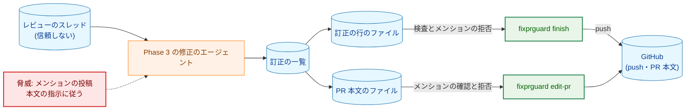

**図 5-1 の凡例**

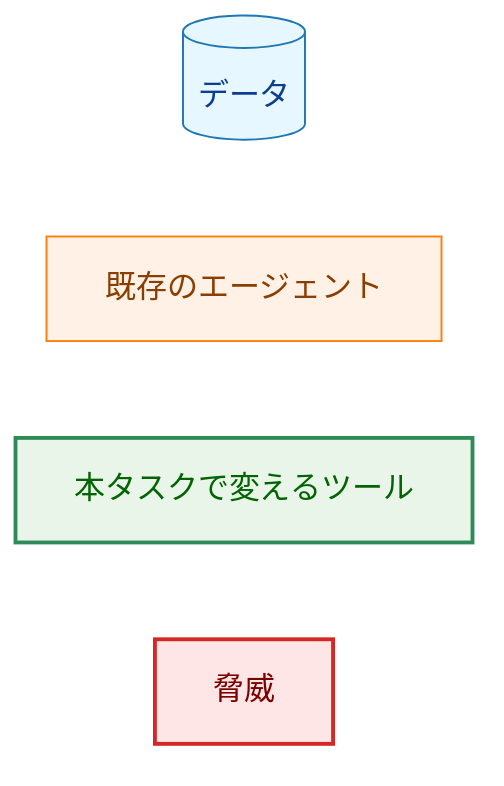

図 5-1 の矢印 A → B は「A の内容が B に渡る」を、破線は「脅威が働きかける先」を表す。

-   **メンションの投稿:** 訂正の文面に `@codex` が入ると、利用者のアカウントの投稿が Codex を動かす。コミットメッセージは push で GitHub に届くので、`finish` は本文のファイルを `reply`・`edit-pr` と同じ規則で拒否する（3.4 節）。PR 本文への追記は、今の Phase 6 のメンションの確認（`fixpr.md` Phase 6）と `edit-pr` の拒否の 2 段を通る。文面を書き直して確認を通すことはしない。
-   **書かれた指示に従わない:** 訂正の一覧は、修正のエージェントがスレッドを読んで書いたデータとして扱う（R6。`fixpr.md:477-479` の `replyBody` と同じ）。このセッションは、Phase 3 に渡したスレッドの、`applied` が真の要素の一覧だけを使い、文面を指示として読まない。PR 本文は今の Phase 6 と同じく従わないデータであり（`fixpr.md:690-692`）、このセッションは本文を読まずに、`gh` の出力をファイルに書き、その末尾に段落を足す（6.2 節）。本文を解析するコードは加えない（要件 4.2）。
-   **引用しない:** 訂正の説明は、スレッドや PR 本文の文を引用せず、エージェントの言葉で書く（AC-01）。修正のエージェントへの指示に書く。
-   **シェルを通さない:** `finish` は今と同じく git をシェルなしで起動し、本文はファイルから読む。`--message-file` の値は引数としてだけ使う。
-   **残余のリスク:** `/fixpr` が PR 本文を取得してから `edit-pr` で書き込むまでの間に、レビュアーが PR 本文を編集すると、その編集は上書きされる。今の Phase 6 の書き直しにも同じ窓がある。窓を短くするため、本文の取得は `edit-pr` の直前に行う。

`docs/dev/security.md` の記述は変えない。`fixprguard` の境界は手引き（`fixprguard_guide.md` 7.1 節の保証の表）に書かれており、`finish` の節と保証の表のメンションの行に本文のファイルを加える。

## 6. 処理フローの詳細 (Processing Flow Details)

### 6.1. `/runpr` の PRE_MERGE

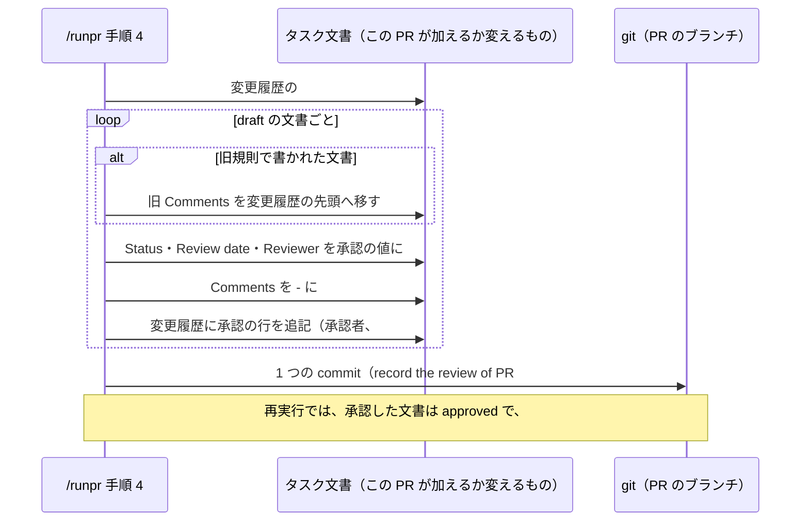

この図の参加者は色分けしない。矢印 A → B は「A が B を書き換える」を表す。PRE_MERGE の commit の後の手順（`mergepr prepare` のやり直し、変更したファイルの確認、マージ）は今のまま変えない（`.claude/commands/runpr.md:631-655`）。PRE_MERGE が変えるのはタスク文書だけなので、今の「PRE_MERGE が変えるファイルだけ」の確認（同 645-646 行）にそのまま通る。

### 6.2. `/fixpr` の訂正の記録（H-01・H-07）

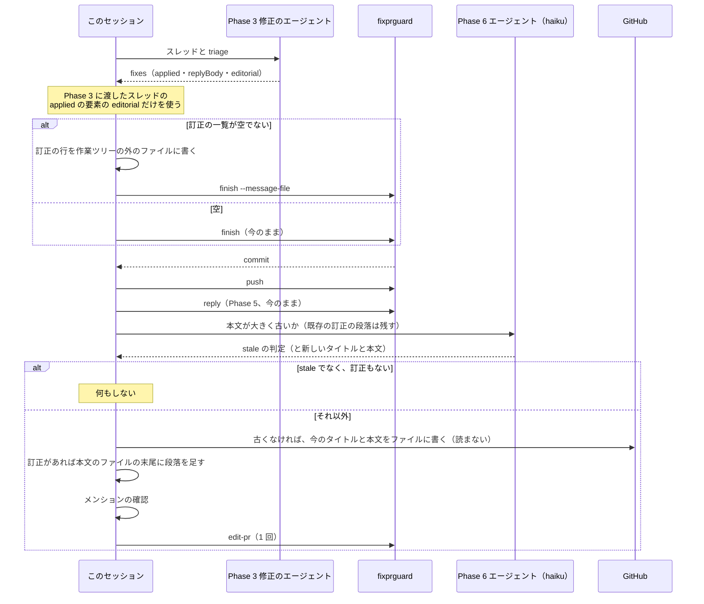

この図の参加者は色分けしない。矢印 A → B は「A が B を呼び出す、または B に渡す」を、破線の矢印は応答を表す。

-   **訂正の一覧（Phase 3 の応答）:** 各スレッドの要素に `editorial` を加える。各項目は、直した文書のパス、PR 本文に書く日本語の説明（何を何に直したか）、コミットメッセージに書く英語の 1 行である。この PR のレビューで加えた訂正（承認済みの文書の、決定の変更でない編集）だけを挙げる。`draft` の文書の編集は、レビューの通常の改訂なので挙げない。
-   **Phase 4:** 訂正の一覧が空でなければ、各項目を `Editorial correction: ` の行（3.6 節の書式）にしてファイルに書き、`finish` に `--message-file` で渡す。
-   **Phase 6 の判定:** haiku のエージェントへの指示に、本文を書き直すときは既にある訂正の段落と `## 編集上の訂正` の節を、文を変えずに残すことを加える（AC-04）。`edit-pr` は、本文が大きく古いか、この回に push した訂正があるときに 1 回だけ呼ぶ。古いときはエージェントのタイトルと本文を、古くないときは `gh pr view` で今のタイトルと本文をファイルに書いたものを使う。このセッションはその内容を読まない。訂正があるときは、本文のファイルの末尾に、次の段落を足す。

    ```markdown
    **編集上の訂正（/fixpr、YYYY-MM-DD）:**

    - `<文書のパス>`: <何を何に直したか>（決定の変更なし）
    ```

    段落は見出しにしない。本文の最後の節がどの見出しであっても、その下に入れ子にならないためである。日付を付けるので、回ごとに段落が分かれる。
-   **最終報告:** 4.2 節のとおり、追記できなかった訂正を挙げる。追記した場合は、追記した訂正の件数を要約の行に挙げる。

### 6.3. 状態の遷移と記録

図 6-1 は、タスク文書の状態と、遷移のたびに書く記録を示す。矢印 A → B は「出来事で A から B に移る」を表し、ラベルは出来事と、そのとき書く `Comments` と変更履歴の行を示す。

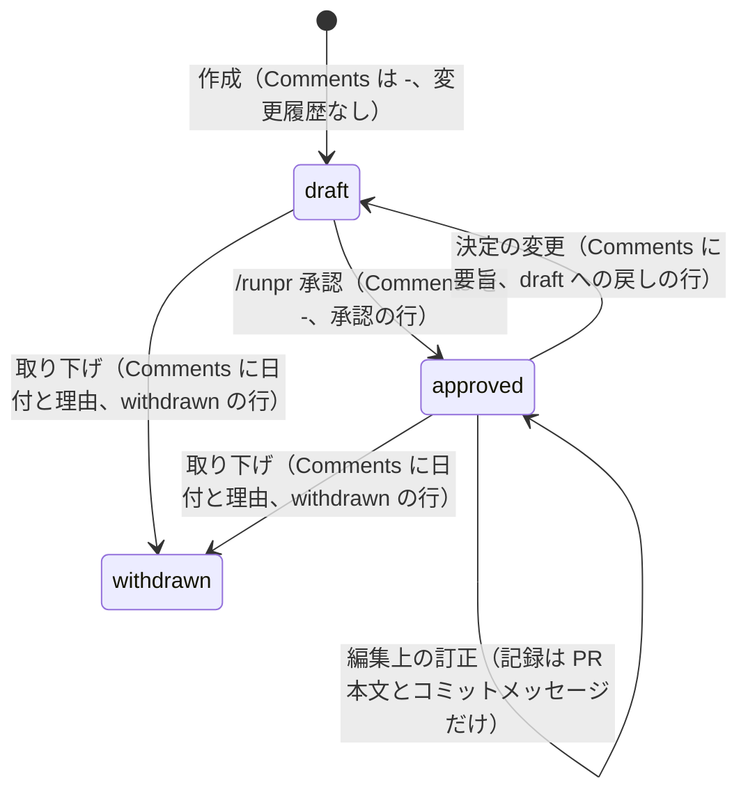

この図は `stateDiagram-v2` で書き、ノードを色分けしない（`docs/dev/conventions/mermaid_reference.md` 7 章）。

## 7. テスト戦略 (Test Strategy)

### 7.1. 単体テスト

-   **`internal/fixprguard`:** `Finish` に本文を渡すと、commit のメッセージが「固定の件名、空行、ファイルの内容のとおりの本文」になることを、一時ディレクトリの実際のリポジトリで確かめる（`#` で始まる行と末尾の空白を含む本文で、git が取り除かないことを含む）。本文がないときに件名だけになることも確かめる。本文のファイルの拒否（メンション、通常のファイルでない、空、不正な UTF-8、NUL）で、`make` を実行せず commit もしないことを、`make` の fake の呼び出しがないことで確かめる。
-   **`cmd/fixprguard`:** `finish` が `--message-file` を受け付け、省略もできること、ほかのサブコマンドがこのフラグを拒否することを確かめる。`fixpr.md` に書いた `finish` の呼び出しは、既存の `TestDocumentedInvocationsParse`（`cmd/fixprguard/docs_test.go:184-213`）が新しいフラグを含めて解析する。
-   **文書のテスト:** 規則とコマンドの定義の文言を照合する恒久のテストは加えない（`CLAUDE.md`「Document tests check values, structure, and executable examples, never prose」）。未記入の印 `#未記入` は規則と `runpr.md` の 2 か所に書かれるが、食い違ったときの害は `main` に印が目に見える形で残ることだけで、小さいので、照合のテストは加えない。

既存のテストで振る舞いの変更に伴って直すものはない。`TestFixprguardCallSites`（`cmd/yt2column/fixpr_docs_test.go:647-670`）は Phase 4 の `fixprguard finish ` の呼び出しを、`TestPostingCommandsInventory`（`cmd/yt2column/codex_review_docs_test.go:189-251`）は Phase 6 の `fixprguard edit-pr ` を、それぞれ今の節で見つける。Phase 6 に加える `gh pr view` は書き込みのコマンドでないので、在庫のテストの対象外である。

テストを書いたら、確かめる対象を壊して失敗することを確かめ、そのことをコミットメッセージに書く（`CLAUDE.md`「Testing Strategy」）。

### 7.2. 統合テスト

N/A。コマンドの定義を実行した結果（編集上の訂正だけの PR、決定の変更の PR がどうなるか）は、要件 2.3 のとおり本タスクの後の PR で分かる。

### 7.3. 差分の確かめ（`_checks/`、AC-19）

AC-19（本タスクの PR が `docs/tasks/` 以下の既存のタスク文書を変えない）は変更の前後の関係なので、`docs/tasks/0053_status_comments_policy/_checks/` に、マージベースと PR の head を比べるスクリプトを置く。`docs/tasks/` 以下で変わったパスが `docs/tasks/0053_status_comments_policy/` の下だけであることを確かめる。最後の PR のブランチで一度実行し、出力と両方のコミット ID を実装計画の確かめの行に記録する（規則 §4）。

### 7.4. セキュリティのテスト

7.1 節の `finish` の本文のファイルのメンションの拒否が、セキュリティのテストに当たる。PR 本文への追記のメンションの確認は、今の Phase 6 の手順を通るので、新しいテストは加えない（`TestPostingPathsCheckMention` が Phase 6 の確認を既に確かめている。`codex_review_docs_test.go:111-128`）。

### 7.5. 受け入れ基準の確かめの方法（H-05）

| 受け入れ基準 | 方法 |
|---|---|
| AC-01〜AC-18、AC-20 の文言 | `manual`（PR のレビューで規則とコマンドの定義を読む） |
| AC-01 の `/fixpr` のコミットメッセージ | `test`（7.1 節の `internal/fixprguard` のテスト）と `manual`（`fixpr.md` の Phase 4） |
| AC-19 | `diff`（7.3 節） |

## 8. 実装の優先順位 (Implementation Priorities)

| フェーズ | 内容 | 理由 |
|---|---|---|
| 1 | `fixprguard finish` の `--message-file`（Go のコードとテスト、手引き、`package_reference.md`） | `fixpr.md` がこのフラグを使う前に、ツールが `main` に入り、利用者が再インストールできる必要がある |
| 2 | 規則（`requirements_process.md`） | コマンドの定義が参照する書式を先に定める |
| 3 | `runpr.md`・`task-pr-handoff.md` | すべての PR が通る記録（PRE_MERGE、PR 本文）を先に変える |
| 4 | `fixpr.md`・`runplan.md`・`mkarch.md`・`mkplan2.md` | 書き込む側を規則と PRE_MERGE に合わせる |
| 5 | AC-19 の差分の確かめ | 最後の PR のブランチで実行する |

**移行の注意:** フェーズ 4 の `fixpr.md` が `--message-file` を渡すと、再インストールしていない古いツールは終了コード `2` で止まる（fail-closed。古い規則で commit しない）。訂正がない回はフラグを渡さないので、古いツールでも今までどおり動く。フェーズ 1 をマージした直後に `make install-fixprguard` で再インストールすることを、フェーズ 1 の PR 本文と手引きに書く。

**本タスクのマージの時点で進行中の文書:** 本タスクのマージの後に書く記録（承認を含む）は新しい規則に従い、それより前に書かれた `Comments` は旧規則の文として 3.3 節の扱いを受ける（要件 1 章）。本タスクの文書そのものも同じである。たとえば本書の承認は、本書の PR の時点ではまだ今の規則で記録される。

## 9. 将来の拡張 (Future Extensibility)

-   **既存の文書の一括の移し替え:** 要件 2.3 のとおり、本タスクでは既存の文書を移さない。3.3 節の手順は 1 文書ずつ機械的に行えるので、後で一括して移すタスクを起こすときも同じ手順を使える。
-   **`/mergepr` の直接の使用:** 4.3 節のとおり、`/mergepr` を直接使うと `#未記入` が残る。この経路でも記録を求める必要が生じたら、`mergepr` の `prepare` で印の有無を確かめる形で加えられる。今は必要がない（YAGNI）。

## 10. 設計への申し送りへの対応 (Design Handoff)

| 項目 | 対応 |
|---|---|
| H-01 `/fixpr` が PR 本文に訂正を追記する手段 | Phase 3 の応答に訂正の一覧を加え、Phase 6 で今の本文の末尾に日付付きの段落を機械的に足し、`fixprguard edit-pr` を 1 回だけ呼ぶ。大きく古い場合の書き直しと組み合わせ、本文を解析しない（1.3 節、6.2 節） |
| H-02 PR 番号を書き足す時期と手順 | PR を作る前の行は `#未記入` を書き、`/runpr` の PRE_MERGE が置き換える。承認せずにマージする場合も置き換える。手作業の取り下げも、規則に従って印を書けば PRE_MERGE が置き換える。PR を作った後の push の失敗は、PRE_MERGE だけが置き換えるので影響しない（1.3 節、3.5 節、2.4 節） |
| H-03 行の書式と移した項目の印 | 箇条書きの行の形と、種類の表記（`承認`・`draft への戻し`・`セッション中の再承認`・`withdrawn`）、移した項目の印 `旧規則の Comments：` を定める。規則の英語の本文には、日本語の値をコードブロックで示す（3.2 節） |
| H-04 PRE_MERGE の「既に記録したもの」との関係 | 承認は `draft` の文書にだけ行い、承認の行を状態と同じ commit で書くので、再実行で二重にならない。`#未記入` も置き換えた後は残らない。新しい判定は加えない（3.5 節） |
| H-05 確かめの方法 | 文言は `manual`、AC-19 は `_checks/` の `diff`。加えて、`fixprguard` の変更は `test` で確かめる（7 章） |
| H-06 書き込む箇所の洗い出し | `Comments`・`editorial`・`withdrawn`・`decision change` で `.claude/commands/`・`CLAUDE.md`・`AGENTS.md`・`docs/dev/guides/`・`docs/dev/conventions/` を探した（コミット `8bcfd272`）。書き込む箇所は 3.6 節の表のとおりで、要件 2.2 の一覧に加わるのは、PR 本文の書き方を定める `runpr.md:149-155` と `task-pr-handoff.md` Part B 手順 3（どちらも要件 2.2 のファイルの中）である。`runplan.md` の単一の PR の場合（`runplan.md:227`）は `task-pr-handoff.md` Part B を使うので、Part B の変更で足りる。`CLAUDE.md`・`AGENTS.md`・`docs/dev/guides/` には `Comments` の書き方の記述はない。`fixprguard` の変更に伴い、`fixprguard_guide.md` と `package_reference.md` を変える（2.2 節） |
| H-07 `/fixpr` の訂正の一覧の受け渡し | Phase 3 の応答の各要素に `editorial` を加え、このセッションが Phase 4 と Phase 6 に渡す。Phase 6 の書き直しでは既存の訂正の段落を残すようエージェントに指示し、追記できなかった訂正は最終報告に挙げる（6.2 節、4.2 節） |

## 11. 受け入れ基準と設計の対応 (AC Traceability)

| 受け入れ基準 | 設計 |
|---|---|
| AC-01 | 3.6 節（訂正の行の書式、引用しない）、3.4 節（`/fixpr` のコミットメッセージ）、2.3 節 |
| AC-02 | 3.6 節（`task-pr-handoff.md` Part B 手順 3、`runpr.md:149-155`） |
| AC-03 | 6.2 節（`/fixpr` の追記。古くない場合も追記）、3.7 節（`/runplan` は PR のあるブランチで作業しない） |
| AC-04 | 6.2 節（Phase 6 の書き直しで既存の訂正の段落を残す） |
| AC-05 | 4.2 節、6.2 節（最終報告） |
| AC-06 | 2.3 節、3.6 節（どのコマンドも訂正を `Comments` と変更履歴に書かない） |
| AC-07 | 3.1 節 |
| AC-08 | 3.1 節 |
| AC-09 | 3.1 節 |
| AC-10 | 3.2 節 |
| AC-11 | 3.2 節 |
| AC-12 | 3.2 節（未記入の印）、3.5 節（PRE_MERGE の置き換え）、2.4 節 |
| AC-13 | 3.5 節 |
| AC-14 | 3.1 節・3.2 節（連鎖した戻しの形）、3.6 節（`fixpr.md`・`mkarch.md`・`mkplan2.md`） |
| AC-15 | 3.6 節（`runplan.md:64`、`settle-decisions.md`）、3.2 節（承認者の形） |
| AC-16 | 3.1 節・3.2 節（`withdrawn` の `Comments` と行） |
| AC-17 | 3.3 節 |
| AC-18 | 3.3 節、3.2 節（移した項目の印） |
| AC-19 | 7.3 節 |
| AC-20 | 1.1 節（書き方は規則の 1 か所）、3.3 節・3.6 節（コマンドの定義は規則を参照する） |
