# 設計書：タスク文書の Comments を今の状態の理由に絞り、編集上の訂正を PR 本文へ、状態の遷移を変更履歴へ移す

## Document Status

| Item | Value |
|---|---|
| Status | `draft` |
| Created | 2026-11-01 |
| Review date | - |
| Reviewer | - |
| Comments | - |

本書は [01_requirements.md](01_requirements.md) の設計である。要件定義から申し送られた設計事項は [design_handoff.md](design_handoff.md) にあり、各項目への対応は 10 章にまとめる。本書が引用するファイルの行番号は、特に断らない限り、コミット `8bcfd272`（本書の作成時の `main`）のものである。

本書でいう「規則」は `docs/dev/conventions/requirements_process.md`、「対象のコマンドの定義」は要件 2.2 に挙げた `.claude/commands/` 以下の 7 ファイル、「状態の遷移」は要件 3 章の 4 種類（承認・`draft` への戻し・セッション中の再承認・`withdrawn`）を指す。「変更履歴」は、文書の最後の、見出し `## 変更履歴` のセクションを指す（3.2 節）。

## 1. 設計の全体像 (Design Overview)

### 1.1. 設計原則

-   **記録の置き場所は、読む人と読む時期で決める。** 文書に関わる記録の場所は 5 つある。状態表の `Comments` はレビュアーが今読み、変更履歴は後から読む人全員が読む。本文の「…で決めたこと」の節は、決定の中身と理由を後から読む人が読む。PR 本文はその PR のレビュアーが一度読み、コミットメッセージは PR 本文を作る手順が読む。状態の遷移、決定の変更、編集上の訂正をこのどこに書くかを、規則で定める（1.2 節の図 1-1、2.3 節の表）。
-   **書式は規則の 1 か所で定め、コマンドの定義はそれを参照する。** `Comments` の値、変更履歴の行の形、未記入の印、コミットメッセージの訂正の行の形、PR 本文の訂正の段落の形は、規則だけに書く。対象のコマンドの定義には、いつ・どの文書に書くかだけを書き、書式は規則の節を名指しして参照する（AC-20）。
-   **追記するのは変更履歴だけで、`Comments` は書き換える。** `Comments` は今の状態の理由だけを持ち、状態が変わるたびに前の内容を消して書き直す。過去の経緯は変更履歴に 1 件 1 行で、古い順に追記する。
-   **PR 本文に書く記録は、ブランチに commit された記録から作る。** 編集上の訂正は、訂正を加えたコミットのメッセージの訂正の行（`Editorial correction: `）から、決定の変更は、ブランチが加えた変更履歴の行から、PR 本文に書く。セッションの記憶に頼らないので、複数のセッションにまたがる `/runplan` でも、ローカルの CLI レビューの修正のコミットでも、同じ手順で集められる。
-   **PR 番号は、マージの直前に 1 か所で埋める。** PR を作る前に書く変更履歴の行は、PR 番号の代わりに未記入の印 `#未記入` を持つ。`/runpr` の PRE_MERGE が、この PR が加えた行の印をこの PR の番号に置き換える（3.5 節）。
-   **GitHub に届く文面は、セッションの確認とツールの拒否の 2 段で守る。** 新しく GitHub に届く文面（`/fixpr` のコミットメッセージの本文と、PR 本文に追記する段落）にも、タスク 0031 の方針（セッションの確認が主、`fixprguard` の拒否が裏の守り）をそのまま当てはめる（5 章）。
-   **既存の仕組みを使う。** 本文のファイルの検査は `fixprguard` の既存の `readTextFile`・`checkPostText` を、承認の二重の記録の防止は PRE_MERGE の既存の判定（`draft` の文書だけを承認する。`.claude/commands/runpr.md:207-213`）を、PR 本文の書き直しは既存の `fixprguard edit-pr` を使う。

### 1.2. 概念モデル

図 1-1 は、文書を編集する出来事と、その記録を書く場所を示す。矢印 A → B は「出来事 A が起きたとき、B に記録を書く」、または「記録 A から記録 B を作る」を表し、ラベルで書く内容を示す。

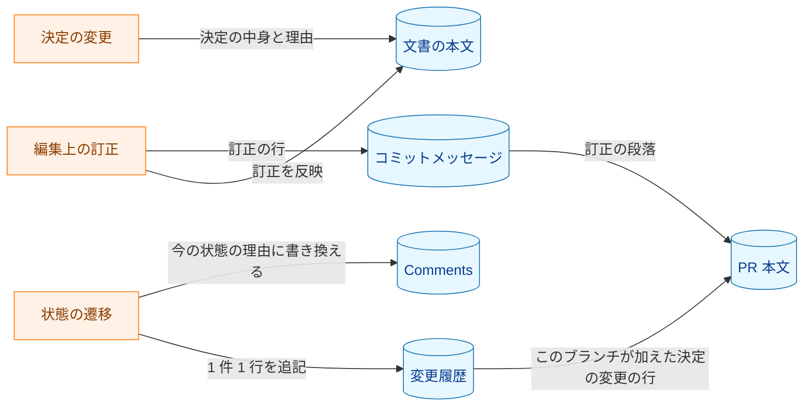

**図 1-1 の凡例**

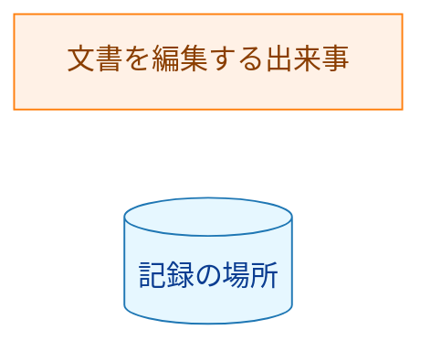

状態の遷移は、承認・`draft` への戻し・セッション中の再承認・`withdrawn` の 4 種類である。決定の変更は、状態の遷移（`draft` への戻し、またはセッション中の再承認）を伴う。そのため、決定の変更は本文と、遷移の記録（`Comments` と変更履歴）の両方に書かれる。編集上の訂正は、`Comments` にも変更履歴にも書かない（AC-01・AC-06）。

### 1.3. 設計の際に決めたこと（2026-11-01）

-   **PR 番号は `/runpr` の PRE_MERGE で埋める（H-02）:** PR を作る前に書く変更履歴の行は、PR 番号の位置に未記入の印 `#未記入` を書く。`/runpr` の PRE_MERGE が、この PR が加えた行の印をこの PR の番号に置き換える。タスク文書を変える PR は `/runpr` を通してマージする、という運用を前提にする（`/runpr` を通らない経路は 4.3 節）。置き換える場所が 1 か所で済み、PR を作った後の追加の push も要らない。PR を作った直後に置き換える案は、PR を作った後の push が失敗すると印が残るため、結局 PRE_MERGE にも同じ置き換えが要り、置き換える場所が 2 か所になる。
-   **変更履歴は箇条書きにする（H-03）:** 見出し `## 変更履歴` の下に、1 件を 1 つの箇条書きの項目で書く（3.2 節）。表にすると、`Comments` と同じく 1 つのセルに長い要旨が入り、読みにくくなるためである。
-   **`fixprguard finish` にコミットメッセージの本文を渡す（AC-01）:** `/fixpr` のコミットは `fixprguard finish` が作る。件名は `fix: address PR #<PR> review comments` に固定で、本文を書く手段がない（`internal/fixprguard/worktree.go:40-43`、`worktree.go:272`）。要件 AC-01 は、訂正の説明を PR 本文とコミットメッセージの両方に書くよう求める。規則に `/fixpr` の例外を設けるより、ツールに任意の引数 `--body-file` を加えて、`/fixpr` のコミットにも訂正の行を書けるようにする（3.4 節）。要件 2.2 は対象を規則とコマンドの定義としているが、`fixprguard` の変更は AC-01 を満たすための手段であり、要件の変更ではない。
-   **`/fixpr` は PR 本文の末尾に訂正の段落を機械的に追記する（H-01・H-07）:** 本文の解析も、LLM による本文全体の書き直しもしないので、既にある内容を落としにくい。追記は `fixprguard` の新しいサブコマンド `append-pr` が行う。ツールが今の本文を取得し、末尾に段落を足して書き込む（3.4 節）。`/fixpr` のセッションは PR 本文を取得も表示もしない。既存の `edit-pr` で追記しようとすると、セッションが今のタイトルと本文を取得してファイルに書く必要がある。そうすると、信頼しない本文がセッションに渡るうえ、セッションは `edit-pr` が求める改行のない 1 行のタイトルのファイルも作れない（`write.go:54-62` は改行を拒否し、`gh` の出力は改行で終わる）。この 2 点が、新しいサブコマンドを設けた理由である。
-   **訂正の記録は、コミットメッセージの `Editorial correction: ` の行を唯一の出どころにする:** `/runplan` は、セッションをまたいで複数のフェーズのグループを実装してから PR を作る。`/fixpr` では、修正のフェーズ（Phase 3）のほかに、ローカルの CLI レビュー（Phase 4.5）の修正のコミットも承認済みの文書を直しうる。どの場合も、PR 本文に書く訂正を、セッションの記憶でなく commit された行から集める。

## 2. システム構成 (System Structure)

### 2.1. 全体の構成

図 2-1 は、記録の場所ごとに、どのコマンドの定義が書き込むかを示す。矢印 A → B は「A が B に書き込む」を表し、ラベルで書き込む手順を示す。

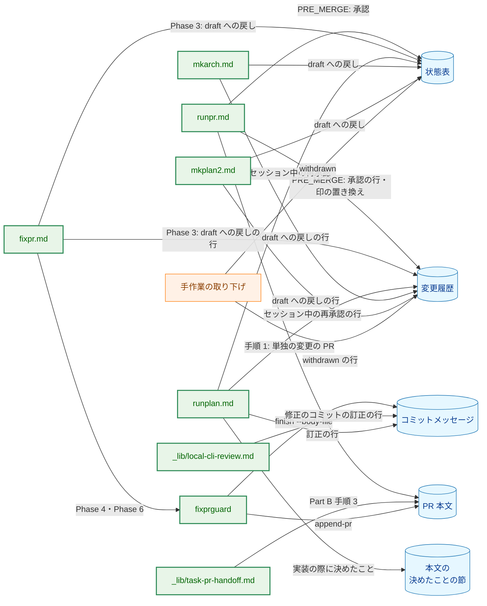

**図 2-1 の凡例**

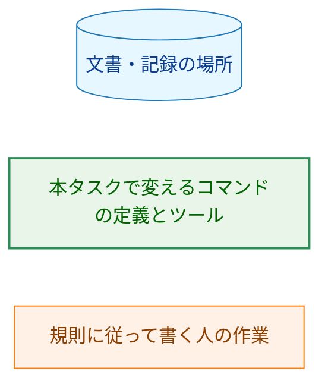

どの書き込みも、書式は規則の節を参照する（AC-20）。図を読みやすくするため、規則への参照の矢印は描かない。`mkarch.md` と `mkplan2.md` も、承認済みの文書に編集上の訂正を加えるときは訂正の行を書くが、規則の一般の求めに従うだけなので、矢印を省いた。

### 2.2. コンポーネントの配置

| 置き場所 | 変更 | 内容 |
|---|---|---|
| `docs/dev/conventions/requirements_process.md` | 変更 | 規則。`Comments` の値、変更履歴の形と作る時期、未記入の印、訂正の行と訂正の段落の形、旧規則で書かれた文書の移し方、`withdrawn` の記録（3.1〜3.3 節、3.6.1 節） |
| `.claude/commands/runpr.md` | 変更 | PRE_MERGE の承認と印の置き換え、手順 4 の選択肢と手順 4.3、単独の変更の PR の本文（3.5 節、3.6 節） |
| `.claude/commands/_lib/task-pr-handoff.md` | 変更 | Part B 手順 3 の PR 本文に、訂正の段落と決定の変更を加える |
| `.claude/commands/fixpr.md` | 変更 | Phase 3 の状態の記録と訂正の一覧（6.2 節）、Phase 4 の `--body-file`、Phase 6 の `append-pr` と書き直しの確認、最終報告（6.2 節） |
| `.claude/commands/_lib/local-cli-review.md` | 変更 | 修正のコミットが承認済みの文書を訂正するときに、訂正の行を書く（手順 7 の commit） |
| `.claude/commands/runplan.md` | 変更 | 編集上の訂正と決定の変更の記録（手順 5 の自己点検） |
| `.claude/commands/mkarch.md` | 変更 | 承認済みの文書を直すときの記録（72 行の項目） |
| `.claude/commands/mkplan2.md` | 変更 | 手順 8.5 の `draft` への戻しの記録 |
| `.claude/commands/_lib/settle-decisions.md` | 変更なし | 記録先（RECORD）は呼び出し元が渡す入力であり、本文に `Comments` への言及はない（3.6 節） |
| `cmd/fixprguard/main.go` | 変更 | `finish` に任意のフラグ `--body-file`、新しいサブコマンド `append-pr` |
| `cmd/fixprguard/main_test.go` | 変更 | 新しいフラグとサブコマンドの解析（7.1 節） |
| `cmd/fixprguard/docs_test.go` | 変更 | 期待するサブコマンドの一覧に `append-pr` を加える（7.1 節） |
| `internal/fixprguard/worktree.go` | 変更 | `FinishRequest` の `BodyFile`、commit の本文、commit のメッセージの確認（3.4.1 節） |
| `internal/fixprguard/write.go` | 変更 | `AppendPRRequest` と `GitHub.AppendPR`、本文のファイルの追加の検査（3.4 節） |
| `internal/fixprguard/worktree_flow_test.go`・`write_test.go` | 変更 | 7.1 節のテスト |
| `cmd/yt2column/fixpr_docs_test.go`・`codex_review_docs_test.go` | 変更 | `fixpr.md` Phase 6 の新しい呼び出しと、本文を出力しない取得の確認（7.1 節） |
| `docs/dev/guides/fixprguard_guide.md` | 変更 | `finish` と `append-pr` の節、終了コード `2` の説明、保証の表 |
| `docs/dev/conventions/package_reference.md` | 変更 | `cmd/fixprguard`・`internal/fixprguard` の説明 |
| `docs/tasks/0053_status_comments_policy/_checks/` | 新規 | AC-19 の差分の確かめのスクリプト（7.3 節） |

### 2.3. 記録の場所と書く内容

| 出来事 | `Comments` | 変更履歴 | 本文 | PR 本文 | コミットメッセージに書くもの |
|---|---|---|---|---|---|
| 編集上の訂正 | 変えない | 変えない | 訂正を反映 | 訂正の段落 | 訂正の行（必須） |
| 決定の変更による `draft` への戻し | その旨と変更の要旨 | `draft` への戻しの行 | 決定の中身を反映 | 決定の変更（`/fixpr` は除く。下の注） | 決まりなし |
| 本文を変えずに連鎖して `draft` に戻す（3.1 節） | 戻した理由の文書 | 連鎖した `draft` への戻しの行 | 変えない | 同上 | 決まりなし |
| 承認（`/runpr`） | `-` | 承認の行 | 変えない | 変えない | 決まりなし（PRE_MERGE の commit が運ぶ） |
| セッション中の再承認（`/runplan`） | `-` | セッション中の再承認の行 | 決定の中身と「実装の際に決めたこと」の節 | 決定の変更 | 決まりなし |
| `withdrawn` | 日付と理由（またはリンク） | `withdrawn` の行 | 変えない | 決まりなし | 決まりなし |

注: PR 本文の決定の変更は、PR を作るときに、ブランチが加えた変更履歴の行（`draft` への戻しとセッション中の再承認）から書く。`/fixpr` が PR を作った後に `draft` に戻した文書は、PR 本文には追記しない。`/fixpr` の最終報告と `/runpr` の手順 4 の問いが、`draft` に戻した文書を挙げる（`.claude/commands/fixpr.md` の Final report 2、`runpr.md:207-209`）。PR 本文に決定の変更を書くことを求める要件は、PR を作るとき（AC-02）と `/runplan` の決定の変更（AC-15）だけで、`/fixpr` の決定の変更（AC-14）には求めていない。

### 2.4. PR 番号の記入

図 2-2 は、変更履歴の行の PR 番号が、どの手順で書かれるかを示す。矢印 A → B は「A の結果が B に渡る」を表す。

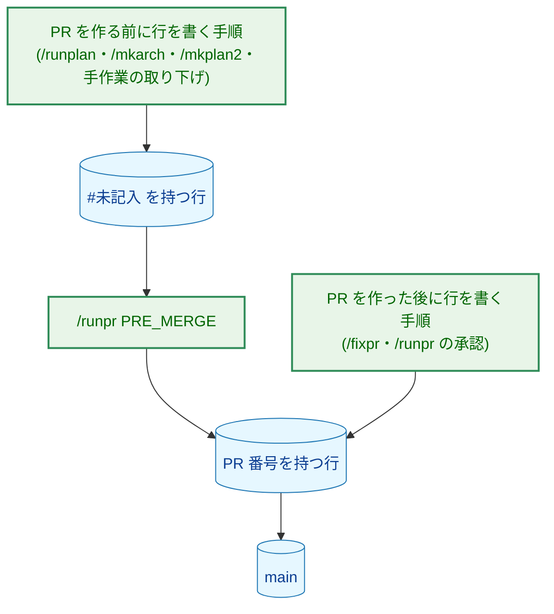

**図 2-2 の凡例**

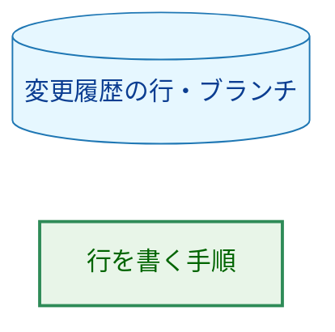

PR を作った後に行を書く手順は、PR 番号を知っているので、印を使わずに番号を書く。`/fixpr` は PR 番号を Phase 1 で解決し、`/runpr` は手順 1 で解決する。

## 3. コンポーネント設計 (Component Design)

### 3.1. `Comments` の値（AC-07〜AC-09）

規則の「Document Status Format」の状態表の `Comments` の説明を「今の状態の理由（なければ `-`）」に改め、値を次のとおり定める。

| 状態 | `Comments` の値 |
|---|---|
| `approved` | `-` |
| 作ったばかりの `draft` | `-` |
| 決定の変更で戻した `draft` | `決定の変更で draft に戻した：<変更の要旨>` |
| 本文を変えずに連鎖して戻した `draft` | `<文書のファイル名> の決定の変更に伴って draft に戻した` |
| `withdrawn` | `YYYY-MM-DD 取り下げ：<理由、または理由を記録した文書へのリンク>` |

-   状態が変わるたびに、前の内容を残さずに書き換える（AC-08）。承認で `-` に戻り、`draft` への戻しで上の値になる。
-   `draft` の期間に決定の変更が 2 件以上重なったときは、要旨を `<br>` で区切って並べる（AC-09）。たとえば、`/fixpr` のある回で `draft` に戻した文書を、次の回でもう一度変えた場合である。このとき状態は変わらないので、変更履歴には次の扱いをする。
    -   この PR が加えた `draft` への戻しの行があれば、その行の要旨に `；` で区切って追記する。その行はまだ `main` に入っていないので、追記しても「古い順に追記する」規則を破らない。同じ要旨が既にあれば追記しない（再実行で二重にしないため）。
    -   その行がなければ（文書が前の PR で `draft` のまま `main` に入った場合）、この PR の `draft` への戻しの行を新しく加える。

### 3.2. 変更履歴の形（AC-10〜AC-12、H-03）

規則に、変更履歴の形を次のとおり定める。規則の本文は英語で、見出しと行の例は、タスク文書に書く日本語の値をそのままコードブロックに示す（規則が既に `PR を作成した` などの日本語の値を示しているのと同じ形）。

```markdown
## 変更履歴

- 旧規則の Comments：<移した旧 Comments の文、内容を変えずに>
- 2026-11-01 承認（isseis、#606）
- 2026-11-03 draft への戻し：<変更の要旨>（#610）
- 2026-11-04 draft への戻し：02_architecture.md の決定の変更に伴う（#610）
- 2026-11-05 セッション中の再承認：<変更の要旨>（isseis、#612）
- 2026-11-07 withdrawn：<理由、または理由を記録した文書へのリンク>（#615）
```

| 遷移の種類 | 行の形 |
|---|---|
| 承認 | `- YYYY-MM-DD 承認（<承認者>、#<PR 番号>）` |
| `draft` への戻し | `- YYYY-MM-DD draft への戻し：<変更の要旨>（#<PR 番号>）` |
| 連鎖した `draft` への戻し | `- YYYY-MM-DD draft への戻し：<文書のファイル名> の決定の変更に伴う（#<PR 番号>）` |
| セッション中の再承認 | `- YYYY-MM-DD セッション中の再承認：<変更の要旨>（<承認者>、#<PR 番号>）` |
| `withdrawn` | `- YYYY-MM-DD withdrawn：<理由、または理由を記録した文書へのリンク>（#<PR 番号>）` |

-   **セクションの見分け方:** 変更履歴は、コードブロックの外にある見出し行 `## 変更履歴` で始まる、文書の最後のセクションである。コードブロックの中の `## 変更履歴`（本書 3.2 節の例や、規則を引用した文書）は変更履歴ではない。旧規則で書かれた文書かどうかの判定（3.3 節）も、印の置き換え（3.5 節）も、この定義に従う。
-   **置き場所:** 文書の最後のセクションとする。`02_architecture.md` に「決定の履歴」の付録があるときは、その後に置く。変更履歴は状態の遷移の記録で、決定の中身と理由を書く付録とは別のセクションである（要件 1 章「上の決定から導いたこと」）。
-   **作る時期:** 文書を作るときには設けず、最初の 1 行を書くときに文書の最後に作る（AC-11）。テンプレート（`docs/tasks/0000_template/requirements.md`）は変えない（要件 2.2）。
-   **承認者:** GitHub のユーザー名（`gh api user --jq .login` の値）を書く。`/runpr` の承認と `/runplan` のセッション中の再承認で同じ形にする（AC-15）。今の `/runpr` が `Reviewer` に書く値と同じ取り方である（`.claude/commands/runpr.md:209-210`）。
-   **未記入の印:** PR を作る前に書く行は、`#<PR 番号>` の位置に `#未記入` を書く。`main` に入った行は、旧規則の `Comments` を移した項目を除き、どれもその行を加えた PR の番号を持つ（AC-12）。`/runpr` の PRE_MERGE が印を置き換える（3.5 節）。
-   **連鎖した戻しを書くコマンド:** 連鎖した `draft` への戻しは、`/fixpr` の R3（申し送りの項目の変更で後の文書を戻す。`.claude/commands/fixpr.md:226-235`）だけが書く。`/mkarch` は自分の文書がまだない段階で要件定義書を戻し、`/mkplan2` は最後の文書（実装計画書）を戻すので、どちらも連鎖して戻す後の文書を持たない。
-   **移した項目:** 旧規則の `Comments` を移した項目は、接頭辞 `旧規則の Comments：` で始め、変更履歴の先頭に置く。日付・種類・PR 番号を求めない、1 件 1 行の規則の唯一の例外である（AC-10・AC-18）。

### 3.3. 旧規則で書かれた文書の移し方（AC-17・AC-18）

規則に、旧規則で書かれた文書を「変更履歴がなく、`Comments` が `-` でない文書」と定める。旧規則で書かれた文書に新しい規則で最初の状態の遷移を書くコマンドは、次の順に行う。

1. 文書の最後に `## 変更履歴` を作り、旧 `Comments` のセルの文を、接頭辞 `旧規則の Comments：` を付けた項目として先頭に置く。セルの文は、`\|` や `<br>` を含め、バイト列を変えずに写す。
2. `Comments` を、遷移の後の状態の理由（3.1 節）に書き換える。
3. 遷移の行を追記する。
4. 写しが元のセルと同じであることを、commit の前に確かめる。`git diff` で、消えた `Comments` の行のセルの文と、加わった `旧規則の Comments：` の項目の文が、バイト列として一致することを機械的に比べる（たとえば両方をファイルに取り出して `cmp` で比べる）。旧 `Comments` は最大で約 8.9KB あり（要件 1 章）、LLM が長い文を写すと変わりうるためである。一致しなければ commit しない。

編集上の訂正だけを加えるときは、移さず、`Comments` を変えない。この手順は規則の 1 か所に書き、状態の遷移を書くコマンドの定義（`runpr.md` の PRE_MERGE、`fixpr.md` の Phase 3、`runplan.md`、`mkarch.md`、`mkplan2.md`）は、遷移を書く前にこの手順を行うことを、規則の節を名指しして参照する。

### 3.4. `fixprguard` の変更

#### 3.4.1. `finish --body-file`

`finish` に任意のフラグ `--body-file FILE` を加える。`reply`・`edit-pr` の `--body-file` と同じ名前と同じファイルの契約にそろえる。渡したときは、固定の件名の後に空行を挟んで、ファイルの内容を本文として commit する。渡さないときは、今までどおり件名だけで commit する。

```go
// FinishRequest names the PR the commit subject refers to and, optionally,
// the file holding the commit body. BodyFile is new; an empty BodyFile means
// the commit holds the fixed subject alone.
type FinishRequest struct {
	PR       PRNumber
	BodyFile string
}
```

-   **型の形:** `ReplyRequest.BodyFile`・`EditPRRequest.BodyFile`（`internal/fixprguard/write.go:97-104`、`write.go:286-312`）と同じく、ファイルのパスを受け取り、`Finish` の中で読んで検査する。読む場所を 1 か所にし、検査を経ない本文で commit する経路を作らないためである。
-   **受け付ける内容:** `reply`・`edit-pr` の本文のファイルと同じ検査（通常のファイル、64 KiB 以下、空白だけでない、有効な UTF-8、NUL を含まない。`write.go:18`、`write.go:28-50`）と、`@codex` のメンションの拒否（`write.go:73-82`）に加えて、次を求める。どの行も規則の訂正の行の接頭辞 `Editorial correction: ` で始まり、制御文字（行の区切りの LF を除く）と `@` を含まない。空の行は拒否し、末尾の LF は 1 つだけ認める。本文に任意の行を書かせず、ローカルの CLI レビューの記録の行や trailer の行を偽れないようにするためである。
-   **読む時期:** `Finish` が作業ツリーを照合する前に読んで検査する。誤りがあれば、`make` も stage も commit もせずに止まる。
-   **commit:** 件名は `CommitSubject` のまま変えない。`/fixpr` が回数を数えるのは件名だからである（`worktree.go:40-41`）。git には、読み込んで検査したメモリ上の文を渡し（ファイルを git に読み直させない）、`--cleanup=verbatim` で記録させる。build checks の間にファイルが変わっても、検査した文と違う文で commit しないためである。commit の後の確認（`checkCommit`。`worktree.go:395`）に、記録されたメッセージが「件名、空行、本文」と一致することを加える。commit-msg の hook や利用者の設定がメッセージを変えたときに、気づくためである。
-   **ファイルの置き場所:** 作業ツリーの外（scratchpad）に書く。作業ツリーの中に書くと、`finish` の照合が、そのファイルを判定の後に現れた変更とみなして止まる。

#### 3.4.2. `append-pr`

新しいサブコマンド `append-pr --body-file FILE [PR]` を加える。ツールが PR の今の本文を取得し、末尾に空行を挟んでファイルの内容を足し、本文だけを書き込む。タイトルは送らない。

```go
// AppendPRRequest names the PR whose description gets the file's content
// appended after its current body.
type AppendPRRequest struct {
	PR       PRNumber
	BodyFile string
}

// AppendPR appends the checked file to the PR description.
func (g *GitHub) AppendPR(ctx context.Context, req AppendPRRequest) error
```

-   **受け付ける内容:** ファイルは `reply`・`edit-pr` の本文のファイルと同じ検査とメンションの拒否に通ることに加えて、`@` と `<` を含まない。PR 本文に足す段落が、利用者への通知を起こしたり、HTML のコメントで訂正を隠したりすることを防ぐためである。足した後の本文全体も、メンションの拒否と 64 KiB の上限（`maxTextFileBytes`）に通ることを求める。
-   **取得と書き込み:** 今の本文は `gh pr view` で取得し、書き込みは `edit-pr` と同じく `gh pr edit` に標準入力で渡す。取得した本文はツールの外に出さず、出力にも診断にも含めない。
-   **出力:** `{"protocol":4,"written":true}`（`edit-pr` と同じ形）。

#### 3.4.3. `Protocol` は上げない

手引きの「ツールを変更する場合」の 3 つの条件（`docs/dev/guides/fixprguard_guide.md:446-451`）が、2 つの変更のどちらにも成り立つ。

1. 古いツールは、知らないフラグ `--body-file`（`finish` には今は渡せない。`cmd/fixprguard/main.go:110`）と知らないサブコマンド `append-pr` を引数の解析で拒否し（終了コード `2`）、古い規則で判定しない。
2. 新しいツールは、フラグのない古い `finish` の呼び出しを今までと同じ規則で扱う。
3. 既存のサブコマンドの出力の形は変えない。

手引きの 4 章の終了コード `2` の説明に、古いツールが止まったときの診断と再インストールの案内を書く（同書 451 行の求め）。

### 3.5. `/runpr` の PRE_MERGE（AC-12・AC-13、H-04）

PRE_MERGE（`.claude/commands/runpr.md:204-217`）を、次のとおり変える。

-   **承認:** この PR が加えるか変えるタスク文書のうち、状態が `draft` のものを承認する。今と同じく、Status を `approved`、`Review date` を当日、`Reviewer` を承認者にする。加えて、旧規則で書かれた文書なら 3.3 節の手順で移したうえで、`Comments` を `-` にし、変更履歴に承認の行を追記する。今の「`Comments` を保つ」（`runpr.md:211`）は、この記述に置き換える。初回の承認と、`draft` に戻した後の承認の両方に当てはまる。
-   **PR 番号の記入（新しい項目）:** この PR がマージベース（`git merge-base origin/main HEAD`）に対して加えた変更履歴の行のうち、`#未記入` を持つものの印を `#<number>` に置き換える。対象は、`git diff` でこの PR が加えた行に限る。`main` に既にある行の `#未記入`（`/runpr` を通らずにマージされた PR の行。4.3 節）は自動で書き換えず、手順 4 の問いで利用者に示す。別の PR の行に、この PR の番号を付けないためである。変更履歴の外の `#未記入` という文字列（規則の説明の引用など）も置き換えない。
-   **二重の記録の防止（H-04）:** 承認は `draft` の文書にだけ行い、承認の行は Status を `approved` にするのと同じ commit で追記する。中断の後にもう一度実行したとき、承認を記録した文書は既に `approved` なので、承認の行を二度書かない。PR 番号の記入も、置き換えた後は対象の印が残らないので、二度目は何もしない。今の「既に記録したものは除く」（`runpr.md:205-206`）の判定は、この 2 つの性質で満たされ、新しい判定は要らない。
-   **承認せずにマージする選択肢:** 手順 4 の選択肢「merge without the approvals」（`runpr.md:569-573`）でも、PR 番号の記入は行う。文書を `draft` のまま `main` に入れても、この PR の行の `#未記入` を `main` に残さないためである。そのため、今は「PRE_MERGE を記録する答え」だけが通る手順 4.3（`runpr.md:631-655`。準備の破棄、commit と push、head の待ち合わせ、`mergepr prepare` のやり直し、変えたファイルの確認、スレッドの取り直し）に、この選択肢も通す。手順 4 の問いの選択肢の文は「承認せず、PR 番号だけを記録してマージ」にする。記入すべき印がなければ、今と同じく commit しない。PR 番号の記入だけの commit の件名は `docs(<task-id>): fill PR numbers for PR #<number>` とし、承認を含む commit の件名（今の `docs(<task-id>): record the review of PR #<number>`）と分ける。
-   **NEXT:** 変えない。PR 番号の記入だけの PRE_MERGE は文書を承認しないので、NEXT の判定（`runpr.md:221-228`）に影響しない。
-   **手順 4 の問い:** 今の表示に加えて、この PR の `/fixpr` が PR 本文に追記できなかった訂正（4.2 節）と、`main` に既にある `#未記入` の行を示す。

### 3.6. 対象のコマンドの定義の変更

| ファイル | 今の記述 | 変更後 |
|---|---|---|
| `runplan.md:63`（編集上の訂正） | 文書の `Comments` に訂正を記録し、PR がある場合は PR 本文を直す | `Comments` と変更履歴は変えず、訂正を加えたコミットのメッセージに訂正の行を書く。PR 本文には、PR を作るとき（`task-pr-handoff.md` Part B 手順 3）に入る。PR を作った後の追記の手順は持たず、その理由（3.7 節）を一文で書く |
| `runplan.md:64`（決定の変更） | `settle-decisions.md` の RECORD を `Comments` とし、`approved` のまま `Comments` に記録 | RECORD を、変えた文書の本文の「実装の際に決めたこと（YYYY-MM-DD）」の節（概要の章に置く）とする。状態は `approved` のまま、`Comments` は `-`（旧規則で書かれた文書は 3.3 節で移す）、変更履歴にセッション中の再承認の行（承認者、`#未記入`）を追記する。PR 本文には、PR を作るときにこの行から入る |
| `mkarch.md:72` | 決定の変更は `draft` に戻し、編集上の訂正は `Comments` に記録 | 規則の「Editing an approved document」を参照する形にする。決定の変更は `draft` に戻し、`Comments` と変更履歴の行（`#未記入`）を規則のとおりに書く。編集上の訂正は `Comments` を変えず、コミットメッセージの訂正の行に書く |
| `mkplan2.md:107`（手順 8.5） | 過去の承認を `Comments` に履歴として残し、PR 境界を加えた日を `Comments` に記録 | `Comments` を `決定の変更で draft に戻した：PR 境界を加えた` にし、変更履歴に `draft への戻し` の行（`#未記入`）を追記する。過去の承認は変更履歴の承認の行が持つ（旧規則で書かれた文書なら 3.3 節で移した項目が持つ） |
| `fixpr.md:453-461`（Phase 3 の 4） | 決定の変更は `draft` に戻し、編集上の訂正は `Comments` に記録 | 決定の変更は `draft` に戻し、`Comments` と変更履歴の行（`#NUMBER`）を規則のとおりに書く（3.1 節の重なった場合を含む）。R3 で連鎖して戻す文書には、連鎖した戻しの形を使う。編集上の訂正は `Comments` と変更履歴を変えず、応答の訂正の一覧に挙げる |
| `fixpr.md:465-476`（Phase 3 の応答） | `{"fixes": [{"threadId", "applied", "replyBody"}]}` | 各要素に `editorial`（訂正の一覧）を加える。各項目は、直した文書のパスと、訂正の行に書く英語の説明（何を何に直したか）である |
| `fixpr.md:546-569`（Phase 4） | `finish` は件名だけで commit | 6.2 節。訂正の一覧から訂正の行のファイルを作り、確認して `--body-file` を渡す |
| `fixpr.md:680-723`（Phase 6） | 大きく古いときだけ本文を書き直す | 6.2 節。書き直しの確認と、`append-pr` による訂正の段落の追記 |
| `fixpr.md` の最終報告 | — | PR 本文に入らなかった訂正と理由を挙げる（AC-05、4.2 節） |
| `local-cli-review.md` 手順 7 の commit | 修正を記録の行とともに commit する | 修正が承認済みのタスク文書の編集上の訂正なら、そのコミットのメッセージに訂正の行も書く |
| `task-pr-handoff.md` Part B 手順 3（196-239 行） | 本文に挙げるものに、訂正と決定の変更はない | 一覧に 2 つを加える。(1) `git log origin/main..HEAD` の訂正の行から作る訂正の段落。(2) `git diff origin/main...HEAD` でブランチが加えた変更履歴の行のうち、`draft` への戻しとセッション中の再承認の行が示す決定の変更 |
| `runpr.md:149-162`（単独の変更の PR の本文） | ブランチのコミットから短い本文を書く | 本文に、`task-pr-handoff.md` Part B 手順 3 と同じく訂正の段落と決定の変更を入れる |
| `runpr.md:204-217`（PRE_MERGE）、`runpr.md:564-573`（手順 4 の選択肢）、`runpr.md:631-655`（手順 4.3） | 承認で `Comments` を保つ。承認しない選択肢は commit しない | 3.5 節 |
| `settle-decisions.md` | — | 変えない。記録先は呼び出し元が RECORD で渡し、本文は `Comments` に触れない。AC-15 の「`settle-decisions.md` に渡す記録先」は `runplan.md` の RECORD の値で満たす |

#### 3.6.1. 訂正の行と訂正の段落の形

規則に、次の 2 つの形を定める。PR 本文の訂正の記録は、PR を作るときも `/fixpr` が追記するときも、同じ段落の形にする。

-   **訂正の行（コミットメッセージ）:** `Editorial correction: <文書のパス>: <何を何に直したか>; no decision changed` の 1 行。コミットメッセージは英語で書く（`CLAUDE.md`「Language」）。行の先頭から始まる行だけを訂正の行とし、字下げした行や文中の言及は数えない。コミットメッセージの文中で、行を `Editorial correction: ` で書き始めない。この読み方は、ローカルの CLI レビューの記録の行の読み方（`.claude/commands/_lib/local-cli-review.md:270-277`）と同じ形だが、規則に独立に書く（タスク文書の規則を、ローカルの CLI レビューの手順に依存させないため）。説明は、レビューのスレッドや PR 本文の文を引用せず、書くエージェントの言葉で書く（AC-01）。
-   **訂正の段落（PR 本文）:** 見出しにしない段落として、次の形で書く。本文の最後の節がどの見出しであっても、その下に入れ子にならないためである。日付と書いた手順を付けるので、回ごとに段落が分かれる。

    ```markdown
    **編集上の訂正（<書いた手順>、YYYY-MM-DD）:**

    - `<文書のパス>`: <何を何に直したか>（決定の変更なし）
    ```

    `<書いた手順>` は `PR の作成` または `/fixpr` である。段落の各項目は、訂正の行を日本語にしたもので、訂正の行と 1 対 1 に対応する。

### 3.7. `/runplan` が PR のあるブランチで作業しない根拠（AC-03）

AC-03 は「PR が既にある場合の `runplan.md`」に、訂正の説明を PR 本文に追記する手順を求める。しかし `/runplan` は、PR のあるブランチでは作業を始めない。

-   `task-pr-handoff.md` Part A 手順 3（`.claude/commands/_lib/task-pr-handoff.md:82-97`）は、`/runplan` が今のブランチを使い続ける条件を、コミットのないブランチか、「PR がまだない」ブランチ（同 88-92 行）としている。PR のあるブランチは、止めて報告する理由になる（同 94-97 行）。
-   PR のチェックポイントに着いたとき、`PR を作成した` の箱が既に付いていれば、PR があるので止まる（`.claude/commands/runplan.md:46`）。手順 5a も、PR がないことを確かめてから PR を作る（`runplan.md:77`）。

そのため、`/runplan` のどの訂正も PR を作る前に加えられ、`task-pr-handoff.md` Part B 手順 3 で PR 本文に入る。今の `runplan.md:63` の「(3) the PR description if one exists」は到達しない場合の記述なので、3.6 節のとおり、訂正の行を書く手順に置き換える。AC-03 の `runplan.md` の部分は、PR がある場合を持たないことを根拠とともに `runplan.md` に明記して満たす。これは AC-03 の文言（追記の手順を持つ）を、到達しない場合を明記する形で読み替えるものなので、PR のレビューで確認を求める（11 章）。

## 4. エラーハンドリング設計 (Error Handling Design)

### 4.1. `fixprguard` の失敗

新しい番兵エラーは加えない。ファイルの誤りは今の `ErrInvalidInput` を、メンションは今の拒否（`errCodexMention` は `ErrInvalidInput` を包む。`internal/fixprguard/errors.go:56`）を使う。どれも終了コード `2` で、標準エラーの 1 行の診断だけが原因を示す（`cmd/fixprguard/main.go:291-295`）。

| 失敗 | 振る舞い | 呼び出し元（`/fixpr`） |
|---|---|---|
| `finish` の本文のファイルの誤り（形、内容の規則、メンション） | 終了コード `2`。照合も `make` も commit もしない | 診断の 1 行を報告して止まる。作業ツリーの修正は残り、次の `/fixpr` は `dirty-work-tree` で止まる。回復は手引き 8 章 (d) の手順（修正を調べて捨てるか、手で commit する）による。セッションの事前の確認（5 章）を通った本文がここで止まるのは、確認とツールの規則が食い違ったときだけである |
| `append-pr` のファイルの誤り、足した後の本文が上限を超える | 終了コード `2`。書き込まない | 追記しなかった訂正として最終報告に挙げる（4.2 節） |
| 古いツールが `--body-file`（`finish`）や `append-pr` を知らない | 終了コード `2`（引数の解析の誤り） | 診断が知らないフラグかサブコマンドを示すときだけ、`make install-fixprguard` での再インストールを案内する |

### 4.2. PR 本文に入らなかった訂正（AC-05）

`/fixpr` は、この回に作ったコミット（Phase 4 と Phase 4.5）の訂正の行のうち、PR 本文に追記できなかったものを、最終報告に訂正と理由とともに挙げる。原因を問わず一般に定める。主な場合は次のとおりである。

-   Phase 4 または Phase 4.5 が止まり、Phase 6 に進まなかった（push されていないコミットの訂正は、PR 本文にも書かない）。
-   訂正の項目がセッションの確認（5 章）に通らず、落とした。
-   Phase 6 のメンションの確認に通らなかった、または `append-pr` が止まった（本文の上限によるものを含む）。

最終報告には、レビュアーが PR 本文に手で書き足せるように、訂正の一覧そのものを挙げる。`/runpr` から実行したときは、`/runpr` の手順 4 の問いもこれを示す（3.5 節）。

### 4.3. 未記入の印が `main` に入る場合

`#未記入` を置き換えるのは PRE_MERGE だけである。`/runpr` を通らずにマージした場合（`/mergepr` の直接の使用、GitHub の画面でのマージ）と、`/runpr` が手順 1 でマージ済みの PR を見つけた場合（`runpr.md:105-111`）は、印が `main` に残る。

-   **検出:** その文書を次に変える PR の `/runpr` が、手順 4 の問いで `main` にある印を示す（3.5 節）。自動では書き換えない。
-   **直し方:** 行を加えたコミットを `git log -S '#未記入' -- <文書>` で探し、そのコミットを含む PR の番号（`gh pr list --state merged --search <SHA>`）で印を置き換える、単独の変更の PR を作る。
-   **受け入れる危険:** `/runpr` を通らない経路では AC-12 が自動では守られない。タスク文書を変える PR は `/runpr` でマージする運用であり、`/mergepr` を直接使う経路は今もタスク文書の承認を記録しない。本タスクはこの経路を変えない（要件 2.2 の対象外）。

## 5. セキュリティ考慮事項 (Security Considerations)

本タスクで信頼の境界に触れるのは、`/fixpr` のコミットメッセージの本文と、PR 本文に追記する訂正の段落である。どちらも、レビューのスレッドを読んだエージェントが書いた文が GitHub に届く経路である。図 5-1 の矢印 A → B は「A の内容が B に渡る」を、破線は「脅威が働きかける先」を表す。

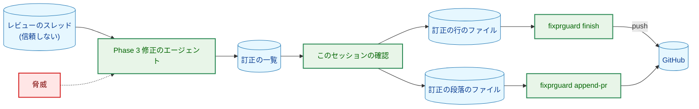

**図 5-1 の凡例**

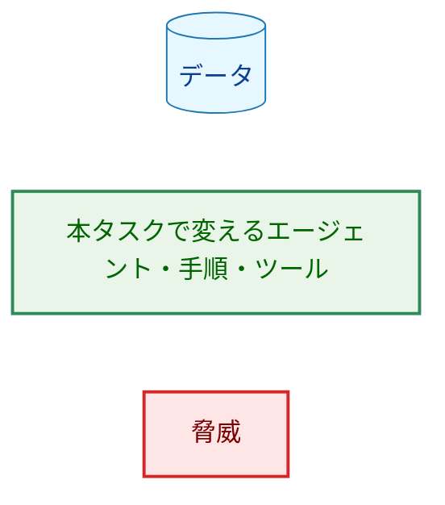

脅威は、メンションの投稿、利用者への通知、訂正を隠す文、偽の記録の行、スレッドに書かれた指示である。

-   **2 段の守り（タスク 0031 の方針の適用）:** タスク 0031 は、GitHub に投稿するすべての経路で、セッションのメンションの確認を主の守りとし、`fixprguard` の拒否を裏の守りとした（`docs/tasks/0031_codex_pr_review/02_architecture.md:43`）。新しい 2 つの経路にもこれをそのまま当てはめる。例外は設けない。
-   **セッションの確認（主の守り）:** このセッションは、修正のエージェントの訂正の一覧を、ファイルに書く前に項目ごとに確かめる。通らない項目は、直さずに一覧から落とし、最終報告に挙げる（4.2 節）。1 つの項目のために、その回の正しい修正すべての commit を止めないためである。確かめる規則は次のとおりである。
    -   パスは、その回の判定した集合（`fixprguard inspect` の判定）に含まれる、承認済みのタスク文書（`docs/tasks/*/0[123]_*.md`）である。
    -   説明は 1 行で、制御文字・`@`・`<`・`![`・`#` の直後の数字を含まず、300 文字以下である。
    -   ファイルに書いた後、今のメンションの確認（`grep -qiF -- '<review-mention>' <file>`）に通る。
-   **ツールの拒否（裏の守り）:** `finish` は行の形・`@`・制御文字とメンションを、`append-pr` は `@`・`<` とメンションを拒否する（3.4 節）。
-   **書かれた指示に従わない:** 訂正の一覧は、修正のエージェントがスレッドを読んで書いたデータとして扱う（`fixpr.md` の R6。`fixpr.md:477-479` の `replyBody` と同じ）。このセッションは、Phase 3 に渡したスレッドの、`applied` が真の要素の一覧だけを使い、文面を指示として読まない。
-   **PR 本文はセッションに入らない:** 追記は `append-pr` が行い、セッションは PR 本文を取得しない。書き直しの確認（6.2 節）で取得するのは、訂正の段落の数を示す数値だけである。今と同じく、本文を取得して読むのは Phase 6 のエージェントだけであり、本文は従わないデータとして扱う（`fixpr.md:690-692`）。
-   **引用しない:** 訂正の説明は、スレッドや PR 本文の文を引用せず、エージェントの言葉で書く（AC-01）。
-   **シェルを通さない:** `finish` と `append-pr` は、今と同じく外部のコマンドをシェルなしで起動し、本文を標準入力か引数で渡す。
-   **残余のリスク:** `append-pr` が本文を取得してから書き込むまでの間（1 回のツールの呼び出しの中）に、レビュアーが PR 本文を編集すると、その編集は上書きされる。Phase 6 の書き直し（`edit-pr`）にも、今と同じく編集が競合する余地がある。

`docs/dev/security.md` の記述は変えない。`fixprguard` の境界は手引き（`fixprguard_guide.md` 7.1 節の保証の表）に書かれており、メンションの行と、返信と PR の説明がシェルのコマンドにならない行に、`finish` の本文のファイルと `append-pr` を加える。

## 6. 処理フローの詳細 (Processing Flow Details)

### 6.1. `/runpr` の PRE_MERGE

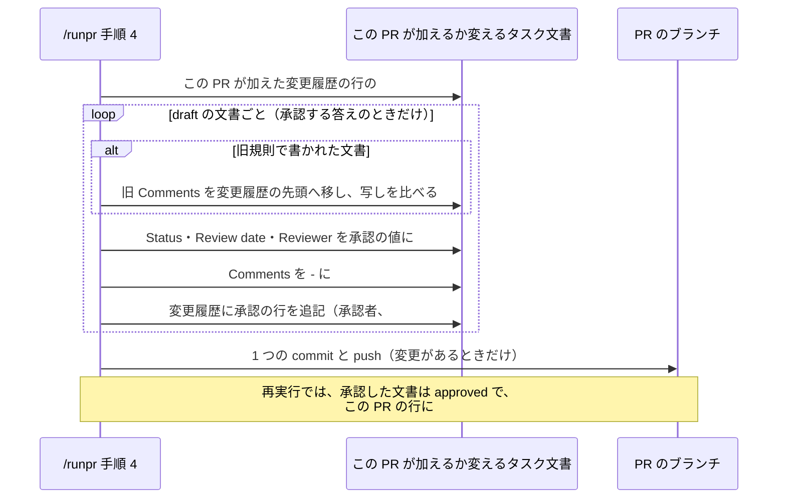

この図の参加者は色分けしない。矢印 A → B は「A が B を書き換える」を表す。PRE_MERGE の commit の後の手順（`mergepr prepare` のやり直し、変えたファイルの確認、マージ）は今のまま変えない（`.claude/commands/runpr.md:631-655`）。PRE_MERGE が変えるのはタスク文書だけなので、今の「PRE_MERGE が変えるファイルだけ」の確認（同 645-646 行）にそのまま通る。

### 6.2. `/fixpr` の訂正の記録（H-01・H-07）

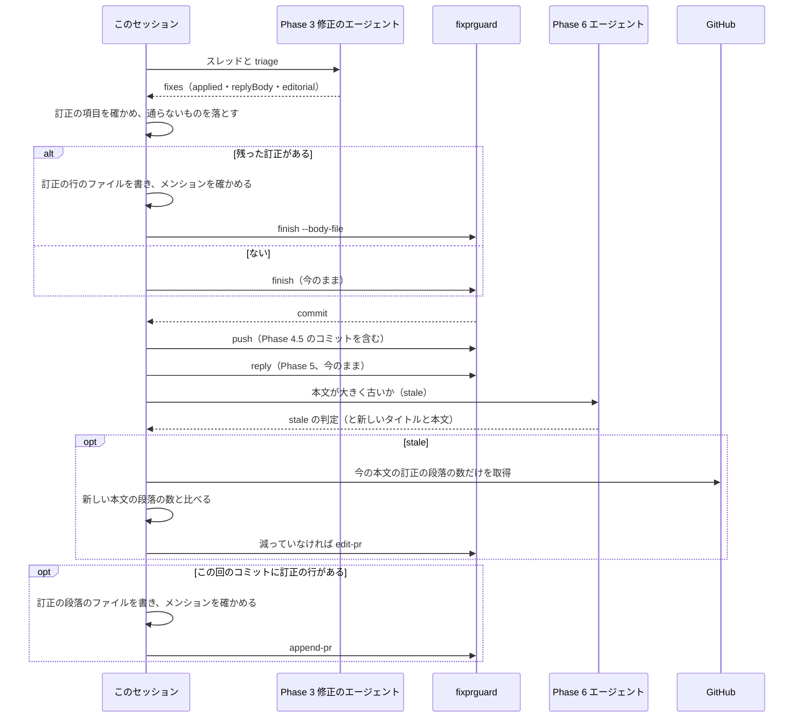

この図の参加者は色分けしない。実線の矢印 A → B は「A が B を呼び出す、または B に渡す」を、破線の矢印は応答を表す。

-   **訂正の一覧（Phase 3 の応答）:** 各スレッドの要素に `editorial` を加える。各項目は、直した文書のパスと、訂正の行に書く英語の説明である。この PR のレビューで承認済みの文書に加えた訂正（決定の変更でない編集）だけを挙げる。`draft` の文書の編集は、レビューの通常の改訂なので挙げない。
-   **Phase 4:** 5 章の確認を通った項目から、訂正の行（3.6.1 節）を書いたファイルを作業ツリーの外に作り、メンションの確認を通して、`finish` に `--body-file` で渡す。
-   **Phase 6 の書き直し（AC-04）:** Phase 6 のエージェントへの指示に、2 つを加える。本文を書き直すときは、既にある訂正の段落を文を変えずに残すこと。この回の訂正を新しく書かないこと（`git log` で見えても、後の追記が書くので二重になる）。書き直した本文を送る前に、このセッションは、今の本文の訂正の段落の数を、本文を出力しない `gh` の `--jq` の式で数値だけ取得する。新しい本文の段落の数（このセッションが書いた本文のファイルを `grep -c` で数える）がそれより少なければ、書き直しを送らず、最終報告に挙げる。段落の数え方は、行が `**編集上の訂正（` で始まることとする。
-   **Phase 6 の追記（AC-03）:** この回のコミットの範囲（Phase 1 の基準値の commit から push した head まで。Phase 4.5 のコミットを含む）の訂正の行を `git log` で集め、日本語の訂正の段落（`<書いた手順>` は `/fixpr`）をファイルに書き、メンションの確認を通して `append-pr` に渡す。本文が古くない場合でも追記する。
-   **最終報告:** 4.2 節のとおり、PR 本文に入らなかった訂正を挙げる。追記した場合は、追記した訂正の件数を要約の行に挙げる。

### 6.3. 状態の遷移と記録

図 6-1 は、タスク文書の状態と、遷移のたびに書く記録を示す。矢印 A → B は「出来事で A から B に移る」を表し、ラベルは出来事と、そのとき書く `Comments` と変更履歴の行を示す。

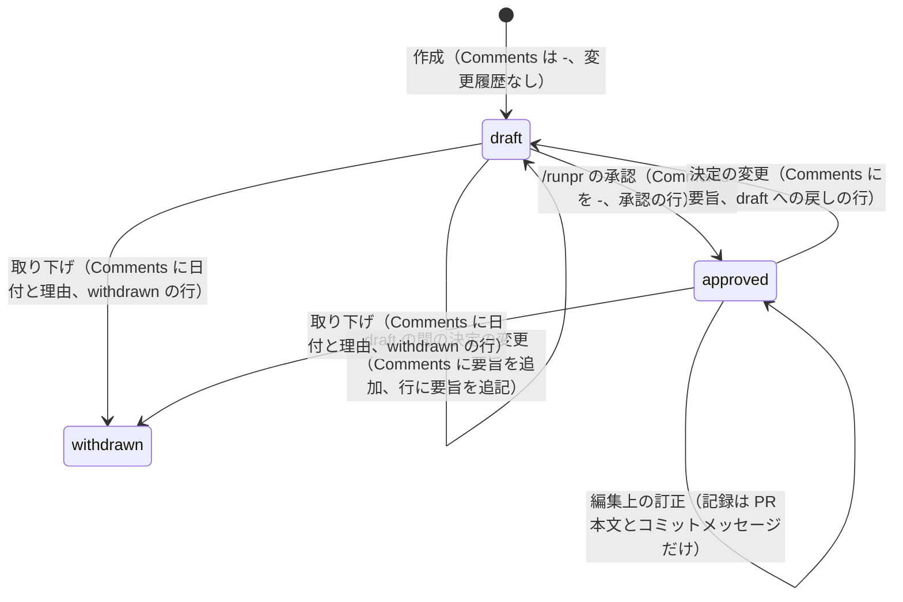

この図は `stateDiagram-v2` で書き、ノードを色分けしない（`docs/dev/conventions/mermaid_reference.md` 7 章）。`Draft --> Draft` は、`draft` に戻した文書が承認される前に、もう一度決定の変更を受ける場合である（3.1 節）。作ったばかりの `draft` の文書のレビューでの改訂は、状態の遷移でも決定の変更の記録の対象でもない。

## 7. テスト戦略 (Test Strategy)

### 7.1. 単体テスト

-   **`internal/fixprguard`（`worktree_flow_test.go`）:** 一時ディレクトリの実際のリポジトリで、次を確かめる。
    -   `Finish` に本文のファイルを渡すと、commit のメッセージが「固定の件名、空行、ファイルの内容のとおりの本文」になる（末尾に空白のある本文でも、git が空白を取り除かないことを含む）。
    -   本文がないときは件名だけになる。
    -   本文のファイルの誤り（メンション、`Editorial correction: ` で始まらない行、`@`、制御文字、通常のファイルでない、空）では、`make` の fake が一度も呼ばれず、commit もされない。
    -   commit の後のメッセージの確認が、hook がメッセージを変えたときに止まる。
-   **`internal/fixprguard`（`write_test.go`）:** `AppendPR` が、`gh` の fake の返す今の本文の末尾にファイルの内容を足した本文を、タイトルなしで書き込むこと。ファイルの `@`・`<`・メンションと、足した後の本文の上限超えで、書き込みを呼ばないこと。
-   **`cmd/fixprguard`（`main_test.go`・`docs_test.go`）:** `finish` が `--body-file` を受け付け、省略もできること、`append-pr` の引数の解析。`fixpr.md` に書いた呼び出しは、既存の `TestDocumentedInvocationsParse`（`cmd/fixprguard/docs_test.go:184-213`）が新しいフラグとサブコマンドを含めて解析する。期待するサブコマンドの一覧（同 189 行）に `append-pr` を加える。
-   **文書のガード（`cmd/yt2column`）:** 信頼の境界のコマンドに当たるものを加える（`CLAUDE.md` の文書テストの規則の例外。「`fixprguard` の呼び出しの場所」と「本文を出力しない `--jq` の式」）。
    -   `TestFixprguardCallSites`（`fixpr_docs_test.go:647-670`）に、Phase 6 の `fixprguard append-pr ` を加える。
    -   Phase 6 の段落の数を取得する `--jq` の式が本文を出力しないことを、今の `checkListings`（`TestRunprDocContract` が使う。`fixpr_docs_test.go:149-193`）と同じ方法で確かめる。
    -   `TestPostingCommandsInventory`（`codex_review_docs_test.go:189-251`）の正規表現は `fixprguard (reply|edit-pr)` だけを投稿のコマンドとみなす（同 132 行）。`append-pr` を投稿のコマンドに加え、Phase 6 の投稿の節の一覧（同 59 行）にも加える。`TestPostingPathsCheckMention`（同 111-128 行）は Phase 6 の確認をそのまま確かめる。
-   **ほかの文書のテスト:** 規則とコマンドの定義の文言を照合する恒久のテストは加えない（`CLAUDE.md`「Document tests check values, structure, and executable examples, never prose」）。未記入の印 `#未記入` は規則と `runpr.md` の 2 か所に書かれる。食い違ったときの害は、`main` に印が目に見える形で残り、次の `/runpr` の問いに示されることだけで小さいので、照合のテストは加えない。

既存のテストで振る舞いの変更に伴って直すのは、上に挙げた `TestDocumentedInvocationsParse` の期待するサブコマンドの一覧、`TestFixprguardCallSites` の表、`TestPostingCommandsInventory` の正規表現と投稿の節の一覧である。

テストを書いたら、確かめる対象を壊して失敗することを確かめ、そのことをコミットメッセージに書く（`CLAUDE.md`「Testing Strategy」）。

### 7.2. 統合テスト

N/A。コマンドの定義を実行した結果（編集上の訂正だけの PR、決定の変更の PR がどうなるか）は、要件 2.3 のとおり本タスクの後の PR で分かる。

### 7.3. 差分の確かめ（`_checks/`、AC-19）

AC-19（本タスクの PR が `docs/tasks/` 以下の既存のタスク文書を変えない）は変更の前後の関係なので、`docs/tasks/0053_status_comments_policy/_checks/` に、マージベースと PR の head を比べるスクリプトを置く。`docs/tasks/` 以下で変わったパスが `docs/tasks/0053_status_comments_policy/` の下だけであることを確かめる。本タスクの実装の PR が複数になるときは、各 PR のブランチで、そのチェックポイントの前に一度ずつ実行し、出力と両方のコミット ID を実装計画書の確かめの行に記録する（規則 §4）。最初の実装の PR より前の PR（本書と実装計画書の PR）は、本タスクのディレクトリだけを変える。

### 7.4. セキュリティのテスト

7.1 節の `finish` と `append-pr` のファイルの拒否（メンション、`@`、`<`、行の形）が、セキュリティのテストに当たる。セッションの確認は手順の文言なので、PR のレビューで読んで確かめる。

### 7.5. 受け入れ基準の確かめの方法（H-05）

| 受け入れ基準 | 方法 |
|---|---|
| AC-01〜AC-18、AC-20 の文言 | `manual`（PR のレビューで規則とコマンドの定義を読む） |
| AC-01 の `/fixpr` のコミットメッセージ、AC-03 の `/fixpr` の追記 | 上に加えて `test`（7.1 節の `internal/fixprguard` と `cmd/fixprguard` のテスト） |
| AC-19 | `diff`（7.3 節） |

## 8. 実装の優先順位 (Implementation Priorities)

| フェーズ | 内容 | 理由 |
|---|---|---|
| 1 | `fixprguard` の `finish --body-file` と `append-pr`（Go のコードとテスト、手引き、`package_reference.md`） | `fixpr.md` がこれらを使う前に、ツールが `main` に入り、利用者が再インストールできる必要がある |
| 2 | 規則（`requirements_process.md`） | コマンドの定義が参照する書式を先に定める |
| 3 | `runpr.md`・`task-pr-handoff.md` | すべての PR が通る記録（PRE_MERGE、PR 本文）を変える |
| 4 | `fixpr.md`（文書のガードを含む）・`local-cli-review.md`・`runplan.md`・`mkarch.md`・`mkplan2.md` | 書き込む側を規則と PRE_MERGE に合わせる |
| 5 | AC-19 の差分の確かめ | 各 PR のブランチで実行する |

-   **PR の分け方:** フェーズ 2〜4 は 1 つの PR にまとめる。規則だけが先に `main` に入ると、規則は訂正を `Comments` に書かないと言い、コマンドの定義はまだ書かせる期間ができ、その間に編集した文書に 2 つの規則が混ざるためである。フェーズ 1 は先に別の PR にしてよい。
-   **移行の注意:** フェーズ 4 の `fixpr.md` が `--body-file` や `append-pr` を使うと、再インストールしていない古いツールは終了コード `2` で止まる（fail-closed。古い規則で commit も投稿もしない）。訂正のない回は、どちらも使わないので、古いツールでも今までどおり動く。フェーズ 1 の PR をマージした直後に `make install-fixprguard` で再インストールすることを、フェーズ 1 の PR 本文に書く。
-   **本タスクのマージの時点で進行中の文書:** 本タスクのマージの後に書く記録（承認を含む）は新しい規則に従い、それより前に書かれた `Comments` は旧規則の文として 3.3 節の扱いを受ける（要件 1 章）。本タスクの文書そのものも同じであり、本書の承認は、本書の PR の時点の規則で記録される。

## 9. 将来の拡張 (Future Extensibility)

-   **既存の文書の一括の移し替え:** 要件 2.3 のとおり、本タスクでは既存の文書を移さない。3.3 節の手順は 1 文書ずつ機械的に行えるので、後で一括して移すタスクを起こすときも同じ手順を使える。
-   **`/mergepr` での印の確認:** 4.3 節のとおり、`/runpr` を通らないと `#未記入` が残る。この経路でも防ぐ必要が生じたら、PR が加えた変更履歴の行に印があれば `mergepr prepare` が止まる検査を、後から加えられる。今は、運用（タスク文書の PR は `/runpr` でマージする）と次の `/runpr` での検出で足りる。

## 10. 設計への申し送りへの対応 (Design Handoff)

| 項目 | 対応 |
|---|---|
| H-01 `/fixpr` が PR 本文に訂正を追記する手段 | 新しいサブコマンド `fixprguard append-pr` が今の本文の末尾に訂正の段落を足す。追記の内容は、この回のコミットの訂正の行から作る。大きく古い場合の書き直し（`edit-pr`）とは別の呼び出しにし、書き直しの前に訂正の段落の数が減らないことを確かめる。PR 本文はセッションに入らない（1.3 節、3.4.2 節、6.2 節） |
| H-02 PR 番号を書き足す時期と手順 | PR を作る前の行は `#未記入` を書き、`/runpr` の PRE_MERGE が、この PR が加えた行の印だけを置き換える。承認せずにマージする場合も置き換える。手作業の取り下げも、規則に従って印を書けば PRE_MERGE が置き換える。PR を作った後の push の失敗は、PRE_MERGE だけが置き換えるので影響しない。`/runpr` を通らない経路は 4.3 節（1.3 節、2.4 節、3.5 節） |
| H-03 行の書式と移した項目の印 | 箇条書きの行の形と、種類の表記（`承認`・`draft への戻し`・`セッション中の再承認`・`withdrawn`）、移した項目の接頭辞 `旧規則の Comments：` を定める。規則の英語の本文には、日本語の値をコードブロックで示す（3.2 節） |
| H-04 PRE_MERGE の「既に記録したもの」との関係 | 承認は `draft` の文書にだけ行い、承認の行を状態と同じ commit で書くので、再実行で二重にならない。この PR の行の `#未記入` も、置き換えた後は残らない。新しい判定は加えない（3.5 節） |
| H-05 確かめの方法 | 文言は `manual`、AC-19 は各 PR のブランチでの `_checks/` の `diff`。`fixprguard` の変更は `test` で確かめる（7 章） |
| H-06 書き込む箇所の洗い出し | `Comments`・`editorial`・`withdrawn`・`decision change`・`Editing an approved` で `.claude/commands/`・`CLAUDE.md`・`AGENTS.md`・`docs/dev/guides/`・`docs/dev/conventions/` を探した（コミット `8bcfd272`）。書き込む箇所は 3.6 節の表のとおりである。要件 2.2 のファイルの中で新しく見つけたのは、PR 本文の書き方を定める `runpr.md:149-162` と `task-pr-handoff.md` Part B 手順 3 である。要件 2.2 にないファイルで加わるのは、承認済みの文書を直しうる修正のコミットを作る `_lib/local-cli-review.md` 手順 7 である。`runplan.md` の単一の PR の場合（`runplan.md:227`）は `task-pr-handoff.md` Part B を使うので、Part B の変更で足りる。`CLAUDE.md`・`AGENTS.md`・`docs/dev/guides/` には `Comments` の書き方の記述はない。`fixprguard` の変更に伴い、`fixprguard_guide.md` と `package_reference.md` を変える（2.2 節） |
| H-07 `/fixpr` の訂正の一覧の受け渡し | Phase 3 の応答の各要素に `editorial` を加え、このセッションが確かめて Phase 4 の訂正の行にする。Phase 6 は、Phase 3 の一覧でなく、この回のコミットの訂正の行から段落を作る（Phase 4.5 の修正も含めるため）。書き直しでは既存の段落を残すよう指示し、数を確かめる。追記できなかった訂正は最終報告と `/runpr` の問いに挙げる（6.2 節、4.2 節） |

## 11. 受け入れ基準と設計の対応 (AC Traceability)

| 受け入れ基準 | 設計 |
|---|---|
| AC-01 | 3.6.1 節（訂正の行、引用しない）、3.4.1 節（`/fixpr` のコミットメッセージ）、2.3 節 |
| AC-02 | 3.6 節（`task-pr-handoff.md` Part B 手順 3、`runpr.md:149-162`）、3.6.1 節（訂正の段落） |
| AC-03 | 6.2 節（`/fixpr` の追記。古くない場合も追記）、3.7 節（`/runplan` は PR のあるブランチで作業しない。AC-03 の文言の読み替えなので、PR のレビューで確認を求める） |
| AC-04 | 6.2 節（Phase 6 の書き直しで既存の段落を残し、数を確かめる） |
| AC-05 | 4.2 節、6.2 節（最終報告）、3.5 節（`/runpr` の問い） |
| AC-06 | 2.3 節、3.6 節（どのコマンドも訂正を `Comments` と変更履歴に書かない） |
| AC-07 | 3.1 節 |
| AC-08 | 3.1 節 |
| AC-09 | 3.1 節 |
| AC-10 | 3.2 節 |
| AC-11 | 3.2 節 |
| AC-12 | 3.2 節（未記入の印）、3.5 節（PRE_MERGE の置き換え）、2.4 節、4.3 節（`/runpr` を通らない経路） |
| AC-13 | 3.5 節 |
| AC-14 | 3.1 節・3.2 節（連鎖した戻しの形は `/fixpr` だけが使う）、3.6 節（`fixpr.md`・`mkarch.md`・`mkplan2.md`） |
| AC-15 | 3.6 節（`runplan.md:64`、`settle-decisions.md`）、3.2 節（承認者の形）、2.3 節（PR 本文は変更履歴の行から） |
| AC-16 | 3.1 節・3.2 節（`withdrawn` の `Comments` と行） |
| AC-17 | 3.3 節、3.2 節（セクションの見分け方） |
| AC-18 | 3.3 節、3.2 節（移した項目の接頭辞） |
| AC-19 | 7.3 節 |
| AC-20 | 1.1 節（書式は規則の 1 か所）、3.3 節・3.6 節（コマンドの定義は規則を参照する） |
