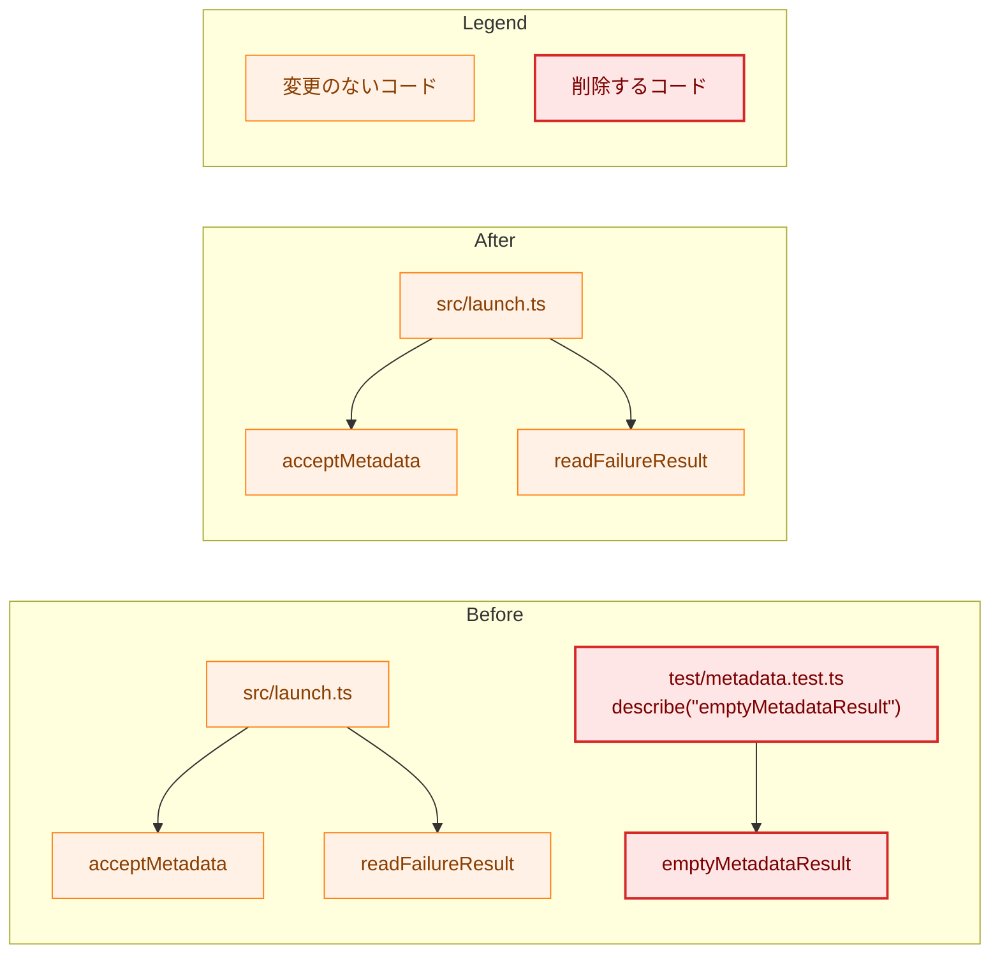
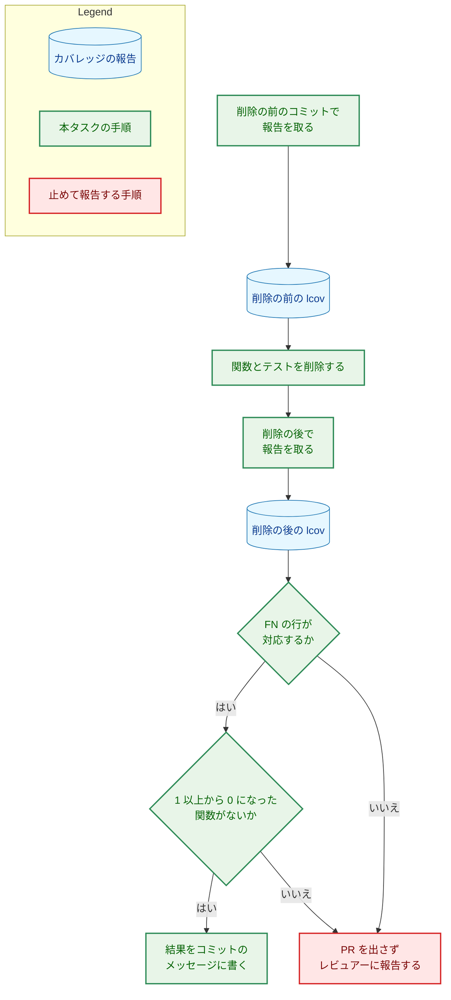

# 設計書：使われなくなった emptyMetadataResult を削除する

## Document Status

| Item | Value |
|---|---|
| Status | `draft` |
| Created | 2026-11-01 |
| Review date | - |
| Reviewer | - |
| Comments | - |

本書は [01_requirements.md](01_requirements.md) の設計である。要件定義から申し送られた設計事項は [design_handoff.md](design_handoff.md) にあり、その対応は 10 章にまとめる。本書が引用するファイルの行番号は、コミット `7478e36a`（本書の作成時の `main`）のものである。

変更は、呼ばれていない 1 つの関数と、それだけを確かめるテストの削除に限られる。新しい型・インターフェース・エラー・依存は加えない。そのため、該当のない節は「該当なし」と書く。

## 1. 設計の全体像 (Design Overview)

### 1.1. 設計原則

-   **削除だけを行う。** `extension/src/core/metadata.ts` の `emptyMetadataResult` と、`extension/test/metadata.test.ts` のその import と `describe` だけを削除する。ほかの行は変えない（AC-02・AC-03）。
-   **テストの削除は、カバレッジの報告で確かめる。** 削除の前と後で lcov 形式のカバレッジの報告を取り、関数ごとの実行回数を比べる（3.2 節）。確かめるための仕組みはリポジトリに加えない。一度だけ行う確認だからである。

### 1.2. 概念モデル

図 1-1 は、`emptyMetadataResult` を使う場所の削除の前と後を示す。矢印 A → B は「A が B を呼ぶ、または import する」を表す。

`src/` の中で `emptyMetadataResult` を呼ぶ場所はない（`git grep -n emptyMetadataResult -- extension` は `extension/src/core/metadata.ts:218`、`extension/test/metadata.test.ts:6`・`:337`・`:339` だけを返す。`7478e36a` で確かめた）。`acceptMetadata` と `readFailureResult` の呼び出し（`extension/src/launch.ts:112`・`:99`・`:105`）は変わらない。

### 1.3. 設計の際に決めたこと（2026-11-01）

人に尋ねる未決の設計事項はなかった。申し送り H-01 の論点（基準の時点、報告の出力先、関数の対応の付け方、Makefile の対象にしないこと、行と分岐を比べるかどうか）は、いずれも妥当な選択が 1 つに定まる。それぞれの選択と理由は 3.2 節に書く。

## 2. システム構成 (System Structure)

### 2.1. 全体の構成

変更なし。拡張のモジュールの構成、ポップアップの経路、Native Messaging のホストとサーバとのやり取りは変わらない。

### 2.2. コンポーネントの配置

| ファイル | 変更 |
|---|---|
| `extension/src/core/metadata.ts` | `emptyMetadataResult` の定義（`:218-220`）、その説明のコメント（`:217`）、その直前の空行（`:216`）を削除する（AC-02） |
| `extension/test/metadata.test.ts` | import の `emptyMetadataResult,`（`:6`）と、`describe("emptyMetadataResult")`（`:337-345`）とその直前の空行（`:336`）を削除する（AC-03） |

ほかのファイルは変えない。Go のコード、`docs/dev/conventions/package_reference.md`、README は `emptyMetadataResult` を名前で挙げていない（`git grep -n emptyMetadataResult -- . ':!docs/tasks'` が返すのは上の 2 ファイルの行だけである。`7478e36a` で確かめた）。過去のタスク文書（0025・0046）は書き換えない（要件 2.3）。

## 3. コンポーネント設計 (Component Design)

### 3.1. 型とインターフェース

変更なし。`MetadataResult`・`acceptMetadata`・`readFailureResult` の型と振る舞いは変わらない（要件 2.3）。

### 3.2. テストの削除の確かめ方（F-002・AC-05・AC-06、H-01）

-   **報告の取り方:** node に組み込まれたテストランナーのカバレッジ機能で、lcov 形式の報告を取る。`extension/` で `node --test --experimental-test-coverage --test-reporter=lcov --test-reporter-destination=<出力先> "test/**/*.test.ts"` を実行する。テストの対象の指定は `extension/package.json` の `test` スクリプトと同じである。node は `extension/.node-version` の版（`24.21.0`）を使い、依存パッケージは `make ext-install` で入れておく。依存パッケージは加えない。
-   **基準の時点:** 削除の前は、テストを削除するコミットの親コミット、削除の後はそのコミットで報告を取る。2 つのコミットの差が削除だけになるので、ほかの変更が比較に混ざらない。
-   **出力先:** リポジトリの外（作業用の一時ディレクトリ）に置く。報告はコミットしない。
-   **比べるもの:** `SF` が `src/` で始まるファイルの、関数の到達（lcov の `FN`・`FNDA`）だけを比べる。削除の前に `FNDA` が 1 以上の関数は、削除の後も 1 以上でなければならない（AC-05）。`scripts/` とテストのファイルは比べない（AC-05 の対象は `src/` の関数である）。
-   **関数の対応の付け方:** 削除の後の `src/` の `FN` の行の集合が、削除の前の集合から `src/core/metadata.ts` の `FN:218,emptyMetadataResult` を除いたものと一致することを、まず確かめる。一致すれば、前と後の関数は (ファイル, 行, 名前) の組で 1 対 1 に対応する。一致しなければ、対応を推測で付けずに止め、レビュアーに報告する。
    -   一致が見込める理由: node の lcov は名前のない関数を、ファイルの中の関数の出現の順の番号で `anonymous_<番号>` と名付ける（`7478e36a` の報告では `metadata.ts` の `:82` が `anonymous_1`、`:209` が `anonymous_7` で、番号はそれより前にある関数の数と一致する）。`emptyMetadataResult` は `metadata.ts` の最後の関数なので、その削除でほかの関数の行も番号も変わらない。ほかの `src/` のファイルは変わらない。
-   **行と分岐は比べない:** 要件は関数の比較だけを求める（要件 1 章「方針の例外」）。削除する `describe` が呼ぶのは `emptyMetadataResult` だけで、`emptyMetadataResult` はほかの関数を呼ばず分岐も持たない（`extension/src/core/metadata.ts:218-220`）。そのため、ほかの関数の行と分岐の到達はこの `describe` に依存しない。
-   **テストがすべて通ることを前提にする:** 前と後のどちらかの実行でテストが失敗した（終了コードが 0 でない）場合、その報告は比較に使わない。失敗したテストが到達させるはずの関数が報告から欠けるからである。依存パッケージがないとテストの一部が読み込めずに失敗するので（`jsdom`・`eslint`・`typescript` を import するテスト）、`make ext-install` を先に行う。
-   **記録:** 実行したコマンド、比べた 2 つのコミットの ID、結果（関数の数と、1 以上から 0 になった関数がないこと）を、テストを削除するコミットのメッセージに書く（AC-06）。
-   **Makefile の対象にしない:** 一度だけ行う確認なので、`make` の対象やスクリプトとして残さない（0027 `02_architecture.md` 3.11 と同じ）。

## 4. エラーハンドリング設計 (Error Handling Design)

該当なし。エラーの型と、利用者に見えるエラーの振る舞いは変わらない（要件 4.3）。

確かめの手順の失敗は次のとおり扱う。

-   AC-05 を満たさない関数があったとき、または 3.2 節の関数の対応が取れなかったときは、PR を出さず、その関数（または一致しなかった `FN` の行）とともにレビュアーに報告する（AC-05）。

## 5. セキュリティ考慮事項 (Security Considerations)

N/A。外部コマンドの呼び出し、API キー・Webhook URL、キャッシュ、ネットワークでの送信、信頼できない文字列の埋め込みのどれも変えない（要件 4.2）。削除する関数は信頼できない入力を受け取らない。

## 6. 処理フローの詳細 (Processing Flow Details)

図 6-1 は、削除と確かめの順序を示す。矢印は実行の順を表す。

## 7. テスト戦略 (Test Strategy)

### 7.1. 単体テスト

テストは加えない。`describe("emptyMetadataResult")` を削除する。残るテストは変えない（AC-03）。`acceptMetadata`・`readFailureResult` の既存のテスト（`extension/test/metadata.test.ts`）はそのまま通る。

### 7.2. 統合テスト

該当なし。`make ext-check`（型の検査、lint、書式の検査、テスト、ビルド）が成功することを確かめる（AC-04）。export を削除するので、型の検査とビルドで、ほかに参照する場所が残っていないことも確かめられる。

### 7.3. セキュリティのテスト

該当なし（5 章）。

### 7.4. 受け入れ基準の確かめの方法

| AC | 方法 |
|---|---|
| AC-01 | `static`: `git grep -n emptyMetadataResult -- extension/src extension/test` が何も返さない |
| AC-02・AC-03 | `diff`: 削除の前と後の差分が、2.2 節の表の行の削除だけである。差分の確かめの具体的な形（`_checks/` のスクリプトにするか）は実装計画で決める |
| AC-04 | `make ext-check` の成功 |
| AC-05・AC-06 | 3.2 節の比較と、コミットのメッセージの記録 |

## 8. 実装の優先順位 (Implementation Priorities)

フェーズは 1 つで、PR も 1 つである。

1.  削除の前のコミットで lcov の報告を取る（3.2 節）。
2.  `metadata.ts` と `metadata.test.ts` から削除する（2.2 節）。
3.  削除の後で lcov の報告を取り、比べる（3.2 節）。
4.  `make ext-check` を実行する（AC-04）。
5.  結果をメッセージに書いてコミットする（AC-06）。

## 9. 将来の拡張 (Future Extensibility)

該当なし。収集が拒否された状態を後で動画メタデータの結果で表す必要が生じたときは、そのタスクで、その状態の結果を作る関数を設計する。#503（Viewer）では使う見込みはない（要件 1 章）。

## 10. 設計への申し送りへの対応 (Design Handoff)

| 項目 | 対応 | 節 |
|---|---|---|
| H-01 カバレッジの報告の取り方と比べ方 | `node --test --experimental-test-coverage --test-reporter=lcov` で削除の前（削除のコミットの親）と後の報告をリポジトリの外に取り、`src/` の関数の `FN`・`FNDA` を比べる。関数は `FN` の行の集合の一致で対応づけ、一致しなければ止める。行と分岐は、削除する `describe` がほかの関数に到達しないので比べない。Makefile の対象には加えない | 3.2 |

## 11. 受け入れ基準と設計の対応 (AC Traceability)

| AC | 設計 |
|---|---|
| AC-01 | 2.2 節、7.4 節 |
| AC-02 | 2.2 節、7.4 節 |
| AC-03 | 2.2 節、7.4 節 |
| AC-04 | 7.2 節、8 章 |
| AC-05 | 3.2 節、4 章、6 章 |
| AC-06 | 3.2 節、8 章 |
