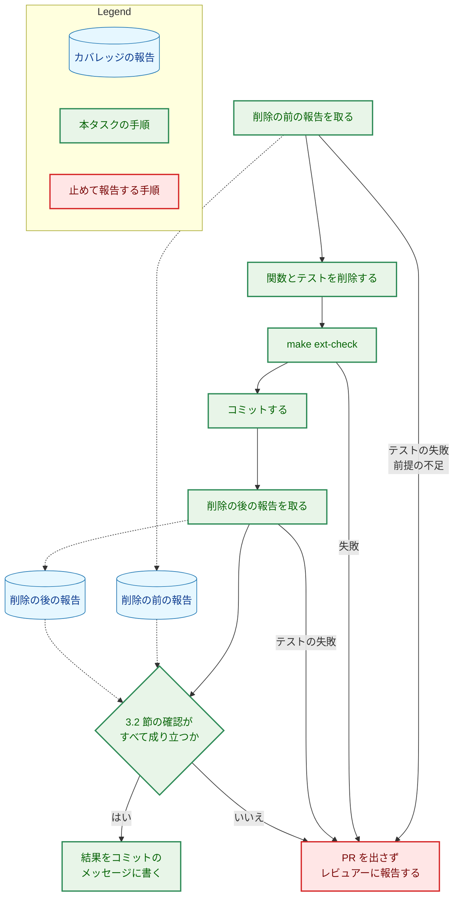

# 設計書：使われなくなった emptyMetadataResult を削除する

## Document Status

| Item | Value |
|---|---|
| Status | `approved` |
| Created | 2026-11-01 |
| Review date | 2026-11-02 |
| Reviewer | isseis |
| Comments | 2026-11-02 実装時の決定の変更（同日、レビュアー isseis が `/runplan` のセッションで承認）: 3.2 節「関数の対応の付け方」に、同じ行から始まる関数が複数ある場合の扱いを加えた。その行の関数が削除の前にすべて実行回数 1 以上なら、行ごとの実行回数の多重集合として比べ、0 の関数を含むときは止める。理由: 実装の時点の報告にその行があり（`src/browser/chromeDeps.ts:320`・`:400`）、(ファイル, 行) の組だけでは関数が一意に定まらず、承認された文面では止まる場合に当たったためである |

本書は [01_requirements.md](01_requirements.md) の設計である。要件定義から申し送られた設計事項は [design_handoff.md](design_handoff.md) にあり、その対応は 10 章にまとめる。本書が引用するファイルの行番号は、コミット `7478e36a`（本書の作成時の `main`）のものである。

拡張のコードの変更は、呼ばれていない 1 つの関数と、それだけを確かめるテストの削除に限られる。新しい型・インターフェース・エラー・依存は加えない。そのため、該当のない節は「該当なし」（セキュリティの節は `N/A`）と書く。

## 1. 設計の全体像 (Design Overview)

### 1.1. 設計原則

-   **削除だけを行う。** `extension/src/core/metadata.ts` の `emptyMetadataResult` と、`extension/test/metadata.test.ts` のその import と `describe` だけを削除する。ほかの行は変えない（AC-02・AC-03）。
-   **テストの削除は、カバレッジの報告で確かめる。** 削除の前と後で lcov 形式のカバレッジの報告を取り、関数ごとの実行回数を比べる（3.2 節）。一度だけ行う確認なので、比べる手順は `make` の対象やスクリプトとして残さない。リポジトリに加えるのは、AC-02・AC-03 の差分を確かめる `_checks/` のスクリプトだけである（7.4 節）。

### 1.2. 概念モデル

図 1-1 は、動画メタデータの結果を作る 3 つの関数について、`src/` からの呼び出しと、削除する `describe` からの呼び出しを、削除の前と後で示す。矢印 A → B は「A が B を呼ぶ」を表す。テストのほかの `describe` と `scripts/` からの呼び出しは、本タスクで変わらないので省く。

`src/` の中で `emptyMetadataResult` を呼ぶ場所はない（`git grep -n emptyMetadataResult -- extension` は `extension/src/core/metadata.ts:218`、`extension/test/metadata.test.ts:6`・`:337`・`:339` だけを返す。`7478e36a` で確かめた）。`acceptMetadata` と `readFailureResult` の呼び出し（`extension/src/launch.ts:112`・`:99`・`:105`）は変わらない。

### 1.3. 設計の際に決めたこと（2026-11-01）

レビュアーに尋ねるべき未決の設計事項はなかった。申し送り H-01 の論点（基準の時点、報告の出力先、関数の対応の付け方、`make` の対象にしないこと、行と分岐を比べるかどうか）は、いずれも妥当な選択が 1 つに定まった。それぞれの選択と理由は 3.2 節に書く。

## 2. システム構成 (System Structure)

### 2.1. 全体の構成

変更なし。拡張のモジュールの構成、ポップアップの経路、Native Messaging のホストとサーバとのやり取りは変わらない。

### 2.2. コンポーネントの配置

| ファイル | 変更 |
|---|---|
| `extension/src/core/metadata.ts` | `emptyMetadataResult` の定義（`:218-220`）、その説明のコメント（`:217`）、その直前の空行（`:216`）を削除する（AC-02） |
| `extension/test/metadata.test.ts` | import の `emptyMetadataResult,`（`:6`）と、`describe("emptyMetadataResult")`（`:337-345`）とその直前の空行（`:336`）を削除する（AC-03） |

ほかのファイルは変えない。Go のコード、`docs/dev/conventions/package_reference.md`、README は `emptyMetadataResult` を名前で挙げていない（`git grep -n emptyMetadataResult -- . ':!docs/tasks'` が返すのは上の 2 ファイルの行だけである。`7478e36a` で確かめた）。過去のタスク文書（0025・0046）は書き換えない（要件 2.3）。

## 3. コンポーネント設計 (Component Design)

### 3.1. 型とインターフェース

変更なし。`MetadataResult`・`acceptMetadata`・`readFailureResult` の型と振る舞いは変わらない（要件 2.3）。

### 3.2. テストの削除の確かめ方（F-002・AC-05・AC-06、H-01）

本節でいう「カバレッジの報告」は lcov 形式のものを指す。関数ごとの「実行回数」は、lcov の `FNDA` の値である。

-   **報告の取り方:** node に組み込まれたテストランナーのカバレッジ機能を使う。`extension/` をカレントディレクトリにして、`node --test --experimental-test-coverage --test-reporter=lcov --test-reporter-destination=<出力先> --test-reporter=spec --test-reporter-destination=stdout "test/**/*.test.ts"` を実行する。テストの対象の指定は `extension/package.json` の `test` スクリプトと同じである。spec 形式の出力は、テストが失敗したときにどのテストが失敗したかを示し、テストの数を数えるのにも使う。依存パッケージは加えない。
-   **実行の前提:** 次のどれかが満たされないときは、報告を取らない。
    -   `node --version` が `extension/.node-version` の版（`v24.21.0`）と一致する。この直接の `node --test` は、`make ext-*` の版の確認を通らないためである。
    -   `extension/node_modules` がある。ないと `jsdom`・`eslint`・`typescript` を import するテストが読み込めずに失敗する。入れるには `make ext-install`（ネットワークを使う）が要るので、先に利用者の承認を得る（[CLAUDE.md](../../../CLAUDE.md)「Tool Execution Safety」）。前と後の報告は、同じ `node_modules` で取る。本タスクは `extension/package-lock.json` を変えない（AC-02・AC-03）。
    -   `git status --porcelain -- extension` が空である（`extension/` にコミットしていない変更がない）。測ったファイルの内容が、コミットの内容と同じであることを保つためである。
-   **基準の時点と順序:** 削除の前の報告は、テストを削除するコミットの親コミットで取る。削除の後の報告は、そのコミットを作ってから取る。結果は、コミットのメッセージだけを直して書く（`git commit --amend` でメッセージだけを直しても、ファイルの内容は変わらない）。こうすると 2 つの時点の差は削除だけになり、測った内容とコミットした内容が一致する。
-   **出力先:** リポジトリの外（作業用の一時ディレクトリ）に置く。報告はコミットしない。
-   **比べるもの:** `SF` が `src/` で始まるファイルの、関数ごとの実行回数だけを比べる。削除の前に実行回数が 1 以上の関数は、削除の後も 1 以上でなければならない（AC-05）。`scripts/` とテストのファイルは比べない（AC-05 の対象は `src/` の関数である）。
-   **関数の対応の付け方:** 関数は (ファイル, `FN` の行番号) の組で識別し、名前では識別しない。
    -   名前を使わない理由: 名前のない関数の `anonymous_<番号>` は、同じコミットでも実行ごとに変わる。`7478e36a` で 4 回取った報告では、`metadata.ts:82` の関数は、ある回では `anonymous_1`、別の回では `anonymous_7` と名付けられ、`:209` の関数にも `anonymous_7` と名付けられた回があった。名前のある関数でも、同じファイルに同じ名前が複数ある（`src/core/strictJson.ts:51`・`:75` がどちらも `<instance_members_initializer>`）。一方、`FN` の行番号の集合は 4 回とも同じだった。
    -   実行回数の読み方: `FNDA` の行は名前しか持たないので、ファイルごとのまとまり（`SF` から `end_of_record` まで）の中で、`FN` と `FNDA` を出現の順で組にする。`FN` の数と `FNDA` の数が違うまとまりがあれば止める。
    -   同じ行から始まる関数: 入れ子のアロー関数など、同じ行から始まる関数が複数あることがある（実装の時点の `main` では `src/browser/chromeDeps.ts:320`・`:400`）。この行の関数は、名前が実行ごとに変わるので互いに対応を付けず、行ごとの実行回数の多重集合として扱う。その行の関数が削除の前にすべて実行回数 1 以上のときは、実行回数が 1 以上の関数の数が削除の後に減っていれば、その行の関数のどれかの実行回数が 0 になったとみなす。この場合は対応の付け方によらずに決まるので、推測は入らない。削除の前に実行回数が 0 の関数を含む行があれば止める（0 から 1 以上になった関数と、1 以上から 0 になった関数が入れ替わると、数が減らずに見逃すためである）。
    -   対応の確認: 削除の後の (ファイル, 行) の多重集合が、削除の前の多重集合から (`src/core/metadata.ts`, 218) を 1 つ除いたものと一致することを、まず確かめる。`emptyMetadataResult` は `metadata.ts` の最後の関数（`:218-220`）で、ほかの `src/` のファイルは変わらないので、ほかの関数の行番号は変わらないはずである。一致しなければ、対応を推測で付けずに止める。
-   **測れていることの確認:** 次のどれかが成り立たなければ止める。カレントディレクトリやテストの対象の指定を誤ると、テストが 1 つも動かずに報告が空になり、ほかの確認がすべて通ってしまうためである。
    -   削除の前の報告に (`src/core/metadata.ts`, 218) の `emptyMetadataResult` があり、その実行回数が 1 以上である。
    -   `src/` の関数の数が 0 でなく、削除の後の数が削除の前の数より 1 少ない。
    -   削除の後のテストの数（spec 形式の出力の `tests`）が、削除の前より 1 少ない（削除する `describe` は `it` を 1 つだけ持つ。`extension/test/metadata.test.ts:338`）。
-   **行と分岐は比べない:** 要件は関数の比較だけを求める（要件 1 章「方針の例外」）。削除する `describe` が呼ぶのは `emptyMetadataResult` だけで、`emptyMetadataResult` はほかの関数を呼ばず分岐も持たない（`extension/src/core/metadata.ts:218-220`）。そのため、ほかの関数の行と分岐の実行はこの `describe` に依存しない。
-   **テストがすべて通ることを前提にする:** 前と後のどちらかの実行でテストが失敗した（終了コードが 0 でない）場合、その報告は比較に使わずに止める。失敗したテストが実行させるはずの関数が報告から欠けるからである。
-   **コミットのメッセージ:** テストを削除するコミットのメッセージに、次を書く（AC-06）。実行したコマンド、node の版、削除の前の時点（親コミットの ID）と削除の後の時点（このコミット自身。コミットは自分の ID を自分のメッセージに書けない）、`src/` のファイルの数と関数の数とテストの数の前後の値、1 以上から 0 になった関数がないこと。
-   **残さないもの:** 一度だけ行う確認なので、`make` の対象にも、`_checks/` のスクリプトにもしない。前と後の関係を確かめる AC は、`_checks/` のスクリプトで merge-base と PR の head を比べるのが規則である（`docs/dev/conventions/requirements_process.md` 4 章）。AC-05 はその例外とする。理由は 2 つある。比較には依存パッケージを入れた環境での 2 回のテストの実行が要り、ファイルの内容を比べるだけのスクリプトでは済まないこと、要件 AC-06 が結果を書く場所をコミットのメッセージに定めていることである。

## 4. エラーハンドリング設計 (Error Handling Design)

エラーの型と、利用者に見えるエラーの振る舞いは変わらない（要件 4.3）。新しいエラーの型は定義しない。

3.2 節の手順は、次のどれかのときに止まる。止まったときは PR を出さず、止まった理由（実行回数が 0 になった関数、一致しなかった (ファイル, 行) の組、失敗したテスト、満たされなかった前提）とともにレビュアーに報告する（AC-05）。

-   実行の前提（node の版、`node_modules`、`extension/` にコミットしていない変更がないこと）が満たされない。
-   前と後のどちらかの実行でテストが失敗する。
-   あるファイルのまとまりの `FN` と `FNDA` の数が違う、関数の対応が取れない、または同じ行から始まる関数に、削除の前の実行回数が 0 のものがある。
-   測れていることの確認が成り立たない。
-   削除の前に実行回数が 1 以上だった関数が、削除の後に 0 になる。

## 5. セキュリティ考慮事項 (Security Considerations)

N/A。外部コマンドの呼び出し、API キー・Webhook URL、キャッシュ、ネットワークでの送信、信頼できない文字列の埋め込みのどれも変えない（要件 4.2）。削除する関数は信頼できない入力を受け取らない。

## 6. 処理フローの詳細 (Processing Flow Details)

図 6-1 は、削除と確認の順序を示す。実線の矢印は手順の実行の順を、点線の矢印は、カバレッジの報告が流れる向き（報告を出す手順から報告へ、報告から報告を読む手順へ）を表す。

## 7. テスト戦略 (Test Strategy)

### 7.1. 単体テスト

テストは加えない。`describe("emptyMetadataResult")` を削除する。残るテストは変えない（AC-03）。`acceptMetadata`・`readFailureResult` の既存のテスト（`extension/test/metadata.test.ts`）はそのまま通る。

### 7.2. 統合テスト

統合テストは加えない。`make ext-check`（型の検査、lint、書式の検査、テスト、ビルド）が成功することを確かめる（AC-04）。export を削除するので、型の検査とビルドで、ほかに参照する場所が残っていないことも確かめられる。

### 7.3. セキュリティのテスト

該当なし（5 章）。

### 7.4. 受け入れ基準の確かめの方法

| AC | 方法 |
|---|---|
| AC-01 | `static`: `git grep -n emptyMetadataResult -- extension/src extension/test` が何も返さない |
| AC-02・AC-03 | `diff`: `_checks/` のスクリプトで merge-base と PR の head を比べ、`extension/` の差分が 2.2 節の表の行の削除だけであることを確かめる（`docs/dev/conventions/requirements_process.md` 4 章） |
| AC-04 | `test`: `make ext-check` の成功 |
| AC-05・AC-06 | `diff`: 3.2 節の比較を一度行い、結果をコミットのメッセージに書く。`_checks/` のスクリプトにしない理由は 3.2 節「残さないもの」 |

## 8. 実装の優先順位 (Implementation Priorities)

フェーズは 1 つで、PR も 1 つである。

1.  実行の前提を確かめ、削除の前の報告を取る（3.2 節）。
2.  `metadata.ts` と `metadata.test.ts` から削除する（2.2 節）。
3.  `make ext-check` を実行する（AC-04）。
4.  コミットする。
5.  そのコミットで削除の後の報告を取り、比べる（3.2 節）。
6.  結果をコミットのメッセージに書く（AC-06。`git commit --amend` でメッセージだけを直す）。
7.  AC-02・AC-03 の `_checks/` のスクリプトを加えて実行する。

## 9. 将来の拡張 (Future Extensibility)

該当なし。収集が拒否された状態を後で動画メタデータの結果で表す必要が生じたときは、そのときのタスクで、その状態の結果を作る関数を設計する。#503（Viewer）では使う見込みはない（要件 1 章）。

## 10. 設計への申し送りへの対応 (Design Handoff)

| 項目 | 対応 | 節 |
|---|---|---|
| H-01 カバレッジの報告の取り方と比べ方 | `node --test --experimental-test-coverage --test-reporter=lcov` で削除の前（削除のコミットの親）と後（削除のコミット）の報告をリポジトリの外に取り、`src/` の関数ごとの実行回数を比べる。関数は名前ではなく (ファイル, `FN` の行番号) で識別する（名前のない関数の番号は実行ごとに変わるため）。対応が取れないとき、測れていることを確かめられないときは止める。行と分岐は、削除する `describe` がほかの関数を実行させないので比べない。`make` の対象にも `_checks/` のスクリプトにもしない | 3.2 |

## 11. 受け入れ基準と設計の対応 (AC Traceability)

| AC | 設計 |
|---|---|
| AC-01 | 2.2 節、7.4 節 |
| AC-02 | 2.2 節、7.4 節 |
| AC-03 | 2.2 節、7.4 節 |
| AC-04 | 7.2 節、8 章 |
| AC-05 | 3.2 節、4 章、6 章 |
| AC-06 | 3.2 節、8 章 |
