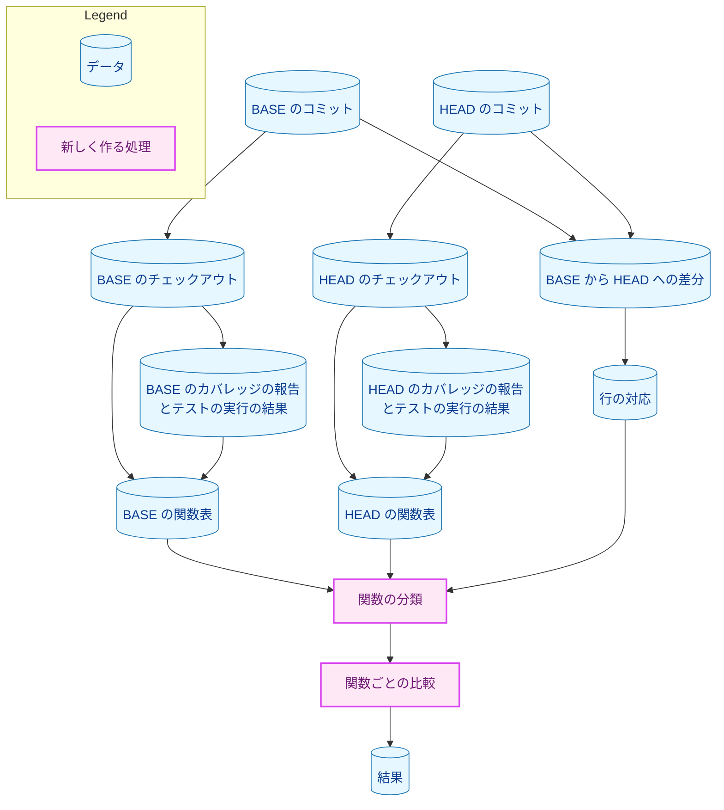
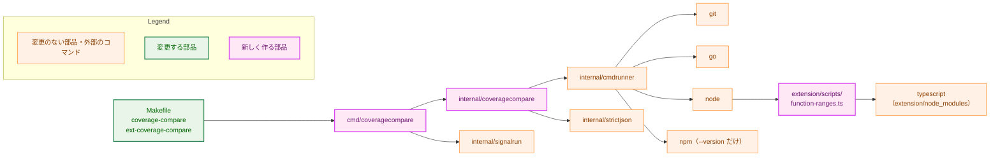
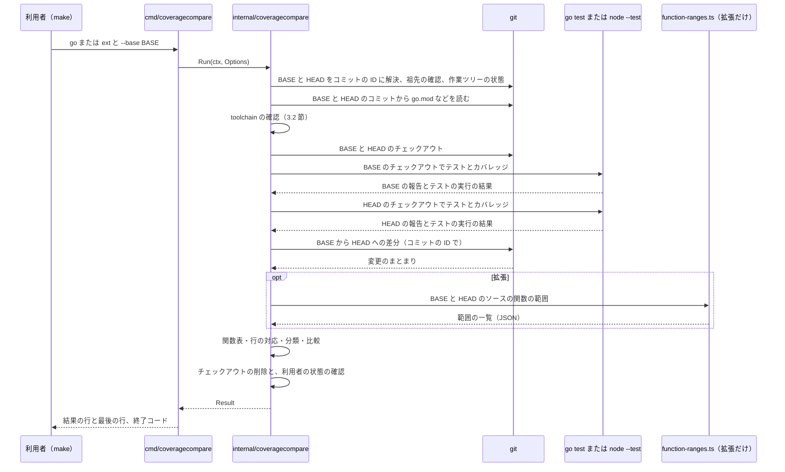
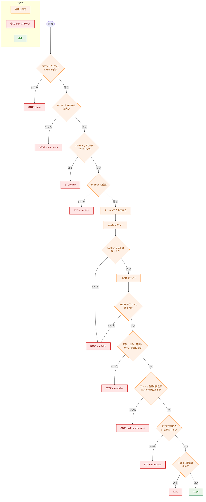

# 設計書：テストの削除の前後でカバレッジを関数ごとに比べる道具（Go と拡張）

## Document Status

| Item | Value |
|---|---|
| Status | `approved` |
| Created | 2026-11-02 |
| Review date | 2026-11-02 |
| Reviewer | isseis |
| Comments | - |

本書は [01_requirements.md](01_requirements.md) の設計である。要件定義から申し送られた設計事項は [design_handoff.md](design_handoff.md) にあり、その対応は 10 章にまとめる。本書が引用するファイルの行番号は、コミット `4bf1842f`（本書の作成時の `main`）のものである。本書が「実測した」と書く値は、2026-11-02 に `4bf1842f`（本書だけを加えた `989ee404` を含む）で、node `v24.21.0`・go `go1.27.1`（darwin/arm64）・GNU Make 3.81 を使って測ったものである。

本書の用語は、要件 6 章の用語集に従う（「製品のコード」「製品の関数」「関数の範囲」「削除した関数」「残る関数」「対応が取れない」「停止の種類」など）。本書で新しく使う用語は、次のとおりである。

-   **チェックアウト:** BASE または HEAD のコミットの内容を展開した一時的なディレクトリ。道具は、テストをここで実行する（3.3 節）。
-   **関数表:** 1 つの時点（BASE または HEAD）の製品の関数の一覧。関数ごとに (ファイル, 始まりの行)、終わりの行、名前、実行の記録（Go は網羅率の分子と分母、拡張は実行回数。報告にない関数は「記録なし」）を持つ。関数はソースから求め、実行の記録は報告から付ける（3.6 節）。
-   **行の対応:** BASE の行と HEAD の行を結ぶ対応。BASE から HEAD への差分から作る（3.7 節）。
-   **範囲の補助:** 拡張の関数の範囲を TypeScript の構文木から求める、小さな TypeScript のスクリプト（3.5 節）。

## 1. 設計の全体像 (Design Overview)

### 1.1. 設計原則

-   **判定は 1 か所に置く。** 差分による行の対応、関数の分類、止まる場合の優先順位、結果の出し方は、Go と拡張で共通の Go のパッケージ（`internal/coveragecompare`）に 1 つだけ置く。Go と拡張で違う部分は、パッケージの中の 1 つのインターフェース（3.1 節の `target`）にまとめる。
-   **測れていない比較を合格にしない。** テストの失敗、空の報告、読めない入力、対応の取れない関数は、どれも合格ではなく「止まる」に分ける（要件 4.3）。読めない部分を飛ばして残りで比べることはしない（F-006）。
-   **関数はソースから数える。** 要件の「製品の関数」は、製品のコードのファイルにある関数である（要件 6 章）。関数表の関数はソースの構文解析から求め、報告は実行の記録を付けるためだけに使う。報告に出ない関数（どのテストも読み込まなかったファイルの関数など）も、分類と HEAD にだけある関数の判定から漏らさないためである。
-   **利用者の状態に触れない。** BASE と HEAD は、利用者のリポジトリの作業ツリーの一覧に登録しないチェックアウトで測る。利用者の作業ツリー・インデックス・ブランチ・HEAD は読むだけで、終わりに前と同じであることを確かめる（AC-03）。
-   **環境の違いを持ち込まない。** go・node には、道具が名前で選んだ環境の変数だけを渡す。git には、利用者の大域の設定を読ませず、出力の形を変える設定は引数で上書きする。ネットワークは使わない（AC-04・AC-05）。
-   **判定に使う値は、道具が実行したコマンドの出力から読む。** テストの数・関数の数・削除した関数を、利用者に申告させない（要件 5 章）。

### 1.2. 概念モデル

図 1-1 は、1 回の比較で道具が扱うデータとその関係を示す。矢印 A → B は「A から B を作る」を表す。



-   関数表は、チェックアウトのソース（関数とその範囲）と報告（実行の記録）から作る（3.6 節）。関数は (ファイル, 始まりの行) で識別し、名前では識別しない（AC-17）。
-   関数の分類は、2 つの関数表と行の対応から、削除した関数・残る関数・対応が取れない関数・HEAD にだけある関数を決める（3.7 節）。比較は、残る関数と、行の対応でそれに結ばれる HEAD の関数の組について行う（3.8 節）。

### 1.3. 設計の際に決めたこと（2026-11-02）

-   **道具は Go で 1 つ書き、拡張の関数の範囲だけを TypeScript の補助に求めさせる（H-01）。** `cmd/coveragecompare` と `internal/coveragecompare` が、Go と拡張の両方の比較を受け持つ。拡張の関数の範囲は、`extension/scripts/function-ranges.ts`（範囲の補助）が、`extension/node_modules` に入っている `typescript` の構文木から求める。理由: 判定の論理（差分による対応、分類、比較、結果）を 1 か所に保てる（DRY）。node の lcov は関数の終わりの行を出さない（3.5 節の実測）ので、拡張の関数の範囲には TypeScript の構文解析が要る。新しい npm のパッケージは加えられないので、入っている `typescript` を使える node の側で求める。代わりに、`make ext-coverage-compare` にも Go が要る。範囲の補助は `extension/scripts/` の下にあるので、要件の「製品のコード」に入り、道具自身もカバレッジを比べる対象になる。これは害がない。
-   **外側の関数が HEAD で実行されなくなり、その中の関数が HEAD の lcov から消えた場合は、要件どおり `unmatched` で止める。** 報告には、外側の関数の HEAD での実行回数が 0 であることを手がかりとして添える（3.8 節）。理由: node の lcov は、一度も呼ばれなかった関数の中の関数を出さない（3.5 節の実測）。この場合は合格にならないので、見逃しは起きない。不合格に分ける案もあったが、それには AC-20 の例外を広げる決定の変更が要る。手がかりを添えれば、利用者は原因を読み取れる。
-   **`extension/package-lock.json` が BASE と HEAD で違うときは、`toolchain` で止める（H-03）。** 理由: AC-06 は、BASE と HEAD を同じ `extension/node_modules` で測ることを求める。lockfile が違えば、片方の時点はその時点の依存パッケージで測られない。テストの削除と依存の変更は、別のコミットに分ければ比べられる。

## 2. システム構成 (System Structure)

### 2.1. 全体の構成

図 2-1 は、道具を構成する部品と、道具が起動する外部のコマンドを示す。矢印 A → B は「A が B を呼ぶ、または起動する」を表す。



-   `internal/cmdrunner` は、外部のコマンドを、シェルを通さず、プロセスグループごと止められる形で実行する既存の境界である（`internal/cmdrunner/runner.go:35-60`）。道具は、git・go・node・npm をすべてこれで起動し、変更しない。標準出力はメモリに受け取る（`MaxOutput` を 0 にして上限を設けない。AC-32）。カバレッジの報告と TAP は、go と node が自分でファイルに書く（3.4・3.5 節）。
-   `internal/signalrun` は、シグナルで取り消される context の下で main を動かす既存の部品である（`internal/signalrun/signalrun.go:31-42`）。道具は、`cmd/codexreview` と同じく、実行の間ずっとシグナルの購読を保つ（`cmd/codexreview/main.go:50-70`）。2 回目のシグナルで後始末の前に終わらないようにするためである（3.3 節）。
-   `internal/strictjson` は、`go test -json` の各行（3.4 節）、範囲の補助の出力と `extension/package.json`（3.2・3.5 節）を読む。

### 2.2. コンポーネントの配置

| ファイル | 変更 | 内容 |
|---|---|---|
| `cmd/coveragecompare/main.go` | 新規 | 入口。コマンドラインは `go --base <rev>` または `ext --base <rev>` だけを受け入れる。プロセスの環境を `coveragecompare.Run` に渡し、`coveragecompare.Write` で結果を標準出力に書き、`coveragecompare.ExitCode` の値で終わる。`signalrun.Run` の下で、シグナルの購読を実行の間ずっと保つ |
| `cmd/coveragecompare/main_test.go` | 新規 | コマンドラインの受け入れと拒否、終了コード（AC-01・AC-02 の `usage`） |
| `internal/coveragecompare/` | 新規 | 道具の本体。前提の確認（3.2 節）、チェックアウト（3.3 節）、Go の測り方（3.4 節）、拡張の測り方（3.5 節）、関数表（3.6 節）、差分による行の対応と分類（3.7 節）、比較（3.8 節）、結果の出し方（3.9 節）。ファイルの分け方は実装計画で決める |
| `internal/coveragecompare/*_test.go`、`internal/coveragecompare/test_helpers.go`、`internal/coveragecompare/testdata/` | 新規 | 道具のテスト（7 章）。偽の go・node・npm と一時的な git のリポジトリを作る補助は、このパッケージのテストの補助（`//go:build test`）に置き、新しいパッケージにはしない。`make test` で動く |
| `extension/scripts/function-ranges.ts` | 新規 | 範囲の補助（3.5 節） |
| `extension/test/functionRanges.test.ts` | 新規 | 範囲の補助のテスト（7 章）。`make ext-test` で動く |
| `Makefile` | 変更 | `coverage-compare` と `ext-coverage-compare` の対象を加え、`.PHONY`（`Makefile:57`）に載せる（3.2 節）。`ext_check_versions`（`Makefile:309-324`）に、道具が同じ確認を持つことを示すコメントを加える |
| `CLAUDE.md` | 変更 | 「Deleting a test is a claim that must be checked」（`CLAUDE.md:490-491`）の書き換えと、「Commands」への 2 つの入口の追加（3.10 節） |
| `.claude/commands/weakreview.md`・`.claude/commands/runplan.md` | 変更 | テストを削除したときの確認の項目（`weakreview.md:209-210`、`runplan.md:218`）を、3.10 節の新しい規則（`make coverage-compare`・`make ext-coverage-compare` の合格の結果の記録）に合わせる。今の 2 つの項目は、カバレッジが変わらないことの確認を求める、AC-37 が置き換える規則を述べている |
| `cmd/yt2column/extension_docs_test.go` | 変更 | CLAUDE.md の `ext-` の対象の一覧を読む正規表現（`:41`）が、対象の名前の後ろの引数（` BASE=<commit>`）を受け入れるようにする（3.11 節） |
| `cmd/yt2column/makefile_test.go` | 変更 | 2 つの対象のレシピの BASE の受け渡しと、HEAD の `go.mod` の確認のテストを加える（7.2・7.3 節） |
| `internal/config/envaccess_test.go` | 変更 | 環境を読んでよい製品のコードの一覧（`allowedEnvRefs`、`:65-77`）に `cmd/coveragecompare/main.go` の `os.Environ` の呼び出しを 1 つ加える（3.11 節） |
| `docs/dev/conventions/package_reference.md` | 変更 | `cmd/coveragecompare` と `internal/coveragecompare` の行を加える |

0038・0052 の一度きりの道具（`docs/tasks/0038_doc_test_pruning/check_pruning.sh`、`docs/tasks/0052_doc_test_pruning/_checks/coverage/main.go`）は変えず、コードとしては再利用しない（3.12 節）。

### 2.3. データの流れ

図 2-2 は、合格する比較の流れを示す。矢印は呼び出しと応答を表す。止まる場合と不合格の場合の分かれ方は 6 章に示す。



## 3. コンポーネント設計 (Component Design)

### 3.1. 型とインターフェース

`internal/coveragecompare` の外に見せる型と関数は次のとおりである。`cmd/coveragecompare` が使うのは `Options`・`Run`・`Write`・`ExitCode` で、ほかの型は `Result` を組み立てるテストと `Write` のために見せる。停止の種類と結果の種類は、文字列ではなく列挙型で表し、`switch` の `default` は `internal` として扱う（CLAUDE.md「Declare, don't infer」）。

```go
package coveragecompare

// Target selects which test suite and report the run measures.
type Target int

const (
	TargetGo  Target = iota + 1 // make coverage-compare
	TargetExt                   // make ext-coverage-compare
)

// Outcome is the verdict of one run.
type Outcome int

const (
	OutcomeStop Outcome = iota // zero value: a run that did not reach a verdict
	OutcomePass
	OutcomeFail
)

// StopKind is why a run stopped (requirement AC-23).
type StopKind int

const (
	StopInternal StopKind = iota // zero value: the tool's own failure
	StopUsage
	StopNotAncestor
	StopDirty
	StopToolchain
	StopTestFailed
	StopUnreadable
	StopNothingMeasured
	StopUnmatched
)

// Options is the whole input of Run.
type Options struct {
	Target   Target
	Base     string   // the BASE argument as given
	RepoRoot string   // the repository root (the current directory of make)
	Env      []string // the process environment, KEY=VALUE
}

// Run compares the coverage of BASE and HEAD and returns the result. It
// never returns without removing what it created (requirement AC-03).
func Run(ctx context.Context, opts Options) Result

// Write writes the result lines and the final line (section 3.9).
func Write(w io.Writer, r Result) error

// ExitCode is the tool's exit code for an outcome: 0 pass, 1 fail, 3 stop.
func ExitCode(o Outcome) int

// FuncID identifies a function by its file, relative to the repository
// root, and its first line (requirement AC-17).
type FuncID struct {
	File string
	Line int
}

// Measure is what one point (BASE or HEAD) measured.
type Measure struct {
	Tests     int // executed tests (requirement AC-30)
	Files     int // product files that appear in the point's report
	Functions int // product functions that appear in the point's report
}

// Result is everything the output is written from.
type Result struct {
	Outcome    Outcome
	Stop       StopKind // meaningful only when Outcome is OutcomeStop
	Target     Target
	BaseArg    string
	BaseCommit string
	HeadCommit string
	HeadTree   string
	Toolchain  string // "go1.27.1" or "v24.21.0"
	Base, Head Measure
	Deleted    []DeletedFunc
	Lost       []LostFunc   // OutcomeFail: functions whose coverage went down
	Reasons    []StopReason // OutcomeStop: what the stop applies to
}

// RunState is what a deleted function's record at BASE says.
type RunState int

const (
	RanUnknown   RunState = iota // zero value: not printed as "ran"
	RanAtBase                    // statements covered, or a run count >= 1
	NotRunAtBase                 // in the report with nothing run, or absent from it
	NoStatements                 // a Go function with no statements
)

// DeletedFunc is one deleted function (requirement AC-18, AC-22).
type DeletedFunc struct {
	ID    FuncID
	Names []string // one name for Go; the FN names of the line for the extension
	State RunState
}

// Unit says what a Coverage counts.
type Unit int

const (
	UnitStatements Unit = iota + 1 // Go: covered statements of a function
	UnitFunctions                  // extension: functions on a line that ran
)

// Coverage is Covered out of Total, in Unit.
type Coverage struct {
	Unit    Unit
	Covered int
	Total   int
}

// LostFunc is one compared Go function, or one line group of extension
// functions, whose coverage went down (requirement AC-10, AC-12, AC-14).
type LostFunc struct {
	ID     FuncID
	Names  []string // one name for Go; every name on the line for the extension
	Before Coverage
	After  Coverage
}

// Point is BASE, HEAD, or neither (a precondition before any test ran).
type Point int

const (
	PointNone Point = iota
	PointBase
	PointHead
)

// Input names the input a stop reason refers to.
type Input int

const (
	InputNone Input = iota
	InputGoProfile
	InputGoTestJSON
	InputLCOV
	InputTAP
	InputDiff
	InputRanges
	InputSource
)

// StopReason names what a stop applies to. Detail is the tool's own English
// sentence; Excerpt holds text copied from a command's output or input,
// bounded in length and printed quoted (section 3.9).
type StopReason struct {
	Point   Point
	Input   Input
	Line    int     // the input's line number, 0 when none
	Func    *FuncID // the function the reason applies to
	Outer   *FuncID // the enclosing function not run at HEAD (section 3.8)
	Test    string  // a failed test's name
	Package string  // a failed Go package, or an extension test file
	Detail  string
	Excerpt string
}
```

Go と拡張の違いは、パッケージの中の次のインターフェースにまとめる。外には見せない。

```go
// target is everything that differs between the Go and the extension
// comparison. The diff, the line mapping, the classification, the stop
// priority, and the output are shared and live outside it.
type target interface {
	// pathspec is the git pathspec of the files the diff covers.
	pathspec() []string
	// isProduct reports whether a file at a point is product code.
	isProduct(src source, file string) (bool, error)
	// checkToolchain reads the pinned versions from both commits and
	// returns the version the result names.
	checkToolchain(ctx context.Context, base, head source) (string, error)
	// prepare readies a checkout for its suite.
	prepare(checkout string) error
	// run runs a point's test suite in its checkout and returns its raw
	// outputs.
	run(ctx context.Context, point Point, checkout string) (rawRun, error)
	// readResults reads one point's test results: the test count and the
	// failures.
	readResults(raw rawRun, point Point) (testResults, error)
	// readReport reads one point's coverage report.
	readReport(raw rawRun, src source) (report, error)
	// table builds one point's function table from the source and the
	// parsed report; files is the set of product files to read.
	table(ctx context.Context, src source, rep report, files []string) (funcTable, error)
	// compare compares the matched functions of the two tables.
	compare(base, head funcTable, pairs []matchedPair) ([]LostFunc, []StopReason)
}
```

-   `source` は 1 つの時点のコミットとそのチェックアウト、`rawRun` は終了コードと標準出力と報告のファイルの中身、`testResults` は読んだテストの実行の結果（テストの数、失敗）、`report` は読んだカバレッジの報告（関数ごとの実行の記録）である。これらとそれを作る読み方の関数（プロファイル、`go test -json`、lcov、TAP、差分、範囲の補助の出力）はパッケージの中の型で、道具のテストは、実際のテストの一式を実行せずに、これらに直接例を与えて確かめる（AC-35、7 章）。
-   同じ行の扱い（Go は AC-15 で止まり、拡張は AC-14 でまとまりとして比べる）、比較の規則、AC-13 の扱い、外側の関数の手がかりは、`table` と `compare` の中にあり、Go と拡張で別々に書く。
-   止まる理由は、処理の中では `*StopError`（4 章）として返し、`Run` が `Result` に移す。

範囲の補助の出力の型は次のとおりである（3.5 節）。

```ts
/** One line range, 1-based and inclusive. */
interface LineRange {
  start: number;
  end: number;
}

/** The output of function-ranges.ts: one entry per requested file, in order. */
interface FunctionRanges {
  files: {
    path: string; // as requested, relative to --root
    functions: LineRange[]; // every function-like node with a body
    fieldGroups: LineRange[]; // per class: its instance fields, first to last
  }[];
}
```

### 3.2. 入口と前提の確認（F-001、AC-01〜AC-06）

**`make` の対象:** `make coverage-compare BASE=<commit>` と `make ext-coverage-compare BASE=<commit>` を加える。どちらのレシピも、次のことだけを行う。

-   **HEAD の `go.mod` の確認:** `GOTOOLCHAIN=local GOENV=off GOFLAGS= GOPROXY=off GOWORK=off go list -m` をリポジトリのルートで実行し、失敗したら `coverage-compare: STOP toolchain` を出して 0 以外で終わる。HEAD の `go.mod` が入っている go より新しい版を求めると、道具そのものをビルドできず、道具の toolchain の確認（下）までたどり着かないためである（AC-05）。`GOTOOLCHAIN=local` の go は、`go.mod` が求める版より古いと、モジュールを読むどのコマンドも拒む。この確認は、道具の前提の確認より前に、作業ツリーの `go.mod` で行う。そのため、`go.mod` を書きかけのまま実行すると、AC-23 の順（`dirty` が先）と違って `toolchain` で止まることがある。`go.mod` の文法の誤りも `toolchain` になる。どちらの場合も合格にはならず、出す理由（`go list -m` が失敗したこと）で区別できる。
-   **ビルド:** 道具を一時的なディレクトリに `go build` でビルドする。環境は `GOTOOLCHAIN=local`・`GOENV=off`・`GOFLAGS=`（空）・`GOPROXY=off`・`GOWORK=off` で、利用者の go の設定や `go.work` で中身が変わらず、ネットワークを使わないようにする。ビルドが失敗したときは、`internal` の最後の行を出して 0 以外で終わる。`go run` は使わない。`go run` は、プログラムが 0 以外で終わると `exit status N` を書き足すので、道具の最後の行（3.9 節）が最後でなくなるためである。
-   **実行:** 道具を `go` または `ext` と `--base` を付けて子のプロセスとして起動し、終わるのを待つ。レシピのシェルは SIGINT・SIGTERM・SIGHUP を受けたら道具に SIGTERM を転送し、道具が終わるのを待ち続ける。この転送がなければ AC-03 を満たせない。`make` だけに SIGTERM が送られると、`make` はレシピのシェルにシグナルを送るが、道具には届かないためである（GNU Make 3.81 での実測。レシピのシェルが終わり、道具はそのまま最後まで動き、一時的なディレクトリが残った）。道具の終了コードが 0・1・3 のどれでもないとき（panic など、道具が最後の行を書けなかったとき）は、レシピが `internal` の最後の行を出す。最後に、道具のバイナリの一時的なディレクトリを消す。
-   **BASE の受け渡し:** BASE は、`make` のコマンドラインで与えたものだけを受け入れる。レシピは、`$(origin BASE)` が `command line` のときだけ BASE の値を持ち、それ以外では空の値を持つ専用の変数（名前は実装計画で決める）を `export` し、道具にはその変数を渡す。環境にだけある `BASE` は道具に届かず、道具が `usage` で止まる。利用者の環境にたまたまある `BASE` という変数で、意図しないコミットと比べないためである。値は、レシピの文字列に `$(BASE)` として展開しない。レシピのシェルが、環境に渡された専用の変数を `"$$<専用の変数>"` の形で展開して、道具の引数にする。値に引用符やシェルの特殊文字があっても、レシピのシェルの文法として解釈されない。ただし、コマンドラインの変数の値の `$(...)` は、レシピより前に `make` 自身が展開する（実測）。これは利用者が自分で打ったコマンドラインに対する `make` の振る舞いで、道具の側では防がない。
-   `ext-coverage-compare` は、ほかの `ext-*` の対象と違い、`ext_preflight`（`Makefile:326-332`）を呼ばない。同じ確認を道具が行う（下の「toolchain の確認」）。`ext_preflight` が失敗すると、道具の最後の行（AC-23）が出ないまま終わり、その確認を道具のテストで確かめられない（AC-36）ためである。

**前提の確認の順序:** テストを実行する前に、次の順で確かめ、最初に当たったもので止まる（AC-02・AC-04・AC-05・AC-23）。

| 順 | 確かめること | 停止の種類 |
|---|---|---|
| 1 | コマンドラインが `go` または `ext` と `--base <rev>` の形である。`<rev>` が空でなく、`git rev-parse --verify --end-of-options <rev>^{commit}` でコミットとして解決できる | `usage` |
| 2 | BASE と HEAD が別のコミットで、BASE が HEAD の祖先である（`git merge-base --is-ancestor`） | `not-ancestor` |
| 3 | `git status --porcelain=v1 -z --untracked-files=all --ignore-submodules=none` の出力が空である。git が無視するファイルはここに出ないので数えない | `dirty` |
| 4 | toolchain の確認（下） | `toolchain` |

**コミットの ID の固定:** 順 1 で、BASE と HEAD を 40 桁のコミットの ID に一度だけ解決する。そのあとの git の操作（チェックアウト、差分、ファイルの読み取り）は、すべてこの ID を使う。利用者の BASE の文字列や `HEAD` という名前を、あとで解決し直さない。チェックアウトの中では `HEAD`・`origin/main` などの名前が利用者のリポジトリと別のものを指すこと（実測）と、実行中に別の端末の `git fetch` で名前の指す先が変わることを避けるためである。HEAD の ID は、終わりの利用者の状態の確認（3.3 節）で変わっていないことも確かめる。

**toolchain の確認:** 確かめるファイルは、作業ツリーではなく、固定した ID のコミットから `git show <ID>:<path>` で読む。

-   Go: 入っている go の版（`GOTOOLCHAIN=local GOENV=off go env GOVERSION`）が、BASE と HEAD のどちらの `go.mod` の `go` の行の版以上である（標準ライブラリの `go/version` で比べる）。`go.mod` の `go` の行を読めない場合も止める。`toolchain` の行は、`GOTOOLCHAIN=local` の下では版を求めないので見ない。
-   拡張: `node --version` が BASE と HEAD の `extension/.node-version` と一致し、`npm --version` が BASE と HEAD の `extension/package.json` の `packageManager` の版と一致する。利用者の作業ツリーに `extension/node_modules` のディレクトリがある。BASE と HEAD の `extension/package-lock.json` が同じである（1.3 節）。`ext_check_versions`（`Makefile:309-324`）と同じファイルの同じ値を比べる。`package.json` は `internal/strictjson` で読む。npm は `--version` でだけ起動する。
-   `Makefile` の `ext_check_versions` と道具の確認には、互いを参照するコメントを置き、片方を変えるときにもう片方を見落とさないようにする。
-   止まるときは、どの時点のどのファイルの、どの版と比べたかを出す。

**git の起動の仕方:** 道具が起動する git は、すべて次の環境と引数で起動する。

-   環境は `cmdrunner.GitEnv`（`GIT_*` の変数を除く。`internal/cmdrunner/git.go:32-44`）に、`GIT_CONFIG_GLOBAL=/dev/null`・`GIT_CONFIG_NOSYSTEM=1`・`GIT_ATTR_NOSYSTEM=1` を加えたもの。利用者の環境の `GIT_DIR` などで別のリポジトリを読まないため、また利用者の大域の設定（filter・smudge・LFS、`diff.*`）とシステムの属性で読み取りや出力の形が変わらないためである。
-   大域の引数は `cmdrunner.GitHardening`（`internal/cmdrunner/git.go:5-30`）と `-c core.attributesFile=/dev/null`。設定でコマンドが起動されないためである。また、git は大域の設定を読まなくても既定の場所（`$XDG_CONFIG_HOME/git/attributes` または `~/.config/git/attributes`）の大域の属性を読み、そこで `-diff` などを付けると差分や展開されるファイルが変わるので、その読み取りを切る。大域の除外（`.gitignore` に当たるもの）は切らない。利用者の git が無視するファイルは、コミットしていない変更に数えない。
-   利用者のリポジトリの `.git/config` は読まれるので、出力の形を変えうる設定は、差分の引数で明示して上書きする（3.7 節）。

**既存の検査を再利用しない理由:** `internal/codexreview` にも、祖先の確認（`internal/codexreview/run.go:362`）、同じ引数の `git status`（`internal/codexreview/state.go:41`）、HEAD とブランチの読み取り（`state.go:81-99`）、作業ツリーの一覧の読み取り（`state.go:168`）がある。これらはパッケージの中の関数で、`codexreview` の出力の契約（`Detail` の値、比べる項目の名前）と結びついている。比べる項目も違う（`codexreview` は ref とスタッシュを比べ、作業ツリーの一覧はブランチの場所の説明に使う。本書は作業ツリーの登録の一覧を比べる）。取り出して共有すると、利用者が `main` から入れて使う `codexreview` の振る舞いの契約を変えることになり、git のコマンドの数行の重複に見合わない。

### 3.3. チェックアウトと後始末（AC-03・AC-06、H-03）

**チェックアウトの作り方:** HEAD と BASE のそれぞれを、この順に、`os.MkdirTemp` で作る持ち主だけが読み書きできる一時的なディレクトリ（以下「作業用のディレクトリ」）の下に、`git clone --shared --no-checkout` と `git checkout --detach <ID>` で展開する。`git checkout` には `-c core.hooksPath=/dev/null` を付け、git のテンプレートのフックを実行しない。clone と checkout には `-c core.logAllRefUpdates=false` も付け、reflog を書かない。reflog を書くには committer の名前とメールが要り、大域の設定を読まないチェックアウトにはそれがないので、git がホストの名前を引き、1 回ごとに数秒待つことがある（実装のときの実測で、macOS で 5 秒）。HEAD も、利用者の作業ツリーではなくチェックアウトで測る。

-   **`git worktree add` を使わない理由:** 作業ツリーを追加すると、利用者のリポジトリの作業ツリーの一覧が変わる（AC-03 が変わらないことを求めるもの）。SIGKILL で道具が終わると、その登録が残り、次の実行で扱いを決める必要がある。`--shared` のクローンは、利用者のリポジトリの作業ツリーの一覧に登録されない（実測。クローンの前後で `git worktree list` の行の数は変わらなかった）。SIGKILL で残るのは作業用のディレクトリだけなので、次の実行は残ったものを扱わない。`--shared` のクローンは、利用者のリポジトリのオブジェクトを読む。BASE と HEAD は利用者のブランチまたは HEAD から届くので、実行中に利用者が `git gc` を実行しても消えない。
-   **`git archive` で展開しない理由:** 拡張のテストは、`git check-ignore` と `git ls-files` をリポジトリで実行する（`extension/test/repository.test.ts:67`・`:81`）。そのため、テストを実行するディレクトリは git のリポジトリでなければならない。
-   **HEAD もチェックアウトで測る理由:** 利用者の作業ツリーには、git が無視するファイル（`build/`・`extension/dist/` など）がある。BASE と HEAD を同じ形のディレクトリで測れば、それらがテストの結果に影響しない。
-   **実測:** `4bf1842f` の `--shared` のクローンで、拡張の全テスト（1,889 件）が通った。lcov の `SF` と `FN` の行の集合は、利用者の作業ツリーで取ったものと同じだった（`FN` の並びの順は実行ごとに変わった）。`989ee404` の `--shared` のクローンで、Go の全テストも通った（終了コード 0、標準エラー出力は空、JSON でない標準出力の行はなし。設計のレビューでの実測）。

**拡張の依存パッケージ:** 各チェックアウトの `extension/node_modules` は、実際のディレクトリとして作り、その中に利用者の `extension/node_modules` の各項目へのシンボリックリンクを置く。

-   `extension/node_modules` そのものをシンボリックリンクにすると、`git check-ignore extension/node_modules/pkg/index.js` が失敗し、`extension/test/repository.test.ts` の「build outputs are ignored」が落ちる（実測）。`.gitignore` の `extension/node_modules/`（`.gitignore:11`）はディレクトリだけに当たり、git はシンボリックリンクの先のパスを扱わないためである。項目ごとのシンボリックリンクにすると、このテストを含めて通った（実測）。
-   こうすると、BASE と HEAD は同じ `node_modules` で測られる（AC-06）。複製しないので、大きさ（実測で 83 MB）によらず速い。テストが `node_modules` の下に書くもの（キャッシュなど）は利用者の `node_modules` に書かれる。これは `make ext-test` と同じである。
-   実行の途中で別の端末から利用者の `node_modules` を入れ直すと、BASE と HEAD が同じ依存で測られなくなる。そこで、BASE のテストの前と HEAD のテストの後に `extension/node_modules/.package-lock.json` の中身を比べ、違えば `internal` で止まる。

**子のプロセスの環境:** go と node（テスト、`go env`、範囲の補助）には、利用者の環境を全部は渡さず、道具が名前で選んだ変数だけを渡す（`internal/codexreview/run.go:162-180` の `codexEnv` と同じ考え方）。

-   渡す変数: `PATH`・`HOME`・`USER`・`LOGNAME`・`SHELL`・`LANG`・`LC_*`・`TZ`・`GOCACHE`・`GOMODCACHE`・`GOPATH`（利用者の環境にあるものだけ）。
-   道具が決める変数: `TMPDIR` と `GOTMPDIR`（作業用のディレクトリの下の `tmp`。下の「後始末」）、Go の測り方の `GOTOOLCHAIN=local`・`GOENV=off`・`GOFLAGS=`（空）・`GOPROXY=off`・`GOWORK=off`。
-   渡さない変数の例と理由: `GOFLAGS` の値と `go env -w` の設定（`GOENV=off` で読まない）。空の `GOFLAGS` だけでは、go は `go env -w` で書いた値を読む（設計のレビューでの実測。`-run=TestB` を書いた設定で、`GOFLAGS=` を付けても `TestB` だけが動いた）。`NODE_OPTIONS`（`--test-name-pattern` や `--test-only` で、node はテストの一部だけを動かし、終了コード 0 で終わる。設計のレビューでの実測）。`NODE_*` と `GIT_*` のほかの変数、API キーなどの秘密。いずれも、BASE と HEAD で同じようにテストの一部を外し、削除したテストが測られないまま合格になる道をふさぐためである。
-   `make test` は利用者の環境をすべて渡す。そのため、名前で選んだ変数だけでテストの一式が通ることは、実際の一式での実行（7.2 節、AC-07）で確かめる。

**後始末:** 道具が作ったものは、作業用のディレクトリ 1 つの下にすべて置く（チェックアウト、報告、TAP、`TMPDIR` と `GOTMPDIR`）。`TMPDIR` をここに向けるので、go のビルドの作業用のディレクトリ、テストの `t.TempDir`、node のカバレッジの途中のファイルも、作業用のディレクトリの下に作られる。Unix ドメインソケットを使うテストは `/tmp` の下に短いディレクトリを作る（`internal/udstest/udstest.go:3-7`・`:18-25`）ので、パスの長さの上限に触れない。

-   `Run` は、合格・不合格・止まった場合のどれでも、戻る前に作業用のディレクトリを消す。消すときは、取り消されない context を使う。
-   SIGINT・SIGTERM・SIGHUP（レシピから転送されたものを含む）では、`signalrun.Run` の context が取り消され、`cmdrunner` がテストのプロセスグループを止める（`ProcessGroup`、`GroupStopGrace`、`WaitDelay`。値は実装計画で決める）。そのあと `Run` が後始末をして、最後の行を出して終わる。シグナルの購読は実行の間ずっと保ち、2 回目のシグナルで後始末の前に終わらないようにする（`cmd/codexreview/main.go:50-70` と同じ考え方）。
-   テストの時間に上限は設けない（要件 4.1）。テストが止まらなくなったときは、利用者のシグナルで上のとおり止まる。
-   SIGKILL では後始末は行われない。残るのは OS の一時的なディレクトリの下の作業用のディレクトリだけで、利用者のリポジトリには何も残らない。次の実行は、別の作業用のディレクトリを作るので、残ったものの影響を受けない。

**利用者の状態の確認:** 前提の確認の時点で、HEAD のコミットの ID、今のブランチ（`git symbolic-ref -q HEAD`）、`git status` の出力（空）、git に登録された作業ツリーのパスの集合（`git worktree list --porcelain` の `worktree` の行）を記録する。後始末の後に同じものを読み、違えば `internal` で止まり、違った項目を出す。ほかの作業ツリーの HEAD やブランチは比べない。利用者が同じリポジトリのほかの作業ツリーで並行して作業すると、それらは道具と関係なく変わるためである。AC-03 が求めるのは、登録された作業ツリーの一覧が変わらないことである。

### 3.4. Go の測り方（AC-01・AC-07・AC-08・AC-10・AC-11・AC-16、H-02・H-05・H-09）

**テストの実行:** 各チェックアウトのルートで、次を実行する。環境は 3.3 節の「子のプロセスの環境」である。

```text
go test -tags test -count=1 -json -coverpkg=./... -coverprofile=<作業用のディレクトリ>/<時点>.cover ./...
```

-   `-coverpkg=./...` で、モジュールのどのパッケージのテストから実行された文も数える（AC-11）。0038・0052 と同じ範囲である。
-   `-count=1` で、テストの結果のキャッシュを使わない。
-   `-race` は付けない。網羅率は、文が実行されたかどうかだけで決まり、race 検出はそれを変えない。race 検出なしのビルドは、`TestParseCopiedLargeInputs` の時間の上限も確かめる（`internal/transcript/copied_format_norace_test.go:1`・`:12-15`）。`make test-parse-norace` は、ほかのパッケージと並べずにこのテストだけを測る（`Makefile:105-114`）。本書の測り方は全パッケージを並べて動かす中でこのテストを測るが、その形で全テストが通り、このテストも通ることを実測した（全体で約 2 分）。そのため、このテストを除く扱いは設けない（H-02）。上限を超えた場合は `test-failed` で止まり、合格にはならない。
-   標準出力（`-json` の行）はメモリに受け取る。大きさの上限は設けない（AC-32。設計のレビューでの実測で約 6.8 MB、プロファイルは約 32 MB）。

**テストの実行の結果の読み方（AC-08・AC-30）:** 標準出力の各行を、`internal/strictjson` で 1 つの JSON のオブジェクトとして読む。読む項目は `Action`・`Package`・`Test`・`ImportPath` と、最初に失敗したテストの `Output`（3.9 節の出力の末尾のため。`Test` のない失敗では、そのパッケージまたは `ImportPath` の `Output`）で、ほかの項目は読み飛ばす（`go test -json` は版によって項目を加えるので、拡張されうるものとして扱う）。JSON のオブジェクトでない行があれば `unreadable` である。

-   **テストの数:** `Test` が空でなく `/` を含まない（トップレベルの）テストのうち、`pass`・`fail`・`skip` で終わったものの数である。サブテストは数えない（AC-30）。
-   **失敗:** `Action` が `fail` の行があれば、その `Test`（ない場合は `Package`）を失敗したものとして出す。ビルドの失敗（`build-fail` の行の `ImportPath`）も同じように扱う。`go test` の終了コードが 0 でなければ、行の内容によらず `test-failed` である。

**カバレッジの報告の読み方（AC-10・AC-28）:** `go tool cover -func` の出力は読まない。網羅率を小数第 1 位に丸めて出すため、丸めると同じになる小さな減少が見えない（AC-10）からである。代わりに、`-coverprofile` のプロファイルを直接読み、関数の範囲は Go のソースの構文解析（標準ライブラリの `go/parser`）から求める（3.6 節）。

-   **プロファイルの受け入れる形:** 1 行目は `mode: set` の 1 行だけで、ほかの位置に `mode:` の行はない。2 行目からは、どの行も `<モジュールのパス>/<ファイル>:<始まりの行>.<列>,<終わりの行>.<列> <文の数> <実行回数>` の形である。行・列・文の数・実行回数は、負でない 10 進の整数で、`int` に収まる。始まりの位置は終わりの位置より後ろでない。ファイルのパスが `go.mod` の `module` の行のパスと `/` で始まらない（モジュールの外の）場合と、その後ろが空、絶対パス、`.` か `..` の要素を含む場合は受け入れない。外れたものは `unreadable` で、どの時点のどの行かを出す。
-   **AC-28 の「全体の集計の行」の当てはめ:** プロファイルには `go tool cover -func` の `total:` の行に当たる集計の行がない。決まった位置に 1 つだけある行として、1 行目の `mode:` の行に当てはめる。AC-33 の「`total:` の行がない、または最後でない出力」のテストも、`mode:` の行がない、2 つ以上ある、1 行目でない出力で確かめる（7 章）。
-   **重複したブロック:** `-coverpkg` で複数のパッケージのテストを測ると、同じブロックがテストのバイナリごとに繰り返し出る（`4bf1842f` の実測で 8,597 ブロックが重複して出た）。同じ位置のブロックは 1 つにまとめ、どれかの実行回数が 1 以上なら実行されたものとする。同じ位置で文の数が違う場合は `unreadable` である。

**製品のコードの見分け方（AC-16、H-05）:** 次のすべてに当たる Go のファイルを製品のコードとする。

-   名前が `_test.go` で終わらない。
-   ファイルの `//go:build` の行を、標準ライブラリの `go/build/constraint` で式として読み、`test` のタグを偽としたときに偽になる（`test` のタグを求める、または `test` のタグで成り立つ）ファイルでない。ほかのタグは、測るビルドと同じ値（道具を動かすホストで `-tags test` だけを与えたビルドの値）で評価する。真になるのは、`unix`（darwin と linux）、ホストの GOOS と GOARCH（`darwin`、`arm64` など）、コンパイラ（`gc`）、Go のリリースタグ（`go1.1` から使っている go の版まで）である。`race` と `integration` を含むほかのタグは偽である。`//go:build` の行がないファイルは製品のコードである。
-   `4bf1842f` の `//go:build` の行は、`test`（205 ファイル）、`test || integration`（9）、`test && !race`（1）、`test && race`（1）、`test && unix`（1）、`integration`（6）、`unix`（2）である。この規則で、`test` を含む 5 種類は製品のコードから外れ、`integration` と `unix` は製品のコードに残る。`integration` だけのファイルと `test && race` のファイルは、`-tags test` のビルドに入らないのでプロファイルに出ず、比べる対象にならない（要件 2.3）。差分に出れば、分類（3.7 節）の対象にはなる。
-   0052 は、`//go:build` の行が `test` で始まるかどうかで見分けた（`docs/tasks/0052_doc_test_pruning/_checks/coverage/main.go:47-49`）。本書は式として評価する。`//go:build integration || test` のように `test` が先頭にない式も、要件の定義どおりに外すためである。

### 3.5. 拡張の測り方（AC-01・AC-07・AC-08・AC-12〜AC-14・AC-16・AC-29、H-02・H-04・H-05・H-06）

**テストの実行:** 各チェックアウトの `extension/` をカレントディレクトリにして、次を実行する。環境は 3.3 節の「子のプロセスの環境」である。

```text
node --test --experimental-test-coverage \
  --test-reporter=lcov --test-reporter-destination=<作業用のディレクトリ>/<時点>.lcov \
  --test-reporter=tap --test-reporter-destination=<作業用のディレクトリ>/<時点>.tap \
  "test/**/*.test.ts"
```

-   テストの対象の指定（`"test/**/*.test.ts"`）は、`extension/package.json:12` の `test` スクリプトと同じにする。道具のテストで、この 2 つが同じであることを確かめる（7 章）。
-   `make ext-test` は `npm run test` を通すが、道具は報告の出力先を指定する必要があるので、`node` を直接起動する。

**テストの実行の結果の読み方（AC-08・AC-30）:** TAP の出力を読む。TAP の `# tests` と `not ok` は書式として定まっているので、人が読むための spec 形式より形の変化に強い。

-   字下げのない `# tests <数>`・`# fail <数>`・`# cancelled <数>` の行が、それぞれ 1 つだけある。数は負でない 10 進の整数である。ない、または 2 つ以上ある場合は `unreadable` である。
-   **テストの数:** `# tests` の値である。node のテストランナーが実行の終わりに報告するテストの数（AC-30）である。`4bf1842f` の実測で 1,889 だった。
-   **失敗:** `node` の終了コードが 0 でない、`# fail` か `# cancelled` が 0 でない、のどれかなら `test-failed` である。失敗したテストの名前は、`not ok <番号> - <名前>` の行（字下げの深さによらない）から読む。node は、報告の出力先を指定すると標準出力に何も書かないので、3.9 節の出力の末尾とテストのファイルは、最初の `not ok` の行に続く診断のブロック（`error`・`stack`・`location:`）から読む。`location:` の絶対パスは、チェックアウトの `extension/` からの相対パスに直す（AC-27）。名前の読めない失敗では、テストのファイルを出す。

**lcov の読み方（AC-29、H-06）:** 要件 AC-29 の受け入れる形のとおりに読む。読むのは `SF`・`FN`・`FNDA`・`end_of_record` で、`TN`・`FNF`・`FNH`・`DA`・`LF`・`LH`・`BRDA`・`BRF`・`BRH` は読み飛ばす。`FN` と `FNDA` は、まとまりの中で出現の順に組にし、名前が違えば受け入れない。

-   **lcov の形（実測）:** `FN` は `FN:<始まりの行>,<名前>` の形で、終わりの行を持たない（`4bf1842f` の拡張の全テストの lcov の `FN` 349 行のすべて）。同じファイルの `FN` の並びの順は、実行ごとに変わる。そのため、関数は並びの順ではなく行で扱う。
-   `SF` のパスは `extension/` からの相対パスである（実測）。`extension/` を前に付けてリポジトリのルートからのパスにする（AC-27）。絶対パス、`..` を含むパス、空のパスは受け入れない（H-05）。
-   **製品のコード:** パスが `src/` または `scripts/` で始まるファイルである（パスの区切りの単位で比べる）。`test/` の下のファイル、`eslint.config.js` などは比べない（AC-16）。実測で、lcov には 41 ファイルが出て、そのうち `eslint.config.js` だけが `src/`・`scripts/` の外だった。
-   **版が変わったとき:** node の版を上げて lcov の形が変わると（知らないレコードの種類、`FN` の書式の違い）、上の受け入れる形から外れて `unreadable` で止まる。読めない部分を飛ばさないので、形の変化は止まることで知らされる（H-06）。道具のテストに、`v24.21.0` の実際の lcov の一部を置く（7 章）。

**範囲の補助（H-04）:** 拡張の関数の範囲は lcov から得られないので、TypeScript のソースの構文解析から求める。`extension/scripts/function-ranges.ts` は、次の形で起動する。

```text
node <HEAD のチェックアウト>/extension/scripts/function-ranges.ts --root <読む時点のチェックアウト>/extension -- <パス>...
```

-   `--root` は、読むソースの時点（BASE または HEAD）のチェックアウトの `extension/` である。パスは `--root` からの相対パスで、`src/` または `scripts/` の下のファイルに限る。カレントディレクトリは HEAD のチェックアウトの `extension/` で、`typescript` はそこの `node_modules` から読む。BASE と HEAD のソースを、同じ HEAD の補助で解析する。BASE に補助がない場合（本タスクで加える前のコミット）にも動くためである。
-   与えた各ファイルを `typescript` の `createSourceFile` で読み、ファイルごとに次を JSON で標準出力に出す（型は 3.1 節）。
    -   `functions`: 本体を持つ関数のような節（関数の宣言と式、アロー関数、メソッド、コンストラクタ、アクセサ）の範囲。始まりの行は、前に付くコメントを含めない節の始まり（`getStart`）の行、終わりの行は節の終わりの行である。
    -   `fieldGroups`: クラスごとに、静的でないプロパティの宣言の最初のものから最後のものまでの範囲。
-   ファイルを読めない、`--root` の外を指すパスがある、引数の形が違う、のどれかでは、何も出さずに 0 以外で終わる。道具は、範囲の補助が 0 以外で終わった場合と、標準エラー出力に何か書いた場合を `internal` とする（`cmdrunner` の `StderrIsFailure`）。標準出力は `internal/strictjson` で読み、型のとおりでない場合と、与えたパスがちょうど 1 回ずつ与えた順に出ていない場合を `unreadable` とする。

**`FN` の行と構文木の対応:**

-   lcov の `FN` の行 L の関数の範囲は、`functions` と `fieldGroups` のうち始まりの行が L のものすべてを合わせた範囲（L から、それらの終わりの行の最大まで）とする。同じ行から始まる関数は 1 つのまとまりとして比べるので（AC-14）、まとまりの範囲は、それらの範囲を合わせたものになる。
-   始まりの行が L のものが 1 つもなければ、報告とソースが食い違っているので `unreadable` で止める。名前は使わない。`<instance_members_initializer>` の範囲も、名前ではなく、その行から始まるフィールドのまとまりとして求まる（CLAUDE.md「Declare, don't infer」）。
-   **実測:** `4bf1842f` の `src/`・`scripts/` の lcov の `FN` の行のうち、338 か所は `functions` の始まりの行と一致した。一致しなかった 3 か所は、どれも `<instance_members_initializer>` で、`FN` の行はクラスの最初のインスタンスのフィールドの行だった（`extension/src/core/response.ts:261`、`extension/src/core/strictJson.ts:51`・`:75`）。これは `fieldGroups` の始まりの行に当たる。
-   **今のコードにない関数の形:** 静的なフィールドや `static {}` のブロック（V8 は `<static_initializer>` という関数を作る）、デコレータ（node `v24.21.0` の型の取り除きは対応しない）は、今の `src/`・`scripts/` にない。これらが加わって `FN` の行が `functions` と `fieldGroups` のどれとも一致しなければ、上の規則で `unreadable` で止まる。止まった時点で、範囲の補助にその形を加える。
-   **lcov に出ない関数（実測）:** 一度も呼ばれなかった関数の中の関数は、lcov に `FN` が出ない。`extension/src/browser/chromeDeps.ts:159` の `createLogger` は `FNDA:0` で、その中の `:161`・`:162` のアロー関数の `FN` はない。V8 が呼ばれなかった関数の中を翻訳しないためである。こうした関数も、関数表にはソースから入る（3.6 節）。

### 3.6. 関数表（F-003・F-004、AC-09・AC-13・AC-17）

関数表は、1 つの時点について、読むファイルの集合のソースから関数とその範囲を求め、報告から実行の記録を付けて作る。

-   **読むファイル:** BASE と HEAD の両方の時点で同じ集合を使う。BASE の報告に出る製品のコードのファイル、HEAD の報告に出る製品のコードのファイル、差分（3.7 節）に出る製品のコードのファイルの和のうち、その時点のコミットにあるものを読む。片方の時点の報告にだけ出るファイル（読み込む唯一のテストを削除したファイルなど）も、両方の時点の関数表に入る。そうすれば、HEAD の報告から消えたファイルの関数は HEAD の関数表で「記録なし」の対応の相手を持ち、AC-13 のとおり実行回数 0 として比べられる。差分に出るファイルは、どの報告に出なくても読む。どのテストも読み込まなかったファイルや、名前を変えたファイルの関数を、分類（削除した関数、HEAD にだけある関数）から漏らさないためである。
-   **Go の関数:** `go/parser` で読んだ関数の宣言（`FuncDecl`）ごとに、`func` の行から閉じ括弧の行までを範囲とする。範囲は前のコメントを含まない。プロファイルのブロックは、始まりの位置を含む関数の宣言に属させる。関数の網羅率は、属するブロックの文の数の合計を分母、実行されたブロックの文の数の合計を分子とする分数で、丸めずに持つ。関数の宣言の外のブロック（パッケージの変数の初期化の関数リテラルなど）は、どの関数にも属さず、比べない（AC-21）。プロファイルに出ないファイルの関数は「記録なし」である。名前は結果に出すためのもので、メソッドにはレシーバの型を添える。
-   **拡張の関数:** 範囲の補助の `functions` と `fieldGroups` を、始まりの行ごとにまとめたもの（3.5 節）を関数表の行とする。lcov の `FN` のある行には、その行の `FN` の数と、実行回数が 1 以上の数を記録する。`FN` のない行は「記録なし」である。報告に出ないファイル（AC-13）の行も、すべて「記録なし」である。
-   **関数の数（`Measure`）:** 結果に出す関数の数とファイルの数（AC-24 の「比べたファイルの数・比べた関数の数」）は、その時点の報告に出る製品のコードについて数える。Go はプロファイルに出る製品のコードのファイルとその関数の宣言、拡張は lcov の製品のコードのまとまりとその `FN` である。実行の記録を比べられるのは報告に出る関数だけなので、これを「比べた」数とする。差分のために読んだ報告に出ないファイルの関数は、比べないので数えない。これが `nothing-measured`（AC-09）の判定にも使う数である。
-   ソースを読めない場合は `unreadable` である。
-   Go で、同じ (ファイル, 行) から始まる関数の宣言が 2 つ以上ある場合は `unmatched` である（AC-15）。
-   関数表を作る途中で見つかった `unmatched` の条件は、その場で止めずに集めておき、`nothing-measured` の判定（3.8 節）の後で出す。AC-23 の優先順位で、`nothing-measured` が `unmatched` より先だからである。
-   拡張の関数の名前は、lcov の `FN` の名前である。`FN` のない行（「記録なし」）の関数は名前を持たず、結果には `<unknown>` と出す。同じ行から始まる関数は、削除した関数の一覧でも 1 つの行のまとまりを 1 項目とし、`FN` の名前をすべて並べる。`deleted` の数はこの項目の数である。

### 3.7. 差分による行の対応と関数の分類（F-004、AC-18〜AC-21、AC-31、H-04）

**差分の取り方:** 利用者のリポジトリで次を実行する（git の起動の仕方は 3.2 節）。

```text
git -c core.quotePath=false diff --no-ext-diff --no-textconv --no-renames --no-color \
  --unified=0 --inter-hunk-context=0 --no-relative --src-prefix=a/ --dst-prefix=b/ \
  --diff-algorithm=myers --indent-heuristic <BASE の ID> <HEAD の ID> -- <範囲>
```

-   `<範囲>` は、Go では `*.go`、拡張では `extension/src` と `extension/scripts` である。差分に出たファイルが製品のコードかどうかは、時点ごとに 3.4・3.5 節の規則で決める。
-   `--no-renames` で、ファイルの名前の変更や移動を、削除と追加として扱う（AC-20）。
-   接頭辞、hunk の間の文脈、相対パス、アルゴリズム、heuristic、外部の diff と textconv を引数で明示する。利用者のリポジトリの `.git/config` の `diff.*`（`diff.noprefix`・`diff.interHunkContext`・`diff.relative` など）で出力の形が変わらないためである（大域の設定は 3.2 節のとおり読まない）。設計のレビューで、`diff.noprefix` と `diff.interHunkContext` が `--unified=0` の出力の形を変えることを実測した。空白を無視する指定は使わない。変わった行を変わらない行と取り違えないためである。

**差分の受け入れる形（AC-31）:** 次の行だけを受け入れる。ほかの行があれば `unreadable` である。

-   ファイルごとの見出し: `diff --git a/<path> b/<path>`、`index <ID>..<ID>[ <mode>]`、`new file mode <mode>`、`deleted file mode <mode>`、`old mode <mode>`、`new mode <mode>`、`--- a/<path>` または `--- /dev/null`、`+++ b/<path>` または `+++ /dev/null`。
-   hunk の見出し `@@ -<a>[,<b>] +<c>[,<d>] @@`（後ろの関数名の文脈は読み飛ばす）と、`-`・`+` で始まる行、`\ No newline at end of file` の行。
-   受け入れないもの: `Binary files ... differ`（製品のコードの範囲にバイナリのファイルの差分がある。`.gitattributes` で `-diff` にしたファイルもこれになり、止まる）、引用符で囲まれたパス（`core.quotePath=false` でも、`"`・タブ・改行を含むパスは囲まれる）、空白を含むパス（git が `---`・`+++` の行の後ろにタブを付け、`diff --git` の行からはパスを一意に読めない。今の製品のコードにはない）、hunk の見出しの数と行の数が合わない場合。

**行の対応:** hunk の見出しから、BASE の各行を「HEAD の行 N に対応する」「削除された」「書き換えられた」のどれかに分ける。変わらない行をはさまずに続く変更の行のまとまり（1 つの hunk）が、削除された行と追加された行の両方を持つとき、その削除された行は「書き換えられた行」である（要件 6 章の定義）。追加された行は、その hunk の BASE での位置（BASE の行 k の後ろ。先頭なら k = 0）に置かれたものとして記録する。

**関数の分類:** BASE の関数表の各関数（「記録なし」のものを含む）を、範囲 [s, e] と行の対応から次に分ける。

| 分類 | 条件 | 扱い |
|---|---|---|
| 削除した関数 | 範囲のすべての行が「削除された」行である。ファイルごと削除された場合は、そのファイルのすべての関数 | 比べず、結果に一覧として出す（AC-18・AC-22） |
| 残る関数 | 範囲のどの行も「削除された」でも「書き換えられた」でもなく、範囲の中に追加された行がない | 始まりの行の HEAD での位置を対応の相手とする（AC-19） |
| 対応が取れない | 上のどちらでもない（範囲の中に書き換えられた行がある、一部の行だけが削除された、範囲の中に行が追加された） | `unmatched` で止まる（AC-20） |

-   **範囲の中に追加された行:** BASE の行 k の後ろに置かれた追加は、s ≤ k < e のとき範囲 [s, e] の中である。始まりの行の直前（k = s − 1）と終わりの行の後ろ（k = e）の追加は範囲の外である。
-   **対応の相手がない:** 残る関数の HEAD での位置から始まる関数が、HEAD の関数表にない場合は `unmatched` である（AC-20）。拡張では、その位置の行が HEAD の関数表にあっても、BASE で `FN` があった行の `FN` が HEAD の lcov にない場合も、要件の「HEAD の報告にない」に当たり `unmatched` である。ただし、そのファイルが HEAD の報告にない場合は、HEAD の関数表の「記録なし」の行が対応の相手になり（3.6 節）、AC-13 のとおり、HEAD の関数の数を BASE と同じとし、実行回数を 0 として比べる。
-   **HEAD にだけある関数:** HEAD の関数表の関数で、どの残る関数の対応の相手でもないものがあれば `unmatched` である（AC-20）。HEAD の関数表はソースから作り、差分に出るファイルを報告に出なくても読む（3.6 節）ので、名前を変えて移したファイルの関数や、どのテストも読み込まない新しいファイルの関数もこれに当たる。
-   **BASE の報告にないファイル（AC-13 の後半）:** その関数は「記録なし」で、分類はされるが比べない。HEAD の報告にそのファイルが出ても、残る関数の対応の相手になるので、HEAD にだけある関数にはならない。
-   **範囲の外の変更:** import、パッケージの変数や定数、トップレベルの式、関数の前のコメントの変更は、どの関数の分類にも影響しない（AC-21）。

**純粋な削除の位置:** 削除された行だけからなる hunk は、その直前や直後に同じ内容の行があると、同じ差分として別の位置にずらせる。例えば Go で関数 B を削除すると、`}`・空行・`func B() {`…`}` の並びのどこで切っても同じ差分になり、前の関数 A の閉じ括弧の行を削除したとみなす位置もありうる。その位置を使うと、A は範囲の一部が削除された関数になり、削除だけの変更なのに `unmatched` で止まる。そこで道具は、分類のときに、純粋な削除の hunk をずらせる位置のうち、削除された行がどの関数の範囲にも「一部だけ」かからない位置（受け入れられる位置）を探す。

-   受け入れられる位置が 1 つもなければ、git の出した位置のままとし、上の表で `unmatched` になる。
-   受け入れられる位置が 2 つ以上あり、位置によって削除した関数の集合が違えば、`unmatched` で止まる。同じ内容の関数が並んでいて、どれを削除したか差分から決まらない場合である。
-   それ以外は、受け入れられる位置のどれを使っても分類は同じなので、git の出した位置が受け入れられればそれを、そうでなければ BASE で最も前の受け入れられる位置を使う。ずらしても差分の内容（どの行が消えるか）は変わらないので、対応の正しさは保たれる。
-   追加された行だけからなる hunk は、ずらさない。テストを削除する変更では製品のコードに追加はないはずで、追加が関数の範囲の中に置かれれば `unmatched` で止まる（合格の側には倒れない）。

### 3.8. 関数ごとの比較（F-003、AC-09〜AC-17、AC-22）

-   **Go（AC-10）:** BASE の網羅率が 0 より大きい残る関数について、HEAD の網羅率が BASE 以上であることを確かめる。その関数の HEAD の対応の相手が「記録なし」（ファイルが HEAD のプロファイルに出ない）のときは、要件の「HEAD の報告にない」（AC-20）に当たるので `unmatched` である。網羅率は分数のまま比べ、丸めない。下がった関数は `LostFunc` として、(ファイル, 行, 名前) と前後の `分子/分母` を出す。`分子/分母` で出すので、丸めると同じになる減少も結果から読み取れる。文を持たない関数（分母が 0）は比べない。
-   **拡張（AC-12・AC-14）:** BASE で `FN` のある残る関数の行を、(ファイル, 行) のまとまりで比べる。BASE と HEAD でその行の `FN` の数が違えば `unmatched` である。数が同じなら、実行回数が 1 以上の数を比べ、同じなら合格、HEAD で少なければ不合格（`LostFunc` に、その行の名前の一覧と前後の数を出す）、多ければ `unmatched` である。BASE でその行に実行回数 0 の関数があることは、それだけでは止める理由にしない。1 つの関数だけの行も同じ規則で扱う（数が 1 で、1 から 0 になれば不合格）。BASE で「記録なし」の行は比べない（AC-13 の後半）。
-   **外側の関数が実行されなくなった場合の手がかり（1.3 節）:** 拡張で、残る関数の行の `FN` が HEAD の lcov にない、またはその行の `FN` の数が減ったために `unmatched` で止まるとき、HEAD の関数表でその行を範囲に含む外側の関数の行の実行回数が 0 であれば、`StopReason.Outer` にその関数を入れる。止まる種類は変えない。
-   **比べない関数（AC-16・AC-22）:** 製品のコードでないファイルの関数は、関数表に入れないので比べない。削除した関数は比べない。BASE で実行されていなかった削除した関数（Go で網羅率が 0、拡張で実行回数が 0、または「記録なし」）は、それだけを理由に不合格にせず、一覧に `NotRunAtBase` として添える。Go の文を持たない関数は `NoStatements` と添える。
-   **測れていることの確認（AC-09）:** BASE と HEAD のどちらかで、テストの数が 0、または報告に出る製品の関数の数（3.6 節）が 0 なら `nothing-measured` である。
-   **実行のゆらぎ:** タイミングに左右されるテスト（`select`、タイムアウト、並列のテスト）では、テストを削除していなくても、関数の網羅率が実行ごとに変わることがある。そうした関数で不合格になったときは、同じコマンドを実行し直して結果が変わるかを見る。道具は、このゆらぎを合格の側に倒す扱いを持たない。

### 3.9. 結果の出し方（F-005、H-08）

道具は、結果をすべて標準出力に書き、標準エラー出力には何も書かない（`Write`）。テストの出力やカバレッジの報告の全文は出さない（AC-26）。進み具合の行も出さない。ファイルはリポジトリのルートからの相対パスで出す（AC-27）。利用者が与えた BASE の指定と、道具がコマンドの出力から読んだ名前・パス・抜き書きは、制御文字を含みうるので、Go の引用の形（`%q`）で出す。

**最後の行（AC-23）:** 出力の最後の行は、次のどれか 1 つである。

| 結果 | 最後の行 |
|---|---|
| 合格 | `coverage-compare: PASS` |
| 不合格 | `coverage-compare: FAIL` |
| 止まった場合 | `coverage-compare: STOP <停止の種類>`（`usage`・`not-ancestor`・`dirty`・`toolchain`・`test-failed`・`unreadable`・`nothing-measured`・`unmatched`・`internal`） |

`make` は、レシピが 0 以外で終わると、自分のエラーの行を標準エラー出力に書く。そのため、「出力の最後の行」は道具（とレシピが道具の代わりに出す行）の標準出力の最後の行を指す。`make` の終了コードは、不合格でも止まった場合でも 2 になるので、どちらであったかは最後の行で区別する（H-08）。

**終了コード（`ExitCode`）:** 道具そのものは、合格で 0、不合格で 1、止まった場合で 3 を返す。2 は使わない（Go の panic と同じ値のため。`cmd/codexreview/main.go:30-37` と同じ考え方）。

**合格のときの出力（AC-24）:** 次の順に、1 項目 1 行で出す。コミットメッセージと PR の説明にそのまま貼れる形である。例（値は説明のためのもの。関数を 1 つ削除した場合）:

```text
target    make coverage-compare BASE="HEAD~1"
base      0123456789abcdef0123456789abcdef01234567
head      89abcdef0123456789abcdef0123456789abcdef tree fedcba9876543210fedcba9876543210fedcba98
toolchain go1.27.1
tests     base 1219 head 1218
files     base 140 head 140
functions base 1630 head 1629
deleted   1
deleted   "internal/x/y.go":12 "helper" (not run at BASE)
no compared function lost coverage
coverage-compare: PASS
```

-   削除した関数は、`deleted` の行に数を出し、その後ろに 1 関数 1 行で `deleted "<ファイル>":<行> "<名前>"` を出す。`RunState` に応じて ` (not run at BASE)` または ` (no statements)` を添える。ファイルごと削除して関数が多くなっても、一覧は省かない（AC-24 は一覧を求める）。
-   **不合格のとき（AC-25）:** 上の `deleted` までの行に続けて、`lost "<ファイル>":<行> "<名前>" <前> -> <後>` を下がった関数ごとに出す。`no compared function lost coverage` の行は出さない。
-   **止まったとき（AC-25）:** その時点までに分かった項目（`target`、解決できていれば `base`・`head` など）に続けて、`StopReason` ごとに `stop` の行を出す。原因を出力だけで読み取れるように、次を含める。抜き書きは、どれも 1 つあたりの長さに上限を置いた一部だけで、全文ではない（AC-26）。上限の値は実装計画で決める。
    -   `test-failed`: 失敗した時点、テストの名前（ないものはパッケージまたはファイル）、最初に失敗したテストの出力の末尾の数行、その時点のコミットの ID と、そのテストだけを実行し直すコマンド（Go は `go test -tags test -run '^<名前>$' '<パッケージ>'`、拡張はテストのファイル）。
    -   `unreadable`: 時点、入力の種類、行の番号、その行の抜き書き。
    -   `internal`: 失敗した処理と、元のエラーの文。
    -   `unmatched`: 関数の (ファイル, 行)、当たった条件、外側の関数の手がかり（3.8 節）。
-   AC-23 の優先順位は、処理の順序で守る。テストの実行の前の 4 つ（3.2 節）は、その順に確かめる。BASE のテストが失敗したら、HEAD のテストは実行せずに `test-failed` で止まる（`test-failed` は、テストの後の停止の種類の中で最も優先されるため）。HEAD のテストの後は、`test-failed`・`unreadable`・`nothing-measured`・`unmatched`・不合格の順に判定し、最初に当たったものを出す。`internal` は、起きた時点で止まる。

### 3.10. CLAUDE.md の書き換え（F-008、AC-37・AC-38）

**「Deleting a test is a claim that must be checked」（`CLAUDE.md:490-491`）:** 次を求める文に書き換える（英語。CLAUDE.md は原則 (b) の文書である）。

-   テストを削除する変更を、それだけで 1 つのコミットにする。
-   その親のコミットを BASE として、Go のテストを削除したときは `make coverage-compare BASE=<parent>` を、拡張のテストを削除したときは `make ext-coverage-compare BASE=<parent>` を実行する。両方を削除したときは両方を実行する。
-   1 回の実行はテストの一式を 2 回走らせ、Go では数分かかる。agent は、コマンドの時間の上限を 10 分以上にして実行するか、バックグラウンドで実行する。上限で打ち切られると、比較の結果が得られないためである。
-   合格の結果（最後の行までの出力）を、そのコミットのメッセージ（メッセージだけを直す。ツリーの ID は変わらない）と PR の説明に書く。
-   基準は、Go では関数ごとの網羅率が下がらないこと、拡張では実行回数が 1 以上の関数が 0 にならないことである。
-   拡張の比較を方針の例外として扱う記述は置かない。

**「Commands」:** 「Test Commands」に `make coverage-compare BASE=<commit>` を、「Extension Commands」に `make ext-coverage-compare BASE=<commit>` を、それぞれの説明とともに加える（AC-38）。「Extension Commands」の冒頭の「every `ext-*` target below refuses to run when `node --version` does not match」は、道具が同じ確認を行うので、そのまま成り立つ（3.2 節）。

### 3.11. 振る舞いが変わる既存のテスト

| テスト | 今の振る舞い | 変更 |
|---|---|---|
| `cmd/yt2column/extension_docs_test.go` の `TestExtensionDocumentation`「lists every ext- target the Makefile defines, and no others」（`:75-82`） | CLAUDE.md の一覧の行を `` ^- `make (ext-[a-z0-9-]+)` `` で読む（`:41`）。対象の名前の直後が `` ` `` でなければ一致しない | Makefile に `ext-coverage-compare` が加わるので、CLAUDE.md の一覧にも要る。一覧の行は `` - `make ext-coverage-compare BASE=<commit>` `` と書くので、正規表現が対象の名前の後ろの空白と引数を受け入れるようにする。対象の名前の読み取りは変えない |
| `internal/config/envaccess_test.go` の環境の読み取りの検査（`allowedEnvRefs`、`:65-77`） | 一覧にない製品のコードの `os.Environ` の呼び出しを拒む | `cmd/coveragecompare/main.go` の `call:os.Environ` を 1 つ許す。環境は、子のプロセスに渡す変数を選ぶためだけに読む（`cmd/codexreview/main.go` の行と同じ扱い） |

`extension/test/repository.test.ts` の、Makefile が `npm` を `ci`・`run`・`pkg`・`--version` でだけ使うことの確認（`:116-128`）は、新しいレシピが `npm` を使わないので、そのまま通る。

### 3.12. 既存の一度きりの道具の扱い（H-01）

-   **0038（`check_pruning.sh`）と 0052（`_checks/coverage/main.go`）は、変えずに残す。** 要件 2.3 は、過去のタスク文書の比べ方の記述を書き換えないとする。これらの道具はタスクの記録の一部で、`make test` も CI も実行しない（`_checks/coverage/main.go:28-31`）。
-   **コードとしては再利用しない。** 0052 の道具は `go tool cover -func` の丸めた出力を比べ、関数の範囲を持たず、前後の行の対応も扱わない（`main.go:24-26` は、比べる 2 つの時点で製品のコードが変わらないことを前提にしている）。本タスクの要件（丸めない比較、行の対応、止まる場合）はそれを超えるので、取り込むと書き直しになる。
-   **引き継ぐ決定:** `-tags test -count=1 -coverpkg=./...` の測り方（0038 `02_architecture.md` 7.1）、モジュールのパスの接頭辞を除いてリポジトリのルートからのパスにすること（0052 の `modulePrefix`）、テストのタグのファイルを製品のコードから外すこと（0052 AC-11。見分け方は 3.4 節のとおり式の評価に改める）。

## 4. エラーハンドリング設計 (Error Handling Design)

**エラーの型:** 止まる理由は、パッケージの中では次の型で返す。呼び出し側は `errors.AsType[*StopError]` で取り出し、`Kind` で分ける。文言で分けない（CLAUDE.md「Testing Strategy」）。

```go
// StopError is a reason to stop without a verdict. Kind is never matched
// from the text of Reasons.
type StopError struct {
	Kind    StopKind
	Reasons []StopReason
	Err     error // the underlying failure, for StopInternal
}

func (e *StopError) Error() string
func (e *StopError) Unwrap() error
```

-   `StopError` でないエラーが `Run` まで届いたときは、`internal` として扱う（`StopKind` の 0 の値が `internal` なので、分け損ないも安全な側に倒れる）。
-   外部のコマンドの失敗は、`cmdrunner` の `*ExitError`（終了コードを持つ）で受け取る。テストのコマンドが 0 以外で終わった場合は `test-failed`、git・go・node の起動そのものの失敗（見つからない、シグナルで取り消された）は `internal` である。
-   シグナルで取り消された場合は、`internal` の最後の行に、取り消されたことを理由として出す。

**停止の種類と、それが起きる場所:**

| 停止の種類 | 起きる場所 | 出す理由の例 |
|---|---|---|
| `usage` | 3.2 節の順 1 | `--base` がない、コミットとして解決できない |
| `not-ancestor` | 3.2 節の順 2 | BASE が HEAD と同じ、祖先でない |
| `dirty` | 3.2 節の順 3 | コミットしていない変更がある（ファイルの数） |
| `toolchain` | 3.2 節の順 4、レシピの `go.mod` の確認 | go・node・npm の版、`node_modules` がない、lockfile が違う |
| `test-failed` | 3.4・3.5 節 | 失敗した時点、テストの名前、パッケージ、ファイル、出力の末尾 |
| `unreadable` | 3.4〜3.7 節 | 時点、入力（プロファイル、`-json`、lcov、TAP、差分、範囲の補助の出力、ソース）、行の番号と抜き書き |
| `nothing-measured` | 3.8 節 | テストの数が 0、製品の関数の数が 0 の時点 |
| `unmatched` | 3.6〜3.8 節 | 関数の (ファイル, 行) と当たった条件、外側の関数の手がかり |
| `internal` | どこでも | チェックアウトの作成の失敗、コマンドの起動の失敗、範囲の補助の失敗、一時的なファイルの読み書きの失敗、利用者の状態や `node_modules` の変化、シグナル、道具のビルドの失敗と panic（レシピが出す） |

**読めない入力の扱い:** どの入力も、受け入れる形から外れたら修復せずに止まる（F-006）。標準ライブラリが黙って読み流すもの（JSON の重複した項目、数の範囲外）は、`internal/strictjson` と範囲の確認で拒む。部分的な結果は使わない。

## 5. セキュリティ考慮事項 (Security Considerations)

N/A。要件 4.2 のとおり、この道具は `yt-dlp` を呼ばず、API キーや Webhook URL を扱わず、キャッシュのディレクトリを読み書きせず、ネットワークで送信せず、信頼できない文字列をプロンプトや記事に埋め込まない（`docs/dev/security.md` の適用条件に当たらない）。BASE のテストを実行するのは、HEAD の祖先のコミットで `make test`・`make ext-test` を実行するのと同じ範囲の操作である。

本書の設計のうち、事故を防ぐためのものを挙げる。脅威のモデルではないので、図は設けない。

-   go の版とモジュールを取りに行かない（`GOTOOLCHAIN=local`、`GOPROXY=off`）。npm は `--version` でだけ起動し、パッケージを入れない。
-   git は `GIT_*` の変数と大域の設定を除き、コマンドを起動する設定を切って起動する（3.2 節）。チェックアウトではフックを実行しない（3.3 節）。
-   go と node には、名前で選んだ環境の変数だけを渡す。API キーなどの秘密はテストに渡らない（3.3 節）。
-   BASE の値はレシピのシェルの文法として解釈されない（3.2 節）。
-   作業用のディレクトリは持ち主だけが読み書きでき、終わるときに消す（3.3 節）。

## 6. 処理フローの詳細 (Processing Flow Details)

図 6-1 は、1 回の実行で結果が決まるまでの分かれ方を示す。矢印は処理の順を表す。`internal` は、どの段階でも起きた時点で止まるので、図では省く。どの終わり方でも、後始末と利用者の状態の確認（3.3 節）を通ってから最後の行を出す。



図 6-1 の色は、mermaid_reference.md の標準の色を、この図では Legend のとおりの意味で使う。

## 7. テスト戦略 (Test Strategy)

### 7.1. 単体テスト

道具のテストは、実際の Go や拡張のテストの一式を実行しない（AC-35）。`internal/coveragecompare` と `cmd/coveragecompare` のテストは `make test` で、範囲の補助のテストは `make ext-test` で動く。

-   **入力の読み方（AC-28〜AC-31、AC-33）:** プロファイル、`go test -json` の出力、lcov、TAP、差分、範囲の補助の出力のそれぞれについて、受け入れる形の例と、壊した例をテストの中で与える。壊した例は、少なくとも次を含む。それぞれ、止まることと、停止の種類が正しいことを確かめる。
    -   テストの数が 0 の出力と、製品の関数の数が 0 の報告（別々に）。
    -   テストが失敗した実行（Go の `fail` の行、ビルドの失敗、終了コードだけが 0 でない場合、TAP の `# fail` と `not ok`）。
    -   `FN` と `FNDA` の数が違う・名前が違う・閉じていないまとまり、重複した `SF`。
    -   形の崩れたプロファイルの行、`mode:` の行がない・2 つある・1 行目でないプロファイル。
    -   差分の、知らない見出しの行、バイナリのファイル、引用符で囲まれたパス。
-   **比較と分類（AC-10〜AC-22、AC-33・AC-34）:** BASE と HEAD の関数表と差分を直接与えて、次の各場合を確かめる。
    -   不合格: 網羅率が下がった Go の関数、丸めると同じになる小さな減少、実行回数が 0 になった拡張の関数、HEAD の報告から消えたファイル、同じ行から始まる関数で実行された数が減った場合。
    -   `unmatched`: 同じ行から始まる関数で実行された数が増えた場合と関数の数が変わった場合、範囲の中が書き換えられた残る関数、範囲の中に行が追加された残る関数、HEAD にだけある関数、名前を変えて移した先がどのテストからも読み込まれないファイル、どのテストも読み込まない新しいファイル、同じ内容の関数が並んでいて削除した関数が差分から決まらない場合。
    -   合格: 途中の関数の削除で行番号がずれた場合、ファイルごとの削除、BASE で実行回数 0 の関数を含む行が変わらない場合、閉じ括弧の行を前の関数から削除したとみなせる差分（純粋な削除の位置のずらし）、どのテストも読み込まなかったファイルの中の関数の削除（削除した関数の一覧に `not run at BASE` で出る）。
    -   範囲の境界: 始まりの行の直前と終わりの行の後ろへの追加は範囲の外、始まりの行の後ろへの追加は範囲の中。
-   **製品のコードの見分け方（AC-16）:** `go/build/constraint` での評価を、`4bf1842f` にある 7 種類の `//go:build` の行と、`integration || test` で確かめる。
-   **結果の出し方（AC-23〜AC-27）:** `Write` に `Result` を与え、各停止の種類の最後の行、合格のときの各項目、不合格と止まったときに `no compared function lost coverage` が出ないこと、抜き書きの長さの上限、制御文字の引用を確かめる。`ExitCode` の値を確かめる。
-   **子のプロセスの環境:** `NODE_OPTIONS`・`GOFLAGS`・`GOENV`・`GIT_DIR`・秘密の変数を含む環境を与え、道具が go と node に渡す環境にそれらがないこと、`GOENV=off` などの決めた値があることを確かめる。
-   **実際の出力の例:** `testdata/` に、`v24.21.0` の実際の lcov の一部と TAP の末尾、`go1.27.1` の実際の `go test -json` の数行とプロファイルの一部を置き、読めることを確かめる。リポジトリ自身のコードを測ったものなので、`docs/dev/security.md` §7 の、第三者の動画の取り込みの規則には当たらない。
-   **テストの対象の指定:** 道具の `"test/**/*.test.ts"` が `extension/package.json` の `test` スクリプトの指定と同じであることを確かめる（3.5 節）。
-   **範囲の補助:** `extension/test/functionRanges.test.ts` で、関数の宣言、アロー関数、入れ子の関数、同じ行から始まる 2 つの関数、メソッド、コンストラクタ、インスタンスのフィールドのまとまりの範囲と、`--root` で与えた木のファイルを読むこと（同じパスで中身の違う 2 つの木で、違う範囲が出ること）、読めないファイルで 0 以外で終わることを確かめる。
-   **壊して確かめる:** 各止まり方と各不合格のテストは、その判定の処理を外すと失敗することを、実装のときに確かめ、コミットメッセージに書く（CLAUDE.md「Every test must be able to fail for its stated reason」、H-07）。

### 7.2. 統合テスト

-   **入口（AC-01・AC-02）:** `cmd/coveragecompare` のテストで、受け入れないコマンドラインが `usage` の最後の行と終了コード 3 になることを確かめる。
-   **前提の確認（AC-02・AC-04・AC-05・AC-36）:** テストの中で一時的な git のリポジトリを作り、`Run` を呼んで、BASE がない・解決できない・HEAD と同じ・祖先でない・コミットしていない変更や追跡されていないファイルがある、の各場合に、テストを実行する前に正しい停止の種類で止まることを確かめる。toolchain は、`PATH` の先頭に版を偽る `go`・`node`・`npm` を置き、BASE または HEAD の `go.mod` の `go` の行が新しい場合、`.node-version` と違う場合、`packageManager` と違う場合、`node_modules` がない場合、lockfile が違う場合で確かめる。偽のコマンドは、テストの実行として起動されたら記録を残し、記録がないことで「テストを実行する前に」止まったことを確かめる。
-   **レシピの `go.mod` の確認（AC-05）:** `cmd/yt2column/makefile_test.go` で、`go list -m` が失敗する偽の `go` を `PATH` の先頭に置いて `make coverage-compare BASE=HEAD` を実行し、`toolchain` の最後の行で終わることを確かめる。
-   **後始末と利用者の状態（AC-03）:** 一時的なリポジトリで、偽の `go`・`node` に合格・不合格・失敗する報告を出させて `Run` を通し、終わった後に作業用のディレクトリが残らず、作業ツリーの一覧・ブランチ・HEAD・`git status` が変わらないことを確かめる。取り消された context でも同じことを確かめる。
-   **実際のテストの一式での実行（AC-06・AC-07）:** 実装の最後に、テストを削除しただけの実際のコミットの組で `make coverage-compare` と `make ext-coverage-compare` を実行し、合格することと、結果が実際に測った値と版を示すことを確かめる。名前で選んだ環境の変数だけでテストの一式が通ることも、これで確かめる。この実行は 2 回のテストの一式を走らせるので、道具のテストには入れず（AC-35）、実装計画の手動の確認とし、出力を PR の説明に書く。
-   **シグナル（AC-03）:** 実際の `make` の対象の実行中に、次の 3 つの場合でシグナルを送り、作業用のディレクトリとレシピの一時的なディレクトリが残らず、最後の行が出ることを、手動の確認とする。端末の Ctrl-C（プロセスグループへの SIGINT）、`make` のプロセスだけへの SIGTERM、`make` のプロセスだけへの SIGHUP。`make` とシェルとテストのプロセスグループの間のシグナルの伝わり方は、テストの中で再現すると環境に左右されるためである。`Run` の後始末そのものは、上の取り消された context のテストで確かめる。

### 7.3. セキュリティのテスト

N/A（5 章）。BASE の値がレシピのシェルの文法として解釈されないこと（3.2 節）は、`cmd/yt2column/makefile_test.go` で確かめる。`make -n coverage-compare BASE=<シェルの特殊文字を含む一意の文字列>` の出力にその文字列が現れず、`"$BASE"` が現れることを、2 つの対象のそれぞれで確かめる。`BASE` を環境だけに置いて実行すると、道具に空の値が渡ることも、`PATH` の先頭に受け取った引数を記録する偽の `go` を置いて対象を実行し、確かめる。

### 7.4. 受け入れ基準の確かめの方法

| 方法 | 受け入れ基準 |
|---|---|
| 単体テスト（7.1 節） | AC-08〜AC-22、AC-23（最後の行の書式と優先順位）、AC-24〜AC-31、AC-33・AC-34 |
| 統合テスト（7.2 節） | AC-01・AC-02（入口）、AC-03（後始末と状態）、AC-04・AC-05、AC-36 |
| 手動の確認（7.2 節） | AC-06・AC-07（実際の一式での実行と、結果の版の行）、AC-03 のうちシグナルの部分 |
| 静的な確認 | AC-32（大きさの上限を設けないこと。コードの読み取り）、AC-35（テストが `make test`・`make ext-test` で動き、一式を実行しないこと） |
| 文書の読み取り（PR のレビュー） | AC-37・AC-38 の文の内容。AC-38 の `make` の対象の一覧は `TestExtensionDocumentation` でも確かめる |

## 8. 実装の優先順位 (Implementation Priorities)

1.  **入力の読み方:** プロファイル、`go test -json`、lcov、TAP、差分の読み方と、それぞれの壊した入力のテスト。
2.  **判定:** 関数表、行の対応（純粋な削除の位置を含む）、関数の分類、比較、`Write` と `ExitCode`。
3.  **範囲の補助:** `extension/scripts/function-ranges.ts` とそのテスト。道具の側で範囲の補助の出力を読む部分。
4.  **実行の部分:** 前提の確認、子のプロセスの環境、チェックアウトと後始末、テストの実行、`cmd/coveragecompare`、Makefile の 2 つの対象。前提の確認と後始末の統合テストと、レシピのテスト。
5.  **文書:** CLAUDE.md の書き換え、`TestExtensionDocumentation` の正規表現、`envaccess_test.go` の一覧、`docs/dev/conventions/package_reference.md`。
6.  **実際の一式での確認（AC-06・AC-07）:** テストを削除しただけのコミットの組での実行と、シグナルの手動の確認。

1〜3 は互いに独立で、外部のコマンドを起動せずに確かめられる。4 は 1〜3 の上に組み立てる。

## 9. 将来の拡張 (Future Extensibility)

-   **#619 の軽量プロセス:** 類型 D「削除」の確かめ方として、2 つの `make` の対象をそのまま呼べる。最後の行の書式（3.9 節）が決まっているので、呼ぶ側は最後の行だけで結果を分けられる。
-   **ほかの言語の報告:** 新しい測り方は、3.1 節の `target` の実装を 1 つ加えることで足りる。差分、行の対応、分類、止まる場合の優先順位、結果の出し方は共通のまま使える。今は予定がないので、`target` は外に見せない（YAGNI）。
-   **行と分岐の単位の比較:** 要件 2.3 のとおり行わない。必要になれば、関数表に行と分岐の記録を加えることになる。

## 10. 設計への申し送りへの対応 (Design Handoff)

| 項目 | 対応 |
|---|---|
| H-01: 道具を書く言語と置き場所、既存の道具の扱い | Go の道具 1 つ（`cmd/coveragecompare`・`internal/coveragecompare`）が両方を比べ、拡張の関数の範囲だけを `extension/scripts/function-ranges.ts` に求めさせる（1.3 節、2.2 節）。`make` の対象は道具を一時的なディレクトリにビルドして実行する（3.2 節）。道具のテストは `make test`、範囲の補助のテストは `make ext-test` で動く（7.1 節）。`package_reference.md` に 2 つのパッケージを載せる（2.2 節）。0038・0052 の道具は残し、コードとしては再利用せず、決定だけを引き継ぐ（3.12 節） |
| H-02: カバレッジの報告とテストの結果の取り方 | Go は `go test -tags test -count=1 -json -coverpkg=./... -coverprofile=...`、`-race` なし。テストの数と失敗は `-json` の出力から読む。丸めない網羅率は、プロファイルの文の数と `go/parser` の関数の範囲から求める。`TestParseCopiedLargeInputs` はこのビルドで通ることを実測したので、除かない（3.4 節）。拡張は 0054 の指定の spec を TAP に替え、テストの数を TAP の `# tests` から読む（3.5 節） |
| H-03: BASE のチェックアウトの作り方と後始末 | BASE と HEAD の両方を、`git clone --shared` のチェックアウトで測る（3.3 節）。`node_modules` は、実際のディレクトリの中に項目ごとのシンボリックリンクを置いて共有する。lockfile が違えば `toolchain` で止める（1.3 節）。後始末は 1 つの作業用のディレクトリの削除で、シグナルの購読を保ったまま行い、レシピはシグナルを道具に転送する（3.2 節）。SIGKILL で残るのは作業用のディレクトリだけで、利用者のリポジトリの作業ツリーの一覧には登録しないので、次の実行は何も扱わない。HEAD もチェックアウトで測り、git が無視するファイルの影響を受けない |
| H-04: 差分による行の対応と関数の範囲 | `git diff` を、rename の検出なし、アルゴリズム・heuristic・接頭辞・hunk の間の文脈を明示、空白の無視なし、大域の設定を読まずに実行する（3.2・3.7 節）。純粋な削除の hunk は、関数の範囲に一部だけかからない位置にずらし、位置によって分類が変わるときは止まる。Go の範囲は `go/parser` の関数の宣言から、拡張の範囲は lcov が終わりの行を出さないことを実測したうえで、`typescript` の構文木から求める（3.5・3.6 節）。始まりの行は、Go では `func` の行、拡張では前のコメントを含めない節の始まりの行で、前のコメントの削除は範囲の外の変更になる。デコレータは node `v24.21.0` の型の取り除きが対応せず、今のコードにない。加わって `FN` の行と合わなければ `unreadable` で止まる（3.5 節） |
| H-05: 製品のコードの見分け方 | Go は `//go:build` の式を `go/build/constraint` で評価し、`test` のタグを偽としたときに偽になるファイルを外す（3.4 節）。拡張は lcov の `SF` のパスの先頭を、区切りの単位で `src/`・`scripts/` と比べ、絶対パスと `..` を含むパスは `unreadable` とする（3.5 節） |
| H-06: lcov の読み方 | `FN` と `FNDA` を出現の順で組にし、名前が違えば止める。node の版が変わって形が変われば `unreadable` で止まることを、受け入れる形を狭く定めることで保ち、実際の `v24.21.0` の lcov の例をテストに置く（3.5 節、7.1 節） |
| H-07: 道具のテストの作り方 | 報告と差分の例はテストの中で組み立て、実際の出力の例を `testdata/` に少し置く。前提の確認と後始末は、一時的な git のリポジトリと偽のコマンドで統合テストにする。シグナルの伝わり方と実際の一式での実行は手動の確認とする（7.1・7.2 節）。各テストは、判定を外すと失敗することを実装のときに確かめる |
| H-08: 結果の出し方 | 最後の行は `coverage-compare: PASS`・`FAIL`・`STOP <停止の種類>`。すべて標準出力に書く。`make` のエラーの行は標準エラー出力に出るので、「最後の行」は道具の標準出力の最後の行とする。削除した関数は 1 関数 1 行で省かない。止まったときは、原因を読み取れる長さに上限のある抜き書きと、実行し直すコマンドを出す（3.9 節） |
| H-09: go の版の取得の防ぎ方 | ビルドとテストを `GOTOOLCHAIN=local`・`GOENV=off`・`GOPROXY=off` で実行する。レシピは HEAD の `go.mod` を道具のビルドの前に確かめ、道具は BASE と HEAD の `go.mod` の `go` の行を `go env GOVERSION` と比べて、新しければテストの前に `toolchain` で止める（3.2・3.4 節） |

## 11. 受け入れ基準と設計の対応 (AC Traceability)

| AC | 設計 |
|---|---|
| AC-01 | 3.2 節（入口）、3.9 節（終了コード） |
| AC-02 | 3.2 節（前提の確認の順 1〜3） |
| AC-03 | 3.2 節（シグナルの転送）、3.3 節（チェックアウト、後始末、利用者の状態の確認） |
| AC-04 | 3.2 節（toolchain の確認、拡張） |
| AC-05 | 3.2 節（レシピの `go.mod` の確認、toolchain の確認、Go）、3.3・3.4 節（`GOTOOLCHAIN=local`・`GOPROXY=off`） |
| AC-06 | 3.3 節（同じ `node_modules` とその確認）、3.4・3.5 節（同じ go・node で続けて測る）、3.9 節（`toolchain` の行） |
| AC-07 | 7.2 節（実際の一式での実行） |
| AC-08 | 3.4・3.5 節（テストの実行の結果の読み方）、3.9 節（BASE の失敗で HEAD を実行しない） |
| AC-09 | 3.6 節（関数の数）、3.8 節（測れていることの確認） |
| AC-10 | 3.6 節（丸めない網羅率）、3.8 節（Go の比較） |
| AC-11 | 3.4 節（`-coverpkg=./...`） |
| AC-12 | 3.8 節（拡張の比較） |
| AC-13 | 3.6 節（報告に出ないファイル）、3.7 節（対応の相手がない、BASE の報告にないファイル）、3.8 節 |
| AC-14 | 3.5 節（同じ行のまとまりの範囲）、3.8 節（拡張の比較） |
| AC-15 | 3.6 節（Go の同じ行の関数） |
| AC-16 | 3.4・3.5 節（製品のコード）、3.8 節（比べない関数） |
| AC-17 | 3.1 節（`FuncID`）、3.5・3.6 節（名前を使わない） |
| AC-18 | 3.6 節（読むファイル）、3.7 節（関数の分類） |
| AC-19 | 3.7 節（関数の分類、行の対応） |
| AC-20 | 3.6 節（読むファイル）、3.7 節（関数の分類、HEAD にだけある関数、`--no-renames`、純粋な削除の位置）、3.8 節（外側の関数の手がかり） |
| AC-21 | 3.6 節（関数の宣言の外のブロック）、3.7 節（範囲の外の変更） |
| AC-22 | 3.8 節（比べない関数）、3.9 節（`not run at BASE`） |
| AC-23 | 3.2 節（レシピが出す最後の行）、3.9 節（最後の行、優先順位）、4 章 |
| AC-24 | 3.9 節（合格のときの出力） |
| AC-25 | 3.9 節（不合格と止まったとき） |
| AC-26 | 3.9 節（抜き書きの上限、全文を出さない） |
| AC-27 | 3.4 節（モジュールのパスの除去）、3.5 節（`extension/` を前に付ける）、3.9 節 |
| AC-28 | 3.4 節（プロファイルの受け入れる形、`mode:` の行への当てはめ） |
| AC-29 | 3.5 節（lcov の読み方） |
| AC-30 | 3.4・3.5 節（テストの数） |
| AC-31 | 3.7 節（差分の受け入れる形） |
| AC-32 | 2.1 節（`MaxOutput` を 0 にする）、3.4 節 |
| AC-33 | 7.1 節 |
| AC-34 | 7.1 節 |
| AC-35 | 7.1 節、2.2 節 |
| AC-36 | 7.2 節（前提の確認、レシピの `go.mod` の確認） |
| AC-37 | 3.10 節 |
| AC-38 | 3.10 節、3.11 節（`TestExtensionDocumentation`） |

## 変更履歴

- 2026-11-02 承認（isseis、#626）
- 2026-11-03 3.4 節：`test` のタグを偽として評価するときに真とするタグを、`unix` だけから、ホストの GOOS・GOARCH・コンパイラ・リリースタグまで広げた。「測るビルドと同じ値」という原則に、実装をそろえるためである（isseis）
