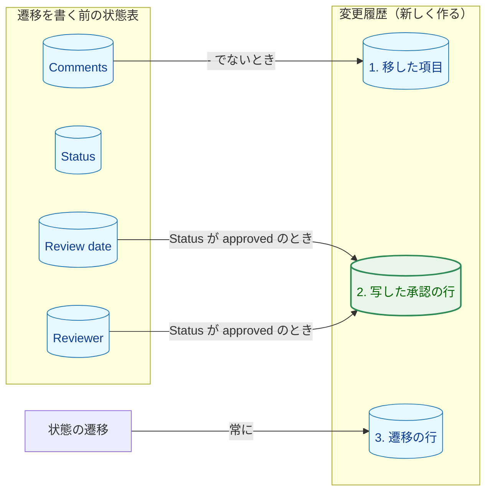
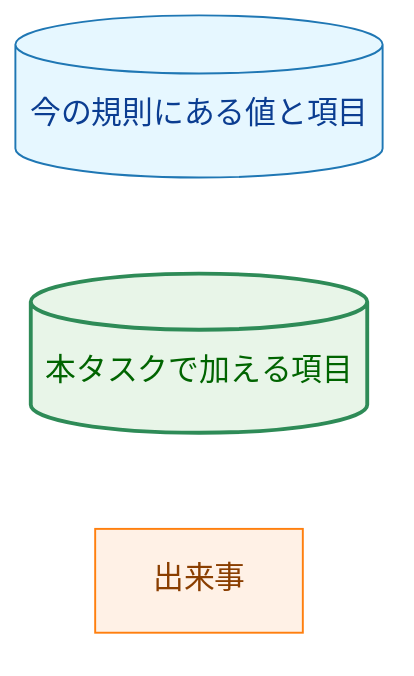
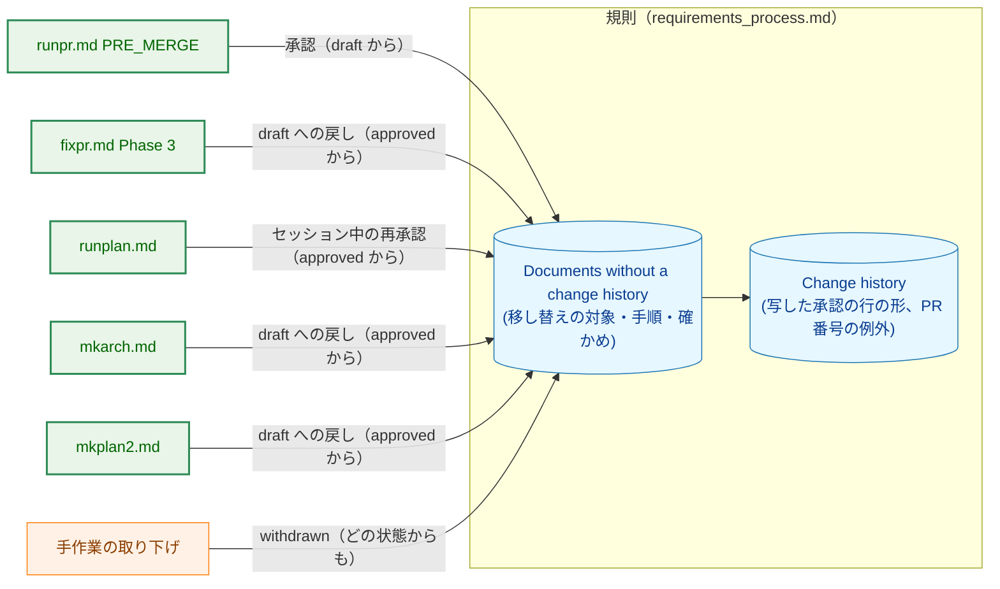
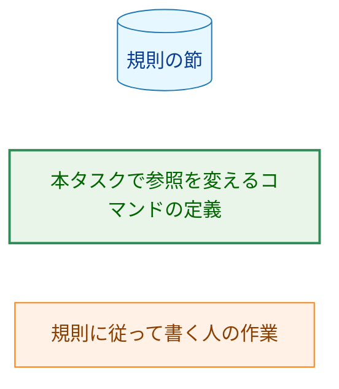
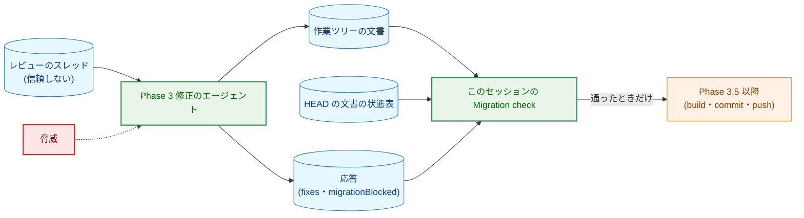
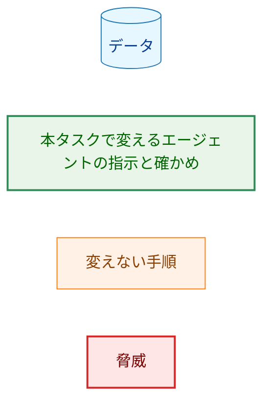
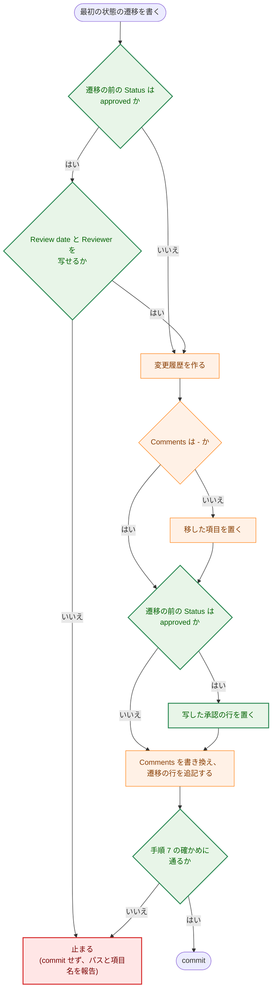
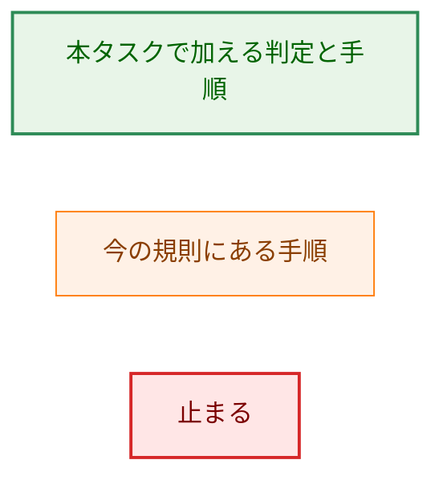
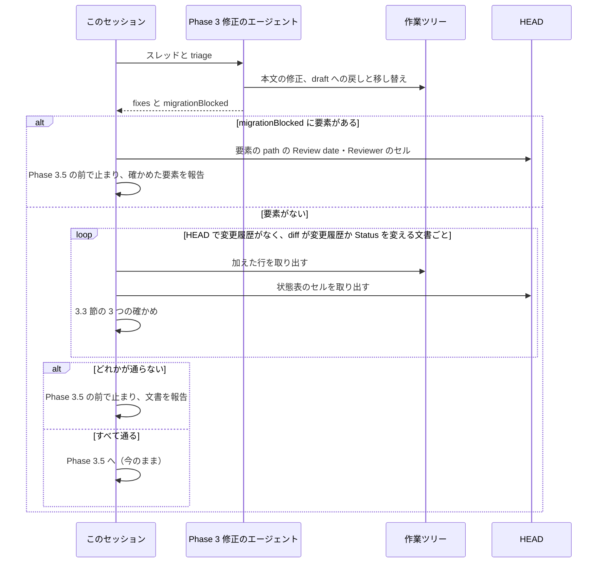

# 設計書：変更履歴のない承認済みのタスク文書に状態の遷移を書くとき、過去の承認を変更履歴に残す

## Document Status

| Item | Value |
|---|---|
| Status | `draft` |
| Created | 2026-11-02 |
| Review date | - |
| Reviewer | - |
| Comments | - |

本書は [01_requirements.md](01_requirements.md) の設計である。要件定義から申し送られた設計事項は [design_handoff.md](design_handoff.md) にあり、各項目への対応は 10 章にまとめる。本書が引用するファイルの行番号は、特に断らない限り、コミット `89b6b592`（本書の作成時の `main`）のものである。

本書の用語は要件 3 章の冒頭と 6 章に従う。「規則」は `docs/dev/conventions/requirements_process.md`、「対象のコマンドの定義」は要件 2.2 に挙げた 5 ファイル（`runpr.md`・`fixpr.md`・`runplan.md`・`mkarch.md`・`mkplan2.md`。どれも `.claude/commands/` の下）を指す。「状態の遷移」は、承認・`draft` への戻し・セッション中の再承認・`withdrawn` の 4 種類を指す。「変更履歴」は、コードブロックの外にある見出し行 `## 変更履歴` で始まる、文書の最後のセクションを指す（規則 141-145 行）。「写した承認の行」は、状態表の `Review date` と `Reviewer` の値から作る承認の行を指す（3.1 節）。

## 1. 設計の全体像 (Design Overview)

### 1.1. 設計原則

-   **規則は 1 か所で定め、コマンドの定義は参照するだけにする。** 移し替えの対象と手順、写した承認の行の形、写しの確かめ方は、規則の 1 つの節（3.2 節で改める「Documents without a change history」）と「Change history」にだけ書く。対象のコマンドの定義は、その節を名指しして参照し、コマンドに固有のこと（誰が確かめるか、止まったときに何を報告するか）だけを書く（AC-11）。
-   **値は写すだけで、直さない。写せなければ止まる。** 写した承認の行の日付と承認者は、状態表のセルの文をバイト列のまま写す。誤記と思われる値も直さない。値がないときは、推測で埋めたり行を省いたりせず、遷移を書かずに止まる（`CLAUDE.md`「Reject, don't normalize」、AC-06・AC-10）。
-   **写しは機械的に確かめる。** 旧 `Comments` の写しをすでに `cmp` で比べているのと同じく、写した承認の行も、commit の前に、遷移を書く前の文書（`HEAD`）の状態表と機械的に比べる（3.3 節）。LLM は `isesis` のような値を `isseis` に「直して」しまいうる。また `/fixpr` では、レビューのコメントを読んだエージェントが行を書く。
-   **既存の手順の流れは変えず、移し替えに 1 段を足す。** 移した項目を変更履歴の先頭に置く規則、`/runpr` の PRE_MERGE が `draft` の文書だけを承認すること、PR 番号の書き足しが `#未記入` だけを置き換えることは、どれも変えない。写した承認の行は、移した項目と遷移の行の間に入るだけである。

### 1.2. 概念モデル

図 1-1 は、変更履歴のない文書に最初の状態の遷移を書くとき、遷移を書く前の状態表のどの値が、変更履歴のどの項目になるかを示す。矢印 A → B は「A の値から B を作る」を表し、ラベルは B を作る条件を示す。変更履歴の中の項目は、上から変更履歴の並び順に並べてある（AC-08）。



**図 1-1 の凡例**



`Status` は、写した承認の行を作るかどうかの条件にだけ使い、値は写さない。`Status` が `approved` で `Review date` か `Reviewer` が写せないときは、変更履歴を作らずに止まる（3.2 節）。

### 1.3. 設計の際に決めたこと（2026-11-02）

-   **写した承認の行は `- <Review date> 承認（<Reviewer>、状態表から写した）` とする（H-01）:** 通常の承認の行（`- YYYY-MM-DD 承認（<承認者>、#<PR 番号>）`。規則 161 行）と同じ形にし、`#<PR 番号>` の位置にだけ印 `状態表から写した` を置く。文書を読む人が、どこから来た承認で、なぜ PR 番号がないのかを印から読めるためである。issue #621 の例の `旧規則` は短いが、何が旧規則なのかが読む人に伝わりにくい。
-   **節の見出しと用語を「変更履歴のない文書」に改める（H-02）:** 規則の「Documents written under the old rule」を「Documents without a change history」に改め、規則の中とコマンドの定義の参照もそろえる。対象を変更履歴のない文書に広げると、作ったばかりの `draft` の文書も対象に入り、「旧規則で書かれた文書」という呼び方と中身が合わなくなるためである。参照している箇所は、どれも AC-11 で読み直す範囲にあるので、改める手間は小さい。Go のテストはこの見出しを読んでいない（`git grep -n "old rule" -- '*_test.go'` で該当なし。コミット `89b6b592`）。移した項目の接頭辞 `旧規則の Comments：` は変えない。旧 `Comments` は実際に旧規則で書かれた文だからである。
-   **写した値は、`HEAD` の状態表と `cmp` で比べる（H-03）:** 規則の移し替えの手順の最後の確かめ（今は旧 `Comments` の `cmp` だけ。規則 219-223 行）に、写した承認の行の確かめを加える。比べる元は、`git diff` で消えた行ではなく、`HEAD` の文書の状態表のセルとする。セッション中の再承認と `withdrawn` では `Review date` と `Reviewer` の行が変わらず、diff に現れないためである。この確かめで、AC-10 で止まる場合（行がない、値が `-` か空）も検出する。
-   **写せずに止まるときは、作業ツリーに残す（H-04）:** 何も commit せず、変更を作業ツリーに残し、文書のパスと写せなかった項目の名前を報告する。今の `/fixpr` の移し替えの確かめが止まるときと同じ扱いである（`.claude/commands/fixpr.md:508-511`）。利用者は残った変更を見て、状態表を直すか変更を捨てるかを決められる。

## 2. システム構成 (System Structure)

### 2.1. 全体の構成

図 2-1 は、移し替えを行う手順と、それが参照する規則の節を示す。矢印 A → B は「手順 A が、規則の節 B に従って変更履歴を書く」を表し、ラベルは、手順が書く遷移と、その前の状態を示す。



**図 2-1 の凡例**



`MIG --> CH` は「移し替えの節が、行の形を Change history の節から取る」を表す。

写した承認の行を作りうるのは、`approved` の文書に遷移を書く手順だけである。

| 手順 | 書く遷移 | 遷移の前の状態 | 写した承認の行 |
|---|---|---|---|
| `runpr.md` PRE_MERGE | 承認 | `draft` だけ（`runpr.md:217-218`） | 作らない（AC-09） |
| `fixpr.md` Phase 3 | `draft` への戻し（連鎖した戻しを含む） | `approved` | 作る |
| `runplan.md` | セッション中の再承認 | `approved` | 作る |
| `mkarch.md` | `draft` への戻し | `approved` | 作る |
| `mkplan2.md` | `draft` への戻し | `approved` | 作る |
| 手作業の取り下げ | `withdrawn` | どれでも | `approved` からのときだけ作る |

### 2.2. コンポーネントの配置

| 置き場所 | 変更 | 内容 |
|---|---|---|
| `docs/dev/conventions/requirements_process.md` | 変更 | 「Change history」の行の表・例・PR 番号の例外・承認者（3.1 節）、「Documents written under the old rule」の節の見出しと対象・手順・確かめ（3.2 節、3.3 節）、規則の中の参照（32-33、41、46、144-145、198、267 行。3.2 節） |
| `.claude/commands/fixpr.md` | 変更 | Phase 3 の 4（458-475 行）の参照と止まるときの応答、応答の JSON（495-496 行）、Migration check（502-511 行）、最終報告の停止の名前（859 行、912 行）（3.4 節） |
| `.claude/commands/runpr.md` | 変更 | PRE_MERGE の承認の参照（223-225 行）（3.5 節） |
| `.claude/commands/runplan.md` | 変更 | 決定の変更の参照と止まるときの扱い（64 行）（3.5 節） |
| `.claude/commands/mkarch.md` | 変更 | 承認済みの文書を直すときの参照（72 行）（3.5 節） |
| `.claude/commands/mkplan2.md` | 変更 | 手順 8.5 の参照と、過去の承認を何が持つかの記述（107 行）（3.5 節） |
| `docs/tasks/0056_legacy_approval_history/_checks/task_docs_unchanged.sh` | 新規 | AC-12 の差分の確かめのスクリプト（7.3 節） |
| `.claude/commands/_lib/task-pr-handoff.md` | 変更なし | PR 本文の決定の変更は、`draft` への戻しとセッション中の再承認の行から作る（規則 260-263 行）。写した承認の行は承認の行なので、対象に入らない（3.6 節） |
| Go のコードとテスト | 変更なし | 変更履歴を読むコードはない。規則の見出しや移し替えの文言を読むテストもない（7.1 節） |

## 3. コンポーネント設計 (Component Design)

本タスクには Go の型やインタフェースの変更がない。この章では、規則に定める行の形と手順、`/fixpr` の応答の形を定める。

### 3.1. 写した承認の行の形（AC-06・AC-07、H-01）

規則の「Change history」に、次を加える。規則の本文は英語で、行の形と例は、タスク文書に書く日本語の値のままコードブロックに示す（今の規則と同じ書き方）。

-   **行の表（規則 159-165 行）:** 1 行を加える。

    | 遷移 | 行 |
    |---|---|
    | 状態表から写した承認（移し替えでだけ書く） | `- <Review date のセルの文> 承認（<Reviewer のセルの文>、状態表から写した）` |

-   **例（規則 169-178 行）:** 移した項目の次に `- 2026-10-20 承認（isseis、状態表から写した）` を加える。例は各形を示すもので、1 つの文書の並びではない、という今の注記は保つ。
-   **セルの文:** `Comments` と同じく、状態表の行の、先頭の `| Review date | `（または `| Reviewer | `）の後から、末尾の ` |` の前までのバイト列とする（規則 213-214 行と同じ定め方）。`|` で分割しない。バッククォートや `\|` があっても、変えずに写す。2026-11-02 時点の変更履歴のない承認済みの文書 156 件では、どのセルも `YYYY-MM-DD` の日付か、`isseis`・`isesis` のような名前だけであった（`docs/tasks/*/0[123]_*.md` のうち、`Status` が `approved` で `## 変更履歴` の行のない文書の 2 つの行を集計。コミット `89b6b592`）。
-   **承認者（規則 180-181 行）:** 今の規則は、承認者を `gh api user --jq .login` の値と定めている。写した承認の行はこの定めの例外で、`Reviewer` のセルの文をそのまま書く、と書き加える（AC-06）。
-   **PR 番号（規則 182-183 行）:** 「移した項目が唯一の例外」を「移した項目と写した承認の行の 2 つが例外」に改める。写した承認の行は、PR 番号も `#未記入` も持たない（AC-07）。
-   **写した承認の行の項目（新しい箇条）:** 「Migrated item」（規則 198-201 行）の次に置く。写した承認の行は移し替えでだけ書き、移した項目があればその直後、なければ変更履歴の先頭に置く。承認 1 件を 1 行で記録するので、1 件 1 行の規則には従う。

印 `状態表から写した` は `#` を含まないので、次の既存の手順の対象にならない。

-   `/runpr` の PRE_MERGE の PR 番号の書き足しは、この PR が加えた変更履歴の行の `#未記入` だけを置き換える（`.claude/commands/runpr.md:228-235`）。
-   PR 本文の決定の変更は、`draft` への戻しとセッション中の再承認の行から作る（規則 260-263 行）。写した承認の行は承認の行なので、決定の変更として PR 本文に挙がらない。

### 3.2. 移し替えの対象と手順（AC-01〜AC-05、AC-08〜AC-10、H-02）

規則の節「Documents written under the old rule」（規則 203-226 行）を、次のとおり改める。

-   **見出し:** `#### Documents without a change history`。
-   **対象:** 変更履歴のない文書（「Change history」の定義で変更履歴がない文書）。`Comments` が `-` かどうかは条件に含めない（AC-01）。この規則より前に書かれた文書は、`Comments` に訂正や過去の承認を持ち、状態表に直近の承認を持つ。どちらもそのままで正しい状態とみなす（要件 4.4）。
-   **手順:** この規則で最初の状態の遷移を書くコマンド（または人）は、次の順に行う。
    1. **写せるかを確かめる。** 遷移を書く前の `Status` が `approved` なら、状態表の `Review date` の行と `Reviewer` の行が、それぞれちょうど 1 行あり、セルの文が空・空白だけ・`-` のどれでもないことを確かめる。そうでなければ止まる（下の「止まるとき」）。
    2. 文書の最後に `## 変更履歴` を作る。
    3. `Comments` が `-` でなければ、旧 `Comments` のセルの文を、接頭辞 `旧規則の Comments：` を付けた項目として先頭に置く（今の手順 1 のまま）。`-` なら、移した項目は作らない（AC-02）。
    4. 遷移を書く前の `Status` が `approved` なら、写した承認の行（3.1 節）を置く（AC-05）。`draft` または `withdrawn` なら作らない（AC-09）。
    5. `Comments` を、遷移の後の状態の理由に書き換える（今の手順 2）。
    6. 遷移の行を追記する（今の手順 3）。
    7. commit の前に、写しを機械的に確かめる（3.3 節）。
-   **遷移を書く前の状態表:** 移し替えは、変更履歴を作るのと同じ commit で行う。そのため、遷移を書く前の状態表は `HEAD` の文書の状態表と同じである。手順 1 と手順 4 は作業ツリーの文書を見て行い、手順 7 は `HEAD` の文書で確かめる。同じ変更の中で 2 つ目の遷移を書くとき（たとえば `/runplan` が 1 つのフェーズのグループで 2 つの決定の変更を扱うとき）は、作業ツリーの文書に変更履歴がすでにあるので、移し替えを繰り返さない。
-   **止まるとき（AC-10）:** 遷移を書かず、その遷移を含む変更（決定の変更による本文の書き換えと、それに伴って `draft` に戻すほかの文書を含む）を、どの文書についても commit しない。変更は作業ツリーに残す。利用者には、文書のパスと、写せなかった項目の名前（`Review date`、`Reviewer`、または両方）を報告する。その後どう続けるかは利用者が決める（要件「要件定義の際に決めたこと」）。
-   **編集上の訂正:** 編集上の訂正だけを加えるときは移し替えを行わず、`Comments` と変更履歴を変えない（今の規則 225-226 行のまま。AC-03）。
-   **作ったばかりの `draft` の文書:** 変更履歴がなく `Comments` が `-` なので、`/runpr` の最初の承認では手順 3 と手順 4 がどちらも何もせず、変更履歴は承認の行 1 行だけになる（AC-04）。今の規則で `/runpr` が最初の承認のときに変更履歴を作るのと同じ結果である（規則 153-156 行）。

規則の中の次の参照を、新しい見出しと用語にそろえる（AC-11）。

| 規則の箇所 | 今の記述 | 変更後 |
|---|---|---|
| 32-33 行（決定の変更） | When the document was written under the old rule, migrate it first | 変更履歴のない文書なら、先に移し替える（節を参照） |
| 41 行（セッション中の再承認） | Migrate a document written under the old rule first | 同上 |
| 46 行（編集上の訂正） | a document written under the old rule is not migrated | 変更履歴のない文書も、編集上の訂正では移し替えない |
| 144-145 行（変更履歴の定義） | the definition of a document written under the old rule ... follow this definition | 変更履歴のない文書の判定も、この定義に従う |
| 198 行（Migrated item） | the old `Comments` of a document written under the old rule | 変更履歴のない文書の旧 `Comments`（`-` でないとき） |
| 267 行（取り下げ） | migrating a document written under the old rule first | 変更履歴のない文書なら先に移し替える |

### 3.3. 写しの機械的な確かめ（H-03）

規則の移し替えの手順 7 に、次の 3 つの確かめを定める。どれも commit の前に、文書を `git diff` と `git show HEAD:<path>` から取り出したファイルで行い、写す文を会話に読み込まない（今の `/fixpr` の確かめと同じ。`fixpr.md:504-507`）。1 つでも通らなければ commit しない。

| 確かめ | 条件 | 内容 |
|---|---|---|
| 旧 `Comments` の写し | 移した項目を加えたとき | 今のまま。消えた `Comments` の行のセルの文と、加えた項目の文を `cmp` で比べる（規則 219-223 行） |
| 写した承認の行の写し | `HEAD` の文書が `approved` のとき | `HEAD` の文書の状態表から `Review date` と `Reviewer` のセルの文を取り出す。どちらかの行が 1 行でない、またはセルの文が空・空白だけ・`-` なら、通らない（AC-10 の検出を兼ねる）。2 つのセルの文から期待する行を組み立て、`git diff` が加えた行のうち `、状態表から写した）` で終わる行と `cmp` で比べる。その行がちょうど 1 行あり、加えた変更履歴の中で、移した項目の直後（移した項目がなければ先頭）にあることも確かめる（AC-08） |
| 写した承認の行がないこと | `HEAD` の文書が `approved` でない、または `HEAD` にないとき | `git diff` が `、状態表から写した）` で終わる行を加えていない（AC-09） |

-   **確かめを行う人:** 移し替えを行うコマンドの、commit を作る側が行う。`/runplan`・`/mkarch`・`/mkplan2`・手作業の取り下げでは、書いたエージェント（または人）自身が行う。`/fixpr` では、行を書くのは修正のサブエージェントで、確かめはこのセッションが行う（3.4 節）。`/runpr` の PRE_MERGE は `draft` の文書だけを扱うので、3 つ目の確かめだけが当てはまる。
-   **規則に書く具体さ:** 規則には、何をどこから取り出して何と比べるかを書く。今の手順 4（規則 219-223 行）と同じく、コマンドの列そのものは規則に書かない。実装計画で、規則の記述どおりに確かめられることを、既存の承認済みの文書の写し（scratchpad に置き、commit しない）で一度試す（7.2 節）。

### 3.4. `/fixpr` の Phase 3（H-04）

`/fixpr` では、文書を書き換えるのは Phase 3 の修正のサブエージェントで、移し替えの確かめは本体のセッションが行う（`fixpr.md:458-475`、`fixpr.md:502-511`）。値を写せないときに、サブエージェントが遷移を書かずに黙って終わると、セッションの確かめは変更履歴が加わっていないので働かず、`draft` に戻していない決定の変更が commit される。そこで、サブエージェントが写せなかったことを応答で知らせ、セッションが止まる。

-   **サブエージェントへの指示（Phase 3 の 4。`fixpr.md:469-472`）:** 参照を新しい節の名前に改める。節の手順 1 で止まる場合は、その文書の遷移を書かず、応答の `migrationBlocked` に挙げる、と書き加える。
-   **応答の形（`fixpr.md:495-496`）:** 最上位に `migrationBlocked` を加える。写せなかった文書がなければ空の配列を返す。

    ```json
    {
      "fixes": [{"threadId": "...", "applied": true, "replyBody": "...", "editorial": []}],
      "migrationBlocked": [{"path": "docs/tasks/NNNN_x/02_architecture.md", "item": "Reviewer"}]
    }
    ```

    `item` は `Review date` か `Reviewer` のどちらかである。両方を写せないときは、文書ごとに 2 つの要素を返す。
-   **Migration check（`fixpr.md:502-511`）:** 対象を、「`- 旧規則の Comments：` の項目を加える文書」から、「`HEAD` で変更履歴がなく、作業ツリーの diff が `## 変更履歴` の見出しの行を加えるか、`Status` の行を変える文書」に改める。`Comments` が `-` の文書では、写した承認の行だけが加わり、移した項目は加わらないためである。対象の文書ごとに、3.3 節の 3 つの確かめを行う。
-   **止まるとき:** `migrationBlocked` に要素が 1 つでもあるとき、または確かめが 1 つでも通らないとき、今の Migration check と同じく Phase 3.5 の前で止まる。build checks、commit、push、返信、resolve のどれも行わず、修正を作業ツリーに残し、次の `/fixpr` は `dirty-work-tree` で止まる。
-   **報告:** `migrationBlocked` の要素は、修正のエージェントが書いたデータとして扱う（`fixpr.md:498-500` の R6 の扱いと同じ）。セッションは、`path` がタスク文書（`docs/tasks/*/0[123]_*.md`）の形で、`item` が 2 つの値のどちらかである要素だけを、`HEAD` の文書のセルで写せないことを確かめてから、パスと項目名で報告する。それ以外の要素（形が違う、または `HEAD` のセルは写せる）は、内容を示さず「修正のエージェントが写せないと報告したが、確かめられなかった」とだけ報告する。どちらの場合も止まる。サブエージェントが必要と判断した遷移を書いていない以上、そのまま commit してはならないためである。
-   **最終報告:** 1 の要約の行の停止の名前「stopped: the migration byte comparison differed」（`fixpr.md:859`）を、「stopped: the migration check failed」に改め、「stopped: a past approval could not be copied」を加える。7 の、作業ツリーに変更を残す停止の一覧（`fixpr.md:910-913`）の「the Phase 3 migration check」に、写せなかった場合も含める。

### 3.5. ほかのコマンドの定義の変更（AC-10・AC-11）

| ファイル | 今の記述 | 変更後 |
|---|---|---|
| `runpr.md:223-225`（PRE_MERGE の承認） | for a document written under the old rule, first migrate it as its "Documents written under the old rule" says | 変更履歴のない文書なら、先に新しい節のとおりに移し替える。PRE_MERGE が承認するのは `draft` の文書だけ（`runpr.md:217-218`）なので、写した承認の行は作らず、写せずに止まる場合もない。止まる場合の記述は加えない（H-04） |
| `runplan.md:64`（決定の変更） | migrate a document written under the old rule first, as its "Documents written under the old rule" says | 変更履歴のない文書なら、先に新しい節のとおりに移し替える。節の手順で止まるときは、そのフェーズのグループの変更を commit せず、作業ツリーに残して報告する、と書き加える |
| `mkarch.md:72`（承認済みの文書を直すとき） | migrating a document written under the old rule first ("Documents written under the old rule") | 変更履歴のない文書なら先に移し替える（新しい節）。止まるときは commit せず、報告する、と書き加える |
| `mkplan2.md:107`（手順 8.5） | the past approval stays in the change history (for a plan written under the old rule, migrate it first, ..., so the migrated item keeps it) | 過去の承認は変更履歴に残る（変更履歴のない計画書なら先に新しい節のとおりに移し替え、写した承認の行がそれを持つ）。止まるときは commit せず、報告する、と書き加える |

`mkplan2.md:107` の「移した項目が過去の承認を持つ」は、今の規則でも `Comments` に承認の経緯がない文書には当てはまらない。写した承認の行が過去の承認を持つように改める。

各コマンドの定義には、止まる条件と報告の中身（パスと項目名）を書かず、規則の節を参照する（AC-11）。コマンドの定義に書くのは、そのコマンドで「止まる」が何を意味するか（何を commit しないか、何を残すか）だけである。

### 3.6. 変えないもの

-   **移した項目の位置と形:** 変更履歴の先頭、接頭辞 `旧規則の Comments：`（規則 198-201 行）のまま。
-   **`/runpr` の PR 番号の書き足し:** `#未記入` だけを置き換える（`runpr.md:228-235`）。写した承認の行は印を持たないので影響しない（3.1 節）。
-   **PR 本文の決定の変更:** `task-pr-handoff.md` Part B 手順 3 と規則 260-263 行のまま。
-   **既存のタスク文書:** 本タスクの PR では変えない（AC-12、7.3 節）。0053 の文書の「旧規則で書かれた文書」という記述も残る。0053 の文書は、その時点の規則の記録として読む。

## 4. エラーハンドリング設計 (Error Handling Design)

新しいエラーの型はない。止まる場合と、それぞれの報告を次に定める。

| 場合 | 検出する人 | 振る舞い | 報告 |
|---|---|---|---|
| `approved` の文書で、`Review date` か `Reviewer` の行が 1 行でない、またはセルの文が空・空白だけ・`-` | 移し替えを行う人（手順 1）。見落としても手順 7 の確かめが検出する | 遷移を書かず、何も commit せず、作業ツリーに残す | 文書のパスと項目名 |
| 写した承認の行が `HEAD` のセルと一致しない、ないか 2 行以上ある、位置が違う | 手順 7 の確かめ | 何も commit せず、作業ツリーに残す | 文書のパスと、通らなかった確かめ |
| `approved` でない文書に写した承認の行を加えた | 手順 7 の確かめ | 同上 | 同上 |
| `/fixpr` の修正のエージェントが `migrationBlocked` を返した | このセッション | Phase 3.5 の前で止まる（3.4 節） | 確かめられた要素はパスと項目名、確かめられなかった要素はその旨だけ |

-   **回復:** 状態表をどう直すかは本タスクでは定めない（要件「要件定義の際に決めたこと」）。作業ツリーに残した変更を、利用者が見て直すか捨てる。`/fixpr` では、次の `/fixpr` が `dirty-work-tree` で止まるので、残った変更が黙って次の回に混ざることはない（`fixpr.md:910-913`）。
-   **今は止まる文書がない:** 2026-11-02 時点の変更履歴のない承認済みの文書 156 件は、どれも 2 つのセルに値を持つ（3.1 節の集計）。この停止は、将来、状態表を手で壊した場合のための守りである。
-   **受け入れる危険:** 確かめは規則の手順であり、ツールが強制するものではない。手作業の取り下げで人が手順 7 を省くと、写しの誤りは PR のレビューでしか見つからない。0053 の旧 `Comments` の確かめと同じ扱いである。また、`Reviewer` のセルの文に `#未記入` という文字列が含まれていると、PRE_MERGE の PR 番号の書き足しがそれを書き換えうる。今の 156 件にそのような値はなく、`Reviewer` は名前を書く欄なので、対策は加えない。

## 5. セキュリティ考慮事項 (Security Considerations)

条件付きのガイド（`docs/dev/security.md`）の適用条件には当たらない（要件 4.2）。写す値はリポジトリの中のタスク文書の状態表の値で、それを解析するコードも加えない。

信頼の境界に触れるのは `/fixpr` だけである。修正のサブエージェントはレビューのコメント（信頼しない）を読んでから文書を書き換えるので、写した承認の行に状態表と異なる値を書くことも、`migrationBlocked` に偽りの要素を返すこともありうる。図 5-1 の矢印 A → B は「A の内容が B に渡る」を、破線は「脅威が働きかける先」を表す。



**図 5-1 の凡例**



-   **写しの誤り:** セッションは、写した承認の行を、修正のエージェントが触れない `HEAD` の状態表と比べる（3.3 節）。一致しなければ commit しない。
-   **偽りの `migrationBlocked`:** 要素があれば必ず止まるので、偽りの要素で起こせるのは停止だけである。セッションは要素の `path` と `item` を形で確かめてから報告に使い、それ以外の文を報告に出さない。要素に書かれた文に従うこともない（R6）。
-   **要素を返さずに遷移を省く:** 修正のエージェントが、写せないことを報告せずに遷移そのものを書かない場合は、Migration check の対象（変更履歴か `Status` の行が変わる文書）に入らない。これは、修正のエージェントが決定の変更を `draft` に戻さない場合と同じで、本タスクの前からある危険である。PR のレビューと、`/runpr` の手順 4 の問いで変更を確かめる今の運用に任せる。
-   **GitHub への投稿:** 新しく GitHub に投稿する文はない。止まったときの報告は利用者の端末にだけ出る。メンションの確かめ（`_context.md`「PR review request」）に変更はない。

## 6. 処理フローの詳細 (Processing Flow Details)

### 6.1. 移し替え

図 6-1 は、変更履歴のない文書に最初の状態の遷移を書くときの流れを示す。矢印 A → B は「A の次に B を行う」を表す。



**図 6-1 の凡例**



手順 7 の確かめに通らずに止まるときは、パスと項目名の代わりに、通らなかった確かめを報告する（4 章）。

### 6.2. `/fixpr` の Phase 3



この図の参加者は色分けしない。実線の矢印 A → B は「A が B に渡す、または B から取り出す」を、破線の矢印は応答を表す。止まるときは、修正を作業ツリーに残す。

## 7. テスト戦略 (Test Strategy)

### 7.1. 単体テスト

-   本タスクは Go のコードを変えないので、単体テストは加えない。
-   既存のテストで、本タスクの変更によって直すものはない。規則の見出し「Documents written under the old rule」、`fixpr.md` の Migration check と停止の名前、応答の JSON の形を読むテストはない（`git grep -n -e "old rule" -e "Migration check" -e "migration byte" -e '"fixes"' -- '*_test.go'` で該当なし。コミット `89b6b592`）。
-   規則とコマンドの定義の文言を照合する恒久のテストは加えない（`CLAUDE.md`「Document tests check values, structure, and executable examples, never prose」）。写した承認の行の印 `状態表から写した` は、規則と `fixpr.md` の確かめの記述の 2 か所に現れうる。食い違ったときは確かめが通らずに止まるだけで、誤った記録は commit されないので、照合のテストは加えない。
-   本タスクの後も、`make test` と CI の `doc-guard` が通ることを確かめる（要件 4.3）。

### 7.2. 統合テスト

コマンドを実行した結果は、要件 2.3 のとおり本タスクの後の PR で分かる。ただし、規則に書く確かめ（3.3 節）が記述どおりに行えることは、実装の PR で一度試す。`origin/main` の変更履歴のない承認済みの文書を 1 つ scratchpad の一時的なリポジトリに写し、`draft` への戻しを規則どおりに書いて、3 つの確かめが通ること、`Reviewer` を 1 文字変えると通らないこと、`Reviewer` を `-` にすると手順 1 で止まることを確かめる。結果は実装計画書の確かめの行に記録し、commit はしない。

### 7.3. 差分の確かめ（`_checks/`、AC-12）

AC-12（本タスクの PR が `docs/tasks/` 以下の既存のタスク文書を変えない）は変更の前後の関係なので、`docs/tasks/0056_legacy_approval_history/_checks/task_docs_unchanged.sh` に、マージベースと PR の head を比べるスクリプトを置く。0053 のスクリプト（`docs/tasks/0053_status_comments_policy/_checks/task_docs_unchanged.sh`）と同じ確かめを、対象のディレクトリだけを変えて行う。0053 のスクリプトを引数で汎用にする案は、0053 のディレクトリを変えることになり、AC-12 に反するので採らない。実装の PR のブランチで一度実行し、出力と両方のコミット ID を実装計画書の確かめの行に記録する（規則 §4）。

### 7.4. セキュリティのテスト

7.2 節の試行のうち、`Reviewer` を変えると確かめが通らないことが、`/fixpr` の修正のエージェントが誤った値を書く脅威（5 章）への守りの確かめに当たる。`migrationBlocked` の扱いは手順の文言なので、PR のレビューで読んで確かめる。

### 7.5. 受け入れ基準の確かめの方法（H-06）

| 受け入れ基準 | 方法 |
|---|---|
| AC-01〜AC-11 | `manual`（PR のレビューで規則とコマンドの定義を読む）。AC-05〜AC-10 は、7.2 節の試行の結果も添える |
| AC-12 | `diff`（7.3 節） |

## 8. 実装の優先順位 (Implementation Priorities)

| フェーズ | 内容 | 理由 |
|---|---|---|
| 1 | 規則（`requirements_process.md`）の「Change history」と、改めた節 | コマンドの定義が参照する形と手順を先に定める |
| 2 | 対象のコマンドの定義（`fixpr.md`・`runpr.md`・`runplan.md`・`mkarch.md`・`mkplan2.md`） | 規則の新しい節の名前を参照する |
| 3 | 7.2 節の試行と、AC-12 の差分の確かめ | PR のブランチで一度ずつ行う |

-   **PR の分け方:** フェーズ 1〜3 は 1 つの PR にまとめる。規則だけが先に `main` に入ると、コマンドの定義が存在しない見出し「Documents written under the old rule」を参照する期間ができるためである。
-   **移行の注意:** ツールの再インストールは要らない（Go のコードを変えない）。本タスクのマージの前に書かれた変更履歴（0053 の規則で移し替えた文書）はそのまま正しい。変更履歴がすでにあるので、新しい規則でも移し替えの対象にならない（要件 4.4）。

## 9. 将来の拡張 (Future Extensibility)

-   **既存の文書への一括の適用:** 要件 2.3 のとおり、本タスクでは既存の文書に写した承認の行を書き足さない。3.2 節の手順は 1 文書ずつ機械的に行えるので、後で一括して行うタスクを起こすときも同じ手順と確かめを使える。
-   **確かめのツール化:** 3.3 節の確かめは、今は規則の手順として各コマンドが行う。移し替えの誤りが実際に起きるようなら、`fixprguard` のような道具に確かめを移し、ツールで強制できる。今は、写す値が短く、止まる文書もないので、手順で足りる。

## 10. 設計への申し送りへの対応 (Design Handoff)

| 項目 | 対応 |
|---|---|
| H-01 写した承認の行の書式と印の文言 | `- <Review date のセルの文> 承認（<Reviewer のセルの文>、状態表から写した）`。通常の承認の行と同じ形で、`#<PR 番号>` の位置に印を置く。セルの文は `Comments` と同じ定め方で、バイト列を変えずに写す。印は `#` を含まないので、`/runpr` の PR 番号の書き足しの対象にならない。規則の行の表・例・PR 番号の例外・承認者の定めに加える（1.3 節、3.1 節） |
| H-02 用語と節の見出しの扱い | 見出しを「Documents without a change history」に改め、規則の中の参照（32-33、41、46、144-145、198、267 行）と対象のコマンドの定義の参照（`runpr.md:223-225`、`fixpr.md:469-470`・`505`、`runplan.md:64`、`mkarch.md:72`、`mkplan2.md:107`）をそろえる。接頭辞 `旧規則の Comments：` は残す（1.3 節、3.2 節、3.5 節） |
| H-03 写した値を機械的に確かめるかどうかと、その方法 | 確かめる。規則の手順 7 に、`HEAD` の状態表のセルから期待する行を組み立てて `cmp` で比べる確かめ、行の数と位置の確かめ、`approved` でない文書に写した承認の行がないことの確かめを加える。`/fixpr` の確かめの対象は、`HEAD` で変更履歴がなく、diff が変更履歴の見出しか `Status` の行を変える文書に改める。エージェント自身が書く経路（`/runplan`・`/mkarch`・`/mkplan2`・手作業の取り下げ）も、規則の手順として同じ確かめを行う（1.3 節、3.3 節、3.4 節） |
| H-04 止まるときの報告の経路 | `/fixpr` では、修正のサブエージェントが遷移を書かずに `migrationBlocked` で知らせ、セッションが `HEAD` のセルで確かめてから、今の Migration check と同じく Phase 3.5 の前で止まる。作業ツリーに残し、パスと項目名を報告する。最終報告の停止の名前を改める。`/runpr` の PRE_MERGE は `draft` の文書だけを扱い（`runpr.md:217-218`）、写した承認の行を作らないので、止まる場合の記述は加えない（3.4 節、3.5 節、4 章） |
| H-05 中断の後の再実行 | 移し替えは変更履歴を作るのと同じ commit で行い、確かめは commit の前に行う。そのため `HEAD` の文書は、変更履歴がまったくないか、移し替えを終えた変更履歴を持つかのどちらかで、変更履歴だけがあって写した承認の行が抜けた状態は commit されない。commit の前に中断した変更は作業ツリーに残り、`/runplan`・`/mkarch`・`/mkplan2` は作業ツリーが clean でなければ始めず（`.claude/commands/_lib/task-pr-handoff.md:78-79`、Part A 手順 1）、`/fixpr` は `dirty-work-tree` で止まるので、途中の状態の上で移し替えをやり直すことはない。二重に書かない判定は、`/runpr` の PRE_MERGE では今のまま（`draft` の文書だけを承認し、承認の行を状態と同じ commit で書く。`runpr.md:209-216`）で、写した承認の行は PRE_MERGE では作らない（3.2 節） |
| H-06 確かめの方法 | AC-01〜AC-11 は `manual`、AC-12 は `_checks/` の `diff`。規則に書く確かめが記述どおりに行えることは、実装の PR で scratchpad の写しで一度試す。文書の文言を照合する恒久のテストは加えない（7 章） |

## 11. 受け入れ基準と設計の対応 (AC Traceability)

| 受け入れ基準 | 設計 |
|---|---|
| AC-01 | 3.2 節（対象を変更履歴のない文書に改める） |
| AC-02 | 3.2 節（手順 3） |
| AC-03 | 3.2 節（編集上の訂正） |
| AC-04 | 3.2 節（作ったばかりの `draft` の文書）、2.1 節の表 |
| AC-05 | 3.2 節（手順 4、遷移を書く前の状態表）、2.1 節の表 |
| AC-06 | 3.1 節（行の形、セルの文、承認者） |
| AC-07 | 3.1 節（PR 番号の例外、印に `#` を含めない） |
| AC-08 | 3.1 節（写した承認の行の項目）、3.2 節（手順 3〜6）、3.3 節（位置の確かめ） |
| AC-09 | 3.2 節（手順 4）、3.3 節（写した承認の行がないことの確かめ）、3.5 節（`runpr.md`） |
| AC-10 | 3.2 節（手順 1、止まるとき）、3.3 節、3.4 節（`/fixpr`）、3.5 節（`runplan.md`・`mkarch.md`・`mkplan2.md`）、4 章 |
| AC-11 | 3.2 節（規則の中の参照）、3.5 節・3.4 節（コマンドの定義の参照）、1.1 節 |
| AC-12 | 7.3 節 |
