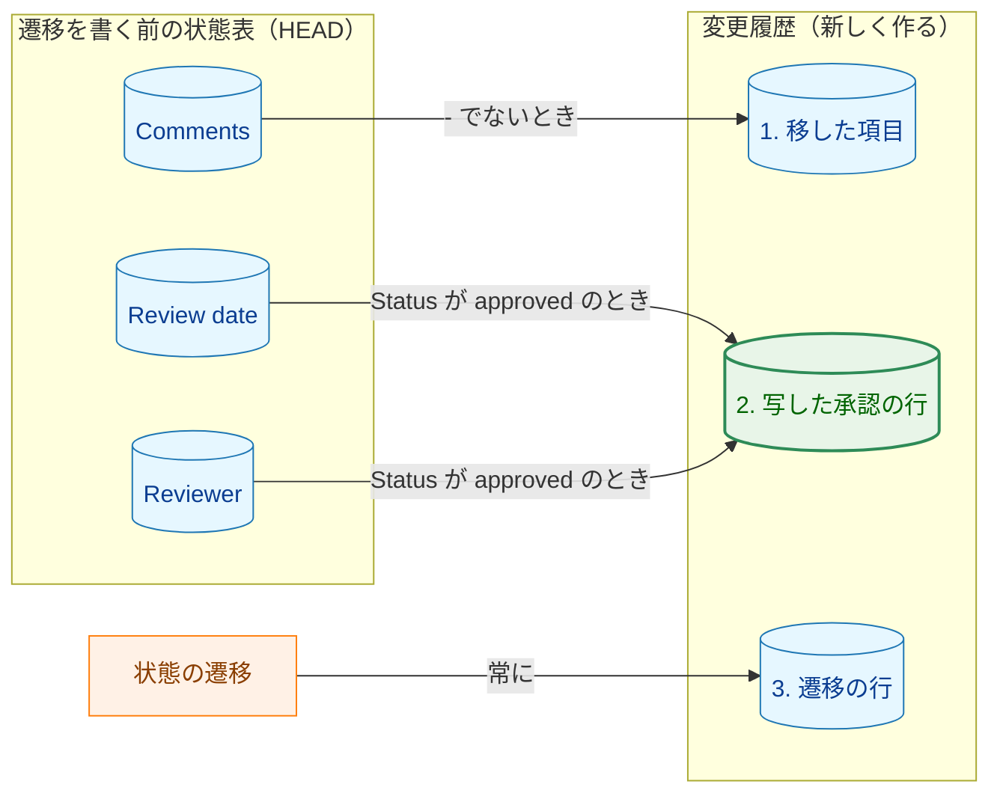
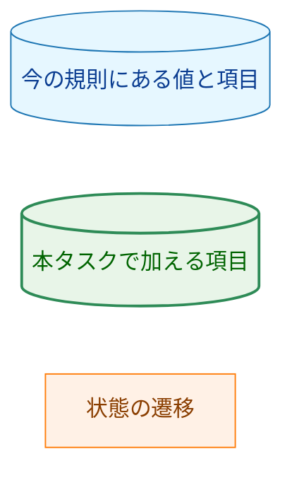
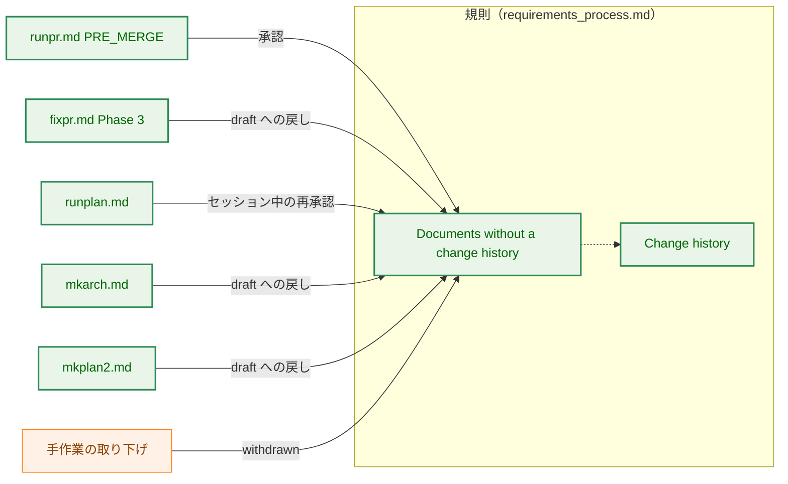
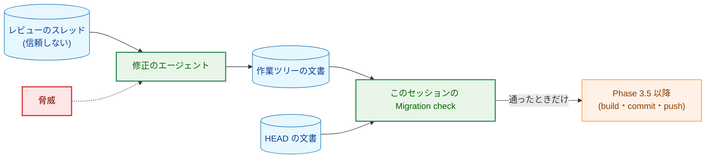
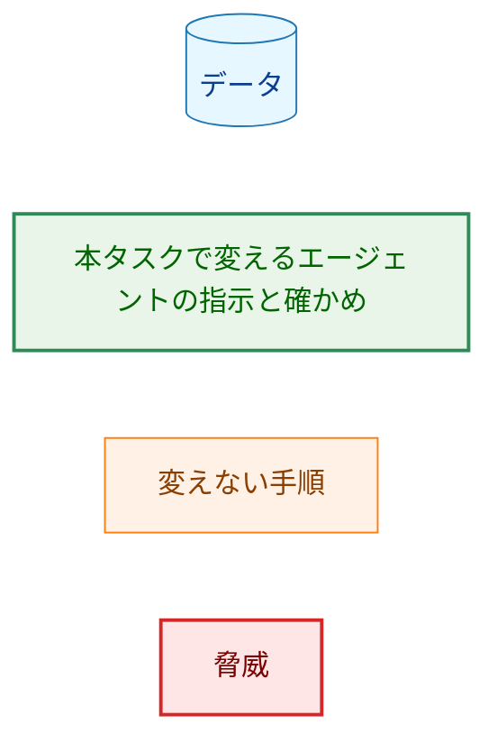
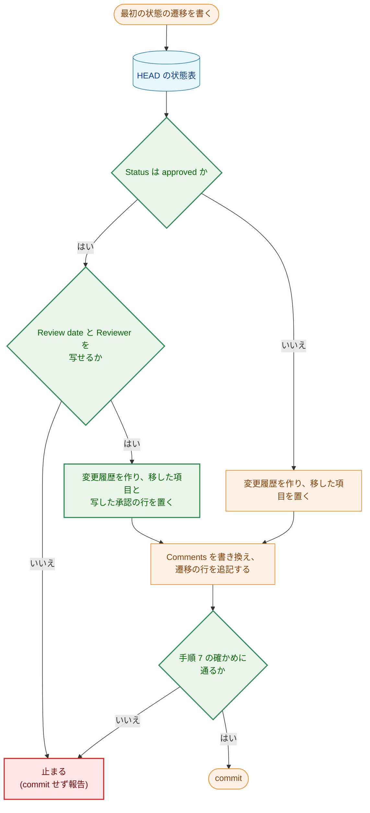
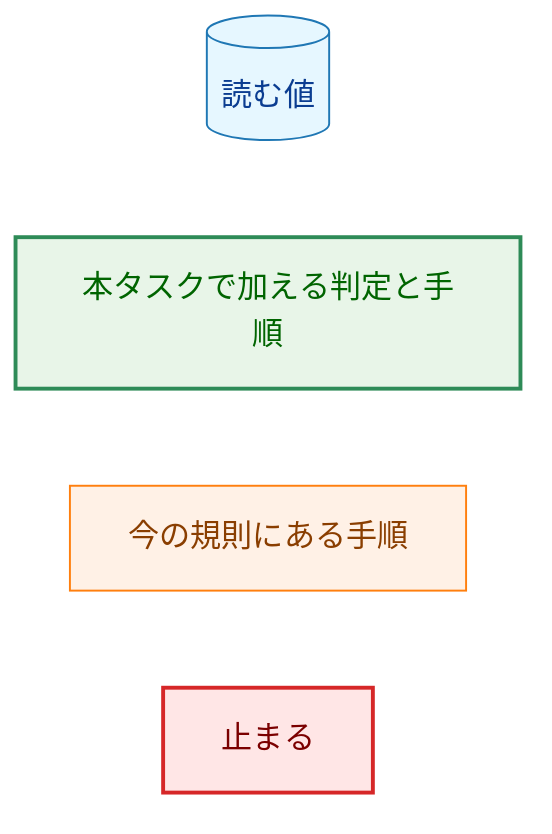
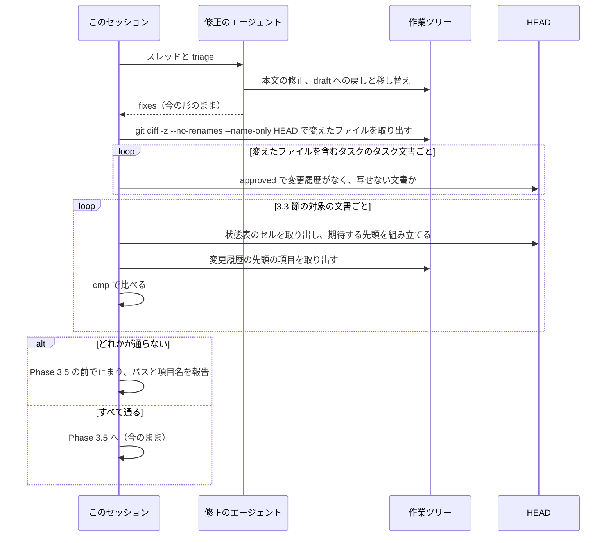

# 設計書：変更履歴のない承認済みのタスク文書に状態の遷移を書くとき、過去の承認を変更履歴に残す

## Document Status

| Item | Value |
|---|---|
| Status | `approved` |
| Created | 2026-11-02 |
| Review date | 2026-11-02 |
| Reviewer | isseis |
| Comments | - |

本書は [01_requirements.md](01_requirements.md) の設計である。要件定義から申し送られた設計事項は [design_handoff.md](design_handoff.md) にあり、各項目への対応は 10 章にまとめる。本書が引用するファイルの行番号は、特に断らない限り、コミット `89b6b592`（本書の作成時の `main`）のものである。

本書の用語は要件 3 章の冒頭と 6 章に従う。「規則」は `docs/dev/conventions/requirements_process.md`、「対象のコマンドの定義」は要件 2.2 に挙げた 5 ファイル（`runpr.md`・`fixpr.md`・`runplan.md`・`mkarch.md`・`mkplan2.md`。どれも `.claude/commands/` の下）を指す。「状態の遷移」は、承認・`draft` への戻し・セッション中の再承認・`withdrawn` の 4 種類を指す。「変更履歴」は、コードブロックの外にある見出し行 `## 変更履歴` で始まる、文書の最後のセクションを指す（規則 141-145 行）。そのほか、本書では次の用語を使う。

-   **写した承認の行:** 状態表の `Review date` と `Reviewer` の値から作る承認の行（3.1 節）。
-   **状態表:** 文書の `## Document Status` の見出しの後の、コードブロックの外にある最初の表。
-   **手順 7 の確かめ:** 移し替えの最後に、commit の前に行う機械的な確かめ（3.3 節）。
-   **修正のエージェント:** `/fixpr` の Phase 3 で文書を書き換えるサブエージェント。**このセッション**は、それを呼び出す `/fixpr` の本体のセッションを指す。

## 1. 設計の全体像 (Design Overview)

### 1.1. 設計原則

-   **規則は規則の中で 1 か所に定め、コマンドの定義は参照するだけにする。** 規則の中でも、項目ごとに書く節を 1 つに決める。行の形、PR 番号の例外、変更履歴の中の位置は「Change history」に書く。移し替えの対象、手順、手順 7 の確かめは、改める節「Documents without a change history」に書く。変更履歴の中の位置は、その節から「Change history」を参照させる。対象のコマンドの定義は規則の節を明示して参照し、そのコマンドで「止まる」が何を意味するかだけを書く（AC-11）。
-   **値は写すだけで、直さない。写せなければ止まる。** 写した承認の行の日付と承認者は、状態表のセルの文をバイト列のまま写す。誤記と思われる値も直さない。値がないときは、推測で埋めたり行を省いたりせず、遷移を書かずに止まる（`CLAUDE.md`「Reject, don't normalize」、AC-06・AC-10）。
-   **書く側と確かめる側が、同じ入力を読む。** 遷移を書く前の状態表は、`HEAD` の文書の状態表とする。移し替えの手順も手順 7 の確かめも、`HEAD` から読む。作業ツリーの状態表は、遷移を書く途中で書き換わりうるためである（3.2 節）。
-   **写しは機械的に確かめる。** 手順 7 の確かめは、`HEAD` の状態表から変更履歴の先頭に来るべき項目を組み立て、作業ツリーの変更履歴の先頭と `cmp` で比べる（3.3 節）。LLM は `isesis` のような値を `isseis` に「直して」しまうことがある。また `/fixpr` では、レビューのコメントを読んだエージェントが行を書く。
-   **既存の手順の流れは変えず、移し替えに 1 段を足す。** 移した項目を変更履歴の先頭に置く規則、`/runpr` の PRE_MERGE が `draft` の文書だけを承認すること、PR 番号の書き足しが `#未記入` だけを置き換えることは、どれも変えない。写した承認の行は、移した項目と遷移の行の間に入るだけである。

### 1.2. 概念モデル

図 1-1 は、変更履歴のない文書に最初の状態の遷移を書くとき、遷移を書く前の状態表のどの値が、変更履歴のどの項目になるかを示す。矢印 A → B は「A の値から B を作る」を表し、ラベルは B を作る条件を示す。変更履歴の中の項目は、上から変更履歴の並び順に並べてある（AC-08）。

**図 1-1 の凡例**

状態表の `Status` は、写した承認の行を作るかどうかの条件（矢印のラベル）にだけ使い、値は写さない。`Status` が `approved` で `Review date` か `Reviewer` を写せないときは、変更履歴を作らずに止まる（3.2 節）。

### 1.3. 設計の際に決めたこと（2026-11-02）

-   **写した承認の行は `- <Review date> 承認（<Reviewer>、状態表から写した）` とする（H-01）:** 通常の承認の行（`- YYYY-MM-DD 承認（<承認者>、#<PR 番号>）`。規則 161 行）と同じ形にし、`#<PR 番号>` の位置にだけ印 `状態表から写した` を置く。文書を読む人が、どこから来た承認で、なぜ PR 番号がないのかを印から読めるためである。issue #621 の例の `旧規則` は短いが、何が旧規則なのかが読む人に伝わりにくい。
-   **節の見出しと用語を「変更履歴のない文書」に改める（H-02）:** 規則の「Documents written under the old rule」を「Documents without a change history」に改め、規則の中とコマンドの定義の参照もそろえる。対象を変更履歴のない文書に広げると、作ったばかりの `draft` の文書も対象に入り、「旧規則で書かれた文書」という呼び方と中身が合わなくなるためである。参照している箇所は、どれも AC-11 で読み直す範囲にあるので、改める手間は小さい。Go のテストはこの見出しを読んでいない（7.1 節）。移した項目の接頭辞 `旧規則の Comments：` は変えない。旧 `Comments` は実際に旧規則で書かれた文だからである。
-   **写した値は、`HEAD` の状態表から組み立てた行と `cmp` で比べる（H-03）:** 今の規則の確かめ（旧 `Comments` の `cmp`。規則 219-223 行）を、変更履歴の先頭の項目をまとめて比べる確かめに広げる（3.3 節）。比べる元は、`git diff` で消えた行ではなく、`HEAD` の文書の状態表のセルとする。セッション中の再承認と `withdrawn` では `Review date` と `Reviewer` の行が変わらず、diff に現れないためである。この確かめで、AC-10 で止まる場合（行がない、値が `-` か空）も検出する。
-   **写せずに止まるときは、作業ツリーに残す（H-04）:** 何も commit せず、変更を作業ツリーに残し、文書のパスと写せなかった項目の名前を報告する。今の `/fixpr` の移し替えの確かめが止まるときと同じ扱いである（`.claude/commands/fixpr.md:508-511`）。利用者は残った変更を見て、状態表を直すか変更を捨てるかを決められる。

### 1.4. 実装の際に決めたこと（2026-11-02）

-   **手順 1 で、`Status` と `Comments` の行も確かめる:** 手順 1 は、`Status` が `approved` のときの `Review date` と `Reviewer` に加えて、状態にかかわらず、遷移を書く前の状態表から `Status` と `Comments` のセルの文を取れること（行がちょうど 1 行あり、末尾が ` |` で終わること）、`Comments` のセルの文が空でも空白だけでもなく、`-` でなければ `#未記入` を含まないことを確かめ、満たさなければ止まる。`Status` と `Comments` のセルの文が定まらなければ、手順 3・4 と手順 7 の確かめの期待する先頭も定まらないためである。また、移した項目は PR が加える変更履歴の行なので、旧 `Comments` に `#未記入` があると `/runpr` の PR 番号の書き足しが書き換える。実装のレビューで指摘され、利用者が決めた。

## 2. システム構成 (System Structure)

### 2.1. 全体の構成

図 2-1 は、移し替えを行う手順と、それが参照する規則の節を示す。実線の矢印 A → B は「手順 A が、規則の節 B に従って変更履歴を書く」を表し、ラベルは、手順が書く遷移を示す。破線の矢印 A ⇢ B は「規則の節 A が、行の形と位置を節 B から取る」を表す。データの流れ（`/fixpr` の中で誰が何を読んで確かめるか）は、6.2 節のシーケンス図に示す。

**図 2-1 の凡例**

写した承認の行を作るかどうかは、手順ではなく、遷移を書く前の状態で決まる。各手順が扱う遷移の前の状態は次のとおりである。

| 手順 | 書く遷移 | 遷移の前の状態 | 写した承認の行 |
|---|---|---|---|
| `runpr.md` PRE_MERGE | 承認 | `draft` だけ（`runpr.md:217-218`） | 作らない（AC-09） |
| `fixpr.md` Phase 3 | `draft` への戻し（連鎖した戻しを含む） | `approved`。`draft` のまま `main` に入った文書に戻しの行を加えることもある（規則 128-137 行） | `approved` からのときだけ作る |
| `runplan.md` | セッション中の再承認 | `approved` | 作る |
| `mkarch.md` | `draft` への戻し | `approved` | 作る |
| `mkplan2.md` | `draft` への戻し | `approved` | 作る |
| 手作業の取り下げ | `withdrawn` | どれでも | `approved` からのときだけ作る |

`Comments` が `-` でない `draft` の文書も、変更履歴がなければ移し替えの対象で、移した項目を作る。コミット `89b6b592` には、`docs/tasks/0010_post_generation_review/02_evaluation.md` と `docs/tasks/0018_article_quality/02_evaluation.md` の 2 件がある。

### 2.2. コンポーネントの配置

| 置き場所 | 変更 | 内容 |
|---|---|---|
| `docs/dev/conventions/requirements_process.md` | 変更 | 「Change history」の行の表・例・承認者・PR 番号の例外・写した承認の行の位置（3.1 節）、「Documents written under the old rule」の節の見出しと対象・手順・手順 7 の確かめ（3.2 節、3.3 節）、規則の中の参照（32-33、41、46、144-145、198、267 行。3.2 節） |
| `.claude/commands/fixpr.md` | 変更 | Phase 3 の 4（469-472 行）の参照、Migration check（502-511 行）、最終報告の停止の名前（859 行、910-913 行）（3.4 節） |
| `.claude/commands/runpr.md` | 変更 | PRE_MERGE の承認の参照（223-225 行）（3.5 節） |
| `.claude/commands/runplan.md` | 変更 | 決定の変更の参照と止まるときの扱い（64 行）（3.5 節） |
| `.claude/commands/mkarch.md` | 変更 | 承認済みの文書を直すときの参照と止まるときの扱い（72 行）（3.5 節） |
| `.claude/commands/mkplan2.md` | 変更 | 手順 8.5 の参照、過去の承認を何が持つかの記述、止まるときの扱い（107 行）（3.5 節） |
| `docs/tasks/0056_legacy_approval_history/_checks/task_docs_unchanged.sh` | 新規 | AC-12 の差分の確かめのスクリプト（7.3 節） |
| `.claude/commands/_lib/task-pr-handoff.md` | 変更なし | PR 本文の決定の変更は、`draft` への戻しとセッション中の再承認の行から作る（規則 260-263 行）。写した承認の行は承認の行なので、対象に入らない（3.6 節） |
| Go のコードとテスト | 変更なし | 変更履歴を読むコードはない。規則の見出しや移し替えの文言を読むテストもない（7.1 節） |

## 3. コンポーネント設計 (Component Design)

本タスクには Go の型やインタフェースの変更がない。この章では、規則に定める行の形と手順、確かめを定める。

### 3.1. 写した承認の行の形（AC-06・AC-07、H-01）

規則の「Change history」に、次を加える。規則の本文は英語で、行の形と例は、タスク文書に書く日本語の値のままコードブロックに示す（今の規則と同じ書き方）。

-   **行の表（規則 159-165 行）:** 1 行を加える。

    | 遷移 | 行 |
    |---|---|
    | 状態表から写した承認（移し替えでだけ書く） | `- <Review date のセルの文> 承認（<Reviewer のセルの文>、状態表から写した）` |

-   **例（規則 169-178 行）:** 移した項目の次に `- 2026-10-20 承認（isseis、状態表から写した）` を加える。例は各形を示すもので、1 つの文書の並びではない、という今の注記は保つ。
-   **セルの文:** `Comments` と同じく、状態表の行の、先頭の `| Review date | `（または `| Reviewer | `）の後から、末尾の ` |` の前までのバイト列とする（規則 213-214 行と同じ定め方）。`|` で分割しない。バッククォートや `\|` があっても、変えずに写す。
-   **承認者（規則 180-181 行）:** 今の規則は、承認者を `gh api user --jq .login` の値と定めている。写した承認の行はこの定めの例外で、`Reviewer` のセルの文をそのまま書く、と書き加える（AC-06）。
-   **PR 番号（規則 182-183 行）:** 「移した項目が唯一の例外」を「移した項目と写した承認の行の 2 つが例外」に改める。写した承認の行は、PR 番号も `#未記入` も持たない（AC-07）。
-   **写した承認の行の項目（新しい箇条）:** 「Migrated item」（規則 198-201 行）の次に置く。写した承認の行は移し替えでだけ書き、移した項目があればその直後、なければ変更履歴の先頭に置く（AC-08）。承認 1 件を 1 行で記録するので、1 件 1 行の規則には従う。変更履歴の中の位置は、この箇条だけで定める。

> この 2 つ目の例外は、タスク 0053 の設計の方針を変える。`docs/tasks/0053_status_comments_policy/02_architecture.md` 3.2 節（292 行）は、移した項目を PR 番号を持たない唯一の行とし、同 3.3 節（298 行）は、移し替えの対象を「変更履歴がなく、`Comments` が `-` でない文書」としている。本タスクは issue #621 の決定に従って、どちらも改める（3.2 節）。この方針を確かめるテストはない（7.1 節）。0053 の文書は、AC-12 のとおり書き換えない。

印 `状態表から写した` は `#` を含まないので、次の既存の手順の対象にならない。

-   `/runpr` の PRE_MERGE の PR 番号の書き足しは、この PR が加えた変更履歴の行の `#未記入` だけを置き換える（`.claude/commands/runpr.md:228-235`）。
-   PR 本文の決定の変更は、`draft` への戻しとセッション中の再承認の行から作る（規則 260-263 行）。写した承認の行は承認の行なので、決定の変更として PR 本文に挙がらない。

### 3.2. 移し替えの対象と手順（AC-01〜AC-05、AC-08〜AC-10、H-02）

規則の節「Documents written under the old rule」（規則 203-226 行）を、次のとおり改める。

-   **見出し:** `#### Documents without a change history`。
-   **対象:** 変更履歴のない文書（AC-01）。変更履歴があるかどうかは「Change history」の定義（規則 141-145 行）で決め、コードブロックの中の `## 変更履歴` は数えない。リスト項目の中で字下げしたコードブロックも同じで、規則の 169-178 行の例がその形である。行が `## 変更履歴` かどうかを調べるだけでは足りない（コードブロックの中の行も拾ってしまう）ことを、規則に明記する。コミット `89b6b592` では、`docs/tasks/0053_status_comments_policy/02_architecture.md` が、例のコードブロックの中にだけ `## 変更履歴` を持つ、変更履歴のない承認済みの文書である。`Comments` が `-` かどうかは対象の条件に含めない。変更履歴を定める前の規則で書かれた文書は、`Comments` に訂正や過去の承認を持ち、状態表に直近の承認を持つ。どちらもそのままで正しい状態とみなす（要件 4.4）。
-   **遷移を書く前の状態表:** `HEAD` の文書（`git show HEAD:<path>`）の状態表とする。移し替えは、変更履歴を作るのと同じ commit で行うので、`HEAD` には遷移を書く前の値がある。作業ツリーの状態表は読まない。連鎖した戻しや 2 つ目の決定の変更を扱う途中で、すでに書き換わっていることがあるためである。`Status` が `approved` かどうかは、`Status` のセルの文が `` `approved` ``（バッククォートを含む）と一致するかで決める。`HEAD` に文書がないときは、`approved` でないとみなす。
-   **手順:** この規則で最初の状態の遷移を書くコマンド（または人）は、次の順に行う。
    1. **写せるかを確かめる。** 遷移を書く前の状態表に `Status` の行と `Comments` の行がそれぞれちょうど 1 行あってセルの文を取れ、`Comments` のセルの文が空でも空白（U+0020、タブ、U+3000）だけでもなく、`-` でなければ `#未記入` を含まないことを確かめる。遷移を書く前の `Status` が `approved` なら、さらに、`Review date` の行と `Reviewer` の行がそれぞれちょうど 1 行あり、セルの文が空でも、空白だけでも、`-` でもなく、`#未記入` を含まないことを確かめる。`#未記入` を含む値は、変更履歴の行になると PRE_MERGE の PR 番号の書き足しが書き換えうるので、写さずに止まる。そうでなければ止まる（下の「止まるとき」）。`HEAD` にない文書は、この手順と手順 3・4 を行わない（1.4 節）。
    2. 文書の最後に `## 変更履歴` を作る。
    3. 遷移を書く前の `Comments` が `-` でなければ、そのセルの文を移した項目として置く（今の規則の手順 1 のまま）。`-` なら、移した項目は作らない（AC-02）。
    4. 遷移を書く前の `Status` が `approved` なら、写した承認の行（3.1 節）を置く（AC-05）。`draft` または `withdrawn` なら作らない（AC-09）。位置は「Change history」に従う（AC-08）。
    5. `Comments` を、遷移の後の状態の理由に書き換える（今の規則の手順 2）。
    6. 遷移の行を追記する（今の規則の手順 3）。
    7. commit の前に、手順 7 の確かめを行う（3.3 節）。
-   **同じ変更の中の 2 つ目の遷移:** 作業ツリーの文書に変更履歴がすでにあれば、移し替えを繰り返さない（たとえば `/fixpr` の同じ回で、連鎖した戻しと本文の変更が同じ文書に重なるとき）。
-   **止まるとき（AC-10）:** 遷移を書かず、その遷移を含む変更を commit しない。この変更には、決定の変更による本文の書き換えと、それに伴って `draft` に戻すほかの文書も含まれ、そのどれも commit しない。変更は作業ツリーに残す。利用者には次を報告する。
    -   文書のパスと、手順 1 で使えなかった行の名前（`Status`、`Comments`、`Review date`、`Reviewer` のうち当たるもの。1.4 節）。手順 7 の確かめで止まったときは、通らなかった項目。
    -   残したもの（作業ツリーの commit していない変更。そのブランチにすでにある commit も挙げる）。
    -   状態表の直し方は規則「Editing an approved document」の分類に従って利用者が決めること。
    その後どう続けるかは利用者が決める（要件「要件定義の際に決めたこと」）。
-   **編集上の訂正:** 編集上の訂正だけを加えるときは移し替えを行わず、`Comments` と変更履歴を変えない（今の規則 225-226 行のまま。AC-03）。
-   **作ったばかりの `draft` の文書:** 変更履歴がなく `Comments` が `-` なので、`/runpr` の最初の承認では手順 3 と手順 4 がどちらも何もせず、変更履歴は承認の行 1 行だけになる（AC-04）。今の規則で `/runpr` が最初の承認のときに変更履歴を作るのと同じ結果である（規則 153-156 行）。

規則の中の次の参照を、新しい見出しと用語にそろえる（AC-11）。

| 規則の箇所 | 今の記述 | 変更後 |
|---|---|---|
| 32-33 行（決定の変更） | When the document was written under the old rule, migrate it first | 変更履歴のない文書なら、先に移し替える（節を参照） |
| 41 行（セッション中の再承認） | Migrate a document written under the old rule first | 同上 |
| 46 行（編集上の訂正） | a document written under the old rule is not migrated | 変更履歴のない文書も、編集上の訂正では移し替えない |
| 144-145 行（変更履歴の定義） | the definition of a document written under the old rule ... follow this definition | 変更履歴のない文書の判定も、この定義に従う |
| 198 行（Migrated item） | the old `Comments` of a document written under the old rule | 変更履歴のない文書の旧 `Comments`（`-` でないとき） |
| 267 行（取り下げ） | migrating a document written under the old rule first | 変更履歴のない文書なら先に移し替える |

### 3.3. 手順 7 の確かめ（H-03）

今の規則の確かめ（消えた `Comments` の行と加えた項目を `cmp` で比べる。規則 219-223 行）を、次の 1 つの確かめに置き換える。旧 `Comments` の写しの確かめは、この中に含まれる。

-   **入力:** `HEAD` の文書（`git show HEAD:<path>`）と、commit する作業ツリーの文書。確かめは最後の編集の後に行い、確かめた後は文書を変えずにそのまま commit する。`git diff` の出力は使わない。index に stage した変更が diff から見えなくなり、確かめが空振りすることを避けるためである。写す文は、ファイルに取り出してコマンドで比べ、会話に読み込まない（今の `/fixpr` の確かめと同じ。`fixpr.md:504-507`）。
-   **対象:** `HEAD` の文書に変更履歴がない文書のうち、作業ツリーの文書に変更履歴がある、または作業ツリーの状態表のどれかのセルの文が `HEAD` と異なるもの。変更履歴の有無は、3.2 節の「対象」の判定（コードブロックの外の見出し）で決める。状態表だけを変えて変更履歴を作らない遷移（移し替えの省略）も、状態表のセルが変わるので対象に入り、作業ツリーに変更履歴がないので、次の「比べ方」の最初の条件で通らない。作業ツリーの状態表からセルを取り出せない（表や行がない、行が 2 行以上ある）ときは、異なるとみなす。`HEAD` にない文書（この変更で作った文書）は対象にしない。作ったばかりの文書の最初の遷移は、その文書を `HEAD` に持つ後の commit で行われる。
-   **期待する先頭:** `HEAD` の状態表から、変更履歴の先頭に来るべき行を組み立てる。項目と並びは「Change history」の定め（3.1 節）に従い、`Comments` が `-` でなければ移した項目（`- 旧規則の Comments：` とセルの文）、`Status` が `approved` なら写した承認の行になる。どちらにも当たらなければ、期待する先頭は空である。手順 1 の条件を満たさなければ、確かめは通らない（1.4 節）。
-   **比べ方:** 作業ツリーの文書に変更履歴がなければ、確かめは通らない。あれば、変更履歴の最初の項目から、期待する先頭と同じ行数を取り出し、期待する先頭と `cmp` で比べる。続く項目に、移した項目の接頭辞で始まる行も、写した承認の行の形（`、状態表から写した）` で終わる行）もないことを確かめる。比べるのは変更履歴の中だけなので、本文で規則を引用する行は数えない。

この比べ方で、次の誤りはすべて検出できる。

| 誤り | 検出のされ方 |
|---|---|
| 写した値の誤り（`isesis` を `isseis` に直した、など） | 期待する先頭と一致しない |
| 写した承認の行の欠落、移した項目の欠落・接頭辞の誤り | 同上 |
| 並びの誤り（AC-08） | 同上 |
| `approved` でない文書に写した承認の行を加えた（AC-09） | 期待する先頭の後に写した承認の行の形がある |
| 写せない値（AC-10） | 期待する先頭を組み立てられない |
| 状態表だけを変え、変更履歴を作らなかった | 対象に入り、変更履歴がない |

-   **確かめを行う人:** 移し替えを行う側が、規則の手順として行う。`/runplan`・`/mkarch`・`/mkplan2`・手作業の取り下げ・`/runpr` の PRE_MERGE では、書いたエージェント（または人）自身が行う。`/fixpr` では、行を書くのは修正のエージェントで、確かめはこのセッションが行う（3.4 節）。コマンドごとに、どの項目が当てはまるかの場合分けは規則に書かない。期待する先頭は `HEAD` の状態だけから決まり、コマンドによらないためである。
-   **規則に書く具体さ:** 規則には、何をどこから取り出して何と比べるかを書く。今の確かめ（規則 219-223 行）と同じく、コマンドの列そのものは規則に書かない。規則の記述どおりに確かめられることは、実装の PR で一度試す（7.2 節）。

### 3.4. `/fixpr` の Phase 3（H-04）

`/fixpr` では、文書を書き換えるのは修正のエージェントで、手順 7 の確かめはこのセッションが行う（`fixpr.md:458-475`、`fixpr.md:502-511`）。修正のエージェントは規則に従い、値を写せない文書には遷移を書かない。このとき状態表も変えなければ、作業ツリーの変更履歴も状態表も `HEAD` と同じなので、3.3 節の確かめの対象にならない。そのままでは、`draft` に戻していない決定の変更が commit されうる。そこで、このセッションは、修正のエージェントの応答に頼らず、git の出力と `HEAD` だけから止まるかどうかを決める。

-   **修正のエージェントへの指示（Phase 3 の 4。`fixpr.md:469-472`）:** 参照を新しい節の名前に改める。応答の形は変えない。
-   **Migration check（`fixpr.md:502-511`）:** 次の 2 つを行う。どちらも、確かめの対象のパスは `git diff -z --no-renames --name-only HEAD` の出力から取り、修正のエージェントの応答からは取らない（`-z` でパスの引用符による書き換えを、`--no-renames` で改名による元のパスの見落としを避ける）。追跡していない新しいファイルは、この出力に現れず、対象にしない。`HEAD` にない文書は 3.3 節の対象外だからである。
    1. **写せない文書の確かめ:** 作業ツリーで変更されたファイルを含むタスクのディレクトリごとに、その中のタスク文書（`docs/tasks/*/0[123]_*.md`）のうち、`HEAD` で `approved`、変更履歴がなく、手順 1 の条件を満たさない文書があれば止まる。修正のエージェントが写せない文書の遷移を書かずに済ませた場合も、連鎖して戻すはずの後の文書を変えなかった場合も、これで止まる。その文書自身や同じタスクの別の文書を編集上の訂正だけで直す回も止まるが、今そのような文書はないので（4 章）、守りを優先する。
    2. **手順 7 の確かめ:** 3.3 節の対象の文書ごとに行う。対象は、今の「`- 旧規則の Comments：` の項目を加える文書」（`fixpr.md:502-503`）から改める。`Comments` が `-` の文書では、写した承認の行だけが加わるためである。
    `fixpr.md` には規則の手順 1 と手順 7 を明示して参照し、印の文言や写せない条件を書き写さない（AC-11）。
-   **止まるとき:** どちらかの確かめが通らないとき、今の Migration check と同じく Phase 3.5 の前で止まる。build checks、commit、push、返信、resolve のどれも行わず、修正を作業ツリーに残す。次の `/fixpr` は `dirty-work-tree` で止まる。報告するパスと項目名は、git の出力と `HEAD` の状態表から取る。
-   **最終報告:** 1 の要約の行の停止の名前「stopped: the migration byte comparison differed」（`fixpr.md:859`）を、「stopped: the migration check failed」に改める。写せない文書で止まったときも、この名前を使い、項目名を添える。最終報告の 7 の、作業ツリーに変更を残す停止の一覧（`fixpr.md:910-913`）の「the Phase 3 migration check」は、そのまま両方を含む。

### 3.5. ほかのコマンドの定義の変更（AC-10・AC-11）

| ファイル | 今の記述 | 変更後 |
|---|---|---|
| `runpr.md:223-225`（PRE_MERGE の承認） | for a document written under the old rule, first migrate it as its "Documents written under the old rule" says | 変更履歴のない文書なら、先に新しい節のとおりに移し替え、手順 7 の確かめを行う。PRE_MERGE が承認するのは `draft` の文書だけ（`runpr.md:217-218`）なので、写した承認の行は作らず、写せずに止まる場合もない。止まる場合の記述は加えない（H-04） |
| `runplan.md:64`（決定の変更） | migrate a document written under the old rule first, as its "Documents written under the old rule" says | 変更履歴のない文書なら、先に新しい節のとおりに移し替える。節の手順で止まるときは、そのフェーズのグループの変更を commit せず、作業ツリーに残して節のとおりに報告する |
| `mkarch.md:72`（承認済みの文書を直すとき） | migrating a document written under the old rule first ("Documents written under the old rule") | 変更履歴のない文書なら先に移し替える（新しい節）。止まるときは commit せず、節のとおりに報告する |
| `mkplan2.md:107`（手順 8.5） | the past approval stays in the change history (for a plan written under the old rule, migrate it first, ..., so the migrated item keeps it) | 過去の承認は変更履歴に残る（変更履歴のない計画書なら先に新しい節のとおりに移し替え、写した承認の行がそれを持つ）。止まるときは commit せず、節のとおりに報告する |

`mkplan2.md:107` の「移した項目が過去の承認を持つ」は、今の規則でも、`Comments` に承認の経緯がない文書には当てはまらない。そのため、写した承認の行が過去の承認を持つ、と改める。

各コマンドの定義には、止まる条件と報告の中身を書かず、規則の節を参照する（AC-11）。コマンドの定義に書くのは、そのコマンドで「止まる」が何を意味するか（何を commit しないか、何を残すか）だけである。

### 3.6. 変えないもの

-   **移した項目の形:** 接頭辞 `旧規則の Comments：` と、変更履歴の先頭という位置（規則 198-201 行）のまま。
-   **`/runpr` の PR 番号の書き足し:** `#未記入` だけを置き換える（`runpr.md:228-235`）。写した承認の行は印を持たないので影響しない（3.1 節）。
-   **PR 本文の決定の変更:** `task-pr-handoff.md` Part B 手順 3 と規則 260-263 行のまま。
-   **既存のタスク文書:** 本タスクの PR では変えない（AC-12、7.3 節）。

## 4. エラーハンドリング設計 (Error Handling Design)

新しいエラーの型はない。止まる場合と、それぞれの報告を次に定める。

| 場合 | 検出する人 | 振る舞い | 報告 |
|---|---|---|---|
| 状態表の `Status` か `Comments` の行が 1 行でない、`Comments` のセルの文が空・空白だけ・`#未記入` を含む（`-` を除く）、または `approved` の文書で `Review date` か `Reviewer` の行が 1 行でない、セルの文が空・空白だけ・`-`・`#未記入` を含む（1.4 節） | 移し替えを行う人（手順 1）。見落としても手順 7 の確かめが検出する | 遷移を書かず、何も commit せず、作業ツリーに残す | 文書のパス、項目名、残したもの（3.2 節） |
| 手順 7 の確かめが通らない | 手順 7 の確かめ | 何も commit せず、作業ツリーに残す | 文書のパス、通らなかった項目、残したもの |
| `/fixpr` で、変えたタスクに写せない承認済みの文書がある | このセッション（3.4 節） | Phase 3.5 の前で止まる | 文書のパスと項目名（`HEAD` から取る） |

-   **回復:** 状態表をどう直すかは本タスクでは定めない（要件「要件定義の際に決めたこと」）。利用者は作業ツリーに残した変更を見て、直すか捨てる。`/fixpr` では、次の `/fixpr` が `dirty-work-tree` で止まるので、残った変更が黙って次の回に混ざることはない（`fixpr.md:910-913`）。`/mkarch` と `/mkplan2` が最初の版の commit の後で止まった場合、再実行は `task-pr-handoff.md` Part A 手順 3 で止まる（PR のない、コミットのある規約名のブランチ）。報告に残したものを挙げるのは、利用者がこの状態から手で続けられるようにするためである。
-   **今は止まる文書がない:** コミット `89b6b592` の変更履歴のない承認済みの文書は 157 件で、どれも 2 つのセルに値を持つ。数え方：`docs/tasks/*/0[123]_*.md` のうち、`Status` のセルが `` `approved` `` で、コードブロックの外に `## 変更履歴` の行がない文書を数えた。コードブロックを考えずに行だけを探すと、`docs/tasks/0053_status_comments_policy/02_architecture.md` が抜けて 156 件になる。`Reviewer` のセルは `isseis`（155 件）と `isesis`（2 件）だけで、`Review date` はどれも `YYYY-MM-DD` の形である。2026-11-02 の `main` の変更履歴のない文書は、どれも `Status` と `Comments` の行をちょうど 1 行ずつ持ち、`Comments` のセルの文は空でも空白だけでもなく、`#未記入` を含まない（1.4 節の確かめ）。この停止は、将来、状態表が壊れた場合のための守りである。
-   **受け入れる危険:**
    -   確かめは規則の手順であり、ツールが強制するものではない。手作業の取り下げで人が手順 7 を省くと、写しの誤りは PR のレビューでしか見つからない。0053 の旧 `Comments` の確かめと同じ扱いである。
    -   手順 7 の確かめは、写した承認の行を作る commit でだけ働く。後の commit（ローカルの CLI レビューの修正、`japrose`、後の回の `/fixpr`）が行を書き換えても、機械的には検出しない。これは移した項目にも、変更履歴のほかのすべての行にも、今も当てはまる。見つけるのは、PR のレビューで差分を読むときである。マージベースと比べる確かめを PRE_MERGE に足す案は、9 章に挙げる。

## 5. セキュリティ考慮事項 (Security Considerations)

条件付きのガイド（`docs/dev/security.md`）の適用条件には当たらない（要件 4.2）。写す値はリポジトリの中のタスク文書の状態表の値で、それを解析するコードも加えない。

信頼の境界に触れるのは `/fixpr` だけである。修正のエージェントはレビューのコメント（信頼しない）を読んでから文書を書き換えるので、写した承認の行に状態表と異なる値を書くことも、写せない文書の遷移を黙って省くこともありうる。図 5-1 の矢印 A → B は「A の内容が B に渡る」を、破線は「脅威が働きかける先」を表す。

**図 5-1 の凡例**

-   **写しの誤り:** このセッションは、写した承認の行を、修正のエージェントが触れない `HEAD` の状態表から組み立てた行と比べる（3.3 節）。修正のエージェントは `.git` の下に書かないので（`fixpr.md:535`）、`HEAD` は確かめの元として信頼できる。一致しなければ commit しない。
-   **写せない文書の遷移を省く:** このセッションは、修正のエージェントの応答ではなく、変えたタスクの `HEAD` の状態表から写せない文書を探して止まる（3.4 節）。修正のエージェントが応答で何を言っても、止まるかどうかは変わらない。
-   **応答の扱い:** 修正のエージェントの応答の形は変えず、新しい項目を受け取らない。確かめに使うパスは `git diff -z --no-renames --name-only HEAD` と `HEAD` の木から取るので、修正のエージェントが書いた文字列をコマンドに渡すことはない。
-   **移し替えの省略:** 修正のエージェントが状態表だけを変えて変更履歴を作らない場合も、手順 7 の確かめの対象に入り、通らない（3.3 節）。
-   **残る危険:** 修正のエージェントが、値を写せる文書について決定の変更を `draft` に戻さずに済ませる（状態表も変更履歴も変えない）場合は検出しない。これは本タスクの前からある危険で、PR のレビューと `/runpr` の手順 4 の問いで変更を確かめる今の運用に任せる。
-   **GitHub への投稿:** 新しく GitHub に投稿する文はない。止まったときの報告は利用者の端末にだけ出る。メンションの確かめ（`_context.md`「PR review request」）に変更はない。

## 6. 処理フローの詳細 (Processing Flow Details)

### 6.1. 移し替え

図 6-1 は、変更履歴のない文書に最初の状態の遷移を書くときの流れを示す。矢印 A → B は「A の次に B を行う」を表し、ラベルは判定の結果を示す。

**図 6-1 の凡例**

移した項目は、どちらの経路でも、`HEAD` の `Comments` が `-` でないときだけ置く。

### 6.2. `/fixpr` の Phase 3

この図の参加者は色分けしない。実線の矢印 A → B は「A が B に渡す、または B から取り出す」を、破線の矢印は応答を表す。止まるときは、修正を作業ツリーに残す。

## 7. テスト戦略 (Test Strategy)

### 7.1. 単体テスト

-   本タスクは Go のコードを変えないので、単体テストは加えない。
-   既存のテストで、本タスクの変更によって直すものはない。規則の見出し「Documents written under the old rule」、`fixpr.md` の Migration check と停止の名前を読むテストはない（`git grep -n -e "old rule" -e "Migration check" -e "migration byte" -- '*_test.go'` で該当なし。コミット `89b6b592`）。
-   規則とコマンドの定義の文言を照合する恒久のテストは加えない（`CLAUDE.md`「Document tests check values, structure, and executable examples, never prose」）。写した承認の行の形は規則にだけ書き、コマンドの定義は規則を参照する（3.4 節）。
-   本タスクの後も、`make test` と CI の `doc-guard` が通ることを確かめる（要件 4.3）。

### 7.2. 統合テスト

コマンドを実行した結果は、要件 2.3 のとおり本タスクの後の PR で分かる。ただし、規則に書く手順 1 と手順 7 の確かめが記述どおりに行えることは、実装の PR で一度試す。`origin/main` のタスク文書を scratchpad の一時的なリポジトリに写し、規則どおりに遷移を書いて確かめる。試す項目は次のとおりである。

| 場合 | 期待する結果 |
|---|---|
| `Comments` が `-` の承認済みの文書を `draft` に戻す | 写した承認の行が先頭に入り、確かめが通る |
| `Comments` が `-` でない承認済みの文書を `draft` に戻す | 移した項目、写した承認の行の順で入り、確かめが通る |
| `docs/tasks/0053_status_comments_policy/02_architecture.md`（コードブロックの中にだけ `## 変更履歴` がある）を `draft` に戻す | 変更履歴のない文書と判定され、移し替えが行われる |
| `Comments` が `-` でない `draft` の文書（`0010` の `02_evaluation.md`）を承認する | 移した項目だけが入り、確かめが通る |
| 写した承認の行の `Reviewer` を 1 文字変える | 確かめが通らない |
| 状態表の `Reviewer` を `-` にする | 手順 1 で止まり、確かめも通らない |
| 変更を stage してから確かめる | 結果が変わらない |
| 本文に写した承認の行の形を引用する行がある | 確かめが通る（変更履歴の中だけを比べる） |
| 2 つの文書を連鎖して戻す | どちらにも写した承認の行が入り、確かめが通る |
| 承認済みの文書の `Status` だけを `draft` にし、変更履歴を作らない | 確かめが通らない |
| 状態表の `Reviewer` を U+3000 だけにする | 手順 1 で止まり、確かめも通らない |
| `/fixpr` の Migration check の 1 つ目（写せない文書の確かめ）を、`Reviewer` を `-` にした承認済みの文書と同じタスクの別の文書だけを変えた作業ツリーで行う | 止まる |

結果は実装計画書の確かめの行に記録し、commit はしない。

### 7.3. 差分の確かめ（`_checks/`、AC-12）

AC-12（本タスクの PR が `docs/tasks/` 以下の既存のタスク文書を変えない）は変更の前後の関係なので、`docs/tasks/0056_legacy_approval_history/_checks/task_docs_unchanged.sh` に、マージベースと PR の head を比べるスクリプトを置く。0053 のスクリプト（`docs/tasks/0053_status_comments_policy/_checks/task_docs_unchanged.sh`）と同じ確かめを、対象のディレクトリだけを変えて行う。0053 のスクリプトを引数で汎用にする案は、0053 のディレクトリを変えることになり、AC-12 に反するので採らない。実装の PR のブランチで一度実行し、出力と両方のコミット ID を実装計画書の確かめの行に記録する（規則 §4）。

### 7.4. セキュリティのテスト

7.2 節の試行のうち、`Reviewer` を変えると確かめが通らないこと、`Reviewer` を `-` にすると止まることが、修正のエージェントが誤った値を書く脅威と、遷移を省く脅威（5 章）への守りの確かめに当たる。`/fixpr` の Migration check の 1 つ目の確かめも、7.2 節の表のとおり一度試す。`/fixpr` の定義の記述そのものは、PR のレビューで読んで確かめる。

### 7.5. 受け入れ基準の確かめの方法（H-06）

| 受け入れ基準 | 方法 |
|---|---|
| AC-01〜AC-11 | `manual`（PR のレビューで規則とコマンドの定義を読む）。AC-01・AC-02・AC-04〜AC-10 は、7.2 節の試行の結果も添える |
| AC-12 | `diff`（7.3 節） |

## 8. 実装の優先順位 (Implementation Priorities)

| フェーズ | 内容 | 理由 |
|---|---|---|
| 1 | 規則（`requirements_process.md`）の「Change history」と、改めた節 | コマンドの定義が参照する形と手順を先に定める |
| 2 | 対象のコマンドの定義（`fixpr.md`・`runpr.md`・`runplan.md`・`mkarch.md`・`mkplan2.md`） | 規則の新しい節の名前を参照する |
| 3 | 7.2 節の試行と、AC-12 の差分の確かめ | PR のブランチで一度ずつ行う |

-   **PR の分け方:** フェーズ 1〜3 は 1 つの PR にまとめる。規則だけが先に `main` に入ると、コマンドの定義が存在しない見出し「Documents written under the old rule」を参照する期間ができるためである。
-   **移行の注意:**
    -   ツールの再インストールは要らない（Go のコードを変えない）。
    -   本タスクのマージの前に 0053 の規則で移し替えた文書は、変更履歴がすでにあるので、新しい規則でも移し替えの対象にならない（要件 4.4）。
    -   本タスクのマージの時点で開いているブランチに、承認済みの文書を移し替えずに `draft` に戻した commit があると、その承認は写されないまま `main` に入る（PRE_MERGE は `HEAD` で `draft` の文書を承認するので、写した承認の行を作らない）。本タスクの PR のマージの前に、開いている PR のブランチにそのような commit がないことを確かめ、PR 本文に記録する。2026-11-02 の時点では、開いている 0050 と 0055 のブランチにはない。

## 9. 将来の拡張 (Future Extensibility)

-   **既存の文書への一括の適用:** 要件 2.3 のとおり、本タスクでは既存の文書に写した承認の行を書き足さない。3.2 節の手順は 1 文書ずつ機械的に行えるので、後で一括して行うタスクを起こすときも同じ手順と確かめを使える。
-   **マージの前の確かめ:** 4 章のとおり、手順 7 の確かめは、写した承認の行を作る commit でだけ働く。後の commit での書き換えも防ぐ必要が生じたら、`/runpr` の PRE_MERGE で、マージベースの状態表から期待する先頭を組み立てて比べる確かめを足せる。すべてのタスク文書の PR が通る場所なので、1 か所で済む。
-   **確かめのツール化:** 手順 7 の確かめは、今は規則の手順として各コマンドが行う。移し替えの誤りが実際に起きるようなら、`fixprguard` のようなツールに確かめを移せば、強制できる。今は、写す値が短く、止まる文書もないので、手順で足りる。

## 10. 設計への申し送りへの対応 (Design Handoff)

| 項目 | 対応 |
|---|---|
| H-01 写した承認の行の書式と印の文言 | `- <Review date のセルの文> 承認（<Reviewer のセルの文>、状態表から写した）`。通常の承認の行と同じ形で、`#<PR 番号>` の位置に印を置く。セルの文は `Comments` と同じ定め方で、バイト列を変えずに写す。印は `#` を含まないので、`/runpr` の PR 番号の書き足しの対象にならない。規則の行の表・例・承認者・PR 番号の例外・位置の定めに加える（1.3 節、3.1 節） |
| H-02 用語と節の見出しの扱い | 見出しを「Documents without a change history」に改め、規則の中の参照（32-33、41、46、144-145、198、267 行）と対象のコマンドの定義の参照（`runpr.md:223-225`、`fixpr.md:469-472`・`502-511`、`runplan.md:64`、`mkarch.md:72`、`mkplan2.md:107`）をそろえる。接頭辞 `旧規則の Comments：` は残す。変更履歴があるかどうかは、コードブロックの外の見出しで判定することを明記する（1.3 節、3.2 節、3.5 節） |
| H-03 写した値を機械的に確かめるかどうかと、その方法 | 確かめる。今の旧 `Comments` の `cmp` を、`HEAD` の状態表から変更履歴の先頭に来るべき項目を組み立て、作業ツリーの変更履歴の先頭と `cmp` で比べる 1 つの確かめに広げる。`git diff` は使わない。`/fixpr` の確かめの対象は、`HEAD` で変更履歴がなく、作業ツリーで変更履歴があるか状態表のどれかのセルが変わった文書に改める。エージェント自身が書く経路（`/runplan`・`/mkarch`・`/mkplan2`・手作業の取り下げ）と `/runpr` の PRE_MERGE も、規則の手順として同じ確かめを行う（1.3 節、3.3 節、3.4 節） |
| H-04 止まるときの報告の経路 | 修正のエージェントは規則に従って写せない文書の遷移を書かない。このセッションは、応答に頼らず、変えたタスクの `HEAD` の状態表から写せない承認済みの文書を探して止まり、手順 7 の確かめも行う。どちらも今の Migration check と同じく Phase 3.5 の前で止まり、作業ツリーに残し、`HEAD` から取ったパスと項目名を報告する。最終報告の停止の名前を「stopped: the migration check failed」に改める。`/runpr` の PRE_MERGE は `draft` の文書だけを扱い（`runpr.md:217-218`）、写した承認の行を作らないので、止まる場合の記述は加えない（3.4 節、3.5 節、4 章） |
| H-05 中断の後の再実行 | 移し替えは変更履歴を作るのと同じ commit で行い、確かめは commit の前に行う。そのため `HEAD` の文書は、変更履歴がまったくないか、移し替えを終えた変更履歴を持つかのどちらかで、変更履歴だけがあって写した承認の行が抜けた状態は commit されない。commit の前に中断した変更は作業ツリーに残る。`/runplan`・`/mkarch`・`/mkplan2` は作業ツリーが clean でなければ始めず（`.claude/commands/_lib/task-pr-handoff.md:78-79`、Part A 手順 1）、`/fixpr` は `dirty-work-tree` で止まるので、途中の状態の上で移し替えをやり直すことはない。`/runpr` の PRE_MERGE で二重に書かないための判定は、今のままである（`draft` の文書だけを承認し、承認の行を状態と同じ commit で書く。`runpr.md:209-216`）。写した承認の行は、PRE_MERGE では作らない。マージの前に開いているブランチの扱いは 8 章に書く |
| H-06 確かめの方法 | AC-01〜AC-11 は `manual`、AC-12 は `_checks/` の `diff`。規則に書く手順 1 と手順 7 の確かめが記述どおりに行えることは、実装の PR で scratchpad の写しで試す（7.2 節の表）。文書の文言を照合する恒久のテストは加えない（7 章） |

## 11. 受け入れ基準と設計の対応 (AC Traceability)

| 受け入れ基準 | 設計 |
|---|---|
| AC-01 | 3.2 節（対象を変更履歴のない文書に改める、判定の仕方） |
| AC-02 | 3.2 節（手順 3） |
| AC-03 | 3.2 節（編集上の訂正） |
| AC-04 | 3.2 節（作ったばかりの `draft` の文書）、2.1 節の表 |
| AC-05 | 3.2 節（遷移を書く前の状態表、手順 4）、2.1 節の表 |
| AC-06 | 3.1 節（行の形、セルの文、承認者） |
| AC-07 | 3.1 節（PR 番号の例外、印に `#` を含めない） |
| AC-08 | 3.1 節（写した承認の行の位置）、3.3 節（期待する先頭との比較） |
| AC-09 | 3.2 節（手順 4）、3.3 節（期待する先頭の後に写した承認の行がないこと）、3.5 節（`runpr.md`） |
| AC-10 | 3.2 節（手順 1、止まるとき）、3.3 節、3.4 節（`/fixpr`）、3.5 節（`runplan.md`・`mkarch.md`・`mkplan2.md`）、4 章 |
| AC-11 | 3.2 節（規則の中の参照）、3.4 節・3.5 節（コマンドの定義の参照）、1.1 節 |
| AC-12 | 7.3 節 |

## 変更履歴

- 2026-11-02 承認（isseis、#627）
- 2026-11-02 セッション中の再承認：手順 1 で Status と Comments の行も確かめ、旧 Comments に PR 番号の未記入の印があれば止まる（isseis、#未記入）
