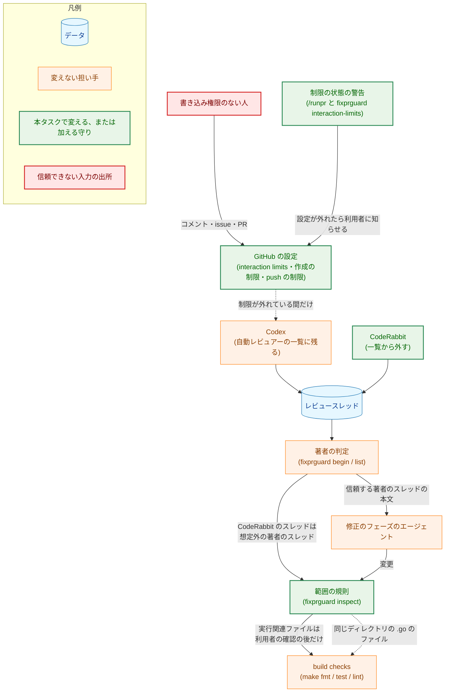
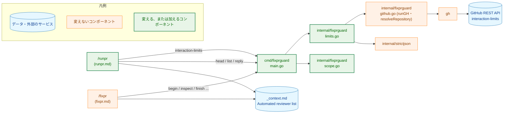
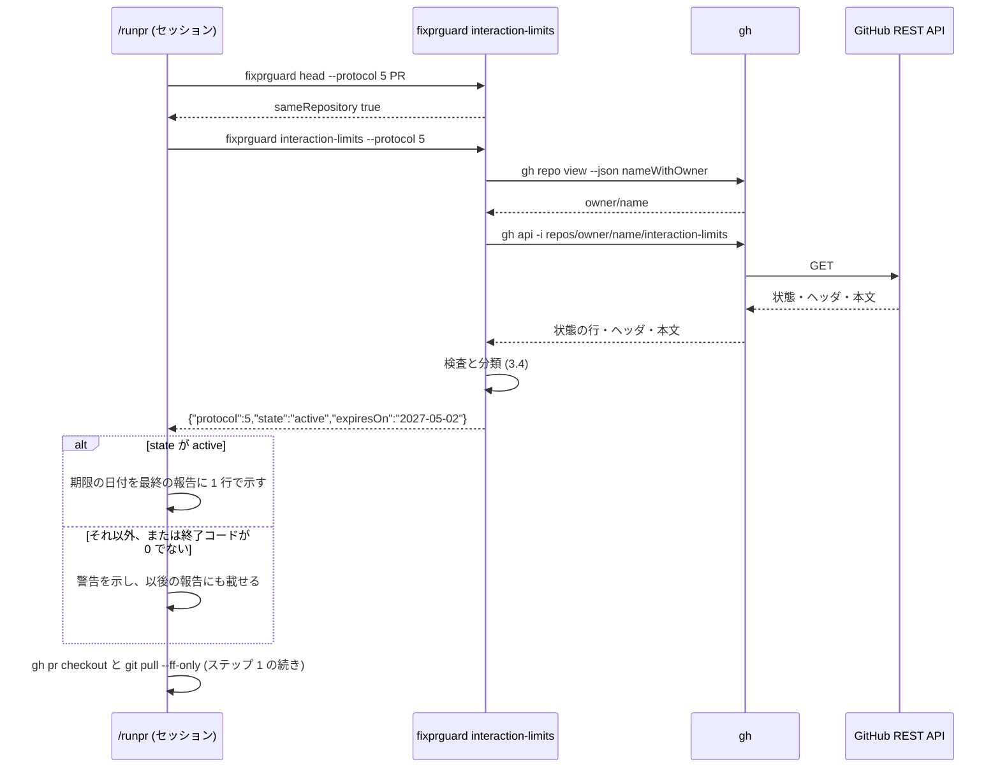
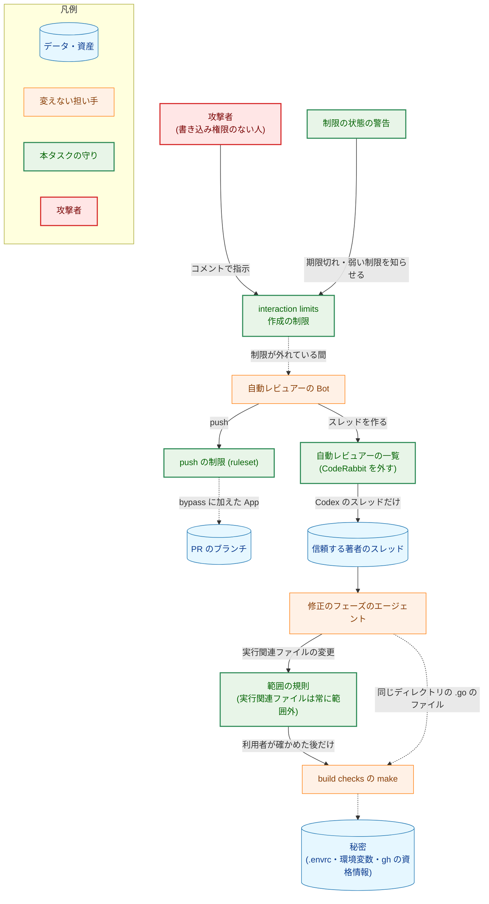
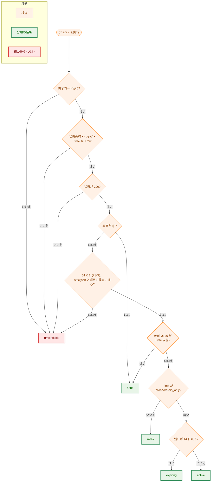

# アーキテクチャ設計書：外部の人が自動レビュアーを介して /fixpr のエージェントに指示を届ける経路を塞ぐ

## Document Status

| Item | Value |
|---|---|
| Status | `draft` |
| Created | 2026-11-03 |
| Review date | - |
| Reviewer | - |
| Comments | - |

本書は [01_requirements.md](01_requirements.md)（要件定義書。以下、要件書）の設計である。既存のファイルに関する記述は、コミット `5f9cdeb` のファイルで確かめた。`file:line` はこのコミットの行番号を指す。F-NNN・AC-NN は要件書の項番を、H-NN は [design_handoff.md](design_handoff.md) の項番を指す。申し送り H-01〜H-07 への対応は付録 A に、受け入れ基準との対応は付録 B にまとめる。#629 などは GitHub の issue の番号を指す。

本書は、要件書 6 章と用語集（`docs/translation_glossary.md`）の用語を同じ意味で使う: interaction limits、作成の制限、push の制限、信頼する著者、信頼する著者のスレッド、想定外の著者のスレッド、自動レビュアー、自動レビュアーの一覧、実行関連ファイル、名指し、範囲外の変更、build checks。規則 1〜6 は、`docs/dev/guides/fixprguard_guide.md`（以下、ガイド）6 章の範囲の規則の番号を指す（規則 1 は `path` そのもの、規則 4 は実行関連ファイルの扱い）。ほかに次の用語を使う。

-   **ガードツール:** `fixprguard`。`/fixpr`・`/runpr` が、著者の判定、範囲の判定、git の状態の比較、GitHub への書き込みに使う開発用ツールである（ガイド 1 章）。
-   **制限の状態:** 要件書 F-004 の表の 5 つの状態（確かめられない・制限なし・制限が弱い・期限が近い・有効）。本書では、ガードツールの出力の値（`unverifiable`・`none`・`weak`・`expiring`・`active`）と 1 対 1 に対応させる（3.3）。
-   **GitHub の時刻:** interaction limits の取得の応答の `Date` ヘッダが示す時刻。期限との比較の「今」に使う（3.4）。

## 1. 設計の全体像 (Design Overview)

### 1.1. 設計原則

-   **判定はコードに置き、手順書には置かない。** interaction limits の応答の検査と、制限の状態への分類は、ガードツールのサブコマンドにする（3.3）。`/runpr` は、出力された状態の名前を見て警告を選ぶだけにする。要件書 4.2 の拒否の規則と AC-18 の境界を、Go のテストで壊して確かめられるようにするためである。
-   **確かめられないものは、確かめられないと示す（fail-safe の警告）。** 応答が受け入れる形に当てはまらなければ、修復も部分的な採用もせず、「確かめられない」とする（`CLAUDE.md`「Reject, don't normalize」）。状態の型の既定値も「確かめられない」にする。ただし `/runpr` は止めない（要件書 4.3）。
-   **範囲の規則は狭めるだけにする。** 規則 4 から、信頼する著者のスレッドの `path` そのものという例外を外す。ほかの規則（規則 1〜3、`.go` の規則、許可リスト）は変えない（要件書 1 章の決定）。
-   **既存の部品を使う。** `gh` の呼び出しは `GitHub.runGH`（`internal/fixprguard/github.go:66-75`）、リポジトリの名前は `resolveRepository`（`:96-122`）、JSON の検査は `internal/strictjson` を使う。新しいパッケージと外部のモジュールは加えない（`CLAUDE.md`「Dependencies」）。
-   **GitHub の設定は利用者が変え、エージェントは読むだけにする。** ガードツールにも `/runpr` にも、設定を書き換える呼び出しを置かない（AC-17）。

### 1.2. 設計の際に決めたこと（2026-11-03）

利用者に確かめて決めたこと:

-   **interaction limits の状態は、ガードツールの新しいサブコマンド `interaction-limits` で読む（H-02）。** `runpr.md` に `gh api --jq` を書く案は採らない。
    -   理由: `jq` は重複した項目を黙って後勝ちにするので、要件書 4.2 の拒否の規則をそのままでは満たせない。サブコマンドなら、`internal/strictjson` が UTF-8・サロゲート・重複・後続のデータを拒否し、境界を Go でテストできる。
-   **「今」は、同じ応答の `Date` ヘッダ（GitHub の時刻）から取る（H-03）。** ローカルの時計は使わない。
    -   理由: `/runpr` は、Codex の待ち時間をすでに GitHub の時刻で測っている（`.claude/commands/runpr.md:339-345`）。ローカルの時計がずれていても、判定がずれない。1 回の取得で状態と時刻がそろう。
-   **制限がない応答を観測し、受け入れる形を「状態 `200`、本文がバイト単位で `{}`」の 1 つに決めた（H-01）。** 観測の結果は 1.3 に書く。
-   **F-003 の 4 つの設定は、設計の間に利用者が行った（H-07）。** 設定の後の応答も観測した（1.3）。利用者の push と `/mergepr` が止まらないことは、本書の PR の push とマージで確かめる（AC-11 の一部。7.4）。
    -   理由: 確かめずに実装を進め、最後の PR で設定が使えないと分かると、実装をやり直すことになる（design_handoff.md の H-07）。
-   **F-003 の手順は、ガイドの新しい章（10 章）に書く（H-05）。** 別のガイドは作らない。既存の章の番号は変えない。
    -   理由: 状態を読むサブコマンド（5 章）と残余のリスク（7.2）と同じ文書にまとめると、読み手が行き来しなくて済む。末尾に足すので、既存の章への参照が変わらない。

設計で決めたこと:

-   **`inScopeOf` の引数の形は変えない（H-04）。** `named` は `.go` の規則だけが使う引数になる（3.1）。
    -   理由: `.go` の規則は名指しの有無で結果が変わるので、引数は要る。関数を分けると、規則の順序を 2 か所で保つことになる。
-   **サブコマンドは、5 つの状態のどれでも終了コード `0` で状態を出力する。** 「確かめられない」も、止まる理由ではなく状態の 1 つとして出力する（3.3）。
    -   理由: 要件書 4.3 は、確かめられないことで `/runpr` を止めないことを求める。終了コード `1` を使うと、`/runpr` の「`0` 以外は止める」という共通の規則に例外が 2 つ要る。
-   **`/runpr` は、このサブコマンドの終了コード `0` 以外、信号による終了、読めない出力を、すべて「確かめられない」として扱い、止まらない（3.5）。** `/runpr` の共通の規則（`.claude/commands/runpr.md:27-31`）の例外である。
-   **時間の上限は、サブコマンド全体で 2 分とする。** ガードツールが `gh` の呼び出しに使う `githubTimeout`（`internal/fixprguard/github.go:19`）と同じ値を、リポジトリの名前の取得と interaction limits の取得の合計に当てる（3.3）。
    -   理由: 値を 1 つに保つ。呼び出しごとに 2 分を当てると、最悪で 4 分待つ。
-   **サブコマンドは `protocol` を `5` に上げる変更と同じ版で導入する。** 番号を 2 度上げない（3.6、H-02）。
-   **`/runpr` は、`fixprguard head` が通った直後に 1 回だけ状態を読む（3.5）。** PR が `MERGED`・`CLOSED` なら、その前に止まるので読まない（AC-12）。
-   **0030 と 0036 の文書には、引用ブロックの注記を加える（AC-22）。** 本文の規則は書き換えない（3.8）。

### 1.3. 確かめた外部の挙動

`gh` 2.96.0 で、本リポジトリに対して読むだけの `gh api -i repos/isseis/yt2column/interaction-limits` を実行した（2026-11-03、利用者が承認した）。

| 時点 | 終了コード | 状態の行 | 本文 |
|---|---|---|---|
| 設定の前（制限なし） | `0` | `HTTP/2.0 200 OK` | `{}`（2 バイト。`Content-Length: 2`） |
| 設定の後 | `0` | `HTTP/2.0 200 OK` | `{"limit":"collaborators_only","origin":"user","expires_at":"2027-05-02T21:30:10Z"}` |

-   利用者の `gh` の資格情報で読める（H-07 の 2 つ目）。
-   `gh api -i` の標準出力は、状態の行（`\n` で終わる）、ヘッダの行（各行が `\r\n` で終わる）、空の行（`\r\n`）、本文の順である。本文は応答のバイト列のままで、末尾に改行を足さない。`Date` ヘッダは 1 つだった（例: `Date: Mon, 02 Nov 2026 21:36:11 GMT`）。
-   設定の後に、ruleset の一覧を読むだけの `gh api repos/isseis/yt2column/rulesets` で、push の制限の ruleset が `active` であることを確かめた（個人の公開リポジトリで ruleset を作れる。H-07 の 1 つ目の一部）。PR と issue の作成の制限は、利用者が設定画面で設定できた。

### 1.4. なぜ既存の方法では足りないか

-   **`runpr.md` の `gh api --jq`:** 1.2 のとおり、`jq` は重複した項目を後勝ちにし、不正な UTF-8 も置き換えうる。`/runpr` がすでに使う `--jq` のフィルタ（`.claude/commands/runpr.md:277-305`）は、Codex の要約のコメントの判定には足りるが、要件書 4.2 は interaction limits の応答に「黙って修復する入力の拒否」を求める。
-   **範囲の規則の今の形:** 規則 4 は、信頼する著者のスレッドの `path` そのものなら実行関連ファイルを範囲内にする（`internal/fixprguard/scope.go:232-234`）。信頼する著者のスレッドを第三者が Codex を介して作れる間は、この例外が `Makefile` の書き換えを確認なしに `make` へ届ける（要件書 1 章「背景」の増幅）。例外を残したまま信頼の判定だけを強める案は、Codex を一覧から外せないので成り立たない（要件書 1 章の決定）。

### 1.5. 概念モデル

要件書 1 章の経路（入口・信頼・増幅・被害）と、本タスクが加える守りを対応づける。図の矢印 A → B は「A のテキストまたは変更が B へ届く」を表す。点線の矢印は、本タスクの後も残る経路（残余のリスク）を表す。



## 2. システム構成 (System Structure)

### 2.1. 全体構成

本タスクで変えるのは、ガードツールの範囲の規則と新しいサブコマンド、`/runpr` の手順、自動レビュアーの一覧、文書である。図の矢印 A → B は「A が B を呼び出す、または B を読む」を表す。



`fixpr.md` は `--protocol` の値だけが変わる。`_context.md` の値は、`/fixpr` と `/runpr` が `--reviewer` に渡す（`.claude/commands/runpr.md:21-27`）。

### 2.2. コンポーネント配置

| ファイル | 種類 | 内容 | 関係する要件 |
|---|---|---|---|
| `internal/fixprguard/scope.go` | 変更 | 規則 4 の分岐（`:232-234`）を、実行関連ファイルなら常に範囲外にする形に改める。冒頭のコメント（`:23-26`）と `inScopeOf` のコメント（`:227-230`）を合わせる | F-001 |
| `internal/fixprguard/scope_test.go` | 変更 | `makefile_is_path`（`:60`）の期待を `true` から `false` に改める。`denyListAtPathItself`（`:23-36`）の信頼する著者の側の期待を `false` に改め、コメントを直す。AC-01・AC-03 の各行を加える（7.1） | F-001 |
| `internal/fixprguard/limits.go` | 新規 | 制限の状態の型、`GitHub.InteractionLimits`、`gh api -i` の出力と本文の検査、分類 | F-004 |
| `internal/fixprguard/limits_test.go` | 新規 | 検査と分類の表のテスト、境界のテスト（7.1） | F-004 |
| `internal/fixprguard/errors.go` | 変更 | 番兵のエラー `ErrInteractionLimitsUnverifiable` を加える（4 章） | F-004 |
| `internal/fixprguard/types.go` | 変更 | `Protocol` を `4` から `5` にする（`:21`） | F-005 |
| `cmd/fixprguard/main.go` | 変更 | サブコマンド `interaction-limits` を加える（`specs`・`execute`。`:56-67`・`:106-121`・`:349-384`） | F-004 |
| `cmd/fixprguard/main_test.go` | 変更 | サブコマンドの終了コードと出力のテスト（7.1） | F-004・F-005 |
| `cmd/fixprguard/docs_test.go` | 変更 | `TestDocumentedInvocationsParse` の `runpr.md` の期待（`:190`）に `interaction-limits` を加える。ガイドが制限の状態の値をすべて挙げることを確かめるテストを加える（7.3） | F-004・F-006 |
| `cmd/yt2column/fixpr_docs_test.go` | 変更 | `wantReviewers`（`:58`）を `chatgpt-codex-connector` だけにする。`TestContextReviewerRowsMalformed`（`:956`）の、受け入れる行（`:975`）を 1 つの名前の行に改め、ほかの行の期待を見直す（7.3） | F-002 |
| `.claude/commands/_context.md` | 変更 | 「Automated reviewer list」（`:185`）を `chatgpt-codex-connector` だけにする | F-002 |
| `.claude/commands/runpr.md` | 変更 | `--protocol 5`、`interaction-limits` の呼び出しと警告、共通の規則の例外、「Authorization」（3.5） | F-004・F-005 |
| `.claude/commands/fixpr.md` | 変更 | `--protocol 5` | F-005 |
| `docs/dev/guides/fixprguard_guide.md` | 変更 | 4 章の現在の番号、5 章の新しいサブコマンドと例の `--reviewer`、6 章の規則 4 と判定の順序、7.2 の残余のリスク、9 章、新しい 10 章（3.7・3.8） | F-002〜F-006 |
| `docs/dev/conventions/package_reference.md` | 変更 | `cmd/fixprguard` のサブコマンドの一覧と、`internal/fixprguard` の説明に `InteractionLimits` を加える | F-004 |
| `docs/translation_glossary.md` | 変更 | 「実行関連ファイル」の説明を改め、「interaction limits」「作成の制限」「push の制限」を加える | F-006 |
| `docs/tasks/0030_fixpr_untrusted_threads/01_requirements.md` | 変更 | F-004 に注記を加える | F-006 |
| `docs/tasks/0030_fixpr_untrusted_threads/02_architecture.md` | 変更 | 3.6・5.1・5.3 に注記を加える | F-006 |
| `docs/tasks/0036_fixprguard_exec_file_scope/01_requirements.md` | 変更 | 規則 4 の例外を述べる箇所に注記を加える | F-006 |
| `docs/tasks/0036_fixprguard_exec_file_scope/02_architecture.md` | 変更 | 規則 4 の例外を述べる箇所に注記を加える | F-006 |

`internal/fixprguard/trust.go` と `threads.go` は変えない。CodeRabbit の Bot は、`--reviewer` に名前が渡らなくなるので、今の判定で `other-bot` になる（3.2）。

### 2.3. データフロー: `/runpr` が制限の状態を読む

図の矢印は、呼び出しとその応答を表す。



## 3. コンポーネント設計 (Component Design)

### 3.1. 範囲の規則（F-001・H-04）

規則 4 を次のとおり改める。

-   **今の規則:** 実行関連ファイルは、`path` そのものでなければ範囲外とする。名指しされた想定外の著者のスレッドでは、`path` そのものでも範囲外とする（`internal/fixprguard/scope.go:232-234`、ガイド:232）。
-   **新しい規則:** 実行関連ファイルは、スレッドの著者と `path` にかかわらず範囲外とする。

判定の順序（ガイド 6 章の「判定の順序」、`internal/fixprguard/scope.go:227-254`）は、順 1 だけが変わる。

| 順 | 調べること | 今の結果 | 新しい結果 |
|---|---|---|---|
| 1 | 変更したパスが実行関連ファイル | 名指しのスレッドでなく、`path` そのもののときだけ範囲内 | 常に範囲外 |
| 2 | 変更したパスが `path` そのもの | 範囲内（規則 1） | 変わらない |
| 3 | ASCII でない文字を含む | 範囲外 | 変わらない |
| 4 | `.go` のファイル | `.go` の規則（名指しのスレッドでは範囲外） | 変わらない |
| 5 | 規則 2・3 の場所にない | 範囲外 | 変わらない |
| 6 | 許可リストの (a)・(b) | 当たれば範囲内 | 変わらない |

順 1 を順 2 より前に置くことは変えない。`path` そのものでも実行関連ファイルを範囲外にするためである。

**`inScopeOf` の形（H-04）。** `inScopeOf(changed, p string, named bool) bool` の形は変えない。`named` を使うのは順 4 だけになる。`ThreadPath.Named`（`internal/fixprguard/github.go:484-488`）と `ThreadPaths` も変えない。ガイドの「判定の順序」の順 1 は「実行関連ファイルなら範囲外」と書き、名指しに触れない。名指しの有無で結果が変わるのは順 4 だけだと、順 4 の説明で示す。

**範囲外になった後（AC-04）。** 実行関連ファイルの変更は、`inspect` の `outOfScope` に入り、`inspect` は終了コード `3` を返す。利用者が続けると答えれば、`finish` は判定した集合をそのまま commit する。`finish` は範囲内かどうかを見ず、判定した集合との一致だけを確かめる（ガイド 7.1）ので、`finish` は変えない。

**既存のテストへの影響。** 次のテストは今の規則を確かめているので、期待を改める。

-   `internal/fixprguard/scope_test.go:60` の `makefile_is_path`（信頼する著者のスレッドの `Makefile` そのもの。`true` → `false`）。
-   `internal/fixprguard/scope_test.go:23-36` の `denyListAtPathItself`。信頼する著者の側の期待を `false` に改める。この補助関数の目的（拒否リストの項目が、許可リストの効かない位置で範囲外になること）は保てる。規則 1 には許可リストを当てないので、拒否リストにないパスは `path` そのものなら範囲内になり、拒否リストにあるパスだけが範囲外になるからである（7.1）。
-   `named_execution_path_itself`（`:81`）など、名指しの側の行は期待が変わらない。

`internal/fixprguard/worktree_test.go`・`worktree_flow_test.go`・`cmd/fixprguard/main_test.go` で範囲内を期待する変更のうち、実行関連ファイルでスレッドの `path` そのものであるものの有無は、計画で `rg` で確かめる。0036 の設計書 7.3 の時点では、範囲内を期待する変更は `.md`・`.txt` か、実行関連ファイルでない `path` そのものだった。

### 3.2. 自動レビュアーの一覧（F-002・H-06）

`_context.md` の「Automated reviewer list」（`.claude/commands/_context.md:185`）の値を `` `chatgpt-codex-connector` `` だけにする。説明の文はそのままにする。`/fixpr`・`/runpr` は一覧のすべての名前を `--reviewer` に渡すので（`.claude/commands/runpr.md:21-27`）、渡す名前は `chatgpt-codex-connector` だけになる。`fixpr.md`・`runpr.md` は名前も数も書かないので変えない（ガイド 9 章）。

ガードツールは変えない。`coderabbitai` の Bot のコメントを含むスレッドは、`--reviewer` のどの名前とも一致しないので、今の判定のまま理由 `other-bot`（アカウント `coderabbitai`）の想定外の著者のスレッドになる（ガイド 5 章の理由の表）。本文は取得されず（AC-06）、利用者が名指しすれば、名指しされた想定外の著者のスレッドとして処理される（AC-07）。そのときの範囲の規則は 3.1 のとおりで、名指しのスレッドの `.go` の規則（`path` そのもの以外の `.go` のファイルは範囲外）と、実行関連ファイルの規則（常に範囲外）が当たる。

**文書のガード（H-06）。** ガイド 9 章の手順に従い、次の 3 つを同じコミットで変える。

1.  `_context.md` の行。
2.  `cmd/yt2column/fixpr_docs_test.go:58` の `wantReviewers` を `[]string{"chatgpt-codex-connector"}` にする。
3.  同じファイルの `TestContextReviewerRowsMalformed`（`:956`）の行。今の受け入れる行（`:975`）は 2 つの名前を書いているので、新しい `wantReviewers` では `problemListNames` になる。この行を 1 つの名前の行に改める。形の誤りを確かめる行（`:984-990`）は、形の検査が名前の照合より先に失敗する限り期待が変わらない。`third_name`・`name_replaced`（`:991-992`）は、名前の照合の誤りを確かめる行として、新しい一覧に合う入力に改める。どの行の期待が変わるかは、計画で `checkContextReviewers` の検査の順序を読んで決める。

`cmd/fixprguard/docs_test.go` の `checkDocumentedReviewer`（`:141-152`）は、`fixpr.md`・`runpr.md` の呼び出しが `--reviewer <reviewer>` の置き場所を 1 つだけ書くことを確かめ、名前は見ない。`TestGuideDescribesReviewerList`（`:285`）は、ガイドの見出しの `--reviewer LOGIN ...` を確かめ、例の名前は見ない。どちらも変えなくてよい。ガイドの例の `--reviewer coderabbitai`（ガイド:99・:120・:153・:196）と 4 章の `（例: coderabbitai）`（ガイド:65）は、文書のガードが確かめないので、手で `chatgpt-codex-connector` に改め、PR のレビューで読む（AC-08）。

**開いているブランチ。** 各セッションは作業しているブランチの `_context.md` を読む。`main` を取り込んでいない開いたブランチでは、CodeRabbit のスレッドの信頼が続く（ガイド 9 章）。急ぐ場合の手順は、ガイド 9 章にすでにある。

### 3.3. サブコマンド `interaction-limits`（F-004・H-02・H-03）

**呼び出し。**

```sh
fixprguard interaction-limits --protocol 5
```

-   フラグは `--protocol` だけで、位置引数を取らない。`--reviewer` は渡せない（`list` などと違い、スレッドを判定しない）。
-   `gh` を呼ぶので、`GH_REPO`・`GH_HOST` が設定されていれば `gh` を起動せずに終了コード `2` で止まる（`cmd/fixprguard/main.go:352-358` の共通の検査）。
-   リポジトリの所有者と名前は、`resolveRepository` で `gh repo view` から求める。呼び出し元からは受け取らない。
-   `gh api -i repos/<owner>/<name>/interaction-limits` を 1 回だけ実行する。メソッドは `GET` だけで、書き込む呼び出しはない。
-   サブコマンド全体の時間の上限は 2 分（`githubTimeout`）である。`runGH` の呼び出しごとの上限は、この上限の内側で働く。

**出力。** 5 つの状態のどれでも、終了コード `0` で 1 行の JSON を出力する。

```json
{"protocol":5,"state":"expiring","expiresOn":"2026-11-15"}
```

| `state` | 要件書の状態 | `expiresOn` |
|---|---|---|
| `unverifiable` | 確かめられない | `""` |
| `none` | 制限なし | `""` |
| `weak` | 制限が弱い | `expires_at` の UTC の日付（`YYYY-MM-DD`） |
| `expiring` | 期限が近い | 同上 |
| `active` | 有効 | 同上 |

`none` で `expiresOn` を空にするのは、期限が過ぎた日付を「期限」として示すと、制限があるように読めるためである。`unverifiable` のときは、標準エラーに、拒否した規則の名前だけを 1 行で書く（例: `fixprguard: interaction limits unverifiable: date header`）。応答の本文、ヘッダの値、`gh` の引数と標準エラーは書かない（ガイド 4 章の標準エラーの約束）。

**型と関数。**

```go
// LimitState is the state of the repository's interaction limits that
// /runpr reports. The zero value is LimitUnverifiable, the state that
// assumes least: a state left unset is reported as unverifiable, never as
// active.
type LimitState int

const (
	LimitUnverifiable LimitState = iota // "unverifiable"
	LimitNone                           // "none"
	LimitWeak                           // "weak"
	LimitExpiring                       // "expiring"
	LimitActive                         // "active"
)

// MarshalText names the state. A value outside the list is an error.
func (s LimitState) MarshalText() ([]byte, error)

// LimitStates lists every state, for the guide's document guard.
func LimitStates() []LimitState

// InteractionLimits is the output of interaction-limits.
type InteractionLimits struct {
	Protocol  int        `json:"protocol"`
	State     LimitState `json:"state"`
	ExpiresOn string     `json:"expiresOn"`
}

// InteractionLimits reads the repository's interaction limits and classifies
// them against GitHub's clock. Every failure, a gh failure and a rejected
// response included, returns an error that wraps
// ErrInteractionLimitsUnverifiable, together with the zero result.
func (g *GitHub) InteractionLimits(ctx context.Context) (InteractionLimits, error)
```

`InteractionLimits` は `NewGitHubWithoutReviewer`（`internal/fixprguard/github.go:52-57`）で作った `GitHub` でも呼べる。スレッドを判定しないためである。

ガードツールの既存の列挙型（`ChangeKind`・`Reason`・`Cause`）は、ゼロ値を名前のない値にし、`MarshalText` で誤りにする（`internal/fixprguard/changes.go:40-64`、`types.go:211-241`）。`LimitState` は、ゼロ値を名前のある `LimitUnverifiable` にする。誤りにすると、出力できずに終了コード `1` になり、`/runpr` の側で「確かめられない」に写すことになる。ゼロ値を「確かめられない」にすれば、設定し忘れた状態も警告として出力される。

**エラーから出力への写し。** `cmd/fixprguard` は、`InteractionLimits` がエラーを返したら、`errors.Is(err, ErrInteractionLimitsUnverifiable)` を確かめ、`{"protocol":5,"state":"unverifiable","expiresOn":""}` を終了コード `0` で出力する。それ以外のエラー（本来は起きない）は、ほかのサブコマンドと同じく終了コード `1` の `stop` にする。`/runpr` は終了コード `1` も「確かめられない」として扱う（3.5）。

### 3.4. 応答の検査と分類（要件書 4.2・H-01・H-02・H-03）

**入力。** `gh api -i` の標準出力のバイト列（`gh` の出力の上限は `cmd/fixprguard/main.go:41` の `ghMaxOutput`。超えれば `cmdrunner.ErrOutputTooLarge` で失敗する）と、`gh` の終了コード。終了コードが `0` でなければ（`gh api` は `2xx` でない状態で `0` 以外を返す）、出力を読まずに「確かめられない」とする。

**出力の分け方。** 1.3 の観測に基づき、次の形だけを受け入れる。

1.  最初の行は状態の行で、`HTTP/` で始まり、1 つの空白の後に 3 桁の状態の番号が続く。行末の `\r` は 1 つまで許す。
2.  続くヘッダの行は、最初の空の行（`\r\n` または `\n` だけの行）までである。空の行がなければ受け入れない。
3.  空の行の後のバイト列すべてが本文である。

ヘッダの行のうち、使うのは `Date` だけである。名前は ASCII の大文字小文字を区別せずに照合する（HTTP のヘッダの名前は大文字小文字を区別しないため）。`Date` が 0 個または 2 個以上なら受け入れない。値は `http.TimeFormat`（`Mon, 02 Jan 2006 15:04:05 GMT`）の形だけを受け入れ、`net/http` の `ParseTime` が許すほかの 2 つの形（RFC 850・ANSI C）は受け入れない。ほかのヘッダは使わず、拡張可能として無視する。

**本文の受け入れる形。** 要件書 4.2 のとおり、次の順に調べる。

| 順 | 形 | 条件 | 結果 |
|---|---|---|---|
| 1 | 制限なし | 状態が `200`、本文がバイト単位で `{}`（2 バイト） | `none` |
| 2 | 制限あり | 状態が `200`、本文が 64 KiB 以下で、`strictjson.ParseObject` に通り、`Collect("limit", "expires_at")` の 2 つが `RequiredString` に通る | 下の分類へ |
| - | それ以外 | 上のどちらでもない | `unverifiable` |

順 2 の検査は、`internal/strictjson` の既存の関数で、要件書 4.2 の拒否の規則を満たす。

| 要件書 4.2 の拒否の規則 | 検査するもの |
|---|---|
| 有効な UTF-8 でない本文、対になっていないサロゲートのエスケープ | `ParseObject`（`internal/strictjson/strictjson.go:72-85`） |
| オブジェクトでない最上位の値、`null`、2 つ目の値や後続のデータ | `ParseObject` |
| 使う項目の欠落、重複、文字列でない値 | `Collect` が使う項目の重複を拒否し（`:90-102`）、`RequiredString` が欠落と文字列でない値を拒否する（`:146`） |
| 一覧にない `limit` の値 | `limit` を `existing_users`・`contributors_only`・`collaborators_only` の 3 つと `switch` で照合し、`default` を `unverifiable` にする |
| 解釈できない `expires_at` | `time.Parse(time.RFC3339, ...)`。時差のない形は RFC 3339 の文法に合わないので拒否される |
| 64 KiB を超える本文 | 本文のバイト数 |
| 1 の形でも 2 の形でもない HTTP の状態、取得の失敗、時間切れ | 状態の番号、`gh` の終了コード、`context` の期限 |

`Collect` は、使わない項目（`origin` など）とその重複を無視する。要件書 4.2 が、使わない項目を拡張可能と定めているためである。拒否のときに部分的な結果を使わない（`expires_at` が読めても、`limit` が拒否されれば `expiresOn` を出さない）。

**分類。** 「今」は `Date` の時刻 `now`、期限は `expires_at` の時刻 `exp` である。要件書 F-004 の表の順に調べる。

1.  `exp` が `now` 以前（`!exp.After(now)`）なら `none`。
2.  `limit` が `existing_users` または `contributors_only` なら `weak`。
3.  `exp - now` が 14 日（`14 * 24 * time.Hour`）以下なら `expiring`。
4.  それ以外は `active`。

14 日は暦の日ではなく、336 時間の長さである。比較は時刻の値で行うので、`exp` の時差は結果に影響しない。`expiresOn` は `exp` を UTC に直した日付である。境界（AC-18）: `exp = now + 14 日` は `expiring`、`exp = now + 14 日 + 1 秒` は `active`、`exp = now` は `none` になる。

**`Declare, don't infer` との関係。** 本文の内容で分岐するのは、GitHub の応答という外部の値を、受け入れる形に照らして列挙型に写す境界だけである。写した後は `LimitState` の `switch` で振る舞いを選ぶ。既存の `role_name` の判定（`internal/fixprguard/trust.go`）と同じ扱いであり、`CLAUDE.md` の例外を加える必要はない。

### 3.5. `/runpr` の変更（AC-12〜AC-17）

**呼ぶ位置（AC-12）。** ステップ 1 の `fixprguard head`（`.claude/commands/runpr.md:168-180`）が終了コード `0` と `sameRepository` の真で通った直後、`gh pr checkout` の前に、1 回だけ呼ぶ。

-   PR が `MERGED`・`CLOSED` なら、ステップ 1 はその前に止まるので呼ばない。
-   standalone の変更では、PR を作った後に `head` を呼ぶので、その後に呼ぶ。
-   ステップ 3 の Codex の待ちはこの後に始まるので、「Codex のレビューを待ち始める前」を満たす。
-   1 回の実行で 1 回だけである。`/runpr` が `fixpr` を何度実行しても、読み直さない（要件書 4.1）。

**結果の扱い。** 呼び出しの結果を、次の表で 1 つの状態に決める。

| 呼び出しの結果 | 状態 |
|---|---|
| 終了コード `0` で、JSON の `state` が `active` | 有効 |
| 終了コード `0` で、`state` が `expiring`・`none`・`weak` | それぞれ期限が近い・制限なし・制限が弱い |
| 終了コード `0` で、`state` が `unverifiable` | 確かめられない |
| 終了コード `0` 以外、信号による終了、JSON として読めない出力、表にない `state` | 確かめられない |

**共通の規則の例外。** `runpr.md` の冒頭は、`fixprguard` の終了コード `0` 以外、信号による終了、JSON でない出力で止まると定める（`.claude/commands/runpr.md:27-31`）。`interaction-limits` だけは止めず、表のとおり「確かめられない」として続ける。`runpr.md` は、この例外を冒頭の規則の段落と、ステップ 1 の呼び出しの箇所の両方に書く。要件書 4.3 が、確かめられないことで止めないことを求めるためである。終了コード `2`（`--protocol` の不一致など）もここでは止めないが、同じ実行の `head` が同じ `--protocol` で先に通っているので、`--protocol` の不一致はここまで来ない。

**示す内容。** 状態ごとに、日本語の 1 行を決める。

| 状態 | 示す内容 |
|---|---|
| 有効 | 警告は出さない。最終の報告に、期限の日付（`expiresOn`）を 1 行で示す（AC-13） |
| 期限が近い | 状態の名前、期限の日付、ガイド 10 章の場所（AC-14） |
| 制限なし | 状態の名前、ガイド 10 章の場所（AC-14） |
| 制限が弱い | 状態の名前、期限の日付、`collaborators_only` に変える必要があること、ガイド 10 章の場所（AC-14・AC-15） |
| 確かめられない | 確かめられなかったこと、利用者が設定画面で確かめる必要があること、ガイド 10 章の場所。応答の本文と標準エラーは含めない（AC-16） |

警告（有効のほかの 4 つ）は、確かめた時点に示し、あわせて `/runpr` の最後の報告に載せる。途中で止まったときは、止まった時点の報告に載せる（AC-14・AC-16）。`runpr.md` は、警告の 1 行を LIMITS_NOTE として実行の間に保持し、ステップ 1 の後のどの報告（最終の報告、止まったときの報告、ステップ 4 の問いの前の報告）にも含めると書く。状態を読む前に止まったときは、LIMITS_NOTE がないので示さない。処理は止めない。

**「Authorization」。** `runpr.md` の「Authorization」（`.claude/commands/runpr.md:62-89`）の、`fixprguard` が `head`・`list`・`reply` で行う操作の一覧に、`interaction-limits` の `gh repo view` と `gh api -i`（interaction limits を読む）を加える（AC-12、`CLAUDE.md`「Tool Execution Safety」）。

**設定を変えない（AC-17）。** `runpr.md` は、interaction limits・作成の制限・ruleset を変える `gh api` の呼び出し（`PUT`・`DELETE` など）を書かない。警告は、利用者がガイド 10 章の手順で設定することを示すだけである。

### 3.6. `protocol` の番号（F-005）

`internal/fixprguard/types.go:21` の `Protocol` を `4` から `5` にする。理由は 2 つある。範囲の規則が変わる（ガイド 9 章の、上げる条件に当たる）ことと、新しいサブコマンドが加わることである。番号 `5` は、ほかのタスクの文書と開いているブランチに使われていない（2026-11-03 に `docs/tasks/` と `.claude/` を検索した）。

-   **古いツールと新しい文書:** 古いツールは `--protocol 5` を受け付けず、終了コード `2` で止まる（`cmd/fixprguard/main.go:238-240`）。`/runpr` の最初の呼び出しは `head` なので、`interaction-limits` の前に止まる。古い規則で判定することはない。
-   **新しいツールと古い文書:** 新しいツールは `--protocol 4` を受け付けず、終了コード `2` で止まる（AC-19）。
-   **文書の値:** `fixpr.md`・`runpr.md` のすべての `--protocol` と、ガイドの例の `--protocol`・出力の `"protocol"`・4 章の「現在の番号」を `5` にする。`TestDocumentedProtocolMatches`（`cmd/fixprguard/docs_test.go:322`）が、これらとバイナリの `Protocol` の一致を確かめる。

**導入の手順。** ガイド 3 章の、番号を上げる変更の手順に従う。その PR の `/runpr` の前に、その PR のブランチで再インストールし、マージの直後に `main` で再インストールし、作業中のほかのブランチには `main` を取り込む。

### 3.7. GitHub の設定とガイドの 10 章（F-003・H-05・H-07）

ガイドの末尾に「10. GitHub の設定」を加える。内容は次のとおりである（AC-09）。

-   4 つの設定（要件書 F-003 の 1〜4）の目的。どの経路を塞ぐかを、要件書 1 章の経路の段（入口・Bot の push）と対応づけて書く。
-   設定する手順。設定画面の場所と選ぶ項目を書く。ruleset は、対象をすべてのブランチにし、「Restrict creations」と「Restrict updates」だけをかけ、bypass に Repository admin を「Always allow」で加える。「For pull requests only」を選ぶと利用者の push が止まることも書く。
-   interaction limits を期限の前に更新する手順。`/runpr` が「期限が近い」と警告したときに行う。
-   設定を変えるのは利用者だけで、`/runpr` と `fixprguard` は読むだけであること。
-   `/runpr` が確かめるのは interaction limits だけで、作成の制限と push の制限は利用者が設定画面で確かめること。
-   `/runpr` の警告の状態ごとの意味と、利用者が行うこと。

`/runpr` の警告は「`docs/dev/guides/fixprguard_guide.md` の 10 章」を示す。

**設定の確認（H-07）。** 1.2・1.3 のとおり、4 つの設定は設計の間に行い、interaction limits の応答と ruleset の状態を読むだけで確かめた。利用者の push（ブランチの作成と更新）と `/mergepr` の squash merge・ブランチの削除が止まらないことは、本書の PR で確かめる（7.4）。止まった場合は、要件書 1 章の決定に従い作業を止め、決定の変更として要件書に戻す。

### 3.8. 文書の変更（F-006・AC-20〜AC-23）

**ガイド。**

-   4 章: 「現在の番号は `5`」。`--reviewer` の例を `chatgpt-codex-connector` にする（3.2）。
-   5 章: `### \`interaction-limits\`` の節を加える。呼び出しの例、出力の項目、5 つの状態の値、副作用（GitHub の読み取りだけ）、確かめられないときの標準エラーを書く。例の `--reviewer` を一覧の名前にする。
-   6 章: 規則 4 を「実行関連ファイルは、スレッドの著者と `path` にかかわらず範囲外とする」にし、判定の順序の順 1 を 3.1 の表のとおりにする（AC-20）。「実行関連ファイル。」の段落の「規則 4 で、`path` そのものでなければ範囲外とするファイル」も改める。
-   7.2: 要件書 4.2 の残余のリスクの 8 項目を書く（AC-21）。既存の 7.2.3 の「同じパッケージの `.go` のファイル」と「ファイルシステムの Unicode の畳み込みによる別名」は、第三者が Codex を介してこの位置に至りうることを加えて改める。新しい項目は、7.2.1 または新しい小節に置く。置き場所は計画で決める。
-   9 章: 自動レビュアーを外すときの手順はすでにある。変えない。
-   10 章: 3.7 のとおり。

**用語集（AC-23）。** 「実行関連ファイル」の説明を「`fixprguard` の範囲の規則が、スレッドの著者と `path` にかかわらず範囲外とするファイル」に改める。「interaction limits」「作成の制限」「push の制限」を、要件書 6 章の定義で加える。

**0030 と 0036 の文書（AC-22）。** 次の箇所の前に、引用ブロックの注記（`> **注記（タスク 0057）:** ...`）を加える。注記は、規則 4 の例外を外したこと、第三者が自動レビュアーを介してスレッドを作れること、`make` に渡す環境を変えないこと、F-003 の設定を、該当する箇所に応じて述べ、本タスクの要件書と設計書への参照を付ける。本文の規則は 0030・0036 の時点の決定の記録として書き換えない。0030 の 3.6 にある、タスク 0036 の注記（`docs/tasks/0030_fixpr_untrusted_threads/02_architecture.md:566`）と同じ扱いである。

| 文書 | 箇所 |
|---|---|
| 0030 `01_requirements.md` | F-004（`:136`） |
| 0030 `02_architecture.md` | 3.6（`:564`）、5.1（`:772`）、5.3（`:842`） |
| 0036 `01_requirements.md` | 規則 4 を述べる 1 章の箇所（`:25`）、AC-05（`:159`）、AC-13（`:211`） |
| 0036 `02_architecture.md` | 規則 4 を述べる 3.3 の順 1（`:250`・`:261`） |

どの文書の状態も `approved` のままとする（要件書 1 章の決定）。今の規則（`docs/dev/conventions/requirements_process.md`「Editing an approved document」）では、決定を変えない注記は編集上の訂正に当たる。`Comments` と変更履歴は変えず、コミットメッセージの訂正の行と PR の説明の訂正の段落に記録する。0030・0036 の文書は旧規則で書かれた文書だが、編集上の訂正では移行しない。

**`package_reference.md`。** `cmd/fixprguard` の行のサブコマンドの一覧に `interaction-limits` を、`internal/fixprguard` の行に `InteractionLimits`（`gh api -i` の出力を検査し、GitHub の時刻で 5 つの状態に分類する）を加える。

### 3.9. 副作用の契約

| 操作 | 外部の副作用 |
|---|---|
| `fixprguard interaction-limits` | GitHub の読み取りだけ（`gh repo view`、`gh api -i` の `GET`）。ファイル、git、GitHub への書き込みはない。記録のファイル（ガイド 8.1）も書かない |
| `/runpr` の状態の確認 | 上の 1 回の呼び出しだけ。GitHub の設定を変えない（AC-17） |
| 範囲の規則の変更 | 副作用は増えない。範囲外が増え、`inspect` の終了コード `3` で利用者に確かめる回数が増える |
| 自動レビュアーの一覧の変更 | 副作用は増えない。CodeRabbit のスレッドの本文を取得しなくなる |

## 4. エラーハンドリング設計 (Error Handling Design)

```go
// ErrInteractionLimitsUnverifiable reports that the repository's interaction
// limits could not be read or that the response was not in an accepted form:
// a gh failure or timeout, a status line, header block, or Date header
// outside the accepted form, a status other than 200, a body over 64 KiB,
// or a body that is neither the no-limit form nor an object that passes the
// strict check with a known limit and an RFC 3339 expires_at. No partial
// result is used.
var ErrInteractionLimitsUnverifiable = errors.New("interaction limits unverifiable")
```

-   拒否はすべてこの番兵にまとめる（要件書 4.2）。包むときは、拒否した規則の名前だけを加える（例: `status`・`header block`・`date header`・`body size`・`body`・`limit`・`expires_at`・`gh failed`・`gh timed out`）。応答のバイト列とヘッダの値は加えない。
-   `gh` の失敗は、既存の `ghFailure`（`internal/fixprguard/github.go:80-85`）のように、時間切れかどうかだけを残し、`gh` の引数と標準エラーを捨てる。ただし包む番兵は `ErrResponseRejected` ではなく `ErrInteractionLimitsUnverifiable` にする。`resolveRepository` の失敗も、この番兵で包み直す。
-   `cmd/fixprguard` はこの番兵を状態 `unverifiable` の出力に写し、終了コード `0` を返す（3.3）。`StopKind`（`internal/fixprguard/errors.go:102-133`）と `stop` の種類の一覧は変えない。
-   テストは `errors.Is(err, ErrInteractionLimitsUnverifiable)` で確かめ、エラーの文面は照合しない（`CLAUDE.md`「Error Testing」）。

## 5. セキュリティ考慮事項 (Security Considerations)

条件付きのセキュリティガイド（`docs/dev/security.md`）のトリガーのうち、ネットワークでデータを送る（GitHub の API を読む）、信頼できないテキストをプロンプトに埋め込む（レビュースレッドの本文）、秘密を扱う（`make` に渡す環境）に当たる。同書は製品を対象にした文書なので変えない（要件書 2.3）。

### 5.1. 脅威モデル

図の矢印 A → B は「攻撃者の文言または変更が A から B へ進む」を表す。各段の横の守りは、その段で進みを止めるものである。点線の矢印は、本タスクの後も残る経路を表す。



### 5.2. 守りの対応

| 脅威 | 守り | 強さ | AC |
|---|---|---|---|
| 書き込み権限のない人が Bot に指示する | interaction limits の `collaborators_only`、作成の制限 | GitHub の設定が強制する。interaction limits は最長 6 か月で解除される | AC-09・AC-10 |
| interaction limits が外れたことに気づかない | `/runpr` の警告（3.5） | `/runpr` を実行したときだけ。`/fixpr` を単独で実行したときは警告しない | AC-12〜AC-16 |
| CodeRabbit が攻撃者の文言でスレッドを作る | 自動レビュアーの一覧から外す（3.2） | ガードツールが強制する（`--reviewer` に名前がなければ `other-bot`）。一覧の値はガイド 9 章の文書のガードが固定する | AC-05〜AC-08 |
| Bot が PR のブランチに push する | ruleset の Restrict creations・Restrict updates | GitHub の設定が強制する。期限はない | AC-09〜AC-11 |
| 信頼する著者のスレッドから `Makefile` などが書き換えられ、確認なしに `make` が実行する | 規則 4 の例外を外す（3.1） | ガードツールが強制する。`inspect` の終了コード `3` の後、利用者が続けると答えるかはセッションの手順に依存する | AC-01〜AC-04 |
| 古いツールが古い規則で判定する | `protocol` の `5`（3.6） | ガードツールが強制する（終了コード `2`） | AC-19 |
| interaction limits の応答を偽る、または壊す | 3.4 の検査。拒否はすべて「確かめられない」 | ガードツールが強制する。偽りの応答が受け入れる形に合えば「有効」と示しうる（`gh` と GitHub の間の改ざんは本タスクの範囲外） | AC-16 |
| 警告が応答の本文や資格情報を漏らす | 状態の名前と日付だけを出力する（3.3）。標準エラーは規則の名前だけ | ガードツールが強制する。`/runpr` の警告の文面は手順に依存する | AC-16 |

### 5.3. 残余のリスク

要件書 4.2 の 8 つの残余のリスク（制限が外れている間の Codex の経路、`.go` のファイル、Unicode の畳み込みによる別名、`make` が実行するコードが使える秘密、push の制限の bypass、設定を外した場合と設定する前の期間、名指しした CodeRabbit のスレッド、確認への慣れ、新しい自動レビュアー）は、そのままガイドの 7.2 に書く（AC-21）。設計で次のことが分かっている。

-   **状態を読んだ後の変化。** `/runpr` は実行の初めに 1 回だけ読む（AC-12）。実行の途中で期限が来ても、警告しない。14 日の猶予は、`/runpr` の 1 回の実行より十分に長いので、期限の前に「期限が近い」の警告が出る。利用者が制限を外した場合は、次の `/runpr` まで気づかない。
-   **`gh api -i` の出力の形への依存。** 状態の行とヘッダの区切りは、`gh` の出力の形であり、GitHub の API の契約ではない。`gh` の版が変わって形が変われば、どの実行も「確かめられない」になる。安全側には倒れるが、警告への慣れを生みうる（要件書 4.2 の「確認への慣れ」に近い）。そのときは、ガードツールのサブコマンドを単独で実行し、標準エラーの規則の名前で原因を調べる（5.4）。
-   **`origin` を見ないこと。** 観測した応答の `origin` は `user` だった。`origin` は、制限をどこで設定したか（リポジトリかアカウントか）を示す項目だと考えられるが、使わない（要件書 4.2）。どこで設定しても、リポジトリに効いている制限が応答に現れることを前提にしている。
-   **CodeRabbit のスレッドによるマージの停止。** `/runpr` は、想定外の著者のスレッドが未解決の間はマージしない（`.claude/commands/runpr.md:521-538`）。CodeRabbit が設定に反してスレッドを作ると（要件書 1 章の PR #617・#620 の例）、利用者が名指しするか、解決するまでマージが止まる。要件書 1 章の「受け入れる負担」の具体的な現れである。

### 5.4. 観測のしやすさ

-   **確かめられない理由。** `/runpr` は理由を示さない（AC-16）。利用者は、`fixprguard interaction-limits --protocol 5` を単独で実行すれば、標準エラーの 1 行で、拒否した規則の名前（`status`・`date header` など）を知れる。応答そのものが要るときは、ガイド 10 章に、読むだけの `gh api -i` の呼び出しを書く。
-   **範囲外になった理由。** 実行関連ファイルの変更が範囲外になった理由は、今までどおり出力しない。ガイド 6 章の判定の順序の順 1 で、利用者が確かめる。

## 6. 処理フロー詳細 (Processing Flow Details)

### 6.1. 制限の状態の分類

図の矢印は、調べる順序を表す。どの段の拒否も「確かめられない」に進む。



### 6.2. 実行関連ファイルが変わったときの `/fixpr`

`/fixpr` の流れ（ガイド 5 章、0030 の設計書 6.1）は変えない。信頼する著者のスレッドの `path` が `Makefile` で、修正のフェーズが `Makefile` を変えた場合は、次のとおり進む。

1.  `inspect` が `Makefile` を `outOfScope` に入れ、終了コード `3` を返す（3.1 の順 1）。
2.  `/fixpr` は、範囲外の一覧を利用者に示して確かめる（今までの手順）。
3.  利用者が続けると答えれば、`finish` が build checks の後に commit する（AC-04）。答えなければ、build checks を実行せずに止まる。

本タスクの前は、この場合に 1. で範囲内になり、2. の確認なしに `finish` が書き換え後の `Makefile` で `make` を実行していた。

## 7. テスト戦略 (Test Strategy)

### 7.1. ユニットテスト

**範囲の規則（`internal/fixprguard/scope_test.go`）。**

-   AC-01 の 6 行を、信頼する著者のスレッドの `path` そのものの組で加える。どれも範囲外を期待する。
-   AC-02: 同じ 6 行を名指しのスレッドの組で加える（範囲外）。
-   AC-03 の 5 行を加える（期待は要件書の表のとおり）。既存の行と重なるものは、表の重複を避けるため 1 つにする（`CLAUDE.md`「Check for duplication」）。
-   `denyListAtPathItself` は、信頼する著者の側も範囲外を期待する形に改める。この組が拒否リストだけを確かめていることは、拒否リストにないパスの `path` そのものの行（`path_itself` など。範囲内）と対にして示す（`CLAUDE.md`「A layered path needs inputs only one layer can handle」）。

**検査と分類（`internal/fixprguard/limits_test.go`）。** `gh` は `internal/cmdrunner/testutil` の fake に置き換え、1.3 の観測の形をもとにしたバイト列を返させる。

-   受け入れる形: 制限なし（`{}`）、3 つの `limit` の値、`origin` などの使わない項目と、その重複を含む本文。
-   要件書 4.2 の拒否の例: 不正な UTF-8、対になっていないサロゲート、配列・`null`・文字列の最上位、後続のデータ、2 つ目の値、`limit` と `expires_at` の欠落・重複・`null`・数値、一覧にない `limit`、時差のない `expires_at`、64 KiB を 1 バイト超える本文、状態 `204`・`404`・`200` の空の本文、`gh` の失敗と時間切れ。
-   出力の形の拒否: 空の行のない出力、`Date` のない出力と 2 つある出力、`http.TimeFormat` でない `Date`（RFC 850 の形を含む）。
-   AC-18 の境界: `Date` を固定し、`expires_at` を `Date` と同じ時刻、14 日後、14 日と 1 秒後にした 3 行。`expires_at` に時差（`+09:00`）を付けた行で、`expiresOn` が UTC の日付になることも確かめる。
-   どの拒否でも、結果がゼロ値で、エラーが `ErrInteractionLimitsUnverifiable` を包むことを確かめる（部分的な結果を使わない）。

**サブコマンド（`cmd/fixprguard/main_test.go`）。** 5 つの状態の出力と終了コード `0`、`--reviewer` と位置引数の拒否（終了コード `2`）、`GH_REPO` の拒否、`--protocol 4` の拒否（AC-19）、確かめられないときに標準出力・標準エラーが応答の本文を含まないこと。

### 7.2. 壊して失敗を確かめる

`CLAUDE.md`「Every test must be able to fail for its stated reason」に従い、計画の各ステップで次を壊して、対応するテストが失敗することを確かめ、コミットメッセージに書く。

| 壊すもの | 失敗するべきテスト |
|---|---|
| 規則 4 の分岐を今の形に戻す | AC-01 の信頼する著者の行 |
| 本文の `{}` の照合を外す（空の本文も制限なしにする） | 状態 `200` の空の本文の行 |
| `Collect` を `strictjson` を通さない `encoding/json` の読み取りに変える | 重複した `limit` の行、不正な UTF-8 の行 |
| `limit` の `switch` の `default` を `weak` にする | 一覧にない `limit` の行 |
| 14 日の比較を `<` にする | 14 日ちょうどの境界の行 |
| `!exp.After(now)` を `exp.Before(now)` にする | `expires_at` が `Date` と同じ時刻の行 |
| `Date` の照合を `http.ParseTime` にする | RFC 850 の形の `Date` の行 |
| 64 KiB の上限を外す | 上限を超える本文の行 |
| `LimitState` のゼロ値を `LimitActive` にする | ゼロ値が `unverifiable` と出力されることを確かめる行 |

### 7.3. 文書のガード

-   `cmd/yt2column/fixpr_docs_test.go`: `wantReviewers` と `TestContextReviewerRowsMalformed` の行を改める（3.2）。一覧の値を確かめる既存のテストは、文書のテストの例外（`CLAUDE.md`「the automated-reviewer list」）として残す。
-   `cmd/fixprguard/docs_test.go`: `TestDocumentedInvocationsParse` の `runpr.md` の期待に `interaction-limits` を加える。`TestDocumentedProtocolMatches` は値の変更（`5`）だけで通る。
-   `cmd/fixprguard/docs_test.go` に、ガイドが `LimitStates()` のすべての値をコードの区切り（`` `active` `` など）で挙げることを確かめる行を加える。`TestGuideCoversStopKindsAndScope` が `stop` の種類で行うのと同じ値の照合である（`CLAUDE.md`「Document tests check values」）。`runpr.md` が状態をすべて扱うことは確かめない。表にない状態は「確かめられない」として扱うので、書き漏らしても警告が出るだけで、文書のテストの手間に見合わない。
-   ガイドの規則 4・判定の順序・7.2・10 章、用語集、0030・0036 の注記の文面は、文書のテストで確かめず、PR のレビューで読む（`manual`。AC-08・AC-09・AC-20〜AC-23）。

### 7.4. 結合テストと手動の確認

-   **AC-10:** 4 つの設定は 2026-11-03 に行った（1.3）。本タスクの最後の PR の `/runpr` が「有効」と期限の日付を報告することで確かめる。
-   **AC-11:** 本書の PR（設定の後に開く最初の PR）で、利用者の `git push` によるブランチの作成と更新、Codex の要約のコメントの完了の状態、`/mergepr` の squash merge とブランチの削除を確かめ、結果を計画に記録する。最後の PR でも、`/runpr` の通常の流れで同じことが確かめられる。
-   **AC-24:** `make test`・`make lint`・`doc-guard` が各 PR で通る。

### 7.5. セキュリティテスト

-   要件書 4.2 の拒否の規則は、7.1 の表のテストで 1 つずつ確かめる。
-   確かめられないときの出力に、応答の本文（テストでは目印の文字列を本文に入れる）が含まれないことを、標準出力と標準エラーの両方で確かめる（AC-16）。
-   規則 4 の例外を外したことは、7.2 の 1 行目で壊して確かめる。

## 8. 実装の優先順位 (Implementation Priorities)

PR の切り方は計画で決める。設計からは、次の順序と制約が決まる。

1.  **フェーズ 1: 自動レビュアーの一覧（F-002）。** `_context.md` と `fixpr_docs_test.go` を同じコミットで変え、ガイドの例を改める（ガイド 9 章）。ガードツールは変えないので、`protocol` を上げずに単独で入れられる。入口の守りのうち最も早く効くので、最初に入れる。
2.  **フェーズ 2: ガードツール（F-001・F-004 のツールの部分・F-005）。** 範囲の規則、`interaction-limits`、`Protocol` の `5` を入れる。
3.  **フェーズ 3: コマンドの文書（F-004・F-005）。** `fixpr.md`・`runpr.md` の `--protocol 5`、`runpr.md` の呼び出しと警告と「Authorization」、ガイドの番号と例と 5 章。
4.  **フェーズ 4: 文書（F-006）。** ガイドの 6 章・7.2・10 章、用語集、`package_reference.md`、0030・0036 の注記。

制約:

-   フェーズ 2 と 3 は、同じ PR に入れる。`TestDocumentedProtocolMatches` と `TestDocumentedInvocationsParse` が、文書の `--protocol` とサブコマンドをバイナリと照合するので、どちらか一方だけでは `make test` が通らない。
-   ガイドの 6 章の規則 4 は、範囲の規則の変更（フェーズ 2）と同じ PR で改める。ガイドが今の規則と食い違う期間を作らないためである。
-   F-003 の設定は済んでいる（1.3）。AC-10 の「最後の PR を開く前」は満たされている。

## 9. 将来の拡張 (Future Extensibility)

-   **自動レビュアーを加えるとき（#405）。** その Bot が外部の人の指示に応じるかを評価してから、一覧に加える（要件書 1 章、ガイド 7.2）。ガードツールは名前の数に上限を設けないので、評価のほかに変えるものは、ガイド 9 章の 3 つだけである。
-   **作成の制限と push の制限の確認。** `/runpr` が確かめるのは interaction limits だけである。ruleset の状態は REST API で読める（1.3 で一覧を読んだ）ので、必要になれば同じサブコマンドの形で加えられる。今は要件がないので加えない（YAGNI）。
-   **`/fixpr` の単独の実行での警告。** 要件書は `/runpr` だけに限った。加えるときは、`fixpr.md` から同じサブコマンドを呼べばよい。

## 付録 A: 申し送り（design_handoff.md）への対応

| 項目 | 対応 |
|---|---|
| H-01（「制限がない」応答の形） | 設定の前に観測し、状態 `200`・本文がバイト単位で `{}` の 1 つに決めた（1.3・3.4）。ほかの形は「確かめられない」 |
| H-02（状態を読む処理を置く場所） | ガードツールのサブコマンド `interaction-limits`（1.2・3.3）。`internal/strictjson` で要件書 4.2 を満たす（3.4）。`Protocol` を `5` に上げる変更と同じ版で入れ、ガイドの 5 章に節を加え、`TestDocumentedInvocationsParse` の期待と、状態の値のガードを加える（3.6・7.3） |
| H-03（現在の時刻と時間の上限） | 同じ応答の `Date` ヘッダ（GitHub の時刻）。`http.TimeFormat` の形だけを受け入れる。テストでは fake の `gh` の出力の `Date` で時刻を固定する（3.4・7.1）。時間の上限はサブコマンド全体で 2 分（`githubTimeout`。1.2） |
| H-04（範囲の規則の `named` の引数） | `inScopeOf` の形は変えず、`named` は `.go` の規則（順 4）だけが使う。ガイドの判定の順序の順 1 は名指しに触れない（3.1） |
| H-05（F-003 の手順を書くガイド） | ガイドの新しい 10 章。`/runpr` の警告はその場所を示す（1.2・3.7） |
| H-06（自動レビュアーの一覧の文書のガード） | `wantReviewers` と `TestContextReviewerRowsMalformed` を改める。`checkDocumentedReviewer`・`TestGuideDescribesReviewerList` は名前を見ないので変えず、ガイドの例の `coderabbitai` は手で改めてレビューで読む（3.2） |
| H-07（GitHub の設定が使えることと読む権限） | 設計の間に利用者が 4 つの設定を行い、interaction limits の応答と ruleset の状態を読むだけで確かめた。利用者の資格情報で読めた（1.3）。利用者の push と `/mergepr` は本書の PR で確かめる（7.4） |

## 付録 B: 受け入れ基準との対応

| AC | 設計 | テスト・確認 |
|---|---|---|
| AC-01 | 3.1 | 7.1（範囲の規則）、7.2 |
| AC-02 | 3.1 | 7.1 |
| AC-03 | 3.1 | 7.1 |
| AC-04 | 3.1・6.2 | 既存の `finish` のテスト。7.1 の範囲の規則と合わせて確かめる |
| AC-05 | 3.2 | 7.3（`wantReviewers`） |
| AC-06 | 3.2 | 既存の `other-bot` の判定のテスト（`internal/fixprguard/trust_test.go`） |
| AC-07 | 3.2・3.1 | 既存の名指しのテストと 7.1 の名指しの行 |
| AC-08 | 3.2・3.8 | 7.3（manual） |
| AC-09 | 3.7 | 7.3（manual） |
| AC-10 | 1.3・3.7 | 7.4 |
| AC-11 | 3.7 | 7.4 |
| AC-12 | 3.5 | 7.3（`TestDocumentedInvocationsParse`）、manual |
| AC-13 | 3.3・3.5 | 7.1（`active` の出力）、manual |
| AC-14 | 3.5 | manual |
| AC-15 | 3.5 | 7.1（`weak` の分類）、manual |
| AC-16 | 3.3・3.4・3.5 | 7.1・7.5 |
| AC-17 | 3.5・3.9 | manual（`runpr.md` に設定を変える呼び出しがないこと） |
| AC-18 | 3.4 | 7.1（境界の 3 行）、7.2 |
| AC-19 | 3.6 | 7.1（`--protocol 4` の拒否）、7.3 |
| AC-20 | 3.8 | manual |
| AC-21 | 3.8・5.3 | manual |
| AC-22 | 3.8 | manual |
| AC-23 | 3.8 | manual |
| AC-24 | 8 章 | 各 PR の `make test`・`make lint`・`doc-guard` |
