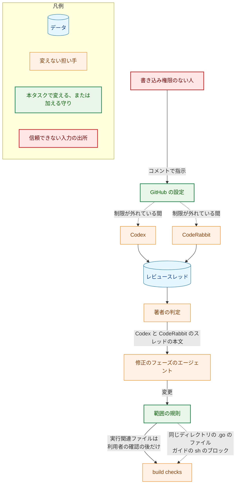
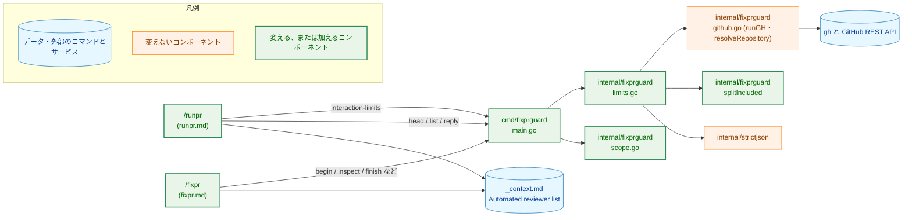
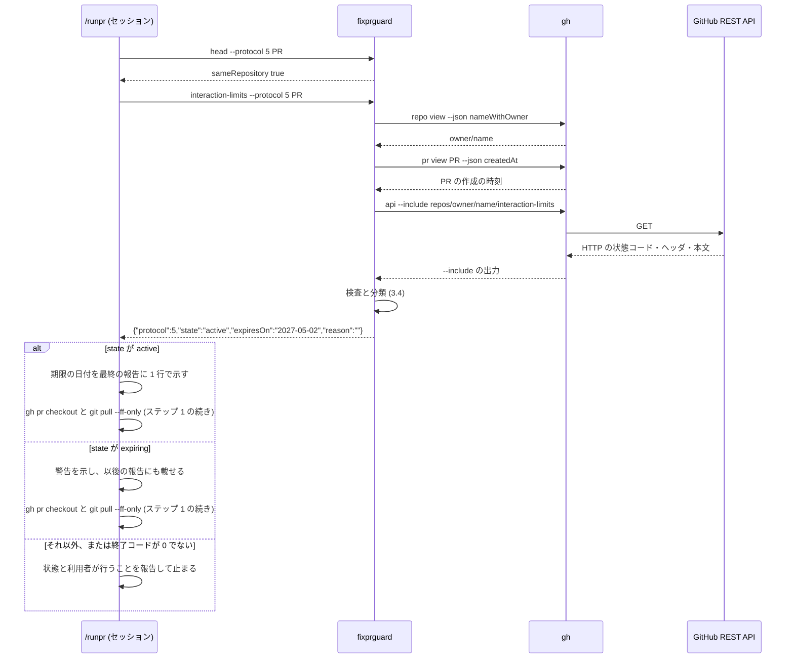
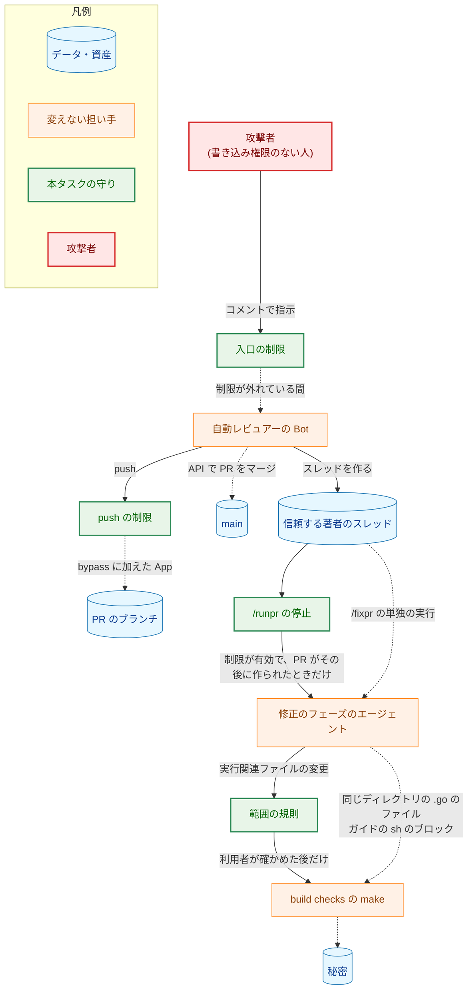
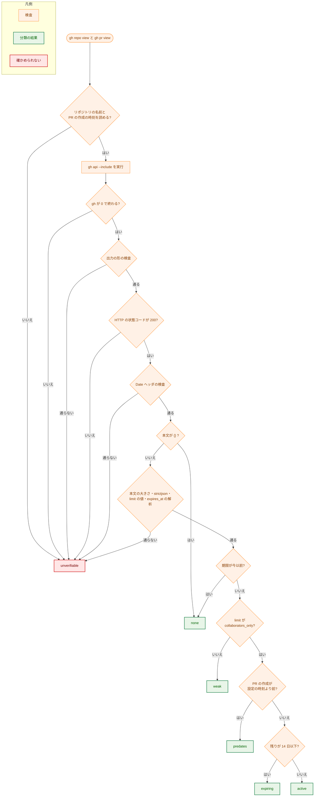

# アーキテクチャ設計書：外部の人が自動レビュアーを介して /fixpr のエージェントに指示を届ける経路を塞ぐ

## Document Status

| Item | Value |
|---|---|
| Status | `approved` |
| Created | 2026-11-03 |
| Review date | 2026-11-03 |
| Reviewer | isseis |
| Comments | - |

本書は [01_requirements.md](01_requirements.md)（要件定義書。以下、要件書）の設計である。既存のファイルに関する記述は、コミット `5f9cdeb` のファイルで確かめた。`file:line` はこのコミットの行番号を指す。F-NNN・AC-NN は要件書の項番を、H-NN は [design_handoff.md](design_handoff.md) の項番を指す。申し送り H-01〜H-07 への対応は付録 A に、受け入れ基準との対応は付録 B にまとめる。#629 などは GitHub の issue の番号を指す。

設計の際に、要件書のいくつかの決定を変えた（1.2）。要件書は `draft` に戻り、本書と同じ PR で再び承認を受ける。

本書は、要件書 6 章と用語集（`docs/translation_glossary.md`）の用語を同じ意味で使う: interaction limits、作成の制限、push の制限、信頼する著者、信頼する著者のスレッド、想定外の著者のスレッド、自動レビュアー、自動レビュアーの一覧、実行関連ファイル、名指し、範囲外の変更、build checks。規則 1〜6 は、`docs/dev/guides/fixprguard_guide.md`（以下、ガイド）6 章の範囲の規則の番号を指す（規則 1 は `path` そのもの、規則 4 は実行関連ファイルの扱い）。ほかに次の用語を使う。

-   **名指しのスレッド:** 名指しされた想定外の著者のスレッドの略。
-   **ガードツール:** `fixprguard`。`/fixpr`・`/runpr` が、著者の判定、範囲の判定、git の状態の比較、GitHub への書き込みに使う開発用ツールである（ガイド 1 章）。
-   **制限の状態:** 要件書 F-004 の表の 6 つの状態（確かめられない・制限なし・制限が弱い・制限より前の PR・期限が近い・有効）。本書では、ガードツールの出力の値（`unverifiable`・`none`・`weak`・`predates`・`expiring`・`active`）と 1 対 1 に対応させる（3.3）。本書で単に「状態」と書くときは、制限の状態を指す。HTTP の応答の状態は「HTTP の状態コード」、PR の状態は「PR の `state`」と書く。
-   **設定の時刻:** 今の interaction limits を設定したとみなす時刻。`expires_at` から UTC の暦で 6 か月を引いて求める（3.4）。
-   **`--include` の出力:** `gh api --include` の標準出力。HTTP の状態コードの行、ヘッダの行、空の行、本文からなる（1.3）。
-   **GitHub の時刻:** interaction limits の取得の応答の `Date` ヘッダが示す時刻。期限との比較の「今」に使う（3.4）。

## 1. 設計の全体像 (Design Overview)

### 1.1. 設計原則

-   **判定はコードに置き、手順書には置かない。** interaction limits の応答の検査と、制限の状態への分類は、ガードツールのサブコマンドにする（3.3）。`/runpr` は、出力された状態の名前を見て、警告するか止まるかを選ぶだけにする。要件書 4.2 の拒否の規則と AC-18 の境界を、Go のテストで壊して確かめられるようにするためである。
-   **確かめられないものは、確かめられないと示す（fail-safe の警告）。** 応答が受け入れる形に当てはまらなければ、修復も部分的な採用もせず、「確かめられない」とする（`CLAUDE.md`「Reject, don't normalize」）。状態の型のゼロ値も「確かめられない」にする。`/runpr` は、確かめられないときも止まる（要件書 4.3）。
-   **範囲の規則は狭めるだけにする。** 規則 4 から、信頼する著者のスレッドの `path` そのものという例外を外す。ほかの規則（規則 1〜3、`.go` の規則、許可リスト）は変えない（要件書 1 章の決定）。
-   **既存の部品を使う。** `gh` の呼び出しは `GitHub.runGH`（`internal/fixprguard/github.go:67-75`）、リポジトリの名前は `resolveRepository`（`:96-122`）、`--include` の出力の分け方は `splitIncluded`（`internal/fixprguard/trust.go:197-223`）、失敗の番兵は `ErrResponseRejected`（`internal/fixprguard/errors.go:34-36`）、JSON の検査は `internal/strictjson` を使う。新しいパッケージと外部のモジュールは加えない（`CLAUDE.md`「Dependencies」）。
-   **GitHub の設定は利用者が変え、エージェントは読むだけにする。** ガードツールにも `/runpr` にも、設定を書き換える呼び出しを置かない（AC-17）。

### 1.2. 設計の際に決めたこと（2026-11-03）

利用者に確かめて決めたこと:

-   **interaction limits の状態は、ガードツールの新しいサブコマンド `interaction-limits` で読む（H-02）。** `runpr.md` に `gh api --jq` を書く案は採らない。
    -   理由: `jq` は重複した項目を黙って後勝ちにするので、要件書 4.2 の拒否の規則をそのままでは満たせない。サブコマンドなら、`internal/strictjson` が UTF-8・サロゲート・重複・後続のデータを拒否し、境界を Go でテストできる。
-   **「今」は、同じ応答の `Date` ヘッダ（GitHub の時刻）から取る（H-03）。** ローカルの時計は使わない。
    -   理由: `/runpr` は、Codex の待ち時間をすでに GitHub の時刻で測っている（`.claude/commands/runpr.md:339-345`）。ローカルの時計がずれていても、判定がずれない。1 回の取得で、制限と時刻がそろう。
-   **制限がない応答を観測し、受け入れる形を「HTTP の状態コード `200`、本文がバイト単位で `{}`」の 1 つに決めた（H-01）。** 観測の結果は 1.3 に書く。
-   **F-003 の 4 つの設定は、設計の間に利用者が行った（H-07）。** 設定の後に、応答と ruleset を読んで確かめた（1.3）。
    -   理由: 確かめずに実装を進め、最後の PR で設定が使えないと分かると、実装をやり直すことになる（design_handoff.md の H-07）。
-   **F-003 の手順は、ガイドの新しい章（10 章）に書く（H-05）。** 別のガイドは作らない。既存の章の番号は変えない。
    -   理由: 状態を読むサブコマンド（5 章）と残余のリスク（7.2）と同じ文書にまとめると、読み手が行き来しなくて済む。末尾に足すので、既存の章への参照が変わらない。

設計のレビューと確認で見つかり、利用者に確かめて要件書を変えたこと（要件書 1 章に決定と理由を書いた）:

-   **push の制限の対象から、既定のブランチ（`main`）を外す。** すべてのブランチを対象にすると、PR のマージ（`main` の更新）も「Restrict updates」に当たる。Web の画面は、bypass を選ばない限りマージを止める。`/mergepr` の `gh pr merge` も、`--admin` なしでは止まる見込みである。これでは AC-11 が成り立たない。`main` は既存の ruleset が直接の push を禁じているので、対象から外しても、本タスクの経路を塞ぐ効果は変わらない（1.3）。`/mergepr` に `--admin` を足す案は採らない。
-   **interaction limits は、アカウント全体の設定のまま使う。** 観測した応答の `origin` は `user` だった（1.3）。利用者は、アカウントの設定画面で有効にしたことと、ほかの公開リポジトリにも効くことを受け入れた。ガイド 10 章の設定と更新の手順は、アカウントの設定画面で書く（3.7）。
-   **制限が外れているか確かめられないとき、`/runpr` は止まる。** 要件書の当初の決定（警告して処理を続ける）を改めた。制限が外れていた間に Codex が作ったスレッドは、本来のレビューのスレッドと見分けられず、利用者が手で探すと見逃しうるためである。止まった後は、利用者が制限を更新し、PR を作り直す。コメントを一律に削除する案は採らない（正当なレビューも消え、取り消せない）。
-   **PR が制限の設定より前に作られていれば、`/runpr` は止まる。** 制限を更新した後に、作り直しを忘れて古い PR で `/runpr` を実行する場合を塞ぐ。応答は設定の時刻を返さないので、`expires_at` から見積もる（3.4）。interaction limits の期間は常に 6 か月にする。
-   **利用者以外の `@codex` のメンションがあれば、`/runpr` は止まる。** 外部の人が Codex に指示した痕跡を、制限の状態と別に見つける（3.5）。
-   **build checks のテストが実行するガイドのコードは、残余のリスクとする。** `make test` は、ガイド 8.1 の `sh` のブロックを実行する（`cmd/fixprguard/docs_test.go:495-561`）。ガイドは実行関連ファイルではないので、F-001 の後も、この経路は確認なしに `make` に届く。同じディレクトリの `.go` のファイルと同じ種類の残余のリスクとして記録する（5.3）。

設計で決めたこと:

-   **`inScopeOf` の引数の形は変えない（H-04）。** `named` は `.go` の規則だけが使う引数になる（3.1）。
    -   理由: `.go` の規則は名指しの有無で結果が変わるので、引数は要る。関数を分けると、規則の順序を 2 か所で保つことになる。
-   **サブコマンドは、6 つの状態のどれでも終了コード `0` で状態を出力する。** 「確かめられない」も、ガードツールが止まる理由ではなく状態の 1 つとして出力し、止めるかどうかは `/runpr` が状態で決める（3.3・3.5）。
    -   理由: ガードツールの終了コード `1` は「止める」を意味し、`stop` の種類を伴う（ガイド 4 章・8 章）。止めない結果に `1` を使うと、この約束が崩れ、新しい `stop` の種類も要る。
-   **`/runpr` は、このサブコマンドが終了コード `0` 以外で終わった場合、信号で終了した場合、出力を読めない場合も止まる。** `runpr.md` の共通の規則（`.claude/commands/runpr.md:27-31`）のとおりで、例外は要らない。止まったときの報告は、「確かめられない」と同じ内容にする（3.5）。
-   **時間の上限は、`GitHub.InteractionLimits` の全体で 2 分とする。** ガードツールが `gh` の呼び出しに使う `githubTimeout`（`internal/fixprguard/github.go:19`）と同じ値を、リポジトリの名前、PR の作成の時刻、interaction limits の 3 つの取得の合計に当てる（3.3）。
    -   理由: 値を 1 つに保つ。呼び出しごとに 2 分を当てる今の形（`runGH`）のままだと、最悪で 6 分待つ。
-   **失敗の番兵は、既存の `ErrResponseRejected` を使う（4 章）。** 要件書 4.2 は「1 つの番兵のエラーにまとめる（名前は設計で決める）」とする。`ErrResponseRejected` は、すでに「GitHub の呼び出しの失敗、または厳密な検査か大きさの上限に通らない応答。部分的な結果は使わない」を意味する（`internal/fixprguard/errors.go:34-36`）。
-   **確かめられない理由を、閉じた一覧の値で出力する（3.3）。** `/runpr` の警告にも載せる。応答の本文は載せない（AC-16）。
-   **サブコマンドは `protocol` を `5` に上げる変更と同じ版で導入する。** 番号を 2 度上げない（3.6、H-02）。
-   **`/runpr` は、`fixprguard head` が通った直後に 1 回だけ状態を読む（3.5）。** PR の `state` が `MERGED`・`CLOSED` なら、その前に止まるので読まない（AC-12）。
-   **0030 と 0036 の文書には、引用ブロックの注記を加える（AC-22）。** 本文の規則は書き換えない（3.8）。

### 1.3. 確かめた外部の挙動

`gh` 2.96.0 で、読むだけの GitHub の呼び出しを実行した（2026-11-03、利用者が承認した）。

**interaction limits の取得**（`gh api -i repos/isseis/yt2column/interaction-limits`。`-i` は `--include` の短い形）:

| 時点 | 終了コード | HTTP の状態コードの行 | 本文 |
|---|---|---|---|
| 設定の前（制限なし） | `0` | `HTTP/2.0 200 OK` | `{}`（2 バイト。`Content-Length: 2`） |
| 設定の後 | `0` | `HTTP/2.0 200 OK` | `{"limit":"collaborators_only","origin":"user","expires_at":"2027-05-02T21:30:10Z"}` |

-   利用者の `gh` の資格情報で読める（H-07 の 2 つ目）。
-   `--include` の出力は、HTTP の状態コードの行（`\n` で終わる）、ヘッダの行（各行が `\r\n` で終わる）、空の行（`\r\n`）、本文の順である。本文は応答のバイト列のままで、末尾に改行を足さない。`Date` ヘッダは 1 つだった（例: `Date: Mon, 02 Nov 2026 21:36:11 GMT`）。
-   `origin` が `user` なのは、利用者がアカウント全体の設定で有効にしたためである（利用者に確かめた）。リポジトリの取得は、アカウント全体の制限も返す。

**ruleset**（`gh api repos/isseis/yt2column/rulesets` と、各 ruleset の取得）:

| ruleset | 対象 | 規則 | bypass |
|---|---|---|---|
| `Restrict branch creation/updates`（本タスクで作成） | `~ALL` から `refs/heads/main` を除く（設定の直後は `~ALL` だった。1.2 の決定で利用者が既定のブランチを外し、読み直して確かめた） | `update`・`creation` | Repository admin が `always`。利用者の `current_user_can_bypass` は `always` |
| `main`（既存） | `~DEFAULT_BRANCH` | `deletion`・`non_fast_forward`・`pull_request`（承認は 0 件） | なし（`current_user_can_bypass` は `never`） |

-   個人の公開リポジトリで ruleset を作れ、`active` になる（H-07 の 1 つ目の一部）。PR と issue の作成の制限は、利用者が設定画面で設定できた。
-   既存の `main` の ruleset の `pull_request` の規則は、bypass なしで `main` への直接の push を禁じる。そのため、Bot が `main` に直接 push することは、本タスクの前からできない。
-   対象が `~ALL` のとき、Web の PR の画面は「Merging is blocked」と「Cannot update this protected ref.」を示した。マージのボタンは、bypass（「Merge without waiting for requirements to be met」）を選んだときだけ使えた（利用者が確かめた）。1.2 の決定の根拠である。
-   利用者の `git push` で一時的なブランチ（`isseis/0057-ruleset-creation-check`）を作り、すぐに削除できた。bypass は、`git push` によるブランチの作成に効く。

### 1.4. なぜ既存の方法では足りないか

-   **`runpr.md` の `gh api --jq`:** 1.2 のとおり、`jq` は重複した項目を後勝ちにする。`/runpr` がすでに使う `--jq` のフィルタ（`.claude/commands/runpr.md:277-305`）は、Codex の要約のコメントの判定には足りる。しかし要件書 4.2 は、interaction limits の応答について、黙って修復されかねない入力を拒否することを求める。
-   **範囲の規則の今の形:** 規則 4 は、信頼する著者のスレッドの `path` そのものなら実行関連ファイルを範囲内にする（`internal/fixprguard/scope.go:232-234`）。信頼する著者のスレッドを第三者が Codex を介して作れる間は、この例外のために、`Makefile` の書き換えが確認なしに `make` へ届く（要件書 1 章「背景」の増幅）。例外を残したまま信頼の判定だけを強める案は、Codex を一覧から外せないので成り立たない（要件書 1 章の決定）。

### 1.5. 概念モデル

要件書 1 章の経路（入口・信頼・増幅・被害）と、本タスクが加える守りを対応づける。図の実線の矢印 A → B は「A のテキストまたは変更が B へ届く」を表す。点線の矢印は、本タスクの後も残る経路（残余のリスク）を表す。守りのノードは、その段で経路を止める。



「GitHub の設定」は、interaction limits・作成の制限・push の制限である。`/runpr` は、この設定が外れたことを利用者に知らせ、外れていた間に作られたスレッドを処理する前に止まる（3.5）。Codex と CodeRabbit は、どちらも自動レビュアーの一覧に残り、そのスレッドは信頼する著者のスレッドになる（1.6）。

### 1.6. 実装の際に決めたこと（2026-11-04）

-   **CodeRabbit を自動レビュアーの一覧に残す（要件書 F-002 の取り下げ）。** 一覧は `coderabbitai` と `chatgpt-codex-connector` のままにし、`_context.md`・`fixpr_docs_test.go`・ガイドの例は変えない。3.2 の設計は削除する。CodeRabbit も Codex と同じく、入口の守りを interaction limits と `/runpr` の停止（3.5）に任せる。3.5 の時刻の比較とメンションの検出は PR 単位で、Bot を問わず効くので、設計は変わらない。PR-1（#641）のレビューの際に、利用者が決めた。
    -   理由: 利用者は、GitHub の Web から CodeRabbit のレビューを依頼して使うことがある。一覧から外すと、そのたびにスレッドごとに名指しする手間がかかる。書き込み権限のない人は、制限が有効な間はどちらの Bot にも指示できないので、CodeRabbit だけを厳しく扱っても減る危険は小さい（要件書 1 章「実装の際に決めたこと（2026-11-04）」）。

## 2. システム構成 (System Structure)

### 2.1. 全体構成

本タスクで変えるのは、ガードツールの範囲の規則と新しいサブコマンド、`/runpr` の手順、自動レビュアーの一覧、文書である。図の矢印 A → B は「A が B を呼び出す、または B を読む」を表す。



`fixpr.md` は `--protocol` の値だけが変わる。`_context.md` の値は、`/fixpr` と `/runpr` が `--reviewer` に渡す（`.claude/commands/runpr.md:21-27`）。

### 2.2. コンポーネント配置

| ファイル | 種類 | 内容 | 関係する要件 |
|---|---|---|---|
| `internal/fixprguard/scope.go` | 変更 | 規則 4 の分岐（`:232-234`）を、実行関連ファイルなら常に範囲外にする形に改める。冒頭のコメント（`:23-26`）と `inScopeOf` のコメント（`:227-230`）を合わせる | F-001 |
| `internal/fixprguard/scope_test.go` | 変更 | `makefile_is_path`（`:60`）と `denyListAtPathItself`（`:23-36`）の期待を改め、AC-01〜AC-03 の行を加える（3.1・7.1） | F-001 |
| `internal/fixprguard/trust.go` | 変更 | `splitIncluded`（`:197-223`）をヘッダの行も返す形に広げ、HTTP の状態コードを数字 3 桁だけに限る（3.4）。戻り値が増えるので、呼び出し元の `queryPermission`・`failureCause` を機械的に合わせる。両者の振る舞いは変えない | F-004 |
| `internal/fixprguard/trust_test.go` | 変更 | `splitIncluded` の広げた戻り値と数字の検査のテスト | F-004 |
| `internal/fixprguard/limits.go` | 新規 | 制限の状態の型、`GitHub.InteractionLimits`、本文と `Date` の検査、分類 | F-004 |
| `internal/fixprguard/limits_test.go` | 新規 | 検査と分類の表のテスト、境界のテスト（7.1） | F-004 |
| `internal/fixprguard/github.go` | 変更 | `NewGitHubWithoutReviewer` のコメント（`:47-51`）の、スレッドを判定しない呼び出しの一覧に `InteractionLimits` を加える | F-004 |
| `internal/fixprguard/types.go` | 変更 | `Protocol` を `4` から `5` にする（`:21`） | F-005 |
| `cmd/fixprguard/main.go` | 変更 | サブコマンド `interaction-limits` を加える（`:57-67` の一覧、`:105-121` の `specs`、`:349-384` の `execute`） | F-004 |
| `cmd/fixprguard/main_test.go` | 変更 | サブコマンドの終了コードと出力のテスト（7.1） | F-004・F-005 |
| `cmd/fixprguard/docs_test.go` | 変更 | `TestDocumentedInvocationsParse` の `runpr.md` の期待（`:190`）に `interaction-limits` を加え、ガイドが制限の状態の値と、確かめられない理由の値をすべて挙げることを確かめる（7.3） | F-004・F-006 |
| `cmd/yt2column/fixpr_docs_test.go` | 変更 | `runpr.md` のメンションの一覧に書いた人の真偽値を加えるので、`TestRunprDocContract` の一覧の fixture と期待を改める（3.5・7.3） | F-004 |
| `.claude/commands/_context.md` | 変更 | 「Guard tool」（`:188`）に、`runpr.md` が interaction limits の状態を読むことを加える | F-004 |
| `.claude/commands/runpr.md` | 変更 | `--protocol 5`、`interaction-limits` の呼び出し・止まる条件・警告、メンションの一覧の書いた人の真偽値と止まる条件、「Authorization」（3.5） | F-004・F-005 |
| `.claude/commands/fixpr.md` | 変更 | `--protocol 5` | F-005 |
| `docs/dev/guides/fixprguard_guide.md` | 変更 | 1 章・4 章・5 章・6 章・7.2・新しい 10 章（3.7・3.8） | F-003〜F-006 |
| `docs/dev/conventions/package_reference.md` | 変更 | `cmd/fixprguard` と `internal/fixprguard` の行（3.8） | F-004 |
| `docs/translation_glossary.md` | 変更 | 「実行関連ファイル」の説明を改め、「interaction limits」「作成の制限」「push の制限」を加える | F-006 |
| `docs/tasks/0030_fixpr_untrusted_threads/01_requirements.md`・`02_architecture.md` | 変更 | 注記を加える（3.8） | F-006 |
| `docs/tasks/0036_fixprguard_exec_file_scope/01_requirements.md`・`02_architecture.md` | 変更 | 注記を加える（3.8） | F-006 |

変えないもの:

-   `internal/fixprguard/threads.go` と、`trust.go` の著者の判定。
-   `.claude/commands/_context.md` の「Automated reviewer list」と、それを固定する `cmd/yt2column/fixpr_docs_test.go` の `wantReviewers`（1.6）。
-   `internal/fixprguard/errors.go`。新しい番兵も `stop` の種類も加えない（4 章）。
-   `cmd/fixprguard/test_helpers.go:22` と `internal/fixprguard/test_helpers.go:19` の `testReviewer = "coderabbitai"`。ユニットテストは、この名前を `--reviewer` に渡して「一覧にある Bot」として使う。値は `_context.md` の一覧と関係しない。名前を変えると多くのテストの期待が変わるだけで、確かめる内容は変わらない。

### 2.3. データフロー: `/runpr` が制限の状態を読む

図の矢印は、呼び出しとその応答を表す。



## 3. コンポーネント設計 (Component Design)

### 3.1. 範囲の規則（F-001・H-04）

規則 4 を次のとおり改める。今の規則は、タスク 0030 の設計書 3.6 の規則 4（`docs/tasks/0030_fixpr_untrusted_threads/02_architecture.md:573`）で決まり、タスク 0036 の設計書 3.3 の順 1（`docs/tasks/0036_fixprguard_exec_file_scope/02_architecture.md:250`）が引き継いだ。本タスクはこの方針の例外ではなく、方針そのものを改める（要件書 1 章の決定）。

-   **今の規則:** 実行関連ファイルは、`path` そのものでなければ範囲外とする。名指しされた想定外の著者のスレッドでは、`path` そのものでも範囲外とする（`internal/fixprguard/scope.go:232-234`、ガイド:232）。
-   **新しい規則:** 実行関連ファイルは、スレッドの著者と `path` にかかわらず範囲外とする。

判定の順序（ガイド 6 章の「判定の順序」、`internal/fixprguard/scope.go:227-254`）は、順 1 だけが変わる。

| 順 | 調べること | 今の結果 | 新しい結果 |
|---|---|---|---|
| 1 | 変更したパスが実行関連ファイル | 名指しのスレッドでなく、`path` そのもののときだけ範囲内 | 常に範囲外 |
| 2 | 変更したパスが `path` そのもの | 範囲内（規則 1） | 変わらない |
| 3 | ASCII でない文字を含む | 範囲外 | 変わらない |
| 4 | `.go` のファイル | `.go` の規則（名指しのスレッドでは、`path` そのもの以外は範囲外） | 変わらない |
| 5 | 規則 2・3 の場所にない | 範囲外 | 変わらない |
| 6 | 許可リストの (a)・(b) | 当たれば範囲内 | 変わらない |

順 1 を順 2 より前に置くことは変えない。`path` そのものでも実行関連ファイルを範囲外にするためである。

**`inScopeOf` の形（H-04）。** `inScopeOf(changed, p string, named bool) bool` の形は変えない。`named` を使うのは順 4 だけになる。`ThreadPath.Named`（`internal/fixprguard/github.go:484-488`）と `ThreadPaths` も変えない。ガイドの「判定の順序」の順 1 は「実行関連ファイルなら範囲外」と書き、名指しに触れない。名指しの有無で結果が変わるのは順 4 だけだと、順 4 の説明で示す。

**範囲外になった後（AC-04）。** 実行関連ファイルの変更は、`inspect` の `outOfScope` に入り、`inspect` は終了コード `3` を返す。利用者が続けると答えれば、`finish` は判定した集合をそのまま commit する。`finish` は範囲内かどうかを見ず、判定した集合との一致だけを確かめる（ガイド 7.1）ので、`finish` は変えない。

**既存のテストへの影響。** 次のテストは今の規則を確かめているので、期待を改める。

-   `internal/fixprguard/scope_test.go:60` の `makefile_is_path`（信頼する著者のスレッドの `Makefile` そのもの。範囲内 → 範囲外）。
-   `internal/fixprguard/scope_test.go:23-36` の `denyListAtPathItself`。信頼する著者の側の期待を範囲外に改め、コメントを直す。この補助関数の目的（拒否リストの項目が、許可リストの効かない位置で範囲外になること）は保てる。
    理由は、規則 1 には許可リストを当てないからである。拒否リストにないパスは、`path` そのものなら範囲内になる。範囲外になるのは、拒否リストにあるパスだけである（7.1）。
-   `named_execution_path_itself`（`:81`）など、名指しの側の行は期待が変わらない。

`internal/fixprguard/worktree_test.go`・`worktree_flow_test.go`・`cmd/fixprguard/main_test.go` に、実行関連ファイルをスレッドの `path` そのものとして範囲内に期待する変更があるかは、計画で検索して確かめる。

### 3.2. 自動レビュアーの一覧（削除）

要件書 F-002 の取り下げにより、本節の設計は削除した（1.6）。自動レビュアーの一覧とその文書のガードは変えない。

### 3.3. サブコマンド `interaction-limits`（F-004・H-02・H-03）

**呼び出し。**

```sh
fixprguard interaction-limits --protocol 5 <PR>
```

-   フラグは `--protocol` だけで、位置引数に PR 番号を 1 つ取る（省略できない）。`--reviewer` は渡せない（スレッドを判定しない）。
-   `gh` を呼ぶので、`GH_REPO`・`GH_HOST` が設定されていれば `gh` を起動せずに終了コード `2` で止まる（`cmd/fixprguard/main.go:350-356` の共通の検査）。
-   リポジトリの所有者と名前は、`resolveRepository` で `gh repo view` から求める。呼び出し元からは受け取らない。
-   PR の作成の時刻は、`gh pr view <PR> --json createdAt` で読み、`strictjson` で検査する（`createdAt` は必須の文字列で、RFC 3339 の日時）。
-   `gh api --include repos/<owner>/<name>/interaction-limits` を 1 回だけ実行する。メソッドは `GET` だけで、書き込む呼び出しはない。
-   時間の上限は、`GitHub.InteractionLimits` の全体で 2 分（`githubTimeout`）とする。`runGH` の呼び出しごとの上限は、この上限の内側で働く。ほかの呼び出しは呼び出しごとに上限を当てるが、この関数だけは 3 つの呼び出しの合計に当てる（1.2）。
-   3 つの呼び出しは、どれも `runGH` を通るので、`cmd/fixprguard` が `gh` の実行に設定している既存の上限がそのまま当たる。捕捉する出力は 32 MiB まで（`ghMaxOutput`、`cmd/fixprguard/main.go:42`。超えると残りを読み切ったうえで `cmdrunner.ErrOutputTooLarge` で失敗する）、取り消しの後にパイプを待つのは 10 秒まで（`waitDelay`、`:51`）である。新しい値は加えない。

**出力。** 6 つの状態のどれでも、終了コード `0` で 1 行の JSON を出力する。

```json
{"protocol":5,"state":"unverifiable","expiresOn":"","reason":"http-status","httpStatus":403}
```

| 項目 | 内容 |
|---|---|
| `state` | 制限の状態。下の表 |
| `expiresOn` | `weak`・`predates`・`expiring`・`active` のとき、`expires_at` の UTC の日付（`YYYY-MM-DD`）。ほかは `""`。`none` で空にするのは、過ぎた日付を「期限」として示すと、制限があるように読めるためである |
| `reason` | `unverifiable` のとき、拒否した段の名前。ほかは `""`。値は閉じた一覧（下の表） |
| `httpStatus` | `reason` が `http-status` のとき、受け入れなかった HTTP の状態コード（3 桁の数）。ほかは `0` |

| `state` | 要件書の状態 |
|---|---|
| `unverifiable` | 確かめられない |
| `none` | 制限なし |
| `weak` | 制限が弱い |
| `predates` | 制限より前の PR |
| `expiring` | 期限が近い |
| `active` | 有効 |

| `reason` | 拒否した段 |
|---|---|
| `repository` | リポジトリの名前を求められない |
| `pr` | PR の作成の時刻を読めない |
| `gh-failed` | `gh` が失敗し、出力から HTTP の状態コードも読めない |
| `timeout` | 時間の上限を超えた |
| `output-form` | `--include` の出力の形が受け入れる形でない、または出力が大きさの上限を超えた |
| `http-status` | HTTP の状態コードが `200` でない（`gh` が `0` 以外で終わった場合を含む） |
| `date` | `Date` ヘッダがない、2 つ以上ある、または受け入れる形でない |
| `body` | 本文が 64 KiB を超える、または JSON の検査（3.4）に通らない |
| `limit` | `limit` が一覧にない値 |
| `expires-at` | `expires_at` が RFC 3339 の日時として読めない |

`reason` と `httpStatus` には、応答の本文、ヘッダの値、`gh` の引数と標準エラーを入れない。HTTP の状態コードは秘密を含まず、403（資格情報の権限の不足）と 5xx（GitHub の障害）を見分けるのに要る。標準エラーには何も書かない（同じ内容は `reason` にある）。

**型と関数。**

```go
// InteractionState is the state of the repository's interaction limits that
// /runpr reports. The zero value is InteractionUnverifiable, the state that
// assumes least: a state left unset is reported as unverifiable, never as
// active.
type InteractionState int

const (
	InteractionUnverifiable InteractionState = iota // "unverifiable"
	InteractionNone                                 // "none"
	InteractionWeak                                 // "weak"
	InteractionPredates                             // "predates"
	InteractionExpiring                             // "expiring"
	InteractionActive                               // "active"
)

// MarshalText names the state. A value outside the list is an error.
func (s InteractionState) MarshalText() ([]byte, error)

// InteractionStates lists every state; the guide's document guard names
// each through MarshalText.
func InteractionStates() []InteractionState

// UnverifiableReason names the stage that rejected the response. The zero
// value is the empty name, used for every state but unverifiable.
type UnverifiableReason string

// UnverifiableReasons lists every non-empty reason, for the guide's
// document guard.
func UnverifiableReasons() []UnverifiableReason

// InteractionLimitsInfo is the output of interaction-limits.
type InteractionLimitsInfo struct {
	Protocol   int                `json:"protocol"`
	State      InteractionState   `json:"state"`
	ExpiresOn  string             `json:"expiresOn"`
	Reason     UnverifiableReason `json:"reason"`
	HTTPStatus int                `json:"httpStatus"`
}

// InteractionLimits reads the repository's interaction limits and the PR's
// creation time, and classifies them against GitHub's clock, within githubTimeout in all. It never returns
// an error: every failure is the unverifiable state with its reason, and no
// partial result (an expiry date read before a later stage failed) is kept.
func (g *GitHub) InteractionLimits(ctx context.Context, pr PRNumber) InteractionLimitsInfo
```

`InteractionLimits` は `NewGitHubWithoutReviewer`（`internal/fixprguard/github.go:52-57`）で作った `GitHub` でも呼べる。スレッドを判定しないためである。

ガードツールの既存の列挙型（`ChangeKind`・`Reason`・`Cause`）は、ゼロ値を名前のない値にし、`MarshalText` で誤りにする（`internal/fixprguard/changes.go:40-64`、`types.go:211-241`）。`InteractionState` は、ゼロ値を名前のある `InteractionUnverifiable` にする。ゼロ値を誤りにすると、出力できずに終了コード `1` になる。ゼロ値を「確かめられない」にすれば、設定し忘れた状態も警告として出力される。

`InteractionLimits` はエラーを返さない。確かめられないことは、状態として結果に入る（4 章）。`cmd/fixprguard` は、戻り値の `Protocol` を `fixprguard.Protocol` にそろえて出力する。`State` のゼロ値の規則と同じく、関数の中で状態を決める前に失敗しても、結果は `unverifiable` になる。

### 3.4. 応答の検査と分類（要件書 4.2・H-01・H-02・H-03）

**`gh` の結果。**

-   `gh` が時間の上限を超えたら `timeout`。
-   `gh` が `0` 以外で終わったら（`gh api` は HTTP の状態コードが `2xx` でないとき `0` 以外を返す）、`cmdrunner.ExitError` の標準出力から、HTTP の状態コードの行だけを読む。本文は読まない。読めれば `http-status`（`httpStatus` にその値）、読めなければ `gh-failed`。既存の `failureCause`（`internal/fixprguard/trust.go:173-195`）と同じ読み方である。
-   出力が `maxResponseBytes`（16 MiB。`internal/fixprguard/threads.go:26`）を超えたら `output-form`。`queryPermission`（`internal/fixprguard/trust.go:145-147`）と同じ上限である。

**出力の分け方。** 既存の `splitIncluded`（`internal/fixprguard/trust.go:197-223`）を使う。`splitIncluded` は、最初の行を HTTP の状態コードの行として読み（空白で区切った最初の欄が `HTTP/` で始まり、2 つ目の欄が 3 文字）、最初の空の行（末尾の `\r` を除いて空の行）の後を本文として返す。権限の照会（`queryPermission`）が、この形の `--include` の出力をすでに読んでいる。本タスクでは、次の 2 点を変える。

-   **ヘッダの行も返す。** HTTP の状態コードの行と空の行の間の行を、末尾の `\r` を 1 つ除いて返す。既存の呼び出し元は使わない。
-   **HTTP の状態コードを数字 3 桁に限る。** 今は 3 文字を `strconv.Atoi` で読むので、`+20` のような符号付きの値も読める。数字だけに限る。`queryPermission` と `failureCause` の結果は、受け入れる HTTP の状態コード（`200`・`403`・`404`・`429`）がすべて数字なので変わらない。

HTTP の状態コードが `200` でなければ、ヘッダも本文も読まずに `http-status` とする。`200` のときだけ、ヘッダを調べる。使うヘッダは `Date` だけである。

-   名前は ASCII の大文字小文字を区別せずに照合する（HTTP のヘッダの名前は大文字小文字を区別しないため）。
-   `Date` の行が 0 個または 2 個以上なら `date`。
-   値は、HTTP の日付の標準の形（IMF-fixdate。`Mon, 02 Jan 2006 15:04:05 GMT`）だけを受け入れる。古い形として HTTP の仕様が許す RFC 850 の形と ANSI C の形は受け入れない。
-   `gh` は同じ名前のヘッダを 1 行にまとめ、値をコンマと空白でつなぐ。2 つの `Date` がつながった値は、この形に合わないので `date` になる。
-   `Date` 以外のヘッダは、今後増えても影響しないよう、読まずに無視する。

**本文の受け入れる形。** 要件書 4.2 のとおり、次の順に調べる。順 2 の検査は、分類の前にすべて行う。

| 順 | 形 | 条件 | 結果 |
|---|---|---|---|
| 1 | 制限なし | HTTP の状態コードが `200`、本文がバイト単位で `{}`（2 バイト） | `none` |
| 2 | 制限あり | HTTP の状態コードが `200` で、次の 4 つをすべて満たす。① 本文が 64 KiB 以下で、1 つの JSON のオブジェクトであり、`strictjson` の検査に通る。② `limit` と `expires_at` が、どちらもちょうど 1 つの文字列である。③ `limit` が `existing_users`・`contributors_only`・`collaborators_only` のどれかである。④ `expires_at` が RFC 3339 の日時（時差を含む。小数の秒は RFC 3339 の文法どおり許す）である | 下の分類へ |
| - | それ以外 | 上のどちらでもない | `unverifiable`（理由は 3.3 の表） |

順 2 の検査と、要件書 4.2 の拒否の規則との対応は次のとおりである。

| 要件書 4.2 の拒否の規則 | 検査するもの |
|---|---|
| 有効な UTF-8 でない本文、対になっていないサロゲートのエスケープ | `strictjson.ParseObject`（`internal/strictjson/strictjson.go:72-85`） |
| オブジェクトでない最上位の値、`null`、2 つ目の値や後続のデータ | `strictjson.ParseObject` |
| 使う項目の欠落、重複、文字列でない値 | `Object.Collect` が使う項目の重複を拒否し（`:90-102`）、`RequiredString` が欠落と文字列でない値を拒否する（`:146`） |
| 一覧にない `limit` の値 | 3 つの値との照合。どれにも当たらなければ `limit` |
| 解釈できない `expires_at` | RFC 3339 の解析。時差のない形は RFC 3339 の文法に合わないので拒否される |
| 64 KiB を超える本文 | 本文のバイト数 |
| 1 の形でも 2 の形でもない HTTP の状態コード、取得の失敗、時間切れ | 上の「`gh` の結果」と HTTP の状態コード |

`Object.Collect` は、使わない項目（`origin` など）とその重複を無視する。要件書 4.2 が、使わない項目を拡張可能と定めているためである。拒否のときに部分的な結果を使わない。たとえば、一覧にない `limit` と過ぎた `expires_at` の組は、分類の順 1（制限なし）に進まず、`limit` で `unverifiable` になる。

**分類。** 「今」は `Date` の時刻、期限は `expires_at` の時刻である。要件書 F-004 の表の順に調べる。

1.  期限が今と同じか、今より前なら `none`。
2.  `limit` が `existing_users` または `contributors_only` なら `weak`。
3.  PR の作成の時刻が設定の時刻より前なら `predates`。
4.  期限までの残りが 14 日（336 時間）以下なら `expiring`。
5.  それ以外は `active`。

14 日は暦の日ではなく、336 時間の長さである。比較は時刻の値で行うので、`expires_at` の時差は結果に影響しない。`expiresOn` は、期限を UTC に直した日付である。境界（AC-18）: 期限が今からちょうど 14 日後なら `expiring`、14 日と 1 秒後なら `active`、今と同じ時刻なら `none` になる。

**設定の時刻の見積もり。** 応答は制限を設定した時刻を返さない。期間を 6 か月にした制限は、設定した時刻の 6 か月後に期限が来る。1.3 の観測では、2026-11-02T21:30:10Z の設定で、期限は 2027-05-02T21:30:10Z だった。米国の夏時間の切り替え（2026-11-01）をまたいでも UTC の時刻がそろっているので、GitHub は UTC の暦で 6 か月を足していると考えられる。設定の時刻は、次のとおり求める。

-   `expires_at` を UTC に直し、暦で 6 か月を引く。日付と時刻は同じにする。
-   引いた先の月にその日がない場合と、`expires_at` がその月の末日である場合は、引いた先の月の末日（時刻は同じ）とする。GitHub が月末をどう扱っても（その月の末日に丸めるか、翌月に繰り越すか）、実際の設定の時刻と同じか、それより後になる。

この見積もりは、月末のほかでは実際の設定の時刻と一致し、月末でも実際より前にはならないので、制限のない期間を経た PR を見逃さない。月末に設定した場合だけ、設定の後の最大 3 日に作られた PR を `predates` と判定しうる（安全側の誤り）。日数の決まった値（たとえば 180 日）を引く方法は、6 か月の長さが 181 日から 184 日まで変わるので、見積もりが実際より前になりうる。境界（AC-26）: PR の作成の時刻が設定の時刻と同じなら `predates` にならず、1 秒前なら `predates` になる。期間を 6 か月より短くすると、見積もりが実際より前になり、見逃しうる（5.3）。

**`Declare, don't infer` との関係。** 内容で分岐するのは、GitHub の応答という外部の値を、受け入れる形に照らして列挙型に写す境界だけである。写した後は `InteractionState` の `switch` で振る舞いを選ぶ。`--include` の出力の読み方は、既存の `splitIncluded` と同じ扱いであり、`CLAUDE.md` の例外を加える必要はない。

### 3.5. `/runpr` の変更（AC-12〜AC-17・AC-25〜AC-27）

**呼ぶ位置（AC-12）。** ステップ 1 の `fixprguard head`（`.claude/commands/runpr.md:168-180`）が終了コード `0` と `sameRepository` の真で通った直後、`gh pr checkout` の前に、PR 番号を付けて 1 回だけ呼ぶ。

-   PR の `state` が `MERGED`・`CLOSED` なら、ステップ 1 はその前に止まるので呼ばない。
-   standalone の変更では、PR を作った後に `head` を呼ぶので、その後に呼ぶ。
-   ステップ 3 の Codex の待ちはこの後に始まるので、「Codex のレビューを待ち始める前」を満たす。
-   1 回の実行で 1 回だけである。`/runpr` が `fixpr` を何度実行しても、読み直さない（要件書 4.1）。

**結果の扱い。** 呼び出しの結果を、次の表で 1 つの状態に決める。

| 呼び出しの結果 | 状態 | 振る舞い |
|---|---|---|
| 終了コード `0` で、JSON の `state` が `active` | 有効 | 続ける |
| 終了コード `0` で、`state` が `expiring` | 期限が近い | 警告して続ける |
| 終了コード `0` で、`state` が `none`・`weak`・`predates` | それぞれ制限なし・制限が弱い・制限より前の PR | その場で止まる |
| 終了コード `0` で、`state` が `unverifiable` | 確かめられない（`reason` と、あれば `httpStatus` を示す） | その場で止まる |
| 終了コード `0` 以外、信号による終了、JSON として読めない出力、表にない `state` | 確かめられない（理由は「ガードツールの呼び出しの失敗」） | その場で止まる（`runpr.md` の共通の規則のとおり） |

「その場で止まる」は、`gh pr checkout` も、Codex の待ちも、`fixpr` も、マージもせずに止まることである（AC-25）。

**示す内容。** 状態ごとに、日本語で示す。

| 状態 | 示す内容 |
|---|---|
| 有効 | 警告は出さない。最終の報告に、期限の日付（`expiresOn`）を 1 行で示す（AC-13） |
| 期限が近い | 状態の名前、期限の日付、ガイド 10 章の場所（AC-14） |
| 制限なし | 状態の名前、ガイド 10 章の場所、利用者が行うこと（AC-25） |
| 制限が弱い | 状態の名前、期限の日付、`collaborators_only` に変える必要があること、ガイド 10 章の場所、利用者が行うこと（AC-15・AC-25） |
| 制限より前の PR | 状態の名前、期限の日付、PR を作り直す必要があること、ガイド 10 章の場所（AC-25・AC-26） |
| 確かめられない | 確かめられなかったこと、その理由（`reason` と `httpStatus`）、利用者が設定画面で確かめる必要があること、ガイド 10 章の場所、利用者が行うこと。応答の本文は含めない（AC-16・AC-25） |

「利用者が行うこと」は、状態によって次のとおりである（手順はガイド 10 章）。PR を閉じること・作ることは利用者が行い、`/runpr` は行わない（AC-17）。

-   「制限なし」「制限が弱い」「制限より前の PR」: 制限を確かめて更新し、PR を閉じて同じブランチから作り直し、新しい PR で `/runpr` を実行する。作り直した PR は、作成の時刻が設定の時刻より後になるので、`predates` にならない（月末に設定した場合は、3.4 のとおり最大 3 日、作り直しを待つことがある。報告は設定の時刻を示す）。
-   「確かめられない」: 設定画面で制限を確かめる。制限が有効で、PR を作る前から設定されていれば、PR を作り直さずに `/runpr` を実行し直す。制限が切れていたか、PR より後に設定したなら、上と同じく作り直す。確かめられない状態が続くとき（GitHub の障害、`gh` の出力の形の変化など）は、利用者が GitHub で PR を確かめてから `/mergepr` で直接マージできる。`/runpr` を経ない、今までの手段である。

「期限が近い」の警告は、確かめた時点に示し、あわせて `/runpr` の最後の報告に載せる。途中で止まったときは、止まった時点の報告に載せる（AC-14）。`runpr.md` は、この警告の 1 行を LIMITS_NOTE として実行の間に保持し、ステップ 1 の後のどの報告（最終の報告、止まったときの報告、ステップ 4 の問いの前の報告）にも含めると書く。状態を読む前に止まったときは、LIMITS_NOTE がないので示さない。

**利用者以外のメンション（AC-27）。** ステップ 3 の各回の読み取りは、PR の会話のコメント・行コメント・PR レビューのうち、本文に `<review-mention>` を含むものを、すでに URL と時刻だけで一覧にしている（`.claude/commands/runpr.md:301-336`）。この一覧に、書いた人が利用者（`<user-login>` の `User`）かどうかと、Bot（`.user.type` が `Bot`）かどうかを表す真偽値を加える。本文は今までどおり出力しない。Codex の名義のコメントは、今までどおり一覧に入らない（`summary`・`codex` の種類か、行コメントと PR レビューの除外）。

-   人（`User`）が書いた、利用者以外のメンションが 1 つでもあれば、`/runpr` は止まる。Bot が書いたものだけなら、URL を示して、続けるかを利用者に問い、続けると答えたときだけ続ける。CodeRabbit が変更した行の `@codex review` を引用した場合に、止まり続けないためである（要件書 1 章）。報告と問いには、そのコメントの URL を示し、本文は示さない。
-   調べる時点は、ステップ 3 の各回の読み取りで、Codex の依頼の状態の規則を当てはめる前である。規則 3（予期しない投稿）の報告は Codex のコメントの本文を読むので、その前に止まれるようにする。ステップ 4 では、最後の `fixpr` の後に読んだ一覧で、マージの問いの前にもう一度調べる。
-   利用者が書いたメンションは止める理由にしない。利用者のレビューのリクエストの書き方の揺れで止まらないためである。
-   人が書いたメンションで止まった後の扱いは、PR の作り直しと同じにする（ガイド 10 章）。メンションのコメントがある PR では、以後の `/runpr` もそのたびに止まるためである。
-   メンションの一覧の既存の用途（Codex の断りのコメントの例外。`.claude/commands/runpr.md:381-386`）は変えない。
-   この一覧の `--jq` のフィルタは、`TestRunprDocContract` の `listings_print_no_body`（`cmd/yt2column/fixpr_docs_test.go:183-185`）が、本文を出力しないことを実際に `jq` で実行して確かめている。真偽値は応答の項目の写しではなく計算した値なので、テストの組み立ても改める（7.3）。

**「Authorization」。** `runpr.md` の「Authorization」（`.claude/commands/runpr.md:62-89`）の、`fixprguard` が `head`・`list`・`reply` で行う操作の一覧に、`interaction-limits` の `gh repo view`・`gh pr view`・`gh api --include`（interaction limits を読む）を加える（AC-12、`CLAUDE.md`「Tool Execution Safety」）。

**設定と PR を変えない（AC-17）。** `runpr.md` は、interaction limits・作成の制限・ruleset を変える `gh api` の呼び出し（`PUT`・`DELETE` など）と、PR を閉じる・作り直す呼び出しを書かない。止まったときの報告は、利用者がガイド 10 章の手順で行うことを示すだけである。

### 3.6. `protocol` の番号（F-005）

`internal/fixprguard/types.go:21` の `Protocol` を `4` から `5` にする。理由は 2 つある。範囲の規則が変わる（ガイド 9 章の、上げる条件に当たる）ことと、新しいサブコマンドが加わることである。番号 `5` は、ほかのタスクの文書に使われていない（2026-11-03 に `docs/tasks/` と `.claude/` を検索した）。

-   **古いツールと新しい文書:** 古いツールは `--protocol 5` を受け付けず、終了コード `2` で止まる（`cmd/fixprguard/main.go:238-240` の照合。番号が等しいことだけを確かめる）。`/runpr` の最初の呼び出しは `head` なので、`interaction-limits` の前に止まる。古い規則で判定することはない。
-   **新しいツールと古い文書:** 同じ照合で、新しいツールは `--protocol 4` を受け付けず、終了コード `2` で止まる（AC-19）。
-   **文書の値:** `fixpr.md`・`runpr.md` のすべての `--protocol` と、ガイドの例の `--protocol`・出力の `"protocol"`・4 章の「現在の番号」を `5` にする。`TestDocumentedProtocolMatches`（`cmd/fixprguard/docs_test.go:322`）が、これらとバイナリの `Protocol` の一致を確かめる。

**導入の手順。** ガイド 3 章の、番号を上げる変更の手順に従う。その PR の `/runpr` の前に、その PR のブランチで再インストールし、マージの直後に `main` で再インストールし、作業中のほかのブランチには `main` を取り込む。

### 3.7. GitHub の設定とガイドの 10 章（F-003・H-05・H-07）

ガイドの末尾に「10. GitHub の設定」を加える。内容は次のとおりである（AC-09）。

-   4 つの設定（要件書 F-003 の 1〜4）の目的。どの経路を塞ぐかを、要件書 1 章の経路の段（入口・Bot の push）と対応づけて書く。
-   設定する手順。設定画面の場所と選ぶ項目を書く。
    -   interaction limits は、アカウントの設定画面（Settings → Moderation → Interaction limits）で設定する。アカウントのほかの公開リポジトリにも効くこと、リポジトリの取得の応答では `origin` が `user` になることを書く。
    -   ruleset は、対象を既定のブランチを除くすべてのブランチにし、「Restrict creations」と「Restrict updates」だけをかけ、bypass に Repository admin を「Always allow」で加える。既定のブランチを含めると、PR のマージが止まること（1.3）、「For pull requests only」を選ぶと利用者の push が止まることも書く。
-   interaction limits を期限の前に更新する手順。`/runpr` が「期限が近い」と警告したときに、アカウントの設定画面で行う。期間は常に 6 か月にする（3.4 の設定の時刻の見積もりの前提）。
-   PR を作り直す手順。`/runpr` が「制限なし」「制限が弱い」「制限より前の PR」で止まったとき、制限が切れていたと確かめた「確かめられない」のとき、または人が書いた利用者以外のメンションで止まったときに行う。更新は、開いている PR がないときに行うのがよいこと（更新の前に開いていた PR は `predates` になる）も書く。「確かめられない」が続くときの `/mergepr` による直接のマージも書く。制限を確かめて更新し、開いている PR を閉じ、同じブランチから新しい PR を開き、新しい PR で `/runpr` を実行する。古い PR は閉じたまま残し、コメントは削除しない。実装計画の PR の記録（`PR を作成した` の行）を新しい PR の URL に直すことも書く。
-   設定を変えるのは利用者だけで、`/runpr` と `fixprguard` は読むだけであること。
-   `/runpr` が確かめるのは interaction limits だけで、作成の制限と push の制限は利用者が設定画面で確かめること。
-   `/runpr` が示す状態ごとの意味と、利用者が行うこと。確かめられない理由（3.3 の `reason` の表）ごとの調べ方。応答そのものを見るときの、読むだけの `gh api --include` の呼び出し。

`/runpr` の警告は「`docs/dev/guides/fixprguard_guide.md` の 10 章」を示す。

**設定の確認（H-07）。** 1.3 のとおり、4 つの設定は設計の間に行い、interaction limits の応答と ruleset を読んで確かめた。利用者の `git push` によるブランチの作成も、一時的なブランチで確かめた。残る確認は次のとおりである（7.4）。

-   ブランチの更新、Codex の PR レビュー、`/mergepr` の squash merge とブランチの削除: 本書の PR で確かめる。本書の PR のブランチは ruleset を設定する前に GitHub 上に作られていたので、作成はこの PR では確かめられない。
-   `gh issue develop` によるブランチの作成（`/runpr` ステップ 5 が次のブランチを作る経路）: 本書の PR のマージの後、`/runpr` ステップ 5 で確かめる。失敗すれば、ステップ 5 がそこで止まって報告する。

どれかが ruleset によって止められた場合は、要件書 1 章の決定に従い作業を止め、決定の変更として要件書に戻す。

### 3.8. 文書の変更（F-006・AC-20〜AC-23）

**ガイド。**

-   1 章: 役割分担の表の `fixprguard` の行に、interaction limits の状態を読むことを加える。3 つの守りの層の外の役目であることも書く。
-   4 章: 「現在の番号は `5`」。終了コードの表の前の、呼び出し側の約束（「これ以外の終了コード…をすべて『止める』として扱う」）に、`interaction-limits` は確かめられない結果も終了コード `0` で出力し、止めるかどうかは呼び出し側が状態で決めることを加える。
-   5 章: `interaction-limits` の節を加える。呼び出しの例、出力の項目、6 つの状態の値と確かめられない理由の値（3.3 の表）、副作用（GitHub の読み取りだけ）を書く。
-   6 章: 規則 4 を「実行関連ファイルは、スレッドの著者と `path` にかかわらず範囲外とする」にし、判定の順序の順 1 を 3.1 の表のとおりにする（AC-20）。「実行関連ファイル。」の段落の「規則 4 で、`path` そのものでなければ範囲外とするファイル」も改める。
-   7.2: 要件書 4.2 の 10 項目の残余のリスクを書く（AC-21）。すでにある項目（7.2.3 の「同じパッケージの `.go` のファイル」「ファイルシステムの Unicode の畳み込みによる別名」「確認への慣れ」）は、第三者が Codex や CodeRabbit を介してこの位置に至りうることを加えて改める。新しい項目の置き場所（7.2.1 か新しい小節か）は計画で決める。7.2.4 の、基準値を持たないサブコマンドが `gh` を起動する前に比べないことの一覧（ガイド:350）に、`interaction-limits` を加える。
-   9 章: 自動レビュアーを外すときの手順はすでにある。変えない。
-   10 章: 3.7 のとおり。

**`_context.md` の「Guard tool」。** `fixpr.md`・`runpr.md` がガードツールを呼ぶ用途の一覧（`.claude/commands/_context.md:188`）に、`runpr.md` が interaction limits の状態を読むことを加える。

**用語集（AC-23）。** 「実行関連ファイル」の説明を「`fixprguard` の範囲の規則が、スレッドの著者と `path` にかかわらず範囲外とするファイル」に改める。「interaction limits」「作成の制限」「push の制限」を、要件書 6 章の定義で加える。

**0030 と 0036 の文書（AC-22）。** 規則 4 の例外を述べる箇所を含む節ごとに、節の初めに引用ブロックの注記（`> **注記（タスク 0057）:** ...`）を 1 つ加える。注記には、次の 4 点のうち節の内容に合うものを述べ、本タスクの要件書と設計書への参照を付ける。(1) 規則 4 の例外を外したこと、(2) 第三者が自動レビュアーを介してスレッドを作れること、(3) `make` に渡す環境を変えないこと、(4) F-003 の設定を行ったこと。本文の規則は 0030・0036 の時点の決定の記録として書き換えない。0030 の 3.6 にある、タスク 0036 の注記（`docs/tasks/0030_fixpr_untrusted_threads/02_architecture.md:566`）と同じ扱いである。

規則 4 の例外を述べる箇所（「`path` そのものでなければ範囲外」「信頼する著者のスレッドなら範囲内」などの記述）を `5f9cdeb` で検索した結果、注記を置く節は次のとおりである。0030 の 5.1・5.3 は、要件書 AC-22 が挙げている節である。

| 文書 | 節（該当する行） |
|---|---|
| 0030 `01_requirements.md` | 1 章（`:55`）、F-004（`:136` から） |
| 0030 `02_architecture.md` | 3.6（`:564` から）、5.1（`:772` から）、5.3（`:842` から） |
| 0036 `01_requirements.md` | 1 章（`:25`）、F-001（`:142`・`:151-159`）、F-003（`:211`）、6 章（`:286`） |
| 0036 `02_architecture.md` | 3.3（`:250`・`:253`）、3.7（`:409`）、7.1（`:602`・`:611`） |

どの文書の状態も `approved` のままとする（要件書 1 章の決定）。今の規則（`docs/dev/conventions/requirements_process.md`「Editing an approved document」）では、決定を変えない注記は編集上の訂正に当たる。`Comments` と変更履歴は変えず、コミットメッセージの訂正の行と PR の説明の訂正の段落に記録する。0030・0036 の文書は旧規則で書かれた文書だが、編集上の訂正では移行しない。

**`package_reference.md`。** `cmd/fixprguard` の行のサブコマンドの一覧に `interaction-limits` を、`internal/fixprguard` の行に `InteractionLimits`（`--include` の出力を検査し、GitHub の時刻と PR の作成の時刻で 6 つの状態に分類する）を加える。

### 3.9. 副作用の契約

| 操作 | 外部の副作用 |
|---|---|
| `fixprguard interaction-limits` | GitHub の読み取りだけ（`gh repo view`、`gh pr view`、`gh api --include` の `GET`）。ファイル、git、GitHub への書き込みはない。記録のファイル（ガイド 8.1）も書かない |
| `/runpr` の状態の確認 | 上の 1 回の呼び出しだけ。GitHub の設定を変えず、PR を閉じない・作らない（AC-17）。止まる場合も、何も書き込まずに報告するだけである |
| 範囲の規則の変更 | 副作用は増えない。範囲外が増え、`inspect` の終了コード `3` で利用者に確かめる回数が増える |

## 4. エラーハンドリング設計 (Error Handling Design)

`InteractionLimits` はエラーを返さず、確かめられないことを状態 `unverifiable` と `reason` で返す（3.3）。関数の中の各段は、要件書 4.2 の「1 つの番兵のエラー」として、既存の `ErrResponseRejected` を使う。

```go
// ErrResponseRejected reports a GitHub call that failed or a response that
// failed the strict check or the size cap. No partial result is used.
// (Existing: internal/fixprguard/errors.go:34-36.)
var ErrResponseRejected = errors.New("GitHub response rejected")
```

-   内部の各段（`resolveRepository`、`gh` の呼び出し、`--include` の出力の分け方、`Date` と本文の検査）は、失敗を `ErrResponseRejected` を包んだエラーで返す。`resolveRepository` と `ghFailure`（`internal/fixprguard/github.go:80-85`）は、すでにこの形である。包むときに加えるのは、拒否した規則の名前だけで、応答のバイト列とヘッダの値は加えない。
-   `reason` は、エラーの文面から求めない（`CLAUDE.md`「Declare, don't infer」「Error Testing」）。各段は、失敗したときに自分の `UnverifiableReason` の値（`http-status` の段は HTTP の状態コードも）を型の値として返し、`InteractionLimits` はその値をそのまま結果に入れる。段と値の対応は 3.3 の表で決まっている。時間の上限を超えたときは、どの段（`gh repo view` を含む）でも `timeout` にする。`context` の期限切れを `errors.Is` で確かめて決める。
-   `InteractionLimits` は、失敗したら結果を `unverifiable` にし、部分的な結果は捨てる。
-   新しい番兵も `stop` の種類も加えない。`StopKind`（`internal/fixprguard/errors.go:102-133`）は変えない。
-   テストは、内部の段について `errors.Is(err, ErrResponseRejected)` で、`InteractionLimits` について `State` と `Reason` の値で確かめる。エラーの文面は照合しない（`CLAUDE.md`「Error Testing」）。

## 5. セキュリティ考慮事項 (Security Considerations)

条件付きのセキュリティガイド（`docs/dev/security.md`）のトリガーのうち、ネットワークでデータを送る（GitHub の API を読む）、信頼できないテキストをプロンプトに埋め込む（レビュースレッドの本文）、秘密を扱う（`make` に渡す環境）に当たる。同書は製品を対象にした文書なので変えない（要件書 2.3）。

### 5.1. 脅威モデル

図の「入口の制限」は、interaction limits と作成の制限を指す。図の実線の矢印 A → B は「攻撃者の文言または変更が A から B へ進む」を表す。守りのノードは、その段で進みを止める。点線の矢印は、本タスクの後も残る経路を表す。



「`/runpr` の停止」は、入口の制限が外れているか、PR がその間を経たか、外部の人のメンションがあるときに、信頼する著者のスレッドがエージェントに届く前に止める（3.5）。`/fixpr` を単独で実行したときと、期間を 6 か月より短くしたときは、この停止を経ずに届きうる。「秘密」は、作業ツリーの `.envrc`、引き継いだ環境変数、`gh` の資格情報である。

### 5.2. 守りの対応

| 脅威 | 守り | 強さ | AC |
|---|---|---|---|
| 書き込み権限のない人が Bot に指示する | interaction limits の `collaborators_only`、作成の制限 | GitHub の設定が強制する。interaction limits は最長 6 か月で解除される | AC-09・AC-10 |
| interaction limits が外れていた間に作られたスレッドを処理する | `/runpr` が止まり、PR の作り直しを求める（3.5）。設定の時刻と PR の作成の時刻の比較（3.4）と、利用者以外のメンションの検出を重ねる | `/runpr` を実行したときだけ。`/fixpr` を単独で実行したときは止まらない。期間を 6 か月より短くすると、時刻の比較が見逃しうる | AC-12〜AC-16・AC-25〜AC-27 |
| Bot が PR のブランチに push する | ruleset の Restrict creations・Restrict updates | GitHub の設定が強制する。期限はない。`main` は既存の ruleset が直接の push を禁じる（1.3） | AC-09〜AC-11 |
| 信頼する著者のスレッドから `Makefile` などが書き換えられ、確認なしに `make` が実行する | 規則 4 の例外を外す（3.1） | ガードツールが強制する。`inspect` の終了コード `3` の後、利用者が続けると答えるかはセッションの手順に依存する。実行関連ファイルでない、`make test` が実行するもの（同じディレクトリの `.go` のファイル、ガイドの `sh` のブロック）は止めない（5.3） | AC-01〜AC-04 |
| 古いツールが古い規則で判定する | `protocol` の `5`（3.6） | ガードツールが強制する（終了コード `2`） | AC-19 |
| interaction limits の応答を偽る、または壊す | 3.4 の検査。拒否はすべて「確かめられない」 | ガードツールが強制する。偽りの応答が受け入れる形に合えば「有効」と示しうる（`gh` と GitHub の間の改ざんは本タスクの範囲外） | AC-16 |
| 警告が応答の本文や資格情報を漏らす | 状態の名前、日付、閉じた一覧の理由、HTTP の状態コードだけを出力する（3.3） | ガードツールが強制する。`/runpr` の警告の文面は手順に依存する | AC-16 |

### 5.3. 残余のリスク

要件書 4.2 の 10 項目の残余のリスク（制限が外れている間の Codex と CodeRabbit の経路、`.go` のファイル、Unicode の畳み込みによる別名、`make` が実行するコードが使える秘密、push の制限の bypass、Bot による `main` へのマージ、build checks のテストが実行するガイドのコード、設定を外した場合と設定する前の期間、確認への慣れ、新しい自動レビュアー）は、そのままガイドの 7.2 に書く（AC-21）。設計で次のことが分かっている。

-   **状態を読んだ後の変化。** `/runpr` は実行の初めに 1 回だけ読む（AC-12）。実行の途中で期限が来ても、止まらない。14 日の猶予は、`/runpr` の 1 回の実行より十分に長いので、期限の前に「期限が近い」の警告が出る。利用者が制限を外した場合は、次の `/runpr` まで気づかない。
-   **設定の時刻の見積もり。** `expires_at` から UTC の暦で 6 か月を引き、月末は遅い側に寄せて設定の時刻とみなすので、期間を 6 か月にしている限り見逃さない（3.4）。この見積もりは、GitHub が UTC の暦で 6 か月を足すという 1 回の観測に基づく。期間を短くすると見逃しうる。また、利用者が期限の前に更新したときも、そのとき開いていた PR は `predates` になり、作り直しが要る（要件書 1 章の受け入れる負担）。
-   **メンションを消された場合。** 外部の人が自分のメンションのコメントを消すか、編集でメンションを外すと、利用者以外のメンションの検出では見つけられない。制限が外れていた間のことなら、設定の時刻の比較が止める。制限が有効な間は、外部の人はコメントを書けない。
-   **`--include` の出力の形と、`gh` の環境への依存。** HTTP の状態コードの行とヘッダの区切りは、`gh` の出力の形であり、GitHub の API の契約ではない。権限の照会（`queryPermission`）も同じ形に依存している。`gh` の版が変わって形が変われば、どの実行も「確かめられない」になる。また、`gh` はセッションの環境変数を引き継ぐ（`internal/cmdrunner`）ので、`GH_FORCE_TTY` や色を強制する変数（`CLICOLOR_FORCE` など）が設定されていると、出力に色の制御文字や整形が入り、同じく「確かめられない」になりうる。どちらも安全側に倒れて `/runpr` が止まるが、続く間はすべての PR が `/runpr` で進められない（`/mergepr` で直接マージする手段は残る。3.5）。`reason`（`output-form`・`date`・`body`）で原因の見当をつけ、ガイド 10 章の手順で調べる。
-   **アカウント全体の制限。** interaction limits はアカウント全体の設定である（1.2）。アカウントのほかの公開リポジトリでも、外部の人はコメント・issue・PR を作れない。期限が来れば、すべてのリポジトリで同時に外れる。
-   **LIMITS_NOTE の保持。** 「期限が近い」の警告の 1 行は、セッションの文脈にだけある。長い実行の間に文脈が要約されると、最後の報告で警告が落ちうる。最初に示した時点の警告は残る。文脈の要約は `/runpr` のほかの値（`--reviewer` の並び、LAST_REVIEWED など）にも同じく及ぶので、この値だけを別の仕組みで保持することはしない。

### 5.4. 観測のしやすさ

-   **確かめられない理由。** `/runpr` が止まったときの報告は、`reason` と `httpStatus` を示す。たとえば `http-status` の `403` は資格情報の権限の不足、`5xx` は GitHub の障害、`date`・`output-form` は `gh` の出力の形の変化か環境変数（5.3）を示す。利用者は、`fixprguard interaction-limits --protocol 5 <PR>` を単独で実行して同じ結果を確かめられる。応答そのものが要るときは、ガイド 10 章に、読むだけの `gh api --include` の呼び出しを書く。
-   **範囲外になった理由。** 実行関連ファイルの変更が範囲外になった理由は、今までどおり出力しない。ガイド 6 章の判定の順序の順 1 で、利用者が確かめる。

## 6. 処理フロー詳細 (Processing Flow Details)

### 6.1. 制限の状態の分類

図の矢印は、調べる順序を表す。どの段の拒否も「確かめられない」に進み、拒否した段の名前が `reason` になる。



### 6.2. 実行関連ファイルが変わったときの `/fixpr`

`/fixpr` の流れ（ガイド 5 章、0030 の設計書 6.1）は変えない。信頼する著者のスレッドの `path` が `Makefile` で、修正のフェーズが `Makefile` を変えた場合は、次のとおり進む。

1.  `inspect` が `Makefile` を `outOfScope` に入れ、終了コード `3` を返す（3.1 の順 1）。
2.  `/fixpr` は、範囲外の一覧を利用者に示して確かめる（今までの手順）。
3.  利用者が続けると答えれば、`finish` が build checks の後に commit する（AC-04）。答えなければ、build checks を実行せずに止まる。

> 本タスクの前は、この場合に 1. で範囲内になり、2. の確認なしに `finish` が書き換え後の `Makefile` で `make` を実行していた。

## 7. テスト戦略 (Test Strategy)

### 7.1. ユニットテスト

**範囲の規則（`internal/fixprguard/scope_test.go`）。**

-   AC-01 の 6 行を、信頼する著者のスレッドの `path` そのものの組で加える。どれも範囲外を期待する。
-   AC-02: 同じ 6 行を名指しのスレッドの組で加える（範囲外）。
-   AC-03 の 5 行を加える（期待は要件書の表のとおり）。既存の行と重なるものは、表の重複を避けるため 1 つにする（`CLAUDE.md`「Check for duplication」）。
-   `denyListAtPathItself` は、信頼する著者の側も範囲外を期待する形に改める。この組が拒否リストだけを確かめていることは、拒否リストにないパスの `path` そのものの行（`path_itself` など。範囲内）と対にして示す（`CLAUDE.md`「A layered path needs inputs only one layer can handle」）。

**`splitIncluded`（`internal/fixprguard/trust_test.go`）。** ヘッダの行を返すこと（末尾の `\r` を除く）、符号付きの HTTP の状態コード（`+20`）を拒否すること。権限の照会の既存のテストは、期待を変えずに通る。

**検査と分類（`internal/fixprguard/limits_test.go`）。** `gh` は `internal/cmdrunner/testutil` の fake に置き換え、1.3 の観測の形をもとにしたバイト列を返させる。

-   受け入れる形: 制限なし（`{}`）、3 つの `limit` の値、`origin` などの使わない項目と、その重複を含む本文、小数の秒を含む `expires_at`。
-   要件書 4.2 の拒否の例: 不正な UTF-8、対になっていないサロゲート、配列・`null`・文字列の最上位、後続のデータ、2 つ目の値、`limit` と `expires_at` の欠落・重複・`null`・数値、一覧にない `limit`、時差のない `expires_at`、64 KiB を 1 バイト超える本文、HTTP の状態コード `204`・`200` の空の本文、`gh` の失敗（HTTP の状態コード `403` を含む出力と、含まない出力）、時間切れ。
-   部分的な結果を使わないこと: 一覧にない `limit` と過ぎた `expires_at` の組が、`none` でなく `unverifiable`（`limit`）になる。
-   出力の形の拒否: 空の行のない出力、`Date` のない出力、`Date` が 2 行ある出力、2 つの値をコンマと空白でつないだ `Date`、IMF-fixdate でない `Date`（RFC 850 の形を含む）、16 MiB を超える出力。
-   AC-18 の境界: `Date` を固定し、`expires_at` を `Date` と同じ時刻、14 日後、14 日と 1 秒後にした 3 行。`expires_at` に時差（`+09:00`）を付けた行で、`expiresOn` が UTC の日付になることも確かめる。
-   AC-26 の境界: 時刻の値をテストに直接書く（見積もりの式から求めない）。`expires_at` が 2027-05-02T21:30:10Z のとき、PR の作成の時刻 2026-11-02T21:30:10Z は `predates` にならず、2026-11-02T21:30:09Z は `predates` になる。月末の行: `expires_at` が 2027-02-28T00:00:00Z（月の末日）のとき、2026-08-31T00:00:00Z は `predates` にならず、2026-08-30T23:59:59Z は `predates` になる。
-   PR の作成の時刻の拒否: `gh pr view` の失敗、`createdAt` の欠落・重複・文字列でない値・RFC 3339 でない値が、`pr` で `unverifiable` になる。
-   どの拒否でも、`State` が `unverifiable`、`ExpiresOn` が空で、`Reason` が 3.3 の表の値になることを確かめる。

**サブコマンド（`cmd/fixprguard/main_test.go`）。** 6 つの状態の出力と終了コード `0`、`--reviewer` の拒否と、PR 番号がないことの拒否（終了コード `2`）、`GH_REPO` の拒否、`--protocol 4` の拒否（AC-19 の後半）、確かめられないときに標準出力・標準エラーが応答の本文を含まないこと。AC-19 の前半（古いツールが `--protocol 5` を拒否する）は、`parse` の番号の照合（`cmd/fixprguard/main.go:238-240`）が等しいことだけを確かめる形で、本タスクの前から成り立つ。既存の `--protocol` の不一致のテストが確かめている。

### 7.2. 壊して失敗を確かめる

`CLAUDE.md`「Every test must be able to fail for its stated reason」に従い、計画の各ステップで次を壊して、対応するテストが失敗することを確かめ、コミットメッセージに書く。

| 壊すもの | 失敗するべきテスト |
|---|---|
| 規則 4 の分岐を今の形に戻す | AC-01 の信頼する著者の行 |
| 制限なしの形の照合を緩め、空の本文も制限なしにする | HTTP の状態コード `200` の空の本文の行 |
| 本文の検査を、`strictjson` を通さない読み取りに変える | 重複した `limit` の行、不正な UTF-8 の行 |
| 一覧にない `limit` を `weak` に分類する | 一覧にない `limit` の行 |
| 14 日の境界を「未満」にする | 14 日ちょうどの境界の行 |
| 「期限が今以前」を「今より前」にする | `expires_at` が `Date` と同じ時刻の行 |
| `Date` の解析に、古い形も許す関数を使う | RFC 850 の形の `Date` の行 |
| 本文の 64 KiB の上限を外す | 上限を超える本文の行 |
| 設定の時刻の比較を外す、または「前」を「同じか前」にする | AC-26 の境界の行 |
| 6 か月を引く代わりに 180 日を引く | AC-26 の境界の行 |
| 月の末日の扱いを外す | AC-26 の月末の行 |
| `InteractionState` のゼロ値を `active` にする | ゼロ値が `unverifiable` と出力されることを確かめる行 |
| `splitIncluded` の数字の検査を外す | 符号付きの HTTP の状態コードの行 |

### 7.3. 文書のガード

-   `cmd/yt2column/fixpr_docs_test.go`: `TestRunprDocContract` の `listings_print_no_body` は、`runpr.md` のメンションの一覧の `--jq` のフィルタを `jq` で実行し、本文を出力しないことを確かめる。書いた人の真偽値を加えるので、次を改める。一覧の出力の比較（`checkListingOutput`。`cmd/yt2column/fixpr_docs_test.go:591`）は、出力の値を fixture の応答の項目と比べるので、計算した真偽値には、`state` と同じく期待の値を fixture に持たせる。一覧の項目の名前の表（`mention` の種類）に新しい項目を加える。fixture は、利用者の `User`（真）、利用者と同じ名前の `Bot`（偽）、Codex の名前の `User`（偽）、ほかの `User` と `Bot`（偽）を含める。利用者以外のメンションで止まることは `runpr.md` の手順なので、文書のテストでは確かめず、PR のレビューで読む（manual）。
-   `cmd/fixprguard/docs_test.go`: `TestDocumentedInvocationsParse` の `runpr.md` の期待に `interaction-limits` を加える。`TestDocumentedProtocolMatches` は値の変更（`5`）だけで通る。
-   `cmd/fixprguard/docs_test.go` に、ガイドが `InteractionStates()` のすべての値（`MarshalText` の名前）と `UnverifiableReasons()` のすべての値を、コードの区切り（`` `active` `` など）で挙げることを確かめる行を加える。`TestGuideCoversStopKindsAndScope` が `stop` の種類で行うのと同じ値の照合である（`CLAUDE.md`「Document tests check values」）。`runpr.md` が状態をすべて扱うことは確かめない。表にない状態は「確かめられない」として扱うので、書き漏らしても `/runpr` が止まるだけで、文書のテストの手間に見合わない。
-   ガイドの規則 4・判定の順序・7.2・10 章、用語集、0030・0036 の注記の文面は、文書のテストで確かめず、PR のレビューで読む（`manual`。AC-09・AC-20〜AC-23）。

### 7.4. 結合テストと手動の確認

-   **AC-10:** 4 つの設定は 2026-11-03 に行った（1.3）。本タスクの最後の PR の `/runpr` が「有効」と期限の日付を報告することで確かめる。
-   **AC-11:** 3.7 のとおり確かめ、結果を計画に記録する。
    -   本書の PR: 利用者の `git push` によるブランチの更新、Codex の要約のコメントの完了の状態、`/mergepr` の squash merge とブランチの削除。
    -   本書の PR のマージの後: `/runpr` ステップ 5 の `gh issue develop` による次のブランチの作成。
    -   `git push` によるブランチの作成は、1.3 の一時的なブランチで確かめた。
-   **AC-24:** `make test`・`make lint`・`doc-guard` が各 PR で通る。

### 7.5. セキュリティテスト

-   要件書 4.2 の拒否の規則は、7.1 の表のテストで 1 つずつ確かめる。
-   確かめられないときの出力に、応答の本文（テストでは目印の文字列を本文に入れる）が含まれないことを、標準出力と標準エラーの両方で確かめる（AC-16）。
-   規則 4 の例外を外したことは、7.2 の 1 行目で壊して確かめる。

## 8. 実装の優先順位 (Implementation Priorities)

PR の切り方は計画で決める。設計からは、次の順序と制約が決まる。

1.  **フェーズ 1: 自動レビュアーの一覧（削除）。** 要件書 F-002 の取り下げにより、変えるものはない（1.6）。
2.  **フェーズ 2: ガードツール（F-001・F-004 のツールの部分・F-005）。** 範囲の規則、`splitIncluded` の拡張、`interaction-limits`、`Protocol` の `5` を入れる。
3.  **フェーズ 3: コマンドの文書とガイドの規範の部分（F-004・F-005・F-006 の一部）。** `fixpr.md`・`runpr.md` の `--protocol 5`、`runpr.md` の呼び出しと止まる条件と警告とメンションの一覧と「Authorization」、`_context.md` の「Guard tool」、ガイドの 4 章・5 章・10 章と 6 章の規則 4 と判定の順序。10 章は `runpr.md` の警告が示す場所なので、同じ PR に入れる。
4.  **フェーズ 4: 残りの文書（F-006）。** ガイドの 1 章・7.2、用語集、`package_reference.md`、0030・0036 の注記。

制約:

-   フェーズ 2 と 3 は、同じ PR に入れる。`TestDocumentedProtocolMatches` と `TestDocumentedInvocationsParse` が、文書の `--protocol` とサブコマンドをバイナリと照合するので、どちらか一方だけでは `make test` が通らない。ガイドの 6 章の規則 4 も、規則と食い違う期間を作らないため、範囲の規則の変更と同じ PR で改める。
-   フェーズ 2・3 の PR は、ほかの worktree で `/fixpr`・`/runpr` が動いていないときに進める。利用者のすべての worktree が 1 つのツールを共有しているので、その PR の `/runpr` の前に `protocol` が `5` のツールを入れると（3.6）、`main` を取り込んでいないほかの worktree の `/fixpr`・`/runpr` は、マージして `main` を取り込むまで終了コード `2` で止まる（fail-closed）。マージの後に `main` を取り込むブランチを、計画に挙げる。
-   F-003 の設定は済んでいる（1.3）。AC-10 の「最後の PR を開く前」は満たされている。
-   フェーズ 2・3 の PR がマージされると、2026-11-02T21:30:10Z より前に作られた開いている PR は、すべて `predates` になる。それらの PR は実際に制限のない期間を経ているので、正しい判定である。マージの後に作り直す。

## 9. 将来の拡張 (Future Extensibility)

-   **自動レビュアーを加えるとき（#405）。** その Bot が外部の人の指示に応じるかを評価してから、一覧に加える（要件書 1 章、ガイド 7.2）。ガードツールは名前の数に上限を設けないので、評価のほかに変えるものは、ガイド 9 章の 3 つである。
-   **作成の制限と push の制限の確認。** `/runpr` が確かめるのは interaction limits だけである。ruleset は REST API で読める（1.3）ので、必要になれば同じサブコマンドの形で加えられる。今は要件がないので加えない（YAGNI）。
-   **`/fixpr` の単独の実行での警告。** 要件書は `/runpr` だけに限った。加えるときは、`fixpr.md` から同じサブコマンドを呼べばよい。

## 付録 A: 申し送り（design_handoff.md）への対応

| 項目 | 対応 |
|---|---|
| H-01（「制限がない」応答の形） | 設定の前に観測し、HTTP の状態コード `200`・本文がバイト単位で `{}` の 1 つに決めた（1.3・3.4）。ほかの形は「確かめられない」 |
| H-02（状態を読む処理を置く場所） | ガードツールのサブコマンド `interaction-limits`（1.2・3.3）。`internal/strictjson` で要件書 4.2 を満たす（3.4）。`Protocol` を `5` に上げる変更と同じ版で入れ、ガイドの 5 章に節を加え、`TestDocumentedInvocationsParse` の期待と、状態と理由の値のガードを加える（3.6・7.3） |
| H-03（現在の時刻と時間の上限） | 同じ応答の `Date` ヘッダ（GitHub の時刻）。IMF-fixdate の形だけを受け入れる。テストでは fake の `gh` の出力の `Date` で時刻を固定する（3.4・7.1）。時間の上限は `GitHub.InteractionLimits` の全体で 2 分（`githubTimeout`。1.2・3.3） |
| H-04（範囲の規則の `named` の引数） | `inScopeOf` の形は変えず、`named` は `.go` の規則（順 4）だけが使う。ガイドの判定の順序の順 1 は名指しに触れない（3.1） |
| H-05（F-003 の手順を書くガイド） | ガイドの新しい 10 章。`/runpr` の警告はその場所を示す（1.2・3.7） |
| H-06（自動レビュアーの一覧の文書のガード） | 要件書 F-002 の取り下げにより、一覧もその文書のガードも変えない（1.6） |
| H-07（GitHub の設定が使えることと読む権限） | 設計の間に利用者が 4 つの設定を行い、interaction limits の応答と ruleset を読んで確かめた。利用者の資格情報で読めた。`git push` によるブランチの作成も確かめた（1.3）。すべてのブランチを対象にすると PR のマージが止まると分かり、既定のブランチを対象から外す決定の変更を要件書に戻した（1.2）。残る確認は本書の PR と、そのマージの後の `/runpr` ステップ 5 で行う（3.7・7.4） |

## 付録 B: 受け入れ基準との対応

| AC | 設計 | テスト・確認 |
|---|---|---|
| AC-01 | 3.1 | 7.1（範囲の規則）、7.2 |
| AC-02 | 3.1 | 7.1 |
| AC-03 | 3.1 | 7.1 |
| AC-04 | 3.1・6.2 | 既存の `finish` のテスト。7.1 の範囲の規則と合わせて確かめる |
| AC-05〜AC-08 | 欠番（要件書 F-002 の取り下げ。1.6） | - |
| AC-09 | 3.7 | 7.3（manual） |
| AC-10 | 1.3・3.7 | 7.4 |
| AC-11 | 1.3・3.7 | 7.4 |
| AC-12 | 3.5 | 7.3（`TestDocumentedInvocationsParse`）、manual |
| AC-13 | 3.3・3.5 | 7.1（`active` の出力）、manual |
| AC-14 | 3.5 | 7.1（`expiring` の分類）、manual |
| AC-15 | 3.5 | 7.1（`weak` の分類）、manual |
| AC-16 | 3.3・3.4・3.5 | 7.1・7.5、manual（止まること） |
| AC-17 | 3.5・3.9 | manual（`runpr.md` に設定を変える呼び出しと、PR を閉じる・作る呼び出しがないこと） |
| AC-18 | 3.4 | 7.1（境界の 3 行）、7.2 |
| AC-19 | 3.6 | 7.1（`--protocol 4` の拒否と、既存の不一致のテスト）、7.3 |
| AC-20 | 3.8 | manual |
| AC-21 | 3.8・5.3 | manual |
| AC-22 | 3.8 | manual |
| AC-23 | 3.8 | manual |
| AC-24 | 8 章 | 各 PR の `make test`・`make lint`・`doc-guard` |
| AC-25 | 3.5 | 7.1（止まる 4 つの状態の分類）、manual（`runpr.md` がその場で止まること） |
| AC-26 | 3.4・3.5 | 7.1（AC-26 の境界の 2 行）、7.2 |
| AC-27 | 3.5 | 7.3（`listings_print_no_body` の fixture）、manual（止まる時点と報告） |

## 変更履歴

- 2026-11-03 承認（isseis、#634）
- 2026-11-04 セッション中の再承認：要件書 F-002 の取り下げに合わせ、自動レビュアーの一覧の設計（3.2）を削除した（isseis、#641）
