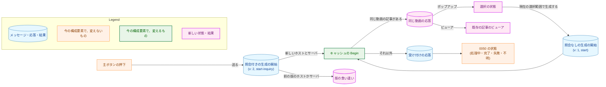
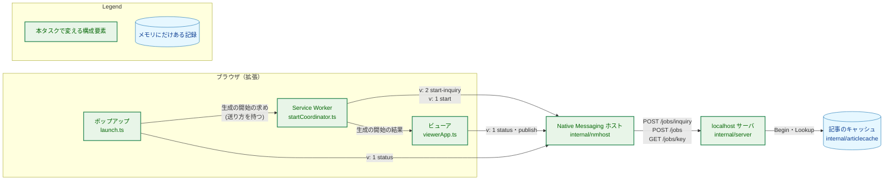
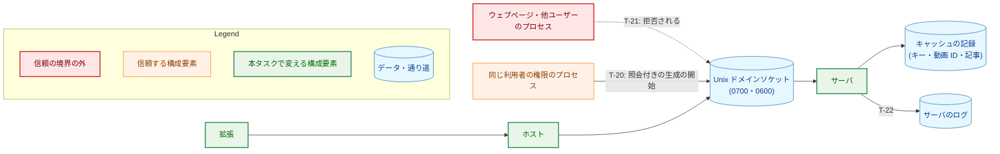
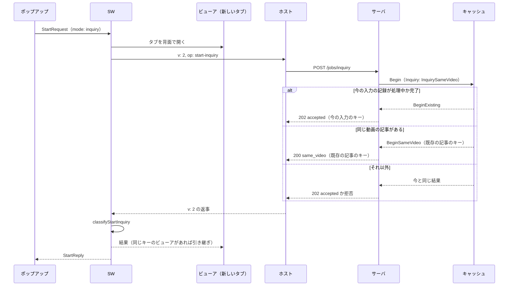
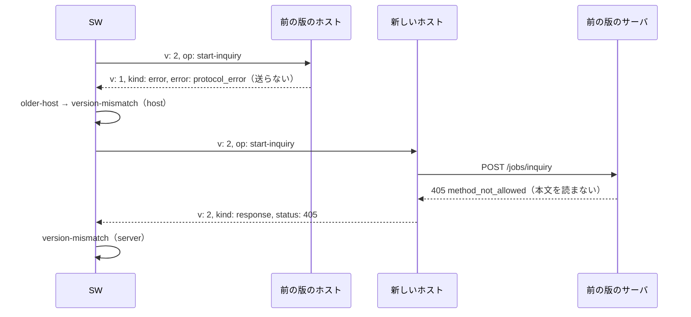
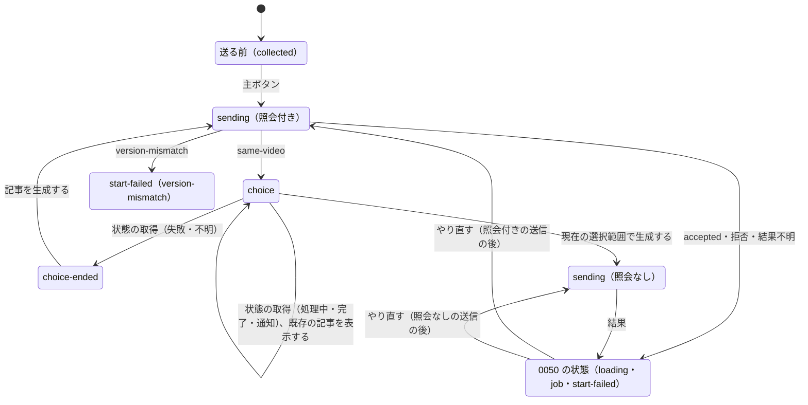

# 設計書：同じ動画の記事があるとき、生成し直すか既存の記事を開くかを選べるようにする

## Document Status

| Item | Value |
|---|---|
| Status | `draft` |
| Created | 2026-11-04 |
| Review date | - |
| Reviewer | - |
| Comments | - |

本書は [01_requirements.md](01_requirements.md)（以下「要件」）を満たす設計を定める。要件の用語（照会の指定、照会付きの生成の開始、同じ動画の応答、選択の状態、既存の記事、既存の記事のビューア、副次のボタン、版の食い違いなど）は要件 6 章の定義に従う。各節の見出しの括弧にある F-…・AC-…・H-… と、数字だけの節番号（3.2、4.5 など）は、要件の項目と章を指す。本文の「（3.3）」のような参照は本書の節を指す。既存のコードの行番号は、コミット `f495b3ec` で確かめた。`internal/nmhost`・`internal/server`・`internal/articlecache` は、要件 F-002 の前の版（コミット `54bca194`）からこのコミットまで変わっていない（`git diff --quiet 54bca194 f495b3ec -- internal/nmhost internal/server internal/articlecache` が差分なしで終わる）。このため、これらの行番号は前の版の振る舞いの根拠にもなる。

## 1. 設計の全体像 (Design Overview)

### 1.1. 設計原則

-   **照会は、新しい操作として宣言する。** 照会付きの生成の開始は、ホストのメッセージでは新しい `op`（`start-inquiry`）、サーバでは新しいパス（`POST /jobs/inquiry`）で表す。照会の有無を、生成の開始の本文のメンバや、入力の中身から決めることはしない（[CLAUDE.md](../../../CLAUDE.md)「Declare, don't infer」）。照会なしの生成の開始（`op: "start"`、`POST /jobs`）は変えない（要件 F-001、4.4）。
-   **前の版は、何もせずに拒否する経路でしか受け取れない形にする。** 前の版のホストは知らない版の値を、前の版のサーバは知らないパスへの `POST` を、どちらも生成を始めずに拒否する（3.1）。照会の指定を、前の版が黙って無視する場所（本文のメンバ、HTTP のヘッダ）には置かない（要件 F-002）。
-   **版の食い違いは、宣言された値で見分ける。** ホストの返事の `v` の値と、サーバの拒否の理由の値で決める。`protocol_error` のような、ほかの原因と共有する値からは推し量らない（3.1.3）。
-   **同じ動画の判定と生成の開始は、キャッシュの 1 つの錠の中で行う。** 照会のための別の問い合わせの操作は作らない（要件 1. 概要の決定）。キャッシュの `Begin` が、今の入力の記録・同じ動画の記事・件数の上限・生成の枠の順に、1 回の錠の中で決める（3.2）。
-   **既存の記事の表示は、今の部品を使う。** 「既存の記事を表示する」は `0050` の「ビューアを開く」の処理を、ビューアの同じキーの再利用は `0050` の引き継ぎの処理を使う。新しく持つ値は、送り方（照会付きか照会なしか）と、ビューアの URL の「既存の記事を表示している」ことの印だけである（要件 4.5）。

### 1.2. 設計の際に決めたこと（2026-11-04）

-   **照会付きの生成の開始は、ホストのメッセージの版 2（`v: 2`）の新しい `op` で送る。ホストは、読んだメッセージの版で返事をする。**
    -   形: 拡張は照会付きの生成の開始だけを `{"v":2,"op":"start-inquiry","input":{…}}` で送り、状態の取得・投稿の操作・照会なしの生成の開始は今と同じく `v: 1` で送る。新しいホストは、メッセージを読んで版を知った後の返事に、メッセージと同じ `v` を付ける（3.1.2）。
    -   理由: 前の版のホストは `v: 2` のメッセージを、送る前に `v: 1` の `protocol_error` で拒否する（`internal/nmhost/relay.go:477-479`）。新しいホストは、`v: 2` のメッセージを読んだ後には `v: 2` で返事をする。このため、`v: 1` の `protocol_error` が返れば、前の版のホストで、サーバに何も送られていないと確定できる。新しいホストは、送った後の失敗（接続の切断、512 KiB を超える応答）にも `protocol_error` を返す（`relay.go:319-320`・`:334-338`）。「照会付きの送信に `protocol_error` が返れば版の食い違い」とする案は、この場合に、サーバが生成を始めたかもしれないのに「生成していない」と表示するので採らない。照会の前にホストの版を尋ねる案は、やり取りと操作が 1 つずつ増えるので採らない。
-   **照会付きの生成の開始のサーバのパスは `POST /jobs/inquiry` にする。**
    -   理由: 前の版のサーバは `/jobs/<残り>` を状態の取得の経路に回し（`internal/server/handler.go:56-62`）、`POST` をメソッドの検査で `405 method_not_allowed` として拒否する（`jobs_api.go:173-177`）。本文は読まず、キャッシュも変えない。新しいサーバは、このパスに `method_not_allowed` を返さない。このため、このパスの `405 method_not_allowed` は前の版のサーバであることを確定させる。本文のメンバやヘッダに置く案は、前の版のサーバが無視して生成する（`request.go:67`）ので採らない。クエリ（`/jobs?…`）は、前の版も `not_found` で拒否する（`handler.go:46-48`）が、新しいサーバにクエリの解析を加えることになるので採らない。記事のキーは小文字の 16 進の 64 文字だけなので（`internal/articlecache/key.go:83-92`）、`inquiry` が状態の取得のキーとして受理されることはない。
-   **前の版を相手にした AC-12 は、記録した返事を使う常設のテストと、実際のバイナリで一度だけ確かめるスクリプトで確かめる。**
    -   形: タスクの `_checks/` に、コミット `54bca194` と新しい版のホストとサーバをビルドし、要件 F-002 の 3 つの版の組み合わせで照会付きの生成の開始を送り、返事とサーバのログを記録するスクリプトを置く。スクリプトは実装の PR で一度だけ走らせ、結果を PR に書く。拡張の常設のテストは、記録した返事（前の版のホストの `v: 1` の `protocol_error`、前の版のサーバの `405 method_not_allowed`）を入力にして、版の食い違いの判定を確かめる（7.3）。
    -   理由: 前の版を毎回ビルドする常設のテストは、`make test` を重くする割に、前の版のコードが変わらない以上、得るものがない。記録した返事だけでは、前の版が本当にその返事をするかを確かめられない。
-   **版の食い違いを表示している間、ポップアップの主ボタンは押せない。** 表示の文言は、拡張・ホスト・サーバを同じ版にそろえてから、ポップアップを開き直す手順を示す。
    -   理由: 要件 F-002 は、同じ入力の送り直しを手順として示さないことを求める。押して送り直せるボタンを置くと、版をそろえる前に押せば毎回同じ表示になる。
-   **「最新」の同じ動画の記事は、記録の世代の番号で選ぶ。** 記録の世代の番号（`record.gen`）は、`Begin` が記録を作るかやり直すたびに、錠の中で 1 つずつ増える（`internal/articlecache/cache.go:110-118`）。このため、世代の番号の順は受け付けの順と一致し、同じ番号の記録はない。
    -   理由: 要件は、受け付けの時刻（失敗の後のやり直しでは、やり直しの受け付けの時刻）が最も新しい記録を求める（要件 F-001、AC-06）。壁時計の時刻（`record.accepted`）は戻ることがあり、同じ時刻の記録の順を別に決める必要がある。世代の番号なら、受け付けの順をそのまま表す。
-   **同じ動画の応答は、既存の記事の状態を持たない。** ポップアップとビューアは、受け付けの応答のキーと同じく、状態の取得で知る（要件 F-003 の表の「最初の結果を受け取る前」）。
    -   理由: 状態を応答に入れると、状態の取得の応答の形を生成の開始の応答に重ねて持つことになる。状態の取得は応答の後すぐに送るので、1 回のやり取りを省く利点は小さい。
-   **ビューアの URL の「既存の記事を表示している」ことの印は、名前 `e`・値 `1` だけにする。** 引き継ぎのメッセージは、引き継ぐ送信の結果が受け付けか同じ動画の応答かを宣言する。引き継いだビューアは、同じ動画の応答なら `e=1` を加え、受け付けなら取り除く。
    -   理由: 印は、そのビューアが表示を受け持つ最後の送信が、同じ動画の応答だったかどうかを表す。受け付けの送信を引き継いだビューアは、現在の選択範囲から生成した記事を表示しているので、印を残すと表示が事実と食い違う。

### 1.3. 概念モデル



矢印 A → B は「A の後に B が起きる（送る、返る、移る）」を表す。矢印のラベルは、その流れになる条件か操作である。照会なしの生成の開始が `Begin` に届いた後は、今と同じく受け付けの応答だけが返る（3.2）。

### 1.4. 既存のコードとの関係

| 既存の部品 | 本タスクでの扱い |
|---|---|
| `articlecache.Cache.Begin`（`internal/articlecache/cache.go:82-120`） | 引数に動画 ID と照会の有無を加え、同じ動画の記事を探す段を加える（3.2）。件数の上限・生成の枠・やり直しの振る舞いは変えない |
| `transcript.ValidateVideoURL`（`internal/transcript/video_id.go:16`） | 同じ動画の判定に使う動画 ID は、今の検査が返す値（`jobInput.videoID`、`internal/server/request.go:97`・`:117`）を使う。URL の解析を別に作らない（要件 4.5） |
| ホストの `route` と `destination.request`（`internal/nmhost/relay.go:467-559`） | 版 2 と `start-inquiry` を加え、返事の版をメッセージの版にする（3.1.2）。今の形（`/articles`）の判定は変えない |
| サーバの `matchTarget` と `startHandler`（`internal/server/handler.go:45-67`、`jobs_api.go:46-133`） | `/jobs/inquiry` を加え、`startHandler` に送り方を渡す（3.3） |
| 拡張の `exchange` と `classifyHostReply`（`extension/src/send.ts`、`extension/src/core/native.ts:113`） | 返事の版の検査を、送ったメッセージの版で行う（3.4.1） |
| `classifyStart`（`extension/src/core/response.ts:559`） | 照会付きの生成の開始の検査 `classifyStartInquiry` を加える（3.4.2） |
| SW の `createStartCoordinator`（`extension/src/startCoordinator.ts:145`） | 送り方を受け取り、同じ動画の応答でも同じキーのビューアの引き継ぎを行う（3.5） |
| ポップアップの `runPopupSend` と `openViewer`（`extension/src/launch.ts:249`・`:419`） | 選択の状態と副次のボタンを加える。「既存の記事を表示する」は `openViewer` を使う（3.6） |
| ビューアの `startViewer` と URL の検査（`extension/src/viewerApp.ts`、`extension/src/core/viewerUrl.ts`） | URL の `e`、既存の記事の表示、経過時間を出さない規則を加える（3.7） |

## 2. システム構成 (System Structure)

### 2.1. 実行時の配置



矢印 A → B は「A が B にメッセージかリクエストを送る」を表す。返事と応答は、逆向きに同じ経路を戻る（図には描かない）。投稿の操作と照会なしの生成の開始の経路は、`0050` のとおりで変えない。

### 2.2. データの流れ

照会付きの生成の開始の流れは、6.1 の図に示す。要点は次のとおりである。

1.  ポップアップは、主ボタンの押下で、送り方 `inquiry` の生成の開始の求めを SW に送る。
2.  SW は、今と同じくビューアのタブを背面で開き、ホストに `v: 2` の `start-inquiry` を 1 回だけ送る。
3.  新しいホストは、`POST /jobs/inquiry` をサーバに送り、サーバの応答を `v: 2` の返事で返す。
4.  サーバは、本文を今と同じく検査した後、`Begin` で振る舞いを決め、受け付けの応答か同じ動画の応答を返す。
5.  SW は結果をビューアとポップアップに届ける。同じ動画の応答なら、ポップアップは選択の状態を、ビューアは既存の記事を表示する。

## 3. コンポーネント設計 (Component Design)

### 3.1. 照会の指定の置き場所と、版の食い違いの見分け方（F-001・F-002・3.2、AC-12〜AC-14・AC-31、H-01）

#### 3.1.1. 置き場所と、前の版の振る舞い

照会の指定は、ホストのメッセージでは `op` の値 `start-inquiry`（版 2 のメッセージにだけある）、サーバでは `POST /jobs/inquiry` というパスとして置く。どちらも閉じた集合の値であり、真偽値のメンバは作らない。このため、要件 3.2 の「受理する形でない照会の指定」は次のようになる。

| 受理しない形 | 拒否 |
|---|---|
| `v` が `1` でも `2` でもない、整数でない | ホストが `protocol_error` で、サーバに送らずに拒否する（今の `ruleVersion`） |
| `op` が文字列でない、知らない値、`v: 1` の `start-inquiry` | ホストが `protocol_error` で、送らずに拒否する（今の `ruleOperation`） |
| メンバの重複（`op` を 2 回書いたものなど）、宣言していないメンバ、`input` がない | ホストが `protocol_error` で、送らずに拒否する（今の `ruleMembers`、`strictjson` の重複の拒否） |
| `/jobs/inquiry` にクエリを付けたもの、`POST` 以外のメソッド | サーバが今と同じく `not_found`・`method_not_allowed` で拒否する |

照会の指定のない生成の開始（`v: 1` の `start`、`POST /jobs`）は、照会なしとして今と同じく受理する（要件 3.2、4.5）。

前の版の振る舞い（コミット `54bca194`。上で述べたとおり `f495b3ec` と同じコード）は、次のとおりである。

| 版の組み合わせ（拡張・ホスト・サーバ） | 前の版の処理 | 拡張が受け取るもの |
|---|---|---|
| 新・前・前 | 前の版のホストは、`v` が `1` でないメッセージを、サーバに送らずに拒否する（`relay.go:477-479`、`forward` は `route` の拒否のときに送らない、`relay.go:257-263`） | `v: 1` の `protocol_error` |
| 新・前・新 | 同上 | `v: 1` の `protocol_error` |
| 新・新・前 | 新しいホストは `POST /jobs/inquiry` を送る。前の版のサーバは `/jobs/` の後の部分を状態の取得のキーとして扱い（`handler.go:56-62`・`:87-88`）、本文を読む前に `POST` を拒否する（`jobs_api.go:173-177`） | `v: 2` の返事に包まれた `405`、`{"status":"rejected","reason":"method_not_allowed",…}` |

どの組み合わせでも、前の版は `Begin` を呼ばないので、LLM を呼ばず、キャッシュに記録を加えない（AC-12）。

#### 3.1.2. ホストのメッセージと返事の版

-   ホストは、新しい形のメッセージの `v` として `1` と `2` を受理する。版 2 の `op` の集合は、版 1 の `start`・`status`・`publish` に `start-inquiry` を加えたものである。`start-inquiry` は `start` と同じメンバ（`v`・`op`・`input`）を持ち、`input` はオブジェクトでなければならない。
-   `start-inquiry` は `POST /jobs/inquiry` に、`input` をそのまま本文として送る。ヘッダは `start` と同じである。
-   **返事の版:** ホストがメッセージを読み、`route` が `v` を `1` か `2` として受理した後の返事（サーバの応答を包んだ返事、送った後の失敗、`route` の残りの規則の違反）は、メッセージと同じ `v` を持つ。次の場合は、メッセージの版が分からないので、今と同じく `v: 1` で返す。
    -   メッセージを読む前の失敗（長さ、接続、読み込み）。
    -   今の形のメッセージ（`v` がない）。
    -   `v` が受理できない値のメッセージ。
-   拡張は、照会付きの生成の開始以外のメッセージを今と同じく `v: 1` で送る。版 2 の `status`・`publish`・`start` は、ホストが受理するが、拡張は送らない（版 2 が版 1 の上位の集合であることを保ち、#526 で今の形を取り除くときに版をそろえる余地を残す）。

```go
// internal/nmhost/relay.go

// Operation gains one value, appended so the zero value stays OperationUnknown.
const (
	OperationUnknown Operation = iota
	OperationStart             // POST /jobs
	OperationStatus            // GET /jobs/{key}
	OperationPublish           // POST /jobs/{key}/publish
	OperationStartInquiry      // POST /jobs/inquiry; protocol version 2 only
)

// protocolVersion is the version a message declares and its reply carries.
// The zero value is protocolV1, the version of every reply sent before the
// message's version is known.
type protocolVersion int

const (
	protocolV1 protocolVersion = iota // "v": 1
	protocolV2                        // "v": 2
)
```

`route` の判定は、CLAUDE.md の例外の範囲（メッセージが厳格な JSON のオブジェクトで、最上位に `v` があるかどうか）を広げない。新しい形の中の版は、宣言された `v` の値を列挙に写し、`switch` で選ぶ。今の `op` と同じ扱いである（要件 5. 制約条件「ホストの判定の例外」）。CLAUDE.md の例外の記述の「Inside the new form the operation is the declared `op` value」に、版も宣言された `v` の値で選ぶことを書き加える（3.10）。#526 で今の形を取り除くときも、版の扱いは変わらない。

#### 3.1.3. 拡張の判定

拡張は、照会付きの生成の開始の返事を、次の順で判定する（3.4.1・3.4.2）。

| 返事 | 判定 | 根拠 |
|---|---|---|
| `v: 2` の返事 | 今の規則で検査し、包まれたサーバの応答を `classifyStartInquiry` で判定する | 新しいホスト |
| `v: 2` の返事に包まれた `405` の `method_not_allowed` | 版の食い違い（サーバ） | 前の版のサーバ（3.1.1）。新しいサーバは `/jobs/inquiry` に `method_not_allowed` を返さない |
| `v: 1` の `protocol_error` | 版の食い違い（ホスト） | 前の版のホストは `v: 2` を送る前に拒否する。新しいホストが `v: 1` の `protocol_error` を返すのは、メッセージを読み終える前の失敗だけで、そのときも何も送っていない（下の「残る誤り」） |
| `v: 1` の `server_unavailable`・`message_too_large` | 今と同じく、送られていない（`not-sent`） | どちらの版のホストでも、メッセージを読む前の失敗 |
| `v: 1` の `server_timeout` | 今と同じく、応答なし（`no-response`） | 今の判定を変えない |
| `v: 1` の `response` | 想定外の応答 | どちらの版のホストも、`v: 2` のメッセージに `v: 1` でサーバの応答を返さない |
| `v` がない・`1` と `2` 以外・形の誤り | 想定外の応答 | 今の規則 |

-   **残る誤り:** 新しいホストが、メッセージの読み込みの途中で時間切れ以外の失敗をすると（ブラウザが標準入力を途中で閉じた場合）、`v: 1` の `protocol_error` を返し、拡張は版の食い違いと表示する。このときも何も送られていないので、「記事を生成していない」という表示は正しい。版をそろえる手順だけが当てはまらない。ブラウザはメッセージを一度に書く（`relay.go:28-30`）ので、起きる見込みは小さい。
-   照会なしの生成の開始・状態の取得・投稿の操作の判定は変えない。`v: 2` の返事を受け取れば、今と同じく想定外の応答（`envelope-version`）とする。

### 3.2. キャッシュの `Begin`（F-001、AC-01〜AC-09、H-02）

記録は、同じ動画の判定のために動画 ID を持つ。`Begin` は、動画 ID と照会の有無を受け取り、同じ動画の応答を表す結果を返す。

```go
// internal/articlecache/cache.go

// Inquiry is whether a generation start asks for a same-video article. The
// zero value is InquirySameVideo: a request that does not say otherwise
// starts nothing when a same-video article exists, so it never spends an
// LLM call the caller did not ask for.
type Inquiry int

const (
	InquirySameVideo Inquiry = iota // report a same-video article instead of starting
	InquiryNone                     // start as before; never report a same-video article
)

// BeginRequest is what Begin decides on.
type BeginRequest struct {
	Key     Key
	VideoID string  // the ID transcript.ValidateVideoURL returned; compared only for equality
	Inquiry Inquiry
}

// BeginOutcome gains one value, appended so the zero value stays BeginFull.
const (
	BeginFull      BeginOutcome = iota // no evictable record: nothing changed
	BeginNoSlot                        // acquire reported false: nothing changed
	BeginExisting                      // the key is running or done: nothing changed
	BeginStarted                       // a running record was created
	BeginRestarted                     // a failed record was restarted
	BeginSameVideo                     // a same-video article was found: nothing changed
)

// BeginResult is what Begin did. Run is non-nil only for BeginStarted and
// BeginRestarted; SameVideo is set only for BeginSameVideo.
type BeginResult struct {
	Outcome   BeginOutcome
	Run       *Run
	Evicted   *Eviction
	SameVideo Key
}

func (c *Cache) Begin(req BeginRequest, acquire func() bool) BeginResult
```

`Begin` は、錠の中で次の順に決める。

| 順 | 条件 | 結果 | キャッシュの変化 |
|---|---|---|---|
| 1 | `req.Key` の記録が処理中か完了 | `BeginExisting` | なし（今と同じ） |
| 2 | `req.Inquiry` が `InquirySameVideo` で、同じ動画の記事がある | `BeginSameVideo`、`SameVideo` は最新の 1 件のキー | なし。`acquire` を呼ばず、記録を捨てず、`req.Key` の失敗した記録もやり直さない |
| 3 | それ以外 | 今と同じ（`BeginFull`・`BeginNoSlot`・`BeginStarted`・`BeginRestarted`） | 今と同じ。作る記録とやり直す記録は `req.VideoID` を持つ |

-   **同じ動画の記事:** 動画 ID が `req.VideoID` と等しく、キーが `req.Key` と違い、状態が処理中か完了の記録。失敗した記録は含めない。
-   **最新:** 同じ動画の記事のうち、世代の番号（`record.gen`）が最も大きい 1 件（1.2）。
-   **探し方:** 記録の全件をたどる。件数は上限の 100 件以下なので、索引は設けない（要件 4.1）。
-   **同時に届いた照会（AC-08）:** 同じ動画の記事がない状態で、同じ動画の違う入力の照会付きの生成の開始が同時に届いても、`Begin` は錠の中で順に決める。最初の 1 つが記録を作り、後のものは順 2 でその記録を同じ動画の記事として見つける。
-   **件数の上限と生成の枠（AC-07）:** 順 2 は順 3 の前にあるので、生成の枠に空きがなくても、捨てられる記録がなくても、同じ動画の応答を返す。
-   **`Inquiry` の零値:** 呼び出し側が照会の有無を書き忘れると、照会付きとして振る舞う。今の入力の記事を生成せずに同じ動画の記事を返すので、利用者が求めていない LLM の呼び出しをしない。照会なしの生成の開始のハンドラは、`InquiryNone` を明示して渡す（3.3）。ハンドラが `BeginSameVideo` を想定していない経路で受け取った場合は、内部の失敗として扱う（4.2）。

記録の項目（`internal/articlecache/record.go:137-160` の `record`）に、動画 ID を加える。

```go
// internal/articlecache/record.go
type record struct {
	// ... the current fields ...

	// videoID is the video the record's input names, as the request
	// validation returned it. It is compared only for equality.
	videoID string
}
```

動画 ID は、キャッシュの中で比べるためだけに持ち、`Snapshot`・ログ・応答には出さない。

**変わる既存のテスト:** `Begin` の引数と戻り値の形が変わるので、`Begin` を呼ぶテスト（`internal/articlecache/cache_test.go` の 14 か所、`internal/server` の `generation_test.go`・`handler_test.go`・`jobs_api_test.go`・`publish_test.go`・`test_helpers.go`）を新しい形に書き換える。振る舞いの期待は変えない。

### 3.3. サーバの受け口と応答（F-001・4.2、AC-01〜AC-11・AC-34、H-02・H-06）

**パス:** `matchTarget`（`internal/server/handler.go:45`）に、`/jobs/inquiry` との完全一致を、キーの部分を切り出す前に加える。

```go
// internal/server/handler.go

// JobsInquiryPath is the request target of a generation start with the
// same-video inquiry.
const JobsInquiryPath = "/jobs/inquiry"

// route gains one value, appended so the zero value stays routeNotFound.
const (
	routeNotFound route = iota
	routeArticles
	routeStart
	routeStatus
	routePublish
	routeStartInquiry
)
```

**ハンドラ:** `startHandler` に照会の有無（`articlecache.Inquiry`）を渡す。`routeStart` は `InquiryNone` を、`routeStartInquiry` は `InquirySameVideo` を渡す。メソッドの検査、読み込みの枠、本文の読み込みと検査、panic の回復は、今の `startHandler` をそのまま使う（要件 F-001 の検査の順序、AC-11）。`Begin` の結果ごとの振る舞いは次のとおりである。

| `Begin` の結果 | 照会なし（`/jobs`） | 照会付き（`/jobs/inquiry`） |
|---|---|---|
| `BeginStarted`・`BeginRestarted` | 今と同じ（生成を始め、受け付けの応答） | 同左 |
| `BeginExisting` | 今と同じ（受け付けの応答） | 同左（AC-04） |
| `BeginSameVideo` | 起きない。起きたら `internal_error` で拒否する（4.2） | 同じ動画の応答（下） |
| `BeginNoSlot`・`BeginFull` | 今と同じ（`too_many_requests`） | 同左 |

**同じ動画の応答:**

| 項目 | 値 |
|---|---|
| 状態コード | `200`（何も受け付けていないので `202` にしない） |
| 本文 | `{"status":"same_video","key":"<既存の記事のキー>","requestId":"…"}` |
| ヘッダ | 今の応答と同じ固定のヘッダ（`writeBody`、`internal/server/response.go`） |

本文は、今の `responseBody`（`Status`・`Key`・`RequestID`）で書く。文言・コピーした字幕・URL・動画メタデータ・秘密の値を持たない（AC-10）。Webhook への通知はしない。新しい API のどの操作も通知しない（`jobs_api.go:43-45`）方針をそのまま保つ。

**ログ（H-06）:** 生成の開始のログの行（`jobs_api.go:132`）は、今の属性（`requestId`・`key`・`videoId`・`outcome`）に、送り方 `inquiry`（`same_video` か `none`）を加える。同じ動画の応答を返したときは、メッセージ `generation start answered with a same-video article` の 1 行を、次の属性で書く。

| 属性 | 値 |
|---|---|
| `requestId` | 応答の `requestId` |
| `key` | 今の入力のキー |
| `videoId` | 動画 ID（今の行と同じ） |
| `outcome` | `same_video` |
| `inquiry` | `same_video` |
| `existingKey` | 同じ動画の応答で返した既存の記事のキー |

既存の記事のキーをログに出すのは、`grep "$key" server.log` で、既存の記事のジョブの行と、その記事を返した照会の行をつなげて追えるようにするためである（`docs/dev/guides/development.md`「ジョブの API」）。キーは今も生成の開始のログに出しており、出す値の種類は増えない。本文・コピーした字幕・`videoUrl` の文字列・動画メタデータ・秘密の値は出さない（AC-34）。

**変わる既存のテスト:** 生成の開始のログの属性を数えるテスト（`internal/server/jobs_api_test.go:179` の `outcome=` の数え方など）は、`inquiry` の属性が加わっても通る形のままであることを確かめ、属性の集合を厳密に比べるテストがあれば `inquiry` を加える。

### 3.4. 拡張のやり取りの判定（F-001・F-002・3.2、AC-12〜AC-14・AC-32、H-01・H-02）

#### 3.4.1. ホストのメッセージと返事

```ts
// src/core/hostMessage.ts
export type HostMessage =
  | { readonly v: 1; readonly op: "start"; readonly input: StartInput }
  | { readonly v: 2; readonly op: "start-inquiry"; readonly input: StartInput }
  | { readonly v: 1; readonly op: "status"; readonly key: ArticleKey }
  | { readonly v: 1; readonly op: "publish"; readonly key: ArticleKey };

export function startInquiryMessage(request: PreparedRequest): HostMessage;

// src/core/native.ts
/** The host reply versions; a Go guard compares each with internal/nmhost. */
export const hostReplyVersion = 1;
export const hostInquiryReplyVersion = 2;

// src/core/exchange.ts
/** What the outside of one host reply became. */
export type HostOutcome =
  | { readonly kind: "response"; readonly status: number; readonly bytes: Uint8Array }
  // A version-1 protocol_error reply to a version-2 message: an older host
  // refused it before sending anything.
  | { readonly kind: "older-host" }
  | ExchangeFailureLog;
```

`classifyHostReply` は、送ったメッセージの版を引数に取る。版 1 のメッセージには今の規則をそのまま当てる。版 2 のメッセージには 3.1.3 の表を当てる。`older-host` は、版 2 のメッセージに対する返事からしか作らない。

#### 3.4.2. 照会付きの生成の開始の応答

```ts
// src/core/response.ts

/** A generation start's result as displayed. */
export type StartOutcome =
  | { readonly kind: "accepted"; readonly key: ArticleKey; readonly requestId: RequestId }
  | { readonly kind: "same-video"; readonly key: ArticleKey; readonly requestId: RequestId }
  | { readonly kind: "version-mismatch" }
  | { readonly kind: "rejected"; readonly reason: StartRejectReason; readonly requestId: RequestId }
  | ExchangeFailure;

/** As logged: a version mismatch also names the side that is older. */
export type StartOutcomeLog =
  | Exclude<StartOutcome, ExchangeFailure | { kind: "version-mismatch" }>
  | { readonly kind: "version-mismatch"; readonly side: "host" | "server" }
  | ExchangeFailureLog;

/** Interprets a generation start with the same-video inquiry. Never throws. */
export function classifyStartInquiry(received: HostOutcome): StartOutcomeLog;
```

`classifyStartInquiry` は、`classifyStart` と同じ厳格な JSON の解析と全体の規則を使い（要件 3.2、`0050` 3.2）、次を受理する。

| `status` | メンバの集合 | 状態コード | 結果 |
|---|---|---|---|
| `accepted` | `status`・`key`・`requestId` | `202` | `accepted` |
| `same_video` | `status`・`key`・`requestId` | `200` | `same-video` |
| `rejected` | `status`・`reason`・`requestId` | 理由ごとの値（`startRejectStatus`） | `rejected`。理由の集合は照会なしの生成の開始と同じ |
| `rejected` で理由が `method_not_allowed` | `status`・`reason`・`requestId` | `405` | `version-mismatch`（`side: "server"`） |

-   `older-host` の受け取りは `version-mismatch`（`side: "host"`）とする。
-   キーは `parseArticleKey` で検査する。キーから動画や入力について何も導かない（要件 3.2）。
-   メンバの過不足、閉じた集合にない値、状態コードとの組の誤り、`method_not_allowed` を `405` 以外で返したものは、想定外の応答とする（AC-32）。
-   `classifyStart`（照会なし）は変えない。照会なしの応答に `same_video` が来れば、今と同じく想定外の応答（`member-set`）になる。

`side` は開発者向けのログにだけ書き、表示とページの間のメッセージには載せない（`toStartOutcome` が落とす）。

### 3.5. SW の生成の開始（F-003・F-004・3.2、AC-15・AC-17・AC-19・AC-26・AC-33、H-03・H-05）

**生成の開始の求め:** ポップアップから SW への求めに、送り方を加える。

```ts
// src/core/extensionMessages.ts

/** Whether a start asks for a same-video article first; declared, never inferred. */
export type SendMode = "inquiry" | "plain";

/** popup -> service worker, chrome.runtime.sendMessage. */
export interface StartRequest {
  readonly type: "start";
  readonly mode: SendMode;
  readonly input: StartInput;
  readonly viewer: ViewerSeed;
  readonly source: SourceTab;
}
```

`mode` は必須のメンバで、`inquiry` と `plain` のほかの値、メンバの欠け、重複は、`parseStartRequest` が拒否する。拒否した求めには、今と同じく何も送らず、タブも開かない（AC-33）。送り手の検査（ツールバーのポップアップの URL だけ）は変えない。ポップアップと SW は同じ拡張の版なので、`mode` のない求めを受理する互換は持たない。

**送る:** SW は `mode` が `inquiry` なら `startInquiryMessage` を送って `classifyStartInquiry` で判定し、`plain` なら今の `startMessage` と `classifyStart` を使う。ビューアのタブを背面で開くこと、1 回だけ送ること、送信の時刻から 35 秒だけ記録を持つことは変えない（`0050` F-001・F-002）。

**同じキーのビューアの引き継ぎ:** SW は、結果が `same-video` のときも、`accepted` と同じく、そのキーを表示しているビューアを尋ね、あれば引き継ぎを頼み、新しいタブを閉じる（`0050` F-002、AC-26）。引き継ぎのメッセージは、引き継ぐ送信の結果の種類を宣言する。

```ts
// src/core/extensionMessages.ts — ViewerChannelMessage, the take-over member
  | {
      readonly type: "take-over";
      readonly queryId: string;
      readonly tabId: number;
      readonly sentAt: number;
      /** What the send that is taken over was answered with. */
      readonly answer: "accepted" | "same-video";
    }
```

`answer` は必須のメンバで、2 つのほかの値を持つメッセージは `parseViewerChannelMessage` が拒否し、ビューアは無視する（AC-33）。ビューアは引き継ぎを確かめられなければ、今と同じく新しいタブを閉じずに表示を続ける（`0050` F-002）。

**結果の届け方:** `StartReply`（ポップアップへ）と `AwaitStartReply`（ビューアへ）は、`StartOutcome` を今と同じく運ぶ。`StartOutcome` に `same-video` と `version-mismatch` が加わるので、両方の検査（`parseStartReply`・`parseAwaitStartReply`）は、この 2 つの種類を受理する。

**自動で送らない:** SW は、同じ動画の応答を受け取っても何も送らない。照会なしの生成の開始は、ポップアップから `mode: "plain"` の求めが届いたときにだけ送る（AC-17、要件 4.2）。

### 3.6. ポップアップの選択の状態（F-003・4.6、AC-15〜AC-24・AC-35〜AC-42、H-03・H-04）

`0046` の設計 9 章と `0050` 3.8 の方針どおり、`PopupJobState` に種類を加え、ボタンの操作は状態から関数で決める。

```ts
// src/core/popupView.ts

/** The existing article's state as the choice shows it. */
export type ExistingState = "loading" | "running" | "done";

export type PopupJobState =
  | { readonly kind: "sending" }
  | { readonly kind: "start-failed"; readonly failure: StartFailure }
  | { readonly kind: "loading"; readonly notice: PollNotice }
  | { readonly kind: "job"; readonly job: JobDisplay; readonly notice: PollNotice }
  // A same-video answer: the existing article and the two buttons.
  | { readonly kind: "choice"; readonly existing: ExistingState; readonly notice: PollNotice }
  // The existing article failed or was lost while the choice was shown.
  | { readonly kind: "choice-ended" };

/** What the primary button does; total over PopupJobState, never stored beside it. */
export type PrimaryAction =
  | "none"
  | "open-viewer"
  | "retry"
  | "open-existing"
  | "start-inquiry";

/** What the secondary button does; "none" means the button is not shown. */
export type SecondaryAction = "none" | "start-plain";

export function primaryAction(state: PopupJobState): PrimaryAction;
export function secondaryAction(state: PopupJobState): SecondaryAction;

// src/core/jobView.ts — a start that gave no key; version-mismatch included
export type StartFailure =
  | Exclude<StartOutcome, { kind: "accepted" } | { kind: "same-video" }>
  | { readonly kind: "no-result" };
```

**ボタンの操作:**

| 状態 | 主ボタン | 副次のボタン |
|---|---|---|
| `choice` | 「既存の記事を表示する」（`open-existing`） | 「現在の選択範囲で生成する」（`start-plain`） |
| `choice-ended` | 「記事を生成する」（`start-inquiry`） | なし |
| `start-failed` で `version-mismatch` | 押せない（`none`、1.2） | なし |
| そのほか | `0050` 3.8 のとおり | なし |

**送り方の記憶:** `runPopupSend` は、今の送信の送り方（`SendMode`）を持つ。主ボタンの最初の押下と `start-inquiry` は `inquiry` で、`start-plain` は `plain` で送る。「やり直す」（`retry`）は、持っている送り方で送る。このため、`plain` の送信の後の「やり直す」は、何度押しても `plain` で送る（AC-23）。どの送信も、新しい送信の時刻で `sending` から始め、ビューアのタブを背面で新しく開く（`0050` 3.8）。

**選択の状態の流れ:**

1.  照会付きの送信の結果が `same-video` なら、`choice`（`existing: "loading"`）を表示し、そのキーでポーリングを始める（`createStatusPoller`、`0050` 3.7 と同じ規則で続け、止める）。SW の応答の `viewerTabId` を、このキーのビューアのタブとして持つ。
2.  ポーリングの結果は、要件 F-003 の表のとおりに写す。
    -   処理中 → `existing: "running"`、完了 → `existing: "done"`。
    -   失敗・不明 → `choice-ended`。ポーリングを止める。
    -   繰り返せば直りうる結果・繰り返しても直らない結果 → `choice` のまま `notice` を並べる。続けるか止めるかは、今のポーラーが決める。
3.  `open-existing` は、`0050` の `openViewer` をそのキーで呼ぶ（4.5）。新しいタブで開く場合のビューアの URL は、現在の収集の値から作る見出しなど（`viewerSeed`）、押した時刻の送信の時刻、キー、`e=1` を持つ。生成の開始は送らない。押した後も、ポップアップが開いていれば `choice` のまま変わらない（AC-18）。
4.  `start-plain` は、照会なしの生成の開始を送り、`sending` から `0050` の状態に移る（AC-19）。既存の記事のビューアのタブには何もしない。
5.  `start-inquiry` は、照会付きの生成の開始を送り、結果に応じて再び `choice` か `0050` の状態になる。

照会付きの送信の結果が `accepted`、または拒否・送れなかった・結果不明なら、今と同じ `0050` の状態を表示し、同じ動画の記事がなかったことに触れない（AC-22、AC-30）。

**描く場所:** 選択の状態は、`0050` 3.8 と同じく、動画のセクションと詳細を残し、確認のセクション（`#checks`）の位置に既存の記事の状態を描く。副次のボタンは、操作のセクションの主ボタンの後に新しい `<button id="secondary" type="button">` として置き、`secondaryAction` が `none` の間は `hidden` にする。2 つのボタンは、`0046` AC-17 と同じ条件でスクロールせずに見える大きさと配置にする（AC-16）。

**アクセシビリティ（4.6）:**

| AC | 設計 |
|---|---|
| AC-35 | 2 つのボタンはネイティブの `<button>` で、DOM の順（主ボタン → 副次のボタン）が見た目の順と一致する。主ボタンのフォーカスの戻し方は `0050` のまま（キーボードで押して押せなくなった主ボタンに、押せるようになった時点でフォーカスを戻す）。副次のボタンにフォーカスがある間に `choice-ended` で `hidden` にするときは、その前に主ボタンにフォーカスを移す |
| AC-36 | 副次のボタンのフォーカスの印は、主ボタンと同じ色の変数（`theme.css`）を使う |
| AC-37 | 見える名前と同じ文字を名前に持つ。主ボタンと副次のボタンは、名前と位置（先が主ボタン）でも区別できる。副次のボタンの見た目は、主ボタンより軽い枠線の形にする |
| AC-38 | `choice` になったこと、既存の記事の状態とその変化、`choice-ended`、通知、版の食い違いは、操作のセクションの `#status`（`role="status"`）に要約を書いて伝える（`0050` 3.8 と同じ） |
| AC-39 | 既存の記事の状態は、`renderJob.ts` と同じ記号の形と状態の語で示し、色だけに頼らない。新しい文字と記号の色は、`theme.css` の今の変数から選び、`test/style.test.ts` のコントラストの計算に加える |
| AC-40 | 文言はすべてメッセージの目録にあり、ページの `lang` は今と同じく表示の言語から決める |
| AC-41 | 副次のボタンは、主ボタンと同じく 44×44 CSS ピクセル以上にする |
| AC-42 | 既存の記事の生成中の記号の動きは、今の `prefers-reduced-motion` の規則（`renderJob.ts` と共有）で止める |

**開き直したとき:** ポップアップは送信の記録を持たないので、開き直すと送る前の画面から始まり、何も送らない（AC-24）。

### 3.7. 既存の記事のビューア（F-004・3.2、AC-25〜AC-28・AC-33、H-05）

**ビューアの URL:** `viewerUrl.ts` の名前の集合に `e` を加え、`k` の後に書く。

```ts
// src/core/viewerUrl.ts
type Name = "h" | "c" | "t" | "u" | "s" | "k" | "e";

export interface ViewerParams extends ViewerSeed {
  readonly key?: ArticleKey;
  /** Set when the viewer shows a same-video article; written as e=1. */
  readonly existing?: true;
}

// ViewerUrlError gains "existing": an e that is not exactly "1", or an e without k.
```

| 規則 | 扱い |
|---|---|
| 値 | `1` だけ（上限 1 文字）。ほかの値・空の値は拒否する |
| 回数 | 1 回だけ。2 回目は今の `duplicate-name` で拒否する |
| `k` との関係 | `k` のない URL が `e` を持てば拒否する |
| 拒否したとき | `0050` と同じく、リンクが正しくないことを表示し、状態の取得を送らない（AC-33） |

`e` は、名前を加えるだけの任意の値なので、前の版の拡張が書いた URL（`e` がない）は今と同じく読める。印は、そのビューアが既存の記事を表示していることだけを表し、入力や既存の記事の値を含まない（要件 4.2）。

**結果を受け取ったとき:**

| 受け取る結果 | ビューアの振る舞い |
|---|---|
| `same-video`（SW から） | `accepted` と同じく、URL に `k` を加え（`history.replaceState`）、`e=1` も加えて、ポーリングを始める |
| `version-mismatch`（SW から） | `start-failed` として版の食い違いを表示する。状態の取得は送らない |
| 引き継ぎで `answer: "same-video"` | 今の引き継ぎ（`viewerApp.ts:346` 付近）に加えて、URL に `e=1` を加える。送信の時刻とポーリングは `0050` F-002 のとおり（`takeOverRestarts`、`viewerApp.ts:140`）。AC-26 |
| 引き継ぎで `answer: "accepted"` | 今の引き継ぎに加えて、URL から `e` を取り除く（1.2） |

**表示:** URL に `e=1` を持つビューア（既存の記事のビューア）は、次を示す。

-   見出しの下に、同じ動画の既存の記事を表示していること（現在の選択範囲からは生成していないこと）と、現在の選択範囲で生成する手順（ポップアップを開いて主ボタンを押し、「現在の選択範囲で生成する」を選ぶ）を示す領域を置く。結果を受け取って `e` が加わったときに読み上げられるよう、この領域の文を `#viewer-status`（今のビューアの `role="status"` の領域）にも要約として書く（AC-38）。
-   処理中は工程の状態だけを示し、経過時間を描かない。描く部品（`renderJob.ts` の `jobNodes`）に、経過時間を描くかどうかを表す値を渡し、既存の記事のビューアでは描かないとする。毎秒の描き直しも行わない。完了した後は、今と同じくサーバが返す所要時間を示す（AC-27、要件 5. 制約条件の `0050` の経過時間の例外）。

見出し・チャンネル名・動画タイトルは、今と同じく URL の値（ポップアップの収集の値から作ったもの）で描く（要件 1. 概要「ビューアの見出しは、現在の収集の値から作る」）。

**版の食い違いの表示:** ポップアップとビューアは、`start-failed` の `version-mismatch` に、専用の文言を出す（3.8）。想定外の応答の文言は出さない（AC-13）。

### 3.8. 文言（F-002〜F-004・F-005、AC-14・AC-16・AC-20・AC-28・AC-30、H-04）

文言は、英語と日本語の両方のメッセージの目録（`extension/src/core/i18n/` の今の目録）に置く。最終の文は実装の PR で書き、レビューで読む（`manual`）。設計では、各文言が伝える内容と、ボタンの名前を決める。

| 文言 | 伝える内容 |
|---|---|
| 主ボタン（選択の状態） | 英語 `Open existing article`、日本語 `既存の記事を表示する` |
| 副次のボタン | 英語 `Generate from current selection`、日本語 `現在の選択範囲で生成する` |
| 選択の状態 | このサーバに同じ動画の記事があること。ほかに記事がないことや、この記事が今後も残ることは断定しない |
| 既存の記事の状態 | 取得中・生成中・生成済みのそれぞれ |
| 選択の状態を終えた | 同じ動画の記事が使えなくなったこと。主ボタンで改めて生成を始められること |
| 版の食い違い | 記事を生成していないこと。拡張・ホスト・サーバを同じ版に更新してから、ポップアップを開き直すこと。同じ入力の送り直しは手順に含めない（AC-14） |
| 既存の記事のビューア | 同じ動画の既存の記事を表示していて、現在の選択範囲からは生成していないこと。現在の選択範囲で生成する手順（AC-28） |

-   照会付きの送信が受け付けられたときの文言は、`0050` のまま変えず、同じ動画の記事がなかったことに触れない（AC-30）。
-   `sendMessages.ts` の `startResultMessage` は、`StartFailure` の `version-mismatch` に版の食い違いの文言を返す。`switch` は `never` で終わるので、文言を決め忘れると型の検査が失敗する。
-   **README のガード:** `test/metadataDocs.test.ts` は、README の手順の主ボタンの名前を目録の値と突き合わせる。README の「ブラウザ拡張」節に 2 つのボタンの名前を書くので（F-005）、このガードの突き合わせる名前に、選択の状態の主ボタンと副次のボタンの名前を加える。

### 3.9. 文書（F-005、AC-29・AC-30）

| 文書 | 書くこと |
|---|---|
| `README.md`（`/mktrans` で `README.en.md`） | 「ブラウザ拡張」節: 選択の状態と 2 つの選択肢、同じ動画の判定の基準（動画 ID）、照会がベストエフォートであること（件数の上限と再起動で記事が消え、そのときは選択を示さずに生成すること）、拡張・ホスト・サーバを同じ版に更新する必要と、版が食い違うと主ボタンから生成できないこと。ジョブの API の説明があれば、照会付きの生成の開始を加える |
| `docs/dev/guides/development.md` | 「ジョブの API」の操作の表に `POST /jobs/inquiry` と同じ動画の応答を加え、照会付きの生成の開始の振る舞い（3.2 の表）を書く。curl の例を加える。「ジョブの API のコード」に `status` の `same_video` を加える。拒否の理由は加えない（`serverReasons.test.ts` の表は変わらない） |
| `docs/dev/security.md` §8 | 照会付きの生成の開始が動画単位で記事の有無とキーを返すことと、それを受け入れる理由、`0044` の T-10 の再評価（5.2）、記録が動画 ID を持つこと、ログに出す値（3.3） |
| `docs/translation_glossary.md` | 要件 F-005 の新しい用語と、改める定義 |
| `CLAUDE.md` | 「Declare, don't infer」のホストの例外に、新しい形の中の版も宣言された `v` の値で選ぶことを書き加える（3.1.2）。例外の範囲は変えない |
| `docs/dev/conventions/package_reference.md` | `internal/nmhost` と `internal/articlecache` の説明が、版 2 と動画 ID を含まない書き方で正しいままなら変えない。正しくなくなる箇所があれば直す |

### 3.10. 既存の方針からの変更と、更新するテスト

| 方針（記載場所） | 本書の扱い | 更新するテスト |
|---|---|---|
| ホストの返事の `v` は常に `1`（`0044` `02_architecture.md` §3.10、`internal/nmhost/relay.go:48-49`） | 例外ではなく拡張: 版 2 のメッセージを読んだ後の返事は `v: 2` を持つ（3.1.2）。理由は 1.2 | `internal/nmhost/relay_test.go:251`・`:263` は版 1 の返事の形を確かめるもので、版 1 のメッセージには今のまま通る。`internal/nmhost/test_helpers.go` の `HostWireValuesForTest`（`Version` が 1 つ）と、それを拡張の `hostReplyVersion` と比べる `cmd/yt2column/extension_docs_test.go:177-182` は、2 つの版を比べる形にする |
| 新しい形の `v` は `1` だけ（`relay.go:60-62`・`:477-479`） | `1` と `2` を受理する | `v: 2` を `ruleVersion` で拒否することを確かめるテスト（`internal/nmhost/relay_test.go:931` の `unknown version`）は、`v: 3` に改める |
| 新しい API の応答は、生成を始めたか既存のキーを返したかを区別しない（`0044` F-001） | 要件 5. 制約条件のとおり、照会付きの生成の開始の同じ動画の応答だけを区別する。照会なしの応答は変えない | なし |
| 処理中の経過時間は送信の時刻から数える（`0050` 1. 概要の決定） | 要件 5. 制約条件のとおり、既存の記事のビューアには当てはめない（3.7） | 経過時間を描くことを確かめる `test/renderJob.test.ts`・`test/viewerApp.test.ts` は、`e` のないビューアについて今のまま通る |
| `0044` の T-10（記事の有無の照会を排除する脅威とした） | 要件 5. 制約条件のとおり、信頼の境界の内側で受け入れるリスクとして再評価する（5.2） | なし（キーを秘密から計算することは変えない） |

### 3.11. コンポーネント責務表

| ファイル | 新規/変更 | 責務 |
|---|---|---|
| `internal/articlecache/cache.go` | 変更 | `Inquiry`・`BeginRequest`・`BeginResult`・`BeginSameVideo`。`Begin` の同じ動画の記事の判定 |
| `internal/articlecache/record.go` | 変更 | `record.videoID` |
| `internal/articlecache/cache_test.go` | 変更 | `Begin` の新しい形への書き換えと、同じ動画の判定のテスト |
| `internal/server/handler.go` | 変更 | `JobsInquiryPath`・`routeStartInquiry`・`matchTarget` |
| `internal/server/jobs_api.go` | 変更 | `startHandler` の照会の有無、`BeginSameVideo` の応答とログ |
| `internal/server/response.go` | 変更 | 同じ動画の応答を書く関数 |
| `internal/server/jobs_api_test.go`・`handler_test.go`・`generation_test.go`・`publish_test.go`・`test_helpers.go` | 変更 | `Begin` の新しい形、照会付きの生成の開始のテスト |
| `internal/nmhost/relay.go` | 変更 | 版 2、`OperationStartInquiry`、返事の版 |
| `internal/nmhost/relay_test.go`・`test_helpers.go` | 変更 | 版 2 のテスト、返事の版の値 |
| `cmd/yt2column/extension_docs_test.go` | 変更 | 返事の版のガードを 2 つの版にする |
| `docs/tasks/0058_same_video_article/_checks/`（スクリプト） | 新規 | 前の版との組み合わせの一度だけの確認（1.2、7.3） |
| `extension/src/core/hostMessage.ts` | 変更 | `start-inquiry` のメッセージ |
| `extension/src/core/native.ts`・`core/exchange.ts` | 変更 | 送った版による返事の判定、`older-host` |
| `extension/src/send.ts` | 変更 | `exchange` が送ったメッセージの版を判定に渡す |
| `extension/src/core/response.ts` | 変更 | `StartOutcome` の `same-video`・`version-mismatch`、`classifyStartInquiry` |
| `extension/src/core/extensionMessages.ts` | 変更 | `SendMode`、`StartRequest.mode`、引き継ぎの `answer`、検査 |
| `extension/src/startCoordinator.ts` | 変更 | 送り方による送信と判定、同じ動画の応答の引き継ぎ |
| `extension/src/core/popupView.ts` | 変更 | `choice`・`choice-ended`、`PrimaryAction`・`SecondaryAction` |
| `extension/src/core/jobView.ts` | 変更 | `StartFailure` の `version-mismatch` |
| `extension/src/launch.ts` | 変更 | 送り方の記憶、選択の状態の流れ、副次のボタン、`open-existing` |
| `extension/src/core/viewerUrl.ts` | 変更 | `e` の書き出しと検査 |
| `extension/src/viewerApp.ts` | 変更 | 同じ動画の結果と引き継ぎの `answer` による `e` の更新、既存の記事のビューアの表示 |
| `extension/src/ui/render.ts`・`ui/renderViewer.ts`・`ui/renderJob.ts` | 変更 | 選択の状態と副次のボタンの描画、既存の記事の領域、経過時間を描かない指定 |
| `extension/src/core/sendMessages.ts` | 変更 | 版の食い違いと選択の状態の文言の選択 |
| `extension/src/core/i18n/`（英語と日本語の目録）・`extension/static/_locales/` | 変更 | 新しい文言（`_locales` は、そこに置く文言がある場合だけ） |
| `extension/static/popup.html`・`extension/static/*.css` | 変更 | 副次のボタンの要素と見た目 |
| `extension/test/`（`hostMessage`・`native`・`response`・`extensionMessages`・`startCoordinator`・`popupView`・`launch`・`viewerUrl`・`viewerApp`・`render`・`renderViewer`・`renderJob`・`sendMessages`・`style`・`metadataDocs`・`popupHtml` の各テスト） | 変更 | 7 章のテスト |
| `README.md`・`README.en.md`・`docs/dev/guides/development.md`・`docs/dev/security.md`・`docs/translation_glossary.md`・`CLAUDE.md` | 変更 | 3.9 |

## 4. エラーハンドリング設計 (Error Handling Design)

### 4.1. エラーの表し方

新しいエラーの型は作らない。失敗は、今と同じく閉じた集合の値で表す。

| 層 | 値 |
|---|---|
| キャッシュ | `BeginOutcome`（`BeginSameVideo` を加える）。零値は今と同じく何も始めない `BeginFull` |
| サーバ | 拒否の理由は加えない。同じ動画の応答は拒否ではなく `status` の `same_video` |
| ホスト | 拒否の値は加えない。版 2 のメッセージの規則の違反は、今と同じ `protocol_error`（`v: 2` で返す） |
| 拡張 | `StartOutcome` の `same-video`・`version-mismatch`、`HostOutcome` の `older-host` |

### 4.2. 失敗時の扱いの原則

-   **生成を始めない側に倒す。** `Inquiry` の零値は照会付き（3.2）。照会なしのハンドラが `BeginSameVideo` を受け取るのは、ハンドラが `InquiryNone` を渡し忘れた場合だけで、そのときは `internal_error` で拒否し、ログに残す（キャッシュは変わっていない）。
-   **黙って生成しない。** 照会付きの生成の開始を、前の版のホストもサーバも生成せずに拒否する（3.1.1）。拡張は、その拒否を宣言された値（返事の `v`、拒否の理由）で版の食い違いと判定する。
-   **判定できない返事は想定外の応答にする。** 3.1.3 と 3.4.2 の表にない返事は、今と同じく想定外の応答として表示する。想定外の応答の表示は、サーバが生成しているかもしれないことを示す（`0050`）ので、照会付きの送信でも安全側である。
-   **panic:** 照会付きの生成の開始は今の `startHandler` を通るので、今の回復（`jobs_api.go:46-69`）がそのまま当てはまる（AC-11）。`Begin` の順 2 は、錠を `defer` で解く今の形の中にあり、範囲外の入力で panic しない。

### 4.3. 副作用の契約

| 操作 | LLM | キャッシュ | Webhook | ログ |
|---|---|---|---|---|
| 照会付き、同じ動画の応答 | 呼ばない | 変えない（記録を加えず、捨てず、やり直さない） | 通知しない | 1 行（3.3） |
| 照会付き、それ以外 | 照会なしと同じ | 照会なしと同じ | 通知しない | 照会なしと同じ行に `inquiry=same_video` |
| 照会なし | 今と同じ | 今と同じ | 通知しない | 今の行に `inquiry=none` |
| 前の版のホストかサーバへの照会付き | 呼ばない | 変えない | 通知しない | 前の版の拒否のログ |
| 拡張の「既存の記事を表示する」 | - | - | - | ホストに何も送らない。タブを前面に出すか新しく開くだけ |

### 4.4. 開発者向けのログ（拡張）

-   SW の生成の開始の結果のログ（`startLogView`）は、`version-mismatch` に `side` を書く。キーと動画メタデータの値は今と同じく書かない（要件 4.2、`security.md` §8.1）。
-   ポップアップとビューアは、今と同じく、拒否したメッセージの検査の名前と、ビューアの URL の規則の名前（`existing` を加える）だけを書く。

## 5. セキュリティ考慮事項 (Security Considerations)

### 5.1. 脅威モデル



実線の矢印 A → B は「A が B に届く（送る、書く）」を、破線の矢印は「届こうとして拒否される」を表す。ラベルは下の表の脅威の番号である。

| 番号 | 脅威 | 対策・扱い |
|---|---|---|
| T-20 | 同じ利用者の権限のプロセスが、照会付きの生成の開始で、ある動画の記事の有無とキーを、生成を始めずに知る。キーがあれば、状態の取得で記事を読み、投稿の操作で Webhook への投稿を求められる | 受け入れるリスクとする（5.2）。そのプロセスは今も信頼している（`security.md` §8）。生成の開始でキーを得られ（`0044` の T-10 の残るリスク）、投稿を求められ（`0044` の T-07）、`.envrc` を読んで LLM API と Webhook を直接使え、ブラウザの履歴も読める。照会は、守る資産を変えない |
| T-21 | ウェブページや他ユーザーのプロセスが照会付きの生成の開始を送る | 今と同じく、ソケットの権限（`0700`・`0600`）とホストの起動の制約（拡張の origin の検査、`HOME` だけを読む、プロキシを使わない、再送しない）で排除する（`security.md` §8.2）。新しいパスと新しい `op` も同じ経路だけを通る。拡張は任意のパスを指定できない（ホストがパスを `op` から決める、`relay.go:527-547`） |
| T-22 | ログや応答に、照会の入力（字幕・URL・動画メタデータ）や秘密が漏れる | 同じ動画の応答はコード・キー・`requestId` だけを持つ（3.3、AC-10）。ログは固定の属性と `redact.Writer` を通す（3.3、AC-34） |
| T-23 | 記録の動画 ID が、記録の寿命を超えて残る | 動画 ID はメモリの記録にだけ持ち、記録が捨てられるかサーバが再起動すると消える。ディスクに書かず、`Snapshot`・応答・ログの新しい属性には出さない（今の生成の開始のログの `videoId` は変えない） |
| T-24 | 前の版のホストかサーバが照会を無視して生成し、利用者に選択を示さずに LLM の料金がかかる | 照会の指定を、前の版が拒否する場所にだけ置く（3.1）。3 つの組み合わせを一度だけ実際に確かめる（1.2、7.3） |
| T-25 | ビューアの URL の `e` が、ブラウザの履歴に残る | `e` は既存の記事を表示していることだけを表し、入力や既存の記事の値を含まない。キーは今も URL に残る（`0050`） |

### 5.2. `0044` の T-10 の再評価（H-08）

-   **再評価の内容:** `0044` `02_architecture.md` §3.2 と同書の脅威 T-10 は、生成を始めずに記事の有無を知る手段を作らないことを、キーの計算に秘密を使う理由の 1 つとした。本タスクの照会付きの生成の開始は、検査を通る入力（字幕は検査を通る形なら中身を問わない）を送れば、その動画の記事の有無とキー（同じ動画の記事のうち最新の 1 件のキー）を、生成を始めずに返す。T-10 の記事の有無の照会は、排除する脅威ではなく、信頼の境界の内側で受け入れるリスクとする（T-20）。
-   **返す範囲:** 返すのは、照会した動画の同じ動画の記事のうち最新の 1 件のキーだけである。照会した入力そのものの記録が処理中か完了なら、今と同じくそのキーを返す（これは照会の前から生成の開始が返していた）。ほかの動画の記事や、記事の一覧は返さない。
-   **秘密を保つ理由:** キーは、今と同じくプロセスごとの秘密を鍵とする HMAC-SHA256 で計算する（`internal/articlecache/key.go:55-69`）。秘密を使う目的は、攻撃に対する防御ではなく、公開しないキーの計算方法に利用者や拡張を依存させないこと（[CLAUDE.md](../../../CLAUDE.md)「Keep internals unobservable」、Hyrum's Law）である。同じ入力のキーは、生成の開始か照会を呼ばずには得られない。
-   **記録の扱い:** 承認済みの `0044` `02_architecture.md` は当時の決定の記録として変えない。T-10 の記事の有無の照会については、本書と `docs/dev/security.md` §8（3.9）の記述が優先する。

### 5.3. 信頼できない入力の境界

| 境界 | 受理する形 | 上限 | 拒否 | 設計の箇所 |
|---|---|---|---|---|
| ホストのメッセージの `v` と `op`（照会の指定） | `v` は `1` か `2`。`start-inquiry` は `v: 2` だけ。メンバの重複・宣言していないメンバは拒否 | 32 MiB（今の `maxMessageBytes`） | `protocol_error`。サーバに送らない | 3.1.1・3.1.2 |
| `POST /jobs/inquiry` の本文 | 今の生成の開始と同じ（`validateBody`） | 4 MiB | 今の理由。キャッシュに何も加えない | 3.3 |
| 拡張が受け取る同じ動画の応答 | 3.4.2 の表。キーは `parseArticleKey` | `0050` と同じ（512 KiB） | 想定外の応答 | 3.4.2 |
| 生成の開始の求めの `mode` | `inquiry` か `plain` | `0050` と同じ 4 MiB | 何も送らず、タブも開かない | 3.5 |
| 生成の開始の結果（`same-video`・`version-mismatch` を含む） | `0050` の検査に 2 つの種類を加えたもの | - | 無視する | 3.5 |
| 引き継ぎのメッセージの `answer` | `accepted` か `same-video` | 今の `BroadcastChannel` のメッセージと同じ | 無視する。引き継ぎを確かめられなければ新しいタブを閉じない | 3.5 |
| ビューアの URL の `e` | `1` だけ、1 回、`k` があるときだけ | 1 文字 | リンクが正しくないことを表示し、状態の取得を送らない | 3.7 |

### 5.4. 権限

拡張の manifest の権限は変えない（`activeTab`・`scripting`・`nativeMessaging`）。`storage`・`tabs` は加えない（要件 4.2）。ホストとサーバの待ち受けの範囲（Unix ドメインソケットだけ）も変えない。

## 6. 処理フロー詳細 (Processing Flow Details)

### 6.1. 照会付きの生成の開始



矢印は送るメッセージと呼び出しを、破線の矢印はその返事を表す。`alt` は、`Begin` が錠の中で選ぶ 3 つの場合である。

### 6.2. 版の食い違い



矢印は送るメッセージを、破線の矢印はその返事を表す。上の 2 行の組は前の版のホストの場合（サーバの版によらない）、下の組は新しいホストと前の版のサーバの場合である。

### 6.3. ポップアップの状態の移り方



矢印 A → B は「A の状態で、ラベルの出来事か操作が起きると B に移る」を表す。版の食い違いの状態からは移らない（主ボタンは押せない、1.2）。ポップアップを閉じて開き直すと、どの状態からでも「送る前」から始まる（AC-24）。

## 7. テスト戦略 (Test Strategy)

ユニットテストは、実際のブラウザ・ホスト・サーバ・LLM を呼ばない（要件 5. 制約条件）。

### 7.1. ユニットテスト（Go）

| 対象 | 確かめること | AC |
|---|---|---|
| `articlecache.Begin` | 順 1〜3 の各行。同じ動画の記事の選び方（失敗を含めない、今のキーを含めない、世代の番号の最大）。`BeginSameVideo` でキャッシュの記録の数・状態・世代の番号が変わらないこと。`acquire` を呼ばないこと。生成の枠がない・捨てられる記録がないときも `BeginSameVideo` を返すこと。`InquiryNone` では同じ動画の記事を無視すること。`Inquiry` の零値が照会付きとして振る舞うこと | AC-01〜AC-07・AC-09 |
| サーバの照会付きの生成の開始 | `youtu.be` と `watch?v=` の書き方の違う同じ動画での同じ動画の応答。応答の状態コード・メンバの集合。LLM の fake が呼ばれないこと。Webhook の fake が呼ばれないこと。応答に字幕・URL・動画メタデータ・秘密の目印がないこと。ログの行の属性 | AC-01〜AC-05・AC-10・AC-34 |
| 同時の照会（H-07） | `0044` AC-09b のテスト（`TestStartConcurrentSameKey`、`internal/server/jobs_api_test.go:370`）と同じ組み立てで、同じ動画の違う入力の照会付きの生成の開始を同時に送り、LLM の fake の呼び出しが 1 回分だけで、ほかがすべてそのキーの同じ動画の応答を受け取ること | AC-08 |
| panic | 照会付きの生成の開始の処理の途中で panic を起こす fake（今の `beforeGenerationJob` などの継ぎ目）で、`internal_error` で拒否し、後のリクエストに応答すること | AC-11 |
| 照会の指定の形 | ホストの `route` が、`v` の値・`op` の値・メンバの重複と欠けの各誤りを、送らずに `protocol_error` で拒否すること。`v: 1` の `start`（照会なし）を今と同じく `/jobs` に送ること | AC-31 |
| ホストの返事の版 | `v: 2` のメッセージに対して、サーバの応答・送った後の失敗・規則の違反の返事が `v: 2` を持つこと。メッセージを読む前の失敗が `v: 1` であること | AC-12（新しいホストの側） |
| 照会なしの生成の開始 | 同じ動画の記事があっても、今の入力の記事を生成すること | AC-09 |

### 7.2. ユニットテスト（拡張）

`0050` の fake（`launch.test.ts`・`startCoordinator.test.ts` の依存の注入、ホストの返事の fake、`BroadcastChannel` の fake）を使う（H-07）。

| 対象 | 確かめること | AC |
|---|---|---|
| `classifyHostReply`・`classifyStartInquiry` | 3.1.3 と 3.4.2 の各行。`0050` AC-41 の形の誤りの一覧を同じ動画の応答に当てたもの、空のキー、文字列でないキー | AC-12・AC-13・AC-32 |
| SW | 主ボタンの求めでホストが `start-inquiry` を 1 つだけ受け取ること。`mode` の誤った求め・ほかの送り手の求めで何も送らないこと。同じ動画の応答で引き継ぎが `answer: "same-video"` を持つこと。同じ動画の応答の後に何も送らないこと | AC-15・AC-17・AC-26・AC-33 |
| ポップアップ | `choice` の描画と 2 つのボタン、既存の記事の状態の変化、`choice-ended`、通知、`open-existing` が生成の開始を送らずに `openViewer` の順でタブを選ぶこと、`start-plain` の送信、送り方ごとの「やり直す」、版の食い違いで主ボタンが押せないこと、フォーカスの移し方 | AC-16・AC-18〜AC-23・AC-35・AC-37・AC-38・AC-41 |
| ビューア | 同じ動画の結果で URL に `k` と `e=1` が加わること、引き継ぎの `answer` による `e` の付け外し、`e=1` の URL の再読み込みで表示が続くこと、処理中に経過時間を描かないこと、完了で所要時間を描くこと、`e` の誤った形の URL の拒否 | AC-25〜AC-27・AC-33 |
| 文言と見た目 | 目録の英語と日本語の両方に新しい文言があること（今の目録のテスト）、新しい色のコントラスト（`style.test.ts`）、README の手順のボタンの名前（`metadataDocs.test.ts`）、`popup.html` の副次のボタンの要素（`popupHtml.test.ts`） | AC-36・AC-39・AC-40・AC-42 |

### 7.3. 前の版との組み合わせ（AC-12・AC-13、H-01・H-07）

-   **一度だけの確認:** `_checks/` のスクリプトは、git の worktree でコミット `54bca194` と新しい版のホストとサーバをビルドし、要件 F-002 の 3 つの組み合わせのそれぞれで、照会付きの生成の開始のメッセージをホストに渡す。そして、ホストの返事、サーバのログ（生成の開始の受け付けの行がないこと）、続く状態の取得でキャッシュに記録がないことを記録する。LLM の鍵はダミーにし、LLM の API に届かない設定で起動する。実際の LLM を呼ばない。実装の PR で一度走らせ、結果を PR の説明に書く（`requirements_process.md` §4 の `_checks/` の扱い）。
-   **常設のテスト:** 拡張のテスト（7.2 の 1 行目）は、上で記録した返事の形（前の版のホストの `v: 1` の `protocol_error`、前の版のサーバの `405` の `method_not_allowed`）を入力にして、`version-mismatch` になることを確かめる。新しいホストとサーバの側（版 2 の返事、`/jobs/inquiry` に `method_not_allowed` を返さないこと）は、Go のテスト（7.1）で確かめる。
-   **前の版の拡張との互換（AC-13 の後半）:** 前の版の拡張が送る `v: 1` の `start` が、新しいホストとサーバで今と同じく受け付けられることは、ホストとサーバの今のテスト（変えないもの）で確かめる。

### 7.4. セキュリティテスト

-   応答とログに、字幕・`videoUrl` の文字列・動画メタデータ・秘密の目印が出ないこと（7.1、AC-10・AC-34）。今の生成の開始の漏れのテストの目印を、照会付きの生成の開始にも当てる。
-   照会の指定の誤った形が、生成を始めずに拒否されること（7.1、AC-31）。
-   ほかの送り手からの求めとメッセージを無視すること（7.2、AC-33）。

### 7.5. 受け入れ基準と設計の対応

| AC | 設計の箇所 | 検証 |
|---|---|---|
| AC-01〜AC-07 | 3.2・3.3 | test |
| AC-08 | 3.2 | test |
| AC-09 | 3.2・3.3 | test |
| AC-10・AC-11 | 3.3・4.2 | test |
| AC-12 | 3.1・7.3 | test（記録した返事）と `_checks/` の一度だけの確認 |
| AC-13 | 3.1.3・3.4・3.7 | test |
| AC-14 | 3.8 | manual |
| AC-15〜AC-24 | 3.5・3.6 | test |
| AC-25〜AC-27 | 3.5・3.7 | test |
| AC-28 | 3.8 | manual |
| AC-29 | 3.9 | manual（拒否の理由は加えないので、表の値の集合のガードは今のまま通る） |
| AC-30 | 3.6・3.8 | manual |
| AC-31 | 3.1 | test |
| AC-32 | 3.4.2 | test |
| AC-33 | 3.5・3.7 | test |
| AC-34 | 3.3 | test |
| AC-35〜AC-42 | 3.6・3.7 | test と static（コントラストは色の変数から計算）。ブラウザでの見え方は手動で加えて確かめる |

## 8. 実装優先順位 (Implementation Priorities)

1.  **キャッシュ:** `Begin` の新しい形と同じ動画の判定（3.2）。ほかの段の前提になる。
2.  **サーバ:** `/jobs/inquiry`、同じ動画の応答、ログ（3.3）。
3.  **ホスト:** 版 2、`start-inquiry`、返事の版（3.1.2）。Go のガードの更新（3.10）。
4.  **前の版との確認:** `_checks/` のスクリプトを書き、前の版との組み合わせを確かめて返事を記録する（7.3）。拡張の判定のテストの入力になる。
5.  **拡張のやり取り:** メッセージ、返事と応答の判定、SW の送り方と引き継ぎ（3.4・3.5）。
6.  **ビューア:** URL の `e`、既存の記事の表示（3.7）。
7.  **ポップアップ:** 選択の状態、副次のボタン、文言、アクセシビリティ（3.6・3.8）。
8.  **文書:** README（`/mktrans`）、`development.md`、`security.md`、用語集、CLAUDE.md（3.9）。

サーバとホストの段（1〜3）は、拡張が新しい操作を送らない間は、今の振る舞いを変えない。このため、拡張の段より先に入れてもよい。

## 9. 将来の拡張性 (Future Extensibility)

-   **#526（今の形と `/articles` の削除）:** 今の形を取り除いた後も、ホストの版 1 と版 2 の扱いはそのまま残る。拡張がすべての操作を版 2 で送るように移すかは、#526 か後のタスクで決める。版 2 は版 1 の上位の集合なので、移しても操作の意味は変わらない。
-   **最近の記事の一覧（スコープ外）:** 記録が動画 ID を持つので、同じ動画の記事の一覧を返す操作を後で加えられる。本タスクは最新の 1 件だけを返す。
-   **キャッシュの永続化（スコープ外）:** 記録の動画 ID はメモリにだけある。永続化するときは、動画 ID をディスクに書くことを `security.md` で改めて評価する。

## 付録 A. design_handoff の各項目への対応

| 項目 | 対応 |
|---|---|
| H-01 | ホストは版 2 の新しい `op` `start-inquiry`、サーバは `POST /jobs/inquiry`（1.2・3.1）。版の食い違いは、返事の `v: 1` の `protocol_error`（ホスト）と `405 method_not_allowed`（サーバ）で見分ける（3.1.3）。AC-12 は、記録した返事を使う常設のテストと、`_checks/` の一度だけの確認で確かめる（7.3）。ホストの判定の例外の範囲は広げず、CLAUDE.md の例外の記述に版の扱いを書き加える。#526 で今の形を取り除いても、版の扱いは変わらない（3.1.2・9 章） |
| H-02 | 同じ動画の応答は `200`、`{"status":"same_video","key":…,"requestId":…}`、既存の記事の状態は持たない（1.2・3.3）。記録は `videoID` を持ち、`Begin` は `BeginRequest` で動画 ID と照会の有無を受け取る（3.2）。同じ錠の中で探して始める（3.2）。最新は世代の番号で選び、同じ番号の記録はない（1.2）。`BeginOutcome` に `BeginSameVideo` を末尾に加え、零値は `BeginFull` のまま（3.2） |
| H-03 | `PopupJobState` に `choice`・`choice-ended` を加え、版の食い違いは `start-failed` の `version-mismatch` で表す（3.6）。取得中の表示と通知は `0050` の `loading` と `PollNotice` に合わせる（3.6）。求めは `StartRequest.mode`、送り手の検査は今のまま（3.5）。「やり直す」の送り方は `runPopupSend` が持つ `SendMode`（3.6）。「既存の記事を表示する」はポップアップの `openViewer` を使う（3.6） |
| H-04 | ボタンの英語と日本語の名前と、各文言の内容を 3.8 で決めた。最終の文は実装の PR で読む。`metadataDocs.test.ts` に 2 つのボタンの名前を加える（3.8） |
| H-05 | SW は `StartOutcome` の `same-video`・`version-mismatch` を今の結果の届け方で渡す（3.5）。引き継ぎのメッセージに `answer` を加える（3.5）。URL の印は `e=1`、上限 1 文字、`k` が必要（3.7）。経過時間は、既存の記事のビューアでは描かない（3.7） |
| H-06 | ログの `outcome` に `same_video` を、生成の開始の行に `inquiry` を加え、既存の記事のキーを `existingKey` として出す（3.3） |
| H-07 | 同時の照会は `TestStartConcurrentSameKey` の組み立てに合わせる（7.1）。版の食い違いは 7.3。拡張の fake は `0050` のものを使う（7.2） |
| H-08 | 5.2 に記録した |
