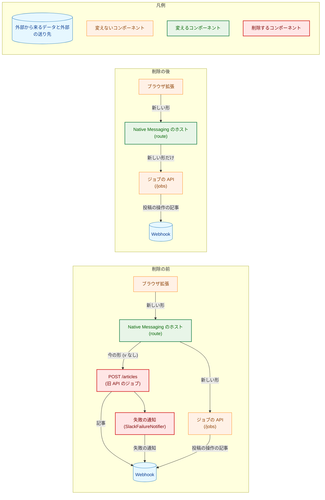
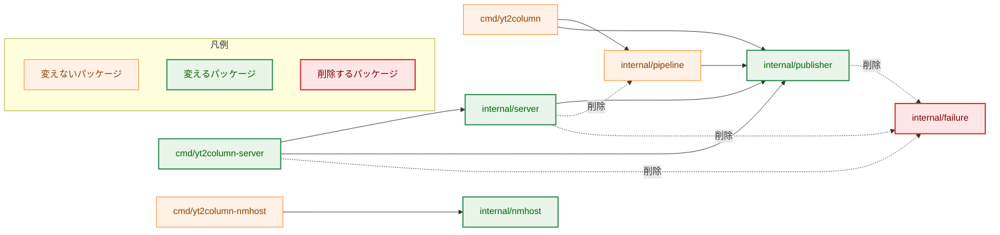
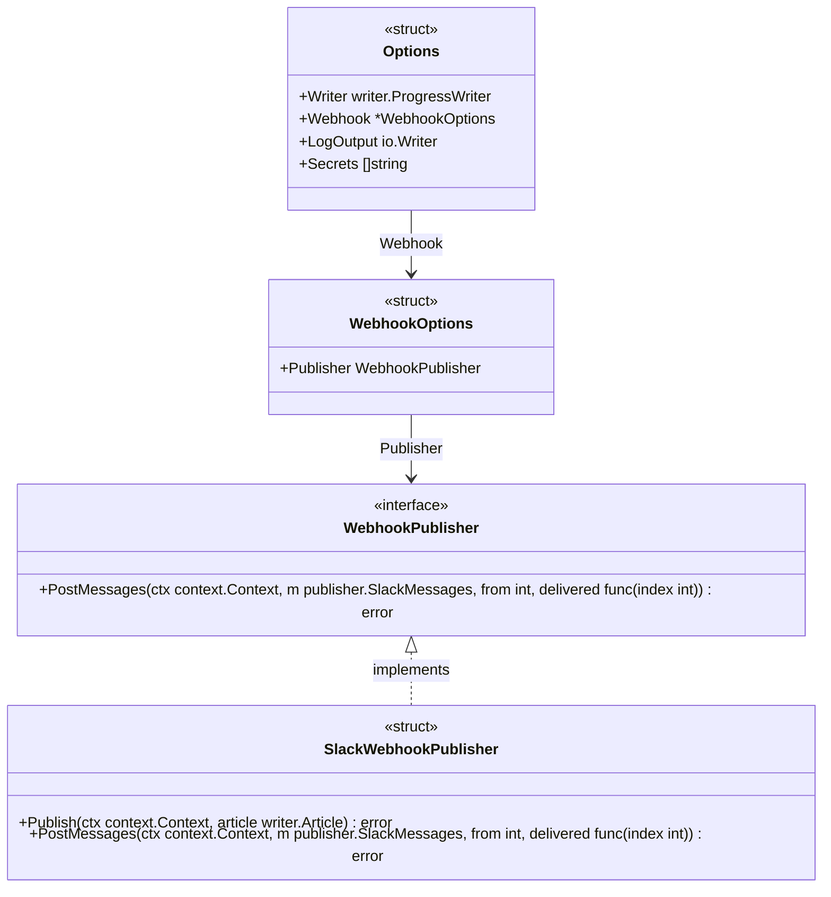
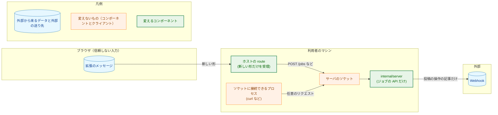
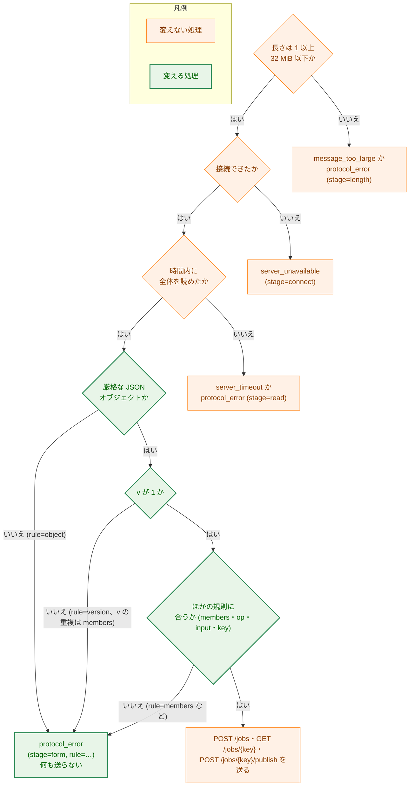
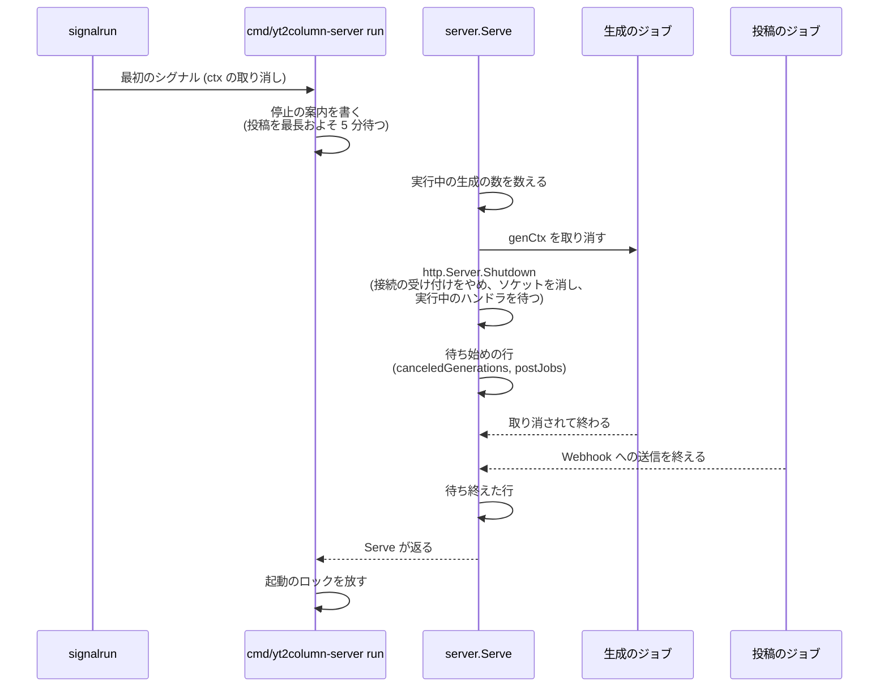

# 設計書：旧 API（`/articles`）とホストの今の形の中継の削除

## Document Status

| Item | Value |
|---|---|
| Status | `approved` |
| Created | 2026-11-04 |
| Review date | 2026-11-04 |
| Reviewer | isseis |
| Comments | - |

本書は [01_requirements.md](01_requirements.md) の設計である。要件定義から申し送られた設計事項は [design_handoff.md](design_handoff.md) にあり、その対応は 10 章にまとめる。本書が引用するファイルの行番号は、コミット `38aee56f`（本書の作成時の `main`）のものである。

本タスクは削除と簡素化のタスクである。新しいパッケージ・新しいエラー・新しい依存は加えない。加えるのは、`internal/publisher` の公開の定数 1 つ（3.3 節）と、ホストのログの規則の値 1 つ（3.4 節）だけである。

用語は要件書 6 章に従う。「今の形のメッセージ」は、版のメンバ `v` を持たず、ホストが `POST /articles` へ中継していたメッセージ、「新しい形のメッセージ」は、`v` を持ち操作 `op` を宣言するメッセージ（`0044` F-008）を指す。

## 1. 設計の全体像 (Design Overview)

### 1.1. 設計原則

-   **旧 API だけが使うものは、型ごと削除する。** `/articles` の受け口、旧 API のジョブ、失敗の通知とその型（`internal/failure`）は、分岐を無効にして残すのではなく、コードから取り除く。残すと、`make deadcode` が報告するか、使われない経路の振る舞いをテストが確かめ続けることになる（要件書 4.5）。
-   **ジョブの API の振る舞いは変えない。** 3 つの操作の受理、拒否の理由、状態コード、応答の形、枠の数、本文の上限、拒否の応答に付ける `Connection: close` は、今のままとする（AC-03）。削除で変わるのは、生成の枠を数える主体と、同時に読む本文の最大の数だけである。
-   **ホストは、形を選ばずに検査する。** ホストは、メッセージの中身から形を選ぶ判定（CLAUDE.md「Declare, don't infer」の例外）をやめる。すべてのメッセージを新しい形の規則で検査し、通らなければ送らずに `protocol_error` を返す（AC-10・AC-11・AC-13）。
-   **残る振る舞いを旧 API で確かめていたテストは、ジョブの API で確かめ直す。** 旧 API だけを確かめるテストは削除し、本文の検査や停止の待ち方のように残る振る舞いは、ジョブの API を通して確かめる（7 章、H-05）。

### 1.2. 概念モデル

図 1-1 は、拡張からサーバの外への送信までの経路を、削除の前と後で示す。矢印 A → B は「A が B へリクエストかメッセージを渡す」を表す。赤い要素が本タスクで削除するもの、緑の要素が本タスクで変えるものである。ホストは、削除の前の図では今の形を `/articles` へ送る分岐を持ち、削除の後の図では持たない。



### 1.3. 設計の際に決めたこと（2026-11-04）

-   **`webhook_not_configured` の `Connection: close` は残す（H-03）。** 投稿の操作は、Webhook の有無を本文の検査より前に確かめる（`internal/server/publish.go:59-69`）。そのため、本文を持つ投稿の操作（`curl` で送るものなど）は、本文を読まれないまま `webhook_not_configured` で拒否される。「本文を読まずに拒否するなら接続を閉じる」という今の原則（`internal/server/response.go:106-120`）に当たるので、`forceClose` に残し、説明だけを投稿の操作に合わせて直す。`0044` 設計書 §3.14 の簡素化 2 との関係は 3.2.3 節に書く。
-   **ホストのログは、属性 `form` を削除し、規則に `object` を加える（H-02）。** 形が 1 つになると、属性 `form` の値はいつも `new` になり、何も区別しない。段階 `form` は「メッセージの形の検査」の意味のまま名前を残す（`docs/dev/security.md:144` と `package_reference.md` が書く名前を変えないため）。`v` がないメッセージは、既存の規則 `version` で記録する（`op` がないときに `operation` で記録するのと揃う）。このため、ホストは版の検査を、宣言していないメンバの検査より先に行う（3.4.1 節）。#503 より前の拡張が送る今の形のメッセージは `videoUrl` などの宣言していないメンバを持つので、今の順序のままでは `members` で記録され、新しい形のメンバの誤りと区別できないためである。厳格な JSON オブジェクトとして読めないメッセージは、新しい規則 `object` で記録する。
-   **停止の案内の「約 5 分」は計算する（H-07）。** `internal/publisher` に、1 回の投稿の送信（`PostMessages`）にかかる最長の時間を表す公開の定数を加え、停止の案内はその値から分を計算する。今の「約 45 分」も、`llmCallsPerJob` と `provider.LLMTimeout` から計算している（`cmd/yt2column-server/run.go:240-241`）。上限を変えたときに、案内が古い値のまま残らないようにするためである。
-   **PR は 2 つに分ける（H-09）。** PR-1 はホストの今の形の中継の削除で、CLAUDE.md の例外の段落とホストを書く文書を含む。PR-2 はサーバの旧 API と失敗の通知の削除で、残りの文書と README を含む（8 章）。ホストの変更は小さく独立しており、CLAUDE.md の例外は、ホストの判定を削除する PR で取り除く必要があるためである（H-09）。
-   **テストの移し替えは、製品のコードを変えないコミットとして削除より先に置く（H-05）。** タスク 0055 のカバレッジを比べる道具（`make coverage-compare`・`make ext-coverage-compare`、issue #618）は、残る関数の中身が変わる比較では止まる（0055 `01_requirements.md` 1 章「削除以外の変更で対応が付かなければ止める」）。本タスクの削除は `handler`・`route` などの残る関数の書き換えを伴うので、削除のコミットにはこの道具を使えない。一方、テストだけを変えるコミットは道具が想定する使い方そのものである。そこで、確かめられる部分を道具に任せ、手で比べる範囲を削除で消えたものだけに絞るため、コミットを分ける（7.1 節「テストの削除の確かめ方」）。

## 2. システム構成 (System Structure)

### 2.1. 全体の構成

図 2-1 は、削除の後のパッケージの依存を示す。矢印 A → B は「A が B を import する」を表す。点線は、本タスクで削除する依存である。



今の依存の根拠: `internal/server` は `internal/pipeline` と `internal/failure` を import している（`internal/server/job.go:10-12`、`internal/server/server.go:26`）。`cmd/yt2column-server` は `internal/failure` を import している（`cmd/yt2column-server/run.go:13`）。`internal/publisher` は `slack_failure.go:9` で `internal/failure` を import している。CLI は `internal/pipeline` を使う（`cmd/yt2column/run.go:20`）。

### 2.2. コンポーネントの配置

| ファイル | 変更 | 内容 | PR |
|---|---|---|---|
| `internal/nmhost/relay.go` | 変更 | 今の形の分岐（`formLegacy`・`articlesURL`）、型 `form`、`destination.form` を削除する。`route` はすべてのメッセージを新しい形の規則で検査し、`ruleObject` を加える。`forward`・`Relay`・`route`・`bodyRequest`・`maxMessageBytes` の説明から、今の形との対比を除く（3.4 節） | PR-1 |
| `internal/nmhost/frame.go` | 変更 | パッケージの説明（`:3-6`）から、形を見分けることを除く | PR-1 |
| `internal/nmhost/relay_test.go` | 変更 | 今の形の中継のテストを拒否のテストに置き換え、今の形のメッセージを入力に使うテストを新しい形のメッセージに移す（7.1 節） | PR-1 |
| `cmd/yt2column-nmhost/main_test.go` | 変更 | `TestRelayUsesDerivedSocket` の `{}` のメッセージを新しい形に移す（7.1 節） | PR-1 |
| `cmd/yt2column-server/relay_e2e_test.go` | 変更 | 今の形を送るサブテストを新しい形に移すか削除する（7.2 節） | PR-1 |
| `.golangci.yml` | 変更 | `nmhost-boundaries` の説明（`:126-131`）を、新しい形だけを検査することに合わせる（PR-1）。`internal/server` が `internal/pipeline` を import しないことを確かめる `depguard` の規則を加える（PR-2、7.4 節） | PR-1・PR-2 |
| `CLAUDE.md` | 変更 | 「Declare, don't infer」の、ホストの形の判定の例外の段落（`:357-375`）を取り除く（PR-1）。Architecture Overview の `internal/failure` の記述を取り除く（PR-2） | PR-1・PR-2 |
| `internal/server/handler.go` | 変更 | `ArticlesPath`、`routeArticles`、`articlesHandler` を削除する。`/articles` は `routeNotFound` になる | PR-2 |
| `internal/server/job.go` | 削除または縮小（計画で決める） | `maxInFlight`・`acquireSlot`・`releaseSlot`・`classifyWrite` は残すファイル（`generation.go` など、配置は計画で決める）へ移し、ほかを削除する（3.2.1 節） | PR-2 |
| `internal/server/request.go` | 変更 | `jobInput.requestID` と、`readRequest`・`validateBody` の `requestID` の引数を削除する | PR-2 |
| `internal/server/response.go` | 変更 | `rejectReason.notify`、`rejection.videoID`、`detailTooManyRequests` を削除し、`forceClose` の説明を直す | PR-2 |
| `internal/server/server.go` | 変更 | `WebhookOptions.Notifier`、`Server.notifier`、`errNilWebhookNotifier` を削除する。パッケージの説明、`slots`・`jobs`・`jobCtx` の説明、`Serve` の説明とシャットダウンのログを直す（3.2.2 節・6.3 節） | PR-2 |
| `internal/server/jobs_api.go`・`publish.go`・`generation.go` | 変更 | 旧 API に触れる説明を直す（`maxReading`、`startHandler`、`WebhookPublisher`）。`WebhookPublisher` から `publisher.Publisher` を除く | PR-2 |
| `internal/server/*_test.go`・`test_helpers.go` | 変更 | 7.1 節の表のとおり | PR-2 |
| `internal/serversock/serversock.go` | 変更 | `:273-274` の注釈の「failure notice」を除く（AC-08） | PR-2 |
| `internal/failure/`・`internal/failure/testutil/` | 削除 | パッケージごと削除する | PR-2 |
| `internal/pipeline/pipeline_test.go` | 変更 | `TestFakesCarryBuildTag` が固定する testutil のファイル数を、`internal/failure/testutil/mocks.go` の削除に合わせて 25 から 24 に直す（7.1 節） | PR-2 |
| `internal/publisher/slack_failure.go`・`slack_failure_test.go` | 削除 | `SlackFailureNotifier` とそのテスト | PR-2 |
| `internal/publisher/slack_errors.go` | 変更 | `ErrSlackInvalidNotice`・`ErrSlackNoticeRejected` を削除する | PR-2 |
| `internal/publisher/slack.go`・`slack_message.go` | 変更 | `SlackMaxPostDuration` を加える（3.3 節）。`webhookClient` の説明から `SlackFailureNotifier` を除く（`slack.go:85`） | PR-2 |
| `internal/publisher/test_helpers_slack.go`・`publisher.go` | 変更 | `NewSlackFailureNotifierForLoopbackTest` を削除し、パッケージの説明（`publisher.go:3`）から失敗の通知を除く | PR-2 |
| `cmd/yt2column-server/run.go` | 変更 | `deps.newNotifier`・`newNotifier`・`llmCallsPerJob` を削除し、起動時の警告と停止の案内を直す（3.5 節） | PR-2 |
| `cmd/yt2column-server/*_test.go`・`test_helpers.go` | 変更 | 7.1 節の表のとおり。`docs_test.go` の curl の例のガードと `pathForm` から `ArticlesPath` を除く | PR-2 |
| `docs/dev/security.md` | 変更 | §8 のホストの記述（`:143-144`）は PR-1、サーバの記述（`:136`・`:140`・`:155` など）は PR-2 | PR-1・PR-2 |
| `docs/dev/conventions/package_reference.md` | 変更 | `internal/nmhost` の行は PR-1。`cmd/yt2column-server`・`internal/server`・`internal/publisher`・`internal/publisher/testutil` の行は PR-2 で直し、`internal/failure` と `internal/failure/testutil` の行は PR-2 で削除する | PR-1・PR-2 |
| `docs/dev/guides/development.md`・`docs/dev/project_overview.md`・`docs/dev/production_profile.md`・`docs/translation_glossary.md` | 変更 | 旧 API・失敗の通知の記述を除き、生成の枠・本文の数・停止を残る振る舞いに合わせ、「新しい API」を「ジョブの API」と呼ぶ（AC-18）。開発用のサーバの確認の例は 3.6 節 | PR-2 |
| `README.md`・`README.en.md` | 変更 | `README.md` を変えた後に `/mktrans README.md` で写し、同じコミットに入れる | PR-2 |

`internal/publisher` の `Publisher` インターフェースと `SlackWebhookPublisher.Publish` は、CLI が使うので残す（AC-05・AC-07、`internal/pipeline` が `Publisher` を受け取る）。拡張（`extension/`）は変えない（要件書 2.3、H-10 は 10 章）。

## 3. コンポーネント設計 (Component Design)

### 3.1. 削除の後の型の形

図 3-1 は、削除の後のサーバの Webhook の型を示す。`-->` はフィールドの型を、`<|..` はインターフェースの実装を表す。`Options`・`WebhookOptions`・`WebhookPublisher` は `internal/server` の型、`SlackWebhookPublisher` は `internal/publisher` の型で、そのメソッドはポインタのレシーバ（`*publisher.SlackWebhookPublisher`）を持つ。



`Publish` は CLI のための `publisher.Publisher` の実装として残るが、サーバの `WebhookPublisher` は求めない（AC-07）。

```go
// internal/server

// WebhookOptions holds what posts to the Webhook. Every field is required.
type WebhookOptions struct {
	Publisher WebhookPublisher // the publish operation's post job
}

// WebhookPublisher posts an article's messages to the Webhook for the
// publish operation.
type WebhookPublisher interface {
	PostMessages(ctx context.Context, m publisher.SlackMessages, from int, delivered func(index int)) error
}
```

**`WebhookOptions` を残す理由:** フィールドが 1 つになっても、`Options.Webhook` を `WebhookPublisher` に置き換えない。`nil` のポインタが「`SLACK_WEBHOOK_URL` が未設定」を表し、設定があるのに投稿の相手が `nil`（型付きの `nil` を含む）なら `New` が拒否する、という今の区別（`internal/server/server.go:197-204`）を保つためである。インターフェースの `nil` で未設定を表すと、型付きの `nil` を未設定と取り違える。

### 3.2. サーバ（`internal/server`）

#### 3.2.1. 削除するもの

AC-06 と `0044` 設計書 §3.14 の削除の 1・2 に従い、次のものを削除する。

| 削除するもの | 今の場所 |
|---|---|
| `ArticlesPath`、`routeArticles`、`matchTarget` の `/articles` の分岐、`articlesHandler` | `handler.go:12-14`・`:30`・`:50-51`・`:83-84`・`:96-181` |
| `startJob`・`runJob`・`notify`・`notifyAsync`・`notifyTimeout`・`classify`・`failureKind`・`reasonToKind`・`logJobFailure`・`logJobSuccess`・`stageOf` | `job.go:24-26`・`:44-142`・`:167-245` |
| `rejectReason.notify`、`rejection.videoID` とその設定、`detailTooManyRequests`（`articlesHandler` だけが使う） | `response.go:93-104`・`:155`・`:129`、`request.go:110`・`:112` |
| `jobInput.requestID`、`readStartRequest`・`readRequest`・`validateBody` の `requestID` の引数 | `request.go:27`・`:39`・`:62`・`:118`、`jobs_api.go:138` |
| `WebhookOptions.Notifier`、`Server.notifier`、`errNilWebhookNotifier`、その検査 | `server.go:52`・`:67`・`:80`・`:176`・`:201-203` |
| `WebhookPublisher` の `publisher.Publisher` | `publish.go:18` |

残すもの: `maxInFlight`・`acquireSlot`・`releaseSlot`（生成のジョブが使う、`jobs_api.go:96`・`generation.go:24`）と `classifyWrite`（`generation.go:51`、AC-06）。`job.go` に残るのがこの 4 つだけになるので、計画でほかのファイルへ移すか、`job.go` を残すかを決める。`jobInput.source` は生成のジョブが使うので残す（`generation.go:42`、H-06）。

旧 API と失敗の通知を説明している注釈（AC-08）は、パッケージの説明（`server.go:1-9`）と `Serve` の説明（`:222-228`）のほか、`Server.publisher` の注釈（`:74-78`）、`webhookConfigured` の注釈（`:214-217`）、`handler` の注釈（`handler.go:70-73`）、`Shutdown` の待ち方の注釈（`server.go:249-251`）、シャットダウンのログの注釈（`:263-268`）である。このうち `Shutdown` の待ち方の注釈は、待つ時間を `WriteTimeout` で区切ると書いているが、実行中のハンドラを区切るのは本文の読み込みの `ReadTimeout` なので、あわせて直す。

`/articles` は、削除の後は `matchTarget` のどの分岐にも当たらず、`routeNotFound` になる。そのため、メソッドによらず、本文を読まず枠も取らずに `not_found` で拒否され、`forceClose` により接続を閉じる（`handler.go:91-92`・`response.go:115`、AC-01）。

#### 3.2.2. 生成の枠と停止の待ち方（H-01・H-06）

削除の後、生成の枠（`slots`、`maxInFlight = 2`）を取るのは、ジョブの API の生成のジョブだけである（`jobs_api.go:96`）。`slots` の説明（`server.go:84-88`）と `maxInFlight` の説明（`job.go:17-21`）から、旧 API のリクエストと失敗の通知を除く。値は変えない（AC-03）。

読み込みの枠（`maxReading = 2`）の値も変えない。説明（`jobs_api.go:11-14`）は「2 つの枠は `/articles` に合わせた」という由来をやめ、同時に読む本文が最大 2 つ（約 8 MiB）であることを書く。

`jobs`（`sync.WaitGroup`）が数えるのは、生成のジョブと投稿のジョブだけになる。`jobCtx` は投稿のジョブだけの親になり、`genCtx` は生成のジョブの文脈のまま変えない。どちらも説明だけを直す（`server.go:98-113`）。

シャットダウンのログ（H-01、AC-16）: 今の属性 `pending` は、`Shutdown` が返った後の生成の枠の使用数（`len(s.slots)`）である（`server.go:269-270`）。旧 API がなくなると、その時点で枠を持つのは取り消した生成のジョブだけになる。しかし、取り消された LLM の呼び出しはすぐに返り、ジョブは枠を放すので、この値はほとんどいつも 0 になり、何が失われたかを表さない。そこで、`pending` を `canceledGenerations` に改め、`genCancel` を呼ぶ直前の生成の枠の使用数、つまり停止を始めた時点で実行中だった生成の数を書く。停止の案内が「失われる」と告げる記事の数であり、テストでも決まった値になる。シャットダウン中に受け付けた生成の開始は、取り消し済みの `genCtx` で始まり（`server.go:243-247`）、この数に入らない。`postJobs` はそのまま残す。行の文言は、待つ対象を「実行中のジョブ」とし、「failure notices」を除く。待ち終えた行も、「every job has finished」の意味の文言にする。具体的な文言は計画で決める。

#### 3.2.3. `webhook_not_configured` の `Connection: close`（H-03）

`forceClose` は `webhook_not_configured` を含んだまま残す（1.3 節）。説明（`response.go:106-112`）は、`/articles` の代わりに、投稿の操作が本文の検査より前に Webhook の有無を確かめることを理由として書く。

**`0044` の方針との関係:** `0044` 設計書 §3.14 の簡素化 2 は、「`webhook_not_configured` の `/articles` での使い方と、それを `forceClose` で扱う分岐」を簡素化の対象とし、申し送り H-03 はこの分岐を取り除くことを既定とした。

1.  **元の方針と場所:** `docs/tasks/0044_article_job_api/02_architecture.md` §3.14 の簡素化 2、本タスクの `design_handoff.md` の H-03。
2.  **例外とする理由:** 申し送りは「投稿の操作は本文を持たない」ことを前提にしている。しかし、投稿の操作は本文の検査（`checkNoBody`）より前に Webhook の有無を確かめる（`publish.go:59-69`）。そのため、本文を持つリクエストは本文を読まれずに `webhook_not_configured` で拒否される。この場合は、「本文を読まずに拒否するなら接続を閉じる」という `forceClose` の原則に当たる。検査の順序を入れ替えると、本文を持つリクエストの拒否の理由が `invalid_body` に変わり、AC-03 に反する。簡素化するのは `/articles` での使い方だけで、`forceClose` の分岐は残す。
3.  **今の振る舞いを確かめているテスト:** `internal/server/publish_test.go:342-372` の `TestPublishWithoutWebhook`（`with_body` の場合を含め、`Connection: close` を確かめる）と、`handler_test.go:135-` の `TestRejectStatusCodes` の `webhook_not_configured` の行。振る舞いは変わらないので、`TestPublishWithoutWebhook` はそのまま残る。`TestRejectStatusCodes` の行は `/articles` のリクエストで組み立てているので、投稿の操作のリクエストに組み替える（7.1 節）。

### 3.3. 投稿の送信の最長の時間（`internal/publisher`、H-07）

```go
// internal/publisher

// SlackMaxPostDuration bounds one PostMessages call: slackMaxMessages
// messages, each bounded by SlackPostTimeout, with slackMessageInterval
// between two of them.
const SlackMaxPostDuration time.Duration = /* 309 s with today's limits */
```

今の値は、最大通数 10（`slack_message.go:17`）× 1 通の上限 30 秒（`slack.go:23`）+ 間隔 1 秒（`slack.go:28`）× 9 で、309 秒である（要件書 4.3）。この値は、3 つの定数から定義する（どこに置くかは計画で決める）。`PostMessages` は 1 通目の前には待たず、2 通目から送る前に間隔を待つ（`slack.go:204-209`）。そのため、間隔は通数より 1 少ない。

投稿のジョブは同時に複数走りうる。ただし、それぞれが並行して送り、自動では送り直さないので、投稿のジョブのために待つ最長の時間は、この値 1 つ分である。停止のときに待つ時間は、これに最大で約 30 秒が加わりうる。最初のシグナルの後も、`Shutdown` は実行中のハンドラ（本文の読み込みは `ReadTimeout` の 30 秒で区切られる）と受け付けの途中の接続を待ち、その間に受け付けた投稿の操作が始めた投稿のジョブも待つためである。したがって、案内の「約 5 分」は目安であり、厳密な上限ではない。`Shutdown` が返った後は、新しい投稿のジョブは始まらない（`startPublish` はハンドラの中で `s.jobs.Go` を呼ぶ。`publish.go:115-121`）。取り消した生成のジョブは、`genCtx` の取り消しで LLM の呼び出しが返って終わるので、この上限に加えない。

分への丸め: 停止の案内は、`SlackMaxPostDuration` を最も近い分に丸め、1 分未満なら 1 分とする。今の値（309 秒）では 5 分になり、AC-15 の「約 5 分」と一致する。今の「約 45 分」の切り捨て（`run.go:241`）は、上限を変えたときに 0 分や過小な値を出しうるので使わない。

### 3.4. ホスト（`internal/nmhost`）

#### 3.4.1. 形の判定の削除（AC-09〜AC-11・AC-13）

`route`（`relay.go:457-510`）は、`strictjson.ParseObject` に通らないメッセージと、最上位に `v` を持たないメッセージを今の形として返している（`:468-470`）。削除の後は、次のようになる。

-   `ParseObject` に通らないメッセージは、規則 `ruleObject` を返す。中身を直して送ることはしない（AC-11）。
-   `v` を持たないメッセージは、`Has("v")` で分岐せず、ほかのメッセージと同じく新しい形の規則で検査する。検査の順序は、版、メンバ、操作、`input` か `key` とし、宣言していないメンバの検査より先に版を検査する（1.3 節）。
    -   版は、`v` だけを取り出す `Collect("v")`（ほかのメンバを無視し、`v` の重複だけを拒否する。`internal/strictjson/strictjson.go:87-102`）で読む。`v` がなければ、版の検査が失敗して `ruleVersion` になる。`v` が重複していれば `ruleMembers` になる。
    -   その後で `CollectOnly("v", "op", "input", "key")` が、宣言していないメンバと重複するメンバを `ruleMembers` で拒否する（`strictjson.go:104-121`）。
    -   `videoUrl` などを持つ今の形のメッセージは、`op` などのほかのメンバがそろっていても、版の検査で `ruleVersion` になる（AC-10）。
-   今は、メンバの検査が版の検査より先にある（`relay.go:473-479`）。順序を入れ替えると、`v` が 1 でなく、宣言していないメンバも持つ新しい形のメッセージは、`ruleMembers` ではなく `ruleVersion` で記録されるようになる。変わるのはログの規則の値だけで、どちらも `protocol_error` で、何も送らない。
-   上のどの規則で拒否した場合も、`forward` は段階 `form` で `protocol_error` を返し、HTTP のリクエストを送らない（`relay.go:257-263`）。処理の順序（長さ、接続、読み込み、形の検査、送信）は変えない（F-002、H-04）。

削除するもの: 型 `form` と `formLegacy`・`formNew`（`:427-434`）、`destination.form`（`:451`）、`articlesURL`（`:54-55`）、`request` の `formLegacy` の分岐と `form` による切り替え（`:528-545`）。`request` は `op` だけで分岐し、`default` は今と同じく `errUnroutable` を返して何も送らない。`strictjson.Object.Has` は、`internal/fixprguard/threads.go:197`、`internal/llm/claude/response.go:327`、`internal/llm/deepseek/response.go:244` などが使い続けるので残る。

**「新しい形」の名前は残す。** 形が 1 つになっても、`newFormVersion` などの識別子、`TestRelayNewForm*` などのテストの名前、文書の「新しい形のメッセージ」という呼び方は変えない。`docs/dev/security.md` §8、`package_reference.md`、`0044` の文書と要件書がこの呼び方を使っており、名前だけを変えると差分と読み替えが増えるためである。

```go
// internal/nmhost

// rule names the rule a message broke, for the log only. The empty value
// means no rule was broken.
type rule string

const (
	ruleObject    rule = "object"    // the message is not one strict JSON object
	ruleVersion   rule = "version"   // "v" is missing or not newFormVersion; checked first
	ruleOperation rule = "operation" // "op" is missing, not a string, or unknown
	ruleMembers   rule = "members"   // an unlisted, duplicate, missing, or extra member
	ruleInput     rule = "input"     // "input" is not a JSON object
	ruleKey       rule = "key"       // "key" is not a JSON string
)

// destination is where one message goes, as route decides it. The zero value
// has OperationUnknown, and request refuses it.
type destination struct {
	op   Operation
	body []byte // a start's "input"
	key  string // the key of a status request or a publish operation
}
```

#### 3.4.2. ログ（H-02、AC-14）

`destination.logAttrs`（`relay.go:512-519`）は属性 `form` を書かなくなり、`op` だけを書く。拒否の行には、今と同じく固定の値だけを書く。段階 `form`、ホストのエラー、規則 `rule`、読めた場合の `op`、メッセージの長さ、経過時間である（`relay.go:218`・`:259-262`）。メッセージのメンバ名や値は書かない。`ruleObject` と `ruleVersion` で拒否した行は、`op` を書かない（`op` を読む前に拒否するため）。

#### 3.4.3. 説明の更新（H-04）

`forward` の契約（`relay.go:230-237`）、`Relay` の契約、`route` の契約（`:457-466`、CLAUDE.md の例外への言及を含む）、`bodyRequest` の説明（`:548-549`、「the current form has always been sent with」）、`stageForm` の注釈（`:178`、「a new-form message broke a rule」）、`destination` の注釈、パッケージの説明（`frame.go:3-6`）、`.golangci.yml` の `nmhost-boundaries` の説明から、今の形との対比を除く。`maxMessageBytes` の説明（`relay.go:34-38`）は今の形に触れていないので変えない。全体を読んでから検査して送る順序は、新しい形の検査に必要なので変えない（`0044` 設計書 §3.10.1）。

### 3.5. サーバの入口（`cmd/yt2column-server`）

-   `deps.newNotifier`・`newNotifier`（`run.go:54`・`:64`・`:79-87`）と、`buildServer` の失敗の通知の送り手の組み立て（`:310-314`）を削除する。設定があれば、`server.WebhookOptions{Publisher: pub}` だけを渡す。失敗の通知の送り手の組み立てがなくなるので、それが原因で起動に失敗することはない（AC-04）。
-   起動時の警告（`:195`）は、投稿の操作だけが `webhook_not_configured` を返すと書き、`/articles` に触れない（AC-04）。
-   停止の案内（`stopNoticeLogger`、`:238-243`）は、実行中の生成を取り消してその記事が失われること、ビューアから送った投稿（投稿のジョブ）が終わるまで待つこと、待つ時間が、最長でおよそ `SlackMaxPostDuration` を 3.3 節の規則で分に丸めた値（今の値では 5 分）であること、2 つ目のシグナルですぐに終わることを書く（AC-15）。`llmCallsPerJob`（`:40-43`）と、この計算での `provider.LLMTimeout` の使用は削除する（`provider.New` などの使用は残るので、`provider` の import は残る）。
-   `deps` の説明（`:45-48`）、`buildServer` の注釈（`:302-304`）、`run` の契約の説明（`:133-137`）、`:204-205` の注釈から、失敗の通知と旧 API を除く。

### 3.6. 文書（F-004、H-08）

文書は AC-18〜AC-21 のとおりに書き換える。書き換えの対象は、要件書 1 章の背景と AC-18 が挙げる文書である。

開発用のサーバが応えることを確かめる例（`docs/dev/guides/development.md:37`、H-08）は、`GET /articles` を `GET /jobs` に置き換える。どちらも `method_not_allowed`（405）を返す。ジョブを始めず、LLM も Webhook も呼ばず、キーも要らないので、今の例と同じ役目を果たす。

curl の例のガード（`cmd/yt2column-server/docs_test.go:95-115`）は、`/articles` の行を除き、ジョブの API の 3 つの操作の例だけを求める（AC-20）。`pathForm`（`:399`）は `server.ArticlesPath` を参照しなくなり、`/articles` は「サーバが扱わないパス」として `""` を返す。README の版がそろっていない場合の説明（`README.md:562-564`）は、要件書 4.4 の表に合わせ、更新の後に `not_found` などの想定外の応答が出るなら、サーバとホストのビルドがそろっていないことを書く。こう書くのは、サーバの拒否のログが理由（`not_found`）を書くがリクエストのターゲットを書かず、`/articles` へのリクエストだとログからは分からないためである。

`TestHasCurlCommand` の `"other path"` の行（`:322`）は、文書の例ではなく `hasCurlCommand` の入力なので、そのまま残してよい。

## 4. エラーハンドリング設計 (Error Handling Design)

新しいエラーの型は加えない。削除するエラーは次のとおりである。

| 削除するエラー | 場所 | 理由 |
|---|---|---|
| `ErrSlackInvalidNotice`・`ErrSlackNoticeRejected` | `internal/publisher/slack_errors.go:19-29` | `SlackFailureNotifier` だけが返す |
| `errZeroNotifier` | `internal/publisher/slack_failure.go:17` | 同上 |
| `errNilWebhookNotifier` | `internal/server/server.go:52` | `WebhookOptions.Notifier` とともになくなる |

拒否の応答（`rejectReason` の値・状態コード・`Connection: close`）は変えない（AC-03・AC-21）。`/articles` は `reasonNotFound` になり、専用の理由は加えない（要件書 1 章「要件定義の際に決めたこと」）。

ホストのエラーの値（`HostError`）も変えない。`v` がないメッセージと、厳格な JSON オブジェクトとして読めないメッセージは、どちらも `HostErrorProtocol`（`protocol_error`）になる（AC-10・AC-11）。拡張はこれを今と同じく想定外の応答として表示する（`extension/src/core/native.ts:73-74`、AC-12）。

## 5. セキュリティ考慮事項 (Security Considerations)

本タスクは、Webhook へ送るコードと、ホストの入力の境界を変えるので、`docs/dev/security.md` を適用する。図 5-1 は、削除の後の信頼の境界と、そこを越えるものを示す。矢印 A → B は「A から B へデータが渡る」を表す。



-   **Webhook へ送るものが減る（AC-02）。** 失敗の通知がなくなるので、サーバが Webhook へ送るのは、投稿の操作が始めた投稿のジョブの記事だけになる。`WebhookPublisher` が `PostMessages` だけを持ち、`Server` が失敗の通知の送り手を持たないので、ほかの経路で Webhook へ送るコードはサーバに残らない（3.1 節）。
-   **二重の生成と投稿のリスクがなくなる。** `docs/dev/security.md:155` の `/articles` の残るリスク（`202` が届かずに送り直したときの二重の生成と投稿）は、`/articles` とともになくなる。ジョブの API は同じ入力に同じキーを返し、投稿の操作は冪等なので、このリスクを持たない（`publish.go:22-29`）。
-   **ホストの入力の境界が狭くなる（AC-09〜AC-11）。** 今は、厳格な JSON オブジェクトとして読めないメッセージも、そのバイト列のまま `/articles` へ送られていた（`relay.go:468-470`）。削除の後は、`ParseObject` が拒否する入力（正しくない UTF-8、対になっていないサロゲートのエスケープ、後続のデータ、最上位がオブジェクトでないもの）と、`CollectOnly` が拒否する入力（重複するメンバ、宣言していないメンバ）は、すべて送られずに `protocol_error` になる。境界を通れるのは、`0044` F-008 の新しい形だけである。
-   **ホストのログに入力を書かない（AC-14）。** 拒否の行に書くのは、固定の段階・ホストのエラー・規則の値だけである（3.4.2 節）。
-   **秘密の扱いは変えない。** Webhook URL と API キーは今と同じく `secret.Secret` で持ち、ログは `internal/redact` を通して書く。`SlackMaxPostDuration` は固定の値で、秘密を含まない。
-   **ソケットに接続できるプロセス**（図 5-1 の `curl`）は、今と同じく、サーバにとっては拡張と区別できない。削除の後は、そのリクエストもジョブの API の検査を通る。`/articles` は `not_found` になり、本文は読まれない（AC-01）。

## 6. 処理フローの詳細 (Processing Flow Details)

### 6.1. ホストの中継

図 6-1 は、長さを読んでから応答を書くまでの、削除の後のホストの流れを示す。矢印は処理の順序を表す。緑の要素が本タスクで変える判定である。



今は、`OBJ` の「いいえ」と、`v` を持たないメッセージが、`POST /articles` を送る分岐へ進んでいた（`relay.go:468-470`・`:529-530`）。

### 6.2. サーバのリクエストの振り分け

`handler`（`handler.go:74-94`）は、リクエスト ID を作り、`matchTarget` でリクエストのターゲットを振り分ける。削除の後の振り分けは次のとおりである。

| ターゲット | 振り分け先 |
|---|---|
| `/jobs` | 生成の開始（`startHandler`） |
| `/jobs/{key}` | 状態の取得（`statusHandler`） |
| `/jobs/{key}/publish` | 投稿の操作（`publishHandler`） |
| `/articles`、クエリを持つもの、ほかのすべて | `not_found`（本文を読まず、接続を閉じる） |

### 6.3. 停止

図 6-2 は、最初のシグナルから終了までの流れを示す。矢印は呼び出しかログの書き込みを表す。



`Shutdown` が実行中のハンドラを待つ間に受け付けた投稿の操作が始めた投稿のジョブも、あわせて待つ（3.3 節）。今と違うのは、待つ対象に旧 API のジョブと失敗の通知がないこと、案内の時間、待ち始めの行の属性の 3 点だけである（AC-15〜AC-17）。2 つ目のシグナルですぐに終わることと、ジョブが終わるまで起動のロックを持つこと（`run.go:133-137`・`:204-206`）は変えない。

## 7. テスト戦略 (Test Strategy)

### 7.1. 単体テスト

テストは次の 3 つに分ける（H-05）。

-   **削除する:** 削除するコードだけを確かめるテスト。
-   **ジョブの API で確かめ直す:** 残る振る舞い（本文の検査、ヘッダの検査、拒否の応答、ソケットでの動作、停止の待ち方、ホストの中継の段階）を、`/articles` や今の形のメッセージを通して確かめていたテスト。同じ観点を、ジョブの API や新しい形のメッセージで確かめる。
-   **値を直す:** 削除したものの名前や値（`Notifier`・`pending=`・`form=`・停止の案内の文言）を参照しているテスト。

確かめ直すテストは、述べた段階まで実際に届くことも確かめる。例えば、ホストの交換の段階のテストは、サーバがリクエストを 1 つ受け取ったことを確かめる。今の形のメッセージは本タスクの後は形の検査で止まり、ホストのエラーの値（`protocol_error`）だけを確かめるテストは、交換の段階に届かなくても通ってしまうためである（CLAUDE.md「Every test must be able to fail for its stated reason」）。

**ホスト（PR-1）**

| テスト | 扱い |
|---|---|
| `internal/nmhost/relay_test.go` の `TestRelayLegacyBytesUnchanged` | 削除し、同じ入力（`v` を持たないもの、厳格な JSON オブジェクトでないもの）が、送られずに `protocol_error` になり、ログに `stage=form` と `rule=version`・`rule=object` を書くことを確かめるテストに置き換える。#503 より前の拡張が送る形のメッセージ（`videoUrl`・`transcript`・`title` を持つ）が `rule=version` になる行を含める（AC-10・AC-11・AC-14） |
| `TestRelayForwardsOneRequest` | 作り直す。正しくない UTF-8 のバイト列をそのまま送るという前提（`relay_test.go:296-297`）は成り立たなくなるので、生成の開始の `input` のバイト列がそのまま送られることを確かめる形にする |
| `TestRelayServerEarlyRejection`（`:365-404`）、`TestRelayHostErrors`（`:514`・`:622`）、`TestRelayOutputs`（`:716`）、`TestRelayNoReplyFrame`（`:784`・`:800`） | 今の形のメッセージを入力に使っているので、新しい形のメッセージに移す。`Expect: 100-continue` の早い拒否は大きい `input` を持つ生成の開始で、交換の段階のホストのエラーと出力の検査は状態の取得などで確かめる |
| `TestRelayNewFormOperations`（`:882`）、`TestRelayNewFormLogOmitsMessage`（`:1070`）、`TestRelayKeyPassedUnchecked`、`TestRelayNewFormRejections` | `form=` の確かめを除き、ログに `form=` が出ないことを確かめる。`TestRelayNewFormRejections` には、版の検査がメンバの検査より先にあることを確かめる行（`v` がなく宣言していないメンバを持つ → `rule=version`、`v` が `2` で宣言していないメンバを持つ → `rule=version`）を加える |
| `TestRequestRefusesUnroutable`（`:1082-1096`） | `destination.form` と型 `form` がなくなるので作り直す。`op` だけを持つ送り先（ゼロ値、`OperationPublish+1`、`-1` など）で、`request` が何も送らずに拒否することを確かめる。ゼロ値の `Operation` は `request` の `default` が拒否する |
| `TestRelayMessageReadFailures`（`:411`） | 読み込みの段階で失敗するので今の形のメッセージのままでも通るが、本タスクの後は受理しない形なので、新しい形のメッセージに移す |
| `cmd/yt2column-nmhost/main_test.go` の `TestRelayUsesDerivedSocket`（`:254-`） | `{}` のメッセージを新しい形のメッセージに移す |

**サーバ（PR-2）**

| テスト | 扱い |
|---|---|
| `internal/server/job_test.go` のすべて（`TestAcceptStartsJob`・`TestJobTranscriptValues`・`TestSlotLimit`・`TestSlotReleasedOnce`・`TestFailureClassification`・`TestNotifyWithoutWebhook`・`TestReasonToKind`・`TestNotifyNoticeFields`・`TestNotifyErrorContinues`・`TestPanicRecycledAsInternal`・`TestNotifyPanicLogged`） | 削除する。生成の枠の上限と解放は `TestStartGenerationSlotsShared` などジョブの API のテストが確かめる。`classifyWrite` は `TestGenerationFailureReasons` が確かめる |
| `handler_test.go` の `TestArticlesWithoutWebhook`、`jobs_api_test.go` の `TestArticlesIgnoresCache`・`TestNewAPINeverNotifies`、`server_test.go` の `TestServeShutdownWaitsForJobs`・`TestBodyReadFailureWritesNoResponse` | 削除する。Webhook なしの拒否は `TestPublishWithoutWebhook`、停止の待ち方は `TestServeShutdownWaitsForPublish`、本文の読み込みの失敗は `TestStartBodyReadFailureWritesNoResponse` が確かめる |
| `internal/failure/failure_test.go`、`internal/publisher/slack_failure_test.go` | 削除する |
| `handler_test.go` の `TestRejectHeaders`・`TestAcceptsWithoutBrowserHeaders`・`TestRejectStatusCodes`（`webhook_not_configured` の行は投稿の操作のリクエストで組み立てる）、`request_test.go` の全体（`TestStartRejectsLikeArticles` は、比べる相手がなくなるので、検査の表のテストに統合する）、`response_test.go` の `TestResponseOmitsInputs`、`server_test.go` の `TestExpectContinueOversizedBodyNotSent`・`TestUnparsableRequestBypassesHandler`・`TestServeOnUnixListener`・`TestServeListenerFailureStops` | ジョブの API で確かめ直す |
| `jobs_api_test.go` の `TestStartGenerationSlotsShared` | 生成のジョブだけが枠を取ることを確かめる形に直す |
| `jobs_api_test.go` の `TestStartHandlerPanicCleanup`、`publish_test.go` の `TestPublishFailureNotNotified`・`TestPublishHandlerPanicCleanup`、`status_test.go` の `TestStatusHasNoSideEffects`、`handler_test.go` の `validHTTPRequest`・`response_test.go` の `rejectRequest` などの補助 | 値を直す。失敗の通知の送り手を数える確かめ（`ts.notifier.Calls`）を除く。`TestPublishFailureNotNotified` は名前と目的を、投稿の失敗のときに投稿の相手が送り直さないことに改めるか、確かめが残らなければ削除する |
| `publish_test.go` の `TestPublishPostsLikeArticles` | `/articles` の代わりに、同じ記事を `SlackWebhookPublisher.Publish`（CLI の経路）で同じループバックの Webhook へ送ったときのメッセージと、投稿の操作が送るメッセージが一致することを確かめる。テストのコードが `Publish` を呼ぶのは、7.4 節の AC-07 の静的な確認の対象外である |
| `server_test.go` の `TestServeShutdownCancelsGeneration` | 旧 API のジョブを除き、停止を始めた時点で実行中だった生成の数が待ち始めの行の `canceledGenerations=1` になることを確かめる（H-01）。数えるのは `genCancel` の前なので、生成のジョブが取り消されて枠を放す速さに左右されない |
| `server_test.go` の `TestNewWebhookOptions`・`TestNewCopiesWebhookOptions`、`test_helpers.go` の `newCustomServer`・`countingPublisher.Publish`・`panickingNotifier`・`serveAccepted` など | 値を直すか削除する |
| `jobs_api_test.go` の `TestJobsTargetRejections`（またはそれに並ぶテスト） | `/articles` を各メソッドで送り、`not_found`・本文を読まないこと・枠を取らないこと・Writer を呼ばないこと・Webhook へ送らないことを確かめる行を加える（AC-01） |
| `cmd/yt2column-server/signal_test.go` の `blockingChild`・`TestSignalWaitsForJob`・`TestSecondSignalExitsAtOnce`、`run_test.go` の `TestStartDuringShutdownRefused` | ジョブの API で確かめ直す。止める対象を、LLM の呼び出しの代わりに投稿のジョブの Webhook への送信にする（生成のジョブは停止で取り消されるので、停止を待たせる対象にならない）。子プロセスの `childModeBlock` は、`SLACK_WEBHOOK_URL` を設定し、印のファイルができるまで `PostMessages` が返らない投稿の相手を使う。テストは、生成を終えさせ、投稿の操作を送り、送信が始まったのを待ってからシグナルを送る。使われなくなる `blockingLLM` と `nopPublisher.Publish`（`test_helpers.go:255`）は削除する |
| `cmd/yt2column-server/server_test.go` の `TestServerEndToEnd`、`run_test.go` の `TestBuildsSlackPublisher`・`TestStartsWithoutWebhook`・`TestOutputsOmitSecrets`、`test_helpers.go` の `postArticle`・`mustPostArticle`・`nopNotifier`・`loopbackDeps` の送り手 | ジョブの API で確かめ直すか、値を直す。`TestStartsWithoutWebhook` は警告の文言が `/articles` に触れないことの確認を含める（AC-04） |
| `run_test.go` の `TestStartupFailures` | 失敗の通知の送り手の組み立ての失敗の行を削除する |
| `run_test.go` の `TestRunLogsListeningAndStop`（停止の案内の「up to about 45 minutes」を確かめる、`:530-531`） | 今の上限で案内が「about 5 minutes」になることを、計算の式を使わずに文字列で確かめ、`/articles` と失敗の通知に触れないことを確かめる（AC-15） |
| `cmd/yt2column-server/docs_test.go` | 3.6 節のとおり |
| `internal/publisher/test_helpers_slack.go` の `NewSlackFailureNotifierForLoopbackTest`・`newSlackFailureNotifierForLoopbackTest` | 削除する |
| `internal/pipeline/pipeline_test.go` の `TestFakesCarryBuildTag` | testutil のファイル数の期待値を 25 から 24 に直す。`internal/failure/testutil/mocks.go` を削除するのと同じ PR・同じコミットで直さないと、このテストが失敗する |

`publisher.SlackMaxPostDuration` は、`PostMessages` を実際に最長の条件で走らせて測るテストは作らない（30 秒の上限を 10 回待つことになる）。定数どうしの関係は、定義そのものが表すので、それを書き直すだけのテストも作らない（CLAUDE.md「Do not assert that a constant equals its own literal」）。案内の分の丸めは、`TestRunLogsListeningAndStop` が今の値の結果で確かめる。

**テストの削除の確かめ方（H-05）。** CLAUDE.md「Testing Strategy」と要件書 5 章に従い、テストを削除する変更では、残る関数ごとの網羅率が変わらないことを確かめる（0055 の道具の基準は「下がらない」）。PR-1・PR-2 のそれぞれで、コミットを次の 2 つに分ける（分け方の細部は計画で決める）。

1.  **テストの移し替えのコミット:** 製品のコードを変えずに、残る振る舞いを旧 API や今の形のメッセージで確かめていたテストを、ジョブの API や新しい形のメッセージに移す（上の表の「確かめ直す」と「値を直す」のうち、製品のコードの変更を待たずにできるもの）。旧 API と今の形だけを確かめるテストは、このコミットでは残す。製品のコードが変わらないので、タスク 0055 の道具で前後を比べられる。その時点で道具がまだ使えなければ（`make` の入口は 0055 の PR-5 で加わる）、`go tool cover -func` の関数ごとの結果を前後で比べる。
2.  **削除のコミット:** 旧 API・失敗の通知・今の形の中継のコードと、それだけを確かめるテストを一緒に削除する。残る関数（`handler`・`matchTarget`・`route` など）が書き換わるので、0055 の道具は止まる。そのため `go tool cover -func` の関数ごとの結果を前後で比べ、削除した関数を除いて、残る関数の結果が変わらないことを確かめる。1 のコミットで共有の振る舞いのテストは移っているので、ここで比べる差はほぼ削除で消えた関数だけになる。

0055 の PR-6 が先にマージされて CLAUDE.md の削除の確認の規則が書き換わっていれば、その規則に従う。

### 7.2. 統合テスト

`cmd/yt2column-server/relay_e2e_test.go` の `TestRelayEndToEnd` は、本物のホストのバイナリとサーバをつなぐ。そのサブテストのうち 4 つは、`v` を持たない今の形のメッセージを送っている（`:63`・`:89`・`:104`・`:168`）。PR-1 の後はホストがこれらを `protocol_error` で拒否するので、PR-1 で次のように扱う。

| サブテスト | 扱い |
|---|---|
| `accepted_job_continues_after_host_exits` | 新しい形で確かめ直す。生成を開始し、ホストが終わった後も生成が終わり、投稿の操作で 1 度だけ投稿されることを確かめる。ジョブがホストより長く続くことを端から端まで確かめる唯一のテストである |
| `invalid_transcript_notifies_failure` | 削除し、新しい形の生成の開始で字幕が正しくない場合に、ホストの応答が `400` の `invalid_transcript` で、Webhook が何も受け取らないことを確かめるテストに置き換える（AC-02 を端から端まで確かめる）。これにより、PR-1 から PR-2 までの間、失敗の通知を端から端まで確かめるテストはなくなる。失敗の通知は PR-2 で削除するので、その間に新しく作られる経路はない |
| `stopped_server_is_unavailable`、`body_over_server_limit_is_rejected_by_server` | メッセージを `{"v":1,"op":"start","input":…}` の形に移す |

`"../articles"` をキーの部分に使う行（`:132`）は、キーが 1 つのパスの区切りに収まることを確かめるもので、`/articles` の受け口とは関係がないので残す。

### 7.3. セキュリティのテスト

-   ホストの入力の境界: 7.1 節の `relay_test.go` の置き換えで、標準ライブラリが黙って直す入力（正しくない UTF-8、対になっていないサロゲートのエスケープ、後続のデータ、重複するメンバ）が送られずに拒否されることを確かめる（要件書 4.2）。`TestRelayOutputs` は、新しい形のメッセージで交換の段階まで届いたうえで、メッセージと応答の印がログに出ないことを確かめる。
-   Webhook へ送るもの（AC-02）: サーバの中で Webhook へ送る経路が投稿のジョブだけであることは、構造で確かめる。`WebhookPublisher` は `PostMessages` だけを持ち（3.1 節）、その呼び出し元は `runPublish`（`publish.go:167`）だけである。これを 7.4 節の静的な確認と `depguard` の規則で確かめる。端から端までの確かめは、7.2 節の字幕が正しくない場合のテストで行う。

### 7.4. 受け入れ基準の確かめの方法

| 確かめ方 | 対象の AC |
|---|---|
| 単体テスト（7.1 節） | AC-01・AC-03・AC-04・AC-09〜AC-11・AC-14〜AC-17 |
| 統合テスト（7.2 節） | AC-02・AC-10 |
| 既存のテストがそのまま通ること | AC-03（ジョブの API の拒否と応答）、AC-05（CLI のテスト）、AC-09（新しい形の中継） |
| 一度だけ行う静的な確認（`_checks/` のスクリプトなど、手段は計画で決める）。名前の衝突（`signal.Notify`、`classifyWrite` など）を避けるため、単純な文字列の検索ではなく、パッケージと識別子で確かめる。確かめる内容は、AC-06 の名前とパッケージがリポジトリの Go のコード（テストを含む）に残らないこと、`WebhookPublisher` が `Publish` を持たないこと、テストでないコードで `SlackWebhookPublisher.Publish` を呼ぶのが CLI の経路だけであること、`internal/server` で `PostMessages` を呼ぶのが `runPublish` だけであること、`internal/nmhost` に `/articles` と今の形を表す値がないこと、の 5 つである | AC-02・AC-06・AC-07・AC-13 |
| `.golangci.yml` の `depguard` の規則（PR-2 で加える）: `internal/server` が `internal/pipeline` を import しないこと。一度だけの確認と違い、後の変更で旧 API のような第 2 の投稿の経路が戻るのを `make lint` で止める | AC-02・AC-06 |
| `make deadcode` が何も報告しないこと | 要件書 4.5 |
| ガードのテスト（`docs_test.go` など） | AC-20（curl の例）・AC-21 |
| PR のレビューで読む（`manual`） | AC-08・AC-12・AC-18・AC-19、AC-20 のうちサーバの確認の例がジョブの API のパスを使うこと（curl の例のガードは 3 つの操作だけを確かめ、`GET /jobs` は確かめないため） |

## 8. 実装の優先順位 (Implementation Priorities)

PR は 2 つに分ける（1.3 節）。どちらの順でも拡張の動作は変わらない（拡張は新しい形しか送らない）が、ホストを先にすると、PR-2 の時点で `/articles` に届くのは `curl` だけになる。

1.  **PR-1: ホストの今の形の中継の削除**
    -   `internal/nmhost/relay.go`・`frame.go` と `relay_test.go`（3.4 節、7.1 節）
    -   今の形のメッセージを送るほかのテスト: `cmd/yt2column-nmhost/main_test.go`、`cmd/yt2column-server/relay_e2e_test.go`（7.1 節、7.2 節）
    -   `.golangci.yml` の `nmhost-boundaries` の説明
    -   CLAUDE.md の「Declare, don't infer」の例外の段落（AC-19 の前半）
    -   `docs/dev/security.md` §8 のホストの記述、`package_reference.md` の `internal/nmhost` の行
2.  **PR-2: サーバの旧 API と失敗の通知の削除**
    -   `internal/server` の削除と簡素化（3.2 節）、`internal/failure` の削除、`internal/serversock` の注釈
    -   `internal/publisher` の `SlackFailureNotifier` の削除と `SlackMaxPostDuration`（3.3 節）
    -   `cmd/yt2column-server` の変更（3.5 節）とテスト（7.1 節）
    -   `.golangci.yml` の `depguard` の規則（7.4 節）
    -   残りの文書と README（3.6 節、AC-18〜AC-21）、CLAUDE.md の Architecture Overview（AC-19 の後半）

PR-2 の中の順序（コードを先に、文書を後に、など）は計画で決める。

## 9. 将来の拡張 (Future Extensibility)

-   ジョブの API の失敗を Webhook へ通知することは、スコープ外である（要件書 2.3）。必要になったときは、ジョブの API の失敗の理由（`articlecache.FailureReason`）から設計し直す。本タスクで削除する `failure.Kind` は、旧 API の失敗の種類であり、その土台にはならない。
-   ホストのメッセージの版（`v`）を上げるときは、`route` の版の検査に分岐を加える。形の判定を中身から推し量る処理は戻さない。

## 10. 設計への申し送りへの対応 (Design Handoff)

| 項目 | 対応 |
|---|---|
| H-01 シャットダウンのログの数え方 | 属性 `pending` を `canceledGenerations` に改め、停止を始めた時点で実行中だった生成の数（`genCancel` の前の生成の枠の使用数）とする。`postJobs` は残す。文言から失敗の通知を除く（3.2.2 節） |
| H-02 ホストのログの属性 | 属性 `form` を削除し、段階 `form` は名前を残す。版の検査をメンバの検査より先にし、`v` がなければ `version`、読めなければ新しい規則 `object`（3.4 節） |
| H-03 `webhook_not_configured` の `Connection: close` | 残す。投稿の操作が本文の検査より前に拒否するため。`0044` の方針との関係は 3.2.3 節 |
| H-04 ホストの説明の更新 | 3.4.3 節。全体を読んでから送る順序は変えない |
| H-05 旧 API に依存するテスト | 7.1 節と 7.2 節の表。テストの移し替えを製品のコードを変えないコミットとして先に置き、0055 の道具（使えなければ `go tool cover -func`）で確かめる。削除のコミットは `go tool cover -func` で確かめる（7.1 節「テストの削除の確かめ方」） |
| H-06 `jobInput` と `slots` の整理 | `jobInput.requestID` を削除し、`source` は生成のジョブが使うので残す。`slots` の説明から旧 API の主体を除き、値は変えない（3.2.1 節・3.2.2 節） |
| H-07 停止の案内の目安の計算 | `publisher.SlackMaxPostDuration` から計算する（3.3 節・3.5 節） |
| H-08 開発用のサーバの確認の例 | `GET /jobs`（`method_not_allowed`）に置き換える（3.6 節） |
| H-09 PR の分け方 | 2 つに分ける。CLAUDE.md の例外の削除は PR-1（8 章） |
| H-10 拡張のテストに残る `/articles` の記述 | 変えない。`extension/test/response.test.ts:127-136` は、古いホストと古いサーバの組み合わせの応答を拡張がどう読むかを確かめるもので、本タスクの後も古い版の組み合わせを表す。`extension/test/typecheck.test.ts:266` の注釈は、`v` を持たない本文が拡張のメッセージの型に当たらないことを説明しており、今の形を受け付けるとは書いていない。拡張は本タスクのスコープ外である（要件書 2.3） |

## 11. 受け入れ基準と設計の対応 (AC Traceability)

| AC | 設計 |
|---|---|
| AC-01 | 3.2.1 節（`/articles` は `routeNotFound`）、6.2 節、7.1 節 |
| AC-02 | 3.1 節、5 章、7.2 節、7.3 節、7.4 節 |
| AC-03 | 1.1 節、3.2.2 節、3.2.3 節、4 章 |
| AC-04 | 3.1 節（`WebhookOptions`）、3.5 節 |
| AC-05 | 2.2 節（`Publish` を残す）、7.4 節 |
| AC-06 | 3.2.1 節、2.2 節、7.4 節 |
| AC-07 | 3.1 節、7.4 節 |
| AC-08 | 2.2 節、3.2.2 節、3.5 節 |
| AC-09 | 3.4.1 節、7.1 節 |
| AC-10 | 3.4.1 節、6.1 節 |
| AC-11 | 3.4.1 節、5 章、6.1 節 |
| AC-12 | 4 章 |
| AC-13 | 3.4.1 節、7.4 節 |
| AC-14 | 3.4.2 節、7.1 節 |
| AC-15 | 3.3 節、3.5 節、6.3 節 |
| AC-16 | 3.2.2 節、6.3 節 |
| AC-17 | 6.3 節、7.1 節（停止のテスト） |
| AC-18 | 2.2 節、3.6 節 |
| AC-19 | 2.2 節、8 章 |
| AC-20 | 3.6 節 |
| AC-21 | 3.6 節、4 章、7.4 節 |

## 変更履歴

- 2026-11-04 承認（isseis、#644）
