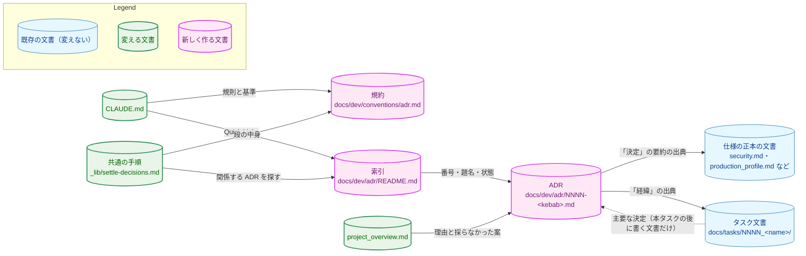
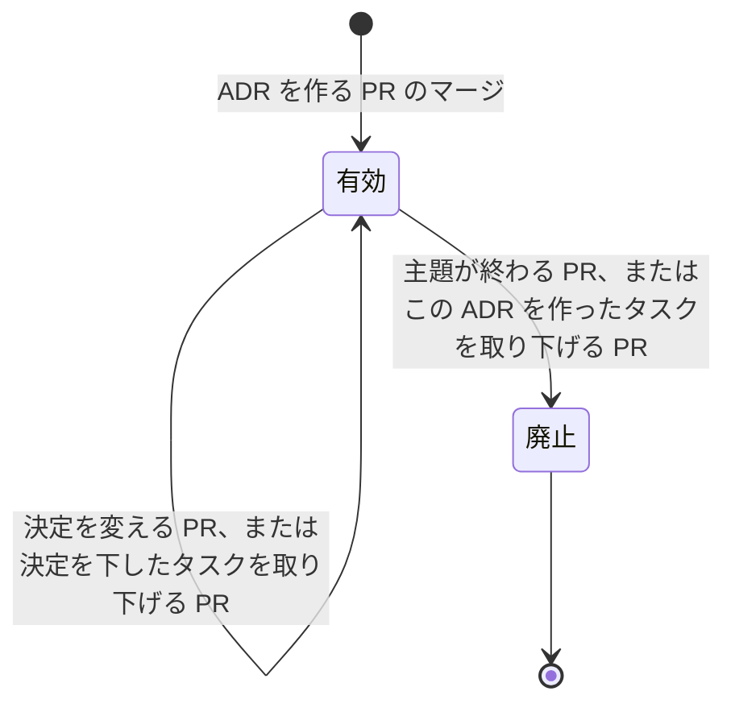
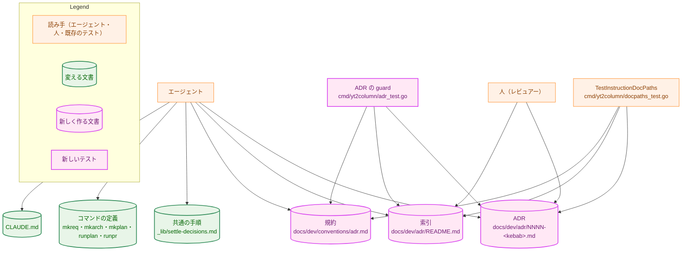
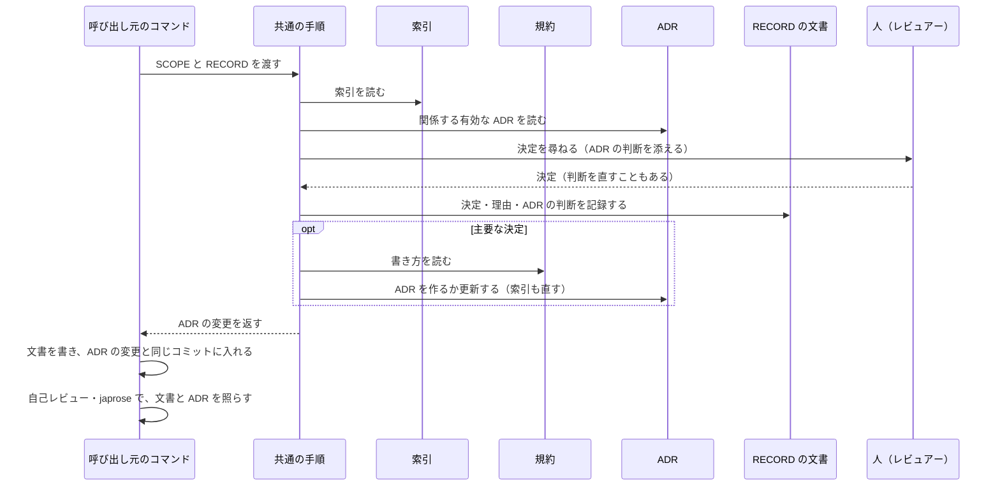
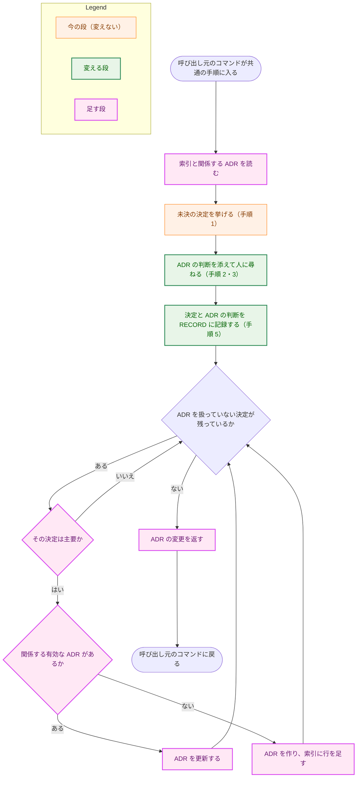
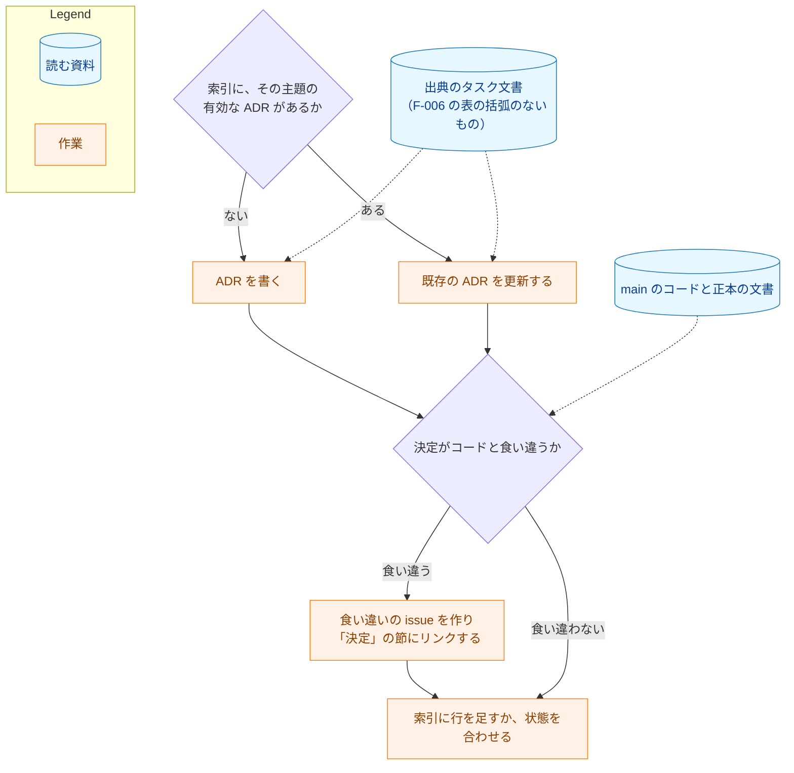

# アーキテクチャ設計書：主要な設計の決定を ADR として docs/dev に記録する

## Document Status

| Item | Value |
|---|---|
| Status | `approved` |
| Created | 2026-11-04 |
| Review date | 2026-11-04 |
| Reviewer | isseis |
| Comments | - |

本書は [01_requirements.md](01_requirements.md)（要件定義書。以下、要件書）の設計である。既存のファイルについての記述は、コミット `8749e5d` のファイルで確かめた。`file:line` は、このコミットでの行番号を指す。F-NNN・AC-NN は要件書の項番、H-NN は [design_handoff.md](design_handoff.md) の項番を指す。申し送りの H-01〜H-08 への対応は付録 A に、受け入れ基準との対応は付録 B にまとめる。調査の番号（A3・B1 など）は、要件書 6 章の定義のとおり、issue #602 のコメント（2026-11-04）で ADR の候補に付けた番号である。

本書は、要件書 6 章の用語（ADR、主題、主要な決定、索引、有効・廃止、経緯、仕様の正本の文書、調査の番号）を同じ意味で使う。そのほかに、次の用語を使う。

-   **規約:** ADR の書式と運用の規約の文書、`docs/dev/conventions/adr.md`（F-003。新しく作る。英語）。
-   **共通の手順:** `.claude/commands/_lib/settle-decisions.md`。`/mkreq`・`/mkarch`・`/mkplan`・`/runplan` が、未決の決定を人に確かめるときに従う手順である（同書 7〜13 行）。
-   **呼び出し元のコマンド:** 共通の手順に従うコマンド（`/mkreq`・`/mkarch`・`/mkplan`・`/runplan`）。
-   **SCOPE・RECORD:** 呼び出し元のコマンドが共通の手順に渡す入力。SCOPE は、そのコマンドの文書で決める決定の種類、RECORD は、その文書が各決定を記録する場所である（共通の手順の「Inputs the calling command must supply」）。
-   **FILES:** 呼び出し元のコマンドが自己レビューのサブエージェントに渡すファイルの一覧（`_lib/review-subagent-pattern.md` の入力）。
-   **ADR の変更:** 共通の手順が作るか変えた ADR と索引のファイルの一覧。共通の手順の出力として、呼び出し元のコマンドに渡す（3.4.1）。
-   **ADR の判断:** 1 つの決定について、ADR を作るか、どの ADR を更新するか、主要でないので ADR にしないか、の判断（要件書 1 章「主要かどうかはエージェントが判断し、人に示す」）。
-   **ADR の guard:** 索引と ADR の名前・番号・節・状態を確かめる、新しい Go のテスト `cmd/yt2column/adr_test.go`（3.6）。
-   **ADR-NNNN:** 番号が `NNNN` の ADR の呼び名。`NNNN` はファイル名の先頭の 4 桁の数字である。

## 1. 設計の全体像 (Design Overview)

### 1.1. 設計原則

-   **規則は規約に書き、手順は規約を参照する。** ADR の書式と運用（雛形、状態、更新・廃止・取り下げ、番号、`main` を取り込むときの扱い）は規約にだけ書く。共通の手順・コマンドの定義・`requirements_process.md` は規約を参照し、その内容を書き写さない（要件書 4.5、AC-23）。CLAUDE.md と規約の両方に書く内容は 3.3 の 3 つに限り、どちらにも相手を指す文を置く。
-   **guard が照らす構造の定義は規約に置く。** ADR の節の見出し、状態の値、索引の列の並びは、規約の決まった英語の見出しの下で定める。ADR の guard はそれを読んで ADR と索引に照らす。テストが固定する値は 3.6 の表に挙げたものに限る。
-   **ADR は生きた文書、タスク文書は変わらない記録。** ADR の本文には、今効いている決定だけを書く。決定が変わったら本文を書き換え、「経緯」に 1 項目を足す。タスク文書は、そのタスクで決めたことの記録として残し、本タスクでは書き換えない（AC-30）。
-   **仕様は正本の文書に残す。** ADR の「決定」の節は、正本の文書がある主題では、決定を要約して正本の文書へリンクする。理由・採らなかった案・経緯を持つのが ADR の役割である（AC-07）。
-   **既存の仕組みを使う。** リンクの実在は既存の `TestInstructionDocPaths`（`cmd/yt2column/docpaths_test.go:140-160`）が確かめ、ADR の guard は確かめない。同じ値を 2 つのテストで確かめないためである（CLAUDE.md「Do not check the same value of the same document against the same source in more than one test」）。文書の解析には `internal/doctestutil` の既存の関数を使う（3.6）。新しいパッケージと外部の依存は加えない。

### 1.2. 設計の際に決めたこと（2026-11-04）

利用者に確かめて決めたこと:

-   **F-006 の 15 件の主題は、主題ごとに 1 本の ADR にする（15 本。H-06）。** AC-25 は 1 本の ADR に 2 件以上の主題を入れることを許すが、まとめると、主題のどれか 1 つが変わるたびに大きな文書を書き換えることになり、廃止も主題の単位でできなくなる。主題ごとに 1 本にすれば、AC-25 の対応が一対一になり、更新と廃止も主題の単位で行える。B5（起動の経路）と B7（ビューアの開き方）のように内容が重なる主題は、ADR どうしのリンクで扱う。
-   **PR は 4 本に分け、F-007 の issue は 1 本目の PR の段階で作る（H-07）。** ①規約・手順・空の索引・ADR の guard、②LLM の ADR（A 系の 4 本）、③構成と拡張の ADR（B 系の 7 本）、④プロセスの ADR（D 系の 4 本）である。issue #602 のコメントの 3 本の案では、2 本目の PR に 11 本の ADR が入る。ADR は 1 本ごとに、出典のタスク文書と今のコードに照らして確かめる必要があるので（AC-26・AC-27）、1 本の PR としては大きすぎる。F-007 の issue を早く作るのは、0058・0059 が本タスクの途中で完了しても、後で足す経緯（AC-33）が失われないようにするためである。
-   **索引と ADR の整合は、恒久的な Go の guard で確かめる（H-02）。** これからの PR で、エージェントが ADR を足したり状態を変えたりする。索引の更新漏れは起こりやすい誤りであり、並行する worktree の 2 つの PR が同じ番号を取ることもある（H-06）。索引が食い違うと、「今どの決定が効いているかを一か所で分かるようにする」という目的（要件書 2.1）が果たせなくなる。本タスクの `_checks/` で 1 回だけ確かめる案では、これからの食い違いを見つけられないので採らない。
-   **ADR の雛形は、規約の文書の中のコードブロックに置く（H-06）。** `docs/dev/adr/` に雛形のファイルを置くと、ADR の guard がそれを ADR として数えるので、除外の規則が要る。

レビュアーに個別には確かめず、上の決定と現行の規則から導いたこと（PR のレビューで異論があれば改める）:

-   **規約の文書の名前は `docs/dev/conventions/adr.md` とする。** 同じディレクトリのほかの規約（`requirements_process.md`・`mermaid_reference.md`）と同じく、内容を表す短い名前にする。
-   **状態の値は、ADR の中では日本語の `有効`・`廃止` と書き、英語の規約では "active"・"obsolete" と呼ぶ（H-08）。** "retired" は、翻訳の用語集で「廃止した LLM の変数」の訳に使われている（`docs/translation_glossary.md:149`）ので避ける。"withdrawn" はタスク文書の状態の値なので使わない。"superseded" も使わない。廃止は主題そのものが終わったときだけで、代わりの ADR があるとは限らないためである（要件書 1 章「要件定義の際に決めたこと」）。
-   **共通の手順は、ADR の変更を出力として返し、呼び出し元のコマンドがそれを自分のコミット・レビュー・`japrose` に含める（H-01）。** 3.4 で定める。
-   **決定ごとの ADR の判断を、RECORD に書き残す。** 人に示した判断が会話にしか残らないと、「主要でないと判断した」と「判断を忘れた」を PR のレビューで見分けられないためである（3.4.1）。
-   **呼び出し元のコマンドの自己レビューの観点に、ADR の確認を 1 項目足す。** 共通の手順を通らない決定（エージェントが文書を書く中で下した決定、自己レビューの修正で変わった決定）も、PR を開く前に確かめるためである（3.4.2）。
-   **`main` を取り込むときの ADR の扱いを規約に定め、`/runpr` の「Taking in `main`」から参照する。** 番号の衝突と、同じ ADR への並行する変更を直す場面は、`main` を取り込むときに起きるためである（3.1.2）。
-   **タスクの取り下げの手順（`requirements_process.md`「Withdrawing a task」）から、規約の取り下げの規則を参照する。** 取り下げを行う人やエージェントが読むのはその節で、そこから規約にたどり着けないと、取り下げたタスクの決定が ADR に `有効` のまま残るためである（3.5.2）。
-   **経緯の日付は、新しく書く項目では書いた日、既存の決定を写す項目では出典の文書が記録する日とする（H-05）。** 3.2.4 で定める。
-   **タスク文書から ADR へは、`ADR-NNNN` を文字にした相対リンクで指す（H-04）。** 3.2.5 で定める。
-   **CLAUDE.md の「Document language」の原則 (a) に `docs/dev/adr/` を足す。** 今の原則 (a) が挙げるのは「`docs/dev/` の直下の文書」（CLAUDE.md 42〜46 行）で、`docs/dev/adr/` の下の ADR はそれに当たらない。ADR と索引が日本語であること（AC-04）を、言語の規則の側でも読めるようにする。

### 1.3. なぜ既存の方法では足りないか

今の記録の置き場所（`requirements_process.md:96-108` の 5 つの置き場所、設計書の付録「決定の履歴」、`project_overview.md` の「決定済みの方針」）は、どれもタスクの単位か、方針の要約の単位である。タスクの単位の記録では、決定の理由と採らなかった案を知るのに、関係するタスクの文書をすべて探す必要がある。要約の単位の記録には、採らなかった案と経緯が入らない。主題の単位で今の決定と経緯を 1 つの文書にまとめるという要件（要件書 2.1 の 1 つ目と 2 つ目）は、既存の置き場所を広げても満たせない。

決定を記録する仕組みのほかの部分は、既存のものを使う。決定を人に確かめる段は共通の手順に足す（新しい手順書を作らない）。リンクの実在の確認は、既存の `TestInstructionDocPaths` に任せる。承認は PR のレビューとマージで行い、`/runpr` の承認の記録は広げない（要件書 1 章）。

### 1.4. 概念モデル

矢印 A → B は「A が B を参照する（リンクする、または読んで従う）」を表す。



点線の矢印は、本タスクの規則が `main` に入った後に書くタスク文書だけが持つリンクを表す。既存のタスク文書には足さない（AC-16・AC-30）。変える文書の一覧は 2.2 にある。

ADR の状態は、次のように移る。矢印は状態の遷移を表し、ラベルはその遷移を起こす PR を表す。



`有効` から `有効` への遷移では、「決定」の節を書き換え（取り下げなら、取り下げたタスクの分を戻し）、「経緯」に 1 項目を足す（3.2.3）。廃止した ADR は削除しない（AC-10）。状態の図は Mermaid の `stateDiagram` で、classDef の色分けを使わないので、Legend を持たない。

## 2. システム構成 (System Structure)

### 2.1. 全体構成

本タスクが作る・変えるファイルと、それを読む者の関係を示す。矢印 A → B は「A が B を読む」を表す。



`TestInstructionDocPaths` は、`docs/dev` の下のすべての `.md` を対象にする（`cmd/yt2column/docpaths_test.go:106-131` の `instructionDocs`。除くのは `readmeGuides` だけ）。そのため、`docs/dev/adr/` と `docs/dev/conventions/adr.md` は、追加の設定なしにリンクの確認の対象になる（H-03。3.7）。

### 2.2. コンポーネント配置

| ファイル | 種類 | 変更 | 担う要件 | PR |
|---|---|---|---|---|
| `docs/dev/conventions/adr.md` | 規約（英語） | 新規 | F-003（AC-12・AC-13）、F-001・F-002 の定義 | ① |
| `docs/dev/adr/README.md` | 索引（日本語） | 新規（① では行のない表） | AC-03・AC-04 | ①〜④ |
| `docs/dev/adr/0001-*.md`〜`0015-*.md` | ADR（日本語） | 新規 | F-002・F-006（AC-25〜AC-29） | ②〜④ |
| `CLAUDE.md` | 指示 | 変更（ADR の節、Quick Links、Document language、Development Notes の guard の一覧） | F-004（AC-14〜AC-17） | ① |
| `docs/dev/conventions/requirements_process.md` | 規約 | 変更（96〜108 行の段落、「Withdrawing a task」） | AC-18、AC-13 の取り下げ | ① |
| `.claude/commands/_lib/settle-decisions.md` | 共通の手順 | 変更（段と出力を足す） | F-005（AC-20〜AC-24） | ① |
| `.claude/commands/mkreq.md` | コマンドの定義 | 変更（手順 6 のコミット、手順 7 の FILES・`japrose`・観点） | AC-24（H-01） | ① |
| `.claude/commands/mkarch.md` | コマンドの定義 | 変更（74 行、手順 7.5 のコミット、手順 8 の FILES・観点、手順 9 の `japrose`） | AC-19・AC-24 | ① |
| `.claude/commands/mkplan.md` | コマンドの定義 | 変更（手順 7.5 のコミット、手順 8 の FILES・観点、手順 9 の `japrose`） | AC-24 | ① |
| `.claude/commands/runplan.md` | コマンドの定義 | 変更（手順 5 の「Decision change」のコミット、手順 7 の FILES） | AC-24 | ① |
| `.claude/commands/runpr.md` | コマンドの定義 | 変更（「Taking in `main`」に規約への参照を 1 項目） | AC-02・AC-03 の維持 | ① |
| `cmd/yt2column/adr_test.go` | ADR の guard | 新規 | AC-01〜AC-03・AC-05・AC-06 の値と構造 | ① |
| `docs/dev/project_overview.md` | 方針の要約 | 変更（9〜16 行の 4 項目にリンクを足す） | AC-31 | ②・③ |
| `docs/tasks/0060_adr_records/_checks/` | 1 回だけの確認 | 新規 | AC-30・AC-31 | 計画で決める |
| GitHub の issue（F-007） | issue | 新規 | AC-32・AC-33 | ① |
| GitHub の issue（AC-26 の食い違い） | issue | 見つけたときだけ新規 | AC-26 | ②〜④ |

変えないもの: `fixprguard` とその範囲の規則（3.4.3）、`/fixpr`・`/mkplan2`・`/mergepr` の定義、`docs/tasks/` の下の既存の文書（AC-30）、仕様の正本の文書（要件書 2.3）、`AGENTS.md`（自動レビュアーは CLAUDE.md に従うよう、すでに指示されている。`AGENTS.md:3`）。

この変更が振る舞いを変える既存のテストはない。`TestInstructionDocPaths` は、新しい文書のリンクとパスにも効くようになるが、テストのコードは変えない。`runpr.md`・`mkarch.md` などを読む既存の文書のテスト（`TestRunprDocContract` など）が今の文言に依存していないかは、実装計画で確かめる。

### 2.3. データフロー：呼び出し元のコマンドが ADR を作るか更新する

矢印は、呼び出しと応答、またはファイルの読み書きを表す。



## 3. コンポーネント設計 (Component Design)

Go の型・interface・エラー型は加えない。加える Go のコードは、ADR の guard のテストだけである（3.6）。

### 3.1. 置き場所・名前・番号（F-001・H-06）

#### 3.1.1. 規則

-   **置き場所:** `docs/dev/adr/` の直下。このディレクトリには、ADR と索引の `README.md` のほかのファイルとサブディレクトリを置かない。
-   **名前:** `NNNN-<kebab>.md`。`NNNN` は `0001` から始まる 4 桁の連番、`<kebab>` は英小文字・数字を `-` でつないだ名前である（AC-01）。
-   **番号の割り当て:** 新しい ADR には、ADR を書く時点の `main` とその PR のブランチにある番号のうち、最も大きいものの次の番号を使う。番号は `0001` から抜けなく続く。廃止した ADR も削除しないので（AC-10）、番号は使い回されない（AC-02）。
-   **呼び名:** 文書の中では `ADR-NNNN` と呼ぶ。
-   **題名:** `|` を含めない。索引の表のセルに入れるためである。

#### 3.1.2. `main` を取り込むとき（H-06）

索引の表は番号の順に並び、新しい行は表の末尾に足す。そのため、ADR を足す 2 つの PR は、索引の同じ位置に行を足すことになり、後からマージされる PR は `main` と衝突する。衝突した PR は CI が動かないので、`main` を取り込む必要がある。

PR のブランチに `main` を取り込むとき、マージの基点より後に `main` で `docs/dev/adr/` が変わっていれば、次のことを行うと規約に定める。あわせて、`/runpr` の「Taking in `main`」（`.claude/commands/runpr.md:249-254`）に、規約のこの節を参照する 1 項目を足す。

1.  **主題を先に確かめる。** PR が新しく作った ADR の主題について、取り込んだ `main` の索引に、同じ主題の有効な ADR がないかを確かめる。あれば、新しい ADR を作らず、`main` の ADR を更新する形に直す。1 つの主題は、有効な ADR のうち 1 本だけに属する（AC-25、要件書 6 章「主題」）。
2.  **番号を直す。** 同じ主題でなく、番号だけが重なったときは、PR の ADR を空いている次の番号に直す。ファイル名、1 行目の番号、索引の行に加えて、PR の差分（`git diff origin/main...HEAD`）の中にある `ADR-<古い番号>` という文字列と、`<古い番号>-` で始まるファイルへのリンクを、すべて直す（タスク文書の中のものを含む）。直したことは、編集上の訂正としてコミットメッセージに書く（`requirements_process.md`「Recording in the PR description」）。
3.  **同じ ADR への並行する変更を照らす。** PR が変えた ADR を `main` も変えていれば、git が衝突なく合わせた場合も含めて、その ADR を読み直す。「決定」の節が、「経緯」の最後の項目の決定と合っていることを確かめ、合っていなければ直す。PR の経緯の項目は、`main` の項目の後に置く（3.2.4）。

**`main` で ADR の guard が失敗したとき。** 2 つの PR が、どちらも `main` を取り込む前に CI を通り、索引の衝突もなくマージされると（行を末尾以外に足した場合など）、番号の重複や抜けが `main` に入りうる。そうなると、`doc-guard` ジョブはすべての PR のマージのコミットで失敗し、手元の `make test` も `main` で失敗する。この食い違いは、関係のない PR に含めて直さず、それだけを直す単独の PR で直す。関係のない PR のレビュアーは、ADR の変更を承認する立場にないためである。

#### 3.1.3. 本タスクの番号の予定

本タスクの 15 本は、調査の番号の順（A 系、B 系、D 系）に `0001`〜`0015` を割り当てる予定である。② → ③ → ④ の順にマージするので（8 章）、ほかのタスクが間に ADR を足さない限り、この番号になる。ほかのタスクが先に番号を取ったときは、3.1.1 の規則で次の番号を使う。`<kebab>` の名前は実装計画で決める。

| 予定の番号 | 調査の番号 | 主題 | PR |
|---|---|---|---|
| 0001 | A3 | LLM のアダプタは標準ライブラリで書き、送信の経路と共有の型を決まったパッケージに置く | ② |
| 0002 | A6 | 生成の後の 2 段階 | ② |
| 0003 | A9 | LLM の設定の契約 | ② |
| 0004 | A10 | 本番の構成と品質の目標 | ② |
| 0005 | B1 | サーバの構成 | ③ |
| 0006 | B2 | 脅威モデル | ③ |
| 0007 | B4 | 字幕の入力は利用者の手動のコピー | ③ |
| 0008 | B5 | 起動の経路と送信の契機 | ③ |
| 0009 | B7 | ビューアの開き方とポップアップを閉じないこと | ③ |
| 0010 | B8 | 拡張は何も保存せず、権限を加えない | ③ |
| 0011 | B11 | 投稿先と投稿の契機 | ③ |
| 0012 | D1 | レビューの体制 | ④ |
| 0013 | D2 | 決定的な判定を Go の開発ツールに置く | ④ |
| 0014 | D3 | レビューのスレッドの本文を信頼しない | ④ |
| 0015 | D4 | 文書のテストの方針 | ④ |

**本タスクの途中で、ほかのタスクが同じ主題の ADR を作ったとき。** 進行中のほかのタスクのブランチは、`main` を取り込んだ後に、CLAUDE.md の規則（AC-14）と共通の手順の新しい段に従う（要件書 4.4）。たとえば 0058 が ③ より前に脅威モデル（B2）の決定を変えれば、0058 の PR が B2 の ADR を作ることがある。② 〜 ④ で ADR を書く前に索引を読み、その主題の有効な ADR がすでにあれば、新しく作らずにその ADR を更新する。そのときは、F-007 の issue に書いた「0058・0059 の分を後で足す」の項目も、ADR の今の経緯と照らして直す（AC-33）。

### 3.2. ADR の書式（F-002）

#### 3.2.1. 規約の構成（AC-13）

規約は次の節からなる。節の英語の見出しの文言は実装計画で決める。ADR の guard が読む節には「guard」と書いた。

| 規約の節 | 中身 | AC-13 の項目 |
|---|---|---|
| Location and naming | 置き場所、名前、番号の割り当て、呼び名、題名の制約（3.1.1） | 置き場所と名前と番号 |
| Template（guard） | ADR の雛形のコードブロック（3.2.2） | 節 |
| Status（guard） | 状態の値の表（3.2.3） | 状態とその意味 |
| Index（guard） | 索引の内容と表の見出しの行（3.5.1） | 索引の内容 |
| What counts as major | 主要な決定の基準（3.3 の、CLAUDE.md と規約の両方に書く内容） | 主要な決定の基準 |
| Writing an ADR | 各節に書くこと、正本の文書との分担、リンクの書き方（3.2.2・3.2.5） | 正本の文書との分担 |
| History entries | 経緯の項目の形・日付・並び（3.2.4） | 更新の仕方 |
| Changing, retiring, and withdrawing | 決定が変わったとき、主題が終わったとき、タスクを取り下げたとき（3.2.3） | 更新の仕方、廃止の仕方、取り下げの扱い |
| Approval and the PR | 承認は ADR を含む PR のレビューとマージで行うこと、主要な決定を下すか変える PR が同じ PR で ADR を作るか更新すること | 承認、PR |
| Taking in `main` | 3.1.2 の 3 つの手順と、`main` で guard が失敗したときの扱い | （AC-02・AC-03 の維持） |

#### 3.2.2. 雛形と各節に書くこと

規約は、次の雛形をコードブロックで示す。

```markdown
# ADR-NNNN: <題名>

## 状態

| 項目 | 値 |
|---|---|
| 状態 | `有効` |

## 背景

## 決定

## 採らなかった案

## 結果

## 経緯
```

-   **題名（1 行目）:** `ADR-NNNN: ` に続く文が題名である。索引の題名の列と同じ文にする（AC-03）。
-   **状態:** 「状態」の節の表の `状態` の行に、`有効` か `廃止` を書く（AC-06）。廃止したときは、同じ表に `廃止の日付`・`廃止の理由`・`代わりの ADR` の 3 行を足す。`代わりの ADR` は、代わりの主題の ADR へのリンクか、`なし` である（AC-10）。状態を表のセルに書くのは、ADR の guard が日本語の値を表のセルとして読めるようにするためである（CLAUDE.md の guard-test literal exception は、表のセルの文字列を許す）。
-   **背景:** その主題で決定が要る理由と、決定を縛る前提を書く。
-   **決定:** 今効いている決定だけを書く。正本の文書がある主題では、決定を要約して正本の文書へリンクする（AC-07）。過去の決定は書かない。
-   **採らなかった案:** 案ごとに、採らなかった理由を書く。出典の文書に理由がない案は、「理由は記録されていない」と明記する（AC-08）。
-   **結果:** その決定が後のタスクや部品に課す制約と、受け入れた代償を書く。
-   **経緯:** 3.2.4 のとおり。

6 つの節（AC-05）の下には、`###` の小見出しを置いてよい。`##` の見出しは、雛形の 6 つだけにする。

#### 3.2.3. 状態と、決定が変わったとき（AC-06・AC-10・AC-13・H-08）

規約は、状態を次の形の表で定める。表の見出しは英語で、値のセルだけが日本語である。

| Value | Name | Meaning |
|---|---|---|
| `有効` | active | The decision is approved. It does not say whether the implementation is finished. |
| `廃止` | obsolete | The subject has ended and the decision is no longer in effect. |

「承認された」は、その ADR を含む PR がレビューを経てマージされたことを指す（要件書 1 章）。ADR は Document Status の表を持たず、`/runpr` の承認の記録の対象にならない。

-   **決定が変わったとき:** 同じ ADR の「決定」の節を今の決定に書き換え、「経緯」に 1 項目を足す。過去の決定は「経緯」に残す。過去の決定を「採らなかった案」にも書くのは、決定を変えた文書が、その決定を採らなくなった理由を述べているときだけにする。新しい ADR を作って古い ADR を廃止することはしない。
-   **主題が終わったとき:** 状態を `廃止` にし、廃止の日付・理由・代わりの ADR を書き、「経緯」に 1 項目を足す。索引の状態の列も `廃止` にする。
-   **決定を下したタスクを取り下げたとき:** 取り下げの PR で、取り下げたタスクが加えた決定の部分を戻し、「経緯」に 1 項目を足す。取り下げたタスクの後に、別のタスクが同じ ADR の決定を変えていたときは、その変更は残し、取り下げたタスクの分だけを戻す。戻す部分が後の変更と分けられないときは、人に確かめる。取り下げたタスクが新しく作った ADR なら、状態を `廃止` にする（削除しない）。

#### 3.2.4. 経緯の項目（AC-09・AC-28・H-05）

経緯の各項目は、次の形の箇条書き 1 行にする。

```markdown
- YYYY-MM-DD <その時点の決定または変更の要旨>（[<出典の文書の呼び名>](<出典の文書への相対リンク>)）
```

**並び。** 項目は、決定が `main` に入った順に並べる。新しい項目は末尾に足す。`main` を取り込んだとき、PR の項目は `main` の項目の後に置く（3.1.2）。決定はマージの順に効くので、この順が「古い順」である（AC-09）。

**日付。** 項目の種類ごとに決める。

-   **新しく書く項目:** その項目を書いた日。`main` を取り込んで PR の項目を後ろに移したとき、その日付が直前の項目より前なら、取り込んだ日に改める。日付の並びが項目の並びと逆にならないようにするためである。マージの日には合わせない。マージの日は書く時点では分からず、合わせる手順を足すほうが重いためである。
-   **既存の決定を写す項目（本タスク）:** 出典の文書が記録する日付を、次の順で最初に見つかるものにする。
    1.  決定を書いた節の見出しの日付（`実装の際に決めたこと（YYYY-MM-DD）` など）。
    2.  出典の文書の変更履歴の承認の行の日付。2 回以上承認されている文書では、その決定を本文に書いた変更の後の、最初の承認の日付にする。
    3.  出典の文書の状態表の `Review date`。
    4.  上のどれもないときは、出典の文書を `main` に加えた最初のコミットの日付（`git log --diff-filter=A --format=%cs -- <path>` の最後の行。名前の変更はたどらない）。項目の要旨の後に「（日付は文書を加えたコミットの日付）」と書き添える。

    `Created` は使わない。文書を書き始めた日で、決定の日ではないためである。

**本タスクの項目の数（AC-28）。** 本タスクで書く ADR の「経緯」には、F-006 の表の「出典のタスク」のうち括弧に入れていないタスクごとに、少なくとも 1 項目を置く。そのタスクが決定を変えずに確かめ直しただけのときも、「決定を保った」という要旨で 1 項目にする。

#### 3.2.5. ADR へのリンクの書き方（AC-11・AC-16・H-04）

-   **ADR から:** 仕様の正本の文書とタスク文書へ、相対リンクで指す。行番号は書かない（AC-11）。節を指すときは、見出しの名前を文で書き、アンカーは使わない。`TestInstructionDocPaths` はアンカーを取り除いて確かめるので（`cmd/yt2column/docpaths_test.go:53`）、見出しが変わってもアンカーの切れを見つけられないためである。
-   **タスク文書・`project_overview.md` から ADR へ:** `[ADR-NNNN](<相対パス>)` の形で指す。リンクの文字は `ADR-NNNN` とし、題名を添えるときはリンクの外に書く。題名をリンクの文字にすると、題名を直したときにリンクの文字が古くなる。

### 3.3. CLAUDE.md の変更（F-004）

CLAUDE.md の「## Documents」の章（22 行から）に、新しい小節「Design decisions (ADR)」を足す。中身は次のとおりで、どれも英語である。

-   **規則（AC-14）:** 主要な決定を下すか変える PR は、同じ PR で ADR を作るか更新する。この規則は、コマンドを通らない PR を含むすべての PR に効く。書き方は規約に従う（規約へのリンク）。
-   **主要な決定の基準（AC-15）:** 影響がそのタスクの外に及ぶこと（後のタスクや複数の部品を縛る、または覆すと複数の箇所が変わる）。例として、構成と部品の境界、プロトコル、外部の依存やサービス、セキュリティの前提、製品の範囲、開発のプロセスとツールの方針を挙げる。既存の ADR の決定を変える決定は、常に主要とする。1 つのタスクの中で閉じる決定の例（テストの名前、文言、1 つの関数の形、定数の値、実装の順序）も挙げる。
-   **分担（AC-16）:** 要件書 AC-16 の 5 項目を規則として書く。タスク文書から ADR へのリンクは、この規則が `main` に入った後に書くタスク文書に求め、既存のタスク文書には足さないことも書く。
-   **Quick Links（AC-17）:** 「Project:」の一覧に、ADR の索引（`docs/dev/adr/README.md`）と規約（`docs/dev/conventions/adr.md`）を足す。索引の説明には、設計の前に今の決定と理由を探す入口であることを書く。
-   **Document language:** 原則 (a) の一覧に `docs/dev/adr/` の ADR と索引を足す（1.2）。原則 (b) の「`docs/dev/conventions/` の規約」には規約の `adr.md` が含まれるので、書き足さない。
-   **Development Notes:** 文書を読む Go の guard を挙げる段落（「the other text-sync guards that read documents」の一覧）に、ADR の guard を足す。文書だけを変える PR でも `doc-guard` ジョブで実行されることを、ほかの guard と同じく読めるようにする。

**CLAUDE.md と規約の両方に書く内容。** 次の 3 つは、AC-13 が規約に求め、AC-14〜AC-16 が CLAUDE.md に求めるので、両方に書く。

| 内容 | CLAUDE.md | 規約 |
|---|---|---|
| 主要な決定の基準 | 基準の全文 | 基準の全文 |
| 主要な決定を下すか変える PR は、同じ PR で ADR を作るか更新すること | 規則の全文（AC-14） | 同じ規則の全文 |
| 仕様の正本の文書との分担 | 分担の 5 項目（AC-16） | 「決定」の節に書くこと（AC-07）としての分担 |

それぞれの直後に、「同じ内容が〈もう一方の文書〉にあり、変えるときは両方を同じ PR で変える」という文を置く。2 か所の文の一致はテストで確かめない。文の意味の一致はテストで確かめられないためである（CLAUDE.md「Document tests check values, structure, and executable examples, never prose」）。PR のレビューで読んで確かめる（H-02）。

### 3.4. コマンドの手順（F-005・H-01）

#### 3.4.1. 共通の手順に足す段と出力

`.claude/commands/_lib/settle-decisions.md` を、次のように変える。段の中身は規約と CLAUDE.md を参照し、書式・状態・基準を書き写さない（AC-23）。

| 位置 | 足す・変える内容 | AC |
|---|---|---|
| 手順 1 の前に新しい段 | 索引を読み、SCOPE の決定に関係する有効な ADR を探して読む。関係する ADR の今の決定は、未決の決定を挙げるときの入力（手順 1 の「the input」）に含める。索引が読めないときは、関係する ADR がないものとして進めず、止まって報告する | AC-20 |
| 手順 2 | 背景の説明に、ADR の判断とその理由を添える | AC-21 |
| 手順 5 | RECORD に、決定ごとの ADR の判断（`ADR-NNNN` を作るか更新する、または「ADR なし」とその理由）を書く | AC-21 の記録 |
| 手順 5 の後に新しい段 | 主要な決定なら、規約に従って ADR を作るか更新する（決定を変えること、廃止することを含む）。索引も同じ変更で直す。RECORD の記録から ADR へリンクする | AC-22 |
| 新しい節「Output」 | 共通の手順は、作るか変えた ADR と索引のファイルの一覧（ADR の変更）を呼び出し元のコマンドに返す。変更がなければ空である | AC-24 |

「Inputs the calling command must supply」（15〜19 行）には入力を足さない。ADR の扱いは、どの呼び出し元でも同じだからである。

#### 3.4.2. 呼び出し元のコマンド

共通の手順は、呼び出し元のコマンドの後の段（コミット・レビュー）を指示しない。呼び出し元のコマンドが、出力の ADR の変更を自分の段で使う。

| コマンド | 変える箇所 |
|---|---|
| `/mkreq` | 手順 6 のコミットの対象（`.claude/commands/mkreq.md:110-112` の「Commit the task directory」）に ADR の変更を足す。手順 7 の FILES と `japrose` の対象に ADR の変更を足す。手順 7 の観点に、下の 1 項目を足す |
| `/mkarch` | 手順 7.5 の最初のコミットに ADR の変更を入れる。手順 8 の FILES と手順 9 の `japrose` の対象に ADR の変更を足す。手順 8 の観点に、下の 1 項目を足す。手順 7 の最後の箇条（`.claude/commands/mkarch.md:74`）を AC-19 のとおり改める（下） |
| `/mkplan` | 手順 7.5 の最初のコミットに ADR の変更を入れる。手順 8 の FILES と手順 9 の `japrose` の対象に ADR の変更を足す。手順 8 の観点に、下の 1 項目を足す |
| `/runplan` | 手順 5 の「Decision change」（`.claude/commands/runplan.md:64`）の「in the same commit」の対象に ADR の変更を足す。手順 7 の FILES に ADR の変更を足す。手順 7 はコードのレビューなので、ADR の書き方の確認は PR のレビューで人が行う。`/runplan` が決定を変えるのは、承認済みの文書の決定を変える必要が出たときだけで、まれだからである |
| `/mkplan2` | 変えない。PR の境界を足すだけで、共通の手順を使わない |

**足す観点の 1 項目（`/mkreq`・`/mkarch`・`/mkplan`）。** 「文書の中の決定のうち、主要な決定の基準（CLAUDE.md）に当たるものは、ADR の判断が書かれ、この PR の ADR の変更に入っている。各 ADR の「決定」の節は、文書の今の決定と合っている。」この項目で、共通の手順を通らない決定（エージェントが文書を書く中で下した決定、自己レビューの修正で変わった決定）と、ADR を書いた後に文書の決定が変わった場合を、PR を開く前に確かめる。

**`mkarch.md:74` の改め方（AC-19）。** 付録「決定の履歴」に置くものを、そのタスクの中で閉じる決定の経緯に限り、主要な決定のタスクをまたぐ経緯は ADR に置く、と改める。本文を今の仕組みの記述に保つという、この箇条の今の指示は残す。

#### 3.4.3. `/fixpr` とコマンドを通らない PR

次の決定は、共通の手順を通らない。これらには CLAUDE.md の規則（AC-14）が効く。

-   `/fixpr` が PR のレビューの後に改めた決定。
-   タスクに属さない単独の PR で決めた決定。
-   呼び出し元のコマンドが文書を書く中でエージェントが下した決定。これは 3.4.2 の観点でも確かめる。

`/fixpr` が ADR を変えるとき、`fixprguard inspect` の範囲の規則（`docs/dev/guides/fixprguard_guide.md` 6 章）では、次のようになる。

-   スレッドの `path` がタスク文書（`docs/tasks/NNNN_<name>/` の下）のとき、`docs/dev/adr/` の ADR は、規則 2（同じディレクトリ）にも規則 3（同じタスクのディレクトリ）にも当たらないので、範囲外になる。`inspect` は終了コード `3` で範囲外の変更を示し、利用者が確かめてから続ける。
-   スレッドの `path` が ADR か索引のとき、同じディレクトリの `.md`（ほかの ADR と索引）は、規則 2 と許可リストの (a) で範囲に入る。

範囲の規則は変えない。主要な決定を `/fixpr` で改めることはまれで、そのときに利用者が範囲外の変更として ADR の変更を確かめることは、決定を人に示すという要件（要件書 1 章）にも合う。残余のリスクは 5.2 に挙げる。

### 3.5. 索引と、ほかの文書の変更

#### 3.5.1. 索引（`docs/dev/adr/README.md`）

索引は、短い説明と 1 つの表からなる。説明には、索引が今どの決定が効いているかを示すこと、書き方は規約にあることを書く。表は次の形で、番号の順に並べる。

```markdown
| 番号 | 題名 | 状態 |
|---|---|---|
| [ADR-0001](0001-<kebab>.md) | <ADR の 1 行目の題名> | `有効` |
```

列は、1 列目が番号（ADR へのリンク）、2 列目が題名、3 列目が状態である。規約は、この表の見出しの行をコードブロックで示す。① の時点の索引は、見出しと区切りの行だけを持ち、行を持たない。

#### 3.5.2. `requirements_process.md`（AC-18・AC-13）

-   **96〜108 行の段落:** 「Five places hold a record about a task document」は、タスク文書についての記録の置き場所を挙げている。ADR は、タスクをまたぐ主題についての記録だが、エージェントが置き場所を選ぶときに見落とさないように、同じ段落に 6 つ目として挙げる。段落の冒頭の数を「Six places」に改め、ADR に置くもの（主要な決定の今の形、理由、採らなかった案、タスクをまたぐ経緯）と、規約へのリンクを足す。
-   **「Withdrawing a task」（382 行から）:** タスクを取り下げるとき、そのタスクが作るか変えた ADR を規約の取り下げの規則（3.2.3）で直すことを、規約への参照として 1 文足す。

#### 3.5.3. `project_overview.md`（AC-31）

「決定済みの方針」（9〜16 行）のうち、AC-31 の表の 4 項目の末尾に、`[ADR-NNNN](adr/NNNN-<kebab>.md)` の形のリンクを足す。項目の要約の文は変えない。リンクは、リンク先の ADR を作る PR で足す。

| 項目 | リンク先 | PR |
|---|---|---|
| 実行形式 | B1・B5 の ADR | ③ |
| 字幕取得 | B4 の ADR | ③ |
| LLM（既定は Claude） | A3・A10 の ADR | ② |
| LLM プロバイダは差し替え可能にする | A3 の ADR | ② |

### 3.6. ADR の guard（H-02）

`cmd/yt2column/adr_test.go` に、ADR と索引の値と構造を確かめるテストを置く。`cmd/yt2column` のテストは、CI の `doc-guard` ジョブで、変更の種類にかかわらずすべての PR で実行される（`.github/workflows/ci.yml:173-187`）。`cmd/yt2column` には、文書を読むほかの guard（`docs_test.go`・`docpaths_test.go`）がすでにある。

**確かめること:**

| 確かめること | AC |
|---|---|
| `docs/dev/adr/` の直下の項目は、`README.md` と、名前が `NNNN-<kebab>.md` のファイルだけで、サブディレクトリがない。名前が `.` で始まる項目（macOS の `.DS_Store`、エディタの一時ファイルなど）は数えない | AC-01 |
| 番号に重複がなく、`0001` から抜けなく続く | AC-02 |
| 各 ADR の 1 行目が `# ADR-NNNN: <題名>` で、`NNNN` がファイル名の番号と同じ | AC-01・AC-03 |
| 索引の表の行と ADR のファイルが一対一に対応する。各行の 1 列目のリンク先が、その番号の ADR のファイル名と同じ | AC-03 |
| 索引の各行の 2 列目と 3 列目が、その ADR の題名と状態に一致する。比べるときは前後の空白とバッククォートを取り除く。題名に `\|` があるときは、題名の不一致とは別の種類の失敗にする | AC-03 |
| 各 ADR の `##` の見出しが、雛形の `##` の見出しと同じ文言・同じ順序である | AC-05 |
| 各 ADR の最初の `##` の節に表が 1 つだけあり、その表に `状態` の行が 1 つだけあり、その値が規約の状態の表の値のどれかである | AC-06 |
| 規約の雛形の `##` の見出しが 6 つ、規約の状態の表の行が 2 つである | AC-05・AC-06 の定義の形 |

**値の出典:**

| 値 | 出典 |
|---|---|
| 雛形の見出し | 規約の Template の節の中の、1 つだけのコードブロック（`doctestutil.SectionOutsideBlocks` で節を取り、`doctestutil.FencedBlocks` でコードブロックを取る） |
| 状態の値 | 規約の Status の節の中で、コードブロックの外にある、1 つだけの表の 1 列目 |
| 索引の見出しの行 | 規約の Index の節の中の、1 つだけのコードブロックの表の見出し。索引の表は、索引のコードブロックの外にある表のうち、この見出しを持つもの 1 つだけとする |
| 規約の節を探す見出し | テストに固定する（英語の見出し） |
| 名前の形 `NNNN-<kebab>.md` と 1 行目の形 `# ADR-NNNN: ` | テストに固定する。規約の Location and naming の節の定義と同じ形にする |
| 状態の行の名前 `状態` | テストに固定する（表のセルの日本語。CLAUDE.md の guard-test literal exception の範囲） |
| 索引の列の役割（1 列目が番号、2 列目が題名、3 列目が状態） | テストに固定する（位置で決める） |
| 雛形の見出しの数 6、状態の数 2 | テストに固定する（要件書 AC-05・AC-06 が定める値） |

表とコードブロックは、決まった節の中で探す。`SectionOutsideBlocks` が返す節の文にはコードブロックの行も残るので、コードブロックの外の表を探すときは `doctestutil.ScanDocLines` の `Block` の印でコードブロックの行を除く。`doctestutil.MarkdownTables` と `FindTable`（`internal/doctestutil/tables.go:10-74`）はコードブロックを飛ばさず、見出しが合う最初の表を返すので、文書の全体からは探さない。節の中の候補が 0 個か 2 個以上のときは失敗にする。

**読めないときは失敗にする。** 規約の節、雛形のコードブロック、状態の表、索引の表のどれかが見つからない、または空のときは、テストを飛ばさずに失敗にする。読めないことを「確かめることがない」と扱うと、規約や索引の形を壊したときに guard が黙って効かなくなるためである。索引の表に行がないこと（① の時点）は、ADR のファイルもないときに限って一致とみなす。

**失敗の報告。** 各失敗は、ファイルのパスと、食い違いの種類（名前の形、番号の重複、番号の抜け、索引にない ADR、ファイルのない索引の行、題名の不一致、題名の `|`、状態の不一致、見出しの不一致、状態の値、規約の定義が読めない、規約の定義の数）を述べる。直す人が、どのファイルのどこを直すかを報告だけで分かるようにする。

**確かめないこと:**

-   リンク先が実在するか（`TestInstructionDocPaths` が確かめる）。
-   1 つの主題が 2 本以上の有効な ADR に属していないか（AC-25）、同じ ADR への並行する変更が正しく合わさったか（3.1.2）。主題が同じかどうかは文の意味で決まるので、テストで確かめられない。`main` を取り込むときの手順（3.1.2）と PR のレビューで確かめる。
-   廃止した ADR の番号を使い回していないか、ADR を削除していないか（AC-02 の後半、AC-10）。guard が見るのはある時点のファイルだけなので、最後の番号の ADR を索引の行とともに消して、その番号を新しい ADR に使っても、番号は抜けなく続く。PR のレビューで確かめる。
-   節の中の文の内容、日本語で書かれているか（AC-04）、経緯の項目の形と日付、採らなかった案の出典（AC-08・AC-09・AC-27）、廃止したときの 3 行（AC-10）。これらは文の意味か、誤りの害が小さい書式で、PR のレビューで読んで確かめる（CLAUDE.md「Do not add a document check whose mistake is unlikely, whose harm is small, or whose upkeep costs more than the mistake it prevents」）。

**恒久のテストにする理由。** CLAUDE.md の文書のテストの方針は、値と構造の確認を許す（「A test that reads a document may compare a value in it with the code or configuration that defines it ... check the heading structure」）。ADR の guard が確かめるのは、索引と ADR の値の一致と、規約が定める見出しの構造で、方針の許す範囲に入る。廃止した仕様を文書に残させるテストでもない。

### 3.7. 既存のリンクの guard との関係（H-03）

`TestInstructionDocPaths`（`cmd/yt2column/docpaths_test.go:140-160`）は、`CLAUDE.md`・`AGENTS.md`・`.claude/commands` と `docs/dev` の下の `.md` について、相対リンクの先と、コードスパンに書いた `docs/dev/` の下のパスが実在することを確かめる（同 101〜131 行）。対象を決めるのはディレクトリの走査なので、次のファイルは追加の設定なしに対象になる。

-   `docs/dev/conventions/adr.md`、`docs/dev/adr/README.md`、`docs/dev/adr/NNNN-*.md`。
-   変える `CLAUDE.md`・`.claude/commands` の各ファイル・`requirements_process.md`・`project_overview.md`。

`docs/tasks/` の下の文書は対象外である（同 103〜104 行のコメント）。そのため、ADR からタスク文書へのリンクは確かめられるが、これから書くタスク文書から ADR へのリンクは確かめられない（5.2）。

PR の中の順序の規則:

-   リンク先のファイルを作る PR より前の PR で、リンクを書かない。CLAUDE.md の Quick Links と規約からの索引へのリンクは、索引を作る ① に入れる。`project_overview.md` から ADR へのリンクは、その ADR を作る ② か ③ に入れる（3.5.3）。
-   規約・CLAUDE.md・共通の手順の中で、ADR のファイル名の例を書くときは、`NNNN-<kebab>.md` のような仮の名前をコードスパンに書くか、コードブロックの中に書く。`TestInstructionDocPaths` は、コードブロックの中、コードスパンの中のリンク、`<` で始まるリンク先を例として扱う（同 34〜37 行・69〜78 行）。ただし、`docs/dev/` で始まる実在の形のパスをコードスパンに書くと、確かめの対象になる（同 27 行の `repoDocPathRE`）。`[ADR-NNNN](NNNN-<kebab>.md)` のように `<` がリンク先の途中にあるリンクを地の文に書くと、確かめの対象になって失敗する。
-   コミットの単位では、リンクとリンク先を同じコミットに入れるか、リンク先を先にコミットする。各コミットで `make test` が通るようにするためである。

## 4. エラーハンドリング設計 (Error Handling Design)

本タスクは Go の製品コードを変えないので、エラー型を加えない。テストの失敗の報告は 3.6 で定めた。

手順の中の失敗の扱い:

| 場面 | 扱い |
|---|---|
| 共通の手順で索引が読めない（ファイルがない、表が見つからない） | 関係する ADR がないものとして進めず、止まって利用者に報告する。① がマージされた後は索引が必ずあるので、読めないことは誤りである |
| 主要かどうかの判断が人と違った | 人の判断に従い、RECORD と ADR をそれに合わせる（要件書 1 章） |
| ADR を書く時点で、正本の文書とコードが食い違っている（AC-26） | ADR にはコードの振る舞いを書き、食い違いを GitHub の issue にし、ADR の「決定」の節にその食い違いと issue へのリンクを書く。issue の作成はネットワークの操作なので、その都度利用者の承認を得る（CLAUDE.md「Tool Execution Safety」） |
| 出典の文書に採らなかった案の理由がない | 理由を補わずに、「理由は記録されていない」と書く（AC-08・AC-27） |
| `main` を取り込んだら、同じ主題の ADR か同じ番号の ADR が `main` にあった | 3.1.2 の手順で直す |
| `main` で ADR の guard が失敗している | 単独の PR で直す（3.1.2） |
| 取り下げで戻す決定の部分が、後のタスクの変更と分けられない | 人に確かめる（3.2.3） |

## 5. セキュリティ考慮事項 (Security Considerations)

### 5.1. 脅威モデル

N/A。本タスクは、文書とコマンドの定義と、文書を読むテストだけを変える。外部コマンドの起動、API キーや Webhook URL の扱い、キャッシュ、ネットワークへの送信、信頼しない文字列のプロンプトや記事への埋め込みのどれも変えない（要件書 4.2）。

### 5.2. 残余のリスクと注意

-   **ADR はエージェントが読む資料になる。** 共通の手順は、エージェントに索引と ADR を読ませる。ADR は PR のレビューを経てマージされたリポジトリの文書で、エージェントがすでに読んでいるタスク文書と同じ信頼の範囲にある。ADR は手順に従う「指示」ではなく、決定を知るための「資料」として読ませる（CLAUDE.md「Document language」の原則 (b) の、指示と資料の区別）。
-   **`/fixpr` で、利用者の確認なしに変わりうる文書。** ADR か索引に付いたスレッドを `/fixpr` が処理すると、同じディレクトリのほかの ADR と索引も範囲に入り、利用者の確認なしに変わりうる（3.4.3）。また、規約（`docs/dev/conventions/adr.md`）は ADR の guard が読む定義を持つが、実行関連ファイルではないので、`docs/dev/conventions/` の文書に付いたスレッドで範囲に入る。どちらも、guard が読むほかの文書（`requirements_process.md` など）と同じ扱いで、変更は PR の差分に現れ、マージの前に人が確かめる。範囲の規則は変えず、残余のリスクとして受け入れる。
-   **タスク文書から ADR へのリンクは、guard で確かめられない。** `TestInstructionDocPaths` は `docs/tasks/` を対象にしない（3.7）。ADR の番号を直したとき（3.1.2）に古い番号へのリンクが残ると、そのリンクは別の ADR を指したまま切れずに残る。3.1.2 の手順は、PR の差分のタスク文書の中の古い番号も直すことを求める。
-   **同じ番号が `main` に入る経路。** 2 つの PR が、どちらも `main` を取り込む前に CI を通り、索引の衝突もなくマージされた場合に限る。索引の行は末尾に足すので、ふつうは衝突が起きる（3.1.2）。入った場合は、すべての PR の `doc-guard` ジョブが失敗し、単独の PR で直すまで続く。
-   **ADR の判断を忘れること。** guard は、主要な決定に ADR がないことを見つけられない。RECORD に書く ADR の判断（3.4.1）と自己レビューの観点（3.4.2）を手がかりに、PR のレビューで見つけられるようにする。

## 6. 処理フロー詳細 (Processing Flow Details)

### 6.1. 共通の手順での ADR の扱い

矢印は、手順の進む向きを表す。



記録はすべての決定について 1 回で行い、その後の繰り返しは決定ごとに ADR を扱う。「その決定は主要か」の判断には、手順 2 で人に示した ADR の判断を、人の答えで直したものを使う。

### 6.2. 既存の決定を ADR にする（② 〜 ④）

1 本の ADR を書くときの流れを示す。実線の矢印は作業の順を、点線の矢印は作業が読む資料を表す。



B7 の ADR は、`docs/tasks/0050_viewer_tab/02_architecture.md` の付録 B（B.1〜B.3）の採らなかった案をすべて写し、付録 B へリンクする（AC-29）。B2・B8・B11 は、括弧に入れた 0058・0059 を経緯に入れず、その ADR を書く時点の `main` のコードと文書の状態で書く（要件書 1 章）。

## 7. テスト戦略 (Test Strategy)

### 7.1. ユニットテスト

ADR の guard のうち、索引と ADR の照合など、`internal/doctestutil` にない処理だけを、文字列を入力にした表のテストで確かめる。入力は、正しい形と、3.6 の食い違いの種類ごとに 1 つずつ壊した形である。規約の節や表が見つからない入力と、候補が 2 つある入力で、テストが飛ばさずに失敗することも確かめる。`doctestutil` の既存の関数そのものは、すでにテストがあるので重ねない。

### 7.2. 結合テスト

N/A。結合する部品がない。ADR の guard は、リポジトリの実際の規約・索引・ADR を読んで実行されるので、それが実際の文書に対する確認になる。

### 7.3. 壊して失敗を確かめる

CLAUDE.md「Every test must be able to fail for its stated reason」に従い、ADR の guard の各確認について、実際の文書を一時的に壊して失敗することを確かめ、コミットメッセージに書く。壊し方の例は、索引の行を 1 つ消す、ADR の状態の値を変える、`##` の見出しを 1 つ変える、番号を重複させる、規約の雛形の見出しを 1 つ消す、である。具体的な手順は実装計画で決める。

### 7.4. 1 回だけの確認

-   **AC-30:** 本タスクの各 PR で、マージの基点と PR の先頭を比べ、`docs/tasks/` の下の既存の文書（`docs/tasks/0060_adr_records/` を除く）が変わっていないことを確かめる。前後の関係を述べる受け入れ基準なので、`docs/tasks/0060_adr_records/_checks/` のスクリプトで行う（`requirements_process.md` §4 の `diff`）。
-   **AC-31 の「項目の要約の文は残っている」:** 前後の関係なので、同じく `_checks/` のスクリプトで、変更の前後の 4 項目の文を比べる（足したリンクを除いて同じであること）。

### 7.5. 読んで確かめる（manual）

文の内容だけを定める受け入れ基準と、guard が確かめない部分（付録 B で manual としたもの）は、PR のレビューで読んで確かめる。AC-26 と AC-27 は、ADR の各文の出典を PR の説明に挙げて、レビュアーが照らせるようにする。

### 7.6. セキュリティテスト

N/A（5.1）。

## 8. 実装の優先順位 (Implementation Priorities)

| PR | 中身 | 前提 |
|---|---|---|
| ① 規約と手順 | 規約、空の索引、ADR の guard、CLAUDE.md、`requirements_process.md`、共通の手順、コマンドの定義（3.4.2・3.1.2）。F-007 の issue の作成（調査の 35 件のうち F-006 にない 20 件と、AC-33 の 2 点） | なし |
| ② LLM の ADR | A3・A6・A9・A10 の 4 本、索引の 4 行、`project_overview.md` の LLM の 2 項目のリンク | ① のマージ |
| ③ 構成と拡張の ADR | B1・B2・B4・B5・B7・B8・B11 の 7 本、索引の 7 行、`project_overview.md` の実行形式と字幕取得の 2 項目のリンク | ② のマージ |
| ④ プロセスの ADR | D1〜D4 の 4 本、索引の 4 行 | ③ のマージ |

-   ① の中では、ADR の guard を、規約と索引と同じコミットか、その後に入れる。guard が読む規約の節が先にないと、guard が失敗するためである。
-   ② → ③ → ④ は、この順にマージする。番号は抜けなく続く必要があり（3.1.1）、予定の番号（3.1.3）は前の PR の番号に続くためである。ADR を書く作業は並行して進めてもよいが、PR を開くのは前の PR のマージの後にする。
-   ① の F-007 の issue は、issue #602 のコメントにある調査の 35 件を読んで作る。issue の作成と、issue #602 のコメントの読み取りはネットワークの操作なので、利用者の承認を得て行う。
-   ① は CLAUDE.md と `.claude/commands/` を変えるので、`fixprguard` の実行関連ファイル（`docs/dev/guides/fixprguard_guide.md` 6 章）に当たる。① の PR で `/fixpr` がそれらを直すときは、毎回利用者の確認に回る。

## 9. 将来の拡張 (Future Extensibility)

-   **残りの候補の ADR:** F-007 の issue で、残りの 20 件（B6 を含む）を ADR にする。B2・B8・B11 の経緯に、0058・0059 の決定を足す。
-   **ADR の運用そのものの ADR:** 本タスクの決定（ADR を生きた文書にする、状態を 2 つにする、など）は、開発のプロセスの方針として、主要な決定の基準に当たる。ただし、本タスクの決定は ① より前に下したので、CLAUDE.md の規則（AC-14）の対象ではなく、F-006 にも入っていない。今の仕様の正本は規約と CLAUDE.md にあり、理由は本タスクの文書にある。後でこの方針を変えるタスクが、その時点で ADR を作る。
-   **ADR の guard の確認を足す:** 経緯の項目の形や、廃止した ADR の 3 行の有無を確かめたくなったら、規約に定義を置いて guard がそれを読む形で足す。今は誤りの害が小さいので足さない（3.6）。

## 付録 A: 申し送り（design_handoff.md）への対応

| 項目 | 対応 | 本書の箇所 |
|---|---|---|
| H-01 コマンドが ADR の変更を自分の PR に含める手段 | 共通の手順が ADR の変更を出力として返す。`/mkreq`・`/mkarch`・`/mkplan` は、コミット・FILES・`japrose` の対象に入れ、自己レビューの観点に 1 項目を足す。`/runplan` は、決定の変更のコミットと FILES に入れる。`/mkplan2` は変えない。`/fixpr` では ADR の変更が範囲外になり、利用者の確認に回る。範囲の規則は変えない | 3.4 |
| H-02 索引と ADR の整合を確かめる手段 | 恒久的な Go の guard（`cmd/yt2column/adr_test.go`）。構造の定義は規約の決まった節から読み、固定する値は 3.6 の表に限る。CLAUDE.md と規約の両方に書く 3 つの内容は、相互の参照の文と PR のレビューで同じに保つ | 1.2、3.3、3.6 |
| H-03 既存の文書のパスを確かめる guard との関係 | ADR・索引・規約・変える文書は、すべて `TestInstructionDocPaths` の対象になる。リンク先を作る PR より前にリンクを書かない。コミットの単位でも順序を守る | 3.7 |
| H-04 タスク文書から ADR を指す書き方 | `[ADR-NNNN](<相対パス>)`。題名はリンクの外に添える | 3.2.5 |
| H-05 移行する ADR の「経緯」の日付 | 決定の節の見出しの日付、変更履歴の承認の日付、`Review date`、文書を加えた最初のコミットの日付、の順に使う。最後の場合はその旨を書き添える | 3.2.4 |
| H-06 番号の割り当てと雛形 | 主題ごとに 1 本、調査の番号の順に `0001`〜`0015` を予定する。番号は次の空き番号で、抜けなく続ける。衝突は索引の衝突と ADR の guard で見つけ、`main` を取り込むときの規約の手順で直す。雛形は規約のコードブロックに置く | 1.2、3.1、3.2.2 |
| H-07 PR の分け方 | 4 本（①規約と手順、②A 系、③B 系、④D 系）を、この順にマージする。F-007 の issue は ① で作る | 1.2、8 |
| H-08 規約での状態の英語の呼び名 | ADR の中の値は `有効`・`廃止`。英語の規約では "active"・"obsolete" と呼ぶ | 1.2、3.2.3 |

## 付録 B: 受け入れ基準との対応

| AC | 設計の箇所 | 確かめ方の種類（詳細は実装計画） |
|---|---|---|
| AC-01 | 3.1.1、3.6 | test（ADR の guard） |
| AC-02 | 3.1.1、3.6 | test（ADR の guard：重複と抜け）、manual（廃止した番号を使い回さないこと） |
| AC-03 | 3.5.1、3.6 | test（ADR の guard） |
| AC-04 | 3.2.2、3.3（Document language） | manual |
| AC-05 | 3.2.2、3.6 | test（ADR の guard） |
| AC-06 | 3.2.3、3.6 | test（ADR の guard：値）、manual（意味の文） |
| AC-07 | 3.2.2 | manual |
| AC-08 | 3.2.2 | manual |
| AC-09 | 3.2.4 | manual |
| AC-10 | 3.2.2、3.2.3 | manual |
| AC-11 | 3.2.5 | manual（リンクの実在は `TestInstructionDocPaths`） |
| AC-12 | 2.2、3.2.1 | test（ADR の guard が規約の節を読めないと失敗する）、manual（英語） |
| AC-13 | 3.2.1、3.3 | manual |
| AC-14 | 3.3 | manual |
| AC-15 | 3.3 | manual |
| AC-16 | 3.3 | manual |
| AC-17 | 3.3 | manual（Quick Links にあること）。リンクの実在は `TestInstructionDocPaths` |
| AC-18 | 3.5.2 | manual |
| AC-19 | 3.4.2 | manual |
| AC-20 | 3.4.1 | manual |
| AC-21 | 3.4.1 | manual |
| AC-22 | 3.4.1 | manual |
| AC-23 | 1.1、3.4.1 | manual |
| AC-24 | 3.4.1、3.4.2 | manual |
| AC-25 | 1.2、3.1.3 | manual（主題と ADR の対応表を実装計画に置く） |
| AC-26 | 4、6.2 | manual |
| AC-27 | 6.2、7.5 | manual |
| AC-28 | 3.2.4 | manual |
| AC-29 | 6.2 | manual |
| AC-30 | 7.4 | diff（`_checks/`） |
| AC-31 | 3.5.3、7.4 | diff（`_checks/`）。リンクの実在は `TestInstructionDocPaths` |
| AC-32 | 8 | manual（issue の確認） |
| AC-33 | 8、3.1.3 | manual（issue の確認） |

## 変更履歴

- 2026-11-04 承認（isseis、#659）
