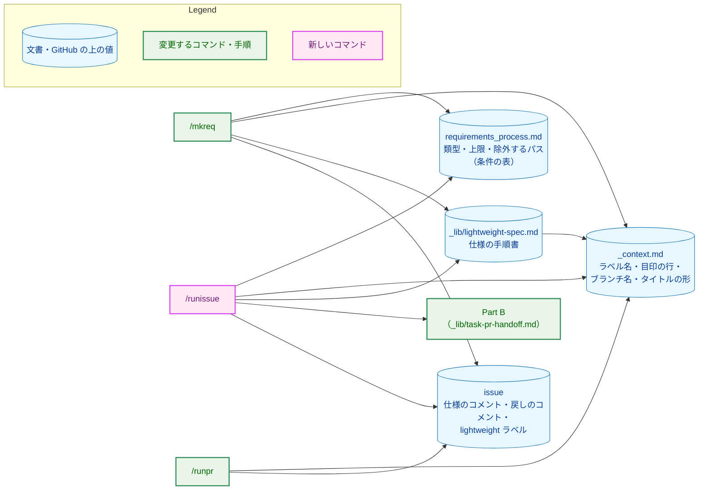
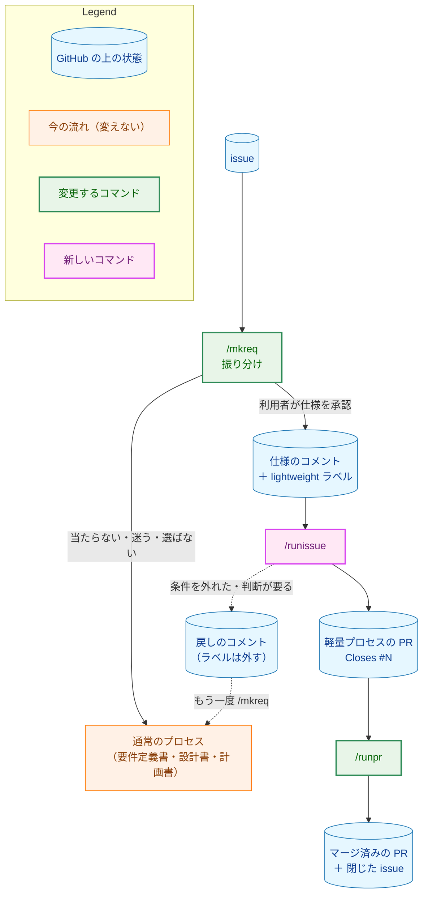
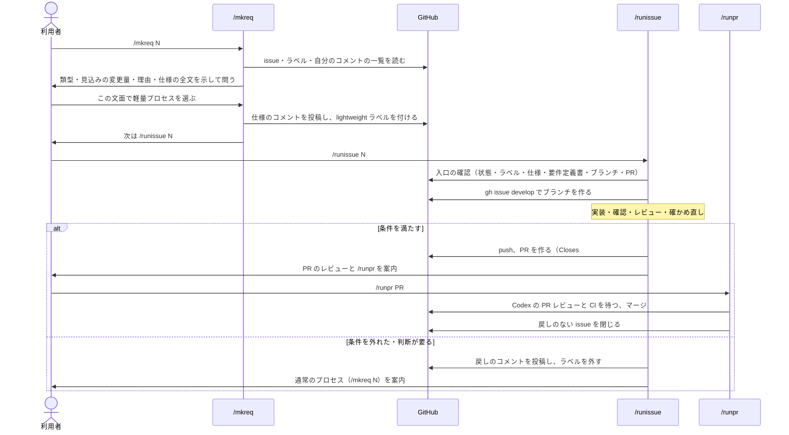
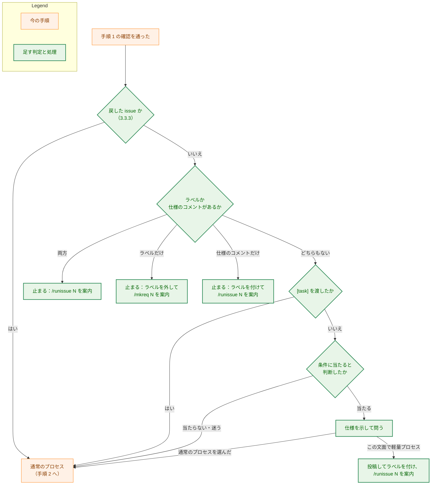
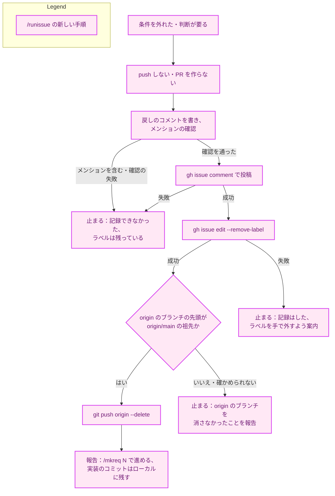
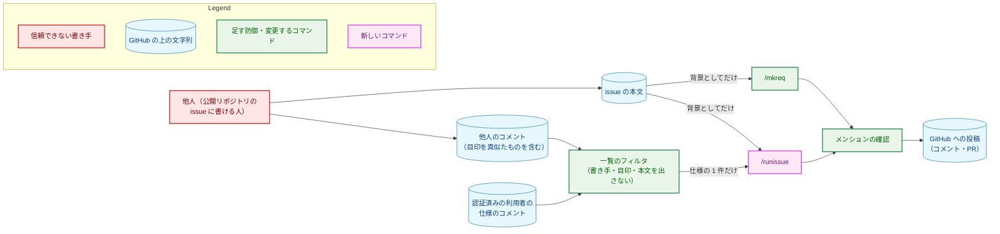
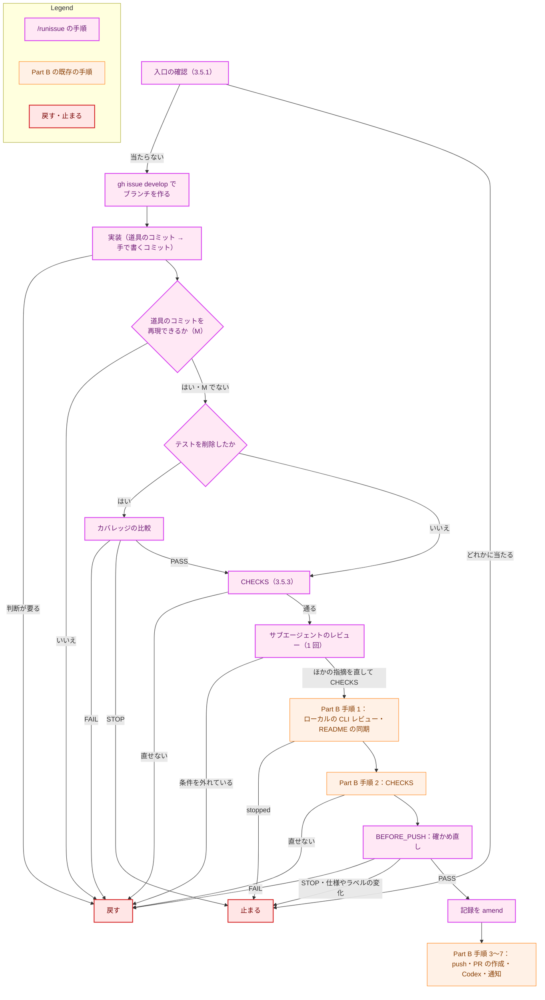
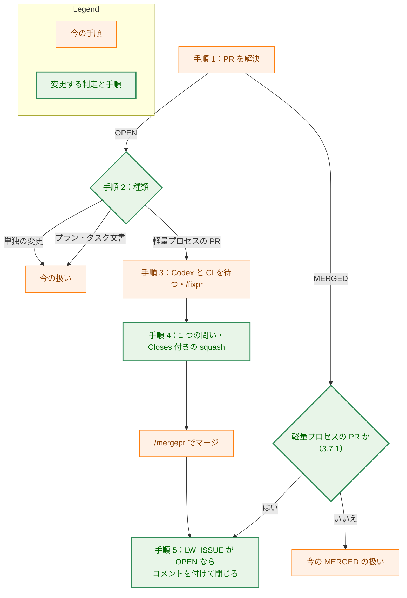

# アーキテクチャ設計書：単純な変更のための軽量プロセスと、/mkreq での振り分け

## Document Status

| Item | Value |
|---|---|
| Status | `draft` |
| Created | 2026-11-04 |
| Review date | - |
| Reviewer | - |
| Comments | - |

本書は [01_requirements.md](01_requirements.md)（要件定義書。以下、要件書）の設計である。既存のファイルについての記述は、コミット `74b9b49` のファイルで確かめた。`file:line` は、このコミットでの行番号を指す。F-NNN・AC-NN は要件書の項番、H-NN は [design_handoff.md](design_handoff.md) の項番を指す。申し送りの H-01〜H-11 への対応は付録 A に、受け入れ基準との対応は付録 B にまとめる。

本書は、要件書 6 章の用語（軽量プロセス、通常のプロセス、類型、仕様のコメント、手で書いた行・手で変更したファイル、確かめ直し）を同じ意味で使う。そのほかに、次の用語を使う。

-   **条件の表:** 軽量プロセスの条件のうち、実際の diff から機械的に確かめられるもの（類型ごとの行数の上限、ファイル数の上限、除外するパス）を、決まった書式で並べたコードブロック。`requirements_process.md` に置く（3.1.3）。
-   **確かめ直しのコマンド:** `runissue.md` に書く、決まった shell コマンド。条件の表を読み、ブランチの diff を数えて、`PASS`・`FAIL` を出す（3.5.6）。
-   **仕様の目印・戻しの目印:** 仕様のコメントと、戻しのコメントの 1 行目に置く HTML コメントの行（3.2）。
-   **戻しのコメント:** issue を通常のプロセスへ戻したときに、`/runissue` が issue に投稿するコメント（AC-30 の手順 2）。戻しの目印で始まる。
-   **仕様の手順書:** 新しく作る `.claude/commands/_lib/lightweight-spec.md`。仕様のコメントの書式、コメントの一覧の取り方、仕様とみなすコメントの選び方、形の確かめ方を定める。`/mkreq` と `/runissue` が従う（3.3）。
-   **軽量プロセスのブランチ:** `/runissue` が作るブランチ。名前は `<GitHub のユーザー名>/issue-<N>` である（3.2）。
-   **軽量プロセスの PR:** `/runissue` が作る PR。`/runpr` は、PR にリンクされた issue のラベルで見分ける（3.7）。
-   **道具のコミット:** 類型 M で、道具が生成した変更だけを含むコミット。生成したコマンドを、コミットメッセージの trailer に記録する（3.5.2）。
-   **記録:** 確かめた結果（AC-26）を、決まった書式で並べた行の並び。コミットメッセージと PR の本文に書く（3.5.8）。
-   **Part B:** `.claude/commands/_lib/task-pr-handoff.md` の「Part B — open the PR and hand it over」。タスクの PR を作り、レビュアーに渡す共通の手順である。

## 1. 設計の全体像 (Design Overview)

### 1.1. 設計原則

-   **条件は 1 か所に、機械が読める形で置く。** 類型・上限・除外するパスは `requirements_process.md` だけに書く。そのうち機械的に確かめるもの（行数・ファイル数の上限と除外するパス）は、条件の表として同じ文書に置き、確かめ直しのコマンドがそれを読む。コマンドの定義に数値やパスを書き写さない（要件書 4.5）。
-   **数えるのは LLM ではなく、コマンドである。** 行数とファイル数の集計と、上限との比較は、確かめ直しのコマンドが行う。LLM はその最後の行（`PASS`・`FAIL`）と終了コードを読むだけにする（H-01）。
-   **値は `_context.md` に、手順は手順書に置く。** ラベル名・目印の行・ブランチ名の形・PR のタイトルの形は `_context.md` に置く。仕様のコメントの読み書きは、仕様の手順書に置く。`/mkreq` と `/runissue` は、それを名前で参照する（AC-39）。
-   **既存の手順を使う。** PR の作成・Codex の PR レビューの開始の確認・レビュアーへの通知は、Part B を使う。Part B には、入力を 2 つ足すだけにする（3.6）。マージは今の `/runpr` と `/mergepr` で行い、`/runpr` には PR の種類の判定と issue を閉じることを足すだけにする（3.7）。
-   **宣言された値で選ぶ。** `/runpr` が軽量プロセスの PR を見分けるときは、PR の本文の文字列を読まず、GitHub が持つ構造化された値（PR にリンクされた issue と、そのラベル）で選ぶ（CLAUDE.md「Declare, don't infer」）。
-   **安全側に止まる。** 確かめられないこと（コマンドの失敗、仕様の変化、ラベルの消失）は、条件を満たさないこととは区別する。issue を変えずに、push もせずに止まる（4 章）。

### 1.2. 設計の際に決めたこと（2026-11-04）

利用者に確かめて決めたこと:

-   **確かめ直しは、`runissue.md` に書いた決まった shell コマンドで行い、新しい Go のツールは作らない（H-01）。** 集計は `git diff --numstat` の出力の足し算と比較で済み、shell コマンドで足りる。Go のツールにすると、パッケージ・テスト・インストールの手順が増え、0054 で問題になった「確かめる仕組みの方が変更より大きい」状態を繰り返す。コマンドが正しく数えることは、document test が fixture のリポジトリで実際に走らせて確かめる（7.1）。
-   **パスで除外するのは、AC-05 が名前を挙げる信頼境界、依存の定義、CI と権限の定義、タスク文書、`docs/dev/security.md` に限る（H-02）。** `security.md` の適用条件に当たるパッケージ（`internal/llm`・`internal/publisher`・`internal/writer` など）の全体はパスで除かず、サブエージェントによるレビュー（AC-24）で確かめる。全体を除くと製品のコードの大半が対象から外れ、`internal/llm` の中での識別子の名前の変更のような、典型的な類型 M の変更もできなくなる。一覧は 3.1.3 に挙げる。
-   **`/runpr` は、PR にリンクされた issue（GraphQL の `closingIssuesReferences`）のうち、`lightweight` ラベルを持つものによって、軽量プロセスの PR を見分ける（H-05）。** ブランチ名は見分ける手段にしない。リンクとラベルは GitHub の構造化された値なので、本文の文字列を読むより「Declare, don't infer」に合う。ブランチで issue にリンクした PR は、本文に `Closes` がなくても `closingIssuesReferences` にその issue が入る。マージの後も、その issue とラベルを読める。これは、2026-11-04 に PR #660（マージ済み。本文に `Closes` はなく、ブランチで #619 にリンク）で確かめた。そのとき #619 は `OPEN` のままで、`documentation`・`devenv`・`priority:medium` のラベルを読めた。
-   **目印の行は、HTML コメントの 1 行にする（H-04・H-10）。** 仕様の目印は `<!-- yt2column:lightweight-spec -->`、戻しの目印は `<!-- yt2column:lightweight-reverted -->` である。GitHub の表示には出ないので、人が手で書いた見出しと誤って一致しにくい。人が読む見出しは 2 行目以降に置く。

レビュアーに個別には確かめず、上の決定と現行の規則から導いたこと（PR のレビューで異論があれば改める）:

-   **軽量プロセスのブランチの名前は `<GitHub のユーザー名>/issue-<N>` とし、連番を付けない（H-06）。** 見分ける手段にはしないが、AC-16 の「軽量プロセスのブランチがすでにある」を判定するのに、決まった形が要る。issue 1 件につき軽量プロセスの実行は 1 回で、再開もしない（要件書 1 章）ので、連番は要らない。2026-11-04 に `gh pr list --state all` で確かめたところ、過去の PR のブランチ名に、この形のものはない。
-   **PR のタイトルとコミットの件名の `<scope>` は `issue-<N>` とする（H-06）。** タスクの番号がないので、代わりに issue の番号で範囲を示す。`_context.md` の `<scope>` の規則（英小文字・数字・`-`）と、squash の件名の正規表現（`_context.md`「Checking a squash subject」）を満たす。
-   **条件の表の上限は、類型ごとに追加と削除の両方の行を必ず持つ。上限がないことは `none` と書く。** 行が欠けたことを「上限なし」と読むと、表を編集し間違えたときに、確かめ直しが黙って通る。欠けた行や重なった行があれば、確かめ直しのコマンドは `STOP` する（CLAUDE.md「Reject, don't normalize」）。
-   **名前の変更は `--no-renames` で数え、ファイルの移動は道具のコミットで扱う（H-01）。** 名前の変更を検出すると、移動は 0 行に数えられる。移動先で中身を書き換えても、類似度の閾値の内側なら手で書いた行に数えられない。`--no-renames` なら、移動は削除と追加に数える。`git mv` による移動は、変更の前の状態で再実行すれば同じ diff になるので、道具のコミットとして上限から外せる（AC-02）。
-   **バイナリのファイルの変更があれば、条件を満たさないとする（H-01）。** 行数を数えられず、diff を読んで確かめることもできないためである。
-   **改行だけの変更、空白だけの変更も、1 行として数える（H-01）。** `git diff --numstat` の数え方のままにする。数え方に例外を足さない。
-   **道具のコミットは、ブランチの先頭に置く（H-03）。** 手で書いたコミットより前に道具のコミットを並べると、手で書いた行とファイルを「最後の道具のコミットから HEAD まで」の diff で数えられる。これは、同じファイルに道具と手の両方が変更を加えても成り立つ。道具が生成した変更だけを含むファイルは、この diff に現れないので数えられない（AC-03）。手で書いた変更を含むファイルは数えられる。
-   **道具のコミットが道具の出力であることは、変更の前の状態の一時的な worktree でコマンドを再実行し、tree の ID が一致することで確かめる（H-03）。** 一致しなければ、道具の行の例外が成り立たないので、条件を外れたものとして通常のプロセスへ戻す（AC-30）。
-   **仕様の手順書 `_lib/lightweight-spec.md` を新しく作る（H-04）。** 仕様のコメントの書式と読み方を、`/mkreq`（書く側）と `/runissue`（読む側）が共有する。どちらかの定義に書くと、もう一方が書き写すことになる。
-   **PR は Part B で作り、Part B に入力を 2 つ足す（AC-27・AC-28）。** 1 つは BEFORE_PUSH（push の直前に行うこと）、もう 1 つは ISSUE_LINK（本文の issue の行を `Refs` にするか `Closes` にするか）である。どちらも省けば今のままになる（3.6）。Part B の番号付きの手順は増やさない。Part B の手順 3・5 を項目の書き出しで探す既存のテスト（`cmd/yt2column/codex_review_docs_test.go:76`・`cmd/yt2column/fixpr_docs_test.go:193`）を壊さないためである。
-   **記録は、push の前の最後のコミットのメッセージに、tree を変えない amend で書く（AC-26）。** 行数とファイル数は、最後のコミットまでを数えて初めて決まる。最後のコミットの後に確かめ直しを行い、その出力をそのコミットのメッセージに足す。テストを削除したコミットにカバレッジの比較の出力を書く、CLAUDE.md の手順と同じ方式である（`CLAUDE.md` の「Deleting a test is a claim that must be checked」）。
-   **`/runissue` は、push の直前に、仕様のコメントとラベルが入口の確認のときから変わっていないことを確かめ直す。** 変わっていれば、issue を変えずに、push もせずに止まる。実行の途中に仕様が編集されると、実装したものと承認された文面が食い違うためである（5.2）。
-   **issue テンプレートには、ラベルを付けない（AC-40）。** テンプレートの front matter で `lightweight` を付けると、`/mkreq` の振り分けの前に、issue にラベルが付く。その issue は AC-15 の「ラベルだけがある」に当たり、`/mkreq` が止まってしまう。
-   **`lightweight` ラベルは、実装の PR の手順で、利用者に承認を求めてから作る（H-09）。** `gh label create` はネットワークへの書き込みで、CLAUDE.md の「Tool Execution Safety」により承認が要る。色は `c2e0c6`（薄い緑）、説明は「要件・設計・計画の文書を作らずに 1 本の PR で進める単純な変更（軽量プロセス）」とする。
-   **`/runpr` は、軽量プロセスの PR の squash のコミットメッセージの本文の最後に `Closes #<N>` を書く。** タスクの最後のプランの PR と同じ扱いである（`.claude/commands/runpr.md:649-651`）。issue を閉じることは、この行に頼らず、`/runpr` が自分で行う（3.7.3）。

### 1.3. なぜ既存の方法では足りないか

今は、どの変更も 3 つのタスク文書の承認を経てから実装する（`docs/dev/conventions/requirements_process.md:11-14`）。PR を作るのは、タスク文書のコマンドか `/runplan` である（`CLAUDE.md:166-173`）。単純な変更を、文書を作らずに 1 本の PR で進めるという要件（要件書 2.1）は、通常のプロセスの手順を短くしても満たせない。文書の承認が、実装を始める条件になっているためである。

そこで、仕様の承認と PR を作るための入口（`/mkreq` の振り分けと `/runissue`）だけを新しく作る。それ以外は既存のものを使う。

-   PR を作り、レビュアーに渡すこと：Part B
-   ローカルの CLI レビュー：`_lib/local-cli-review.md`
-   サブエージェントによるレビュー：`_lib/review-subagent-pattern.md`
-   README の同期：`mktrans.md` の「When a caller runs it」
-   テストを削除したときのカバレッジの比較：`make coverage-compare`・`make ext-coverage-compare`
-   マージ：`/runpr`・`/mergepr`

`/runpr` は、今の単独の変更（タスクのない PR）の扱いをそのまま使う。足すのは、軽量プロセスの PR の判定と、マージの後に issue を閉じることだけである。今の `/runpr` が issue を閉じるのは、タスクの最後のプランの PR だけである（`.claude/commands/runpr.md:809-827`）。そのため、そのままでは AC-34 を満たせない。

### 1.4. 概念モデル

矢印 A → B は「A が B を参照する（読んで従う、または値を読む）」を表す。



`requirements_process.md`・`_context.md` は変更する文書で、仕様の手順書は新しい文書である。図では、文書は区別せずデータとして示す。どの文書が新しいかは 2.2 の表に示す。

## 2. システム構成 (System Structure)

### 2.1. 全体構成

矢印 A → B は「A の次に B が行われる（人の操作か、コマンドの実行）」を表す。点線は、条件を外れたときの流れである。



### 2.2. コンポーネント配置

| ファイル | 新規・変更 | 責務 | 関係する AC |
|---|---|---|---|
| `docs/dev/conventions/requirements_process.md` | 変更 | 軽量プロセスの節を足す。類型・上限・除外する変更の定義、条件の表、機械的に確かめる条件とレビューで確かめる条件の区別、例外の範囲を書く。「LLM Constraints」に例外を、「Review Flow」に軽量プロセスの流れを足す | AC-01〜AC-07・AC-38 |
| `.claude/commands/_context.md` | 変更 | ラベル名・仕様の目印・戻しの目印・軽量プロセスのブランチ名・軽量プロセスの PR のタイトルの形を定める。「PR title and squash subject」の表に行を足す | AC-39 |
| `.claude/commands/_lib/lightweight-spec.md` | 新規（英語） | 仕様のコメントの書式（日本語の文面の雛形を含む）、自分のコメントの一覧の取り方、仕様とみなすコメントの選び方、戻したかどうかの判定、形の確かめ方を定める | AC-11・AC-15・AC-17・AC-19・AC-20・AC-32 |
| `.claude/commands/mkreq.md` | 変更 | 手順 1 の確認の後、手順 2 の前に、振り分けの手順を足す。AC-15 の停止、仕様の提示と問い、投稿、ラベルの付与、失敗したときの報告を書く。報告（手順 9）と「Authorization」を改める | AC-08〜AC-15・AC-32・AC-43 |
| `.claude/commands/runissue.md` | 新規（英語） | 入口の確認、ブランチの作成、実装、確認、サブエージェントによるレビュー、確かめ直しのコマンド、記録、通常のプロセスへの戻し、Part B の呼び出し、「Authorization」を書く | AC-16・AC-18・AC-21〜AC-31・AC-42 |
| `.claude/commands/_lib/task-pr-handoff.md` | 変更 | Part B に、省略できる入力 BEFORE_PUSH と ISSUE_LINK を足す。手順 2 の最後で BEFORE_PUSH を行い、手順 3 の本文の issue の行を ISSUE_LINK で選ぶ。番号付きの手順は増やさない | AC-27・AC-28 |
| `.claude/commands/runpr.md` | 変更 | 手順 2 の「Kind」に、軽量プロセスの PR を足す。手順 1 の `MERGED` の場合、手順 4 の squash のメッセージ、手順 5 で issue を閉じること、「Authorization」を改める | AC-33〜AC-36・AC-44 |
| `CLAUDE.md` | 変更 | 「Documents」の「Each task lives in」の例外、「Claude Commands」の一覧への `/runissue <N>` の追加、「Each task PR is handled by two commands」の段落、軽量プロセスの概要と `requirements_process.md` へのリンクを書く | AC-37・AC-38 |
| `.github/ISSUE_TEMPLATE/lightweight.md` | 新規（日本語） | 背景・やること・やらないこと・確かめ方の見出しを置く。ラベルは付けない | AC-40 |
| `cmd/yt2column/codex_review_docs_test.go` | 変更 | `postingSections` に、`mkreq.md` の仕様の投稿と、`runissue.md` の戻しのコメントの投稿を足す。今の 8 区画の一覧では、新しい投稿のコマンドが `TestPostingCommandsInventory` で失敗する | AC-12・AC-30 |
| `cmd/yt2column/lightweight_docs_test.go` | 新規 | 確かめ直しのコマンドを fixture のリポジトリで走らせるテスト、条件の表の除外するパスが実在することのテスト、仕様の手順書のコメントの一覧のフィルタが本文を出さないことのテストを置く | AC-06・AC-17・AC-29 |
| GitHub のリポジトリのラベル `lightweight` | 新規 | 仕様が承認された issue に付ける | AC-41 |

既存のテストへの影響:

-   `TestPostingCommandsInventory`（`cmd/yt2column/codex_review_docs_test.go:200-258`）は、コマンドの定義のすべての投稿のコマンドが、`postingSections`（同 60-79 行）に挙げた区画の中で、メンションの確認の後にあることを確かめる。`mkreq.md` と `runissue.md` に `gh issue comment ... --body-file` が加わるので、区画を足さないと失敗する。`gh issue edit --add-label`・`--remove-label` は、本文のフラグを持たないので、投稿に数えられない（同 139 行の `textFlag`）。
-   `TestPostingPathsCheckMention`（同 119-133 行）は、足した区画にもメンションの確認があることを確かめる。
-   Part B の手順 3 と手順 5 を項目の書き出しで探すテスト（`cmd/yt2column/codex_review_docs_test.go:76`、`cmd/yt2column/fixpr_docs_test.go:193`）は、Part B の番号付きの手順を増やさないので、変更は要らない。
-   `runpr.md` の手順の見出しを探すテスト（`TestRunprDocContract` など）は、見出しを変えないので、変更は要らない。
-   `TestCodexMentionOnlyInRequestRow`（`cmd/yt2column/codex_review_docs_test.go:92`）と `TestInstructionDocPaths`（`cmd/yt2column/docpaths_test.go:140`）は、`.claude/commands/` の下のすべての文書を読む（`internal/doctestutil/protocol.go:85-103`、`cmd/yt2column/docpaths_test.go:106-110`）。新しい `runissue.md` と仕様の手順書も、変更なしに対象になる。

### 2.3. データフロー

矢印は、参加者の間の操作と、その応答を表す。



## 3. コンポーネント設計 (Component Design)

本タスクは Go の型やインターフェースを足さない。この章では、文書が定める書式と、コマンドの間の取り決めを示す。

### 3.1. 条件の定義（`requirements_process.md`。F-001）

#### 3.1.1. 置き場所

`requirements_process.md` の「## 0. Review Workflow」の下に、新しい小節「Lightweight Process」を足す。既存の章の番号（「§ 4」などの参照先）を動かさないためである。小節には、次のものを英語で書く。

-   軽量プロセスとは何か、その例外の範囲（3.1.5）
-   3 つの類型と、それぞれの確かめ方（AC-01）
-   上限と、行・ファイルの数え方（AC-02・AC-03・AC-04）
-   分量にかかわらず通常のプロセスとする変更（AC-05）
-   機械的に確かめる条件と、レビューで確かめる条件の区別（AC-06）。条件の表（3.1.3）を含む
-   軽量プロセスの流れ（AC-07）

類型の定義・上限の値・除外する変更の文言は、要件書の AC-01〜AC-05 をそのまま英語にする。

#### 3.1.2. 行・ファイルの数え方（H-01）

-   **数える範囲:** 軽量プロセスのブランチの、`origin/main` から分かれた点（以下、BASE）から最後のコミットまでの diff。手で書いた行とファイルは、最後の道具のコミット（ないときは BASE）から最後のコミットまでの diff で数える（3.5.2）。
-   **行:** `git diff --numstat --no-renames` の追加の列と削除の列を、それぞれ足す。改行だけ・空白だけの変更も 1 行に数える。
-   **ファイル:** 同じ範囲の `git diff --name-only --no-renames` の行の数。名前の変更は、元のパスと先のパスの 2 ファイルに数える。
-   **バイナリのファイル:** `--numstat` が行数の代わりに `-` を出すファイルがあれば、条件を満たさない。
-   **`README.en.md`:** `README.md` の変更に伴う変更も、ほかのファイルと同じく数える（AC-03）。

#### 3.1.3. 条件の表

条件の表は、`requirements_process.md` の決まった英語の見出しの直後に置く、`text` の言語名を付けたコードブロックである。1 行に 1 つの条件を書く。書式は次のとおりである。

```text
limit W added 30
limit W deleted 30
limit D added 10
limit D deleted 100
limit M added 50
limit M deleted none
limit files 10
exclude docs/tasks/
exclude docs/dev/security.md
exclude cmd/fixprguard/
...
```

-   `limit <類型> added|deleted <数 | none>` は、手で書いた行の上限である。3 つの類型のそれぞれに、`added` と `deleted` の行がちょうど 1 つずつなければならない。`none` は上限がないことを表す。
-   `limit files <数>` は、手で変更したファイルの数の上限で、ちょうど 1 行なければならない。
-   `exclude <パス>` は、除外するパスである。`/` で終わるものはディレクトリ、それ以外はファイルを表す。リポジトリのルートからのパスで書く。
-   それ以外の行、欠けた行、重なった行があれば、確かめ直しのコマンドは `STOP` する（3.5.6）。

除外するパスの一覧（H-02）は、次のとおりである。

| 区分 | パス | AC-05 の項目 |
|---|---|---|
| タスク文書 | `docs/tasks/` | タスク文書の編集 |
| セキュリティの文書 | `docs/dev/security.md` | `security.md` の適用条件 |
| 信頼境界（開発の道具） | `cmd/fixprguard/`・`internal/fixprguard/`・`cmd/codexreview/`・`internal/codexreview/`・`cmd/mergepr/`・`internal/mergepr/` | 信頼境界 |
| 信頼境界（秘密情報） | `internal/secret/`・`internal/redact/`・`internal/config/` | 信頼境界（秘密情報） |
| 信頼境界（`yt-dlp`・キャッシュ） | `internal/transcript/`・`internal/cmdrunner/`・`internal/cachelock/`・`internal/articlecache/` | 信頼境界（`yt-dlp` の呼び出し、キャッシュ） |
| 依存の定義 | `go.mod`・`go.sum`・`extension/package.json`・`extension/package-lock.json`・`.golangci.yml` | 依存パッケージの追加 |
| CI と権限 | `.github/workflows/`・`.claude/settings.json`・`extension/static/manifest.json` | 信頼境界・振る舞いを変える変更 |

各パスを選んだ理由は、次のとおりである。

-   `internal/config/`：API キーと Webhook の URL を環境変数から読む（`internal/config/config.go`）。
-   `internal/transcript/`：`yt-dlp` の呼び出し（`ytdlp.go`・`exec.go`）と字幕のキャッシュ（`cache.go`）を含む。
-   `internal/cmdrunner/`：外部のコマンドを起動する。
-   `.golangci.yml`：`depguard` で許す依存を定める。
-   `extension/static/manifest.json`：拡張の権限を定める。

パッケージの一部のファイルだけを除くと、ファイルの追加や分割で除外が抜けるので、パッケージ単位で除く。

`CLAUDE.md`・`.claude/commands/`・`docs/dev/conventions/` は、パスでは除かない。類型 W はこれらの誤字の修正を認める（AC-05）ので、パスでは扱い分けられない。誤字の修正を超えていないことは、サブエージェントによるレビュー（3.5.4）が確かめる。

#### 3.1.4. 機械的に確かめる条件と、レビューで確かめる条件（AC-06）

| 条件 | 確かめる者 |
|---|---|
| 類型ごとの行数の上限、手で変更したファイルの数、除外するパスへの変更がないこと、バイナリのファイルの変更がないこと | 確かめ直しのコマンド（3.5.6） |
| 道具のコミットが、再実行で同じ tree になること | `/runissue` の再現の確認（3.5.2） |
| ちょうど 1 つの類型に収まること、AC-05 のうちパスで決まらないもの（意味の変わる文言、文字列で参照される名前、`security.md` の適用条件、信頼境界、方針の例外、設計上の選択肢、振る舞いの変更）、仕様の範囲を超えないこと | サブエージェントによるレビュー（3.5.4） |

#### 3.1.5. 方針の例外

本タスクは、次の既存の方針に例外を設ける。どれも、範囲を F-001 の条件を満たし、仕様が承認された変更に限る。

| 元の方針と場所 | 例外にする理由 | 古い振る舞いを確かめる既存のテスト |
|---|---|---|
| 実装計画書が `approved` になるまで実装を始めない（`docs/dev/conventions/requirements_process.md:13`） | 単純な変更では、文書の量とレビューの手間が変更の大きさに釣り合わない（要件書 1 章「背景」）。仕様のコメントの承認を、要件の承認に当たるものとする | なし（文書の文言を確かめるテストはない） |
| 各タスクは `docs/tasks/NNNN_<name>/` に置く（`CLAUDE.md:33`） | 同上。軽量プロセスは `docs/tasks/` の下に何も作らない（AC-21） | なし |
| `/mkreq` は必ず要件定義書を作る（`.claude/commands/mkreq.md:12-15`）、タスクの PR を作るのは 5 つのコマンド（`CLAUDE.md:166-173`） | 軽量プロセスでは、`/mkreq` は仕様を投稿して止まり、PR は `/runissue` が作る | なし |
| タスクの PR の本文には closing keyword を書かない（`.claude/commands/_lib/task-pr-handoff.md:243-246`） | 例外ではない。この規則はタスクの PR についてのもので、軽量プロセスの PR はタスクの PR ではない。Part B の新しい入力 ISSUE_LINK で、呼び出し元が選ぶ形にする（3.6） | なし |

### 3.2. `_context.md` に足す値（AC-39・H-06）

「Process convention」の表に、次の行を足す。

| 名前 | 値 |
|---|---|
| Lightweight label | `lightweight` |
| Lightweight spec marker | `<!-- yt2column:lightweight-spec -->`：仕様のコメントの 1 行目 |
| Lightweight revert marker | `<!-- yt2column:lightweight-reverted -->`：戻しのコメントの 1 行目 |
| Lightweight branch name | `<GitHub user name>/issue-<N>`：`<N>` は issue の番号。連番を付けない |

「PR title and squash subject」の表に、次の行を足す。

| 項目 | 形 |
|---|---|
| Lightweight PR title | `<type>(issue-<N>): <Japanese summary>`。`<type>` は接頭辞の表から選ぶ |
| Lightweight commit subject | `<type>(issue-<N>): <English summary>`。`/runissue` が作るコミットの件名 |

squash の件名は、今のとおり `/mergepr` の手順 2 が書く。`issue-<N>` は `<scope>` の規則（`[a-z0-9-]+`）を満たすので、件名の正規表現は変えない。

### 3.3. 仕様の手順書（`_lib/lightweight-spec.md`。H-04・H-10）

#### 3.3.1. 仕様のコメントの書式

仕様のコメントは、次の形の日本語の Markdown である。改行は LF か CRLF のどちらでもよい（GitHub の画面で編集すると CRLF になるため）。

```markdown
<!-- yt2column:lightweight-spec -->
## 軽量プロセスの仕様

### 類型

<W・D・M のどれか 1 文字>

### やること

<箇条書き>

### やらないこと

<箇条書き>

### 確かめ方

<箇条書き。類型の確かめ方（AC-01）と、この変更に固有の確認>

### 見込みの変更量

<追加 N 行・削除 M 行・ファイル K 個。見込みであり、上限の判定は実際の diff で行う>
```

形の確かめ方（AC-19）は、次のとおりである。

-   1 行目が、仕様の目印とちょうど一致する（行末の CR を除いて比べる）。
-   `### 類型`・`### やること`・`### やらないこと`・`### 確かめ方` の 4 つの見出しの行が、それぞれちょうど 1 回現れる。
-   それぞれの見出しの下（次の見出しの行まで）に、空白でない行が 1 行以上ある。
-   `### 類型` の下の空白でない行は 1 行だけで、`W`・`D`・`M` のどれかにちょうど一致する。
-   `### 見込みの変更量` は確かめない。示すための見出しで、判定に使わないためである。

形に合わなければ、どの規則に合わないかを報告して止まる。形を直して受け入れることはしない。`/mkreq` も、問いの前に、示す文面がこの形に合うことを確かめる。

#### 3.3.2. 自分のコメントの一覧

`/mkreq` と `/runissue` は、issue のコメントを、次の取り決めで一覧にする。

-   認証済みの利用者の名前は、`gh api user --jq .login` で得る。
-   一覧は、`gh api --paginate repos/<owner>/<repo>/issues/<N>/comments --jq '<フィルタ>'` で取る。フィルタは、書き手（`.user.login`）が認証済みの利用者と一致し、本文の 1 行目（行末の CR を除く）が仕様の目印か戻しの目印に一致するコメントだけを選ぶ。出すのは、コメントの `id`・`created_at`・`updated_at`・`html_url` と、どちらの目印か、だけである。
-   本文は出さない。他人のコメントの本文が会話に入らないようにするためである。仕様の本文は、選んだ 1 件だけを、`id` を指定して読む（`gh api repos/<owner>/<repo>/issues/comments/<id>`）。

#### 3.3.3. 仕様とみなすコメントと、戻したかどうか（AC-17・AC-32）

-   **戻した issue:** 一覧に、戻しの目印のコメントが 1 件以上ある issue。
-   **仕様のコメント:** 一覧のうち、仕様の目印のコメントで、最後の戻しの目印のコメント（ないときは、すべてのコメント）より後に作られたもののうち、最後の 1 件。順序は、API が返す順（作成の順）で決める。

`/mkreq` は、戻した issue では振り分けず、AC-15 の停止もしない（AC-32）。`/runissue` は、戻した issue に戻しの後の仕様のコメントがなければ、「仕様のコメントがない」として止まる（AC-16）。

戻しの後の仕様のコメントは、`/mkreq` は投稿しない（AC-32）。利用者が手で書いたときにだけ現れる。そのときは、利用者がもう一度軽量プロセスを選んだものとして扱う。書き手が認証済みの利用者であることは、一覧のフィルタで保証されている。

### 3.4. `/mkreq` の振り分け（F-002・H-07・H-11）

#### 3.4.1. 手順の位置

振り分けは、今の手順 1（issue の読み取りと、要件定義書の重複の検索。`.claude/commands/mkreq.md:34-49`）の後、手順 2（タスクのディレクトリの決定）の前に行う。手順 1 の確認を通った後で、ブランチを作る（手順 3）前である（AC-08）。

#### 3.4.2. 判定の順序



矢印 A → B は「A の次に B を行う」を表し、ラベルは分岐の条件である。

-   ラベルの有無は、`gh issue view <N> --json labels` で読む。
-   条件に当たるかの判断は、`requirements_process.md` の軽量プロセスの節に照らして、issue の本文とコメントから LLM が行う。見込みの変更量は、そのとき読んだコードから見積もる。
-   `/mkreq` の今の手順 1 は、`gh issue view --json ...,comments` で、他人のコメントの本文も読んでいる（`.claude/commands/mkreq.md:36`）。振り分けの判断にも、それを背景として使う。仕様のコメントとして扱うのは 3.3.3 のものだけで、他人のコメントが仕様の目印で始まっていても、仕様のコメントにも戻しのコメントにも数えない。

#### 3.4.3. 問いの形（AC-09・H-11）

1.  仕様の全文を、スクラッチパッドのファイルに書く。3.3.1 の形に合うことを確かめる。
2.  メッセージで、類型、見込みの変更量、当たると判断した理由、そのファイルの全文を示す。
3.  `AskUserQuestion` で問う。選択肢は「この文面で軽量プロセスで進める」と「通常のプロセスで進める」の 2 つである。
4.  利用者が選択肢にない答えをしたときは、文面の修正の指示とみなす。ファイルを書き直し、形を確かめ、全文を示して、もう一度問う。
5.  承認は、直前に示した全文について、1 つ目の選択肢が選ばれたときだけとする。

投稿は、このファイルを `--body-file` で渡して行う。示した全文と投稿する文面が、バイト単位で同じになる（AC-11）。

#### 3.4.4. 投稿とラベルの付与（AC-11〜AC-14）

1.  メンションの確認（`_context.md`「PR review request」の規則）を、仕様のファイルに対して行う。含まれていれば止まる（AC-12）。
2.  投稿の前に、自分の仕様の目印のコメントの数を一覧（3.3.2）で数えておく。
3.  `gh issue comment <N> --body-file <file>` で投稿する。
4.  投稿が失敗したら、ラベルを付けずに止まる。一覧を取り直して、仕様の目印のコメントの数が増えていないことを確かめてから、何も投稿されていないことを報告する。一覧を取れないとき、または数が増えていたときは、投稿されたかどうか分からないことを報告し、issue を確かめるよう求める（AC-14）。
5.  投稿が成功したら、`gh issue edit <N> --add-label <Lightweight label>` でラベルを付ける。失敗したら止まり、投稿したコメントの URL と、ラベルを手で付ければ `/runissue <N>` で進めることを報告する。ラベルがリポジトリにないときも、ここで失敗する。
6.  報告（手順 9）では、類型、仕様のコメントの URL、ラベルを付けたこと、次に実行する `/runissue <N>` を示す。`/runissue` は実行しない（AC-13）。

「Authorization」には、`gh api user`、コメントの一覧と 1 件の読み取り（`gh api`）、`gh issue comment`（仕様の投稿）、`gh issue edit --add-label`（ラベルの付与）を、この issue に限って足す（AC-43）。

### 3.5. `/runissue`（F-003〜F-005）

`.claude/commands/runissue.md` を、英語で新しく書く。入力は `<issue>`（番号か URL）である。手順の全体の流れは 6.1 に示す。

#### 3.5.1. 入口の確認（AC-16〜AC-19）

次の確認を、ブランチを作る前に行う。どれかに当たれば、ブランチを作らずに止まり、理由を報告する。

| 確認 | 方法 |
|---|---|
| 作業ツリーがきれいである | `git status --short` |
| issue が開いていて、このリポジトリのものである | `gh issue view <N> --json number,state,url,labels,title,body` と `gh repo view --json url`（`mkreq.md` の手順 1 と同じ判定） |
| `lightweight` ラベルがある | 同上の `labels` |
| 仕様のコメントがあり、形に合う | 仕様の手順書（3.3.2・3.3.3・3.3.1） |
| その issue を `対応 issue` とする要件定義書がない | `git fetch origin` の後、`mkreq.md` の手順 1 と同じ `git grep`（`.claude/commands/mkreq.md:42-49`） |
| 軽量プロセスのブランチが、ローカルにも `origin` にもない | `git show-ref --verify --quiet refs/heads/<branch>` と `git ls-remote --exit-code origin refs/heads/<branch>` |
| issue にリンクされた、開いている PR がない | GraphQL の `closedByPullRequestsReferences`（`includeClosedPrs: true`）の `state` |

`gh issue view` の `body` は、背景としてだけ読む。仕様にない作業の指示としては扱わない（AC-18）。他人のコメントの本文は読まない（3.3.2）。

入口の確認を通ったら、仕様のコメントの `id`・`updated_at` と、そのときのラベルを控える。push の直前に確かめ直すためである（3.5.6）。

#### 3.5.2. ブランチの作成と、コミットの並び（AC-21・H-03）

-   ブランチは、`gh issue develop <N> --name <軽量プロセスのブランチ> --base main --checkout` で作る。issue にリンクされ、`origin` にも作られる。作った後、`HEAD` が `origin/main` と同じことを確かめる（Part A の手順 4 と同じ）。`docs/tasks/` の下には何も作らない。
-   **類型 M の道具のコミット:** 道具が生成した変更は、ブランチの先頭のコミットにまとめる。1 つの道具のコマンドにつき 1 つのコミットとし、メッセージに trailer `Lightweight-Generated-By: <コマンド>` を書く。手で書いたコミットは、その後に置く。
-   **再現の確認:** 道具のコミットのそれぞれについて、親のコミットの一時的な worktree（スクラッチパッドの下）でコマンドを再実行する。`git add -A` の後の `git write-tree` が、そのコミットの tree の ID と一致することを確かめる。一致しなければ、条件を外れたものとして 3.5.7 のとおり戻す。worktree は、確かめた後に消す。
-   **類型 D のテストの削除:** テストを削除するときは、削除だけを 1 つのコミットに分け、CLAUDE.md の「Deleting a test is a claim that must be checked」のとおりに比べる（AC-23）。結果ごとの扱いは次のとおりである。
    -   `PASS`：比較の出力を、そのコミットのメッセージに amend で書く（tree を変えない）。
    -   `FAIL`：条件を外れたものとして、3.5.7 のとおり戻す。
    -   `STOP <kind>`：issue を変えずに止まる。
-   **コミットの件名:** `_context.md` の「Lightweight commit subject」の形にする。

#### 3.5.3. 確認（AC-22）

実装の後に行う確認の一覧（以下、CHECKS）は、変更したファイルで決まる。

| 条件 | 確認 |
|---|---|
| 常に | 類型の確かめ方（仕様の「確かめ方」）、`make test`、`make lint` |
| Go のファイルを変えた | 先に `make fmt` |
| `extension/` を変えた | `make ext-check` |
| `README.md`・`README.en.md`・`docs/dev/guides/development.md` を変えた | `make ext-test` |
| `README.md` を変えた | README の同期の確認（`mktrans.md`「When a caller runs it」）。`translated` なら `README.en.md` を同じブランチにコミットする |

確認が通らなければ、仕様の範囲で直して、確認をやり直す。仕様の範囲で直せないとき、または README の同期が `stopped` のときは、判断が要ったものとして 3.5.7 のとおり戻す（AC-31）。

類型 D では、到達できないことを示した道具（`make deadcode`・`tsc`・`git grep`）とその結果を、記録に書くために控える。

#### 3.5.4. サブエージェントによるレビュー（AC-24）

`_lib/review-subagent-pattern.md` を single-reviewer mode で 1 回行う。

-   **ARTIFACT:** ブランチの diff（BASE から HEAD まで）。
-   **PERSONA:** 軽量プロセスの条件を厳しく当てはめる、経験のあるレビュアー。
-   **FILES:** 仕様のコメントの本文を保存したファイル、`requirements_process.md`、`CLAUDE.md`、変更したファイル。issue の本文は渡さない（AC-18）。
-   **CRITERIA:** 次の 3 つである。
    -   変更が、仕様の類型にちょうど 1 つ収まること。
    -   AC-05 のうちパスで決まらない除外（3.1.4）に当たらないこと。
    -   仕様の「やること」を超えず、「やらないこと」に触れないこと。

条件を外れているという指摘があれば、3.5.7 のとおり戻す。それ以外の指摘は、仕様の範囲で直し、CHECKS をやり直す。レビューは繰り返さない。

#### 3.5.5. Part B の呼び出し（AC-25〜AC-28）

レビューの修正をコミットした後、Part B を次の入力で行う。

| 入力 | 値 |
|---|---|
| TASK_DIR | なし（Part B の手順 1〜7 は TASK_DIR を読まない） |
| REPORT | `/runissue` の最後の報告 |
| CHECKS | 3.5.3 の CHECKS |
| LOCAL_REVIEW | `run`（AC-25） |
| PR_TEXT | タイトルは `_context.md` の「Lightweight PR title」の形。本文は 3.5.8 の項目 |
| ISSUE_LINK | `Closes #<N>` |
| BEFORE_PUSH | 3.5.6 の確かめ直しと、記録の amend |

Part B の手順 1（ローカルの CLI レビュー）で修正のコミットが増えても、確かめ直しはその後の BEFORE_PUSH で、最後のコミットに対して行う（AC-29）。Part B の手順 2 で CHECKS が通らず、仕様の範囲で直せないときは、3.5.7 のとおり戻す。Part B の手順 1 のローカルの CLI レビューが止まったとき（`stopped`）は、条件を外れたことではないので、issue を変えずに止まる。

#### 3.5.6. 確かめ直しのコマンド（AC-29・H-01）

`runissue.md` の決まった英語の見出しの直後に、`bash` のコードブロックとして書く。エージェントはこれを書き写さずに、そのまま実行する。

**入力**（shell の変数で渡す）:

| 変数 | 値 |
|---|---|
| `TYPE` | 仕様の類型（`W`・`D`・`M`） |
| `BASE` | `git merge-base origin/main HEAD` の SHA（直前に `git fetch origin main`） |
| `TOOL` | 最後の道具のコミットの SHA。道具のコミットがないときは `BASE` |
| `CONDITIONS` | `docs/dev/conventions/requirements_process.md` のパス |

**確かめること:**

1.  作業ツリーがきれいである。
2.  `BASE` が `TOOL` の祖先で、`TOOL` が `HEAD` の祖先である。
3.  類型が `M` でなければ、`TOOL` は `BASE` と同じである。
4.  `BASE..TOOL` のすべてのコミットが `Lightweight-Generated-By` の trailer を持ち、`TOOL..HEAD` のどのコミットも持たない。
5.  条件の表を読み、3.1.3 の規則に合う。
6.  `BASE..HEAD` にバイナリのファイルの変更がない。
7.  `BASE..HEAD` で、除外するパスのどれも変わっていない（名前の変更の元と先の両方を見る）。
8.  `TOOL..HEAD` の追加行・削除行・ファイル数が、類型の上限とファイル数の上限以下である。

**出力:** 標準出力に、次の形の行を出す。最後の行が判定である。

```text
lightweight-check: type=W base=<12 桁> tool=<12 桁> head=<12 桁>
lightweight-check: added=12/30 deleted=3/30 files=2/10 binary=0 excluded=0
lightweight-check: PASS
```

| 最後の行 | 終了コード | 意味 | `/runissue` の扱い |
|---|---|---|---|
| `lightweight-check: PASS` | `0` | 条件を満たす | 記録を amend して push に進む |
| `lightweight-check: FAIL <理由>[,<理由>]` | `1` | 条件を満たさない。理由は `added`・`deleted`・`files`・`binary`・`excluded`・`tool-order` | 3.5.7 のとおり戻す。理由ごとの実際の値は、その前の行にある |
| `lightweight-check: STOP <理由>` | `2` | 確かめられない（git の失敗、条件の表の形の誤り、作業ツリーが汚れている、祖先の関係が成り立たない） | issue を変えずに、push もせずに止まり、出力を報告する |
| 上のどれでもない（シグナル、ほかの終了コード、形の違う出力） | — | 確かめられない | `STOP` と同じ |

`FAIL` の行は、超えたもの・変わった除外するパス・バイナリのファイルのパスを、それぞれ前の行に出す。戻しのコメント（3.5.7）には、それを写す。

**確かめ直しの前後の確認:** コマンドが `PASS` を出したら、次のことを確かめ直す。どちらかが変わっていれば、issue を変えずに、push もせずに止まる。

-   仕様のコメントの `updated_at` が、3.5.1 で控えたものと同じである（一覧を取り直す）。
-   issue に `lightweight` ラベルがまだある。

その後、記録（3.5.8）を最後のコミットのメッセージに amend で足し、tree の ID が変わっていないことを確かめる。

#### 3.5.7. 通常のプロセスへの戻し（AC-30・AC-31）



矢印 A → B は「A の次に B を行う」を表し、ラベルは分岐の条件である。

-   戻しのコメントは、`/runissue` のスクラッチパッドのファイルに書き、`--body-file` で投稿する。
-   origin のブランチの先頭は、`git ls-remote` で読む。その SHA がローカルにないとき、つまり誰かがそのブランチに push したときは、祖先の関係を確かめられない。そのときは、消さずに止まる。
-   ローカルのブランチは消さず、実装のコミットを残す（要件書 1 章）。

戻しのコメントの書式は、次のとおりである。

```markdown
<!-- yt2column:lightweight-reverted -->
## 通常のプロセスへ戻しました

- 理由：<確かめ直しで条件を満たさなかった／サブエージェントのレビューが条件を外れていると判断した／道具のコミットを再現できなかった／カバレッジの比較が FAIL だった／仕様が決めていない判断が必要になった>
- 満たさなかった条件と実際の値：<例：手で書いた追加行 42 行（上限 30 行）>
- 必要になった判断：<AC-31 のときだけ>
- 次の進め方：`/mkreq <N>` を実行すると、通常のプロセスで進みます。
```

AC-20 の「仕様以外のコメントは仕様の目印から始めない」は、次のとおり満たす。戻しのコメントは戻しの目印で始まる。`/runpr` が issue を閉じるときのコメント（3.7.3）は、目印を持たない。

#### 3.5.8. 記録の書式（AC-26・AC-27・H-06）

記録は、次の英語の行の並びである。コミットメッセージ（push の前の最後のコミット）と PR の本文の両方に書く。PR の本文では、日本語の見出し「確かめた結果」の下のコードブロックに置く。

```text
Lightweight process: #<N>, type <W|D|M>
Spec: <仕様のコメントの html_url> (updated <updated_at>)
<確かめ直しのコマンドの出力、そのまま>
Checks: <確認の名前>: <PASS|FAIL|not run (<理由>)>; ...
Unreachable: <道具>: <結果の要約>                 （類型 D のとき）
Generated: <commit12> by `<コマンド>`, tree reproduced  （類型 M の道具のコミットごと）
Coverage compare: see <commit12>                     （テストを削除したとき）
```

PR の本文（日本語）は、次のものを含む（AC-27）。

-   仕様のコメントへのリンク
-   類型
-   記録
-   レビュアーが確かめる点：AC-05 のうちレビューで確かめた条件、ローカルの CLI レビューの `unclear`・`deferred` の指摘（Part B の手順 3 の既存の項目）
-   `Closes #<N>`（ISSUE_LINK）

テストを削除したときは、カバレッジの比較の出力も含める（AC-23）。

squash のコミットメッセージは、今のとおり `/mergepr` が PR の材料から書く（`.claude/commands/_context.md:51`）。記録は PR の本文にあるので、その材料に含まれる。

### 3.6. Part B に足す入力（`_lib/task-pr-handoff.md`）

「Inputs the calling command must supply」に、次の 2 つの省略できる入力を足す。

-   **BEFORE_PUSH**（省略できる）：CHECKS が通った後、push の前に行うこと。止まることがある。止まったら push せずに終わる。`/runissue` は、確かめ直しと記録の amend を渡す。
-   **ISSUE_LINK**（省略できる）：本文の issue の行。省けば、今のとおり `Refs #<issue>` で、closing keyword は書かない。`/runissue` は `Closes #<N>` を渡す。

手順 2 の最後に「BEFORE_PUSH が与えられていれば、それを行う」を足し、手順 3 の `Refs #<issue>` の項目を ISSUE_LINK で選ぶ形に改める。番号付きの手順は増やさない（1.2）。Part B の「Authorization」は、呼び出し元の分を変えない。`/runissue` は、自分の「Authorization」に Part B の操作を含める。

Part B の手順 3 の本文の項目のうち、タスクにしか当てはまらないもの（訂正の段落、`draft` への戻し）は、軽量プロセスのブランチには `docs/tasks/` の変更がないので、何も出さない。

### 3.7. `/runpr` の変更（F-006・H-05）

#### 3.7.1. 種類の判定

手順 2 の「Kind」で、今の「Standalone change」を 2 つに分ける。

-   **Lightweight PR**：プランの PR でもタスク文書の PR でもない。そのうえで、PR の `closingIssuesReferences` に、このリポジトリの issue で `lightweight` ラベルを持つものが、ちょうど 1 つある。その issue の番号を LW_ISSUE とする。
-   **Standalone change**：それ以外。

判定に使う値は、GraphQL の `pullRequest.closingIssuesReferences`（`number`・`state`・`repository.nameWithOwner`・`labels.name`）だけである。本文は読まない。ラベルを持つ issue が 2 つ以上あれば、どちらを閉じるか決められないので、止まって報告する。

軽量プロセスの PR では、PRE_MERGE はない（`docs/tasks/` の変更がないため）。NEXT もない（AC-33）。そのほかの手順（Codex の PR レビューと CI を待つこと、`/fixpr`、1 つの問い、`/mergepr`）は、今の単独の変更と同じである。

#### 3.7.2. squash のメッセージ

手順 4 の 1 で、軽量プロセスの PR では、squash のメッセージの本文の最後を `Closes #<LW_ISSUE>` とする。今のタスクの最後のプランの PR と同じ扱いである（`.claude/commands/runpr.md:649-651`）。

#### 3.7.3. issue を閉じる（AC-34〜AC-36）

手順 5 の「タスクの最後のプランの PR では対応 issue を閉じる」の項目と並べて、次の項目を足す。

-   マージした PR が軽量プロセスの PR なら、`gh issue view <LW_ISSUE> --json state` を確かめる。
-   `OPEN` なら、マージした PR を示す日本語のコメントをファイルに書き、メンションの確認をする。
-   確認を通ったら、`gh issue close <LW_ISSUE> --reason completed --comment "$(cat "<file>")"` で閉じる。
-   `OPEN` でなければ何もしない。
-   リンクのための sub-issue（`#<issue> の PR リンク (<k>)`）は、軽量プロセスでは作らないので、閉じる対象にない。

手順 1 の `MERGED` の場合にも、PR が軽量プロセスの PR なら（3.7.1 の判定。マージの後も値を読めることは 1.2 で確かめた）、この項目を行う（AC-35）。どちらの場合も、`state` が `OPEN` のときだけ閉じるので、何度実行しても同じ結果になる。

軽量プロセスでない単独の変更とタスクの PR では、issue を閉じる条件を変えない（AC-36）。

「Authorization」には、GraphQL での `closingIssuesReferences` の読み取りと、LW_ISSUE についての `gh issue view`・`gh issue close` を足す（AC-44）。

### 3.8. CLAUDE.md・issue テンプレート・ラベル（F-007）

-   **CLAUDE.md（AC-37・AC-38）:**
    -   「Documents」の「Each task lives in `docs/tasks/NNNN_<name>/`」の項目に、軽量プロセスの例外と範囲を足す。
    -   「Claude Commands」の一覧に、`/runissue <N>` を足す。`/mkreq` の行に、振り分けを行うことを足す。
    -   「Each task PR is handled by two commands」の段落に、軽量プロセスでは `/mkreq` が要件定義書を作らずに仕様を投稿し、`/runissue` が PR を作ることを足す。
    -   「Requirements and Acceptance Criteria」に、軽量プロセスの概要と、`requirements_process.md` の軽量プロセスの節へのリンクを足す。
-   **issue テンプレート（AC-40）:** `.github/ISSUE_TEMPLATE/lightweight.md`。front matter の `name` は「単純な変更（軽量プロセスの候補）」とし、`labels` は書かない（1.2）。本文には、背景・やること・やらないこと・確かめ方の見出しを置く。テンプレートの冒頭に、`/mkreq <N>` が振り分けることを 1 行書く。
-   **ラベル（AC-41・H-09）:** 実装の PR の手順で、`gh label list` で有無を確かめ、ないときだけ、利用者の承認を得てから `gh label create` で作る。色と説明は 1.2 のとおりである。

### 3.9. 新しい document test（H-08）

CLAUDE.md の「Document tests check values, structure, and executable examples, never prose」に従い、次のものだけを足す。

| テスト | 確かめること | CLAUDE.md の根拠 |
|---|---|---|
| `postingSections` への 2 区画の追加 | `mkreq.md` の仕様の投稿と、`runissue.md` の戻しのコメントの投稿が、メンションの確認の後にある | 信頼境界のコマンド（メンションの確認）の例外 |
| 確かめ直しのコマンドの実行 | `runissue.md` のコードブロックを取り出し、`t.TempDir()` に作った fixture のリポジトリで実行する。実際の `requirements_process.md` の条件の表を使う。7.1 の場合ごとに、最後の行と終了コードを確かめる | 実行できる例の例外。信頼境界のコマンド（条件の確かめ直し） |
| 除外するパスの実在 | 条件の表の `exclude` のパスが、リポジトリに実在する | 文書の値と、それを定めるもの（リポジトリの木）との照合 |
| コメントの一覧のフィルタ | 仕様の手順書の `--jq` フィルタを、既存の `checkListings`（`cmd/yt2column/fixpr_docs_test.go:431`）で fake の応答に対して実行し、本文を出さないこと、書き手と目印と CRLF の扱いが正しいことを確かめる | 本文を出してはならない `--jq` フィルタの例外 |

次のものにはテストを足さない。

-   ラベル名、CLAUDE.md のコマンドの一覧、テンプレートの見出し：誤りが起きにくく、害も小さい。
-   仕様のコメントの形の確かめ方（3.3.1）：LLM が手順書を読んで行う文章の手順で、実行できる例ではない。
-   `_context.md` の新しい値：値を名前で参照する取り決めを、コマンドの定義が守っているかは、PR のレビューで読む。

## 4. エラーハンドリング設計 (Error Handling Design)

本タスクは Go のエラー型を足さない。コマンドの定義での失敗の扱いを、次の 3 つに分ける。

-   **条件を外れた:** 変更が軽量プロセスの条件を満たさないことが分かった。issue を通常のプロセスへ戻す（3.5.7）。
-   **確かめられない:** 道具や GitHub への操作が失敗し、条件を満たすかどうかが分からない。issue を変えず、push もせずに止まり、原因と再開の方法を報告する。
-   **書き込みの途中の失敗:** GitHub への書き込みの途中で失敗した。どこまで書けたかを確かめて報告する。

| 場面 | 分類 | 振る舞い | 報告（日本語） |
|---|---|---|---|
| `/mkreq` の AC-15 に当たる | — | ブランチも文書も作らずに止まる | 3.4.2 の 3 つの案内 |
| `/mkreq` のメンションの確認で止まる | 確かめられない | 投稿もラベルの付与もしない | メンションを含んだこと、または確認が失敗したこと |
| `/mkreq` の仕様の投稿の失敗 | 書き込みの途中の失敗 | ラベルを付けない。一覧を取り直す | 何も投稿されていない、または投稿されたか分からない（AC-14） |
| `/mkreq` のラベルの付与の失敗 | 書き込みの途中の失敗 | 止まる | コメントの URL と、ラベルを付ければ `/runissue <N>` で進めること |
| `/runissue` の入口の確認に当たる | — | ブランチを作らずに止まる | 当たった確認と、その値。形の誤りは、どの規則に合わないか（AC-19） |
| `gh issue develop` の失敗 | 確かめられない | 止まる | ブランチが `origin` かローカルにあるかを確かめた結果と、消してからやり直す方法 |
| 道具のコミットを再現できない | 条件を外れた | 3.5.7 | 一致しなかったコミットとコマンド |
| カバレッジの比較が `FAIL` | 条件を外れた | 3.5.7 | 比較の出力 |
| カバレッジの比較が `STOP <kind>` | 確かめられない | issue を変えずに止まる | `STOP` の種類 |
| CHECKS が仕様の範囲で直せない、README の同期が `stopped` | 条件を外れた（判断が要る） | 3.5.7（AC-31） | 通らなかった確認と、必要になった判断 |
| サブエージェントのレビューが条件を外れていると判断 | 条件を外れた | 3.5.7 | 指摘の要約 |
| 実装の途中で、仕様が決めていない判断が要る | 条件を外れた（判断が要る） | 3.5.7（AC-31） | 必要になった判断 |
| ローカルの CLI レビューが止まる | 確かめられない | issue を変えずに止まる。push しない | `_lib/local-cli-review.md` の報告 |
| 確かめ直しのコマンドが `FAIL` | 条件を外れた | 3.5.7 | 出力の全行 |
| 確かめ直しのコマンドが `STOP`、または形の違う結果 | 確かめられない | issue を変えずに止まる。push しない | 出力の全行と終了コード |
| 仕様のコメントが編集された、ラベルが外された | 確かめられない | issue を変えずに止まる。push しない | 変わった値と、仕様を確かめてからブランチを消してやり直す方法 |
| 戻しの途中の失敗 | 書き込みの途中の失敗 | 3.5.7 の図のとおり | 何を書けて、何が残っているか |
| `/runpr` で、ラベルを持つリンクされた issue が 2 つ以上 | 確かめられない | 止まる | issue の番号の一覧 |
| `/runpr` の issue を閉じるときのメンションの確認、または `gh issue close` の失敗 | 書き込みの途中の失敗 | 止まる | PR はマージ済みで、issue が開いたままであること。`/runpr <PR>` をもう一度実行すれば閉じること（3.7.3） |

「issue を変えずに止まる」ときも、`gh issue develop` が作ったブランチは `origin` とローカルに残る。AC-16 により、そのままでは `/runissue` をやり直せない。報告では、ブランチの状態（`git ls-remote` とローカルの確認の結果）と、原因を除いた後にブランチを消してやり直す方法を示す。途中で止まった実行を自動で再開しない、という要件（要件書 1 章）のとおりである。

## 5. セキュリティ考慮事項 (Security Considerations)

`docs/dev/security.md` の適用条件（`_context.md` の「Conditional-guide trigger」）には当たらない（要件書 4.2）。この章では、GitHub の issue から読む、信頼できない文字列の扱いを扱う。

### 5.1. 脅威モデル

矢印 A → B は「A が B に文字列を渡す、または B を操作する」を表す。



| 脅威 | 防御 |
|---|---|
| 他人が仕様の目印で始まるコメントを書き、`/runissue` に実装させる | 一覧のフィルタが、書き手を認証済みの利用者に限る（3.3.2、AC-17） |
| 他人のコメントの本文が、指示としてエージェントの文脈に入る | `/runissue` は他人のコメントの本文を読まない。フィルタは本文を出さず、本文は選んだ 1 件だけを `id` で読む（3.3.2） |
| issue の本文に書いた指示で、仕様にない作業をさせる | 本文は背景としてだけ扱う（AC-18）。サブエージェントのレビューには渡さず、仕様の範囲だけで判断させる（3.5.4） |
| issue の本文で、`/mkreq` に危うい変更を軽量プロセスとして提案させる | 利用者が、投稿する文面の全文を読んで選ぶ（3.4.3）。そのうえで、確かめ直しが除外するパスと上限を機械的に確かめる |
| `/runissue` の実行の途中に、仕様のコメントが書き換えられる | push の直前に `updated_at` とラベルを確かめ直し、変わっていれば止まる（3.5.6）。他人のコメントを編集できるのは書き込みの権限を持つ利用者本人だけである（要件書 AC-17） |
| 投稿する文面に Codex のメンションが入る | 投稿のたびにメンションの確認をする（AC-12・AC-27・AC-30・AC-34）。区画は document test で確かめる（3.9） |
| 名前の変更で、除外するパスの外へ移したように見せる | `--no-renames` で、元のパスと先のパスの両方を除外するパスに照らす（3.1.2） |
| バイナリのファイルで、行数の上限をすり抜ける | バイナリのファイルの変更は、条件を満たさないとする（3.1.2） |
| 道具のコミットに、手で書いた行を混ぜる | 変更の前の状態での再実行で、tree の ID が一致することを確かめる（3.5.2） |

### 5.2. 残余のリスク

-   条件の表の上限と除外するパスは、機械的な下限の守りである。意味の変わる文言や振る舞いの変更は、パスでは決まらない。それを確かめるのはサブエージェントのレビューで、見落としうる。最後の守りは、人による PR のレビューと Codex の PR レビューである（要件書 1 章「上の決定から導いたこと」）。
-   PR を作った後の修正（`/runpr` から行う `/fixpr`）では、条件を確かめ直さない（要件書 2.3）。修正で上限を超えても、機械的には止まらない。レビュアーが判断する。
-   道具のコミットの再実行では、記録したコマンドを実行する。このコマンドは、同じ実行の中で `/runissue` 自身が書いたものに限る。他人が書いた文字列ではない。

## 6. 処理フロー詳細 (Processing Flow Details)

### 6.1. `/runissue` の全体

矢印 A → B は「A の次に B を行う」を表し、ラベルは分岐の条件である。「戻す」は 3.5.7、「止まる」は issue を変えずに止まることを表す。



### 6.2. `/runpr` での軽量プロセスの PR

矢印 A → B は「A の次に B を行う」を表す。



## 7. テスト戦略 (Test Strategy)

### 7.1. ユニットテスト

確かめ直しのコマンドのテスト（3.9）は、fixture のリポジトリで次の場合を確かめる。どの場合も、実際の `requirements_process.md` の条件の表を使う。

| 場合 | 期待する最後の行 |
|---|---|
| 類型 W、追加・削除とも上限以下 | `PASS` |
| 類型 W、追加行が上限を 1 行超える | `FAIL added` |
| 類型 D、削除行が上限以下、追加行が上限を超える | `FAIL added` |
| 類型 M、道具のコミットの行は上限を超えるが、手で書いた行は上限以下 | `PASS` |
| 類型 M、道具のコミットが手で書いたコミットの後にある | `FAIL tool-order` |
| 類型 W で `TOOL` が `BASE` と違う | `FAIL tool-order` |
| ファイル数が上限を超える | `FAIL files` |
| 除外するパスのファイルを変える | `FAIL excluded` |
| 除外するパスから外へ名前を変える | `FAIL excluded` |
| バイナリのファイルを足す | `FAIL binary` |
| 条件の表の 1 行を欠いた写し | `STOP` |
| 作業ツリーが汚れている | `STOP` |

`FAIL` の場合は、超えた値の行が出ることも確かめる。テストは `git` と `bash` を使い、ネットワークは使わない。

### 7.2. 結合テスト

コマンドの定義の流れ（`/mkreq` の振り分けから `/runpr` のマージまで）は、自動のテストにしない。実装の後、最初の実際の軽量プロセスの issue で、利用者と一緒に流れを確かめる（8 章）。

### 7.3. 壊して失敗を確かめる

CLAUDE.md の「Every test must be able to fail for its stated reason」に従い、実装のときに次のように壊して、テストが失敗することを確かめる。

-   確かめ直しのコマンドから、上限の比較・除外するパスの照合・`--no-renames`・バイナリの判定を、1 つずつ外す。
-   一覧のフィルタから、書き手の条件を外す。
-   `postingSections` に足した区画で、メンションの確認を投稿の後に移す。

### 7.4. 読んで確かめる（manual）

文書の文言だけを定める AC は、PR のレビューで読んで確かめる。

-   AC-01・AC-04・AC-05・AC-07：類型・対象・除外の文言・流れ
-   AC-09・AC-10・AC-13〜AC-15：`/mkreq` の手順の文言
-   AC-18・AC-20・AC-21・AC-24・AC-31・AC-33：`/runissue`・`/runpr` の手順の文言
-   AC-37・AC-38・AC-40・AC-42〜AC-44：文書と「Authorization」の文言

### 7.5. セキュリティテスト

-   メンションの確認：`postingSections` の 2 区画（3.9）。
-   書き手で絞ることと、本文を出さないこと：一覧のフィルタのテスト（3.9）。
-   除外するパスと名前の変更・バイナリのファイル：確かめ直しのコマンドのテスト（7.1）。

## 8. 実装の優先順位 (Implementation Priorities)

軽量プロセスを使えるようになるのは、すべてがそろったときである。順序は、途中の状態で、ラベルの付いた issue が進めなくなることがないように決める。

1.  **条件と値:** `requirements_process.md` の軽量プロセスの節と条件の表、`_context.md` の値、仕様の手順書。
2.  **`/runissue` と Part B:** `runissue.md`（確かめ直しのコマンドを含む）、Part B の入力、新しい document test と `postingSections` の追加。
3.  **`/runpr`:** 軽量プロセスの PR の判定と、issue を閉じること。
4.  **入口と周辺:** `/mkreq` の振り分け、CLAUDE.md、issue テンプレート、`lightweight` ラベルの作成（利用者の承認を得て）。

`/mkreq` の振り分けを最後にする。それより前に入れると、仕様を投稿してラベルを付けた issue を、`/runissue` か `/runpr` が扱えない期間ができる。PR の分け方は、実装計画書で決める。

## 9. 将来の拡張 (Future Extensibility)

-   **確かめ直しを Go のツールにする:** 条件が増えて shell コマンドが読みにくくなったら、`fixprguard` と同じ形のツールに移す。そのときも、条件の表と出力の形（3.5.6）を保てば、`runissue.md` の手順は変わらない。
-   **類型を足す:** 条件の表の書式は、類型の文字を増やすだけで足せる。
-   **途中で止まった `/runissue` の再開:** 今は行わない（要件書 2.3）。足すときは、ブランチの状態とコミットの並び（3.5.2）を確かめる手順が要る。
-   **PR を作った後の確かめ直し:** 今は行わない（要件書 2.3）。`/fixpr` の後に確かめ直すときも、確かめ直しのコマンドをそのまま使える。

## 付録 A: 申し送り（design_handoff.md）への対応

| 項目 | 対応 |
|---|---|
| H-01 確かめ直しの方法 | `runissue.md` に書いた決まった shell コマンドで行い、出力の最後の行と終了コードで判定する（1.2・3.5.6）。数え方は 3.1.2 で定める。名前の変更は `--no-renames` で数える。バイナリのファイルは条件を満たさないとする。改行だけの変更は 1 行に数える。`README.en.md` も数える |
| H-02 除外するパスの一覧 | 3.1.3 の表。置き場所は `requirements_process.md` の条件の表である。`security.md` の適用条件に当たるパッケージの全体は、パスで除かずにレビューで確かめる（1.2）。`CLAUDE.md`・`.claude/commands/`・`docs/dev/conventions/` はパスで除かず、誤字の修正を超えないことをレビューで確かめる（3.1.3） |
| H-03 道具が生成した行の確かめ方 | 道具のコミットをブランチの先頭に置き、trailer でコマンドを記録する。一時的な worktree での再実行で、tree の ID が一致することを確かめる。手で書いた行は、最後の道具のコミットから HEAD までの diff で数える（3.5.2） |
| H-04 仕様のコメントの書式 | 目印の行と見出しは 3.3.1 のとおりで、見込みの変更量も書く（判定には使わない）。書き手で絞り、本文を出さないフィルタで一覧を取り、本文は選んだ 1 件だけを読む（3.3.2） |
| H-05 `/runpr` が見分ける方法 | `closingIssuesReferences` のうち `lightweight` ラベルを持つ issue で見分ける。本文は読まない（1.2・3.7.1）。`MERGED` の場合も同じ値を読める（PR #660 で確かめた） |
| H-06 名前と記録の書式 | ブランチは `<user>/issue-<N>`、`<scope>` は `issue-<N>`（3.2）。記録の書式は 3.5.8 |
| H-07 `/mkreq` のどこで振り分けるか | 手順 1 の後、手順 2 の前（3.4.1）。報告の内容は 3.4.4 の 6 |
| H-08 文書のテスト | 3.9 の 4 つ。ラベル名・コマンドの一覧・テンプレートの見出しにはテストを足さない |
| H-09 ラベルの作成 | 実装の PR の手順で、利用者の承認を得て作る。色 `c2e0c6`、説明は 1.2 のとおり（3.8） |
| H-10 戻した issue の見分け方 | 戻しの目印のコメントがあれば、戻した issue とする。戻しの前の仕様のコメントは仕様とみなさない（3.3.3）。戻しの目印は仕様の目印と別の文字列である。ラベルを外せなかったときは、利用者がラベルを手で外す（3.5.7） |
| H-11 `/mkreq` の問いの形 | 全文をファイルに書いてメッセージで示し、2 つの選択肢で問う。選択肢にない答えは修正の指示とみなし、全文を示し直して問い直す（3.4.3） |

## 付録 B: 受け入れ基準との対応

| AC | 設計の箇所 |
|---|---|
| AC-01〜AC-05 | 3.1.1・3.1.2・3.1.3 |
| AC-06 | 3.1.3・3.1.4 |
| AC-07 | 3.1.1・2.1 |
| AC-08 | 3.4.1・3.4.2 |
| AC-09 | 3.4.3 |
| AC-10 | 3.4.2 |
| AC-11 | 3.3.1・3.4.3・3.4.4 |
| AC-12 | 3.4.4・3.9 |
| AC-13 | 3.4.4 |
| AC-14 | 3.4.4・4 章 |
| AC-15 | 3.3.3・3.4.2 |
| AC-16 | 3.5.1・4 章 |
| AC-17 | 3.3.2・3.3.3 |
| AC-18 | 3.5.1・3.5.4・5.1 |
| AC-19 | 3.3.1 |
| AC-20 | 3.3.3・3.5.7 |
| AC-21 | 3.5.2 |
| AC-22 | 3.5.3 |
| AC-23 | 3.5.2・3.5.8 |
| AC-24 | 3.5.4 |
| AC-25 | 3.5.5 |
| AC-26 | 3.5.8 |
| AC-27 | 3.5.5・3.5.8・3.6 |
| AC-28 | 3.5.5・3.6 |
| AC-29 | 3.5.5・3.5.6 |
| AC-30 | 3.5.7 |
| AC-31 | 3.5.3・3.5.7 |
| AC-32 | 3.3.3・3.4.2 |
| AC-33 | 3.7.1 |
| AC-34・AC-35 | 3.7.3 |
| AC-36 | 3.7.3 |
| AC-37・AC-38 | 3.1.5・3.8 |
| AC-39 | 3.2 |
| AC-40・AC-41 | 3.8 |
| AC-42 | 3.5 |
| AC-43 | 3.4.4 |
| AC-44 | 3.7.3 |
