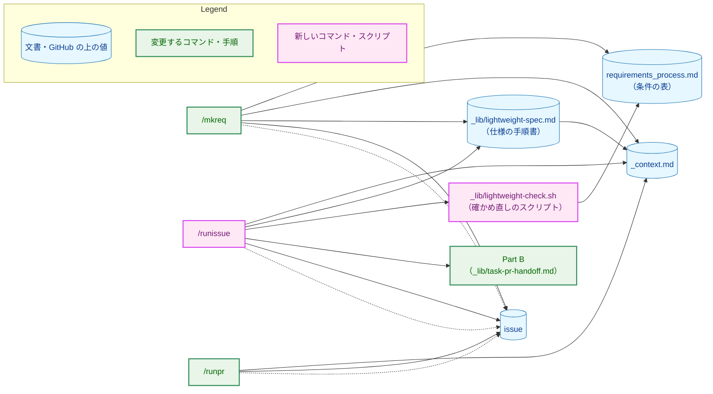
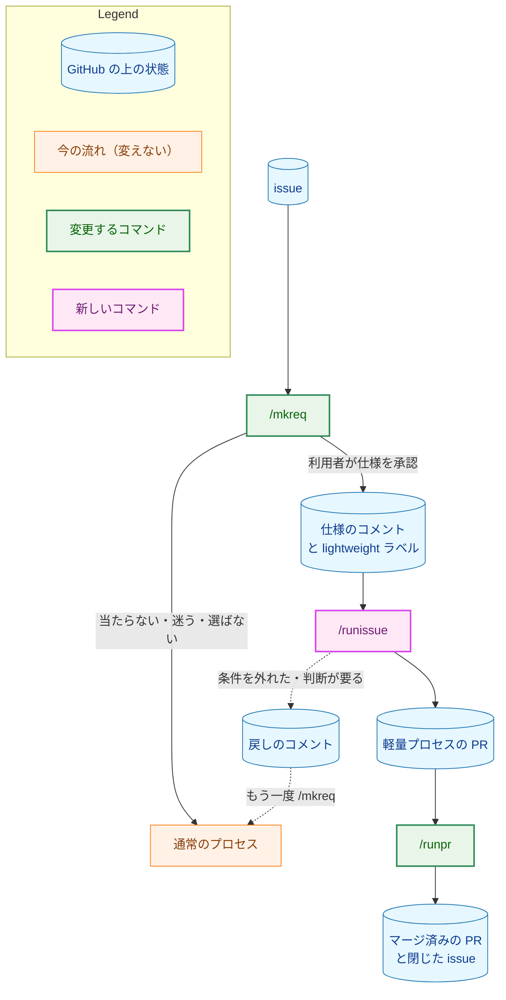
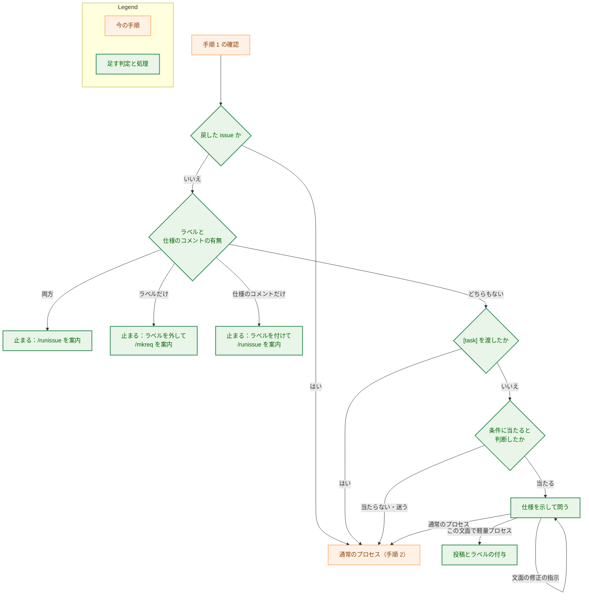
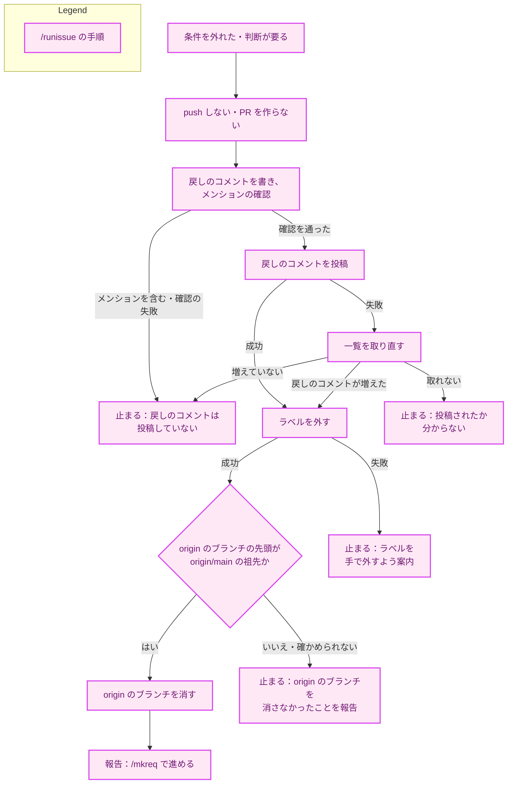
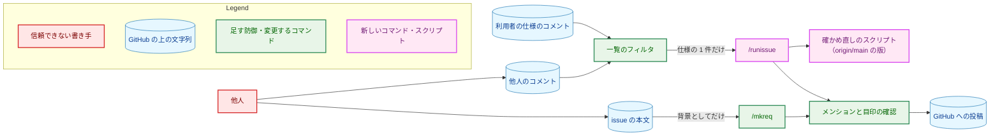
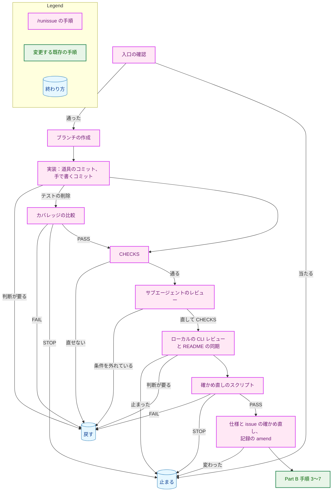
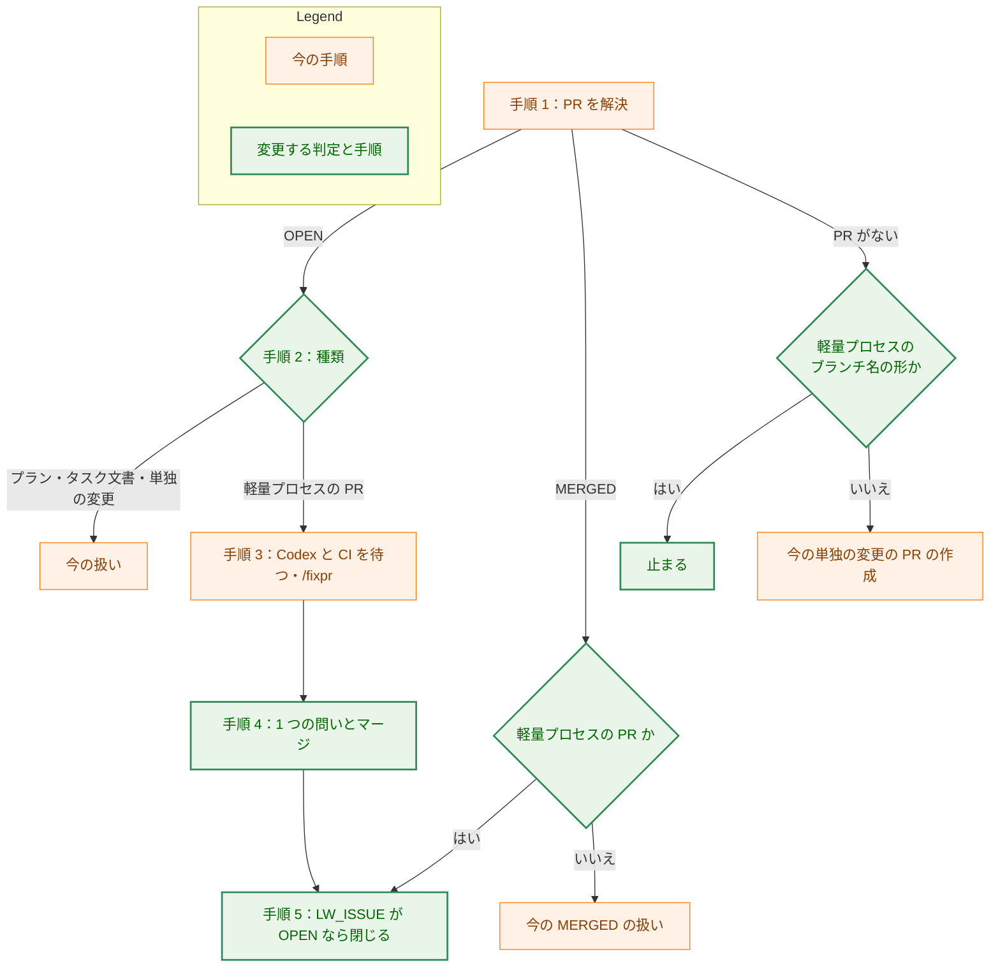

# アーキテクチャ設計書：単純な変更のための軽量プロセスと、/mkreq での振り分け

## Document Status

| Item | Value |
|---|---|
| Status | `draft` |
| Created | 2026-11-04 |
| Review date | - |
| Reviewer | - |
| Comments | - |

本書は [01_requirements.md](01_requirements.md)（要件定義書。以下、要件書）の設計である。既存のファイルについての記述は、コミット `74b9b49` のファイルで確かめた。`file:line` は、このコミットでの行番号を指す。F-NNN・AC-NN は要件書の項番、H-NN は [design_handoff.md](design_handoff.md) の項番を指す。申し送りの H-01〜H-11 への対応は付録 A に、受け入れ基準との対応は付録 B にまとめる。

本書は、要件書 6 章の用語（軽量プロセス、通常のプロセス、類型、仕様のコメント、手で書いた行・手で変更したファイル、確かめ直し）を同じ意味で使う。そのほかに、次の用語を使う。

-   **条件の表:** 軽量プロセスの条件のうち、実際の diff から機械的に確かめるもの（類型ごとの行数の上限、ファイル数の上限、除外するパス、道具として認めるコマンド）を、決まった書式で並べたコードブロック。`requirements_process.md` に置く（3.1.3）。
-   **確かめ直しのスクリプト:** 新しく作る `.claude/commands/_lib/lightweight-check.sh`。条件の表を読み、ブランチの diff を数えて、`PASS`・`FAIL`・`STOP` を出す（3.5.6）。
-   **仕様の目印・戻しの目印:** 仕様のコメントと戻しのコメントの 1 行目に置く、HTML コメントの行（3.2）。
-   **戻しのコメント:** issue を通常のプロセスへ戻したときに、`/runissue` が issue に投稿するコメント（AC-30 の手順 2）。戻しの目印で始まる。
-   **仕様の手順書:** 新しく作る `.claude/commands/_lib/lightweight-spec.md`。仕様のコメントの書式、自分のコメントの一覧の取り方、仕様とみなすコメントの選び方、形の確かめ方を定める。`/mkreq` と `/runissue` が従う（3.3）。
-   **軽量プロセスのブランチ:** `/runissue` が作るブランチ。名前は `<GitHub のユーザー名>/issue-<N>` である（3.2）。
-   **軽量プロセスの PR:** 軽量プロセスのブランチから作られ、`lightweight` ラベルを持つ issue にリンクされた PR。`/runpr` は、この 2 つの値で見分ける（3.7.1）。PR を作るのは `/runissue` だけで、`/runpr` は軽量プロセスのブランチから PR を作らない（3.7.2）。
-   **道具のコミット:** 類型 M で、条件の表が認める道具のコマンドが生成した変更だけを含むコミット。生成したコマンドを、コミットメッセージの trailer に記録する（3.5.2）。
-   **確かめた結果の記録:** 確かめた結果（AC-26）を、決まった書式で並べた行の並び。コミットメッセージと PR の本文に書く（3.5.8）。
-   **Part B:** `.claude/commands/_lib/task-pr-handoff.md` の「Part B — open the PR and hand it over」。PR を作り、Codex の PR レビューの開始を確かめ、レビュアーに渡す共通の手順である。

## 1. 設計の全体像 (Design Overview)

### 1.1. 設計原則

-   **条件は 1 か所に、機械が読める形で置く。** 類型・上限・除外するパスは `requirements_process.md` だけに書く。そのうち機械的に確かめるものは条件の表として同じ文書に置き、確かめ直しのスクリプトがそれを読む。スクリプトとコマンドの定義には、数値やパスを書き写さない（要件書 4.5）。
-   **確かめる仕組みは、確かめられる側から独立させる。** 確かめ直しのスクリプトも条件の表も、`origin/main` の版を使う。検査対象のブランチがスクリプトや条件の表を書き換えても、判定は変わらない。軽量プロセス自身の仕組みとガードは、除外するパスに含める（3.1.3）。
-   **判定に使う値は、エージェントから受け取らずに、スクリプトが自分で決める。** 分かれた点・類型・道具のコミットの範囲は、エージェントの申告ではなく、git と仕様の本文から求める。行数の集計と上限との比較も、LLM ではなくスクリプトが行う（H-01）。
-   **値は `_context.md` に、手順は手順書に置く。** ラベル名・目印の行・ブランチ名の形・PR のタイトルの形は `_context.md` に置く。仕様のコメントの読み書きは仕様の手順書に置く。`/mkreq` と `/runissue` は、それを名前で参照する（AC-39）。
-   **既存の手順を使う。** ローカルの CLI レビュー・README の同期・サブエージェントによるレビュー・カバレッジの比較・PR の作成と引き渡し（Part B の手順 3〜7）・マージは、既存のものを使う。`/runpr` には、PR の種類の判定と issue を閉じることを足すだけにする（3.7）。
-   **宣言された値で選ぶ。** `/runpr` は、PR の本文の文字列を読まず、GitHub が持つ構造化された値（PR にリンクされた issue、そのラベル、PR のブランチ名）で軽量プロセスの PR を見分ける（CLAUDE.md「Declare, don't infer」）。
-   **「条件を外れた」と「確かめられない」を分ける。** issue を通常のプロセスへ戻すのは、diff についての事実が条件を外れたときだけである。道具やネットワークの失敗、エージェントの手順の誤り、仕様の変化は「確かめられない」として、issue を変えずに止まる。戻すことは取り消せない（AC-32）からである（4 章）。

### 1.2. 設計の際に決めたこと（2026-11-04）

利用者に確かめて決めたこと:

-   **確かめ直しは、決まった shell のスクリプトで行い、新しい Go のツールは作らない（H-01）。** 集計は `git diff` の出力の足し算と比較で済み、shell で足りる。Go のツールにすると、パッケージ・テスト・インストールの手順が増え、0054 で問題になった「確かめる仕組みの方が変更より大きい」状態を繰り返す。
    -   利用者に示した案は、`runissue.md` のコードブロックに書くものだった。設計のレビューを受けて、同じ shell をリポジトリのファイル（`.claude/commands/_lib/lightweight-check.sh`）に置く形にした。理由は 2 つある。
        -   コードブロックのままだと、エージェントはそれを打ち直して実行する。そのため、テストが走らせるものと実際に走るものが同じだと保証できない。
        -   コマンドが長くなり、PTY が 4000 バイトを超える入力を黙って切り詰めるおそれがある。
    -   Go のツールを作らないという決定は変わらない。
-   **パスで除外するのは、次のものに限る（H-02）。**
    -   AC-05 が名前を挙げる信頼境界
    -   依存・CI・権限・開発の道具の設定
    -   軽量プロセス自身の仕組みとガード
    -   タスク文書と `security.md`
    -   `security.md` の 7 節・8 節が扱うファイル
    -   プロンプト

    `security.md` の適用条件に当たる製品のパッケージ（`internal/llm`・`internal/publisher`・`internal/writer`・`internal/slackwebhook`・`internal/server` など）の全体は、パスで除かず、サブエージェントによるレビュー（AC-24）で確かめる。全体を除くと製品のコードの大半が対象から外れ、`internal/llm` の中での識別子の名前の変更のような、典型的な類型 M の変更もできなくなる。一覧と、各パスを選んだ基準は 3.1.3 に示す。
-   **`/runpr` は、PR にリンクされた issue（GraphQL の `closingIssuesReferences`）のうち `lightweight` ラベルを持つものによって、軽量プロセスの PR を見分ける（H-05）。** 補助の条件として、PR のブランチ名がその issue の軽量プロセスのブランチ名と一致することも求める（3.7.1）。リンク・ラベル・ブランチ名は、どれも GitHub の構造化された値である。
    -   ブランチで issue にリンクした PR は、本文に `Closes` がなくても、`closingIssuesReferences` にその issue が入る。マージの後も、その issue とラベルを読める。
    -   これは、2026-11-04 に PR #660 で確かめた。PR #660 はマージ済みで、本文に `Closes` はなく、ブランチで #619 にリンクしている。そのとき #619 は `OPEN` のままで、`documentation`・`devenv`・`priority:medium` のラベルを読めた。
    -   本文に `Closes #N` を書いた PR では、GitHub が本文を解析してリンクを作る。それでも、`/runpr` が読むのは GitHub の値で、本文の文字列ではない。
-   **目印の行は、HTML コメントの 1 行にする（H-04・H-10）。** 仕様の目印は `<!-- yt2column:lightweight-spec -->`、戻しの目印は `<!-- yt2column:lightweight-reverted -->` である。GitHub の表示には出ないので、人が手で書いた見出しと誤って一致しにくい。人が読む見出しは 2 行目以降に置く。

レビュアーに個別には確かめず、上の決定と現行の規則から導いたこと（PR のレビューで異論があれば改める）:

-   **軽量プロセスのブランチの名前は `<GitHub のユーザー名>/issue-<N>` とし、連番を付けない（H-06）。** AC-16 の判定と、`/runpr` の補助の条件に、決まった形が要る。issue 1 件につき軽量プロセスの実行は 1 回で、再開もしない（要件書 1 章）ので、連番は要らない。2026-11-04 に `gh pr list --state all` で確かめたところ、過去の PR のブランチ名に、この形のものはない。
-   **PR のタイトルとコミットの件名の `<scope>` は `issue-<N>` とする（H-06）。** タスクの番号がないので、代わりに issue の番号で範囲を示す。`_context.md` の `<scope>` の規則（英小文字・数字・`-`）と、squash の件名の正規表現（`_context.md`「Checking a squash subject」）を満たす。
-   **確かめ直しのスクリプトも条件の表も、`origin/main` の版を使う。** ブランチの作業ツリーの版を使うと、類型 W の誤字の修正として条件の表やスクリプトを書き換え、書き換えた版で判定させることができる。分かれた点の版ではなく `origin/main` の版にするのは、スクリプトと条件の表の版をそろえるためと、ブランチが作られた後に `main` に足された除外も適用するためである。
-   **分かれた点・類型・道具のコミットの範囲は、スクリプトが自分で決める。**
    -   分かれた点は `git merge-base origin/main HEAD` で求める。
    -   類型は、保存した仕様の本文から読む。
    -   道具のコミットの範囲は、分かれた点から続く、trailer を持つコミットの並びとする。

    エージェントが渡す値で決めると、誤った値（たとえば分かれた点として `HEAD~1`）を渡されて、数える範囲を狭められる。
-   **道具のコマンドは、条件の表の許可リスト（`tool` の行）にあるものに限る。再現の確認は、スクリプトが行う（H-03）。** 決まった出力を出すコマンドなら、`git apply` や `sed -i` でも再現の確認を通る。許可リストがないと、手で書いた変更を道具のコミットに包んで、上限から外せる。
-   **条件の表の上限は、類型ごとに追加と削除の両方の行を必ず持つ。上限がないことは `none` と書く。** 行が欠けたことを「上限なし」と読むと、表を編集し間違えたときに、確かめ直しが黙って通る。欠けた行や重なった行があれば、スクリプトは `STOP` する（CLAUDE.md「Reject, don't normalize」）。
-   **名前の変更は `--no-renames` で数え、ファイルの移動は道具のコミット（`git mv`）で扱う（H-01）。** 名前の変更を検出すると、移動は 0 行に数えられる。そのうえ、移動先で中身を書き換えても、類似度の閾値の内側なら手で書いた行に数えられない。
-   **バイナリのファイル、シンボリックリンク、サブモジュール、ファイルのモードの変更があれば、条件を満たさないとする（H-01）。** どれも行数で大きさを測れず、diff を読んでも確かめられない。シンボリックリンクは除外するパスの中を指せ、サブモジュールは依存の追加に当たる。
-   **改行だけの変更、空白だけの変更も、1 行として数える（H-01）。** git の数え方のままにし、例外を足さない。
-   **道具のコミットは、ブランチの先頭に置く（H-03）。** 道具のコミットを手で書いたコミットより前に並べると、手で書いた行とファイルを「最後の道具のコミットから HEAD まで」の diff で数えられる。道具が生成した変更だけを含むファイルはこの diff に現れないので数えず、手で書いた変更を含むファイルは数える（AC-03）。
-   **仕様の手順書 `_lib/lightweight-spec.md` を新しく作る（H-04）。** 仕様のコメントの書式と読み方を、`/mkreq`（書く側）と `/runissue`（読む側）が共有する。どちらかの定義に書くと、もう一方が書き写すことになる。
-   **戻した issue では、どのコメントも仕様とみなさない（AC-17・AC-32）。** 戻した後で利用者が手で仕様を書いても、`/runissue` は受け付けない。受け付けると、`/mkreq` が通常のプロセスで進む issue（AC-32）に、`/runissue` も進められる状態ができ、AC-15 が防ぐ「同じ issue に 2 つの進め方」になる。
-   **`/runissue` は、ローカルの CLI レビュー・README の同期・CHECKS（実装の後に行う確認の一覧。3.5.3 で定める）を自分で行い、PR の作成からは Part B の手順 3〜7 を使う（AC-25・AC-27・AC-28）。** Part B の手順 1・2 は、確認が通らないと「直して、やり直す」を繰り返すだけで、軽量プロセスの戻し（AC-30・AC-31）へ抜ける出口がない。そこで、手順 1・2 に当たる処理を `/runissue` の手順に置き、Part B は手順 3 から使う。そのために、Part B を手順 3 から使えるようにし、本文の issue の行の種類を選ぶ入力 ISSUE_KEYWORD（3.6）を足す。
-   **確かめた結果の記録は、push の前の最後のコミットのメッセージに、tree を変えない amend で書く（AC-26）。** 行数とファイル数は、最後のコミットまでを数えて初めて決まる。テストを削除したコミットにカバレッジの比較の出力を書く、CLAUDE.md の手順と同じ方式である。amend でコミットの ID は変わるので、記録には tree の ID を書く。
-   **`/runissue` は、Part B の手順 3 に入る直前に、仕様の選び直しの結果・issue の状態・ラベルが入口の確認のときから変わっていないことを確かめる。** 変わっていれば、issue を変えずに、push もせずに止まる。実行の途中に仕様が編集されると、実装したものと承認された文面が食い違うためである（5.1）。
-   **`/runissue` は、issue の本文もタイトルも読まない。** 仕様のコメントで足り、誰でも書ける文字列を、コードを書いて push できるエージェントの文脈に入れる理由がない。要件書の AC-18 は本文を背景として読むことを許すが、求めてはいない。
-   **issue テンプレートには、ラベルを付けない（AC-40）。** テンプレートの front matter で `lightweight` を付けると、`/mkreq` の振り分けの前に issue にラベルが付く。その issue は AC-15 の「ラベルだけがある」に当たり、`/mkreq` が止まってしまう。
-   **`lightweight` ラベルは、実装の PR の手順で、利用者に承認を求めてから作る（H-09）。** `gh label create` はネットワークへの書き込みで、CLAUDE.md の「Tool Execution Safety」により承認が要る。色は `c2e0c6`（薄い緑）、説明は「要件・設計・計画の文書を作らずに 1 本の PR で進める単純な変更（軽量プロセス）」とする。`/mkreq` は、仕様を投稿する前にラベルがリポジトリにあることを確かめ、なければ投稿せずに止まる（3.4.4）。
-   **`/runpr` は、軽量プロセスの PR の squash のコミットメッセージの本文の最後に `Closes #<N>` を書く。** タスクの最後のプランの PR と同じ扱いである（`.claude/commands/runpr.md:649-651`）。issue を閉じることは、この行に頼らず、`/runpr` が自分で行う（3.7.4）。

### 1.3. なぜ既存の方法では足りないか

今は、どの変更も 3 つのタスク文書の承認を経てから実装する（`docs/dev/conventions/requirements_process.md:11-14`）。PR を作るのは、タスク文書のコマンドか `/runplan` である（`CLAUDE.md:166-173`）。単純な変更を、文書を作らずに 1 本の PR で進めるという要件（要件書 2.1）は、通常のプロセスの手順を短くしても満たせない。文書の承認が、実装を始める条件になっているためである。

そこで、仕様を承認して PR を作るまでの入口（`/mkreq` の振り分けと `/runissue`）だけを新しく作る。それ以外は既存のものを使う。

-   ローカルの CLI レビュー：`_lib/local-cli-review.md`
-   サブエージェントによるレビュー：`_lib/review-subagent-pattern.md`
-   README の同期：`mktrans.md` の「When a caller runs it」
-   テストを削除したときのカバレッジの比較：`make coverage-compare`・`make ext-coverage-compare`
-   PR の作成と引き渡し：Part B の手順 3〜7
-   マージ：`/runpr`・`/mergepr`

`/runpr` は、今の単独の変更（タスクのない PR）の扱いをそのまま使い、軽量プロセスの PR の判定と、マージの後に issue を閉じることを足す。今の `/runpr` が issue を閉じるのは、タスクの最後のプランの PR だけである（`.claude/commands/runpr.md:809-827`）。そのため、そのままでは AC-34 を満たせない。

### 1.4. 概念モデル

矢印 A → B は「A が B を読む（読んで従う、または値を読む）」を、点線の矢印 A -.-> B は「A が B に書き込む」を表す。



文書は、変更するものも新しいものも区別せずデータとして示す。どの文書が新しいかは 2.2 の表に示す。issue の上の値は、仕様のコメント・戻しのコメント・`lightweight` ラベルである。

## 2. システム構成 (System Structure)

### 2.1. 全体構成

矢印 A → B は「A の次に B が行われる（人の操作か、コマンドの実行）」を表す。点線は、条件を外れたときの流れである。



### 2.2. コンポーネント配置

| ファイル | 新規・変更 | 責務 | 関係する AC |
|---|---|---|---|
| `docs/dev/conventions/requirements_process.md` | 変更 | 軽量プロセスの節を足す。類型・上限・除外する変更の定義、条件の表、機械的に確かめる条件とレビューで確かめる条件の区別、例外の範囲を書く。「LLM Constraints」に例外を、「Review Flow」に軽量プロセスの流れを足す | AC-01〜AC-07・AC-38 |
| `.claude/commands/_context.md` | 変更 | ラベル名・仕様の目印・戻しの目印・軽量プロセスのブランチ名・タイトルとコミットの件名の形を定める。「Reviewer ping」の行に `runissue.md` を足す | AC-39 |
| `.claude/commands/_lib/lightweight-spec.md` | 新規（英語） | 仕様のコメントの書式（日本語の文面の雛形を含む）、自分のコメントの一覧の取り方、仕様とみなすコメントの選び方、戻したかどうかの判定、形の確かめ方を定める | AC-11・AC-15・AC-17・AC-19・AC-20・AC-32 |
| `.claude/commands/_lib/lightweight-check.sh` | 新規 | 確かめ直しのスクリプト（3.5.6） | AC-06・AC-29 |
| `.claude/commands/mkreq.md` | 変更 | 手順 1 の確認の後、手順 2 の前に振り分けの手順を足す。AC-15 の停止、仕様の提示と問い、投稿、ラベルの付与、失敗したときの報告を書く。冒頭の目的の段落（`.claude/commands/mkreq.md:12-17`）と front matter の `description` を、要件定義書を作らない進め方がある形に改める。報告（手順 9）と「Authorization」も改める | AC-08〜AC-15・AC-32・AC-43 |
| `.claude/commands/runissue.md` | 新規（英語） | 入口の確認、ブランチの作成、実装、確認、サブエージェントによるレビュー、ローカルの CLI レビュー、確かめ直し、確かめた結果の記録、通常のプロセスへの戻し、Part B の呼び出し、「Authorization」を書く | AC-16・AC-18・AC-21〜AC-31・AC-42 |
| `.claude/commands/_lib/task-pr-handoff.md` | 変更 | Part B を手順 3 から使える呼び出し元を足し、入力 ISSUE_KEYWORD を足す。冒頭の説明、「Authorization」（「for its task and its PR only」）、TASK_DIR・PR_TEXT の説明に、`/runissue` の場合を足す（3.6） | AC-27・AC-28 |
| `.claude/commands/_lib/local-cli-review.md` | 変更 | 呼び出し元の一覧（同書 11〜20 行）に `runissue.md` を足す | AC-25 |
| `.claude/commands/runpr.md` | 変更 | 手順 2 の「Kind」に軽量プロセスの PR を足す。手順 1 で、軽量プロセスのブランチから単独の PR を作ることを拒む。手順 1 の `MERGED` の場合、手順 4 の squash のメッセージ、手順 5 の issue を閉じる項目、「Authorization」を改める | AC-33〜AC-36・AC-44 |
| `CLAUDE.md` | 変更 | 「Documents」の「Each task lives in」の例外、「Claude Commands」の一覧への `/runissue <N>` の追加、「Each task PR is handled by two commands」の段落、軽量プロセスの概要と `requirements_process.md` へのリンクを書く | AC-37・AC-38 |
| `AGENTS.md` | 変更 | Codex の PR レビューへの指示（`AGENTS.md:11`）に、軽量プロセスの例外を足す（3.1.5） | AC-38 |
| `.github/ISSUE_TEMPLATE/lightweight.md` | 新規（日本語） | 背景・やること・やらないこと・確かめ方の見出しを置く。ラベルは付けない | AC-40 |
| `cmd/yt2column/codex_review_docs_test.go` | 変更 | `postingSections` に区画を足し、`readOnlyInvocations` に GraphQL の読み取りを足す（下の「既存のテストへの影響」） | AC-12・AC-30・AC-34 |
| `cmd/yt2column/fixpr_docs_test.go` | 変更 | `checkListings` の fake の応答と置き換えの表を、仕様の手順書の一覧に合わせて広げる（3.9） | AC-17 |
| `cmd/yt2column/lightweight_docs_test.go` | 新規 | 確かめ直しのスクリプトのテスト、除外するパスの実在のテスト、コメントの一覧のフィルタのテストを置く（3.9） | AC-06・AC-17・AC-29 |
| `internal/doctestutil/` | 変更 | 新しいテストが文書を探す見出しの定数を置く（3.9） | — |
| GitHub のリポジトリのラベル `lightweight` | 新規 | 仕様が承認された issue に付ける | AC-41 |

既存のテストへの影響:

-   **`TestPostingCommandsInventory`（`cmd/yt2column/codex_review_docs_test.go:200-255`）:**
    -   このテストは、コマンドの定義のすべての投稿のコマンドが、`postingSections`（同 60-79 行）に挙げた区画の中で、メンションの確認の後にあることを確かめる。
    -   `mkreq.md` と `runissue.md` に `gh issue comment ... --body-file` が加わるので、区画を足さないと失敗する。
    -   `-F`・`-f` を渡す GraphQL の読み取りも投稿に数えられる（同 139 行の `textFlag`）。そのため、次の 2 つを `readOnlyInvocations`（同 148-150 行）に足す。
        -   `runpr.md` の `closingIssuesReferences` の読み取り
        -   `runissue.md` の `closedByPullRequestsReferences` の読み取り
    -   `gh issue edit --add-label`・`--remove-label` は、本文のフラグを持たないので、投稿に数えられない。
-   **`TestPostingPathsCheckMention`（同 119-133 行）:** 足した区画にもメンションの確認があることを確かめる。
-   **Part B の手順 3 と手順 5 を項目の書き出しで探すテスト（`cmd/yt2column/codex_review_docs_test.go:76`、`cmd/yt2column/fixpr_docs_test.go:193`）:** Part B の番号付きの手順を増やさず、書き出しも変えないので、変更は要らない。
-   **`runpr.md` の手順の見出しを探すテスト（`TestRunprDocContract` など）:** 見出しを変えないので、変更は要らない。
-   **`TestCodexMentionOnlyInRequestRow`（`cmd/yt2column/codex_review_docs_test.go:92`）と `TestInstructionDocPaths`（`cmd/yt2column/docpaths_test.go:140`）:** `.claude/commands/` の下のすべての文書を読む（`internal/doctestutil/protocol.go:85-103`、`cmd/yt2column/docpaths_test.go:106-110`）。新しい `runissue.md` と仕様の手順書も、変更なしに対象になる。

### 2.3. データフロー

矢印は、参加者の間の操作と、その応答を表す。


## 3. コンポーネント設計 (Component Design)

本タスクは Go の型やインターフェースを足さない。この章では、文書が定める書式と、コマンド・スクリプトの間の取り決めを示す。手順の細かい並びは、実装計画書で決める。

### 3.1. 条件の定義（`requirements_process.md`。F-001）

#### 3.1.1. 置き場所

`requirements_process.md` の「## 0. Review Workflow」の下に、新しい小節「### Lightweight Process」を足す。既存の章の番号（「§ 4」などの参照先）を動かさないためである。小節には、次のものを英語で書く。

-   軽量プロセスとは何か、その例外の範囲（3.1.5）
-   3 つの類型と、それぞれの確かめ方（AC-01）
-   上限と、行・ファイルの数え方（AC-02・AC-03・AC-04）
-   分量にかかわらず通常のプロセスとする変更（AC-05）
-   機械的に確かめる条件と、レビューで確かめる条件の区別（AC-06）。見出し「#### Mechanically checked conditions」の下に、条件の表（3.1.3）を置く
-   軽量プロセスの流れ（AC-07）

類型の定義・上限の値・除外する変更の文言は、要件書の AC-01〜AC-05 をそのまま英語にする。

#### 3.1.2. 行・ファイルの数え方（H-01）

-   **数える範囲:** 軽量プロセスのブランチの、`origin/main` から分かれた点（以下、BASE）から最後のコミットまでの diff。手で書いた行とファイルは、最後の道具のコミット（ないときは BASE）から最後のコミットまでの diff で数える（3.5.2）。
-   **行:** 追加と削除を、それぞれ足す。改行だけ・空白だけの変更も 1 行に数える。名前の変更は検出せず、削除と追加に数える。
-   **ファイル:** 変わったパスの数。名前の変更は、元のパスと先のパスの 2 ファイルに数える。
-   **数えられないもの:** バイナリのファイル、シンボリックリンク、サブモジュール、モードの変更（通常のファイルの `100644` と `100755` の間の変更を含む）があれば、条件を満たさない。
-   **`README.en.md`:** `README.md` の変更に伴う変更も、ほかのファイルと同じく数える（AC-03）。
-   **再現性:** 利用者の git の設定（diff のアルゴリズム、外部の diff、textconv、色）で数が変わらないよう、スクリプトはそれらを無効にするオプションを明示して git を呼ぶ。パスは NUL で区切って読み、日本語のパスが引用符付きの形になって除外の照合を外れることを防ぐ。

#### 3.1.3. 条件の表

条件の表は、見出し「#### Mechanically checked conditions」の直後に置く、`text` の言語名を付けたコードブロックである。1 行に 1 つの条件を書く。書式は次のとおりである。

```text
limit W added 30
limit W deleted 30
limit D added 10
limit D deleted 100
limit M added 50
limit M deleted none
limit files 10
exclude docs/tasks/
exclude-absent go.sum
tool gofumpt -w
tool git mv
...
```

-   `limit <類型> added|deleted <数 | none>` は、手で書いた行の上限である。3 つの類型のそれぞれに、`added` と `deleted` の行がちょうど 1 つずつなければならない。`none` は上限がないことを表す。
-   `limit files <数>` は、手で変更したファイルの数の上限で、ちょうど 1 行なければならない。
-   `exclude <パス>` は、除外するパスで、リポジトリに実在しなければならない。`/` で終わるものはディレクトリ、それ以外はファイルを表す。リポジトリのルートからのパスで書く。照合はパスの完全な一致か、ディレクトリの下であることで行い、文字列の前方一致では行わない（`go.mod.bak` は `go.mod` に当たらない）。
-   `exclude-absent <パス>` は、今はリポジトリにないが、作られること自体を除外するパスである（`go.sum`・`.gitmodules` など）。
-   `tool <語> [<語> ...]` は、道具のコミットに認めるコマンドである（3.5.2）。照合は語の単位で行う。trailer のコマンドを空白で語に分け、先頭の語の並びが `tool` の行の語の並びとちょうど一致しなければならない（`gofumpt -w` は `gofumpt -wx` に当たらない）。残りの語は、すべてリポジトリの中の相対パスでなければならない。
-   それ以外の行、欠けた行、重なった行があれば、確かめ直しのスクリプトは `STOP` する（3.5.6）。

除外するパスの一覧（H-02）は、次のとおりである。基準は、パスで決まる AC-05 の除外と、軽量プロセスを機械的に守る仕組みそのものである。

| 区分 | パス | 基準 |
|---|---|---|
| タスク文書 | `docs/tasks/` | AC-05「タスク文書の編集」 |
| セキュリティの文書 | `docs/dev/security.md` | AC-05「`security.md` の適用条件」 |
| 開発の道具の信頼境界 | `cmd/fixprguard/`・`internal/fixprguard/`・`cmd/codexreview/`・`internal/codexreview/`・`cmd/mergepr/`・`internal/mergepr/` | AC-05「信頼境界」が名前を挙げるもの |
| 秘密情報 | `internal/secret/`・`internal/redact/`・`internal/config/` | AC-05「秘密情報」。秘密情報の型・出力からの削除・環境変数からの読み取りを定める場所である。秘密情報を使うだけのパッケージ（`internal/llm` など）は含めず、レビューで確かめる（1.2） |
| `yt-dlp` とキャッシュ | `internal/transcript/`・`internal/cmdrunner/`・`internal/cachelock/`・`internal/articlecache/` | AC-05「`yt-dlp` の呼び出し、キャッシュ」。`internal/transcript/` は `yt-dlp` の呼び出しと字幕のキャッシュを含み、`internal/cmdrunner/` は外部のコマンドを起動する |
| ブラウザとの境界 | `cmd/yt2column-nmhost/`・`internal/nmhost/`・`internal/serversock/`・`extension/static/manifest.json` | `security.md` 8 節の、Native Messaging のホストの登録・ソケット・拡張の権限 |
| 取り込んだデータとプロンプト | `testdata/`・`prompts/` | `security.md` 7 節の、取り込んだデータの制約。プロンプトは文言の変更でも LLM の出力（振る舞い）が変わる |
| 依存の定義 | `go.mod`・`exclude-absent go.sum`・`exclude-absent go.work`・`extension/package.json`・`extension/package-lock.json`・`extension/.npmrc`・`.golangci.yml`・`exclude-absent .gitmodules` | AC-05「依存パッケージの追加」。`.npmrc` は install スクリプトを止める設定、`.golangci.yml` は `depguard` で許す依存を持つ |
| CI と開発の道具の設定 | `.github/workflows/`・`.claude/settings.json`・`.pre-commit-config.yaml`・`.coderabbit.yaml`・`.gitattributes`・`Makefile` | 確認とレビューそのものを変えうる。`Makefile` は CHECKS と CI が呼ぶ `make` の対象を定める |
| エージェントへの指示（Codex） | `AGENTS.md`・`.github/copilot-instructions.md`・`.github/instructions/` | PR のレビューの指示を変えうる |
| 軽量プロセス自身の仕組み | `docs/dev/conventions/requirements_process.md`・`.claude/commands/_context.md`・`.claude/commands/runissue.md`・`.claude/commands/_lib/lightweight-spec.md`・`.claude/commands/_lib/lightweight-check.sh`・`.claude/commands/_lib/task-pr-handoff.md`・`cmd/coveragecompare/`・`internal/coveragecompare/` | 条件・目印・確かめ直し・類型 D の確かめ方を定める。軽量プロセスの PR で、これらを変えられないようにする |
| 軽量プロセスとメンションのガード | `cmd/yt2column/codex_review_docs_test.go`・`cmd/yt2column/fixpr_docs_test.go`・`cmd/yt2column/lightweight_docs_test.go`・`internal/doctestutil/` | メンションの確認、本文を出さない一覧、確かめ直しを確かめるテスト |

パッケージの一部のファイルだけを除くと、ファイルの追加や分割で除外が抜けるので、パッケージ単位で除く。

`CLAUDE.md`、上の表にない `.claude/commands/` の文書、上の表にない `docs/dev/conventions/` の文書は、パスでは除かない。類型 W はこれらの誤字の修正を認める（AC-05）ので、パスでは扱い分けられない。誤字の修正を超えていないことは、サブエージェントによるレビュー（3.5.4）が確かめる。

一覧から漏れたパスは、存在のテスト（3.9）では見つからない。そこで、`requirements_process.md` の軽量プロセスの節に、次の規則を書く。「信頼境界に当たるパッケージやファイルを新しく足す PR は、同じ PR で条件の表に `exclude` を足す。」この規則を守らせるのは、その PR（通常のプロセス）のレビューである。

次のものも、パスでは除かない。`/runpr`・`/mkreq`・`_lib/local-cli-review.md` の軽量プロセスとガードの部分と、lint・format・型検査の設定（`.gitignore`・`extension/.node-version`・`extension/tsconfig*.json`・ESLint と Prettier の設定）である。これらには誤字の修正（類型 W）や道具による整形（類型 M）の余地がある。意味の変わる変更は、サブエージェントのレビューと PR のレビューで止める。メンションの確認などの区画は、CI で走るガードのテスト（3.9）が確かめる。

#### 3.1.4. 機械的に確かめる条件と、レビューで確かめる条件（AC-06）

| 条件 | 確かめる者 |
|---|---|
| 類型ごとの行数の上限、手で変更したファイルの数、除外するパスへの変更がないこと、数えられない変更（3.1.2）がないこと、道具のコミットが許可リストのコマンドで再現できること | 確かめ直しのスクリプト（3.5.6） |
| ちょうど 1 つの類型に収まること、AC-05 のうちパスで決まらないもの（意味の変わる文言、文字列で参照される名前、`security.md` の適用条件、信頼境界、方針の例外、設計上の選択肢、振る舞いの変更）、仕様の範囲を超えないこと | サブエージェントによるレビュー（3.5.4） |

#### 3.1.5. 方針の例外

本タスクは、次の既存の方針に例外を設ける。どれも、範囲は F-001 の条件を満たし、仕様が承認された変更に限る。

| 元の方針と場所 | 例外にする理由 | 古い振る舞いを確かめる既存のテスト |
|---|---|---|
| 実装計画書が `approved` になるまで実装を始めない（`docs/dev/conventions/requirements_process.md:13`） | 単純な変更では、文書の量とレビューの手間が変更の大きさに釣り合わない（要件書 1 章「背景」）。仕様のコメントの承認を、要件の承認に当たるものとする | なし |
| 支配する文書が `approved` になる前の実装のコミットは、Codex の PR レビューの指摘とする（`AGENTS.md:11`） | 同上。軽量プロセスの PR には支配する文書がない。リンクされた issue に承認された仕様がある PR は、この指摘の対象にしないと足す | なし |
| 各タスクは `docs/tasks/NNNN_<name>/` に置く（`CLAUDE.md:33`） | 同上。軽量プロセスは `docs/tasks/` の下に何も作らない（AC-21） | なし |
| `/mkreq` は必ず要件定義書を作る（`.claude/commands/mkreq.md:12-15`）、タスクの PR を作るのは 5 つのコマンド（`CLAUDE.md:166-173`） | 軽量プロセスでは、`/mkreq` は仕様を投稿して止まり、PR は `/runissue` が作る | なし |
| タスクの PR の本文には closing keyword を書かない（`.claude/commands/_lib/task-pr-handoff.md:243-246`） | 例外ではない。この規則はタスクの PR についてのもので、軽量プロセスの PR はタスクの PR ではない。Part B の入力 ISSUE_KEYWORD で、呼び出し元が選ぶ形にする（3.6） | なし |

「なし」は、`*_test.go` に、これらの文言・`Refs`・closing keyword を確かめるテストがないことを確かめた結果である（CLAUDE.md の「Document tests ... never prose」により、文言のテストは置かない）。

### 3.2. `_context.md` に足す値（AC-39・H-06）

「Process convention」の表に、次の行を足す。

| 名前 | 値 |
|---|---|
| Lightweight label | `lightweight` |
| Lightweight spec marker | `<!-- yt2column:lightweight-spec -->`：仕様のコメントの 1 行目 |
| Lightweight revert marker | `<!-- yt2column:lightweight-reverted -->`：戻しのコメントの 1 行目 |
| Lightweight branch name | `<GitHub user name>/issue-<N>`：`<N>` は issue の番号。連番を付けない |

「PR title and squash subject」の表に、次の行を足す。

| 項目 | 形 |
|---|---|
| Lightweight PR title | `<type>(issue-<N>): <Japanese summary>`。`<type>` は接頭辞の表から選ぶ |
| Lightweight commit subject | `<type>(issue-<N>): <English summary>`。`/runissue` が作るコミットの件名 |

squash の件名は、今のとおり `/mergepr` の手順 2 が書く。`issue-<N>` は `<scope>` の規則（`[a-z0-9-]+`）を満たすので、件名の正規表現は変えない。

### 3.3. 仕様の手順書（`_lib/lightweight-spec.md`。H-04・H-10）

#### 3.3.1. 仕様のコメントの書式

仕様のコメントは、次の形の日本語の Markdown である。改行は LF か CRLF のどちらでもよい（GitHub の画面で編集すると CRLF になるため）。

```markdown
<!-- yt2column:lightweight-spec -->
## 軽量プロセスの仕様

### 類型

<W・D・M のどれか 1 文字>

### やること

<箇条書き>

### やらないこと

<箇条書き>

### 確かめ方

<箇条書き。類型の確かめ方（AC-01）と、この変更に固有の確認>

### 見込みの変更量

<追加 N 行・削除 M 行・ファイル K 個。見込みであり、上限の判定は実際の diff で行う>
```

形の確かめ方（AC-19）は、次のとおりである。

-   1 行目が、仕様の目印とちょうど一致する（行末の CR を除いて比べる）。
-   `### 類型`・`### やること`・`### やらないこと`・`### 確かめ方` の 4 つの見出しの行が、それぞれちょうど 1 回現れる。
-   それぞれの見出しの下（次の見出しの行まで）に、空白でない行が 1 行以上ある。
-   `### 類型` の下の空白でない行は 1 行だけで、`W`・`D`・`M` のどれかにちょうど一致する。
-   `### 見込みの変更量` は確かめない。示すための見出しで、判定に使わないためである。

形に合わなければ、どの規則に合わないかを報告して止まる。形を直して受け入れることはしない。`/mkreq` も、問いの前に、示す文面がこの形に合うことを確かめる。確かめ直しのスクリプトは、保存した仕様の本文から、`### 類型` の下の 1 文字だけを読む（3.5.6）。

#### 3.3.2. 自分のコメントの一覧

`/mkreq` と `/runissue` は、issue のコメントを、次の取り決めで一覧にする。手順書の見出し「## Listing own marker comments」の下に、コマンドを 1 つだけ書く。

-   認証済みの利用者の名前は、`gh api user --jq .login` で得る。
-   一覧は、`gh api --paginate repos/<owner>/<repo>/issues/<N>/comments --jq '<フィルタ>'` で取る。フィルタは、次の 3 つを満たすコメントだけを選ぶ。
    -   書き手の種類（`.user.type`）が `User` である。
    -   書き手（`.user.login`）が、置き換えの印 `<user-login>` に入れた認証済みの利用者と一致する。
    -   本文の 1 行目が、仕様の目印か戻しの目印に一致する。行末の CR は除いて比べる。目印は、置き換えの印 `<spec-marker>`・`<revert-marker>` に `_context.md` の値を入れる。
-   1 件につき 1 つの JSON のオブジェクトを出す。出すのは、次のキーだけである。
    -   `kind`（`spec` か `revert`）
    -   `id`
    -   `url`（`html_url`）
    -   `created_at`
    -   `updated_at`
-   本文は出さない。他人のコメントの本文が会話に入らないようにするためである。仕様の本文は、選んだ 1 件だけを `id` で読む（`gh api repos/<owner>/<repo>/issues/comments/<id> --jq .body`）。その本文をスクラッチパッドのファイルに保存し、本文の SHA-256 を控える。

#### 3.3.3. 仕様とみなすコメントと、戻したかどうか（AC-17・AC-32）

-   **戻した issue:** 一覧に、戻しの目印のコメントが 1 件以上ある issue。戻した issue では、どのコメントも仕様とみなさない（1.2）。
-   **仕様のコメント:** 戻した issue でなければ、一覧の仕様の目印のコメントのうち、`created_at` が最も新しいもの。`created_at` が同じなら、`id` が大きいものを選ぶ。

`/mkreq` は、戻した issue では振り分けず、AC-15 の停止もせず、通常のプロセスで進む（AC-32）。`/runissue` は、戻した issue では「戻した issue である」として止まる（AC-16 の「仕様のコメントがない」に当たる）。

### 3.4. `/mkreq` の振り分け（F-002・H-07・H-11）

#### 3.4.1. 手順の位置

振り分けは、今の手順 1（issue の読み取りと、要件定義書の重複の検索。`.claude/commands/mkreq.md:34-49`）の後、手順 2（タスクのディレクトリの決定）の前に行う。手順 1 の確認を通った後で、ブランチを作る（手順 3）前である（AC-08）。

#### 3.4.2. 判定の順序

矢印 A → B は「A の次に B を行う」を表し、ラベルは分岐の条件である。



-   ラベルの有無は、`gh issue view <N> --json labels` で読む。
-   条件に当たるかの判断は、`requirements_process.md` の軽量プロセスの節に照らして、issue の本文とコメントから LLM が行う。見込みの変更量は、そのとき読んだコードから見積もる。
-   `/mkreq` の今の手順 1 は、`gh issue view --json ...,comments` で、他人のコメントの本文も読んでいる（`.claude/commands/mkreq.md:36`）。振り分けの判断にも、それを背景として使う。仕様のコメントと戻しのコメントとして扱うのは 3.3 のものだけで、他人のコメントが目印で始まっていても数えない。

#### 3.4.3. 問いの形（AC-09・H-11）

1.  仕様の全文を、スクラッチパッドのファイルに書く。3.3.1 の形に合うことを確かめる。
2.  メッセージで、類型、見込みの変更量、当たると判断した理由、そのファイルの全文を示す。
3.  `AskUserQuestion` で問う。選択肢は「この文面で軽量プロセスで進める」と「通常のプロセスで進める」の 2 つである。
4.  利用者が選択肢にない答えをしたときは、文面の修正の指示とみなす。ファイルを書き直し、形を確かめ、全文を示して、もう一度問う。
5.  承認は、直前に示した全文について、1 つ目の選択肢が選ばれたときだけとする。

投稿は、このファイルを `--body-file` で渡して行う。示した全文と投稿する文面が、バイト単位で同じになる（AC-11）。

#### 3.4.4. 投稿とラベルの付与（AC-11〜AC-14）

1.  `gh label list` で、ラベルがリポジトリにあることを確かめる。なければ、何も投稿せずに止まり、ラベルを作るよう報告する。
2.  仕様のファイルに、メンションの確認（`_context.md`「PR review request」の規則）を行い、メンションが含まれていれば止まる（AC-12）。
3.  投稿の前に、一覧（3.3.2）で、自分の仕様の目印のコメントの数を数えておく。
4.  `gh issue comment <N> --body-file <file>` で投稿する。
5.  投稿が失敗したら、ラベルは付けない。一覧を取り直したうえで、次のとおり報告して止まる。
    -   仕様の目印のコメントの数が増えていなければ、何も投稿されていないことを報告する。
    -   数が増えていれば、投稿はされたが失敗と報告されたことと、そのコメントの URL を報告する。あわせて、ラベルを付ければ `/runissue <N>` で進めることを報告する。
    -   一覧を取れなければ、投稿されたかどうか分からないことを報告し、issue を確かめるよう求める（AC-14）。
6.  投稿が成功したら、`gh issue edit <N> --add-label <Lightweight label>` でラベルを付ける。失敗したら止まり、投稿したコメントの URL と、ラベルを手で付ければ `/runissue <N>` で進めることを報告する。
7.  報告（手順 9）では、類型、仕様のコメントの URL、ラベルを付けたこと、次に実行する `/runissue <N>` を示す。`/runissue` は実行しない（AC-13）。

「Authorization」には、次の操作を、この issue に限って足す（AC-43）。

-   `gh api user`
-   `gh label list`
-   コメントの一覧と 1 件の読み取り（`gh api`）
-   `gh issue comment`（仕様の投稿）
-   `gh issue edit --add-label`（ラベルの付与）

### 3.5. `/runissue`（F-003〜F-005）

`.claude/commands/runissue.md` を、英語で新しく書く。入力は `<issue>`（番号か URL）である。手順の全体の流れは 6.1 に示す。

#### 3.5.1. 入口の確認（AC-16〜AC-19）

次の確認を、ブランチを作る前に行う。どれかに当たれば、ブランチを作らずに止まり、理由を報告する。

| 確認 | 方法 |
|---|---|
| 作業ツリーがきれいである | `git status --short` |
| issue が開いていて、このリポジトリのものである | `gh issue view <N> --json number,state,url,labels` と `gh repo view --json url`（`mkreq.md` の手順 1 と同じ判定）。`title`・`body` は取らない（1.2） |
| `lightweight` ラベルがある | 同上の `labels` |
| 戻した issue でなく、仕様のコメントがあり、形に合う | 仕様の手順書（3.3） |
| その issue を `対応 issue` とする要件定義書がない | `git fetch origin` の後、`mkreq.md` の手順 1 の検索（`.claude/commands/mkreq.md:42-49`）を、そこを参照して行う |
| 軽量プロセスのブランチが、ローカルにも `origin` にもない | `git show-ref --verify --quiet refs/heads/<branch>` と `git ls-remote --exit-code origin refs/heads/<branch>` |
| issue にリンクされた、開いている PR がない | GraphQL の `closedByPullRequestsReferences(first: 20, includeClosedPrs: true)` の `state`。`pageInfo.hasNextPage` が真なら、確かめきれないので止まる |

ブランチがすでにあって止まるときは、次のことを報告する。

-   前の実行が途中で止まった可能性
-   ほかの worktree で実行中の可能性
-   そのブランチの状態（`origin` とローカルの有無、`origin/main` の先にあるコミット）
-   ローカルのコミットを残したまま、ブランチを消してやり直す手順

入口の確認を通ったら、次のものを控える。push の直前に確かめ直すためである（3.5.6）。

-   仕様のコメントの `id`・`updated_at`
-   仕様の本文の SHA-256
-   戻しのコメントがないこと
-   issue の状態
-   ラベル

#### 3.5.2. ブランチの作成と、コミットの並び（AC-21・AC-23・H-03）

-   **ブランチ:** `gh issue develop <N> --name <軽量プロセスのブランチ> --base main --checkout` で作る。issue にリンクされ、`origin` にも作られる。その後は、`_lib/task-pr-handoff.md` の Part A の手順 4 と同じく `git fetch origin main` をして、`HEAD` と `origin/main` が違えば `git merge --ff-only origin/main` で進める。`docs/tasks/` の下には何も作らない。
-   **類型 M の道具のコミット:** 道具が生成した変更は、ブランチの先頭のコミットにまとめる。1 つの道具のコマンドにつき 1 つのコミットとし、メッセージに trailer `Lightweight-Generated-By: <コマンド>` を書く。
    -   コマンドの先頭の語の並びは、条件の表の `tool` の行のどれかと、語の単位で一致しなければならない（3.1.3）。trailer は 1 つのコミットに 1 行だけとし、2 行以上あればスクリプトは `STOP` する。
    -   引数は、リポジトリの中のパスだけとする。リポジトリの外の入力（パッチのファイル、ネットワーク）は使わない。
    -   手で書いたコミットは、道具のコミットの後に置く。
-   **類型 D のテストの削除:** テストを削除するときは、削除だけを 1 つのコミットに分ける。CLAUDE.md の「Deleting a test is a claim that must be checked」のとおりに比べ、そのコミットの後にほかのコミットを作る前に、比較の出力を amend でそのメッセージに書く（tree を変えない。AC-23）。結果ごとの扱いは次のとおりである。
    -   `PASS`：続ける。
    -   `FAIL`：条件を外れたものとして、3.5.7 のとおり戻す。
    -   `STOP <kind>`：issue を変えずに止まる。
-   **コミットの件名:** `_context.md` の「Lightweight commit subject」の形にする。

#### 3.5.3. 確認（AC-22）

実装の後に行う確認の一覧（以下、CHECKS）は、変更したファイルで決まる。

-   常に行うのは、仕様の「確かめ方」、`make test`、`make lint` である。
-   それに加えて、CLAUDE.md の「Development Notes」が変更したファイルごとに定める確認を行う。`make fmt`、`make ext-check`、`make ext-test` である。

`runissue.md` は、CHECKS の定めを CLAUDE.md から書き写さず、参照する。

確認が通らなければ、仕様の範囲で直して、確認をやり直す。仕様の範囲で直せなければ、判断が要ったものとして、3.5.7 のとおり戻す（AC-31）。

類型 D では、到達できないことを示した道具（`make deadcode`・`tsc`・`git grep`）とその結果を、記録に書くために控える。

#### 3.5.4. サブエージェントによるレビュー（AC-24）

`_lib/review-subagent-pattern.md` の手順で、レビューのサブエージェントを 1 回だけ起こす。

-   **ARTIFACT:** ブランチの diff（BASE から HEAD まで）。
-   **PERSONA:** 軽量プロセスの条件を厳しく当てはめる、経験のあるレビュアー。
-   **FILES:** 保存した仕様の本文、`requirements_process.md`、`CLAUDE.md`、変更したファイル。issue の本文は渡さない（AC-18）。
-   **CRITERIA:** 次の 3 つである。
    -   変更が、仕様の類型にちょうど 1 つ収まること。
    -   AC-05 のうちパスで決まらない除外（3.1.4）に当たらないこと。
    -   仕様の「やること」を超えず、「やらないこと」に触れないこと。

その手順書の「指摘を受けた後」の扱い（Critical・Major を直して、確かめのレビューを最大 3 回まで繰り返すこと）は、`/runissue` では使わない。代わりに、次のとおり扱う。

-   条件を外れているという指摘があれば、直さずに 3.5.7 のとおり戻す。
-   それ以外の指摘は、仕様の範囲で直し、CHECKS をやり直す。
-   確かめのレビューは行わない。

`runissue.md` には、この違いを明記する。

#### 3.5.5. ローカルの CLI レビューと README の同期（AC-25・AC-22）

レビューの修正をコミットした後、`/runissue` は次のことを行う。

1.  `_lib/local-cli-review.md` に、次の入力で従う。
    -   BASE：`$(git merge-base origin/main HEAD)`
    -   SCOPE：branch
    -   SUMMARY：`/runissue` の最後の報告

    指摘を直すのは、仕様の範囲の中だけである。直すと仕様の範囲を超える指摘は、`deferred` として PR の本文に挙げる。仕様にない判断が要る指摘は、3.5.7 のとおり戻す（AC-31）。ローカルの CLI レビューが止まったときは、条件を外れたことではないので、issue を変えずに止まる。
2.  README の同期の確認を、`mktrans.md` の「When a caller runs it」のとおりに行う。
    -   `translated` なら、`README.en.md` をコミットする。
    -   `stopped` なら、判断が要ったものとして、3.5.7 のとおり戻す。
3.  修正のコミットが増えていれば、CHECKS をやり直す。

#### 3.5.6. 確かめ直しのスクリプト（AC-29・H-01・H-03）

`/runissue` は、Part B に入る直前に、`git fetch origin main` をしてから、確かめ直しのスクリプトを実行する。`origin/main` の版を使い（`git show origin/main:.claude/commands/_lib/lightweight-check.sh` をスクラッチパッドに書き出して `bash` で実行する）、作業ツリーの版は使わない。

**入力:** 保存した仕様の本文のファイルのパスだけを、引数で渡す。ほかの値は、スクリプトが自分で決める。

| 値 | 決め方 |
|---|---|
| BASE | `git merge-base origin/main HEAD` |
| 類型 | 仕様の本文の `### 類型` の下の 1 文字（3.3.1） |
| 道具のコミットの範囲 | BASE の次から続く、`Lightweight-Generated-By` の trailer を持つコミットの並び。最後のものを TOOL とする（ないときは BASE）。trailer は、メッセージのどこにあっても、`Lightweight-Generated-By: ` で始まる行として読む。確かめた結果の記録を後から amend で足しても、trailer が読めなくならないためである |
| 条件の表 | `git show origin/main:docs/dev/conventions/requirements_process.md` の、見出し「#### Mechanically checked conditions」の直後のコードブロック |

**確かめること:** 次の 3 つに分けて確かめる。

-   **入力の確からしさ**
    -   作業ツリーがきれいである。
    -   条件の表が 3.1.3 の規則に合う。
    -   類型 M でなければ、道具のコミットがない。
    -   TOOL より後に trailer を持つコミットがない。
    -   trailer のコマンドが、許可リストのどれかに語の単位で一致し、残りの語がすべて許されるパスである。許されるパスは、英数字と `.`・`_`・`-`・`/` だけから成り、`/` で始まらず、`..` の要素を持たないものである。shell の記号（`;`・`|`・`&`・`$`・引用符・括弧など）を含む語は許さない。
-   **道具のコミットの再現:** 道具のコミットごとに、親のコミットの一時的な worktree で、trailer のコマンドを語の並びとして（shell を通さずに）実行する。その結果の tree の ID が、そのコミットの tree の ID と一致することを確かめる。worktree は確かめた後に消す。
-   **diff についての事実**
    -   `BASE..HEAD` に、数えられない変更（3.1.2）がない。
    -   `BASE..HEAD` で、除外するパスのどれも変わっていない。名前の変更は、元のパスと先のパスの両方を見る。
    -   `TOOL..HEAD` の追加行・削除行・ファイル数が、類型の上限とファイル数の上限以下である。

**出力:** 標準出力に、次の形の行を出す。最後の行が判定である。

```text
lightweight-check: type=W spec-sha256=<64 桁> base=<40 桁> tool=<40 桁> tree=<40 桁>
lightweight-check: added=12/30 deleted=3/30 files=2/10
lightweight-check: PASS
```

| 最後の行 | 終了コード | 意味 | `/runissue` の扱い |
|---|---|---|---|
| `lightweight-check: PASS` | `0` | 条件を満たす | 確かめた結果の記録を amend し、Part B に進む |
| `lightweight-check: FAIL <理由>[,<理由>]` | `1` | diff が条件を満たさない。理由は `added`・`deleted`・`files`・`binary`・`symlink`・`submodule`・`mode`・`excluded` のどれか | 3.5.7 のとおり戻す |
| `lightweight-check: STOP <理由>` | `2` | 確かめられない。理由は次のとおり。`git` の失敗、条件の表の形の誤り、作業ツリーが汚れている、類型を読めない、道具のコミットの並びや許可リストの誤り、道具のコマンドの失敗、道具のコミットを再現できない | issue を変えずに、push もせずに止まり、出力を報告する |
| 上のどれでもない（シグナル、ほかの終了コード、形の違う出力） | — | 確かめられない | `STOP` と同じ |

`FAIL` のときは、その前の行に、理由ごとの実際の値を出す。超えた値と上限、変わった除外するパス、数えられない変更のパスである。戻しのコメント（3.5.7）には、それを写す。

道具のコミットの並びの誤りと、許可リストの誤りは、エージェントの手順の誤りであって、diff についての事実ではない。そのため `FAIL` ではなく `STOP` にする。道具のコマンドが失敗したとき（道具がない、ネットワークに届かない）と、再実行の tree が一致しないときも `STOP` にする。一致しない原因は、手で書いた変更が混ざったことのほかに、道具の版の違いのような環境のこともあり、diff についての事実と言い切れないためである。いずれの場合も push はしない。`FAIL` は取り消せない戻し（AC-32）につながるので、diff についての事実だけに使う（1.1）。

**Part B に入る直前の確認:** スクリプトが `PASS` を出したら、次のことを確かめ直す。どれかが変わっていれば、issue を変えずに、push もせずに止まる。

-   3.3.3 の選び方をやり直して、同じ `id` のコメントが選ばれる。
-   そのコメントの `updated_at` が変わっていない。
-   取り直した本文の SHA-256 が、入口で控えたものと、スクリプトの出力の `spec-sha256`（スクリプトが読んだファイルの SHA-256）の両方と一致する。これで、スクリプトが類型を読んだファイルが、GitHub の上の承認された仕様と同じであることが確かめられる。
-   戻しのコメントがない。
-   issue が `OPEN` で、`lightweight` ラベルがまだある。

その後、確かめた結果の記録（3.5.8）を、最後のコミットのメッセージに amend で足し、tree の ID が変わっていないことを確かめてから、Part B に入る。

#### 3.5.7. 通常のプロセスへの戻し（AC-30・AC-31）

矢印 A → B は「A の次に B を行う」を表し、ラベルは分岐の条件である。



-   戻しのコメントは、スクラッチパッドのファイルに書き、`gh issue comment <N> --body-file <file>` で投稿する。ラベルは `gh issue edit <N> --remove-label <Lightweight label>` で外す。
-   投稿の失敗の扱いは、`/mkreq` の仕様の投稿（3.4.4 の 5）と同じく、一覧で戻しの目印のコメントの数を数え直して決める。
-   origin のブランチの先頭は、`git ls-remote` で読む。その SHA がローカルにないとき、つまり誰かがそのブランチに push したときは、祖先の関係を確かめられないので、消さずに止まる。
-   消すときは、`git push --force-with-lease=refs/heads/<branch>:<SHA> origin :refs/heads/<branch>` で、確かめた SHA のときだけ消す。消す対象は、この issue の軽量プロセスのブランチに限る。
-   ローカルのブランチは消さず、実装のコミットを残す（要件書 1 章）。

戻しのコメントの書式は、次のとおりである。

```markdown
<!-- yt2column:lightweight-reverted -->
## 通常のプロセスへ戻しました

- 理由：<確かめ直しで条件を満たさなかった／サブエージェントのレビューが条件を外れていると判断した／カバレッジの比較が FAIL だった／仕様が決めていない判断が必要になった>
- 満たさなかった条件と実際の値：<例：手で書いた追加行 42 行（上限 30 行）>
- 必要になった判断：<AC-31 のときだけ>
- 実装のコミット：ローカルのブランチ <branch> に残した（tree <40 桁>）
- 次の進め方：`/mkreq <N>` を実行すると、通常のプロセスで進みます。
```

AC-20 の「仕様以外のコメントは仕様の目印から始めない」は、次のとおり満たす。

-   戻しのコメントは、戻しの目印で始まる。
-   `/runpr` が issue を閉じるときのコメント（3.7.4）は、目印を持たない。

さらに、`/runissue` の戻しのコメントと `/runpr` の閉じるときのコメントは、投稿の前に、1 行目が仕様の目印でないことを確かめる。確かめ方は、メンションの確認と同じく、ファイルの 1 行目を固定の文字列と比べることである。

#### 3.5.8. 確かめた結果の記録（AC-26・AC-27・H-06）

確かめた結果の記録は、次の英語の行の並びである。push の前の最後のコミットのメッセージと、PR の本文の両方に書く。PR の本文では、日本語の見出し「確かめた結果」の下のコードブロックに置く。

```text
Lightweight process: #<N>, type <W|D|M>
Spec: <仕様のコメントの html_url> (updated <updated_at>, sha256 <本文の SHA-256>)
<確かめ直しのスクリプトの出力、そのまま>
Checks: <確認の名前>: <PASS|FAIL|not run (<理由>)>; ...
Unreachable: <道具>: <結果の要約>                 （類型 D のとき）
Generated: <tree の ID> by `<コマンド>`, reproduced  （類型 M の道具のコミットごと）
Coverage compare: in the commit with tree <tree の ID> （テストを削除したとき）
```

コミットは amend で ID が変わるので、記録はコミットを tree の ID で指す。

PR の本文（日本語）は、次のものを含む（AC-27）。

-   仕様のコメントへのリンクと、承認された仕様の全文（保存した本文をそのまま引用する）。マージの後に仕様が編集されても、承認された文面が PR に残るためである。
-   類型
-   確かめた結果の記録
-   レビュアーが確かめる点：AC-05 のうちレビューで確かめた条件、サブエージェントのレビューで直した点、ローカルの CLI レビューの `unclear`・`deferred` の指摘
-   ISSUE_KEYWORD による `Closes #<N>`（3.6）

テストを削除したときは、カバレッジの比較の出力も含める（AC-23）。

squash のコミットメッセージは、今のとおり `/mergepr` が PR の材料から書く（`.claude/commands/_context.md:51`）。確かめた結果の記録は PR の本文にあるので、その材料に含まれる。

### 3.6. Part B の変更（`_lib/task-pr-handoff.md`）

-   **手順 3 から使う呼び出し元を足す。** 冒頭の説明に、`/runissue` が Part B の手順 3〜7 を使うことを足す。手順 1（ローカルの CLI レビューと README の同期）と手順 2（CHECKS）は、`/runissue` が自分の手順で行う（3.5.5）。
-   **入力 ISSUE_KEYWORD を足す。** 値は `refs` か `closes` で、省けば `refs` である。手順 3 は、`refs` なら今のとおり `Refs #<issue>` を書き、closing keyword は書かない。`closes` なら `Closes #<issue>` を書く。値はこの 2 つに限り、ほかの値なら止まる。`/runissue` は `closes` を渡す。
-   **呼び出し元ごとの値を足す。** 次のところに、`/runissue` の場合を足す。
    -   TASK_DIR：なし。手順 3〜7 は TASK_DIR を読まない。
    -   PR_TEXT：`_context.md` の「Lightweight PR title」と、3.5.8 の本文の項目。
    -   ISSUE：仕様の issue の番号。今の説明（`mkreq.md` だけが渡し、ほかは Part A が要件定義書から読む）に、`/runissue` が渡す場合を足す。
    -   REPORT：`/runissue` の最後の報告。AFTER_CREATE：なし。
    -   CHECKS・LOCAL_REVIEW：使わない。手順 3 の本文が手順 1 から受け取るもの（ローカルの CLI レビューの SUMMARY、README の同期が報告した用語集にない用語、レビューされなかった範囲）は、`/runissue` の 3.5.5 の結果を使う。
    -   「Authorization」：「for its task and its PR only」を「for its task or issue, and its PR only」にする。
-   **番号付きの手順と、その書き出しの文は変えない。** Part B の手順 3・5 を書き出しで探す既存のテスト（2.2）を壊さないためである。

手順 3 の本文の項目のうち、タスクにしか当てはまらないもの（訂正の段落、`draft` への戻し）は、軽量プロセスのブランチに `docs/tasks/` の変更がないので、何も出さない。

### 3.7. `/runpr` の変更（F-006・H-05）

#### 3.7.1. 種類の判定

手順 2 の「Kind」で、今の「Standalone change」を 2 つに分ける。

-   **Lightweight PR**：次の 3 つをすべて満たす PR。
    -   プランの PR でもタスク文書の PR でもない。
    -   PR の `closingIssuesReferences` に、このリポジトリの issue で `lightweight` ラベルを持つものが、ちょうど 1 つある。その issue の番号を LW_ISSUE とする。
    -   PR のブランチ名（`headRefName`）が、LW_ISSUE の軽量プロセスのブランチ名と一致する。
-   **Standalone change**：それ以外。

判定に使う値は、GraphQL の `pullRequest` の次のものと、それぞれの `pageInfo.hasNextPage` だけで、本文は読まない。ブランチ名の `<GitHub のユーザー名>` は、`gh api user` で得る認証済みの利用者の名前である。

-   `headRefName`
-   `closingIssuesReferences(first: 20)`：`number`・`state`・`repository.nameWithOwner`・`labels(first: 50).name`

次のときは、どの issue を閉じるか決められないので、止まって報告する。

-   `pageInfo.hasNextPage` が真である。
-   ラベルを持つ issue が 2 つ以上ある。
-   ラベルを持つ issue が 1 つあるが、ブランチ名が一致しない。
-   どれかの issue の `labels` の `pageInfo.hasNextPage` が真である。

軽量プロセスの PR では、PRE_MERGE（`runpr.md` の、マージの直前に記録するもの）はない（`docs/tasks/` の変更がないため）。NEXT（マージの後に案内する次のコマンド）もない（AC-33）。そのほかの手順（Codex の PR レビューと CI を待つこと、`/fixpr`、1 つの問い、`/mergepr`）は、今の単独の変更と同じである。

#### 3.7.2. 軽量プロセスのブランチから PR を作らない

手順 1 の「PR がないときは単独の変更として PR を作る」（`.claude/commands/runpr.md:117-171`）で、対象のブランチの名前が軽量プロセスのブランチ名の形なら、PR を作らずに止まる。報告では、確かめ直しを経ていない PR は作れないことを伝える。そのうえで、`/runissue` が止まった理由を取り除いてから、ブランチを消して `/runissue <N>` をやり直す方法を示す。

`/runissue` が止まった後に `/runpr` でそのブランチから PR を作ると、確かめ直しも確かめた結果の記録もない PR が、軽量プロセスの PR として扱われ、マージの後に issue が閉じてしまうためである。

#### 3.7.3. squash のメッセージ

手順 4 の 1 で、軽量プロセスの PR では、squash のメッセージの本文の最後を `Closes #<LW_ISSUE>` とする。今のタスクの最後のプランの PR と同じ扱いである（`.claude/commands/runpr.md:649-651`）。

#### 3.7.4. issue を閉じる（AC-34〜AC-36）

手順 5 の、タスクの最後のプランの PR で対応 issue を閉じる項目（`.claude/commands/runpr.md:809-827`）を、「閉じる issue」を持つ項目に広げる。閉じる issue は、次のとおりである。

-   タスクの最後のプランの PR では、今のとおり、対応 issue とそのリンクのための sub-issue。
-   軽量プロセスの PR では、LW_ISSUE。軽量プロセスでは、リンクのための sub-issue を作らない。

閉じる手順（`gh issue view` で `OPEN` を確かめ、コメントのファイルにメンションの確認をして、`gh issue close --reason completed --comment` で閉じる）は、両方で共有する。軽量プロセスの PR では、コメントの 1 行目が仕様の目印でないことも確かめる（3.5.7）。

手順 1 の `MERGED` の場合も、PR が軽量プロセスの PR なら（3.7.1 の判定。マージの後も値を読めることは 1.2 で確かめた）、この項目を行う（AC-35）。`state` が `OPEN` のときだけ閉じるので、閉じた後に実行し直しても何もしない。`gh issue close` がコメントを投稿した後に閉じることに失敗したときは、実行し直すとコメントがもう 1 件投稿される。これは、閉じ忘れより害が小さいので許す。

軽量プロセスでない単独の変更とタスクの PR では、issue を閉じる条件を変えない（AC-36）。

「Authorization」には、次の操作を足す（AC-44）。

-   GraphQL での `headRefName` と `closingIssuesReferences` の読み取り
-   LW_ISSUE についての `gh issue view`・`gh issue close`

### 3.8. CLAUDE.md・AGENTS.md・issue テンプレート・ラベル（F-007）

-   **CLAUDE.md（AC-37・AC-38）:**
    -   「Documents」の「Each task lives in `docs/tasks/NNNN_<name>/`」の項目に、軽量プロセスの例外と範囲を足す。
    -   「Claude Commands」の一覧に、`/runissue <N>` を足す。`/mkreq` の行に、振り分けを行うことを足す。
    -   「Each task PR is handled by two commands」の段落に、次のことを足す。軽量プロセスでは、`/mkreq` が要件定義書を作らずに仕様を投稿し、`/runissue` が PR を作る。
    -   「Requirements and Acceptance Criteria」に、軽量プロセスの概要と、`requirements_process.md` の軽量プロセスの節へのリンクを足す。
-   **AGENTS.md（3.1.5）:** 実装のコミットについての指摘の規則に、例外を足す。リンクされた issue に承認された軽量プロセスの仕様がある PR には、支配する文書がないので、この指摘を出さない。
-   **issue テンプレート（AC-40）:** `.github/ISSUE_TEMPLATE/lightweight.md` を作る。
    -   front matter の `name` は「単純な変更（軽量プロセスの候補）」とし、`labels` は書かない（1.2）。
    -   本文には、背景・やること・やらないこと・確かめ方の見出しを置く。
    -   テンプレートの冒頭に、`/mkreq <N>` が振り分けることを 1 行書く。
-   **ラベル（AC-41・H-09）:** 実装の PR の手順で、`gh label list` で有無を確かめる。ないときだけ、利用者の承認を得てから `gh label create` で作る。色と説明は 1.2 のとおりである。

### 3.9. 新しい文書のテスト（H-08）

CLAUDE.md の「Document tests check values, structure, and executable examples, never prose」に従い、次のものだけを足す。テストが文書を探す見出し（「#### Mechanically checked conditions」「## Listing own marker comments」など）の定数は、`internal/doctestutil` に置く。

| テスト | 確かめること | CLAUDE.md の根拠 |
|---|---|---|
| `postingSections` への区画の追加 | 次の 2 つの投稿が、メンションの確認の後にある。`mkreq.md` の仕様の投稿と、`runissue.md` の戻しのコメントの投稿である。`runpr.md` の手順 5 の区画は今もあり、閉じる issue を広げても変わらない | 信頼境界のコマンド（メンションの確認）の例外 |
| 確かめ直しのスクリプト | `.claude/commands/_lib/lightweight-check.sh` を、`t.TempDir()` に作った fixture のリポジトリで実行する。7.1 の場合ごとに、最後の行と終了コードを確かめる。fixture の `origin/main` に当たる参照に、実際の `requirements_process.md` とスクリプトを置く | 実行できる例。信頼境界のコマンド（条件の確かめ直し） |
| 除外するパスの実在 | `exclude` のパスがリポジトリに実在し、`exclude-absent` のパスが実在しない | 文書の値と、それを定めるもの（リポジトリの木）との照合 |
| コメントの一覧のフィルタ | 仕様の手順書の `--jq` フィルタを、`checkListings`（`cmd/yt2column/fixpr_docs_test.go:431`）で fake の応答に対して実行し、本文を出さないことを確かめる。あわせて、書き手・書き手の種類・目印・CRLF の扱いが正しいことを確かめる | 本文を出してはならない `--jq` フィルタの例外 |

`checkListings` が今扱う置き換えの印は、`<awaited-reviewer>`・`<user-login>`・`<review-request>`・`<review-mention>` だけである（同 443-448 行）。fake の応答の項目も、`html_url` を `url` というキーに対応させる形に限られている。そのため、次のように広げる。

-   置き換えの表に、`<spec-marker>`・`<revert-marker>` を足す。
-   fake の応答に `id`・`created_at`・`updated_at` を足す。
-   gh api の呼び出しを許す一覧（`checkGhAPICalls` の `readCalls`）に、`gh api user` と 1 件の本文の読み取りを足す。

次のものにはテストを足さない。

-   ラベル名、CLAUDE.md のコマンドの一覧、テンプレートの見出し：誤りが起きにくく、害も小さい。
-   仕様のコメントの形の確かめ方（3.3.1）：LLM が手順書を読んで行う文章の手順で、実行できる例ではない。
-   `_context.md` の新しい値：値を名前で参照する取り決めを、コマンドの定義が守っているかは、PR のレビューで読む。

## 4. エラーハンドリング設計 (Error Handling Design)

本タスクは Go のエラー型を足さない。コマンドの定義での失敗を、次の 3 つに分けて扱う。

-   **条件を外れた:** diff についての事実か、レビューの判断で、変更が軽量プロセスの条件を満たさないことが分かった。issue を通常のプロセスへ戻す（3.5.7）。取り消せない（AC-32）。
-   **確かめられない:** 道具や GitHub への操作が失敗した、エージェントの手順が誤った、または仕様や issue が途中で変わった。条件を満たすかどうかが分からない。issue を変えず、push もせずに止まり、原因と再開の方法を報告する。
-   **書き込みの途中の失敗:** GitHub への書き込みの途中で失敗した。どこまで書けたかを確かめて報告する。

| 場面 | 分類 | 振る舞い | 報告（日本語） |
|---|---|---|---|
| `/mkreq` の AC-15 に当たる | — | ブランチも文書も作らずに止まる | 3.4.2 の 3 つの案内 |
| `/mkreq` でラベルがリポジトリにない | 確かめられない | 何も投稿しない | ラベルを作ること |
| `/mkreq` のメンションの確認で止まる | 確かめられない | 投稿もラベルの付与もしない | メンションを含んだこと、または確認が失敗したこと |
| `/mkreq` の仕様の投稿の失敗 | 書き込みの途中の失敗 | ラベルを付けない。一覧を取り直す | 3.4.4 の 5 |
| `/mkreq` のラベルの付与の失敗 | 書き込みの途中の失敗 | 止まる | コメントの URL と、ラベルを付ければ `/runissue <N>` で進めること |
| `/runissue` の入口の確認に当たる | — | ブランチを作らずに止まる | 当たった確認と、その値。形の誤りは、どの規則に合わないか（AC-19）。ブランチがあるときは 3.5.1 の報告 |
| `gh issue develop` の失敗 | 確かめられない | 止まる | ブランチが `origin` かローカルにあるかを確かめた結果と、ほかの実行がないことを確かめてから消してやり直す方法 |
| カバレッジの比較が `FAIL` | 条件を外れた | 3.5.7 | 比較の出力 |
| カバレッジの比較が `STOP <kind>` | 確かめられない | issue を変えずに止まる | `STOP` の種類 |
| CHECKS が仕様の範囲で直せない、README の同期が `stopped`、レビューの指摘に仕様にない判断が要る | 条件を外れた（判断が要る） | 3.5.7（AC-31） | 通らなかった確認、または必要になった判断 |
| サブエージェントのレビューが条件を外れていると判断 | 条件を外れた | 3.5.7 | 指摘の要約 |
| 実装の途中で、仕様が決めていない判断が要る | 条件を外れた（判断が要る） | 3.5.7（AC-31） | 必要になった判断 |
| ローカルの CLI レビューが止まる | 確かめられない | issue を変えずに止まる。push しない | `_lib/local-cli-review.md` の報告 |
| 確かめ直しのスクリプトが `FAIL` | 条件を外れた | 3.5.7 | 出力の全行 |
| 確かめ直しのスクリプトが `STOP`、または形の違う結果 | 確かめられない | issue を変えずに止まる。push しない | 出力の全行と終了コード |
| 仕様の選び直しの結果・本文・issue の状態・ラベルが変わった | 確かめられない | issue を変えずに止まる。push しない | 変わった値と、仕様を確かめてからブランチを消してやり直す方法 |
| Part B の手順 3 で push が失敗した | 確かめられない | PR を作らずに止まる | 失敗の内容と、`origin` のブランチの先頭（誰かが push したかどうか） |
| Part B の手順 3 で push の後に PR の作成が失敗した | 書き込みの途中の失敗 | 止まる | 実装のコミットが `origin` にあり、PR がないこと。保存した本文のファイルを使って `gh pr create` を手で行う方法。`/runpr` では作れないこと（3.7.2） |
| 戻しの途中の失敗 | 書き込みの途中の失敗 | 3.5.7 の図のとおり | 何を書けて、何が残っているか |
| `/runpr` で軽量プロセスのブランチから PR を作ろうとした | — | PR を作らずに止まる | 3.7.2 |
| `/runpr` で、リンクされた issue を決められない | 確かめられない | 止まる | issue の番号の一覧と、ブランチ名 |
| `/runpr` の issue を閉じるときの確認、または `gh issue close` の失敗 | 書き込みの途中の失敗 | 止まる | PR はマージ済みで、issue が開いたままであること。`/runpr <PR>` をもう一度実行すれば閉じること（3.7.4） |

「issue を変えずに止まる」ときも、`gh issue develop` が作ったブランチは `origin` とローカルに残る。AC-16 により、そのままでは `/runissue` をやり直せない。これは、途中で止まった実行を自動で再開しないという要件（要件書 1 章）のとおりである。報告では、次のことを示す。

-   ブランチの状態（`git ls-remote` とローカルの確認の結果）
-   原因を取り除いてから、ローカルのコミットを残したまま、ブランチを消してやり直す方法

## 5. セキュリティ考慮事項 (Security Considerations)

`docs/dev/security.md` の適用条件（`_context.md` の「Conditional-guide trigger」）には当たらない（要件書 4.2）。この章では、次の 2 つを扱う。

-   GitHub の issue から読む、信頼できない文字列の扱い
-   軽量プロセスの条件を迂回されないこと

### 5.1. 脅威モデル

矢印 A → B は「A が B に文字列を渡す、または B を操作する」を表す。



本リポジトリは公開リポジトリだが、issue の作成は collaborators に限り、コメントも interaction limits（`collaborators_only`）で collaborators に限っている（`docs/dev/guides/fixprguard_guide.md` 10.1）。ただし interaction limits には期限（最長 6 か月）があり、切れている間は、書き込み権限のない人も issue と PR にコメントを書ける。図の「他人」は、その間の書き手を指す。

| 脅威 | 防御 |
|---|---|
| interaction limits が切れている間に、他人が仕様の目印で始まるコメントを書き、`/runissue` に実装させる | 一覧のフィルタが、書き手を認証済みの利用者（`User`）に限る（3.3.2、AC-17） |
| 他人のコメントや issue の本文の指示が、実装するエージェントの文脈に入る | `/runissue` は、他人が書いた文字列を読まない。issue の本文とタイトルは取らず、一覧のフィルタは本文を出さない。本文は選んだ 1 件だけを `id` で読む（3.3.2・3.5.1） |
| issue の本文で、`/mkreq` に危うい変更を軽量プロセスとして提案させる | 利用者が、投稿する文面の全文を読んで選ぶ（3.4.3）。そのうえで、確かめ直しのスクリプトが除外するパスと上限を機械的に確かめる |
| 利用者のトークンで動くエージェントが、注入された指示で仕様の目印のコメントを投稿する | 仕様の目印で始まるコメントを投稿するのは、`/mkreq` の仕様の投稿だけである。`/runissue` と `/runpr` が issue に投稿する文面は、1 行目が仕様の目印でないことを確かめる（3.5.7） |
| `/runissue` の実行の途中に、仕様のコメントが書き換えられる、新しい仕様や戻しのコメントが足される、issue が閉じられる | Part B に入る直前に、選び直し・`updated_at`・本文の SHA-256・状態・ラベルを確かめ、変わっていれば止まる（3.5.6）。PR の本文には、承認された仕様の全文を残す（3.5.8） |
| 検査対象のブランチが、条件の表・確かめ直しのスクリプト・ガードのテストを書き換えて、緩い判定を得る | スクリプトも条件の表も `origin/main` の版を使う。軽量プロセスの仕組みとガードは、除外するパスに含める（3.1.3・3.5.6） |
| 誤った BASE や類型を渡して、数える範囲を狭める | BASE・類型・道具のコミットの範囲は、スクリプトが自分で決める。類型を読んだファイルは、出力の `spec-sha256` と GitHub から取り直した本文の SHA-256 を比べて、承認された仕様と同じであることを確かめる（3.5.6） |
| 手で書いた変更を、道具のコミットに包んで上限から外す | 道具のコマンドは許可リストに限り、引数はリポジトリの中のパスだけとする。再現の確認はスクリプトが行う（3.5.2・3.5.6） |
| 名前の変更・バイナリ・シンボリックリンク・サブモジュール・モードの変更・引用符付きのパスで、上限や除外をすり抜ける | `--no-renames` で元と先の両方を照らし、数えられない変更は条件を満たさないとし、パスは NUL で区切って読む（3.1.2） |
| `/runpr` で、確かめ直しを経ていない PR を作って、issue を閉じさせる | `/runpr` は軽量プロセスのブランチから PR を作らない。判定には、ブランチ名の一致も求める（3.7.1・3.7.2） |
| 投稿する文面に Codex のメンションが入る | 投稿のたびにメンションの確認をする（AC-12・AC-27・AC-30・AC-34）。区画は文書のテストで確かめる（3.9） |

### 5.2. 残余のリスク

-   **機械的な確認の範囲:** 条件の表の上限と除外するパスは、機械的に確かめられる最低限の防御である。意味の変わる文言や振る舞いの変更は、パスでは決まらない。それを確かめるのはサブエージェントのレビューで、見落としうる。最後の防御は、人による PR のレビューと Codex の PR レビューである（要件書 1 章「上の決定から導いたこと」）。
-   **レビューの後の修正:** ローカルの CLI レビューと CHECKS の修正は、サブエージェントのレビューの後に入る。その範囲を確かめるのは、確かめ直しのスクリプトと PR のレビューだけである。
-   **PR を作った後の修正:** PR を作った後の修正（`/runpr` から行う `/fixpr`）では、条件を確かめ直さない（要件書 2.3）。修正で上限を超えても機械的には止まらず、レビュアーが判断する。
-   **類型 M の削除行:** 要件書の AC-02 のとおり、類型 M の削除行には上限がない。除外するパスの外の 10 ファイルまでなら、手で何行でも削除できる。振る舞いを変える削除かどうかは、レビューで確かめる。
-   **コメントの編集:** 書き込みの権限を持つ人は、他人のコメントを編集でき、編集しても書き手（`.user.login`）は変わらない。仕様の書き手で絞ることが守りになるのは、書き込みの権限を持つのが利用者本人だけのときに限る（要件書 AC-17）。共同作業者を足すときは、この前提を見直す。
-   **interaction limits の状態:** `/runpr` と違い、`/mkreq` と `/runissue` は interaction limits の状態を確かめない。制限が切れている間に他人が書いたコメントを除くのは、書き手で絞る一覧のフィルタ（3.3.2）である。この防御は、設定の状態に左右されない。
-   **戻しのコメントの編集・削除:** 利用者が戻しのコメントを消すと、その issue は戻した issue として見分けられなくなる。
-   **除外するパスの漏れ:** 新しい信頼境界のパッケージを条件の表に足し忘れると、そのパッケージは除外されない（3.1.3 の規則と、その PR のレビューで防ぐ）。
-   **マージの後のラベルの削除:** マージの後でラベルが外されると、`MERGED` の場合の実行し直しで LW_ISSUE を見つけられず、issue は開いたまま残る。
-   **手で作った PR:** 軽量プロセスのブランチから利用者が手で PR を作ると（4 章の「push の後に PR の作成が失敗した」の回復の方法を含む）、`/runpr` はそれを軽量プロセスの PR として扱い、マージの後に issue を閉じる。確かめ直しを経たかどうかは、PR の本文の確かめた結果の記録を読むレビュアーが確かめる。

## 6. 処理フロー詳細 (Processing Flow Details)

### 6.1. `/runissue` の全体

矢印 A → B は「A の次に B を行う」を表し、ラベルは分岐の条件である。「戻す」は 3.5.7 の戻し、「止まる」は issue を変えずに止まることを表す。



### 6.2. `/runpr` での軽量プロセスの PR

矢印 A → B は「A の次に B を行う」を表し、ラベルは分岐の条件である。



## 7. テスト戦略 (Test Strategy)

### 7.1. ユニットテスト

確かめ直しのスクリプトのテスト（3.9）は、fixture のリポジトリで次の場合を確かめる。どの場合も、fixture の `origin/main` に当たる参照に、実際の `requirements_process.md` を置く。

| 区分 | 場合 | 期待する最後の行 |
|---|---|---|
| 上限 | 類型 W、追加・削除とも上限以下 | `PASS` |
| 上限 | 類型 W、追加行が上限を 1 行超える | `FAIL added` |
| 上限 | 類型 D、削除行が上限を超える | `FAIL deleted` |
| 上限 | 類型 D、追加行が上限を超える | `FAIL added` |
| 上限 | 類型 M、削除行が多い（`none`） | `PASS` |
| 上限 | ファイル数が上限を超える | `FAIL files` |
| 上限 | 2 つの上限を同時に超える | `FAIL` に 2 つの理由 |
| 除外 | 除外するパスのファイルを変える | `FAIL excluded` |
| 除外 | 除外するパスから外へ名前を変える | `FAIL excluded` |
| 除外 | 除外するディレクトリの下の、日本語の名前のファイルを変える | `FAIL excluded` |
| 除外 | `exclude-absent` のパスを作る | `FAIL excluded` |
| 除外 | 除外するパスと前方だけが一致するパス（`go.mod.bak`）を変える | `PASS` |
| 除外 | ブランチが条件の表を緩める | `FAIL excluded`（判定は `origin/main` の表で行う） |
| 数えられない変更 | バイナリのファイル・シンボリックリンク・サブモジュール・モードの変更 | それぞれ `FAIL binary`・`symlink`・`submodule`・`mode` |
| 道具のコミット | 類型 M、道具のコミットの行は上限を超え、手で書いた行は上限以下 | `PASS` |
| 道具のコミット | 道具のコミットが除外するパスに触れる | `FAIL excluded` |
| 道具のコミット | 再実行で tree が一致しない | `STOP` |
| 道具のコミット | 道具のコマンドが失敗する | `STOP` |
| 道具のコミット | 許可リストと前方だけが一致する語（`gofumpt -wx`） | `STOP` |
| 道具のコミット | 残りの語に、リポジトリの外のパス・`..`・shell の記号がある | `STOP` |
| 道具のコミット | 道具のコミットに確かめた結果の記録を amend で足した後に、もう一度確かめる | 前と同じ判定 |
| 入力 | 仕様の本文のファイルと、出力の `spec-sha256` | ファイルの SHA-256 と一致する |
| 道具のコミット | 手で書いたコミットの後に道具のコミットがある | `STOP` |
| 道具のコミット | 許可リストにないコマンド | `STOP` |
| 道具のコミット | 類型 W で道具のコミットがある | `STOP` |
| 入力 | 条件の表の行が欠ける、重なる、`none` が `files` にある、CRLF の行 | `STOP` |
| 入力 | 作業ツリーが汚れている | `STOP` |
| 入力 | 仕様の本文の類型を読めない | `STOP` |

どの場合も、終了コードも確かめる。`FAIL` の場合は、超えた値の行も確かめる。テストは `git` と `bash` を使い、ネットワークは使わない。道具のコミットの場合は、テストの中で用意した決まった出力のコマンドを許可リストに置いた条件の表を使う。

### 7.2. 結合テスト

コマンドの定義の流れ（`/mkreq` の振り分けから `/runpr` のマージまで）は、自動のテストにしない。実装の後、最初の実際の軽量プロセスの issue で、利用者と一緒に流れを確かめる（8 章）。

### 7.3. 壊して失敗を確かめる

CLAUDE.md の「Every test must be able to fail for its stated reason」に従い、実装のときに次のように壊して、テストが失敗することを確かめる。

-   確かめ直しのスクリプトから、次のものを 1 つずつ外す。
    -   上限の比較
    -   除外するパスの照合
    -   `--no-renames`
    -   数えられない変更の判定
    -   `origin/main` の版の条件の表を読むこと
    -   再現の確認
    -   許可リストとの語の単位の照合と、残りの語のパスの確かめ
-   一覧のフィルタから、書き手の条件を外す。
-   `postingSections` に足した区画で、メンションの確認を投稿の後に移す。

### 7.4. 読んで確かめる（manual）

文書の文言だけを定める AC は、PR のレビューで読んで確かめる。

-   AC-01・AC-04・AC-05・AC-07：類型・対象・除外の文言・流れ
-   AC-09・AC-10・AC-13〜AC-15：`/mkreq` の手順の文言
-   AC-18・AC-20・AC-21・AC-24・AC-31・AC-33：`/runissue`・`/runpr` の手順の文言
-   AC-37・AC-38・AC-40・AC-42〜AC-44：文書と「Authorization」の文言

### 7.5. セキュリティテスト

-   メンションの確認：`postingSections` の区画（3.9）。
-   書き手で絞ることと、本文を出さないこと：一覧のフィルタのテスト（3.9）。
-   除外するパス・数えられない変更・条件の表の独立性・道具のコミット：確かめ直しのスクリプトのテスト（7.1）。

## 8. 実装の優先順位 (Implementation Priorities)

軽量プロセスを使えるようになるのは、すべてがそろったときである。順序は、途中の状態で、ラベルの付いた issue が進めなくなることがないように決める。

1.  **条件と値:** `requirements_process.md` の軽量プロセスの節と条件の表、`_context.md` の値、仕様の手順書、確かめ直しのスクリプトと、そのテスト。
2.  **`/runissue` と Part B:** `runissue.md`、Part B と `local-cli-review.md` の変更、`postingSections` の追加、一覧のフィルタのテスト。
3.  **`/runpr`:** 軽量プロセスの PR の判定、軽量プロセスのブランチから PR を作らないこと、issue を閉じること。
4.  **入口と周辺:** `/mkreq` の振り分け、CLAUDE.md、AGENTS.md、issue テンプレート、`lightweight` ラベルの作成（利用者の承認を得て）。

`/mkreq` の振り分けを最後にする。それより前に入れると、仕様を投稿してラベルを付けた issue を、`/runissue` か `/runpr` が扱えない期間ができる。`/mkreq` は投稿の前にラベルの有無を確かめるので、ラベルを作る前に振り分けが入っても、仕様が半端に投稿されることはない。PR の分け方は、実装計画書で決める。条件の表の `exclude` の行は、そのパスを作る PR で足す（たとえば `runissue.md` の行は 2 の PR で足す）。除外するパスの実在のテスト（3.9）が、まだないパスで失敗しないためである。

## 9. 将来の拡張 (Future Extensibility)

-   **確かめ直しを Go のツールにする:** 条件が増えて shell のスクリプトが読みにくくなったら、`fixprguard` と同じ形のツールに移す。そのときも、条件の表と出力の形（3.5.6）を保てば、`runissue.md` の手順は変わらない。
-   **類型を足す:** 類型の文字は、次の 3 か所に書かれている。そのため、類型を足すには 3 か所を同時に変える必要がある。
    -   `requirements_process.md` の定義と条件の表
    -   仕様の手順書の形の確かめ方
    -   確かめ直しのスクリプトの、類型の読み取り
-   **途中で止まった `/runissue` の再開:** 今は行わない（要件書 2.3）。足すときは、ブランチの状態とコミットの並び（3.5.2）を確かめる手順が要る。
-   **PR を作った後の確かめ直し:** 今は行わない（要件書 2.3）。`/fixpr` の後に確かめ直すときも、確かめ直しのスクリプトをそのまま使える。

## 付録 A: 申し送り（design_handoff.md）への対応

| 項目 | 対応 |
|---|---|
| H-01 確かめ直しの方法 | 決まった shell のスクリプト `_lib/lightweight-check.sh` で行い、`origin/main` の版を走らせる。最後の行と終了コードで判定する（1.2・3.5.6）。数え方は 3.1.2 で定める。名前の変更は `--no-renames` で数え、バイナリ・シンボリックリンク・サブモジュール・モードの変更は条件を満たさないとする。改行だけの変更は 1 行に数え、`README.en.md` も数える |
| H-02 除外するパスの一覧 | 3.1.3 の表と基準。置き場所は `requirements_process.md` の条件の表である。`security.md` の適用条件に当たる製品のパッケージの全体は、パスで除かずにレビューで確かめる（1.2）。`CLAUDE.md` と、表にないコマンドの定義・規約は、パスで除かず、誤字の修正を超えないことをレビューで確かめる（3.1.3） |
| H-03 道具が生成した行の確かめ方 | 道具のコミットをブランチの先頭に置き、trailer でコマンドを記録する。コマンドは条件の表の許可リストに限る。再現の確認は、確かめ直しのスクリプトが一時的な worktree で行う。手で書いた行は、最後の道具のコミットから HEAD までの diff で数える（3.5.2・3.5.6） |
| H-04 仕様のコメントの書式 | 目印の行と見出しは 3.3.1 のとおりで、見込みの変更量も書く（判定には使わない）。書き手で絞り、本文を出さないフィルタで一覧を取り、本文は選んだ 1 件だけを読む（3.3.2） |
| H-05 `/runpr` が見分ける方法 | `closingIssuesReferences` のうち `lightweight` ラベルを持つ issue と、ブランチ名の一致で見分ける。本文は読まない（1.2・3.7.1）。`MERGED` の場合も同じ値を読める（PR #660 で確かめた） |
| H-06 名前と記録の書式 | ブランチは `<user>/issue-<N>`、`<scope>` は `issue-<N>`（3.2）。確かめた結果の記録の書式は 3.5.8 |
| H-07 `/mkreq` のどこで振り分けるか | 手順 1 の後、手順 2 の前（3.4.1）。報告の内容は 3.4.4 の 7 |
| H-08 文書のテスト | 3.9 の 4 つ。ラベル名・コマンドの一覧・テンプレートの見出しにはテストを足さない |
| H-09 ラベルの作成 | 実装の PR の手順で、利用者の承認を得て作る。色 `c2e0c6`、説明は 1.2 のとおり（3.8）。`/mkreq` は投稿の前にラベルの有無を確かめる（3.4.4） |
| H-10 戻した issue の見分け方 | 戻しの目印のコメントがあれば、戻した issue とし、どのコメントも仕様とみなさない（3.3.3）。戻しの目印は仕様の目印と別の文字列である。投稿の失敗は一覧の数え直しで扱い、ラベルを外せなかったときは、利用者がラベルを手で外す（3.5.7） |
| H-11 `/mkreq` の問いの形 | 全文をファイルに書いてメッセージで示し、2 つの選択肢で問う。選択肢にない答えは修正の指示とみなし、全文を示し直して問い直す（3.4.3） |

## 付録 B: 受け入れ基準との対応

| AC | 設計の箇所 |
|---|---|
| AC-01〜AC-05 | 3.1.1・3.1.2・3.1.3 |
| AC-06 | 3.1.3・3.1.4 |
| AC-07 | 3.1.1・2.1 |
| AC-08 | 3.4.1・3.4.2 |
| AC-09 | 3.4.3 |
| AC-10 | 3.4.2 |
| AC-11 | 3.3.1・3.4.3・3.4.4 |
| AC-12 | 3.4.4・3.9 |
| AC-13 | 3.4.4 |
| AC-14 | 3.4.4・4 章 |
| AC-15 | 3.3.3・3.4.2 |
| AC-16 | 3.3.3・3.5.1・4 章 |
| AC-17 | 3.3.2・3.3.3 |
| AC-18 | 3.5.1・3.5.4・5.1 |
| AC-19 | 3.3.1 |
| AC-20 | 3.3.3・3.5.7 |
| AC-21 | 3.5.2 |
| AC-22 | 3.5.3・3.5.5 |
| AC-23 | 3.5.2・3.5.8 |
| AC-24 | 3.5.4 |
| AC-25 | 3.5.5 |
| AC-26 | 3.5.8 |
| AC-27 | 3.5.8・3.6 |
| AC-28 | 3.6 |
| AC-29 | 3.5.6 |
| AC-30 | 3.5.7 |
| AC-31 | 3.5.3・3.5.5・3.5.7 |
| AC-32 | 3.3.3・3.4.2 |
| AC-33 | 3.7.1 |
| AC-34・AC-35 | 3.7.4 |
| AC-36 | 3.7.4 |
| AC-37・AC-38 | 3.1.5・3.8 |
| AC-39 | 3.2 |
| AC-40・AC-41 | 3.8 |
| AC-42 | 3.5 |
| AC-43 | 3.4.4 |
| AC-44 | 3.7.4 |
