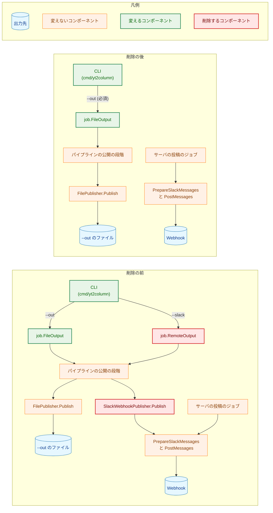
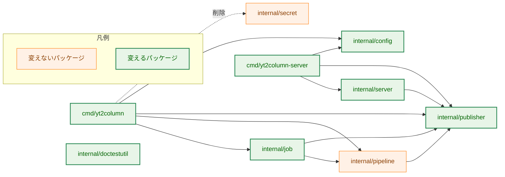
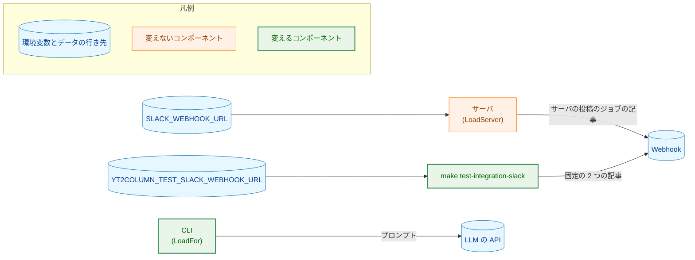
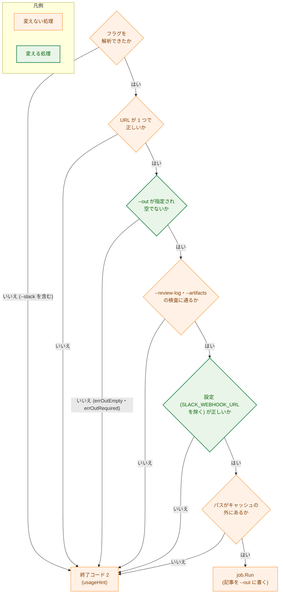

# 設計書：CLI の Webhook への投稿（`--slack`）と `SlackWebhookPublisher.Publish` の削除

## Document Status

| Item | Value |
|---|---|
| Status | `approved` |
| Created | 2026-11-04 |
| Review date | 2026-11-04 |
| Reviewer | isseis |
| Comments | - |

本書は [01_requirements.md](01_requirements.md) の設計である。要件定義から申し送られた設計事項は [design_handoff.md](design_handoff.md) にあり、その対応は 10 章にまとめる。本書が引用するファイルの行番号は、コミット `df190ddc`（本書の作成時の `main`）のものである。

本タスクは削除と簡素化のタスクである。新しいパッケージ・新しい依存は加えない。加える識別子は、CLI の `--out` が必須であることを示すセンチネルエラー 1 つと、`--out` を検査する関数 1 つ（3.1 節）だけである。用語は要件書 6 章に従う。本書では、ブラウザ拡張のビューアからのリクエストでサーバが記事を Webhook に投稿する処理を「サーバの投稿のジョブ」と呼ぶ。

## 1. 設計の全体像 (Design Overview)

### 1.1. 設計原則

-   **CLI の投稿だけが使うものは、型ごと削除する。** 分岐を無効にして残さない。値が 1 つしかなくなる列挙（CLI の `destination`、`job` の出力の種類 `outputKind`）も取り除く。
-   **型が守る不変条件は残す。** `job.Output` は、出力のパスと `Publisher` を同じコンストラクタ `FileOutput` で束ね、片方だけを設定した `Request` を作れなくしている（タスク 0006 `02_architecture.md` 3.8 節）。出力の種類がなくなっても、この束ねは残す（3.3 節）。
-   **サーバの投稿の経路は変えない。** サーバは `PrepareSlackMessages` で記事を検査・分割し、`PostMessages` で送る（`internal/server/publish.go:158-166`）。本タスクはこの経路に触れない（AC-22）。
-   **削除するテストが確かめていた振る舞いは、残る関数で確かめ直す。** 確かめ直すテストは、製品のコードを変えないコミットで先に加える。元のテストは、それが実行する関数を削除・書き換えるのと同じコミットで削除する（7.4 節）。
-   **削除したことの確かめは一度だけ行う。** 削除した識別子・フラグ・ターゲットがもうないことは、タスクの `_checks/` のスクリプトで、各 PR の head で一度だけ確かめ、恒久のテストにしない。恒久のテストには、最終的な仕様の規則だけを置く（0059 `02_architecture.md` 1.4 節と同じ方針）。

### 1.2. 概念モデル

図 1-1 は、記事が外へ出る経路を、削除の前と後で示す。矢印 A → B は「A が B へ記事かリクエストを渡す」を表す。赤い要素は本タスクで削除するもの、緑の要素は本タスクで変えるものである。Webhook は、記事の行き先として、データと同じ円柱で描く（図 5-1 の LLM の API も同じ）。



今の経路の根拠: CLI は `--slack` で `job.RemoteOutput` に `SlackWebhookPublisher` を渡し（`cmd/yt2column/run.go:653-658`）、パイプラインの公開の段階がその `Publish` を呼ぶ（`internal/pipeline/pipeline.go:116`）。`Publish` は `PrepareSlackMessages` と `PostMessages` を順に呼ぶ（`internal/publisher/slack.go:171-179`）。`job.FileOutput` は中身を変えないが、出力の種類の値を持たなくなるので「変える」に含める。

### 1.3. 設計の際に決めたこと（2026-11-04）

-   **PR は 2 つに分ける（H-06）。** PR-1 は CLI・設定・`internal/job`・`Makefile` の `test-integration-cli-slack`、`SlackMessageCount` の削除と、それに触れるテストと文書。PR-2 は `SlackWebhookPublisher.Publish` の削除、`Publish` を呼ぶテストと統合テストの書き直し、残りのコメントと文書（8 章）。理由: PR-1 の後は `Publish` を呼ぶのがテストだけになり、PR-2 の製品のコードの変更は `internal/publisher` の中で閉じる。差分を分けると、それぞれのレビューで確かめる観点が 1 つにまとまる。
-   **AC-01 は一度だけの確かめにする。** 未知のフラグを終了コード `2` で拒否し、副作用がないことは、今の恒久のテスト（`cmd/yt2column/run_test.go:510` の `--bogus` の行）が確かめている。`--slack` の各形（`--slack`・`-slack`・`=true`・`=false`、`--out` との同時指定、URL の後）が拒否されることは、`_checks/` のスクリプトで PR-1 の head で一度だけ確かめる（7.3 節）。理由: `--slack` の行を恒久のテストに置くと、削除したフラグの名前をテストが持ち続ける。AC-12 の「`--slack` を渡すのは AC-01 の拒否を確かめるテストだけ」は、恒久のテストに `--slack` を渡すものがない状態で満たされる。
-   **`publisher.SlackMessageCount` は削除する（H-01）。** テストでないコードで呼ぶのは CLI の `reportSuccess`（`run.go:854`）だけである。テストは `PrepareSlackMessages(a).Len()` で同じ数を確かめる。理由: 製品のコードで使わない公開の関数を、テストのためだけに残さない。
-   **`job.Output` と `FileOutput` は残し、`outputKind` と `RemoteOutput` だけを削除する（H-01）。** 理由: 出力の種類が 1 つになると `outputKind` は何も区別しなくなるが、パスと `Publisher` を束ねる `Output` は、片方だけを設定した `Request` を型で防いでいる（タスク 0006 `02_architecture.md` 3.8 節、CLAUDE.md「Enforce invariants with the type」）。`Request` に 2 つのフィールドを直接持たせると、この保証が実行時の検査に下がり、`internal/job/job_test.go` の `FileOutput(` の呼び出し 37 か所も書き換えることになる。
-   **CLI の `destination` の型は取り除く（H-04）。** 値が `destinationFile` だけになるので、`checkReviewLog`・`checkCacheDirs` は `--out` と常に比べる。`--out` は必須なので、比べる値はいつもある。AC-04 の振る舞いは変わらない。
-   **CLI のテストは `SLACK_WEBHOOK_URL` を設定したまま走らせる。** `newRunEnv`（`run_test.go:144`）は `SLACK_WEBHOOK_URL` に印の値を入れ続け、`secretStrings`（`run_test.go:86-89`）はその値、その値の末尾の 8 文字、`webhookPathMarker` を持ち続ける。理由: 削除の後、Webhook URL は伏せ字の対象から外れ（`run.go:335-336`）、「出力に書かない」は「読まない」だけに頼る。どの実行の行も、その値を出力に書かないことを確かめ続けるので、AC-07 の裏づけにもなる。これは CLI が変数を無視するという最終的な仕様の規則であり、廃止した仕様の確かめではない。

## 2. システム構成 (System Structure)

### 2.1. 全体の構成

図 2-1 は、本タスクに関わるパッケージの依存を示す。矢印 A → B は「A が B を import する」を表す。点線は本タスクで削除する依存である。緑は、製品のコード・テスト・コメントのいずれかを変えるパッケージである。



`internal/server` は `publish_test.go` だけを変える（AC-22）。`internal/doctestutil` は、文書のガードのテストが使う見出しの定数を持つ（`cmd/yt2column/docs_test.go` が使う）。

`cmd/yt2column` が `internal/secret` を使うのは、`newSlackPublisher` と `buildOutput` の引数の型だけである（`run.go:123`・`:154`・`:645`）。`cmd/yt2column/run.go` の import のうち、`net/http` は `rejectedPostStatus`（`:1042-1049`）だけが、`strconv` は `messageCount`（`:931`）だけが使うので、どちらも削除する。

### 2.2. コンポーネントの配置

| ファイル | 変更 | 内容 | PR |
|---|---|---|---|
| `cmd/yt2column/run.go` | 変更 | `--slack`、`cliOptions.slack`、`destination` の型、`errSlackFalse`・`errOutAndSlack`・`errNoDestination`・`errInvalidDestination`、`deps.newSlackPublisher`・`newSlackPublisher`、`chooseDestination`、`buildOutput`、`reportSuccess`・`reportReviewLogFailure`・`reportRunError`・`warnHTTP2Debug` の Webhook の分岐と `dest` の引数、`reportWebhookHints`・`rejectedPostStatus`・`messageCount`・`seconds` を削除する。`--out` の検査と `errOutRequired` を加える（3.1 節） | PR-1 |
| `cmd/yt2column/test_helpers.go`・`test_helpers_integration.go` | 変更 | `loopbackSlackPublisher`・`refusingSlackPublisher`・`childModeSlackStall`・`stallingPublisher`・`errSlackPublisherNotSubstituted`・`errLoopbackWebhookURL`・`loopbackPostTimeout`、`cliSlackDeepSeekOptions`・`gateCLISlackIntegration` を削除する | PR-1 |
| `cmd/yt2column/integration_slack_test.go` | 削除 | CLI の投稿の統合テスト | PR-1 |
| `cmd/yt2column/run_test.go`・`signal_test.go`・`cost_test.go`・`token_test.go`・`makefile_test.go`・`docs_test.go` | 変更 | 7.1 節の表のとおり。`run_test.go` の `useWebhook`・`webhookServer`・`runEnv.webhook`・`failMessage` も削除する | PR-1 |
| `internal/job/job.go`・`job_test.go`・`test_helpers.go` | 変更 | `outputKind` とその定数、`Output.kind`、`RemoteOutput` を削除する。`validateRequest`・`precheckOutput` から種類の分岐を除く（3.3 節） | PR-1 |
| `internal/config/config.go`・`config_test.go`・`envaccess_test.go` | 変更 | `Config.slackWebhookURL`・`SlackWebhookURL`・`RequireSlackWebhookURL` と、`LoadFor` の `loadSlackWebhook` の呼び出しを削除する。`slackEnv`・`loadSlackWebhook`・`LoadServer` は残す（3.2 節） | PR-1 |
| `internal/publisher/testutil/integration.go`・`integration_settings_test.go` | 変更 | `CLISlackOptInEnv`・`CLISlackIntegrationOptions` を削除する | PR-1 |
| `internal/publisher/slack_message.go` | 変更 | `SlackMessageCount` を削除する（PR-1。CLI が最後の呼び出し元のため）。`Publish` に触れる説明を、サーバの投稿の経路の説明に直す（PR-2） | PR-1・PR-2 |
| `internal/publisher/slack_message_test.go` | 変更 | `TestSlackMessageCount` を直す（7.1 節） | PR-1 |
| `internal/publisher/slack_test.go` | 変更 | `SlackMessageCount` の呼び出しを直す（PR-1）。`Publish` を呼ぶテストを直す（PR-2、7.2 節） | PR-1・PR-2 |
| `internal/publisher/slack_integration_test.go` | 変更 | `SlackMessageCount` の呼び出しを直す（PR-1）。`PrepareSlackMessages` → `PostMessages` で投稿する（PR-2、3.5 節） | PR-1・PR-2 |
| `internal/doctestutil/guides.go` | 変更 | `DevCLIWebhookIntegrationHeading`（`guides.go:29-31`）を削除する。使うのは `TestDeepSeekDocsContract` の `cli_slack` の行（`docs_test.go:215-217`）だけである | PR-1 |
| `Makefile` | 変更 | `test-integration-cli-slack` と `CLI_SLACK_INTEGRATION_TIMEOUT`、`.PHONY` と `lint` の注釈の該当箇所を削除する | PR-1 |
| `internal/publisher/slack.go`・`publisher.go` | 変更 | `Publish`、`var _ Publisher = (*SlackWebhookPublisher)(nil)` を削除し、型とパッケージの説明を直す（3.4 節） | PR-2 |
| `internal/publisher/test_helpers_slack.go` | 変更 | 説明だけを直す（3.5 節、7.2 節） | PR-2 |
| `internal/server/publish_test.go` | 変更 | `TestPublishPostsLikeCLI` を書き直す（7.2 節）。製品のファイルは変えない（AC-22） | PR-2 |
| `cmd/yt2column-server/run.go`・`run_test.go` | 変更 | CLI の `--slack` に触れるコメント（`run.go:60-62`、`run_test.go:374`）を直す | PR-2 |
| `docs/dev/guides/cli.md`・`docs/dev/guides/development.md`・`docs/dev/security.md`・`docs/dev/conventions/package_reference.md`・`docs/dev/project_overview.md`・`docs/dev/production_profile.md`・`CLAUDE.md`・`README.md`・`README.en.md`・`docs/translation_glossary.md` | 変更 | 3.6 節 | PR-1・PR-2 |
| `docs/tasks/0062_remove_cli_slack/_checks/` | 新規 | 一度だけの確かめのスクリプト（7.3 節）と、網羅率の比べ方のスクリプト（7.4 節） | PR-1・PR-2 |

拡張（`extension/`）と、`internal/server` の製品のファイルは変えない（AC-22）。

`make deadcode` は関数だけを報告し、`unused` は公開の識別子を報告しない。使われなくなる公開の定数・変数（`DevCLIWebhookIntegrationHeading`、`CLISlackOptInEnv` など）は、この表と H-01 の一覧で削除を決める。

## 3. コンポーネント設計 (Component Design)

### 3.1. CLI（`cmd/yt2column`）

**出力先の検査。** `chooseDestination` の代わりに、`--out` だけを検査する関数を置く。指定されたかどうかは、今ある `flagGiven(fs, "out")`（`run.go:243`）で判断し、値の中身では選ばない（今の `chooseDestination` と同じ方針）。指定がなければ `errOutRequired`、指定されて値が空なら `errOutEmpty` を返す。

```go
// cmd/yt2column

var (
	errOutEmpty    = errors.New("--out needs a path")
	errOutRequired = errors.New("--out is required") // replaces errNoDestination
)
```

`errOutRequired` は AC-02 専用のセンチネルエラーで、`errors.Is` で見分ける。関数の名前と文言は計画で決めてよい。

**記事の出力。** `buildOutput` は削除し、`run` が `job.FileOutput(outPath, d.newFilePublisher(outPath))` を直接作る。

**削除する分岐。** 2.2 節の表のとおり。削除の後、`run` は設定を読んだ後に Webhook URL を受け取らず、標準エラーの伏せ字の対象は API キーだけになる（`run.go:335-336`）。`warnHTTP2Debug` は API キーの 1 行だけを書く（AC-05）。`reportSuccess` は「記事をファイルに書いた」行だけを書き、`reportReviewLogFailure` は記事を `--out` に書いたことだけを述べる。行の文言は今のファイルの場合の行と同じで、AC-04 の振る舞いは変わらない。これらの関数の説明のコメントは、関数を書き換えるのと同じコミットで直す。

**使い方。** `writeUsage`（`run.go:254-271`）の説明を、記事を `--out` のファイルに書くこと、`--out` が必須であることに改める（AC-03）。フラグの一覧は `newFlagSet` から作るので、`--slack` の定義を除けば一覧からも消える。

**AC-01 の振る舞い。** `--slack` は `newFlagSet` で定義されないので、URL より前にあれば `fs.Parse` が未知のフラグの誤りを返し、`usageError` が終了コード `2` で `usageHint` とともに書く（`run.go:296-304`）。URL より後にあれば、フラグの解析が URL で止まり、引数の数の誤りになる（`:308-310`）。どちらも手順 A1・A2（`run` の手順の番号。`run.go:287-310` のコメントによる。図 6-1 の最初の 2 つの判定）で終わり、設定、キャッシュ、`yt-dlp`、LLM、`--out` に触れない。専用の拒否は加えない（要件書 1 章）。

### 3.2. 設定（`internal/config`）

`Config` から `slackWebhookURL` のフィールドと、`SlackWebhookURL`・`RequireSlackWebhookURL` を削除する。`LoadFor`（`config.go:472-488`）は `loadSlackWebhook` を呼ばない。そのため、CLI の実行は `SLACK_WEBHOOK_URL` を `lookup` に問い合わせず（AC-06）、不正な値でも設定エラーにしない（AC-07）。

`LoadServer`（`:381-399`）、`loadSlackWebhook`（`:717-735`）、`slackEnv`、`ServerConfig.WebhookURL` は変えない（AC-08・AC-10）。`loadSlackWebhook` の説明の「Load and LoadServer」は `LoadServer` だけに直す。

### 3.3. ジョブ（`internal/job`）

`outputKind` とその定数（`job.go:28-36`）、`Output.kind`、`RemoteOutput`（`:54-57`）を削除する。`Output`（非公開の `path` と `pub`）と `FileOutput(path, p)` は残す（1.3 節）。

```go
// internal/job

// Output is where Run publishes the article: a local file and the Publisher
// that writes it. The zero value is invalid, so a Request whose output was
// never chosen cannot run.
type Output struct {
	path string
	pub  publisher.Publisher
}

func FileOutput(path string, p publisher.Publisher) Output
```

`validateRequest`（`job.go:175-202`）は、`Output` のパスが空なら、また `pub` が `nil`（型付きの `nil` を含む。`nilcheck.IsNil`）なら、今と同じ `errInvalidRequest` で拒否する。ゼロ値の `Output` はパスが空なので拒否され、「出力を選ばなかった `Request` は走らない」という今の保証は保たれる。`precheckOutput`（`:209-222`）は種類で分岐せず、出力のパスを常に事前に確かめる（今のファイルの出力の場合と同じ）。

### 3.4. 投稿する型（`internal/publisher`）

削除の後の `SlackWebhookPublisher` は次のとおりである。`publisher.Publisher` を満たさない（AC-09）。`FilePublisher.Publish` と `Publisher` インターフェイスは変えない。

```go
// internal/publisher

// SlackWebhookPublisher posts prepared messages to a Slack-compatible
// Incoming Webhook. It does not implement Publisher.
type SlackWebhookPublisher struct { /* unexported fields unchanged */ }

func NewSlackWebhookPublisher(webhookURL secret.Secret) (*SlackWebhookPublisher, error)
func (p *SlackWebhookPublisher) PostMessages(ctx context.Context, m SlackMessages, from int, delivered func(index int)) error
```

`webhookClient.configured` は `PostMessages` が使い続けるので残る（`slack.go:189`）。次の説明を直す（AC-20）。

-   パッケージの説明（`publisher.go:1-3`）: `Publisher` を実装するのはファイルへの保存であり、Webhook への送信は `PrepareSlackMessages` と `PostMessages` が担う。
-   `slack.go` の型の説明（`:138-141` の「Publish on the zero value fails」）と `webhookClient.post` の説明（`:226-228` の「move in from Publish」）。
-   `slack_message.go` の「`Publish` が送る」という説明（`:24`・`:43`・`:60`・`:73`・`:94` など）は「`PostMessages` が送る」に直す。

### 3.5. 統合テスト（`make test-integration-slack`、H-05）

`TestIntegrationSlackWebhookPublisher` は、2 つの記事それぞれを `PrepareSlackMessages` で検査・分割し、通数を確かめる。すべての記事の通数を、何かを送る前に確かめるという今の順序（`slack_integration_test.go:46-58`）は保つ。その後、検査に通った `SlackMessages` の値そのものを `PostMessages(ctx, m, 0, …)` で送り、`delivered` が `m.Len()` 回呼ばれたことを確かめる。同意の変数の確認、URL の読み出し、`http2debug` が有効なときに送らずに失敗する処理は `publishertestutil.SettingsFrom` が行い、変えない（AC-16）。

時間の上限: `make test-integration-slack` の `SLACK_INTEGRATION_TIMEOUT` は、`internal/publisher/makefile_test.go:36` が `SlackPublishMaxDurationForTest`（`test_helpers_slack.go:91-97`）と比べている。この式は通数ごとの送信の上限と間隔から求めるもので、`Publish` の前提を含まない。`PostMessages` も同じ上限と間隔で送る（`slack.go:181-215`）。`Makefile` の注釈（`Makefile:281-288`）も通数と上限だけを述べる。したがって、式と注釈は変えない。補助の名前の `Publish` は「投稿する」の意味で残し、説明の「production publisher」だけを `PostMessages` に合わせる。

### 3.6. 文書（F-005）

文書は AC-17〜AC-21 のとおりに書き換える。PR の割り当ては次のとおりである。

-   **PR-1:** `docs/dev/guides/cli.md`、`README.md`・`README.en.md`（`/mktrans`）、`docs/translation_glossary.md`、`docs/dev/guides/development.md` の `test-integration-cli-slack` の記述、`docs/dev/security.md` §2 の表と `GODEBUG` の項、`docs/dev/conventions/package_reference.md` の `cmd/yt2column`・`internal/job`・`internal/config`（`:32`）の行、`docs/dev/project_overview.md` の冒頭と `SLACK_WEBHOOK_URL` の行、`docs/dev/production_profile.md`、`CLAUDE.md` の「Tool Execution Safety」。`TestSlackDocsContract`（`cmd/yt2column/docs_test.go:136-165`）は、`CLISlackIntegrationOptions` と `CLISlackOptInEnv` を除いた値を文書と比べる（AC-21）。このガードが `test-integration-cli-slack` を求めなくなるのは `Makefile` と同じコミットである。
-   **PR-2:** `CLAUDE.md` の「Architecture Overview」の `Publisher` の項、`docs/dev/project_overview.md` の `Publisher` の初期実装の項（`:75-76`）、`docs/dev/conventions/package_reference.md` の `internal/publisher` の行、`make test-integration-slack` の説明（`development.md`、`security.md` §2）。

`CLAUDE.md` の「Tool Execution Safety」は、本物の Webhook への投稿（サーバの投稿のジョブと `make test-integration-slack`）に承認が要ることを保つ。

## 4. エラーハンドリング設計 (Error Handling Design)

| 変更 | エラー | 場所 |
|---|---|---|
| 加える | `errOutRequired`（`--out` の指定がない） | `cmd/yt2column` |
| 削除する | `errSlackFalse`・`errOutAndSlack`・`errNoDestination`・`errInvalidDestination` | `cmd/yt2column/run.go:175-179` |
| 変えない | `errOutEmpty`、`--review-log`・`--artifacts`・キャッシュのディレクトリの拒否 | `cmd/yt2column/run.go` |
| 変えない | `errInvalidRequest`（`Output` のパスが空、`Publisher` が `nil`） | `internal/job` |
| 変えない | `SlackPostError`・`SlackHTTPStatusError`・`ErrSlackMention` などの `internal/publisher` のエラー | サーバが使い続ける。CLI だけが参照しなくなる（AC-05） |

使い方と設定の誤りの報告の形（終了コード `2`、`usageHint` の行）、実行の失敗の報告（終了コード `1`）は変えない。

## 5. セキュリティ考慮事項 (Security Considerations)

本タスクは Webhook URL の扱いと Webhook への送信の経路を変えるので、`docs/dev/security.md` を適用する。図 5-1 は、削除の後に Webhook URL を受け取るものと Webhook へ送るものを示す。矢印 A → B は「A から B へデータが渡る」を表す。



-   **送信の経路:** CLI のプロセスが自分で HTTP で送る先は LLM の API だけになる。`cmd/yt2column` は `SlackWebhookPublisher` を作らない（AC-05）。製品のコードで Webhook へ送るのはサーバの投稿のジョブだけである。
-   **秘密情報:** `SLACK_WEBHOOK_URL` はプロセスの環境には残りうるが、CLI は次の 3 点でその値を使わない。
    -   `LoadFor` は `lookup` にこの名前を問い合わせない（3.2 節、AC-06）。
    -   `yt-dlp` に渡す環境は許可した変数の一覧（`internal/transcript/exec.go:44`）から作り（`exec.go:217-231`）、この名前は一覧にないので、子プロセスに渡らず、`yt-dlp` の標準エラーの伏せ字の対象にもならない。
    -   出力のどの経路もこの値を受け取らない。伏せ字の対象から Webhook URL がなくなるが、値を持たないので書く経路もない。これは、`SLACK_WEBHOOK_URL` を設定したまま走る CLI のテストが、すべての実行の行で確かめ続ける（1.3 節、7.1 節）。
-   **`GODEBUG=http2debug`:** CLI の警告は API キーの 1 行だけになる（AC-05）。サーバの警告は変えない。
-   **統合テスト:** `security.md` §2 の規則（本番の `SLACK_WEBHOOK_URL` を読まない、URL がないときと `http2debug` が有効なときは送らずに失敗する、出力に URL を書かない）は `publishertestutil.SettingsFrom` と `PostMessages` のエラーの形が保ち、変えない（3.5 節）。
-   **フェイルクローズ:** CLI に `--slack` が残っていると誤解して実行しても、未知のフラグとして副作用の前に拒否される（3.1 節）。

## 6. 処理フローの詳細 (Processing Flow Details)

図 6-1 は、削除の後の CLI の手順のうち、副作用の前の検査（手順 A1〜A4）を示す。保存した出力のディレクトリ（`--artifacts`）を開く手順 A4.5 と、それより後の失敗は今と同じなので省く。矢印は処理の順序を表す。緑の要素が本タスクで変える判定である。



今との違いは、出力先の選択が `--out` の検査になること（`run.go:315-318`）と、設定が Webhook URL を読まず、必須ともしないこと（`:331-341`）の 2 点だけである。

## 7. テスト戦略 (Test Strategy)

テストは次の 3 つに分ける（H-02）。

-   **削除する:** CLI の投稿・`--slack`・CLI の `SLACK_WEBHOOK_URL` の読み出しだけを確かめるテストと、残るテストと重複するテスト。
-   **確かめ直す:** 残る振る舞いを `Publish`・`Load`・Webhook を通して確かめていたテスト。同じ観点を `PrepareSlackMessages`・`PostMessages`・`LoadServer`・`--out` で確かめる。
-   **値を直す:** 削除したものを参照するテストの補助と行。

### 7.1. PR-1 のテスト

| テスト | 扱い |
|---|---|
| `cmd/yt2column/run_test.go` の `TestRunSlackFailureHints`・`TestRunSlackSignalAfterPosting`・`TestRunSlackSummaryUnknownCount`・`TestNewSlackPublisherNilOnFailure`・`TestTestDepsSlackPublisherDoesNotSend`、補助 `rejectedMention`・`slackUsageRow` | 削除する |
| `run_test.go` の `executionPathRows` の Webhook の行（`--slack` の組み合わせ、`SLACK_WEBHOOK_URL` の不正な値の行 `:523-525` など） | 削除する。`neither --out nor --slack` の行は、`--out` がない実行が拒否される行に直す（AC-02） |
| `run_test.go` の `TestRunGODEBUGWarning`・`TestRunHelp`・`TestRunEscapesUntrustedText`・`TestRunReviewLog`・`TestRunReviewLogFailure`・`TestRunExecutionPaths`・`TestRunPromptOverrides`・`TestRunRejectsInvalidEffortPart`・`TestRunDefaultWriterOptions`、`seedCache` | Webhook の場合の行と設定を除く。`TestRunGODEBUGWarning` は警告が 1 行であることを確かめる（AC-05）。`newRunEnv` と `secretStrings` は `SLACK_WEBHOOK_URL` の印の値を持ち続ける（1.3 節） |
| `run_test.go` に加えるテスト | `--out` の検査の関数の単体テスト（指定がないと `errors.Is(err, errOutRequired)`、空の値で `errOutEmpty`。AC-02）。`SLACK_WEBHOOK_URL` が不正な値でも `--out` の実行が未設定の場合と同じ結果になる行（AC-07）。`lookup` に `SLACK_WEBHOOK_URL` が問い合わせられないこと（AC-06。問い合わせた名前を記録する `lookup` で確かめる） |
| `cmd/yt2column/signal_test.go` の `TestSignalDuringSlackPost` | 削除する。シグナルの扱いは `TestSignalDuringYtDlp`（`signal_test.go:113`）・`TestSignalDuringGenerate`（`:148`）が確かめる。公開の段階で止まっている間のシグナルを確かめるテストはなくなる。ファイルへの保存は待ち状態にならず、その間のシグナルを再現する手段もないためである |
| `cost_test.go` の `TestRunCostLinesFailure/publish failure after every stage`（`:577-587`）と `TestRunCostLinesReviewLogFailure`（`:616`）、`token_test.go` の `TestRunTokenLinesAfterAllCalls/publish failure`（`:283-300`）と `TestRunTokenLinesReviewLogFailure`（`:484`） | 確かめ直す。どれも、すべての段階の後に公開が失敗する経路として Webhook を使っている（`--out` の既存のファイルは事前の確かめで止まる。`token_test.go:288-289`）。`--out` の実行で `d.newFilePublisher` を差し替え、すべての段階が終わった後の公開で失敗する `Publisher` を返す形に直す。検証・推敲のログの失敗のテストでは、`Publish` が成功した後にログの書き込みを失敗させる `Publisher` を返す（`run_test.go:728-739` と同じ形） |
| `cost_test.go`・`token_test.go` のそのほかの Webhook の行 | 除く |
| `makefile_test.go` の `TestMakeTestIntegrationCLISlack`・`TestCLISlackIntegrationSettings`・`TestCLISlackIntegrationTestBuildTag`、`TestMakeOptInsAreTargetSpecific`・`TestMakeTargetsDoNotReadRetiredModelEnv` の該当行 | 削除する・行を除く |
| `docs_test.go` の `TestSlackDocsContract`・`TestDeepSeekDocsContract` | CLI の投稿の値と `cli_slack` の行を除く（AC-21） |
| `internal/job/job_test.go` の `TestRunRemoteOutput`、`remote output` の行（`:927-931`） | 削除する。ゼロ値の `Output`、パスが空、`Publisher` が `nil` の拒否は今の表の行で確かめる |
| `internal/config/config_test.go` の `TestRequireSlackWebhookURL` | 削除する |
| `config_test.go` の `TestLoadSlackWebhookAccepted`（`:592`）、拒否の表の `slack webhook` の行（`:188`）、伏せ字の表の `slack webhook` の行（`:728-732`） | `LoadServer` で確かめ直す。`TestLoadServerWebhookOptional`（`:1015`）は不正な値を 1 つしか確かめないので、受理する 5 つの値、拒否の値、伏せ字の値のすべてを `LoadServer` に移す |
| `config_test.go` の `TestLoadValid` などの `SlackWebhookURL` の確かめ | 除く。`Load` が不正な `SLACK_WEBHOOK_URL` を拒否しないことを確かめる行を加える |
| `internal/publisher/slack_message_test.go` の `TestSlackMessageCount` | `PrepareSlackMessages(a).Len()` を確かめる形に直す（今の `TestPrepareSlackMessages*` と重複する行は除く） |
| `internal/publisher/slack_test.go`（`:589`）・`slack_integration_test.go`（`:50-55`）の `SlackMessageCount` の呼び出し | `PrepareSlackMessages(a).Len()` に直す |
| `internal/publisher/testutil/integration_settings_test.go` の `other_opt_in_only` の行 | `CLISlackOptInEnv` の代わりに、テストのためだけの別の名前で確かめる |

### 7.2. PR-2 のテスト

`slack_test.go` の `Publish` を呼ぶテストは、`PrepareSlackMessages` の検査と、準備したメッセージを `PostMessages` で送る既存の補助 `postFrom`（`slack_test.go:1269`）で確かめ直す。新しい補助は加えない。各テストは、確かめる観点に応じて次のどれかにする（AC-15）。

| テスト | 扱い |
|---|---|
| `TestSlackPublishPayload`・`TestSlackPublishCostLine`・`TestSlackPublishSplit` | 送信の形・費用の行・分割を、`PrepareSlackMessages` の結果を `postFrom` で送って確かめる |
| `TestSlackPublishPrepareSendsNothing` | `PrepareSlackMessages` の拒否で確かめ直す。拒否が `*SlackPostError` でないことを確かめる。拒否のとき送るメッセージがないので、サーバが受け取らないことは確かめる対象にならない |
| `TestSlackPublishWaitsBetweenMessages`・`TestSlackPublishResponses`・`TestSlackPublishRedirect`・`TestSlackPublishTimeout`・`TestSlackPublishBodyFailures`・`TestSlackPublishCanceled`・`TestSlackPublishErrorsOmitWebhookURL`・`TestSlackPublishTransportErrorWithheld`・`TestSlackPublishErrorClasses` | 送信の順序と間隔、応答の扱い、通信の失敗、URL を出さないことを、`postFrom` で確かめる。名前の `Publish` は `Post` に改める |
| `TestSlackPublishPartialFailure`（`:1054`） | 削除する。送信の途中の失敗とその数は `TestPostMessagesFailureCountsFromFirst`（`:1321`）の行が、`ErrSlackHTTPStatus` の分類は `TestSlackPublishErrorClasses` が、エラーの文の「posted N of M」は `slack_errors_test.go:21`・`:26` が確かめる |
| `TestSlackPublishZeroValue`（`:1167`） | 削除する。ゼロ値の拒否は `TestPostMessagesRejectsWithoutSending` の `zero value publisher` の行（`slack_test.go:1446-1452`）が確かめる |
| `TestSlackMessagesForTest`、`slack_articles_test.go`、`makefile_test.go` | 変えない。`slack_articles_test.go` は `Publish` を呼ばない（H-02 の前提の訂正）。`SlackMessagesForTest` の説明だけを直す（`test_helpers_slack.go:73-76`） |
| `internal/server/publish_test.go` の `TestPublishPostsLikeCLI`（`:72-94`） | 書き直す。比べる相手を `hook.publisherFor(t).Publish(...)` から `publisher.SlackMessagesForTest(article)` に変え、名前を CLI に触れないものに改める。準備した 3 通のメッセージがそのまま送られて成功することと、成功のログの行の `posted=3`・`total=3` は、ほかのテストが確かめないので、この 2 つの確かめを残す |
| `internal/publisher/slack_integration_test.go` | 3.5 節 |

### 7.3. 一度だけの確かめ（`_checks/`）

0059 と同じく、Go のプログラムを `docs/tasks/0062_remove_cli_slack/_checks/` に置き、1 行目を `//go:build test` にして `go run -tags test` で動かす。名前の衝突を避けるため、識別子は文字列の検索ではなく `go/parser`・`go/ast` でパッケージと識別子を読む。文字列を探す確かめは、`docs/tasks/**/_checks` を探す範囲から除く（確かめのプログラム自身が探す語を持つため）。各 PR の head で一度実行し、結果を計画に記録する。

-   **PR-1:**
    -   ビルドした CLI を、`--slack` の各形（AC-01 の列挙）で実行し、終了コード `2` と、キャッシュのディレクトリ・`yt-dlp`・`--out`・Webhook に触れないことを確かめる。合格の条件は、終了コードが `2` であること、偽の `yt-dlp` の印のファイルがないこと、ループバックのリスナーがリクエストを受けていないことのすべてであり、0 以外の終了コードだけでは合格としない。子プロセスの環境は親から何も引き継がず、明示して作る: 偽の API キー、一時のディレクトリの `YT2COLUMN_CACHE_DIR`、印のファイルを作る偽の `yt-dlp` を指す `YT2COLUMN_YTDLP_PATH`、受けたリクエストを記録するループバックのリスナーを指す `SLACK_WEBHOOK_URL`。この環境で走らせるので、merge-base の CLI で同じ確かめを実行して失敗することも、本物の LLM や Webhook に触れずに示せる。
    -   対照として、同じ環境で `--slack` を付けない `--out` だけの実行が偽の `yt-dlp` の印に届くことを確かめる。これで、拒否が設定の誤り（手順 A3）ではなく手順 A1・A2 で起きていることを示す。
    -   `cmd/yt2column` に AC-05・AC-12 の識別子がないこと、`config.Config` に AC-10 のメソッドがないこと、`Makefile` と Go のコードに AC-11 のターゲットと変数がないこと、`extension/` と `internal/server/` の製品のファイルが merge-base から変わらないこと（AC-22）を確かめる。
-   **PR-2:** `SlackWebhookPublisher` に `Publish` がないこと（AC-09）、Go のコメントが `SlackWebhookPublisher.Publish` と CLI の `--slack` に触れないこと（AC-20）、AC-22 を再び確かめる。AC-20 の語の一覧は、実装の前に計画で決める。確かめは PR-2 の merge-base と、PR-1 より前の `main` でも実行し、どちらでも失敗することを記録する（PR-1 で書き直したコメントも、確かめが基準で失敗することを示すため）。AC-20 の文の確かめは、PR のレビューで読むこと（`manual`）が主であり、このスクリプトはその補いである。

### 7.4. コミットの分け方と網羅率の比べ方（AC-14、H-06）

**規則:** テストを削除できるのは、そのテストが実行する関数を削除・書き換えるのと同じコミットか、それより後である。HEAD に残る関数を実行するテストを先に削除すると、その関数の網羅率が下がり、`make coverage-compare` が `FAIL` になる（0055 の AC-10）。新しい振る舞いを確かめるテスト（AC-06・AC-07 の行、`Load` が `SLACK_WEBHOOK_URL` を拒否しない行、`--out` の検査の関数のテスト）は、今の製品のコードでは失敗するので、製品のコードを変えるコミットに入れる。

各 PR のコミットは次の順に分ける。細部は計画で決める。

1.  **テストの移し替えのコミット:** 製品のコードを変えずに、変更の前と後のどちらでも成り立つテストを加える・直す（`LoadServer` での確かめ直し、`SlackMessageCount` の代わりの確かめ、費用とトークンの行の確かめ直し、PR-2 の `PrepareSlackMessages`・`postFrom` のテストと `TestPublishPostsLikeCLI` の書き直し）。書き直すテストは新しい名前で加え、元のテストは、それが実行する関数を削除するコミットまで残す。親のコミットを `BASE` にした `make coverage-compare` が `PASS` で終わり、その出力をコミットメッセージと PR の説明に書く。
2.  **関数をまるごと削除するコミット（PR-2）:** `Publish` と `var _ Publisher` の行を削除し、同じコミットで `Publish` を呼ぶテスト（`TestSlackPublishZeroValue`・`TestSlackPublishPartialFailure` を含む）を削除し、統合テストを書き直す。残る関数の中は書き換えない。`make coverage-compare` で確かめる（削除した関数は失敗ではなく一覧に挙がり、関数の外の行は数えない。`internal/coveragecompare/classify.go`）。
3.  **残る関数を書き換える削除のコミット（PR-1）:** CLI・`internal/config`・`internal/job` の削除と、それらが実行していたテストの削除を同じコミットで行う。`SlackMessageCount`・`CLISlack*`・`DevCLIWebhookIntegrationHeading`・`Makefile` のターゲットと、それらを参照する `makefile_test.go`・`docs_test.go` の行も、`make test` が通るように同じコミットに入れる。PR-1 には、テストだけを削除するコミットはない。`make coverage-compare` は書き換えた関数で止まる（0055 `01_requirements.md` 1 章）ので、本タスクの `_checks/coverage/` のスクリプトで比べる。スクリプトは 0059 のもの（`docs/tasks/0059_remove_legacy_articles_api/_checks/coverage/main.go`、関数を (パッケージ, レシーバ, 名前) で対応づける）を写す。ただし、比べる値は、四捨五入した網羅率の割合ではなく、2 つの coverprofile から求めた関数ごとの「実行されなかった文の数」にする。削除だけの書き換えでは、この数は増えない。数が増えた関数がないことを合格の条件とし、削除した関数と加えた関数を挙げる。どちらの実行も `-count=1` で、各コミットのクリーンな作業ツリーから取る。

コメントの書き直し（AC-20）は 1・2 のコミットに混ぜない。3 のコミットは、書き換える関数の中のコメントを同じコミットで直してよい。

### 7.5. 受け入れ基準の確かめの方法

| 確かめ方 | 対象の AC |
|---|---|
| 単体テスト（7.1 節・7.2 節） | AC-02〜AC-07、AC-15 |
| 既存のテストがそのまま通ること | AC-04、AC-08（サーバのテスト） |
| 一度だけの確かめ（7.3 節） | AC-01、AC-05、AC-09〜AC-12、AC-20、AC-22 |
| `make deadcode` | AC-13 |
| コミットごとの網羅率の比較（7.4 節） | AC-14、AC-15 |
| ガードのテスト・`make readme-sync-check` | AC-18、AC-21 |
| `publishertestutil.SettingsFrom` の単体テスト（`internal/publisher/testutil/integration_settings_test.go`） | AC-16 の、送らずに失敗する条件と URL を書かないこと |
| 統合テスト（利用者の承認の後に実行） | AC-16 の、本物の Webhook への投稿 |
| PR のレビューで読む（`manual`） | AC-17〜AC-20 の文 |

## 8. 実装の優先順位 (Implementation Priorities)

1.  **PR-1: CLI の投稿の削除**
    -   テストの移し替え（`LoadServer` の確かめ、`SlackMessageCount` の代わりの確かめ、費用とトークンの行の確かめ直し）
    -   `cmd/yt2column`・`internal/config`・`internal/job` の削除と、それらのテストの削除、AC-02・AC-06・AC-07 のテストの追加。`SlackMessageCount`・`CLISlack*`・`DevCLIWebhookIntegrationHeading`・`Makefile` のターゲットの削除
    -   PR-1 の文書（3.6 節）と一度だけの確かめ
2.  **PR-2: `SlackWebhookPublisher.Publish` の削除**
    -   `slack_test.go` の確かめ直し、`TestPublishPostsLikeCLI` の書き直し
    -   `Publish` の削除とそれを呼ぶテストの削除、統合テストの書き直し、コメントの書き直し
    -   PR-2 の文書と一度だけの確かめ

PR-1 の後、`Publish` を呼ぶのは `internal/publisher` と `internal/server` のテストだけになる。`make deadcode` はテストからの到達を数えるので、PR-1 の時点でも通る。PR-1 は `slack_integration_test.go` の `SlackMessageCount` の呼び出しも直す。このファイルは `integration` のタグでだけビルドされるが、`make lint` は `go vet -tags integration ./...` を実行する（`Makefile:314-322`）。

## 9. 将来の拡張 (Future Extensibility)

-   CLI から投稿を確かめる必要が再び生じたときは、CLI に投稿を戻すのではなく、サーバのジョブの API を使う。
-   CLI に第 2 の出力先を加えるときは、`job.Output` の中に出力の種類を宣言するフィールドを戻す（CLAUDE.md「Declare, don't infer」）。`Request` の形は変えずに済む。

## 10. 設計への申し送りへの対応 (Design Handoff)

| 項目 | 対応 |
|---|---|
| H-01 使われなくなる関数・型 | `job.RemoteOutput`・`outputKindRemote` は `outputKind` ごと削除し、`Output` と `FileOutput` は残す（1.3 節、3.3 節）。`SlackMessageCount` は削除（1.3 節）。`loopbackSlackPublisher`・`refusingSlackPublisher`・`childModeSlackStall`・`stallingPublisher`・`CLISlackIntegrationOptions`・`CLISlackOptInEnv`・`cliSlackDeepSeekOptions`・`gateCLISlackIntegration`・`DevCLIWebhookIntegrationHeading` は削除（2.2 節）。公開の定数・変数は `make deadcode` が報告しないので、2.2 節の表で決める |
| H-02 `Publish` を使うテストの書き直し | 7.2 節。既存の補助 `postFrom` で確かめ直し、`PostMessages` の既存のテストと重複する `TestSlackPublishZeroValue`・`TestSlackPublishPartialFailure` は削除する。`slack_articles_test.go` は `Publish` を呼ばないので変えない |
| H-03 `--slack` の拒否の確かめ方 | 未知のフラグの拒否は既存の恒久のテスト、`--slack` の各形は一度だけの確かめ（1.3 節、7.3 節）。エラーの文言には頼らず、終了コードと副作用で確かめ、対照の実行で拒否が手順 A1・A2 で起きることを示す |
| H-04 `checkReviewLog` と `checkCacheDirs` の引数 | `destination` を取り除き、`--out` と常に比べる（1.3 節） |
| H-05 `make test-integration-slack` の書き直し | 3.5 節。`SlackPublishMaxDurationForTest` と `SLACK_INTEGRATION_TIMEOUT` の注釈は `Publish` を前提にしていないので変えない |
| H-06 コミットの分け方と網羅率の比べ方 | 7.4 節。PR は 2 つ（1.3 節） |

## 11. 受け入れ基準と設計の対応 (AC Traceability)

| AC | 設計 |
|---|---|
| AC-01 | 3.1 節、6 章、7.3 節 |
| AC-02 | 3.1 節、4 章、7.1 節 |
| AC-03 | 3.1 節 |
| AC-04 | 3.1 節、1.3 節（H-04） |
| AC-05 | 3.1 節、5 章、7.1 節、7.3 節 |
| AC-06 | 3.2 節、5 章、7.1 節 |
| AC-07 | 3.2 節、1.3 節、7.1 節 |
| AC-08 | 3.2 節 |
| AC-09 | 3.4 節、7.3 節 |
| AC-10 | 3.2 節、7.3 節 |
| AC-11 | 2.2 節、7.3 節 |
| AC-12 | 1.3 節、2.2 節、7.3 節 |
| AC-13 | 2.2 節、10 章（H-01）、7.5 節 |
| AC-14 | 7.4 節 |
| AC-15 | 7.2 節、7.4 節 |
| AC-16 | 3.5 節、7.5 節 |
| AC-17〜AC-19 | 3.6 節 |
| AC-20 | 3.4 節、7.3 節 |
| AC-21 | 3.6 節 |
| AC-22 | 2.2 節、7.3 節 |

## 変更履歴

- 2026-11-04 承認（isseis、#668）
