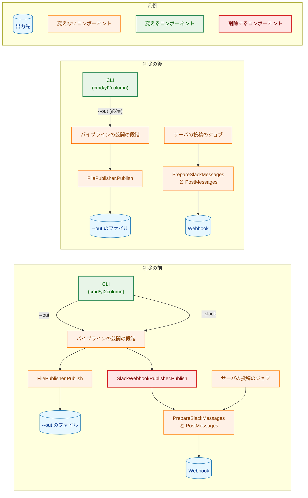
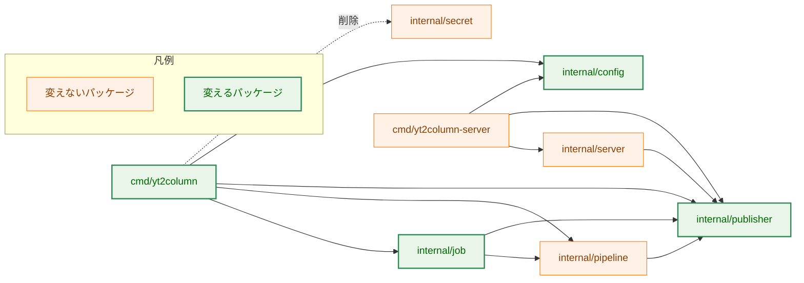
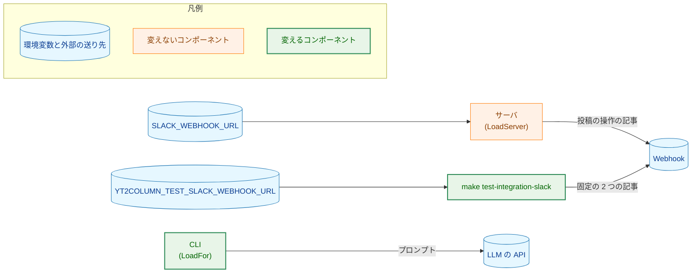
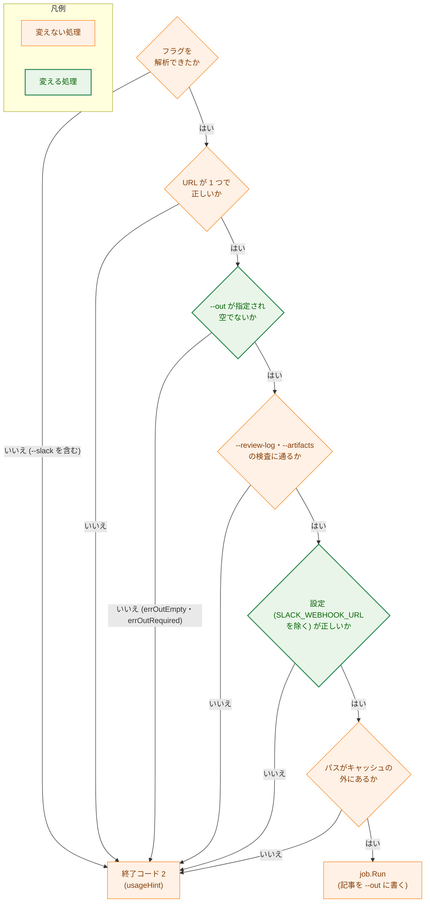

# 設計書：CLI の Webhook への投稿（`--slack`）と `SlackWebhookPublisher.Publish` の削除

## Document Status

| Item | Value |
|---|---|
| Status | `draft` |
| Created | 2026-11-04 |
| Review date | - |
| Reviewer | - |
| Comments | - |

本書は [01_requirements.md](01_requirements.md) の設計である。要件定義から申し送られた設計事項は [design_handoff.md](design_handoff.md) にあり、その対応は 10 章にまとめる。本書が引用するファイルの行番号は、コミット `df190ddc`（本書の作成時の `main`）のものである。

本タスクは削除と簡素化のタスクである。新しいパッケージ・新しい依存は加えない。加える識別子は、CLI の `--out` が必須であることを示すセンチネルエラー 1 つ（3.1 節）だけである。用語は要件書 6 章に従う。

## 1. 設計の全体像 (Design Overview)

### 1.1. 設計原則

-   **CLI の投稿だけが使うものは、型ごと削除する。** 分岐を無効にして残さない。値が 1 つしかなくなる列挙（CLI の `destination`、`job` の出力の種類）も取り除く。
-   **サーバの投稿の経路は変えない。** サーバは `PrepareSlackMessages` で記事を検査・分割し、`PostMessages` で送る（`internal/server/publish.go:158-166`）。本タスクはこの経路に触れない（AC-22）。
-   **削除するテストが確かめていた振る舞いは、残る関数で確かめ直してから削除する。** 書き直すテストを製品のコードを変えないコミットで先に加え、元のテストと製品のコードの削除は後のコミットで行う（7.4 節）。
-   **削除したことの確かめは一度だけ行う。** 削除した識別子・フラグ・ターゲットがもうないことは、タスクの `_checks/` のスクリプトで PR の時点に一度だけ確かめ、恒久のテストにしない。恒久のテストには、最終的な仕様の規則だけを置く（0059 `02_architecture.md` 1.4 節と同じ方針）。

### 1.2. 概念モデル

図 1-1 は、記事が外へ出る経路を、削除の前と後で示す。矢印 A → B は「A が B へ記事かリクエストを渡す」を表す。赤い要素は本タスクで削除するもの、緑の要素は本タスクで変えるものである。



今の経路の根拠: CLI は `--slack` で `job.RemoteOutput` に `SlackWebhookPublisher` を渡し（`cmd/yt2column/run.go:653-658`）、パイプラインの公開の段階がその `Publish` を呼ぶ（`internal/pipeline/pipeline.go:116`）。`Publish` は `PrepareSlackMessages` と `PostMessages` を順に呼ぶ（`internal/publisher/slack.go:171-179`）。

### 1.3. 設計の際に決めたこと（2026-11-04）

-   **PR は 2 つに分ける（H-06）。** PR-1 は CLI・設定・`internal/job`・`Makefile` の `test-integration-cli-slack` と、それに触れる文書。PR-2 は `SlackWebhookPublisher.Publish` の削除、`internal/publisher` のテストと統合テストの書き直し、残りの文書（8 章）。理由: PR-1 の後は `Publish` を呼ぶのがテストだけになり、PR-2 は `internal/publisher` の中で閉じる。差分を分けると、それぞれのレビューで確かめる観点が 1 つにまとまる。
-   **AC-01 は一度だけの確かめにする。** 未知のフラグを終了コード `2` で拒否し、副作用がないことは、今の恒久のテスト（`cmd/yt2column/run_test.go:510` の `--bogus` の行）が確かめている。`--slack` の各形（`--slack`・`-slack`・`=true`・`=false`、`--out` との同時指定、URL の後）が拒否されることは、`_checks/` のスクリプトで PR-1 の時点に一度だけ確かめる（7.3 節）。理由: `--slack` の行を恒久のテストに置くと、削除したフラグの名前をテストが持ち続ける。AC-12 の「`--slack` を渡すのは AC-01 の拒否を確かめるテストだけ」は、恒久のテストに `--slack` を渡すものがない状態で満たされる。
-   **`publisher.SlackMessageCount` は削除する（H-01）。** テストでないコードで呼ぶのは CLI の `reportSuccess`（`run.go:854`）だけである。テストは `PrepareSlackMessages(a).Len()` で同じ数を確かめる。理由: 製品のコードで使わない公開の関数を、テストのためだけに残さない。
-   **`job.Output` をやめて、`job.Request` に出力のパスと `Publisher` を直接持たせる（H-01）。** 出力の種類が 1 つになると、`outputKind` の列挙と `Output` の包みは何も区別しなくなる。ゼロ値の拒否は、パスが空であることと `Publisher` が `nil` であることの拒否で保つ（3.3 節）。
-   **CLI の `destination` の型は取り除く（H-04）。** 値が `destinationFile` だけになるので、`checkReviewLog`・`checkCacheDirs` は `--out` と常に比べる。`--out` は必須なので、比べる値はいつもある。AC-04 の振る舞いは変わらない。

## 2. システム構成 (System Structure)

### 2.1. 全体の構成

図 2-1 は、本タスクに関わるパッケージの依存を示す。矢印 A → B は「A が B を import する」を表す。点線は本タスクで削除する依存である。



`cmd/yt2column` が `internal/secret` を使うのは、`newSlackPublisher` と `buildOutput` の引数の型だけである（`run.go:123`・`:154`・`:645`）。`cmd/yt2column/run.go` の `net/http` の import も、`rejectedPostStatus`（`:1042-1049`）だけが使うので削除する。

### 2.2. コンポーネントの配置

| ファイル | 変更 | 内容 | PR |
|---|---|---|---|
| `cmd/yt2column/run.go` | 変更 | `--slack`、`cliOptions.slack`、`destination` の型、`errSlackFalse`・`errOutAndSlack`・`errNoDestination`・`errInvalidDestination`、`deps.newSlackPublisher`・`newSlackPublisher`、`chooseDestination`、`buildOutput` の Webhook の分岐、`reportSuccess`・`reportReviewLogFailure`・`reportRunError`・`warnHTTP2Debug` の Webhook の分岐と `dest` の引数、`reportWebhookHints`・`rejectedPostStatus`・`messageCount`・`seconds` を削除する。`--out` の検査と `errOutRequired` を加える（3.1 節） | PR-1 |
| `cmd/yt2column/test_helpers.go`・`test_helpers_integration.go` | 変更 | `loopbackSlackPublisher`・`refusingSlackPublisher`・`childModeSlackStall`・`useWebhook` などの Webhook の補助、`cliSlackDeepSeekOptions`・`gateCLISlackIntegration` を削除する | PR-1 |
| `cmd/yt2column/integration_slack_test.go` | 削除 | CLI の投稿の統合テスト | PR-1 |
| `cmd/yt2column/run_test.go`・`signal_test.go`・`cost_test.go`・`token_test.go`・`makefile_test.go`・`docs_test.go` | 変更 | 7.1 節の表のとおり | PR-1 |
| `internal/job/job.go`・`job_test.go`・`test_helpers.go` | 変更 | `Output`・`outputKind`・`FileOutput`・`RemoteOutput` を削除し、`Request` に出力のパスと `Publisher` を持たせる（3.3 節） | PR-1 |
| `internal/config/config.go`・`config_test.go`・`envaccess_test.go` | 変更 | `Config.slackWebhookURL`・`SlackWebhookURL`・`RequireSlackWebhookURL` と、`LoadFor` の `loadSlackWebhook` の呼び出しを削除する。`slackEnv`・`loadSlackWebhook`・`LoadServer` は残す（3.2 節） | PR-1 |
| `internal/publisher/testutil/integration.go`・`integration_settings_test.go` | 変更 | `CLISlackOptInEnv`・`CLISlackIntegrationOptions` を削除する | PR-1 |
| `internal/publisher/slack_message.go` | 変更 | `SlackMessageCount` を削除する（PR-1。CLI が最後の呼び出し元のため）。`Publish` に触れる説明を、サーバの投稿の経路の説明に直す（PR-2） | PR-1・PR-2 |
| `Makefile` | 変更 | `test-integration-cli-slack` と `CLI_SLACK_INTEGRATION_TIMEOUT`、`.PHONY` と `lint` の注釈の該当箇所を削除する | PR-1 |
| `internal/publisher/slack.go`・`publisher.go` | 変更 | `Publish`、`var _ Publisher = (*SlackWebhookPublisher)(nil)` を削除し、型とパッケージの説明を直す（3.4 節） | PR-2 |
| `internal/publisher/slack_test.go`・`slack_message_test.go`・`slack_articles_test.go`・`makefile_test.go`・`test_helpers_slack.go` | 変更 | 7.2 節の表のとおり | PR-2 |
| `internal/publisher/slack_integration_test.go` | 変更 | `PrepareSlackMessages` → `PostMessages` で投稿する（3.5 節） | PR-2 |
| `internal/server/publish_test.go` | 変更 | `TestPublishPostsLikeCLI` を削除する（7.2 節）。製品のファイルは変えない（AC-22） | PR-2 |
| `cmd/yt2column-server/run.go`・`run_test.go` | 変更 | CLI の `--slack` に触れるコメント（`run.go:60-62`、`run_test.go:374`）を直す | PR-2 |
| `docs/dev/guides/cli.md`・`docs/dev/guides/development.md`・`docs/dev/security.md`・`docs/dev/conventions/package_reference.md`・`docs/dev/project_overview.md`・`docs/dev/production_profile.md`・`CLAUDE.md`・`README.md`・`README.en.md`・`docs/translation_glossary.md` | 変更 | 3.6 節 | PR-1・PR-2 |
| `docs/tasks/0062_remove_cli_slack/_checks/` | 新規 | 一度だけの確かめのスクリプト（7.3 節） | PR-1・PR-2 |

拡張（`extension/`）と、`internal/server` の製品のファイルは変えない（AC-22）。

## 3. コンポーネント設計 (Component Design)

### 3.1. CLI（`cmd/yt2column`）

**出力先の検査。** `chooseDestination` の代わりに、`--out` だけを検査する関数を置く。検査はフラグが指定されたかどうか（`flag.FlagSet.Visit`）で行い、値の中身では選ばない（今の `chooseDestination` と同じ方針）。拒否の順序は、空の `--out`（`errOutEmpty`）、指定がないこと（`errOutRequired`）である。

```go
// cmd/yt2column

var (
	errOutEmpty    = errors.New("--out needs a path")
	errOutRequired = errors.New("--out is required") // replaces errNoDestination
)
```

`errOutRequired` は AC-02 の固有のセンチネルエラーで、`errors.Is` で見分ける。具体的な文言は計画で決める。

**削除する分岐。** 2.2 節の表のとおり。削除の後、`run` は設定を読んだ後に Webhook URL を受け取らず、標準エラーの伏せ字の対象は API キーだけになる（`run.go:335-336`）。`warnHTTP2Debug` は API キーの 1 行だけを書く（AC-05）。`reportSuccess` は「記事をファイルに書いた」行だけを書き、`reportReviewLogFailure` は記事を `--out` に書いたことだけを述べる。行の文言は今のファイルの場合の行と同じで、AC-04 の振る舞いは変わらない。

**使い方。** `writeUsage`（`run.go:254-271`）の説明を、記事を `--out` のファイルに書くこと、`--out` が必須であることに改める（AC-03）。フラグの一覧は `newFlagSet` から作るので、`--slack` の定義を除けば一覧からも消える。

**AC-01 の振る舞い。** `--slack` は `newFlagSet` で定義されないので、URL より前にあれば `fs.Parse` が未知のフラグの誤りを返し、`usageError` が終了コード `2` で `usageHint` とともに書く（`run.go:296-304`）。URL より後にあれば、フラグの解析が URL で止まり、引数の数の誤りになる（`:308-310`）。どちらも手順 A1・A2 で終わり、キャッシュ、`yt-dlp`、LLM、`--out` に触れない。専用の拒否は加えない（要件書 1 章）。

### 3.2. 設定（`internal/config`）

`Config` から `slackWebhookURL` のフィールドと、`SlackWebhookURL`・`RequireSlackWebhookURL` を削除する。`LoadFor`（`config.go:472-488`）は `loadSlackWebhook` を呼ばない。そのため、CLI の実行は `SLACK_WEBHOOK_URL` を `lookup` に問い合わせず（AC-06）、不正な値でも設定エラーにしない（AC-07）。

`LoadServer`（`:381-399`）、`loadSlackWebhook`（`:717-735`）、`slackEnv`、`ServerConfig.WebhookURL` は変えない（AC-08・AC-10）。`loadSlackWebhook` の説明の「Load and LoadServer」は `LoadServer` だけに直す。

### 3.3. ジョブ（`internal/job`）

`Output`・`outputKind`・`FileOutput`・`RemoteOutput` を削除し、`Request` に出力のパスと `Publisher` を直接持たせる（1.3 節）。

```go
// internal/job

// Request is one run. Writer and Publisher are built by the caller.
// VideoURL is validated by transcript.ValidateVideoURL before Run.
type Request struct {
	VideoURL   string
	CacheDir   string
	YtDlpPath  string
	Refresh    bool
	KeepCache  bool
	Writer     writer.ArticleWriter
	OutputPath string              // the file the Publisher writes; Run pre-checks it
	Publisher  publisher.Publisher // must write to OutputPath
	ReviewLog  *publisher.ReviewLogWriter
}
```

フィールドの名前は計画で決めてよい。`validateRequest`（`job.go:178-205`）は、出力のパスが空なら、また `Publisher` が `nil`（型付きの `nil` を含む。`nilcheck.IsNil`）なら、今と同じ `errInvalidRequest` で拒否する。これで「出力を選ばなかった `Request` は走らない」という今の保証（ゼロ値の拒否）は保たれる。`precheckOutput` は出力のパスを常に事前に確かめる（今のファイルの出力の場合と同じ）。

### 3.4. 投稿する型（`internal/publisher`）

削除の後の `SlackWebhookPublisher` は次のとおりである。`publisher.Publisher` を満たさない（AC-09）。`FilePublisher.Publish` と `Publisher` インターフェイスは変えない。

```go
// internal/publisher

// SlackWebhookPublisher posts prepared messages to a Slack-compatible
// Incoming Webhook. It does not implement Publisher.
type SlackWebhookPublisher struct { /* unexported fields unchanged */ }

func NewSlackWebhookPublisher(webhookURL secret.Secret) (*SlackWebhookPublisher, error)
func (p *SlackWebhookPublisher) PostMessages(ctx context.Context, m SlackMessages, from int, delivered func(index int)) error
```

`webhookClient.configured` は `PostMessages` が使い続けるので残る（`slack.go:189`）。パッケージの説明（`publisher.go:1-3`）は、`Publisher` を実装するのはファイルへの保存であり、Webhook への送信は `PrepareSlackMessages` と `PostMessages` が担うことを書く。`slack_message.go` の「`Publish` が送る」という説明（`:24`・`:43`・`:60`・`:73`・`:94` など）は「`PostMessages` が送る」に直す（AC-20）。

### 3.5. 統合テスト（`make test-integration-slack`、H-05）

`TestIntegrationSlackWebhookPublisher` は、2 つの記事それぞれを `PrepareSlackMessages` で検査・分割し、通数を確かめてから、`PostMessages(ctx, m, 0, …)` で送る。すべての記事の通数を、何かを送る前に確かめるという今の順序（`slack_integration_test.go:46-58`）は保つ。オプトイン、URL の読み出し、`http2debug` の失敗は `publishertestutil.SettingsFrom` が行い、変えない（AC-16）。

時間の上限: `SlackPublishMaxDurationForTest`（`test_helpers_slack.go:91-97`）は、通数ごとの送信の上限と間隔から求める式で、`Publish` の前提を含まない。`PostMessages` も同じ上限と間隔で送る（`slack.go:181-215`）。`Makefile` の `SLACK_INTEGRATION_TIMEOUT` の注釈（`Makefile:281-288`）も通数と上限だけを述べる。したがって、どちらも変えない。補助の名前の `Publish` は「投稿する」の意味で残し、説明の「production publisher」だけを `PostMessages` に合わせる。

### 3.6. 文書（F-005）

文書は AC-17〜AC-21 のとおりに書き換える。PR の割り当ては次のとおりである。

-   **PR-1:** `docs/dev/guides/cli.md`、`README.md`・`README.en.md`（`/mktrans`）、`docs/translation_glossary.md`、`docs/dev/guides/development.md` の `test-integration-cli-slack` の記述、`docs/dev/security.md` §2 の表と `GODEBUG` の項、`docs/dev/conventions/package_reference.md` の `cmd/yt2column` と `internal/job` の行、`docs/dev/project_overview.md` の冒頭と `SLACK_WEBHOOK_URL` の行、`docs/dev/production_profile.md`、`CLAUDE.md` の「Tool Execution Safety」。`TestSlackDocsContract`（`cmd/yt2column/docs_test.go:136-165`）は、`CLISlackIntegrationOptions` と `CLISlackOptInEnv` を除いた値を文書と比べる（AC-21）。このガードが `test-integration-cli-slack` を求めなくなるのは `Makefile` と同じコミットである。
-   **PR-2:** `CLAUDE.md` の「Architecture Overview」の `Publisher` の項、`docs/dev/project_overview.md` の `Publisher` の初期実装の項（`:75-76`）、`docs/dev/conventions/package_reference.md` の `internal/publisher` の行、`make test-integration-slack` の説明（`development.md`、`security.md` §2）。

`CLAUDE.md` の「Tool Execution Safety」は、本物の Webhook への投稿（サーバの投稿の操作と `make test-integration-slack`）に承認が要ることを保つ。

## 4. エラーハンドリング設計 (Error Handling Design)

| 変更 | エラー | 場所 |
|---|---|---|
| 加える | `errOutRequired`（`--out` の指定がない） | `cmd/yt2column` |
| 削除する | `errSlackFalse`・`errOutAndSlack`・`errNoDestination`・`errInvalidDestination` | `cmd/yt2column/run.go:175-179` |
| 変えない | `errOutEmpty`、`--review-log`・`--artifacts`・キャッシュのディレクトリの拒否 | `cmd/yt2column/run.go` |
| 変えない | `SlackPostError`・`SlackHTTPStatusError`・`ErrSlackMention` などの `internal/publisher` のエラー | サーバが使い続ける。CLI だけが参照しなくなる（AC-05） |

使い方と設定の誤りの報告の形（終了コード `2`、`usageHint` の行）、実行の失敗の報告（終了コード `1`）は変えない。

## 5. セキュリティ考慮事項 (Security Considerations)

本タスクは Webhook URL の扱いと Webhook への送信の経路を変えるので、`docs/dev/security.md` を適用する。図 5-1 は、削除の後に Webhook URL を受け取るものと Webhook へ送るものを示す。矢印 A → B は「A から B へデータが渡る」を表す。



-   **送信の経路:** CLI のプロセスが自分で HTTP で送る先は LLM の API だけになる。`cmd/yt2column` は `SlackWebhookPublisher` を作らない（AC-05）。製品のコードで Webhook へ送るのはサーバの投稿のジョブだけである。
-   **秘密情報:** CLI は `SLACK_WEBHOOK_URL` を読まず、値を持たない（AC-06）。伏せ字の対象から Webhook URL がなくなるが、値を持たないので書く経路もない。`yt-dlp` には許可した環境変数だけを渡す（`internal/transcript/ytdlp.go:209`）ので、`SLACK_WEBHOOK_URL` は子プロセスにも渡らない。
-   **`GODEBUG=http2debug`:** CLI の警告は API キーの 1 行だけになる（AC-05）。サーバの警告は変えない。
-   **統合テスト:** `security.md` §2 の規則（本番の `SLACK_WEBHOOK_URL` を読まない、URL がないときと `http2debug` が有効なときは送らずに失敗する、出力に URL を書かない）は `publishertestutil.SettingsFrom` と `PostMessages` のエラーの形が保ち、変えない（3.5 節）。
-   **フェイルクローズ:** CLI に `--slack` が残っていると誤解して実行しても、未知のフラグとして副作用の前に拒否される（3.1 節）。

## 6. 処理フローの詳細 (Processing Flow Details)

図 6-1 は、削除の後の CLI の手順 A1〜A5 を示す。矢印は処理の順序を表す。緑の要素が本タスクで変える判定である。



今との違いは、出力先の選択が `--out` の検査になること（`run.go:315-318`）と、設定が Webhook URL を読まず求めないこと（`:331-341`）の 2 点だけである。

## 7. テスト戦略 (Test Strategy)

テストは次の 3 つに分ける（H-02）。

-   **削除する:** CLI の投稿・`--slack`・CLI の `SLACK_WEBHOOK_URL` だけを確かめるテスト。
-   **確かめ直す:** 残る振る舞いを `Publish` や `Load` を通して確かめていたテスト。同じ観点を `PrepareSlackMessages`・`PostMessages`・`LoadServer` で確かめる。
-   **値を直す:** 削除したものを参照するテストの補助と行。

### 7.1. PR-1 のテスト

| テスト | 扱い |
|---|---|
| `cmd/yt2column/run_test.go` の `TestRunSlackFailureHints`・`TestRunSlackSignalAfterPosting`・`TestRunSlackSummaryUnknownCount`・`TestNewSlackPublisherNilOnFailure`・`TestTestDepsSlackPublisherDoesNotSend`、補助 `rejectedMention`・`slackUsageRow` | 削除する |
| `run_test.go` の `executionPathRows` の Webhook の行（`--slack` の組み合わせ、`SLACK_WEBHOOK_URL` の不正な値の行など） | 削除する。`neither --out nor --slack` の行は、`--out` がない実行が `errOutRequired` で拒否される行に直す（AC-02） |
| `run_test.go` の `TestRunGODEBUGWarning`・`TestRunHelp`・`TestRunEscapesUntrustedText`・`TestRunReviewLog`・`TestRunReviewLogFailure`・`TestRunExecutionPaths`・`TestRunPromptOverrides`・`TestRunRejectsInvalidEffortPart`・`TestRunDefaultWriterOptions`、`newRunEnv`・`secretStrings`・`seedCache` | Webhook の場合の行と設定を除く。`TestRunGODEBUGWarning` は警告が 1 行であることを確かめる（AC-05） |
| `run_test.go` に加える行 | `SLACK_WEBHOOK_URL` が不正な値でも `--out` の実行が未設定の場合と同じ結果になること（AC-07）、`lookup` に `SLACK_WEBHOOK_URL` が問い合わせられないこと（AC-06。問い合わせた名前を記録する `lookup` で確かめる） |
| `cmd/yt2column/signal_test.go` の `TestSignalDuringSlackPost` | 削除する。シグナルの扱いは `TestSignalDuringYtDlp`・`TestSignalDuringGenerate` が確かめる |
| `cost_test.go`・`token_test.go` の Webhook の行 | 除く |
| `makefile_test.go` の `TestMakeTestIntegrationCLISlack`・`TestCLISlackIntegrationSettings`・`TestCLISlackIntegrationTestBuildTag`、`TestMakeOptInsAreTargetSpecific`・`TestMakeTargetsDoNotReadRetiredModelEnv` の該当行 | 削除する・行を除く |
| `docs_test.go` の `TestSlackDocsContract`・`TestDeepSeekDocsContract` | CLI の投稿の値を除く（AC-21） |
| `internal/job/job_test.go` の `TestRunRemoteOutput`、`remote output` の行（`:928-931`） | 削除する。ほかのテストは `Request` の新しいフィールドに直す。出力のパスが空・`Publisher` が `nil` の拒否は今の表の行で確かめる |
| `internal/config/config_test.go` の `TestRequireSlackWebhookURL`、`TestLoadValid`・`TestLoadEmpty`・`TestLoadSlackWebhookAccepted` などの `SlackWebhookURL` の確かめ | `RequireSlackWebhookURL` のテストは削除する。`loadSlackWebhook` の受理・拒否の確かめは、`LoadServer` のテスト（`TestLoadServerWebhookOptional` など）が同じ値を確かめていなければ、`LoadServer` で確かめ直す。`Load` が `SLACK_WEBHOOK_URL` を拒否しないことを確かめる |
| `internal/publisher/slack_message_test.go` の `TestSlackMessageCount` | `PrepareSlackMessages(a).Len()` を確かめる形に直す（今の `TestPrepareSlackMessages*` と重複する行は除く） |
| `internal/publisher/slack_test.go`・`slack_integration_test.go` の `SlackMessageCount` の呼び出し | `PrepareSlackMessages(a).Len()` に直す |
| `internal/publisher/testutil/integration_settings_test.go` の `other_opt_in_only` の行 | `CLISlackOptInEnv` の代わりに、テストのためだけの別の名前で確かめる |

### 7.2. PR-2 のテスト

`slack_test.go` の `Publish` を呼ぶテストは、`PrepareSlackMessages` と `PostMessages(ctx, m, 0, …)` を順に呼ぶテストのための補助（サーバの投稿のジョブと同じ順序）を通して確かめ直す。補助は `slack_test.go` に置き、製品のコードには置かない。

| テスト | 扱い |
|---|---|
| `TestSlackPublishPayload`・`TestSlackPublishCostLine`・`TestSlackPublishSplit`・`TestSlackPublishWaitsBetweenMessages`・`TestSlackPublishResponses`・`TestSlackPublishRedirect`・`TestSlackPublishTimeout`・`TestSlackPublishBodyFailures`・`TestSlackPublishCanceled`・`TestSlackPublishPartialFailure`・`TestSlackPublishErrorsOmitWebhookURL`・`TestSlackPublishTransportErrorWithheld`・`TestSlackPublishErrorClasses` | 上の補助で確かめ直す（送信の形、分割、`silent`、順序と間隔、失敗が送り終えた数を示すこと。AC-15）。名前の `Publish` は `Post` に改める |
| `TestSlackPublishPrepareSendsNothing` | `PrepareSlackMessages` の拒否で確かめ直す。拒否のとき補助が `PostMessages` を呼ばず、サーバが何も受け取らないことを確かめる |
| `TestSlackPublishZeroValue` | 削除する。ゼロ値の拒否は `TestPostMessagesRejectsWithoutSending` の `zero value publisher` の行（`slack_test.go:1446-1452`）が確かめる |
| `TestSlackMessagesForTest`、`slack_articles_test.go`、`makefile_test.go` | 変えない。`SlackMessagesForTest` の説明だけを直す（`test_helpers_slack.go:73-76`） |
| `internal/server/publish_test.go` の `TestPublishPostsLikeCLI` | 削除する。比べる相手の CLI の投稿がなくなる。投稿の操作が送るメッセージが `PrepareSlackMessages` の結果と一致することは、`SlackMessagesForTest` と比べる同じファイルのテスト（`publish_test.go:187`・`:508`）が確かめる |
| `internal/publisher/slack_integration_test.go` | 3.5 節 |

### 7.3. 一度だけの確かめ（`_checks/`）

0059 と同じく、Go のプログラムを `docs/tasks/0062_remove_cli_slack/_checks/` に置き、1 行目を `//go:build test` にして `go run -tags test` で動かす。名前の衝突を避けるため、文字列の検索ではなく `go/parser`・`go/ast` でパッケージと識別子を読む。PR ごとに PR の head で一度実行し、結果を計画に記録する。

-   **PR-1:** ビルドした CLI を、`--slack` の各形（AC-01 の列挙）で実行し、終了コード `2`、標準エラーの行、キャッシュのディレクトリ・`yt-dlp`（印のファイルを作る偽の `yt-dlp`）・`--out` に触れないことを確かめる。`cmd/yt2column` に AC-05・AC-12 の識別子がないこと、`config.Config` に AC-10 のメソッドがないこと、`Makefile` と Go のコードに AC-11 のターゲットと変数がないこと、`extension/` と `internal/server/` の製品のファイルが merge-base から変わらないこと（AC-22）を確かめる。
-   **PR-2:** `SlackWebhookPublisher` に `Publish` がないこと（AC-09）、Go のコメントが `SlackWebhookPublisher.Publish` と CLI の `--slack` に触れないこと（AC-20。語の一覧は、merge-base で成り立たず head で成り立つように実装のときに決める）、AC-22 を再び確かめる。

### 7.4. テストの削除の確かめ方（AC-14、H-06）

各 PR で、コミットを次の順に分ける。細部は計画で決める。

1.  **テストの移し替えのコミット:** 製品のコードを変えずに、確かめ直すテストを加える・直す（7.1 節・7.2 節の「確かめ直す」）。親のコミットを `BASE` にした `make coverage-compare` が `PASS` で終わり、その出力をコミットメッセージと PR の説明に書く。
2.  **テストだけの削除のコミット:** 製品のコードを変えずに、移し替えで不要になったテストを削除する（`TestSlackPublishZeroValue`、`TestPublishPostsLikeCLI` など）。`make coverage-compare` で確かめる。
3.  **関数をまるごと削除するコミット:** 残る関数の中を書き換えない削除（PR-2 の `Publish` と `var _ Publisher` の行）。`make coverage-compare` で確かめる（関数の外の行と、削除した関数は道具が扱える）。
4.  **残る関数を書き換える削除のコミット:** PR-1 の CLI・`internal/config`・`internal/job` の削除。道具は止まる（0055 `01_requirements.md` 1 章）ので、0059 のスクリプト `docs/tasks/0059_remove_legacy_articles_api/_checks/coverage/main.go`（関数を (パッケージ, レシーバ, 名前) で対応づけて `go tool cover -func` の結果を比べる）で比べる。そのまま動かなければ、本タスクの `_checks/coverage/` に写して直す（0059 のスクリプトは保守しないため）。削除した関数を挙げ、網羅率が下がった残る関数には、加えたテストか、実行されていた文を削除しただけであることとその理由を、コミットメッセージと PR の説明に書く。

コメントの書き直し（AC-20）は、1〜3 のコミットに混ぜない。

### 7.5. 受け入れ基準の確かめの方法

| 確かめ方 | 対象の AC |
|---|---|
| 単体テスト（7.1 節・7.2 節） | AC-02〜AC-07、AC-15 |
| 既存のテストがそのまま通ること | AC-04、AC-08（サーバのテスト） |
| 一度だけの確かめ（7.3 節） | AC-01、AC-05、AC-09〜AC-12、AC-20、AC-22 |
| `make deadcode` | AC-13 |
| コミットごとの網羅率の比較（7.4 節） | AC-14、AC-15 |
| ガードのテスト・`make readme-sync-check` | AC-18、AC-21 |
| 統合テスト（利用者の承認の後に実行） | AC-16 |
| PR のレビューで読む（`manual`） | AC-17〜AC-20 の文 |

## 8. 実装の優先順位 (Implementation Priorities)

1.  **PR-1: CLI の投稿の削除**
    -   テストの移し替え（AC-06・AC-07 の行、`SlackMessageCount` の代わりの確かめ、`LoadServer` の確かめ）
    -   `cmd/yt2column`・`internal/config`・`internal/job` の削除と、`SlackMessageCount`・`CLISlack*`・`Makefile` のターゲットの削除
    -   PR-1 の文書（3.6 節）と一度だけの確かめ
2.  **PR-2: `SlackWebhookPublisher.Publish` の削除**
    -   `slack_test.go` の確かめ直し、`TestSlackPublishZeroValue`・`TestPublishPostsLikeCLI` の削除
    -   `Publish` の削除、統合テストの書き直し、コメントの書き直し
    -   PR-2 の文書と一度だけの確かめ

PR-1 の後、`Publish` を呼ぶのは `internal/publisher` と `internal/server` のテストだけになる。`make deadcode` はテストからの到達を数えるので、PR-1 の時点でも通る。

## 9. 将来の拡張 (Future Extensibility)

-   CLI から投稿を確かめる必要が再び生じたときは、CLI に投稿を戻すのではなく、サーバのジョブの API を使う。
-   CLI に第 2 の出力先を加えるときは、`job.Request` に出力の種類を宣言するフィールドを戻す（CLAUDE.md「Declare, don't infer」）。

## 10. 設計への申し送りへの対応 (Design Handoff)

| 項目 | 対応 |
|---|---|
| H-01 使われなくなる関数・型 | `job.RemoteOutput`・`outputKindRemote` は `Output` ごと削除（3.3 節）。`SlackMessageCount` は削除（1.3 節）。`loopbackSlackPublisher`・`refusingSlackPublisher`・`childModeSlackStall`・`CLISlackIntegrationOptions`・`CLISlackOptInEnv`・`cliSlackDeepSeekOptions`・`gateCLISlackIntegration` は削除（2.2 節）。残すものはない |
| H-02 `Publish` を使うテストの書き直し | 7.2 節。準備と送信を順に呼ぶテストの補助で確かめ直し、`PostMessages` の既存のテストと重複する `TestSlackPublishZeroValue` は削除する |
| H-03 `--slack` の拒否の確かめ方 | 未知のフラグの拒否は既存の恒久のテスト、`--slack` の各形は一度だけの確かめ（1.3 節、7.3 節）。エラーの文言には頼らず、終了コードと副作用で確かめる |
| H-04 `checkReviewLog` と `checkCacheDirs` の引数 | `destination` を取り除き、`--out` と常に比べる（1.3 節） |
| H-05 `make test-integration-slack` の書き直し | 3.5 節。`SlackPublishMaxDurationForTest` と `SLACK_INTEGRATION_TIMEOUT` の注釈は `Publish` を前提にしていないので変えない |
| H-06 コミットの分け方と網羅率の比べ方 | 7.4 節。PR は 2 つ（1.3 節） |

## 11. 受け入れ基準と設計の対応 (AC Traceability)

| AC | 設計 |
|---|---|
| AC-01 | 3.1 節、6 章、7.3 節 |
| AC-02 | 3.1 節、4 章、7.1 節 |
| AC-03 | 3.1 節 |
| AC-04 | 3.1 節、1.3 節（H-04） |
| AC-05 | 3.1 節、5 章、7.3 節 |
| AC-06 | 3.2 節、7.1 節 |
| AC-07 | 3.2 節、7.1 節 |
| AC-08 | 3.2 節 |
| AC-09 | 3.4 節、7.3 節 |
| AC-10 | 3.2 節、7.3 節 |
| AC-11 | 2.2 節、7.3 節 |
| AC-12 | 1.3 節、2.2 節、7.3 節 |
| AC-13 | 10 章（H-01）、7.5 節 |
| AC-14 | 7.4 節 |
| AC-15 | 7.2 節、7.4 節 |
| AC-16 | 3.5 節 |
| AC-17〜AC-19 | 3.6 節 |
| AC-20 | 3.4 節、7.3 節 |
| AC-21 | 3.6 節 |
| AC-22 | 2.2 節、7.3 節 |
