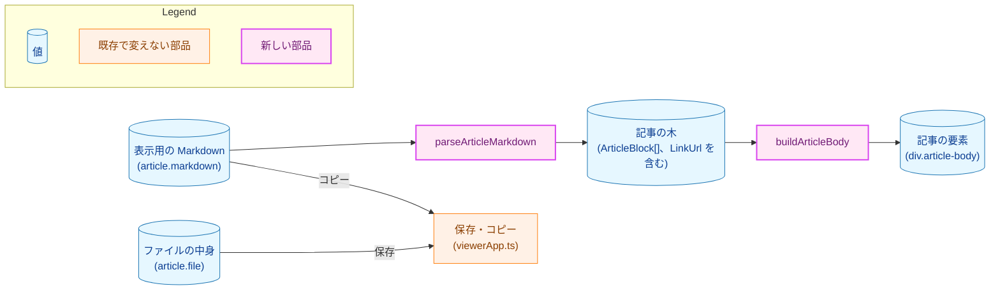
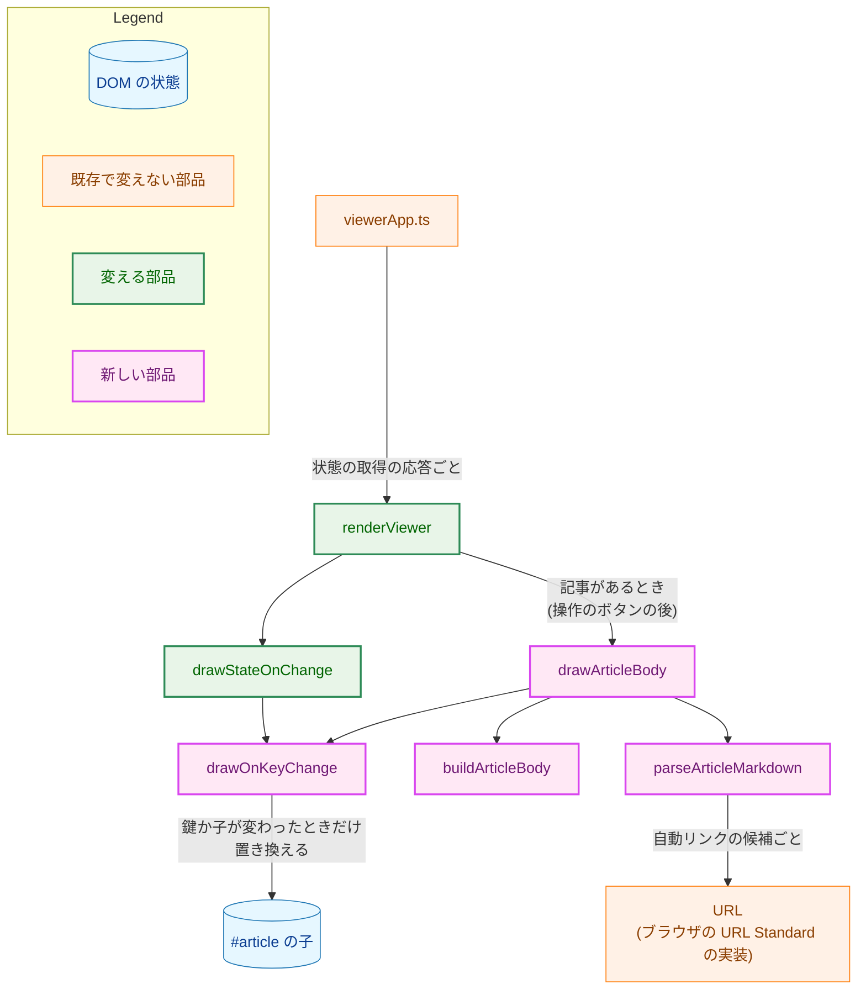
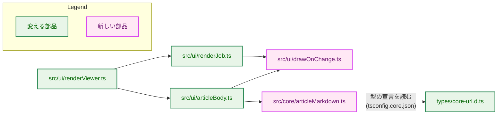
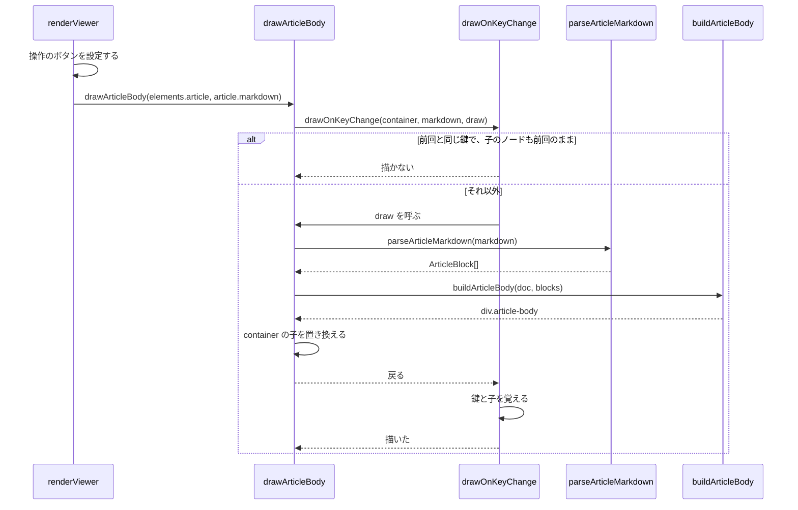
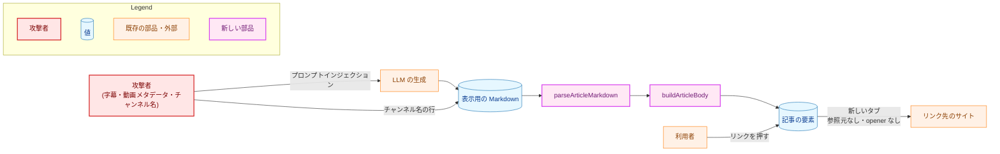
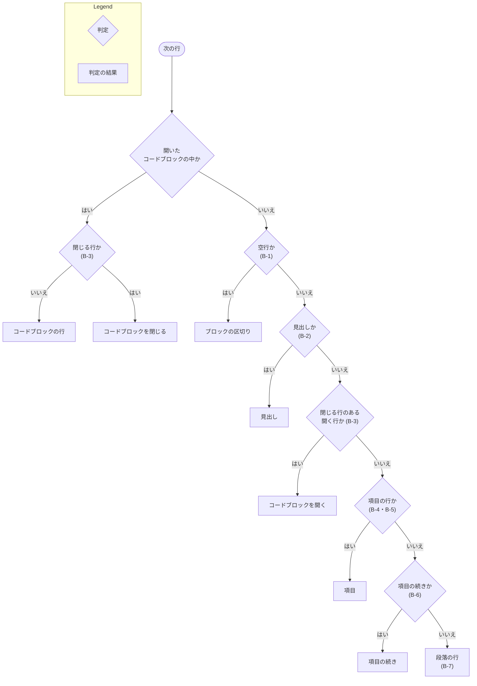
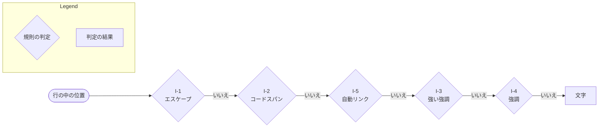

# 設計書：ビューアで記事の Markdown を描画する

## Document Status

| Item | Value |
|---|---|
| Status | `draft` |
| Created | 2026-11-05 |
| Review date | - |
| Reviewer | - |
| Comments | - |

本書は、[01_requirements.md](01_requirements.md)（以下「要件」）を満たす設計を定める。用語（表示用の Markdown、出典の行、描画、自動リンク、URL の文字列など）は、要件 6 章の定義に従う。各節の見出しの括弧の中では、F-…・AC-…・H-… と数字だけの節番号（4.1 など）は、要件の項目と節を指す。本文の B-1〜B-7・I-1〜I-5 は、要件 3.2 の規則を指す。本文で数字だけで書いた「（3.3）」のような参照は本書の節を指し、要件の節は「要件 3.2」のように「要件」を付けて書く。既存のコードの行番号は、コミット `b9e33644` で確かめた。

本書では、次の 3 つの部品を次の名前で呼ぶ。

-   **解釈の関数**: `parseArticleMarkdown`（`extension/src/core/articleMarkdown.ts`）。表示用の Markdown を記事の木にする。
-   **組み立ての関数**: `buildArticleBody`（`extension/src/ui/articleBody.ts`）。記事の木から DOM を作る。
-   **描画の関数**: `drawArticleBody`（`extension/src/ui/articleBody.ts`）。ビューアが呼ぶ入口で、解釈と組み立てを行い、`#article` の子を置き換える。

## 1. 設計の全体像 (Design Overview)

### 1.1. 設計原則

-   **解釈と組み立てを分ける。** 表示用の Markdown の解釈は、`src/core/` の純粋な関数が 1 回で行い、ブロックとインラインの型付きの木（以下、記事の木）を返す。組み立ての関数は記事の木だけを受け取り、記事の文字列を受け取らない。要素は木の種類の `switch` で選ぶので、作る要素と属性は、組み立ての中の固定の一覧に閉じる（F-004、AC-20）。`src/core/` は DOM を使わない純粋な関数だけを置く場所で、`tsconfig.core.json` が DOM の参照を型の検査で拒否する（`extension/tsconfig.core.json:1-8`）。
-   **規則を足さず、そのまま実装する。** 解釈は要件 3.2 の規則だけに従う。CommonMark に寄せた場合分けも、規則にない補正もしない。規則に合わない入力は、文字として記事の木に入る（CLAUDE.md「Reject, don't normalize」）。
-   **記事を HTML として解釈する経路を作らない。** 組み立ては `createElement`・文字のノード・決めた属性の設定だけを使う。HTML を解釈する API を禁止する lint の規則（`extension/eslint.config.js:177-209`）は、すべてのファイルの設定（`:253-271`）と `src/**/*.ts` の設定（`:272-284`）に入っているので、新しいファイルにも効く。
-   **リンクにしてよい URL は型で示し、値はテストで確かめる。** F-003 の検査を通った URL の文字列だけが、ブランド型 `LinkUrl` になる。この型を作れるのは解釈の関数のファイルだけで、`href` を設定するのは組み立ての中の 1 つの関数だけである。その関数は `LinkUrl` だけを受け取る。今の拡張のブランド型（`ArticleKey` など、`extension/src/core/articleKey.ts:5-8`）と同じ方式で、`LinkUrl` への型の主張（`as LinkUrl`）は、lint の規則で解釈の関数のファイルだけに許す（`extension/eslint.config.js:112-172`・`:234-247`）。ただし、これで守れるのは `LinkUrl` を作る側だけで、`LinkUrl` を含む外側の型への型の主張（`as ArticleInline` など）は防げない。そのため、作った DOM の属性の値を、テストが解釈の関数と独立に確かめる（7.1・7.3）。
-   **改行と行ごとの文字の方向は、今と同じ仕組みで保つ。** 段落・項目・コードブロックの中の改行は、U+000A の文字のまま残し、CSS の `white-space: pre-wrap` で改行として表示する。行ごとの文字の方向は、`unicode-bidi: plaintext` で決める。今の本文と同じ仕組みである（`extension/src/ui/articleBody.ts:13-22`、`extension/static/viewer.css:53-62`）。
-   **保存とコピーは描画と無関係に保つ。** 保存とコピーは、今と同じく状態の取得が返す文字列（保存は `article.file`、コピーは `article.markdown`）を使う（`extension/src/viewerApp.ts:537`・`:548`）。描画の部品は、この経路に触れない。描画に欠陥があっても保存とコピーが使えるよう、`renderViewer` は操作のボタンを記事の本文より先に設定する（4.2、F-006）。

### 1.2. 設計の際に決めたこと（2026-11-05）

-   **解釈は `src/core/` の純粋な関数に置き、DOM の組み立ては `src/ui/articleBody.ts` に置く。**
    -   理由: 解釈は DOM なしで、node のテストで速く確かめられる。性能の上限（AC-33）も、解釈だけを取り出して測れる。組み立ては記事の木の種類の `switch` だけになるので、要素と属性の一覧を、型と 1 つのファイルで閉じられる。今の拡張の分け方（判断は `src/core/`、DOM は `src/ui/`）とも同じである。
    -   採らなかった案: 解釈しながら DOM を直接作る 1 つのファイル。ファイルは減るが、解釈のテストにも jsdom が要る。また、要素を作る箇所が解釈の分岐の中に散る。
    -   ADR の判断: 作らない。レンダラーの内部の構成で、このタスクの中で閉じる。
-   **段落と項目の中の改行は、`<br>` を使わず、U+000A の文字と `pre-wrap` で表す。**
    -   理由: 今の表示と同じ仕組みなので、`unicode-bidi: plaintext` が改行ごとに文字の方向を決める振る舞いが続く（AC-28）。`textContent` に改行が残るので、描画した文字列が AC-21 の形になる。
    -   採らなかった案: `<br>` の要素。`<br>` が双方向の段落の区切りになるかを、別に確かめる必要がある。また、`textContent` から改行が消える。
    -   ADR の判断: 作らない。CSS と要素の選び方で、このタスクの中で閉じる。
-   **コードブロックの長い行は、ブロックの中で折り返す。**
    -   理由: 横のスクロールにすると、ブロックにフォーカスを当てる属性（`tabindex`）と、キーボードでスクロールできることの確認が要る（AC-22）。折り返しなら、どちらも要らない。記事のコードブロックは短い例に限られ、改行の位置が崩れても読める。
    -   採らなかった案: ブロックの中で横にスクロールする。
    -   ADR の判断: 作らない。CSS の値で、このタスクの中で閉じる。
-   **確かめていないブラウザの振る舞いは、文書に基づいて設計し、実装の最初のフェーズで試作を使って Chrome で手動で確かめる。**
    -   対象: 改行と行内の要素が混ざったときの行ごとの方向、リンクの方向の分離、Chrome と node の URL の解析の一致、512 KiB の入力の描画の時間。対象ごとの根拠と、崩れた場合の代わりの方法は 3.8 に挙げる。
    -   性能の自動テスト: node のテストで、解釈だけを 1 秒の上限で測る。組み立ては、最大の大きさの入力で例外を投げないことだけを jsdom で確かめる。jsdom の DOM はブラウザより大幅に遅く、配置も行わないので、jsdom での時間はブラウザでの時間を表さない（H-01）。DOM の組み立てと配置を含めた時間は、Chrome で 1 回測って実装計画に記録する（7.1・7.2）。
    -   理由: 0050 と同じ方針である（[0050 設計書](../0050_viewer_tab/02_architecture.md) 1.2）。どの振る舞いにも公開の仕様の根拠がある。代わりの方法も先に決めておくので、崩れても設計の骨格は変わらない。
    -   ADR の判断: 作らない。確かめる時期と方法の決定で、このタスクの中で閉じる。

ADR: 本書で新しく決める主要な決定はない。描画の安全性の規則は、要件が [ADR-0017](../../dev/adr/0017-viewer-markdown-rendering.md) に記録した。本書の設計は ADR-0017 の決定（自前の最小限のレンダラー、HTML を解釈しない、要素と属性を限る、`https` の自動リンクだけを新しいタブで参照元を送らずに開く、保存とコピーは描画の結果を使わない）に従い、その決定を変えない。

### 1.3. 概念モデル

表示用の Markdown が、ビューアの記事の要素になるまでの値の関係を示す。矢印 A → B は「A から B を作る、または A が B を使う」を表す。



-   **記事の木**は、ブロック（見出し・段落・箇条書き・番号付きリスト・コードブロック）の列である。見出し・段落・項目は行の列を持ち、各行はインライン（文字・強い強調・強調・コードスパン・リンク）の列である（3.1）。
-   **リンクの URL**（`LinkUrl`）は、記事の木の `link` のインラインが持つ、F-003 の条件をすべて満たした URL の文字列で、解釈の関数だけが作る。
-   **記事の要素**は、ビューアの `#article` の中に置く `div.article-body` である。本書で「記事の中の要素」と書くときは、その子孫の要素を指す（AC-20 の「記事の中に作られる要素」）。

### 1.4. 既存のコードとの関係

-   **本文の表示**: 今の `renderArticleBody(doc, markdown)`（`extension/src/ui/articleBody.ts:13-22`）は、`div.article-body[dir=auto]` を作り、`textContent` に表示用の Markdown を入れる。本文を表示するのはこの関数だけである。本タスクは、この関数を描画の関数と組み立ての関数に置き換える。

    > 0050 は、本文の表示をこの関数に集め、#504 でここだけを差し替える構成にした（[0050 設計書](../0050_viewer_tab/02_architecture.md) 3.12）。

-   **描き直しの判定**: 今の `renderViewer` は、`#article` の `textContent` が表示用の Markdown と違うときだけ描き直す（`extension/src/ui/renderViewer.ts:318-321`）。描画すると `textContent` から記号が除かれるので、この比較は使えない（H-05）。状態の表示は、描いた状態の鍵と描いた子のノードを `WeakMap` に覚えて比べる（`extension/src/ui/renderJob.ts:361-403` の `drawStateOnChange`）。本タスクは、この仕組みを共通の関数に取り出し、状態の表示と本文の両方で使う（3.4）。
-   **URL の解析**: 拡張は、WHATWG の URL Standard の `URL` を `src/core/` で使っている（`extension/src/core/acceptedUrl.ts:6-30`）。`src/core/` が使える `URL` の型は `extension/types/core-url.d.ts` で宣言したメンバだけで、今は `href` がない。本タスクで `href` を加える（3.3）。
-   **フェンスの閉じる行**: サーバは、閉じたコードフェンスを `isClosingFence`（`internal/writer/markdown.go:176-186`）で判定する。要件 B-3 の閉じる行は、これと同じ形と定められている。拡張の判定は TypeScript で別に書く。拡張のテストが確かめるのは、拡張の判定が要件 B-3 に合うことで、サーバの判定との差は検出しない。
-   **`switch` の網羅**: 拡張の型付きの `switch` は、`default` で `const exhaustive: never = x` とし、到達したら例外を投げる形で網羅を確かめている（`extension/src/core/response.ts:490-493`、`extension/src/ui/render.ts:533-536`）。`tsconfig.json` には `noImplicitReturns` がなく、lint に `switch` の網羅の規則もないので、この形がないと、種類の漏れは型の検査で見つからない。組み立ての関数もこの形に従う（3.2）。
-   **文字組み**: ルートの文字の大きさは 14px（`extension/static/theme.css:7`）で、日本語の UI の `body` の行の高さは 1.7（`extension/static/theme.css:233-235`）である。ページの幅は `body` の `max-width: 48rem`（672px。`extension/static/viewer.css:5-9`）である。記事の部分は、これと別に文字の大きさ・行の高さ・幅を決める（3.5）。

## 2. システム構成 (System Structure)

### 2.1. 実行時の配置

ビューアのページの中の部品と、描画に関わる呼び出しを示す。矢印 A → B は「A が B を呼ぶ、または A が B を変える」を表す。



`viewerApp.ts` から `renderViewer` への呼び出しは、今のままである。変わるのは、`renderViewer` の中の操作のボタンと本文の順序、本文を描く関数、状態の表示の描き直しの判定を共通の関数に移すことである。記事の要素の文字組みは、`viewer.css` と `theme.css` が決める（3.5）。

### 2.2. ディレクトリ構成とモジュールの依存関係

矢印 A → B は「A が B を import する」を表す。



破線の矢印は import ではなく、`tsconfig.core.json` が `src/core/` を検査するときに読む型の宣言を表す。`src/core/articleMarkdown.ts` は、ほかの拡張のファイルを import しない。npm のパッケージも使わない（CLAUDE.md「Dependencies」、要件 4.5）。

### 2.3. データの流れ

完了した記事の状態の取得の応答が届いてから、記事の要素ができるまでを示す。



## 3. コンポーネント設計 (Component Design)

### 3.1. 記事の木（F-001・F-002・F-004、AC-20、H-04）

解釈の関数が返す型を示す。`LinkUrl` の名前と、それを作るファイル（`extension/src/core/articleMarkdown.ts`）は、lint の設定（3.9）が参照するので固定する。ほかの型の名前と形は、実装で細部を変えてよい。ただし、次の 3 点は変えない。

-   インラインの種類が F-004 の一覧に閉じていること。
-   記事の内容から決める属性の値が、リンク先（`LinkUrl`）と番号付きリストの開始番号（`start`）だけであること。
-   強い強調と強調の中身が文字だけであること（入れ子にしない。要件 3.2 の「入れ子」）。

```ts
// src/core/articleMarkdown.ts

declare const linkUrlBrand: unique symbol;

/** A URL string that meets every link condition. Only parseArticleMarkdown creates it. */
export type LinkUrl = string & { readonly [linkUrlBrand]: true };

/** One piece of a line's text. */
export type ArticleInline =
  | { readonly kind: "text"; readonly text: string }
  | { readonly kind: "strong"; readonly text: string }
  | { readonly kind: "emphasis"; readonly text: string }
  | { readonly kind: "code"; readonly text: string }
  | { readonly kind: "link"; readonly url: LinkUrl };

/** One source line of a heading, a paragraph or a list item, as inline pieces. */
export type ArticleLine = readonly ArticleInline[];

/** The lines of one list item: its first line and its continuation lines. */
export type ArticleItem = readonly ArticleLine[];

export type ArticleBlock =
  | { readonly kind: "heading"; readonly level: "title" | "section"; readonly line: ArticleLine }
  | { readonly kind: "paragraph"; readonly lines: readonly ArticleLine[] }
  | { readonly kind: "bulletList"; readonly items: readonly ArticleItem[] }
  | { readonly kind: "orderedList"; readonly start: number; readonly items: readonly ArticleItem[] }
  | { readonly kind: "codeBlock"; readonly lines: readonly string[] };

/** Parses the display Markdown by the rules of requirements 3.2. Never throws. */
export function parseArticleMarkdown(markdown: string): readonly ArticleBlock[];
```

-   **見出しの段**: 記事の木は、見出しの段を記法の意味（`title` は B-2 の `#`、`section` は `##`）で持つ。表示の段（`h2`・`h3`）は組み立てが決める（3.2）。ビューアのページの見出しの構造は、組み立ての関心だからである。
-   **文字の部分**: `text`・`strong`・`emphasis` の文字列は、I-1 で表示しない `\` を除いた後の文字列である。`code` の文字列は、コードスパンの間の文字列そのままである。`text` には、規則に当たらなかった記号（開けなかった並び、リンクにならなかった `<`、扱わない記法、HTML のタグ、文字参照）がそのまま入る。
-   **行**: 見出し・段落・項目の行は、表示用の Markdown の 1 行に当たる。B-2・B-4・B-5 のブロックの記号を除き、残りの空白は詰めずに持つ（要件 3.2 の「段落・項目・見出しの文字列の中の空白」）。コードブロックの行は、開く行と閉じる行の間の行を、インラインの規則を当てはめずにそのまま持つ（B-3）。
-   **番号付きリストの開始番号**: 最初の項目の 1〜9 桁の数字を数値にしたものである（B-5）。B-5 の形から、値は 0 以上 999,999,999 以下の整数に限られ、HTML の `start` 属性の値の範囲（符号付き 32 ビット整数）に収まる。先頭に 0 のある数字（例: `007.`）も、数値（7）で持つ。
-   **リストを分ける記号と区切りの文字**: 箇条書きの記号（`-`・`*`・`+`）と番号付きリストの区切りの文字（`.`・`)`）は、記事の木に持たない。解釈の関数は、記号か区切りの文字が変わったところで新しいリストを始め（B-4・B-5）、隣り合う 2 つのリストのブロックになる。表示の記号は CSS の既定（`ul` の黒丸、`ol` の数字）であり、記事の記号を表示しないからである。
-   **AC-21 の形**: 「記事の木の文字列」を次のように定める。段落・項目・コードブロックの中では、行の文字列を、行の間に U+000A を 1 つ入れてつなげる。見出しは 1 行の文字列である。それらを、ブロックの順、項目の順に、間に何も入れずにつなげる。項目の境目は、AC-21 の「ブロックの間」として扱う。組み立ての関数が作る `textContent` は、この文字列と一致する（3.2）。

### 3.2. 組み立てと描画（F-001〜F-005、AC-01〜AC-07・AC-16・AC-17・AC-20・AC-24・AC-25・AC-28、H-04・H-07）

```ts
// src/ui/articleBody.ts

/** Builds the article element from the parsed tree alone; it never receives the Markdown string. */
export function buildArticleBody(doc: Document, blocks: readonly ArticleBlock[]): HTMLElement;

/** Draws the display Markdown into container, unless the same Markdown is already drawn there. */
export function drawArticleBody(container: HTMLElement, markdown: string): void;
```

`renderViewer` が呼ぶのは `drawArticleBody` だけである。`buildArticleBody` を書き出すのは、テストが任意の記事の木（解釈の関数では作れない形を含む）から組み立てを確かめるためである。

`buildArticleBody` は、記事の木の種類ごとに、次の要素だけを作る。要素は `doc.createElement` で作り、文字は `doc.createTextNode` で入れる。属性は下の表の名前だけを設定する。

| 記事の木 | 作る要素 | 属性 |
|---|---|---|
| （記事全体） | `div` | `class="article-body"`・`dir="ltr"`・`lang="ja"`（すべて固定） |
| 見出し（`title`） | `h2` | なし |
| 見出し（`section`） | `h3` | なし |
| 段落 | `p` | なし |
| 箇条書き | `ul` と、項目ごとの `li` | なし |
| 番号付きリスト | `ol` と、項目ごとの `li` | `start`（記事の木の開始番号。数値から設定する） |
| コードブロック | `pre` と、その中の 1 つの `code` | なし |
| 文字 | 文字のノード | ― |
| 強い強調 | `strong` | なし |
| 強調 | `em` | なし |
| コードスパン | `code` | なし |
| リンク | `a` | `href`（`LinkUrl`）・`target="_blank"`・`rel="noopener noreferrer"`・`dir="ltr"`（`href` のほかは固定） |

-   **要素と属性の一覧との対応（AC-20）**: 表の要素は、F-004 の一覧（見出し・段落・箇条書き・番号付きリスト・項目・強い強調・強調・コードスパン・コードブロック・リンク・これらを入れる要素）に収まる。F-004 の「改行」の要素は使わない（1.2）。記事の内容から値を決める属性は `href` と `start` だけである。`class`・`dir`・`lang`・`target`・`rel` は、記事の内容によらない固定の値である。H-07 が想定した「一覧にない要素や属性」は要らないので、要件と ADR-0017 は変えない。属性の一覧を守るのは lint ではない（lint が禁じる `setAttribute` の名前は `on` と `srcdoc` で始まるものだけである。`extension/eslint.config.js:195-198`）。7.1・7.3 の DOM をたどるテストが守る。
-   **リンク先を設定する箇所**: `a` の要素を作り、`href` を設定する関数は、組み立ての中に 1 つだけ置く。その関数は `LinkUrl` だけを受け取る。ほかの箇所は `href` を設定しない。
-   **網羅の形**: 木の種類の `switch` は、1.4 の形（`default` で `never` に代入し、到達したら例外を投げる）に従う。型の検査が種類の漏れを知らせる。`default` には、型が正しい限り到達しない。
-   **大きな配列を 1 回の呼び出しに広げない**: 512 KiB の入力は、1 つの段落に十数万の子のノードを作りうる（例: `*a*` の繰り返しの 1 行）。そのような配列を `append(...nodes)` や `replaceChildren(...nodes)` の引数に広げると、呼び出しの引数の数の上限で例外になりうる。組み立ては、子のノードを 1 つずつ加える。`#article` の子の置き換えは、作った `div` 1 つを渡す。
-   **リンクの文字列（F-003、AC-13・AC-16・AC-17・AC-26）**: `a` の文字は、`LinkUrl` の文字列を文字のノードで入れる。表示する文字列とリンク先は同じ文字列である。リンクの方向の分離は 2 重にする。`dir="ltr"` を付けると、HTML の既定のスタイルが `unicode-bidi: isolate` をかける。加えて、CSS で `.article-body a` に `unicode-bidi: isolate` を明示する（3.5）。そのため、リンクの文字は周りの文字の方向から切り離され、左から右に並ぶ（根拠と確かめ方は 3.8）。リンクの名前は、`a` の文字（URL の文字列）になる。
-   **記事全体の方向**: 記事の要素は固定の `dir="ltr"` を持つ。今の本文の `dir="auto"` は、記事の最初の強い方向の文字で方向を決める。リストや見出しを描くと、その方向がリストの記号の側や字下げにも及び、右から左の文字で始まるタイトルが記事全体の配置を左右逆にする。記事は日本語（`lang="ja"`）なので、固定の左から右とし、各行の文字の方向は、ブロックごとの `unicode-bidi: plaintext` が行の文字から決める（AC-28）。
-   **行と改行（AC-02・AC-05・AC-21・AC-28）**: 段落と項目は、行のインラインを順に置き、行の間に U+000A の文字のノードを 1 つ置く。コードブロックは、行を U+000A でつないだ文字列を `code` の文字のノードに入れる。見出しは 1 行である。CSS の `white-space: pre-wrap` が、改行と、行頭と連続した空白を表示する（3.5）。
-   **ブロックの間の空白**: ブロックの要素の間と、`li` の間には、文字のノードを置かない。`pre-wrap` の要素の外に空白の文字を出さないためである。こうすると、文字列も 3.1 の「AC-21 の形」になる。
-   **記事の言語（AC-24）**: `lang="ja"` は記事の要素に付け、ページの `html` の `lang`（UI の表示言語。`extension/src/ui/pageLocale.ts:10-12`）は変えない。
-   **見出しの構造（AC-25）**: 記事の見出しは `h2`・`h3` だけで、動画のセクションの `h1`（`extension/static/viewer.html:11`）の後ろに並ぶ。

### 3.3. リンクの判定（F-003、AC-13〜AC-15、H-02）

解釈の関数は、I-5 で見つけた `<https://…>` の URL の文字列ごとに、次の 4 つをすべて満たすときだけ `link` のインラインを作る。満たさないときは、要件 I-5 のとおり `<` を文字として、走査を `<` の後ろから続ける。

| 要件 F-003 の条件 | 判定に使う値 |
|---|---|
| URL として解釈できる | `new URL(文字列)` が例外を投げない |
| スキームが `https` で、文字列が小文字の `https://` で始まる | `protocol === "https:"` と、文字列の先頭 |
| ホストが空でなく、ユーザー名とパスワードを持たない | `hostname !== ""`・`username === ""`・`password === ""` |
| 直列化と 1 文字も違わない | `href === 文字列` |

-   **`href` の宣言**: `extension/types/core-url.d.ts` の `URL` に `readonly href: string` を加える。`src/core/` は、このファイルで宣言したメンバだけを使える（`extension/types/core-url.d.ts:1-6`）。
-   **`LinkUrl` は印字可能な ASCII の文字だけから成る**: 直列化は、パス・クエリ・フラグメントの ASCII 以外の文字と空白と制御文字をパーセントエンコードし、ホストの ASCII 以外の文字を IDNA で変換する。そのため、そうした文字を含む文字列は、直列化と一致せずリンクにならない。双方向の制御文字（U+202E など）、全角の文字、Unicode のドメイン名は、リンクの文字列に入らない。`xn--` で始まる ASCII のドメイン名はリンクになり、その文字列（Punycode）のまま表示されるので、見た目の似た文字で別のドメインを装うことはできない。この性質は、要件の条件から導かれるもので、7.3 のランダムな入力のテストで確かめる。
-   **判定とリンクの遷移は同じ解析器を使う**: ブラウザでは、判定の `new URL` も、`a` の `href` の解析も、同じ URL の実装が行う。判定で `href === 文字列` を確かめているので、ブラウザがリンクを開くときに解析した URL は、表示している文字列と同じになる。node のテストとブラウザで解析が異なっても、ブラウザの中では、表示とリンク先が食い違うリンクは作られない。異なりうるのは、ある URL をリンクにするかどうかの判定だけである。その差は 3.8 の手動の確認で調べる。
-   **出典の URL（H-02）**: 出典の行の URL（`https://www.youtube.com/watch?v=<動画 ID>`。`internal/transcript/video_id.go:68`）が 4 つの条件を満たし、リンクになることを、node のテストで確かめる（7.1）。
-   **例外**: `new URL` が投げた例外は、解釈の関数の中で受け止め、「リンクにしない」とする。

### 3.4. 描き直しの判定（F-006、AC-32、H-05）

今の `drawStateOnChange`（`extension/src/ui/renderJob.ts:376-403`）の中の「鍵と描いた子のノードを覚えて比べる」部分を、新しい `src/ui/drawOnChange.ts` の共通の関数に取り出す。

```ts
// src/ui/drawOnChange.ts

/**
 * Calls draw, which replaces container's children, unless key equals the key
 * last drawn into container and its children are still the nodes drawn then.
 * Returns whether it drew.
 */
export function drawOnKeyChange(container: HTMLElement, key: string, draw: () => void): boolean;
```

-   **状態の表示**: `drawStateOnChange` は、今の鍵（状態・表示言語・経過時間の表示の有無の JSON）で `drawOnKeyChange` を呼ぶ。描かなかったときだけ、今と同じく経過時間の値を書き換える。振る舞いは変わらない。
-   **本文**: `drawArticleBody` は、表示用の Markdown を鍵として `drawOnKeyChange` を呼ぶ。描くときは、解釈の関数と組み立ての関数で作った要素で、`container` の子を置き換える。
-   **子のノードの比較**: 記事を隠すとき、`renderViewer` は子を消す（`extension/src/ui/renderViewer.ts:308-317`）。消した後に同じ記事がまた届いたら、子が覚えたノードと違うので描き直す。
-   **覚えた鍵**: 拡張のメモリにだけあり、DOM の属性には書かない。記事の内容を属性の値にしないためである（AC-20）。鍵の比較は、応答ごと（2 秒ごと）に最大 512 KiB の文字列を 1 回比べるだけで、時間は問題にならない。
-   **記事が変わる場合**: 完了した記事のキーについては、サーバのキャッシュにある同じ記事が返り続けることを前提とする（本書はサーバの振る舞いを確かめていないので、前提として書く）。記事が失われたときは、拡張が表示していた記事を保つ（`lost` の `kept`。`extension/src/core/jobView.ts:58-59`）。そのため、描き直すのは、最初に描くときと、記事を隠した後に表示し直すときだけと見込む。それ以外で Markdown が変わった場合は描き直し、記事の中のフォーカスと選択は失われる。AC-32 が求めるのは、同じ記事の応答が繰り返し届く場合に描き直さないことなので、Markdown が変わった場合にフォーカスと選択が失われることは受け入れる。
-   **`renderViewer` の変更**: `textContent` の比較（`extension/src/ui/renderViewer.ts:319-321`）を、`drawArticleBody` の呼び出しに置き換える。操作のボタン（投稿・保存・コピー）を設定する処理（今の `:323-336`）を、`drawArticleBody` の呼び出しの前に移す（4.2）。記事を隠す処理（`:308-317`）は、今のままである。

### 3.5. 文字組みと CSS（F-005、AC-22〜AC-29、H-06）

具体的な値は次のとおりとする。実装で微調整する場合も、括弧の中の要件の範囲は保つ。

| 対象 | 値 | 要件 |
|---|---|---|
| 記事の文字の大きさ（段落・項目） | 16px（ルートの 14px によらない固定の値） | AC-23（16 CSS px 以上） |
| 記事の行の高さ（段落・項目） | 1.8 | AC-23（1.7〜2.0 倍） |
| 記事の 1 行の最大の幅 | `.article-body` の内容の幅（`box-sizing: content-box`）の最大を 720px（16px の 45 文字分）とする。枠は 1px、内側の余白は 16px | AC-22（700〜800 CSS px） |
| ページの幅 | `body` の `max-width` を 800px にする。`body` の `max-width` は内容の幅に対する指定（`box-sizing` の指定がない）なので、左右の余白（14px ずつ）はその外側にある。記事の枠を含めた幅（720 + 2 × 17 = 754px）は、800px の内容の幅に収まる | AC-22 |
| 幅の狭いタブ | 記事の要素と、その中のブロックに `overflow-wrap: anywhere` をかける。長い URL や記号の並びも折り返す | AC-22（320 CSS px で横のスクロールなし） |
| 段落・項目・見出し・コードブロックの空白 | `white-space: pre-wrap` | AC-02・AC-05・AC-06 |
| 行ごとの文字の方向 | 段落・項目・見出し・コードブロックに `unicode-bidi: plaintext` | AC-28 |
| コードスパンとコードブロックの書体 | `ui-monospace, monospace`。文字の大きさは周りと同じにする | AC-06・AC-09・AC-23 |
| コードブロックの長い行 | ブロックの中で折り返す（`pre-wrap` と `overflow-wrap: anywhere`） | AC-22（1.2 の決定） |
| コードスパンとコードブロックの背景 | 新しい色の変数 `--code-bg`（明るいテーマと暗いテーマの両方で定める） | AC-27 |
| リンク | 色は今の `--link`、下線と `unicode-bidi: isolate` を CSS で明示する | AC-17・AC-27 |
| フォーカス | 今の共通の `:focus-visible`（`extension/static/theme.css:121-124`）のまま | AC-26 |
| 記事の書体 | 今の日本語の書体の規則（`:root:lang(ja)`、`extension/static/theme.css:228-231`）の選択子に `.article-body` を加える | AC-24 |

-   **値を決めない項目**: 見出しの大きさと余白、リストの字下げ、ブロックの間の余白は、実装で決める。どの AC にも関わらないので、組み立てた要素を見ながら決めるほうが早い。ただし、番号付きリストの字下げは、9 桁の開始番号の記号が、320 CSS px の幅で記事の枠からはみ出さない値にする（7.2 で確かめる）。
-   **等幅の書体の大きさ**: 書体を `monospace` だけにすると、ブラウザは等幅の既定の大きさ（13px）を使う。そのため、書体の並びは、今のリクエスト ID の表示（`extension/static/theme.css:127-130`）と同じ `ui-monospace, monospace` にする。`code` と `pre` の書体の規則は要素に直接書くので、継承される日本語の書体の指定より優先される。
-   **日本語の書体**: 今の日本語の書体の指定は、ページの言語が日本語のときだけ効く。英語の UI でも記事は日本語なので、同じ規則の選択子に `.article-body` を加え、書体の候補の並びを 1 か所に保つ。
-   **コントラスト（AC-27）**: 今の `contrastPairs` の表（`extension/test/style.test.ts:252-366`）に次の 2 つの組を加え、両方のテーマで最小のコントラストを確かめる。
    -   記事のリンクの文字（`--link`）と背景（`--bg`）
    -   コードの文字（`--text`）とコードの背景（`--code-bg`）

    リンクはコードの中に作られない（I-2・B-3）ので、コードの背景の上にフォーカスの輪郭が出ることはなく、その組は加えない。フォーカスの輪郭（`--focus`）と背景（`--bg`）の組は、今の表にある。
-   **リンクの大きさ（AC-29）**: 記事のリンクは文の中に置かれるので、44×44 CSS px の大きさを求めない。今のテストの「押せる要素は 44 CSS px 以上」（`extension/test/style.test.ts:730-747`）は、選択子の一覧（`.action-button`・`#video-link`）を確かめる。記事のリンクは、この一覧に加えない。
-   **ページの幅**: `body` の `max-width` を広げると、動画のセクションと操作の列も同じ幅に広がる。読む幅は記事が決めるので、受け入れる。

### 3.6. 解釈の関数の時間（4.1、AC-33、H-01・H-03）

設計は、解釈の時間に次の要求を課す。具体的な走査の手順は実装が決める。

-   **行の長さに比例する**: 1 行の解釈にかかる時間は、その行の長さにほぼ比例する。閉じる記号（I-2・I-3・I-4）と `>`（I-5）を探すとき、同じ行の同じ範囲を、開く記号ごとに探し直さない。閉じない記号の多い行でも、時間は行の長さの 2 乗にならない。
-   **ブロックの解釈は全体の行の数に比例する**: B-3 の「閉じる行がないときは、開いた行と以降の行をほかの規則で解釈する」も、開く行ごとに以降の行を探し直さない形で実装する。閉じない開く行が多い入力（例: `` ```x `` の行の繰り返し）でも、時間は行の数の 2 乗にならない。
-   **規則を足さない（H-03）**: 走査は、要件 3.2 の順序（I-1・I-2・I-5・I-3・I-4）、並びの扱い、開けなかった並びの扱いを、そのまま実装する。高速化のための場合分けは、規則と違う結果を出してはならない。規則の境目の入力（AC の例と H-03 の例）を、テストで固定する（7.1）。
-   **再帰しない**: リストは 1 階層で、強調は入れ子にしないので、解釈と組み立ては再帰を使わずに書ける。長い入力で呼び出しの深さが増えることはない。

### 3.7. 方針の変更と、更新するテストと文書

本タスクの設計は、次の既存の方針を変える。要件 1 章「方針の変更」で決めたことを、設計の中の場所と、更新するテストに結び付けて示す。

| 元の方針と、その場所 | 変える理由 | 更新するテスト |
|---|---|---|
| ビューアは記事を `textContent` だけで文字として表示し、Markdown を解釈せず、リンクにしない（[security.md](../../dev/security.md) §8.1「記事を untrusted テキストとして表示する」、[0050 要件](../0050_viewer_tab/01_requirements.md) F-005・AC-25、[0050 設計書](../0050_viewer_tab/02_architecture.md) 3.12） | 記事を読みやすく表示することが issue #504 の目的である（要件 1 章）。HTML を解釈しないこと、lint の禁止、既定の CSP は変えない | `extension/test/articleBody.test.ts` の全体（子の要素がない、`textContent` が Markdown と一致する、属性が `class` と `dir` だけ）。`extension/test/renderViewer.test.ts:240-253`・`:255-268`（`.article-body` の `textContent` が `article.markdown` と一致する）。`extension/test/style.test.ts:748-757`（`.article-body` に `pre-wrap` と `plaintext` がある） |
| 本文の描き直しは、`#article` の `textContent` と Markdown の比較で決める（`extension/src/ui/renderViewer.ts:319-321`） | 描画すると `textContent` が Markdown と一致しなくなる（H-05、3.4） | `extension/test/renderViewer.test.ts:705-727`（同じ文字なら要素を保ち、違えば置き換える。置き換えた後の `textContent` を `# Another` と比べる） |
| 記事の本文は `dir="auto"` で方向を決める（[0050 設計書](../0050_viewer_tab/02_architecture.md) 3.12） | リストと見出しの配置が、記事の最初の文字で左右逆になる（3.2「記事全体の方向」） | `extension/test/articleBody.test.ts`（`dir` が `auto` であること。上の行と同じテスト） |
| 呼び出し側の文字列の中身を調べて処理を選ばない（CLAUDE.md「Declare, don't infer」） | 表示用の Markdown は、拡張が型で表せない外部の値で、描画することが issue の目的である（要件 1 章） | なし（CLAUDE.md の例外の一覧に書き加える。H-08） |

-   **テストを直すか削除するか**: 上のテストは、本書の AC に合わせて書き直す。テストを削除して別のファイルの新しいテストに移す場合は、削除を 1 つのコミットにし、`make ext-coverage-compare` で比べる（CLAUDE.md「Deleting a test is a claim that must be checked」）。どちらにするかは実装計画で決める。
-   **更新する文書（H-09）**: 要件 2.2 の一覧のとおりである。
    -   `docs/dev/security.md` §6 のチャンネル名の行の残余のリスク（`docs/dev/security.md:76`）、§8.1「記事を untrusted テキストとして表示する」（`:117`）、§8.2「返す記事は untrusted なテキスト」（`:140`）を、要件の規則と本書の構成に合わせて書き換える。5.3 の残余のリスクも §8.1 に書く。
    -   `CLAUDE.md`「Declare, don't infer」に、例外を 1 つ加える（H-08）。範囲は `extension/src/core/articleMarkdown.ts` の `parseArticleMarkdown` で、表示用の Markdown を要件 3.2 の規則で解釈することだけである。理由は、表示用の Markdown が LLM の出力とチャンネル名から成り、拡張が型で表せない外部の値であること、描画することが issue の目的であることである。境界は、どの規則にも当たらない入力を広く解釈せず、文字として表示することで、組み立ての関数は記事の木の種類だけで要素を選ぶ。ほかの例外（`resolveLocale` など）と同じ形の英語で書く。
    -   `README.md:627` の「Markdown を解釈せずに文字のまま表示し」を書き換え、`/mktrans` で `README.en.md` の対応する文に反映する。README の変更は、拡張の node のテスト（`metadataDocs.test.ts` など）が読むので、`make ext-test` を実行する（CLAUDE.md「Development Notes」）。要件 2.2 と H-09 は `README.md:630` と書くが、書き換える文は 627 行目にある（630 行目はコピーの操作の行）。
    -   古い振る舞いを書いたコードのコメント: `extension/src/ui/articleBody.ts` の先頭のコメント（`:1-11`）、`renderViewer` のコメント（`extension/src/ui/renderViewer.ts:277-282`、「本文は文字が変わったときだけ置き換える」）、`Article.markdown` のコメント（`extension/src/core/response.ts:138`、「表示とコピーに変えずに使う」）を、本書の構成に合わせて直す。
    -   ADR-0017 は変えない（1.2）。

### 3.8. 確かめていないブラウザの振る舞い（H-01・H-02・H-07）

実装の最初のフェーズで、試作を Chrome（`minimum_chrome_version` の 110 以降。`extension/static/manifest.json:8`）と Brave に読み込み、手動で確かめる（1.2）。結果は実装計画に記録する。

| 振る舞い | 設計の根拠 | 確かめ方 | 崩れた場合の代わり |
|---|---|---|---|
| `pre-wrap` の段落の中で、`strong`・`a` などの行内の要素をはさんでも、U+000A の改行ごとに文字の方向が決まる（AC-28） | 保たれた改行は、双方向のアルゴリズムで段落の区切り（種別 B）になる。`unicode-bidi: plaintext` は、区切りごとの段落の方向をその段落の文字から決める（CSS Writing Modes 3 §2.4、UAX #9 P1）。行内の要素は、区切りの位置を変えない | 1 行目に右から左の文字と U+202E を置き、2 行目に強調とリンクを置いた段落と項目を描き、2 行目の並びが変わらないことを見る | 各行を、記事の内容によらない固定の要素（例: `display: block` の `span`）で包む。F-004 の一覧に要素を加えることになるので、要件と ADR-0017 を直す（H-07） |
| リンクの `dir="ltr"` と `unicode-bidi: isolate` で、直前の U+202E・U+202B・U+2067・U+2066 や右から左の文字があっても、URL の文字が左から右に並ぶ（AC-17） | 分離した中身は、外の埋め込みと上書き（U+202E など）の影響を受けない（UAX #9 X5a〜X5c）。`LinkUrl` は双方向の制御文字を含まない（3.3） | AC-17 の制御文字のそれぞれをリンクの直前に置き、URL の文字の順を見る | リンクに CSS の `direction: ltr` と `unicode-bidi: isolate-override` をかける。固定の CSS で、要素と属性は増えない |
| Chrome と Brave の `URL` が、AC-13・AC-14 の例で node と同じ判定を出す（H-02） | Chrome の `URL` は URL Standard の実装で、`https` のような特別なスキームの扱いは node（同じ標準の実装）とそろう。Brave は Chromium の同じ実装を使う。判定と遷移は同じ解析器なので、差があっても表示とリンク先は食い違わない（3.3） | 試作のページで、AC-13・AC-14 の例と出典の URL を描き、node のテストと同じものだけがリンクになることを見る | 差のあった形を、両方で同じ判定になる追加の条件で、リンクにしない側に寄せる。F-003 は「満たすものだけ」をリンクにすることを求めるので、条件を足す向きの変更は要件の範囲に収まる。追加の条件は、出典の URL の形（AC-13）を必ず通す |
| 512 KiB の表示用の Markdown の描画が、DOM の組み立てと配置を含めて 1 秒以内に終わる（AC-33） | 解釈は行の長さに比例する（3.6）。組み立ては、文書につないでいない `div` の中で要素を作り、最後に 1 回だけ `#article` の子を置き換える | 7.2 の入力を試作で描き、解釈・組み立て・配置の時間を分けて測る。配置の時間は、子を置き換えた後に要素の大きさを読んで配置を強制するか、ブラウザの開発ツールの Performance で測る | 組み立てが上限を超える場合は、隣り合う文字のノードを 1 つにまとめて、ノードの数を減らす。配置が上限を超える場合、要素を減らす方法は要件の描画の規則を変えることになるので、要件 AC-33 か描画の規則の見直しを人に諮る |

### 3.9. コンポーネント責務表

| ファイル | 新規・変更 | 責務 | 本タスクの変更 |
|---|---|---|---|
| `extension/src/core/articleMarkdown.ts` | 新規 | 表示用の Markdown を記事の木にする | `parseArticleMarkdown`、記事の木の型、`LinkUrl`（3.1・3.3・3.6） |
| `extension/types/core-url.d.ts` | 変更 | `src/core/` が使える `URL` の型 | `href` を加える（3.3） |
| `extension/src/ui/articleBody.ts` | 変更 | 記事の本文の DOM を作り、描く | `renderArticleBody` を、`buildArticleBody` と `drawArticleBody` に置き換える（3.2） |
| `extension/src/ui/drawOnChange.ts` | 新規 | 鍵と子のノードが変わったときだけ描く | `drawOnKeyChange`（3.4） |
| `extension/src/ui/renderJob.ts` | 変更 | 状態の表示 | `drawStateOnChange` が `drawOnKeyChange` を使う（3.4） |
| `extension/src/ui/renderViewer.ts` | 変更 | ビューアの表示 | 操作のボタンを本文より先に設定し、本文を `drawArticleBody` で描く。コメントを直す（3.4・3.7） |
| `extension/src/core/response.ts` | 変更 | サーバの応答の検査 | `Article.markdown` のコメントだけを直す（3.7） |
| `extension/eslint.config.js` | 変更 | lint の規則 | `brandNames` に `LinkUrl` を加え、`src/core/articleMarkdown.ts` の `creatorConfig` を加える（7.3） |
| `extension/static/viewer.css` | 変更 | ビューアの配置 | 3.5 の文字組み、ページの幅、リンク・コード・リストの規則 |
| `extension/static/theme.css` | 変更 | 色の変数と共通の規則 | `--code-bg` を両方のテーマに加え、日本語の書体の規則に `.article-body` を加える（3.5） |
| `extension/test/articleMarkdown.test.ts` | 新規 | 解釈の関数のテスト | 7.1・7.3 |
| `extension/test/helpers/` の新しい補助のファイル | 新規 | 種を固定した擬似乱数と、DOM の要素・属性の名前と値を確かめる関数 | 7.1・7.3 |
| `extension/test/articleBody.test.ts` | 変更 | 組み立てと描画のテスト | 書き直す（3.7・7.1） |
| `extension/test/renderViewer.test.ts` | 変更 | ビューアの表示のテスト | 本文と描き直しのテストを書き直し、操作のボタンの順序のテストを加える（3.7・7.1） |
| `extension/test/renderJob.test.ts` | 変更なしの予定 | 状態の表示のテスト | `drawStateOnChange` の振る舞いは変わらないので、今のテストが通ることで確かめる |
| `extension/test/style.test.ts` | 変更 | CSS のテスト | 3.5 の値とコントラストの組（7.1） |
| `extension/test/lintRules.test.ts` | 変更 | lint の規則のテスト | ブランド型の表に `LinkUrl` を加える（7.3） |
| `extension/test/viewerApp.test.ts` | 変更 | ビューアの経路のテスト | コピーのテストの記事に記号を含む Markdown を使う（7.1） |
| `docs/dev/security.md` | 変更 | セキュリティの方針 | §6・§8.1・§8.2（3.7） |
| `CLAUDE.md` | 変更 | プロジェクトの規則 | 「Declare, don't infer」の例外（3.7） |
| `README.md`・`README.en.md` | 変更 | 利用者向けの説明 | 記事の表示の説明（3.7） |

## 4. エラーハンドリング設計 (Error Handling Design)

### 4.1. エラーの表し方

描画は失敗の結果を持たない（要件 4.3）。解釈の関数と組み立ての関数は、エラーの型も sentinel error も持たない。規則に合わない入力は、エラーではなく文字として表示する（F-004）。

### 4.2. 失敗時の扱いの原則

-   **例外を投げない設計**: 解釈の関数は、どの文字列にも記事の木を返す。例外になりうる外部の呼び出しは `new URL` だけで、その例外は「リンクにしない」として関数の中で受け止める（3.3）。組み立ての関数の `switch` の `default` は、型が正しい限り到達しない（3.2）。大きな配列を引数に広げないので、引数の数の上限による例外も起きない（3.2）。例外を投げないことは、ランダムな入力と最大の大きさの入力のテストで確かめる（7.1・7.3）。
-   **それでも例外が起きた場合の影響を限る**: 描画の関数の欠陥で例外が起きると、その応答の描画は途中で止まる。`renderViewer` は操作のボタン（投稿・保存・コピー）を本文より先に設定する（3.4）ので、本文が表示されなくても、保存とコピーは使える。例外は、ポーリングの処理の中で処理されない Promise の reject として、開発者ツールのコンソールに出る。描画は決定的なので、同じ記事では同じ例外が繰り返し起きる。利用者は「Markdown をコピー」で記事を取り出せ、開発者はその文字列で node のテストを書いて欠陥を再現できる。
-   **文字のまま表示する代わりの経路は作らない**: 例外のときに `textContent` で文字のまま表示する経路を加えれば、記事は読める。しかし、その経路は描画の欠陥を利用者の目から隠す。保存とコピーが使えるので、記事を取り出す手段は残る。そのため、代わりの経路は作らない。
-   **副作用の契約**: 描画の部品は、DOM の `#article` の子の置き換えのほかに副作用を持たない。ホストへの送信、保存、クリップボードへの書き込み、ログの出力、ブラウザの API の呼び出しをしない。リンクを開くのは、利用者がリンクを押したときのブラウザの既定の動作だけである。

### 4.3. 開発者向けのログ

描画は新しいログを書かない（要件 4.2）。記事の値と URL の値をログに出さない今の方針（security.md §8.1「開発者向けのログに値を出さない」）は変わらない。

## 5. セキュリティ考慮事項 (Security Considerations)

本タスクは信頼できないテキスト（LLM が生成した記事と、チャンネル名）をビューアに描画するので、[security.md](../../dev/security.md) §6・§8.1 を適用する。

### 5.1. 脅威モデル

攻撃者が記事の中身を操作できる経路と、ビューアの防御を示す。矢印 A → B は「A から B へ値が渡る、または A が B を開く」を表す。



| 脅威 | 防御 | AC |
|---|---|---|
| 記事の中の HTML でスクリプトを動かし、`nativeMessaging` でホストへ任意の送信をする | 組み立ては HTML を解釈する API を使わない（lint で禁止。`extension/eslint.config.js:177-209`）。タグは記事の木の `text` に入り、文字のノードになる。拡張のページの既定の CSP がインラインのスクリプトを禁じる | AC-18 |
| 記事の内容から属性の名前や `on…` の属性を作る | 組み立てが設定する属性は 3.2 の表の固定の名前だけである。DOM をたどるテストが、名前と値を確かめる（7.1・7.3） | AC-20 |
| `javascript:` などのリンクで、ビューアの権限でコードを動かす | リンクは `LinkUrl` からだけ作り、`LinkUrl` は `https:` で直列化と一致する URL だけである（3.3）。DOM をたどるテストが、`href` の値を解釈の関数と独立に確かめる | AC-14 |
| 表示する文字とリンク先が違うリンクで利用者を欺く | `[文字](URL)` をリンクにしない。表示する文字列とリンク先は同じ `LinkUrl` で、直列化と一致するので、ブラウザが開く URL も同じ文字列になる。`LinkUrl` は印字可能な ASCII の文字だけで、Unicode のドメイン名は Punycode のまま表示される（3.3） | AC-13〜AC-15 |
| 双方向の制御文字で、リンクの文字の順やほかの行の表示を入れ替える | リンクを `dir="ltr"` と `unicode-bidi: isolate` で分離する。`LinkUrl` の中には双方向の制御文字がない。行ごとの方向を `unicode-bidi: plaintext` で決める（3.2・3.3・3.5・3.8） | AC-17・AC-28 |
| 開いたページがビューアのウィンドウを操作する。または、参照元からビューアの URL を得る | `target="_blank"` と `rel="noopener noreferrer"`。ビューアの元動画へのリンクと同じ扱いである（`extension/static/viewer.html:13`）。ビューアの URL は記事のキーを持つので、`noreferrer` はキーをリンク先に渡さないための防御でもある | AC-16 |
| 閉じない記号の多い入力で、描画を止める | 解釈の時間を行の長さと行の数に比例させる（3.6）。上限は応答の上限（512 KiB。`extension/src/core/exchange.ts:93`）で決まる | AC-33 |

### 5.2. 信頼できない入力の境界

要件 3.4 の表のとおりである。設計で加える境界はない。

-   **表示用の Markdown**: 受け取るのは、状態の取得の応答の検査（0050）を通った空でない文字列だけで、`drawArticleBody` の引数になる。中身による拒否はない。
-   **URL の文字列**: 解釈の関数の中で、3.3 の判定を通ったものだけが `LinkUrl` になる。`LinkUrl` への型の主張は、lint の規則で `src/core/articleMarkdown.ts` に限る（3.9）。ブランドは作る側を守るが、`href` を設定する側の値は守らないので、作った DOM の `href` の値をテストが独立に確かめる（7.3）。

### 5.3. 残余のリスク

要件 4.2 の残余のリスク（`https` の自動リンクで任意のサイトを指すこと、チャンネル名の行の途中の記法が描画されること、チャンネル名の行の途中の `\` が表示されないこと）に、次の 3 点を書き加える。security.md §8.1 にも書く（3.7）。

-   **リンク先には、利用者のマシンや LAN の中のアドレスも入る。** `https://localhost/`・`https://127.0.0.1:8443/`・LAN のアドレスも、F-003 の条件を満たせばリンクになる。利用者が押すと、そのアドレスへ GET のリクエストが 1 回送られる。リンクの表示はそのアドレスそのものなので、利用者は押す前に見分けられる。
-   **`noreferrer` を外すと記事のキーが漏れる。** ビューアの URL は記事のキーを持つ（security.md §8.1）。リンクの `rel` から `noreferrer` を外す変更は、キーをリンク先に渡しうる。
-   **リンクの位置は周りの制御文字で動く。** リンクの中の文字の順は変わらないが、同じ行の右から左への上書き（U+202E など）で、リンクの前後の文字の並びが変わり、リンクの隣に見える文字が変わりうる。影響は同じ行の中に限られる（AC-28）。

### 5.4. 権限

manifest の権限と CSP は変えない（要件 4.2、[ADR-0010](../../dev/adr/0010-extension-stores-nothing.md)）。リンクを新しいタブで開くのは、`a` の `target="_blank"` によるブラウザの既定の動作で、`tabs` などの権限を使わない。

## 6. 処理フロー詳細 (Processing Flow Details)

### 6.1. ブロックの解釈

1 行ごとのブロックの規則の当てはめを示す。ここに示すのは要件 3.2 の規則の順序で、走査の手順ではない。矢印は「判定の結果に応じて次に進む」を表す。どの結果のノードからも、次の行の判定に戻る（図では省く）。この図と 6.2 の図は判定の流れだけを示すので、ノードを色分けしない。



-   行は LF だけで分け、CR は文字として残す（要件 3.2「行」）。
-   B-3 の「閉じる行のある開く行」は、閉じる行がないときは開く行として扱わないことを表す（要件 B-3）。3.6 の要求のとおり、閉じる行の有無を、開く行ごとに以降の行を探し直さずに決める。

### 6.2. インラインの解釈

1 行の中の各位置で試す規則の順序を示す。矢印は「当たらなければ次に試す」を表す。当たった規則がその部分を処理し、走査はその後ろの位置から続く（図では省く）。



I-5 で URL が 3.3 の判定を通らないときは、`<` 1 文字を文字にして、その後ろから続ける。強い強調と強調の中では I-1 だけを当てはめる（要件 3.2「入れ子」）。

## 7. テスト戦略 (Test Strategy)

### 7.1. ユニットテスト

テストは `node --test` で動く（`extension/package.json` の `test`）。npm のパッケージは加えない。

-   **解釈の関数（新しい `extension/test/articleMarkdown.test.ts`）**: `parseArticleMarkdown` の返す記事の木を、手で書いた期待する木と比べる。DOM は使わない。
    -   AC-01〜AC-15・AC-18・AC-19 の例のそれぞれ。
    -   H-03 の境目の入力（`\**a**`・`**a\***`・`**a \** b**`・`*a**b*`・`***語***`・`****` など）と、AC-10 の行末の `\`、CR を含む行。
    -   B-3 の閉じる行の形（行頭の 0〜3 個の U+0020、開いた並び以上の長さ、後ろの空白だけ、4 個の空白で閉じないこと、`` ` `` の並びの後ろに `` ` `` のある開く行）。
    -   出典の行（`internal/writer/output.go:236-240` が作る形）と、チャンネル名の行の頭のエスケープ（`internal/publisher/file_render.go:87-99` が作る形）を含む、表示用の Markdown の全体の形（AC-07・AC-13）。
    -   AC-12・AC-21 の文字列の一致: 例ごとに、手で書いた期待する文字列（入力から記号を除いたもの）と、記事の木の文字列（3.1「AC-21 の形」）を比べる。規則をもう一度実装して期待する値を作ることはしない。
-   **組み立てと描画（`extension/test/articleBody.test.ts` を書き直す）**: jsdom の文書（`extension/test/helpers/dom.ts` の `container`）で、`buildArticleBody` と `drawArticleBody` を確かめる。
    -   要素の種類と見出しの段（AC-01・AC-25）、`ol` の `start`（AC-04）、`pre` と `code`（AC-06）、リンクの `href`・`target`・`rel`・`dir` と文字（AC-13・AC-16・AC-17）、記事の要素の `lang` と `dir`（AC-24）。
    -   `textContent` が、手で書いた期待する文字列と一致すること（AC-12・AC-21）。2 つ以上の項目のリストを含む例を入れる。
    -   要素と属性の一覧（AC-20、H-04）: 作った DOM の木をたどり、各要素の名前、属性の名前、属性の値を確かめる共通のテストの関数を、テストの補助のファイルに置く。値は解釈の関数を使わずに確かめる。`a` の `href` は `https://` で始まり、`new URL(値).href` と一致し、ユーザー名とパスワードを持たず、`a` の `textContent` と一致する。`ol` の `start` は 1〜9 桁の 10 進数である。固定の属性は決めた値である。AC-18・AC-19 の入力と、7.3 のランダムな入力に当てはめる。jsdom は要素と属性をたどれる（今の `articleBody.test.ts:23-31` も属性の名前を数えている）。
    -   最大の大きさの入力: 7.1「性能」の各入力を 512 KiB で解釈し、組み立てても例外を投げないことを確かめる。時間は測らない。
-   **描き直し（`extension/test/renderViewer.test.ts:705-727` を書き直す）**: 同じ Markdown の応答が繰り返し届いても `.article-body` の要素が同じであること、違う Markdown で置き換わること、記事を隠した後に同じ Markdown が届くと描き直すこと（AC-32）。記事の中のリンクにフォーカスがあるときと、記事の中の文字を選択しているとき、同じ応答の後もフォーカスと選択が残ることも確かめる。
-   **操作のボタンの順序（`renderViewer.test.ts`）**: テストの記事の要素（`elements.article`）の `replaceChildren` を、その要素だけに対して差し替え、記事の子が置き換えられる時点で、保存とコピーのボタンがすでに押せることを、置き換えた関数の中で確かめる。このテストが順序の退行で失敗しうることは、実装のときに順序を逆にして確かめ、コミットメッセージに記す（CLAUDE.md「Testing Strategy」）。
-   **状態の表示（`extension/test/renderJob.test.ts`）**: `drawStateOnChange` を `drawOnKeyChange` に移した後も、今のテストが変えずに通ること。
-   **CSS（`extension/test/style.test.ts`）**: 3.5 の表の値を、今の CSS の解析の仕組み（`effectiveValue`）で確かめる。記事の文字の大きさと行の高さ（AC-23）、最大の幅（AC-22）、`pre-wrap` と `plaintext`（AC-02・AC-28）、リンクの下線と `unicode-bidi: isolate`（AC-17・AC-27）、等幅の書体、`--code-bg` の両方のテーマの定義と、`contrastPairs` に加える組（AC-27）。
-   **性能（AC-33、H-01）**: `articleMarkdown.test.ts` で、512 KiB（`maxResponseBytes`。`extension/src/core/exchange.ts:93`）の入力の解釈が 1 秒以内に終わることを確かめる。入力は時間を測る範囲の外で作り、`parseArticleMarkdown` の呼び出しだけを測る。入力は次の形である。
    -   1 行の繰り返し: `*`・`` ` ``・`<https://`・`\`・`**a`・`*a`。
    -   閉じる記号の候補がどれも規則に合わない 1 行: `**a `（後ろに空白）の繰り返しと、`*a ` の繰り返し。開く記号ごとに行の終わりまで探す実装では 2 乗の時間になる。
    -   長さが 1 つずつ増える `` ` `` の並び（`` `a``a```a… ``）の 1 行。同じ長さの閉じる並びがない。
    -   閉じない開く行の繰り返し（`` ```x `` の行を改行で並べたもの）。開く行ごとに以降の行を探す実装では、行の数の 2 乗の時間になる。
    -   上の形を混ぜた 1 行と、記事の形の段落を繰り返した複数の行。

    行の長さに比例する解釈では、どの入力も数十ミリ秒の見込みで、1 秒の上限との差は 10 倍以上ある。1 秒は、2 乗の時間の解釈を見分けるための上限である。`make ext-coverage-compare` の計測中や、テストのファイルが並行して動く CI でも、10 倍以上の差があるので、誤って失敗することはないと見込む。
-   **保存とコピー（AC-30）**: コピーは、`extension/test/viewerApp.test.ts` のコピーのテスト（`:805`）の記事に記号を含む Markdown を使い、描画した文字列ではなく `article.markdown` が書き込まれることを確かめる。保存は、今の保存のテストが変えずに通ることで確かめる。
-   **ほかの表示（AC-31）**: 今の `renderViewer.test.ts` の状態・動画のセクション・操作のテストが、変えずに通ることで確かめる。

### 7.2. 統合テスト（手動）

-   **ブラウザの振る舞い**: 3.8 の 4 つを、実装の最初のフェーズで、試作を Chrome と Brave に読み込んで確かめる（要件 4.4）。
-   **描画の時間**: 512 KiB の病的な入力（7.1 と同じ形）と、記事の形の入力を、試作のビューアで描き、解釈・組み立て・配置の時間を分けて測って、実装計画に記録する（3.8）。
-   **キーボードとフォーカス（AC-26）**: 記事の中のリンクに Tab と Shift+Tab で表示の順に移れること、Enter で新しいタブに開くこと、フォーカスの輪郭が見えることを、明るいテーマと暗いテーマで見る。
-   **文字組み（AC-22）**: タブの幅を 900 CSS px 以上と 320 CSS px にして、記事の行の幅、横のスクロールがないこと、コードブロックの長い行の折り返し、9 桁の開始番号の番号付きリストの記号が記事の枠からはみ出さないことを見る。
-   **スクリーンリーダー**: 見出しの構造（AC-25）と、リンクの名前が URL の文字列であること（AC-26）を、ブラウザのアクセシビリティの木で見る。

### 7.3. セキュリティテスト

-   **HTML とスクリプト（AC-18）**: 組み立てのテストで、AC-18 の入力から要素も属性も作られず、タグが文字として表示されることを確かめる。jsdom はスクリプトを実行しない設定で使うので、スクリプトが動かないことは、要素が作られないことで確かめる。
-   **リンクの条件（AC-14・AC-15）**: AC-14・AC-15 の例のそれぞれが、記事の木で `link` にならず、組み立てで `a` を作らないことを確かめる。
-   **ランダムな入力（AC-20・AC-21、H-04）**: 記号（`*`・`` ` ``・`<`・`>`・`\`・`#`・`-`・`+`・数字・`.`・`)`・`~`・`&`・`[`・`]`）、空白、LF、CR、`https://`・`xn--`、日本語の文字、全角の文字、双方向の制御文字を混ぜた文字列を、種を固定した擬似乱数で作る。各入力について次を確かめる。
    -   解釈と組み立てが例外を投げない（4.2）。
    -   要素・属性の名前と値が 3.2 の表と 7.1 の値の条件に収まる（AC-20）。
    -   すべての `LinkUrl` が印字可能な ASCII の文字だけから成る（3.3）。
    -   描画した文字列が、入力の文字の部分列である（文字を作らず、順序を変えない。AC-21 の性質の一部）。
    -   失敗したときは、種と入力の文字列をテストの失敗の報告に出し、同じ入力で再現できるようにする。擬似乱数の関数はテストの補助のファイルに書き、npm のパッケージを加えない。入力の数と長さは実装計画で決める。
-   **lint（要件 4.2）**: HTML を解釈する API の禁止が新しいファイルにも効くことは、lint の規則の対象のファイルの指定（`extension/eslint.config.js:253-284`）で決まる。新しいブランド型 `LinkUrl` を `brandNames` と作成者のファイルの設定に加え、`extension/test/lintRules.test.ts` のブランド型の表に加える。

### 7.4. 受け入れ基準と設計の対応

| AC | 設計の節 | 確かめ方 |
|---|---|---|
| AC-01〜AC-07 | 3.1・3.2・6.1 | 7.1 の解釈と組み立てのテスト |
| AC-08〜AC-12 | 3.1・6.2 | 7.1 の解釈のテスト |
| AC-13〜AC-15 | 3.3 | 7.1 の解釈と組み立てのテスト、7.3、3.8 の手動の確認 |
| AC-16 | 3.2 | 7.1 の組み立てのテスト、7.2 の手動の確認 |
| AC-17 | 3.2・3.3・3.8 | 7.1 の組み立てのテスト（`dir` の属性）と CSS のテスト（`unicode-bidi: isolate`）、3.8 の手動の確認 |
| AC-18・AC-19 | 3.1・3.2 | 7.1・7.3 |
| AC-20 | 3.2 | 7.1 の要素と属性のテスト、7.3 のランダムな入力 |
| AC-21 | 3.1・3.2 | 7.1、7.3 のランダムな入力 |
| AC-22・AC-23 | 3.5 | 7.1 の CSS のテスト、7.2 の手動の確認 |
| AC-24・AC-25 | 3.2 | 7.1 の組み立てのテスト |
| AC-26 | 3.2・3.5 | 7.2 の手動の確認。フォーカスの輪郭のコントラストは、今の `contrastPairs` の `--focus` の組（`extension/test/style.test.ts:357-364`） |
| AC-27 | 3.5 | 7.1 の CSS のテスト |
| AC-28 | 3.2・3.5・3.8 | 7.1 の CSS のテスト、3.8 の手動の確認 |
| AC-29 | 3.5 | 設計の読み合わせ（大きさを求めない例外なので、確かめるテストはない）。7.2 で、ほかの操作の大きさが変わらないことを見る |
| AC-30 | 1.1 | 7.1 の保存とコピーのテスト |
| AC-31 | 3.4・4.2 | 7.1 の今のテスト |
| AC-32 | 3.4 | 7.1 の描き直しのテスト |
| AC-33 | 3.6・3.8 | 7.1 の性能のテスト、7.2 の描画の時間の測定 |

## 8. 実装優先順位 (Implementation Priorities)

1.  **ブラウザの振る舞いの確認**: 試作で 3.8 の 4 つを Chrome と Brave で確かめる。崩れた振る舞いがあれば、3.8 の代わりの方法に切り替え、要件や ADR の変更が要る場合は人に諮ってから進む。
2.  **解釈の関数**: `src/core/articleMarkdown.ts` と、`types/core-url.d.ts` の `href`、`LinkUrl` の lint の設定、解釈と性能のテスト。
3.  **描き直しの共通の関数**: `src/ui/drawOnChange.ts` と、`drawStateOnChange` の移し替え。
4.  **組み立てと描画**: `src/ui/articleBody.ts` の `buildArticleBody` と `drawArticleBody`、`renderViewer.ts` の順序と呼び出しの置き換え、組み立て・描き直し・ランダムな入力のテスト。
5.  **文字組み**: `viewer.css` と `theme.css`、CSS のテスト。
6.  **文書とコメント**: security.md・CLAUDE.md・README（と `/mktrans` による `README.en.md`）、3.7 のコードのコメント。

2 と 3 は互いに依存しない。4 は 2 の記事の木の型と 3 の共通の関数に依存する。5 は 4 の後に、作られる要素を見ながら決める。

## 9. 将来の拡張性 (Future Extensibility)

-   **記法を増やす**: 引用・水平線などを扱うときは、記事の木に種類を加え、組み立ての `switch` に場合を加える。`default` の `never` への代入が、組み立ての場合の漏れを型の検査で知らせる（3.2）。要件の規則と ADR-0017 を更新する（要件 4.5）。
-   **表示の段を変える**: 見出しの段の対応は組み立てだけにあるので、ページの構造が変わっても、解釈の関数は変えずに済む。
-   **ほかのページで記事を描画する**: 解釈の関数は DOM に依存しないので、ポップアップなどほかのページでも同じ記事の木を使える。今はその予定はない（YAGNI）。

## 付録 A. design_handoff の各項目への対応

| 項目 | 対応 |
|---|---|
| H-01 解釈の時間 | 解釈の時間を行の長さと行の数に比例させる要求を課す（3.6）。node のテストで解釈だけを 1 秒の上限で測り、2 乗の時間を引き起こす入力（閉じる候補が規則に合わない行、長さの増える `` ` `` の並び、閉じない開く行の繰り返し）を含める（7.1）。組み立ては最大の大きさの入力で例外を投げないことを jsdom で確かめ、配置を含めた時間は Chrome で 1 回測る（3.8・7.2） |
| H-02 URL の解釈と直列化の比較 | 判定は `new URL` と `href` の比較で、判定と遷移は同じ解析器を使う（3.3）。出典の URL は node のテストで確かめ（7.1）、Chrome と Brave との一致は試作で確かめる（3.8） |
| H-03 インラインの走査 | 規則に場合を足さず、要件の順序のとおりに 1 つの走査で実装する（3.6・6.2）。H-03 の境目の入力と、2 乗の時間を引き起こす入力をテストで固定する（7.1） |
| H-04 要素と属性の一覧の確かめ方 | 作った DOM の木をたどって要素・属性の名前と値を確かめる共通のテストの関数を置き、AC-18・AC-19 の入力と、種を固定したランダムな入力に当てはめる（7.1・7.3）。jsdom で要素と属性をたどれる |
| H-05 描き直しの判定 | 鍵と子のノードを覚えて比べる仕組みを `drawOnKeyChange` に取り出し、状態の表示と本文の両方で使う。本文の鍵は表示用の Markdown である（3.4）。`renderViewer.test.ts:705-727` を書き直す（3.7・7.1） |
| H-06 文字組みとコードブロック | 値を 3.5 の表で決める（記事の内容の幅 720px、ページの幅 800px）。コードブロックの長い行は折り返す（1.2）。見出しとリストの余白は、AC に関わらないので実装で決める。コントラストは `--code-bg` を加えて両方のテーマで確かめる（3.5・7.1） |
| H-07 双方向の文字 | 改行は U+000A の文字と `pre-wrap` で表し、行ごとの方向は今と同じ `unicode-bidi: plaintext` で決める（1.2・3.2）。リンクは固定の `dir="ltr"` と CSS の `unicode-bidi: isolate` で分離する（3.2・3.5）。一覧にない要素は要らないので、要件と ADR-0017 は変えない。確かめ方と、崩れた場合の代わり（要件と ADR の変更を伴う）は 3.8 に書く |
| H-08 CLAUDE.md の例外 | 範囲・理由・境界を 3.7 に示す。範囲は `extension/src/core/articleMarkdown.ts` の `parseArticleMarkdown` である |
| H-09 文書とテストの更新 | 更新する文書・テスト・コメントを 3.7 と 3.9 に挙げる。テストを削除する場合は `make ext-coverage-compare` で比べる。lint の禁止が新しいファイルに効くことは 7.3 に書く |
