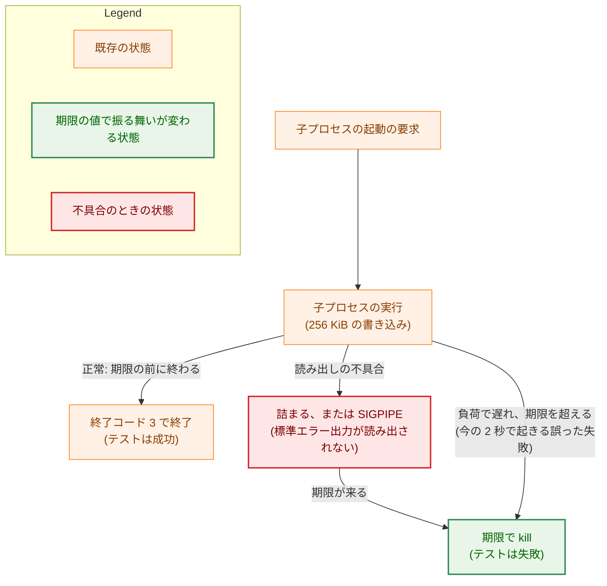
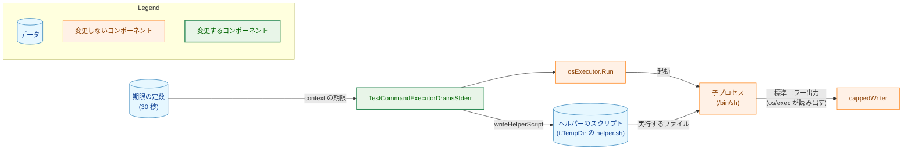
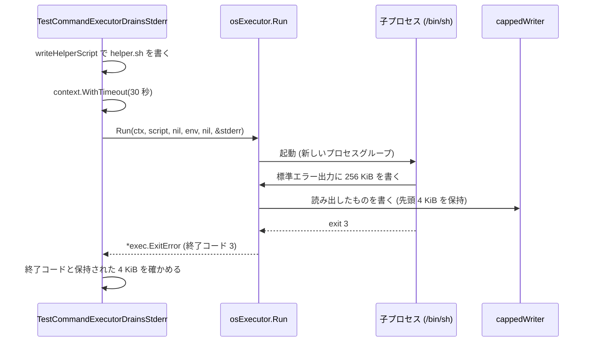
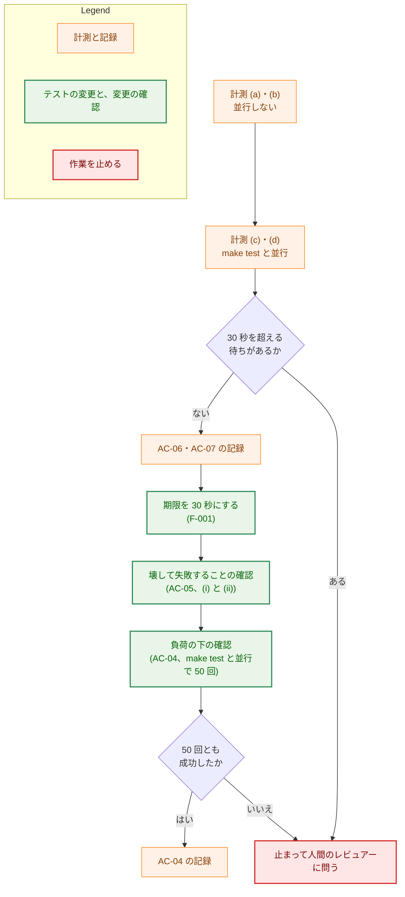
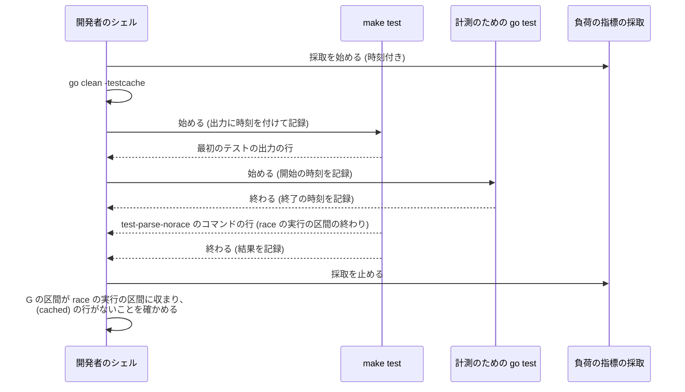

# アーキテクチャ設計書：標準エラーの読み出しのテストが負荷の下で期限を超えて失敗しないようにする

## Document Status

| Item | Value |
|---|---|
| Status | `draft` |
| Created | 2026-11-05 |
| Review date | - |
| Reviewer | - |
| Comments | - |

本書は [01_requirements.md](01_requirements.md)（要件定義書。以下、要件書）の設計である。既存のファイルについての記述は、コミット `66f3a640` のファイルで確かめた。`file:line` は、このコミットの行番号を指す。F-NNN・AC-NN は要件書の項番を指す。先行タスクの受け入れ基準は、「0002 AC-56」のようにタスクの番号を付けて書く。要件のレビューで設計に申し送られた事項（[design_handoff.md](design_handoff.md) の H-01〜H-04）への対応は、付録 A にまとめる。

本書は、要件書 6 章の用語（期限、詰まる、並行の負荷、新しいファイルの初回の検査）を同じ意味で使う。ほかに次の用語を使う。

-   **対象のテスト:** `internal/transcript` のテスト `TestCommandExecutorDrainsStderr`（`internal/transcript/exec_test.go:62-83`）。
-   **計測用のテスト:** AC-06 の計測のために一時的に置く `_test.go` のファイル。`internal/transcript` に置き、コミットしない。ソースは調査の記録に載せる（3.3）。
-   **調査の記録:** 本タスクで新しく置く文書 `04_investigation.md`。AC-04・AC-06・AC-07 の記録を置く（3.5）。
-   **race の実行の区間:** `make test` のうち、最初の `go test -tags test -race -v ./...`（`Makefile:96`）が動いている区間。`make test` は、その後に `test-parse-norace`（`Makefile:97`・`:113-114`）を `-race` なしで実行する。こちらは区間に含めない。

## 1. 設計の全体像 (Design Overview)

### 1.1. 設計原則

-   **期限は、詰まった子プロセスからテストを解放するための上限であり、正常な実行の時間を測るものではない。** 対象のテストが確かめるのは、終了コードと保持された標準エラー出力である（`exec_test.go:73-82`）。所要時間は確かめない。期限を延ばしても、確かめる内容は変わらない（要件書 1 章）。
-   **確かめる内容と、子プロセスの振る舞いは変えない。** 子プロセスが書く量（256 KiB）、終了コード（3）、2 つの確認とその失敗のメッセージは、そのまま残す（AC-02・AC-03）。変えるのは期限の値と、その定数の名前とコメントだけである。
-   **本番のコードは変えない。** `internal/transcript/exec.go` には触れない（要件書 2.3）。
-   **調査のためのコードは残さない。** 計測は一度きりの調査なので、計測用のテストはコミットせず、ソースと出力を調査の記録に残す。後から読む人は、記録のソースから計測をやり直せる。
-   **並行の負荷は、`make test` の race の実行の区間で計測する。** 観察された失敗は、`make test` などのテスト全体の実行と並行しているときに起きている（要件書 1 章）。AC-04 と、AC-06 の条件 (c)・(d) は、この区間の中で実行する。その前に `go clean -testcache` を実行し、`make test` がキャッシュの結果を使わないようにする。`make test` は `-count=1` を付けていないためである（`Makefile:96`）。
-   **計測を先に、変更を後に。** 原因の調査（F-003）を、期限の変更（F-001）の前のコミットで行う。計測するのは子プロセスの実行の時間であり、期限の値とは関係しない。ただし、30 秒を超える待ちが観察されたら、期限の値の前提が崩れる。先に計測しておけば、変更を書く前にそのことが分かる（要件書 3.2）。

### 1.2. 設計の際に決めたこと（2026-11-05）

人間のレビュアーが決めたもの:

-   **計測用のテストは、コミットしない一時的な `_test.go` とする（H-02）:** `internal/transcript` に一時的なテストのファイルを置き、本番の `osExecutor` で子プロセスを実行して時間を測る。計測が終わったら消し、ソースを調査の記録に載せる（3.3）。理由は 2 つある。1 つめに、`osExecutor` は非公開の型なので、同じ経路で測るにはパッケージの中のテストとして書く必要がある。2 つめに、一度きりの調査のために、恒久的なコードを残す必要がない。タスクの `_checks/` に置く案は採らなかった。パッケージの外からは `osExecutor` を呼べないので、実行の経路を書き直すことになり、対象のテストと同じ経路を測れなくなるためである。環境変数で有効にする常設のテストも採らなかった。調査が終わった後も、使われないコードが残るためである。ADR: 作らない。本タスクの調査の手段で、ほかのタスクを縛らないためである。
-   **AC-06 の各条件は 30 回とし、条件を交互に回す（H-02）:** 並行しない (a)・(b) を交互に 30 回ずつ、`make test` と並行する (c)・(d) を交互に 30 回ずつ実行する（3.3）。issue #684 のコメントの観察では、遅いときと速いときの時間が 10 倍以上違う（2.00 秒と 0.15 秒）。30 回あれば、この違いは中央値と最大で区別できる。交互に回すのは、時間とともに変わる負荷（`XprotectService` が動く時間帯など）が、一方の条件に偏らないようにするためである。ADR: 作らない。本タスクの計測の手順であるためである。
-   **AC-05 は、詰まる形と SIGPIPE で終わる形の両方で確かめる（H-04）:** `osExecutor` を、標準エラー出力を読み出さない 2 つの形に一時的に変える（3.4）。(i) 読み出し側を開いたまま読まないパイプの書き込み側を、子プロセスの標準エラー出力につなぐ形。子プロセスはパイプのバッファが満ちると詰まり、30 秒の期限で kill される。(ii) 読み出し側をすぐに閉じたパイプの書き込み側をつなぐ形。子プロセスは、最初の書き込みで SIGPIPE を受けて終わる。対象のテストの失敗のメッセージ（`exec_test.go:78`）は、この 2 つを見張る対象として挙げている。両方で確かめれば、メッセージの挙げる失敗の形の両方を、テストが検出できることが分かる。ADR: 作らない。本タスクの確認の手順であるためである。
-   **期限は関数の中の定数のまま、名前を変え、根拠をコメントに書く（H-01）:** 定数を `timeout` から、詰まった子プロセスを終わらせる上限であることを示す名前（例: `stuckChildBound`）に変える。コメントには、正常な実行の時間を測るものではないことと、30 秒にした理由を書く（3.2）。`helperStartBound`（`exec_test.go:427-429`）とは共通にしない。値は同じ 30 秒だが、意味が「ヘルパーが PID を記録するのを待つ上限」で、対象のテストの期限とは違うためである。共通にすると、一方の値を変えたときに、もう一方の意味まで変わる。パッケージの水準の定数にもしない。使うのは対象のテストだけだからである。ADR: 作らない。1 つのテストの定数の名前と置き場所で、`CLAUDE.md`「Design decisions (ADR)」の major に当たらないためである。

設計で決めたもの（人間のレビュアーに諮らず、理由とともに記す）:

-   **調査の記録は `04_investigation.md` に置く（H-03）:** AC-04・AC-06・AC-07 の記録を、本タスクのディレクトリの新しい文書 `04_investigation.md` に置く。タスク 0039 と同じ置き方である（`docs/tasks/0039_large_input_test_timeout/04_investigation.md`）。AC-05 の記録は、要件書のとおり、対象のテストを変更するコミットのメッセージに書く。理由は 2 つある。計測の値と手順は、実装計画の検証の行に収まる量ではない。また、記録は承認する文書ではなく、PR のレビューで中身を確かめる文書だからである。0039 と同じく、`Document Status` は持たせない。
-   **計測では、新しいファイルを、新しいパスと違う内容で作る:** 条件 (a)・(c) では、1 回ごとに新しい一時ディレクトリにスクリプトを書く。内容の末尾には、回ごとに違うコメントの行を加える（3.3）。macOS の検査が、何を単位にして結果を使い回すかは分かっていない。パスと内容の両方を変えれば、どちらが単位でも「初めて見るファイル」になる。コメントの行はシェルが読み飛ばすので、子プロセスの振る舞いは対象のテストと同じである。
-   **計測では、`go` は `make test` と同じものを使う:** 手元の既定の `go`（本書の作成時は go1.27.1。`go.mod:3` は go1.26.5）を、`GOTOOLCHAIN` を指定せずに使い、版を記録する。調べるのは、手元の `make test` と pre-commit のフックで起きる失敗である。それらと同じ版で測るためである。

### 1.3. 概念モデル

対象のテストで、子プロセスの実行がどう終わるかと、期限との関係を示す。矢印 A → B は「A の状態から B の状態に移る」ことを表す。

期限を 30 秒にしても、「読み出しの不具合 → 期限で kill」の経路は残る。消えるのは、負荷による遅れで期限を超える経路だけである。ただし、負荷の下で 30 秒を超える遅れが起きないことは、AC-04 と AC-06 の計測で確かめる（要件書 3.2）。

## 2. システム構成 (System Structure)

### 2.1. 全体の構成

対象のテストと、それが実行する本番のコードの関係を示す。矢印 A → B は「A が B を呼ぶ、または B にデータを渡す」ことを表す。

`osExecutor.Run`（`internal/transcript/exec.go:83-102`）は、`cmd.Stderr` に呼び出し側の `io.Writer` を渡す（`:92`）。`*os.File` でない `io.Writer` を渡されると、`os/exec` はパイプを作り、別のゴルーチンで読み出して `io.Writer` に書く。`cappedWriter.Write`（`:128-133`）は、先頭の `maxStderrBytes`（4 KiB。`:20`）だけを保持し、残りは捨てる。どの書き込みにも、全量を書いたと返す。そのため、読み出しは子プロセスが閉じるまで続き、子プロセスは詰まらない。期限が来ると、`cmd.Cancel` がプロセスグループに SIGKILL を送る（`:100`、`killProcessGroup`。`:106-117`）。

### 2.2. コンポーネント配置

| ファイル | 変更 | 責務 |
|---|---|---|
| `internal/transcript/exec_test.go` | 変更 | 対象のテストの期限の定数を 30 秒にし、名前とコメントを変える（3.2）。ほかのテストと、ヘルパーの関数（`writeHelperScript` など）は変えない |
| `docs/tasks/0064_stderr_drain_test_deadline/04_investigation.md` | 新規 | 調査の記録。AC-04・AC-06・AC-07 の記録を置く（3.5） |
| `docs/tasks/0064_stderr_drain_test_deadline/03_implementation_plan.md` | 新規（実装計画の段階で作る） | 各受け入れ基準の確かめ方と結果を記録する。AC-04・AC-06・AC-07 については、調査の記録の該当箇所を指す |
| `internal/transcript/` の計測用のテスト | 一時的（コミットしない） | AC-06 の計測（3.3）。計測が終わったら消し、ソースを調査の記録に載せる |
| `internal/transcript/exec.go` | 一時的に変更（コミットしない） | AC-05 の確認のために、標準エラー出力を読み出さない形に変える（3.4）。確認が終わったら戻す |

本番のコードの変更と、新しいパッケージや型はない。対象のテストのほかに、本書の変更で振る舞いが変わるテストはない。変える定数は対象のテストの関数の中にあり（`exec_test.go:63-66`）、ほかのテストからは参照されないためである。

### 2.3. データの流れ

対象のテストの 1 回の実行を示す。

期限が来た場合は、`osExecutor.Run` がプロセスグループを kill する。返るエラーは `signal: killed` の `*exec.ExitError` で、終了コードは 3 でない。テストは、終了コードを確かめる箇所（`exec_test.go:76-79`）で失敗する。

## 3. コンポーネント設計 (Component Design)

### 3.1. 型とインターフェース

新しい型とインターフェースはない。既存の `commandExecutor`（`internal/transcript/exec.go:67-74`）、`osExecutor`（`:78`）、`cappedWriter`（`:123-125`）を、そのまま使う。

### 3.2. 対象のテストの期限の定数（F-001、H-01）

対象のテストの関数の中の定数 `timeout = 2 * time.Second`（`exec_test.go:65`）を、次のように変える。

-   **値:** 30 秒（AC-01）。
-   **名前:** 詰まった子プロセスを終わらせる上限であることを示す名前にする（例: `stuckChildBound`）。具体的な名前は実装で決める。
-   **コメント:** 次の 3 点を書く（要件書 4.5）。(1) この期限は、標準エラー出力が読み出されずに子プロセスが詰まったとき、テストを終わらせるための上限であること。(2) 正常な実行の時間を測るものではないこと。(3) 負荷の下で、正常な実行が 2 秒を超えたことがあること。
-   **置き場所:** 関数の中の定数のまま、`burst` と同じ `const` のブロックに置く。

次のものは変えない（AC-02・AC-03）。

-   `burst = 256 << 10` と、スクリプトの内容（`exec_test.go:64`・`:67`）。
-   終了コードの確認と、その失敗のメッセージ（`:73-79`）。
-   保持された標準エラー出力の確認（`:80-82`）。

AC-02 の (1)・(2) は、変更しない行が確かめ続ける。要件書は、変更の後もこれらの行が残っていることを求めている。そのため、確かめ方は実装計画で `diff` による確認として定める（`docs/dev/conventions/requirements_process.md` 4 章）。

### 3.3. 原因の計測（F-003、AC-06、H-02）

#### 3.3.1. 計測用のテスト

計測用のテストは、`internal/transcript` に置く一時的な `_test.go` のファイルである。1 回の計測は、対象のテストと同じ次の手順で行う。

-   本番の `osExecutor{}.Run` で、対象のテストと同じ内容のスクリプト（256 KiB を標準エラー出力に書いて `exit 3` で終わる）を実行する。環境と標準エラー出力の受け手（`allowlistEnv(os.Environ())` と `cappedWriter`）も、対象のテストと同じにする。
-   `Run` を呼ぶ直前から、`Run` が戻った直後までの時間を、1 回の計測の時間とする。`Run` は、`exec.Cmd.Run` の中で子プロセスの起動を要求し、子プロセスの終了を受け取るまで戻らない（`exec.go:101`）。そのため、この区間は AC-06 の定める区間（親が起動を要求してから終了を受け取るまで）を含み、子プロセスが動き出す前の待ちも含む。
-   期限は 60 秒とする。30 秒を超える待ちを観察できるように、期限を対象のテストの期限より長くしている。
-   1 回ごとに、条件の名前、回の番号、時刻、時間、結果（エラーと終了コード）を、`t.Logf` で 1 行に出す。

条件ごとのファイルの作り方は次のとおり。

| 条件 | ファイル | 並行 |
|---|---|---|
| (a) | 1 回ごとに新しい一時ディレクトリに書き、末尾に回ごとに違うコメントの行を加える | `make test` と並行しない |
| (b) | 計測の前に 1 回だけ書き、1 回実行しておく（この実行は数えない）。その後は同じファイルを繰り返し実行する | `make test` と並行しない |
| (c) | (a) と同じ | `make test` の race の実行の区間の中 |
| (d) | (b) と同じ | `make test` の race の実行の区間の中 |

一時ディレクトリは、`t.TempDir()` で作る。対象のテストの `writeHelperScript` と同じ置き方である（`exec_test.go:609-616`）。`t.TempDir()` は呼ぶたびに新しいディレクトリを作るので、パスは回ごとに違う。

#### 3.3.2. 計測の手順

-   **回数と順序:** 並行しない (a)・(b) を、(a)→(b) の順で交互に 30 回ずつ、1 回の `go test` で実行する。続けて、`make test` と並行して (c)・(d) を、同じく交互に 30 回ずつ、1 回の `go test` で実行する。
-   **並行の作り方:** `go clean -testcache` の後に、`make test` を始める。`make test` の出力の各行には、時刻を付けて記録する。出力に最初のテストの行が現れたら、race の実行の区間に入ったと判断し、計測用のテストを始める。`make test` の出力に `test-parse-norace` のコマンドが現れる前に、計測の 60 回が終わっていれば有効とする。終わらなければ、その計測はすべて捨て、`go clean -testcache` からやり直す。
-   **負荷の指標:** 計測の間、別のシェルで、1 分間の負荷平均（`sysctl -n vm.loadavg`）と `XprotectService` の CPU 使用率（`ps` の出力）を、時刻を付けて一定の間隔で取る。各条件の負荷の指標は、その条件の計測の時刻に近い値から読む。
-   **実行のコマンド:** `go test -tags test -race -count=1 -v -run '<計測用のテストの名前>' ./internal/transcript`。`-race` を付けるのは、失敗が観察された `make test` と同じビルドにするためである。
-   **計測するコミット:** 対象のテストを変える前のコミットとする（1.1「計測を先に、変更を後に」）。計測用のテストは子プロセスの実行の時間を測るもので、対象のテストの期限を使わないので、どちらのコミットで測っても値は同じ意味を持つ。

計測が終わったら、計測用のテストのファイルを消す。調査の記録に、そのソース、実行したコマンド、出力から読んだ値を載せる。

#### 3.3.3. 結論の出し方（AC-07）

調査の記録は、次の比較から結論を述べる。

-   (a) と (b) の違い（並行しないときの、新しいファイルの効果）。
-   (c) と (d) の違い（並行するときの、新しいファイルの効果）。
-   (b) と (d) の違い（同じファイルでの、並行の負荷の効果）。

判断は、中央値と最大で行う。数値の閾値は事前には決めない。issue の観察では、遅いときと速いときの違いが 10 倍以上なので、主な原因であれば差は大きく現れる。差が小さく、判断が分かれる場合は、「判別できない」と結論する。

待ちそのものを減らす変更（スクリプトの使い回しなど）を別の issue として提案するかどうかと、その理由を記録に書く。提案する場合、issue の作成はネットワークの操作なので、人間のレビュアーの承認を得てから作る（`CLAUDE.md`「Tool Execution Safety」）。作った issue は、記録からリンクする。

### 3.4. 壊して失敗することの確認（F-002、AC-05、H-04）

`osExecutor.Run` の `cmd.Stderr = stderr`（`exec.go:92`）を、一時的に次の 2 つの形に変え、それぞれで対象のテストを実行する。どちらも、期限を 30 秒にした後の対象のテストで行う。

| 形 | 変え方 | 期待する結果 |
|---|---|---|
| (i) 詰まる | パイプを作り、書き込み側を `cmd.Stderr` につなぐ。読み出し側は開いたまま読まない | 子プロセスはパイプのバッファが満ちると書き込みで止まる。30 秒の期限で kill され、終了コードを確かめる箇所（`exec_test.go:76-79`）で失敗する |
| (ii) SIGPIPE | パイプを作り、書き込み側を `cmd.Stderr` につなぐ。読み出し側は起動の前に閉じる | 子プロセスは最初の書き込みで SIGPIPE を受けて終わる。終了コードを確かめる箇所で失敗する |

どちらの形も、`cmd.Stderr` に `*os.File` を渡す。`*os.File` を渡されると、`os/exec` はそのファイルを子プロセスに直接渡し、読み出しのゴルーチンを作らない。そのため、親は子プロセスの標準エラー出力を読み出さない。`cmd.Stderr = nil` の形は使わない。`os/exec` は子プロセスの標準エラー出力を null デバイスにつなぐので、子プロセスは詰まらず、保持された標準エラー出力を確かめる箇所（`:80-82`）だけで失敗する。要件書は、この形を AC-05 の確認に数えない。

(i) の経過時間は、期限の 30 秒程度と見込む。読み出しのゴルーチンがないので、`execWaitDelay`（5 秒。`exec.go:25`）の待ちは加わらない。要件書 4.1 は、最大で約 35 秒と見込んでいる。

確認が終わったら、`exec.go` を元に戻す。どう変えたか、どの箇所で失敗したか（失敗のメッセージ）、失敗までの経過時間を、対象のテストを変更するコミットのメッセージに書く（要件書 AC-05、`CLAUDE.md`「Testing Strategy」）。

### 3.5. 調査の記録（`04_investigation.md`、H-03）

調査の記録は、次のものを置く。

-   **計測の環境:** macOS の版、CPU とコア数、メモリ、`go version`、計測したコミット、計測した日時。
-   **AC-06 の計測:** 計測用のテストのソース、実行したコマンド、各条件の回数、時間の最小・中央値・最大、各条件の負荷の指標（1 分間の負荷平均、`XprotectService` の CPU 使用率）。(c)・(d) については、並行した `make test` の区間と、キャッシュの結果を使わなかったこと（`(cached)` の行がないこと）。
-   **AC-07 の結論:** 3.3.3 の比較と結論。待ちそのものを減らす変更を提案するかどうかと、その理由。提案した issue へのリンク。
-   **AC-04 の確認:** 実行したコミットと機械、並行した `make test` の結果と、キャッシュの結果を使わなかったこと、50 回の実行が race の実行の区間に収まったこと（両方の開始と終了の時刻）、50 回の結果、1 回ごとの所要時間の最大、2 秒を超えた回数、実行の開始時の負荷の指標。並行した `make test` のほかのテストが失敗した場合は、その失敗（要件書 3.2）。

1 回ごとの所要時間は、`go test -v` の出力の `--- PASS: TestCommandExecutorDrainsStderr (0.15s)` の形の行から読む。AC-04 のコマンドは、要件書の最低限の形に `-v` を加えたものとする（`go test -tags test -race -count=50 -v -run '^TestCommandExecutorDrainsStderr$' ./internal/transcript`）。`make test` と並行させる手順は、3.3.2 の「並行の作り方」と同じである。

## 4. エラーハンドリング設計 (Error Handling Design)

新しいエラーの型はない。対象のテストの失敗のメッセージは変えない（AC-02）。

-   **期限が来たとき:** `osExecutor.Run` は `signal: killed` の `*exec.ExitError` を返す。テストは、今と同じメッセージ（`exec_test.go:78`）で失敗する。メッセージは、標準エラー出力が読み出されないことによる詰まりと SIGPIPE を、見張る対象として挙げている。
-   **失敗までの時間:** 子プロセスが詰まったときは、期限の 30 秒が来るまでテストは失敗しない。今の 2 秒より長くなる（要件書 3.2・4.1）。

計測と確認の途中で起きたことの扱いは、要件書 3.2 のとおりとする。

| 起きたこと | 扱い |
|---|---|
| AC-04 の 50 回のうち 1 回でも失敗した | 作業を止めて、人間のレビュアーに問う（決定の変更として扱う） |
| AC-06 の計測で、30 秒を超える待ちが観察された | 同上。計測用のテストの期限は 60 秒なので、30 秒を超える待ちも観察できる（3.3.1）。60 秒の期限が来た回は、30 秒を超えた回として扱う |
| AC-04 の実行中に、並行した `make test` のほかのテストが失敗した | その失敗を記録する。AC-04 の結果は無効にしない。その失敗は別の issue で扱う |
| 計測の 60 回、または AC-04 の 50 回が race の実行の区間に収まらなかった | その実行を捨て、`go clean -testcache` からやり直す（3.3.2） |

## 5. セキュリティ考慮事項 (Security Considerations)

N/A。本タスクは、テストの期限の値と名前の変更と、手元での計測だけを扱う。本番のコードは変えない。`yt-dlp` の実行、API キーと Webhook の URL、キャッシュのディレクトリ、ネットワークへの送信、信頼できないテキストの埋め込みのどれにも触れないので、`docs/dev/security.md` を適用する条件に当たらない（要件書 4.2）。AC-05 で `exec.go` を一時的に変えるが、その変更はコミットしない。計測用のテストのスクリプトも、テストが書く固定の内容だけを実行する。

## 6. 処理フローの詳細 (Processing Flow Details)

### 6.1. 作業の流れ

計測、変更、確認の順序を示す。矢印 A → B は「A の後に B を行う」ことを表す。

### 6.2. `make test` と並行させる手順

AC-04 と、AC-06 の (c)・(d) で共通の手順を示す。

## 7. テスト戦略 (Test Strategy)

### 7.1. 単体テスト

対象のテストを変更する（3.2）。新しいテストは加えない。受け入れ基準ごとの確かめ方は次のとおり。具体的な手順と結果の置き場所は、実装計画で定める。

| AC | 確かめ方 |
|---|---|
| AC-01 | 期限の定数の値が 30 秒であることを、コードを読んで確かめる |
| AC-02 | 終了コードと保持された標準エラー出力の確認、および失敗のメッセージ（`exec_test.go:73-82`）が、変更の前後で同じであることを、`diff` で確かめる。(1)・(2) が実際に確かめられていることは、AC-05 の確認（(1)）と、変更の後のテストの成功（(1)・(2)）で分かる |
| AC-03 | `burst` とスクリプトの内容（`:64`・`:67`）が、変更の前後で同じであることを、`diff` で確かめる |
| AC-04 | `make test` と並行して 50 回実行し、調査の記録に記録する（3.5） |
| AC-05 | `exec.go` を 2 つの形に壊して実行し、コミットのメッセージに記録する（3.4） |
| AC-06 | 計測用のテストで 4 条件を計測し、調査の記録に記録する（3.3） |
| AC-07 | 調査の記録の結論を読んで確かめる（3.3.3） |

AC-02・AC-03 は変更の前後の関係を述べる基準なので、常設のテストにはしない（`docs/dev/conventions/requirements_process.md` 4 章）。

### 7.2. 結合テスト

N/A。外部のサービスや、パッケージをまたぐ振る舞いは変えない。

### 7.3. セキュリティテスト

N/A（5 章）。

## 8. 実装の優先順位 (Implementation Priorities)

1.  原因の計測（3.3）。対象のテストを変える前のコミットで行う。30 秒を超える待ちが観察されたら止まる。
2.  調査の記録に、AC-06・AC-07 の記録を書く。
3.  期限の定数を変える（3.2）。
4.  壊して失敗することを確かめる（3.4）。結果を、3 のコミットのメッセージに書く。
5.  負荷の下で確かめる（AC-04）。調査の記録に、AC-04 の記録を書く。

1〜5 は 1 つの PR に収まる量と見込む。PR の区切りは実装計画で決める。

## 9. 将来の拡張性 (Future Extensibility)

-   **ほかのテストの期限:** 実プロセスを短い期限で実行するテストは、ほかにもある（例: `internal/cmdrunner/runner_test.go:76-91`）。それらが同じ形で失敗したら、別の issue で扱う（要件書 2.3）。その判断の材料として、本タスクの調査の記録（遅れの主な原因）を使える。
-   **待ちそのものを減らす変更:** 新しいファイルの初回の検査が主な原因と分かった場合、スクリプトを使い回すなどの変更が候補になる。本タスクでは行わず、AC-07 の記録に従って別の issue で扱う。

## 付録 A. 設計への申し送り（design_handoff.md）への対応

| 項目 | 対応 |
|---|---|
| H-01: 期限の定数と、その根拠の書き方 | 関数の中の定数のまま、名前を変え、根拠をコメントに書く。`helperStartBound` とは共通にしない（1.2、3.2） |
| H-02: 原因の計測の方法 | コミットしない一時的な計測用のテストで、本番の `osExecutor.Run` の前後の時間を測る。新しいファイルは、新しいパスと違う内容で作る。各条件 30 回、交互に回す。`make test` の race の実行の区間で計測し、`go clean -testcache` でキャッシュを使わせない。負荷の指標は別のシェルで時刻付きで採る（1.2、3.3） |
| H-03: 記録を置く文書 | `04_investigation.md` に AC-04・AC-06・AC-07 の記録を置く。AC-05 の記録は、コミットのメッセージに書く（1.2、3.5） |
| H-04: AC-05 の壊し方 | 読み出さないパイプ（詰まる）と、読み出し側を閉じたパイプ（SIGPIPE）の 2 つの形で確かめる。`cmd.Stderr = nil` は詰まらないので使わない（1.2、3.4） |
