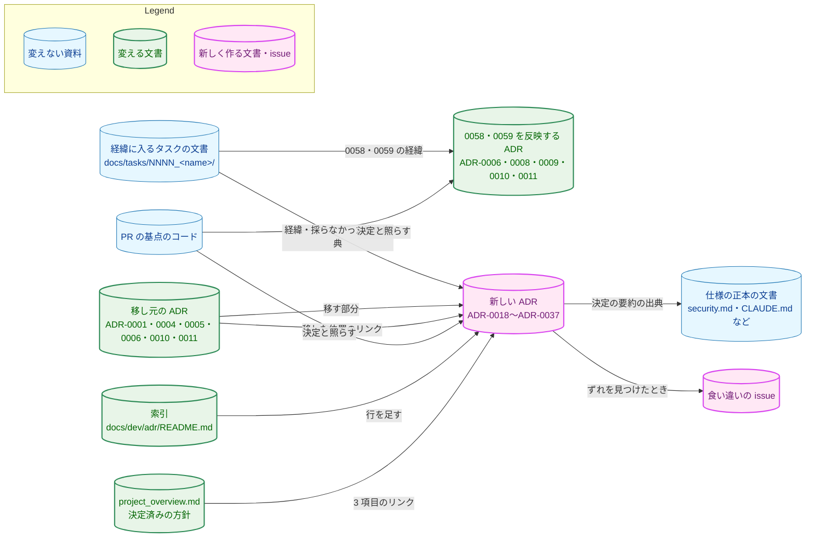
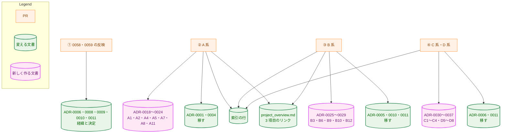
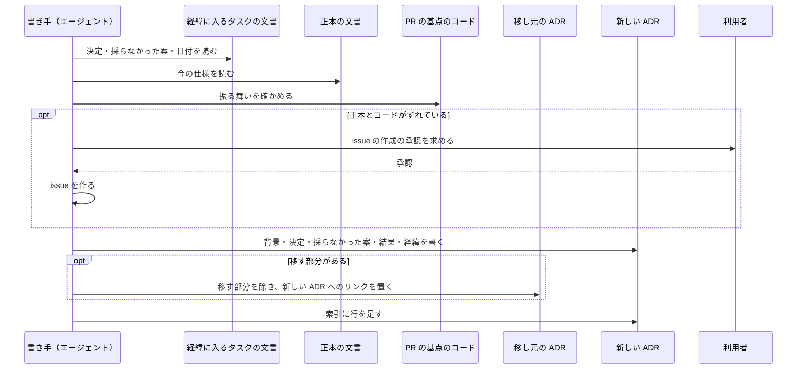
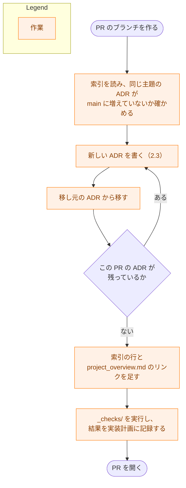

# アーキテクチャ設計書：ADR の残りの候補 20 件と、0058・0059 の決定の反映

## Document Status

| Item | Value |
|---|---|
| Status | `draft` |
| Created | 2026-11-06 |
| Review date | - |
| Reviewer | - |
| Comments | - |

本書は [01_requirements.md](01_requirements.md)（要件定義書。以下、要件書）の設計である。既存のファイルについての記述は、コミット `622db232` のファイルで確かめた。`file:line` は、このコミットでの行番号を指す。F-NNN・AC-NN は要件書の項番、H-NN は [design_handoff.md](design_handoff.md) の項番を指す。申し送りの H-01〜H-05 への対応は付録 A に、受け入れ基準との対応は付録 B にまとめる。調査の番号（A1・B3 など）は、要件書 6 章の定義のとおり、issue #602 のコメント（2026-11-04）で ADR の候補に付けた番号である。

本書は、要件書 6 章の用語（ADR、主題、候補、調査の番号、出典のタスク、仕様の正本の文書、PR の基点、有効）を同じ意味で使う。そのほかに、次の用語を使う。

-   **規約:** ADR の書式と運用の規約、`docs/dev/conventions/adr.md`。
-   **移す:** 既存の ADR の「決定」の一部が新しい ADR の主題に属するとき、その部分を既存の ADR の「決定」から除き、新しい ADR の「決定」に書き、除いた位置から新しい ADR へリンクすること（AC-02）。
-   **移し元・移し先:** 移す部分を持っていた既存の ADR と、それを受け取る新しい ADR。
-   **経緯に入るタスク:** ある ADR の「経緯」に 1 項目以上を持つタスク（AC-05）。どのタスクが入るかの規則は 3.3 で定める。
-   **決定を記録する節:** タスク文書のうち、決定を記録する節。要件定義書の「issue #N で決めたこと」「要件定義の際に決めたこと」などの節、設計書の本文、実装計画の「計画の際に決めたこと」「実装の際に決めたこと」を指す。要件定義書の機能要件・互換性・スコープ外の節は含めない（1.2）。

## 1. 設計の全体像 (Design Overview)

### 1.1. 設計原則

-   **20 件は、すべて新しい ADR にする。** 調査の結果、20 件のどの候補も、既存の ADR と同じ主題ではなかった。重なりは、既存の ADR の「決定」の一部が候補の主題に属する形である（3.1）。そこで、候補ごとに新しい ADR を作り、重なる部分を既存の ADR から移す。1 つの主題は有効な ADR のうち 1 本だけに属する（規約「Location and naming」の Subject）。
-   **決定は書き換えず、置き場所だけを移す。** 移した部分の文の意味は変えない。移し元の ADR の「経緯」の項目は、当時の事実としてそのまま残す（1.2）。
-   **仕様は正本の文書に残す。** 正本の文書がある主題では、ADR の「決定」は決定を要約して正本へリンクし、表・列挙・規則の一覧を書き写さない（AC-07）。正本の文書がない主題（A8・C1）では、ADR の「決定」が決定そのものを述べる（3.2）。
-   **ADR はコードに合わせる。** 「決定」の節は PR の基点のコードの振る舞いと食い違わないようにする。正本の文書とコードのずれを見つけたら、ADR にはコードの振る舞いを書き、ずれを issue にしてリンクする（AC-03。3.5）。
-   **確かめは、0060 の `_checks/` を写して使う。** 恒久的なテストは足さない（要件書 2.3）。ADR と索引の構造は、既存の `TestADRRecords` が確かめる（7 章）。

### 1.2. 設計の際に決めたこと（2026-11-06）

利用者に確かめて決めたこと:

-   **A1 と A2 は、それぞれ新しい ADR にし、ADR-0001 から重なる部分を移す（H-01）。** A1（段階を interface にすること）は `TranscriptSource`・`Publisher` を含むパイプラインの全体に及ぶ。A2（`internal/strictjson`）は、LLM のアダプタのほかに `internal/server`・`internal/nmhost`・`internal/fixprguard` など 10 個以上のパッケージが使う（`docs/dev/adr/0001-llm-adapter-stdlib.md:28`）。どちらも、LLM のアダプタという ADR-0001 の主題より広い。ADR-0001 には、SDK を使わないこと、`llmhttp`、プロバイダ固有のパラメータの型が残る。ADR-0001 の主題を広げる案は、主題が LLM の外に広がるので採らない。ADR の判断：本タスクの作業範囲の決定であり、タスクの中で閉じるので、ADR は作らない。
-   **B12 は、B3 と別の ADR にする（H-01）。** 0060 の前例（主題ごとに 1 本）に合わせる。110 という値の理由（Service Worker のアイドルの時間）は、B3 の決定（TypeScript・MV3・バンドラなし・固定の ID・Chrome と Brave）と独立して変わりうる。ADR の判断：同上。
-   **D8 は、2 つの決定（deadcode の範囲、パースの時間を `-race` なしのビルドで確かめること）を 1 本の ADR にまとめる（H-01）。** 承認済みの要件の表では、D8 は 1 件の主題であり、AC-01 は各主題がちょうど 1 本の ADR に入ることを求める。2 本に分けると、要件の「20 件」を 21 の主題と読み替えることになる。題名に 2 つの決定を明記する。ADR の判断：同上。
-   **PR は 4 本に分け、0058・0059 の反映（F-002）を最初にする（H-04）。** ① F-002、② A 系 7 本、③ B 系 5 本、④ C 系と D 系の 8 本である。ADR-0008・ADR-0009・ADR-0010 の「決定」は、今のコードと食い違っている（3.4）。この食い違いを、20 本を書き終えるのを待たずに直すため、F-002 を先にする。各 PR の新しい ADR は 5〜8 本になる。ADR の判断：同上。
-   **移し元の ADR の「経緯」には、移したことの項目を足さない（H-01）。** 規約の経緯は、決定を下したときと変えたときの記録である（規約「History entries」）。置き場所を移しても、決定は変わらない。移したことは、移し元の「決定」に置くリンクで辿れる。移し元の経緯にある既存の項目（たとえば ADR-0001 の 0003 の項目）は、当時の決定の記録なので、そのまま残す。ADR の判断：同上。
-   **仕様の正本の文書がコードより狭いだけで矛盾しない場合も、AC-03 の食い違いとして issue にする。** 例は、`docs/dev/security.md:144` が「版のメンバ `v` を持たない」メッセージの拒否だけを述べ、コードは `v` が `1` でないメッセージも拒否すること（`internal/nmhost/relay.go:462-467`）である。正本を後で直す手がかりを残すためである。ADR の判断：同上。
-   **後のタスクが方針を保ったことを経緯に入れるのは、そのタスクが決定を記録する節で明記した場合だけにする（AC-05・AC-11）。** 要件書の「決定の節で方針を明示して保った」に合わせる。互換性・スコープ外・機能要件の節で「従来どおり」と当てはめただけのものは入れない。ADR の判断：同上。

レビュアーに個別には確かめず、上の決定と現行の規則から導いたこと（PR のレビューで異論があれば改める）:

-   **移す部分に結び付いた「採らなかった案」と「結果」の項目も、移し先へ移す。** 決定と、その代わりに採らなかった案を別の ADR に置くと、案の理由が決定から離れる。移した項目の出典は、移し先の経緯に入るタスクの文書なので、AC-04 に反しない。
-   **新しい ADR の番号は、調査の番号の順に `0018`〜`0037` を割り当てる（3.1）。** 0060 の前例と同じである。
-   **同じ決定が 2 本の ADR の主題に触れるときは、両方の経緯に 1 項目ずつ書く（H-02）。** 規約は経緯を ADR ごとの記録と定めており、2 本に書くことを禁じていない。たとえば 0058 の T-10 の再評価は、ADR-0006（脅威モデル）と B6 の ADR（記事のキー）の両方の主題に触れる。それぞれの経緯の要旨は、その ADR の主題から見た変化を書く。
-   **要件書 F-001 の B12 の出典の説明の誤りは、本書に記録し、要件書は変えない。** 要件書は「最初の値（103）を決めた 0046」とするが、0007 が 102 に決め、0020 が 103 に上げ、0046 は 103 を保っただけである（3.3）。0046 は保ったタスクとして経緯に入るので、AC-05 は満たせる。

### 1.3. なぜ既存の ADR の更新では足りないか

20 件の主題は、既存の 17 本のどれとも一致しない（3.1）。たとえば B9（結果が分からないときは自動で送り直さない）は、拡張・ホスト・サーバ・Webhook の 4 つにまたがる方針で、ADR-0011 が持つのは Webhook の部分だけである（`docs/dev/adr/0011-webhook-publishing.md:18`・`:22`）。既存の ADR を更新して候補を入れると、1 本の ADR が 2 つの主題を持つことになり、主題の一方が変わるたびに他方まで書き換えることになる。

### 1.4. 概念モデル

矢印 A → B は「A の内容が B に入る、または A が B へリンクする」を表す。

移し元の ADR と、0058・0059 を反映する ADR は、ADR-0006・ADR-0010・ADR-0011 で重なる。それらは ① で経緯と「決定」を直し、③・④ で移す（8 章）。

## 2. システム構成 (System Structure)

### 2.1. 全体構成

PR ごとに変える文書を示す。矢印 A → B は「A の PR が B を変えるか作る」を表す。PR は ① → ② → ③ → ④ の順にマージする（8 章）。

`project_overview.md` のリンクは、A1 の ADR へのリンクを ② で、B3・B6 の ADR へのリンクを ③ で足す（3.6）。

### 2.2. コンポーネント配置

| ファイル | 種類 | 変更 | 担う要件 | PR |
|---|---|---|---|---|
| `docs/dev/adr/0018-*.md`〜`0037-*.md` | ADR（日本語） | 新規 20 本 | F-001（AC-01〜AC-07） | ②〜④ |
| `docs/dev/adr/0006-threat-model.md` | ADR | 変更（経緯に 0058。C1 の部分を移す） | AC-08、AC-02 | ①・④ |
| `docs/dev/adr/0008-launch-path.md` | ADR | 変更（「決定」と経緯に 0058） | AC-11 | ① |
| `docs/dev/adr/0009-viewer-opening.md` | ADR | 変更（「決定」と経緯に 0058） | AC-11 | ① |
| `docs/dev/adr/0010-extension-stores-nothing.md` | ADR | 変更（「決定」と経緯に 0058。B6 の部分を移す） | AC-09・AC-11、AC-02 | ①・③ |
| `docs/dev/adr/0011-webhook-publishing.md` | ADR | 変更（経緯に 0059。B9・C1 の部分を移す） | AC-10、AC-02 | ①・③・④ |
| `docs/dev/adr/0001-llm-adapter-stdlib.md` | ADR | 変更（A1・A2 の部分を移す） | AC-02 | ② |
| `docs/dev/adr/0004-production-profile.md` | ADR | 変更（A11 の部分を移す） | AC-02 | ② |
| `docs/dev/adr/0005-server-architecture.md` | ADR | 変更（B6 の部分を移す） | AC-02 | ③ |
| `docs/dev/adr/README.md` | 索引 | 変更（20 行を足す） | AC-14 | ②〜④ |
| `docs/dev/project_overview.md` | 方針の要約 | 変更（3 項目の末尾にリンク） | AC-13 | ②・③ |
| `docs/tasks/0065_adr_remaining/_checks/` | 1 回だけの確認 | 新規 | AC-05・AC-08〜AC-10・AC-12・AC-13 ほか（7 章） | 計画で決める |
| GitHub の issue（AC-03 の食い違い） | issue | 見つけたときだけ新規 | AC-03 | ②〜④ |

変えないもの: CLAUDE.md（AC-07）、規約 `docs/dev/conventions/adr.md` と `.claude/commands/`（要件書 2.3）、仕様の正本の文書（要件書 2.3）、`docs/tasks/` の下の本タスクのディレクトリの外の文書（AC-12）、ADR-0002・ADR-0003・ADR-0007・ADR-0012〜ADR-0017（3.1・3.4 のとおり、変える部分がない）。

この変更が振る舞いを変える既存のテストはない。新しい ADR と索引の行は、既存の `TestADRRecords`（`cmd/yt2column/adr_test.go`）と `TestInstructionDocPaths`（`cmd/yt2column/docpaths_test.go`）の対象に、追加の設定なしで入る。

### 2.3. データフロー：1 本の新しい ADR を書く

矢印は、作業の順と、作業が読み書きする文書を表す。

## 3. コンポーネント設計 (Component Design)

Go の型・interface・エラー型は加えない。本タスクは文書だけを変える。`_checks/` のプログラムは 1 回だけの確認で、製品のコードではない（7 章）。

### 3.1. 候補の振り分けと番号（H-01・AC-01・AC-02）

20 件の候補を、次の新しい ADR に振り分ける。予定の番号は、ほかのタスクが間に ADR を足さなければこのとおりになる。ほかのタスクが先に番号を取ったときは、規約「Location and naming」と「Taking in `main`」に従って次の空き番号を使う。`<kebab>` の名前は実装計画で決める。

| 予定の番号 | 調査の番号 | 主題 | 移す部分（移し元の `file:line`） | PR |
|---|---|---|---|---|
| 0018 | A1 | 段階を interface にし、型を持つパッケージを分け、番兵はプロバイダに依存するかで置き場所を分ける | ADR-0001 の「決定」の 2 つ目の項目（`internal/llm` の型と番兵。`0001-llm-adapter-stdlib.md:25`）と、3 つ目の項目のうち番兵を各アダプタに残す文（同 `:26`）。番兵の置き場所の採らなかった案 2 つ（同 `:38`・`:39`）と、結果の最後の項目（同 `:50`） | ② |
| 0019 | A2 | 厳格な JSON の部品を `internal/strictjson` に集め、不透明な型にし、負でない整数の規則を 1 つにする | ADR-0001 の「決定」の 5 つ目の項目（同 `:28`）と、採らなかった案 2 つ（同 `:36`・`:37`）。背景の「応答の厳格な検証」の項目（同 `:17`）は、A2 の ADR へのリンクに改める | ② |
| 0020 | A4 | `LLMClient` の契約：モデル名・版・使用量を返し、打ち切りなどのエラーでも返す | なし（ADR-0001 の `:25` は型の置き場所だけを述べ、A1 へ移る） | ② |
| 0021 | A5 | 料金の概算を `internal/pricing` に置き、整数で正確に計算する | なし | ② |
| 0022 | A7 | 中間生成物を保存し、途中から再開する | なし | ② |
| 0023 | A8 | 環境変数の読み取りを `internal/config` と決めた場所に限る | なし | ② |
| 0024 | A11 | Claude の出力の上限を 40,000 にし、ストリーミングを使わない | ADR-0004 の「決定」の最後の項目（`0004-production-profile.md:22`） | ② |
| 0025 | B3 | 拡張の基盤：TypeScript と MV3、バンドラなし、固定の ID、Chrome と Brave だけ | なし（ADR-0005 `:22`・ADR-0006 `:20` の `allowed_origins` は、ホストと脅威モデルの主題として残す） | ③ |
| 0026 | B6 | ジョブの API、HMAC の記事キー、メモリのキャッシュ（同じ入力は作り直さない） | ADR-0005 の「決定」の 5 つ目の項目のうち、`202` で受け付けてジョブをメモリで動かす文（`0005-server-architecture.md:21`。上限の文は ADR-0005 に残す）。ADR-0010 の「決定」の「サーバの状態はメモリにだけ置く」の項目（`0010-extension-stores-nothing.md:19`） | ③ |
| 0027 | B9 | 結果が分からないときは自動で送り直さず、投稿の操作を冪等にする | ADR-0011 の「決定」の 4 つ目の項目の最後の文「投稿は冪等ではないので、自動で再送しない」（`0011-webhook-publishing.md:18`）と、8 つ目の項目（投稿の冪等性。同 `:22`）。自動のリトライの採らなかった案（同 `:29`）は Webhook の主題として ADR-0011 に残し、B9 の ADR からリンクする | ③ |
| 0028 | B10 | 拡張の UI を英語と日本語の 2 言語にし、表示の言語は `resolveLocale` の 1 か所で決める | なし | ③ |
| 0029 | B12 | `minimum_chrome_version` を 110 にする | なし | ③ |
| 0030 | C1 | 秘密を `secret.Secret` 型のクロージャで持つ | ADR-0006 の「決定」の 4 つ目の項目のうち、秘密を `secret.Secret` で持ち出力に漏らさない文（`0006-threat-model.md:20`。`allowed_origins` の文は残す）。ADR-0011 の「決定」の 6 つ目の項目のうち、Webhook URL を `secret.Secret` で持つ文（`0011-webhook-publishing.md:20`。`*url.Error` を直す文は Webhook の主題として残す） | ④ |
| 0031 | C2 | testdata に置く実データは、再配布できるライセンスのものに限る | なし | ④ |
| 0032 | C3 | 字幕のキャッシュを 2 つのスロットとポインタで持ち、成功したら既定で消す | なし（ADR-0010 の記事のキャッシュは別のキャッシュで、B6 に移る） | ④ |
| 0033 | C4 | テンプレートで使える構文を許可リストで絞り、出典のリンクはコードで付ける | なし（ADR-0002 `:17` は段階の順序だけを述べる） | ④ |
| 0034 | D5 | 言語の方針（文書・コード・GitHub）、README の同期の印、PR のタイトルと squash の件名の言語 | なし | ④ |
| 0035 | D6 | タスク文書の状態の記録：Comments、変更履歴、PR の説明の分担 | なし | ④ |
| 0036 | D7 | テストを削除したことは、カバレッジの比較で確かめる | なし（ADR-0014 は `coveragecompare` を Go の道具に置くことを述べ、その主題に残す。ADR-0014 の「決定」の `coveragecompare` の項目（`0014-deterministic-checks-in-go.md:22`）から D7 の ADR へリンクする） | ④ |
| 0037 | D8 | deadcode の範囲と、パースの時間を `-race` なしのビルドだけで確かめること | なし | ④ |

**既存の ADR の題名。** 移したあとも、移し元の ADR の題名は変えない。ADR-0001 の題名の「共有の型」は、設定とアダプタが共有するパラメータの型（`claudeparam`・`deepseekparam`）として、移したあとも当たる。ADR-0004・ADR-0005・ADR-0006・ADR-0010・ADR-0011 の題名は、移す部分を名指ししていない。題名を変えないので、AC-14 の後半の対象はない。

**移した位置の書き方。** 移し元の「決定」の、移した部分があった位置に、新しい ADR の名前を挙げてリンクする文を置く（例：「Webhook URL の持ち方は [ADR-0030](0030-<kebab>.md) が定める」）。この文は、移し元の ADR が自分の決定として述べることに当たらない（AC-02）。

### 3.2. 主題ごとの仕様の正本の文書（H-05・AC-07）

ADR の「決定」は、次の正本の文書へリンクし、その表・列挙・規則の一覧を書き写さない。正本の文書が「なし」の主題では、ADR の「決定」が決定を述べる。

| 調査の番号 | 仕様の正本の文書（節） |
|---|---|
| A1 | CLAUDE.md「Key Design Patterns」の「Separation of Concerns」「Interface-based Design」、`docs/dev/project_overview.md`「パイプライン」、`docs/dev/conventions/package_reference.md` のパッケージの表 |
| A2 | `docs/dev/conventions/package_reference.md` の `internal/strictjson` の行 |
| A4 | `docs/dev/project_overview.md`「パイプライン」の `LLMClient` の項目 |
| A5 | `docs/dev/guides/pricing_update.md`、`docs/dev/guides/cli.md`「推定の料金」 |
| A7 | `docs/dev/guides/cli.md`（「使い方」のフラグの表、「生成の後の工程」、「トークンの使用量」）、`docs/dev/security.md` §5「キャッシュディレクトリ」 |
| A8 | なし（規則を定めているのはテスト `internal/config/envaccess_test.go:59-81` だけである） |
| A11 | `docs/dev/guides/claude_output_limit.md`、`docs/dev/production_profile.md` |
| B3 | CLAUDE.md「Extension Commands」「Dependencies」、`docs/dev/security.md` §8.1「ブラウザ拡張」 |
| B6 | `docs/dev/guides/development.md`「ジョブの API」、`docs/dev/security.md` §8 と §8.2「Native Messaging のホスト」 |
| B9 | `docs/dev/security.md` §8.1「ブラウザ拡張」・§8.2・§3「外部への送信」、`docs/dev/guides/development.md`「ジョブの API」 |
| B10 | CLAUDE.md「Key Design Patterns」の「Declare, don't infer」の `resolveLocale` の例外と、「Go Idioms」の拡張の段落 |
| B12 | `extension/static/manifest.json` |
| C1 | なし（今の文書は、秘密を `secret.Secret` で持つことだけを述べ、クロージャの設計を述べていない。`docs/dev/security.md:141`、`docs/dev/conventions/package_reference.md:28`） |
| C2 | `docs/dev/security.md` §7「リポジトリに保存する実データ」、`testdata/README.md` |
| C3 | `docs/dev/cache_consistency.md` |
| C4 | `prompts/README.md`、`docs/dev/security.md` §6 |
| D5 | CLAUDE.md「Document language」「Translation Guidelines (Japanese to English)」「Language」「Go Idioms」、`.claude/commands/_context.md`「PR title and squash subject」、`.claude/commands/mktrans.md` |
| D6 | `docs/dev/conventions/requirements_process.md`「Editing an approved document」「Document Status Format」「Comments」「Change history」「Documents without a change history」「Recording in the PR description」 |
| D7 | CLAUDE.md「Testing Strategy」の「Deleting a test is a claim that must be checked」、「Test Commands」「Extension Commands」の coverage-compare の項目 |
| D8 | CLAUDE.md「Code Quality」の `make deadcode`、「Test Commands」の `make test` と `make test-parse-norace` |

CLAUDE.md を正本とする主題（A1・B3・B10・D5・D7・D8）では、規則の文を ADR に移さず、CLAUDE.md に残す（CLAUDE.md「Design decisions (ADR)」の「The rules and cross-cutting principles of this file are not ADRs」）。ADR は ADR-0016 と同じく、規則へリンクし、理由・採らなかった案・経緯を持つ。

### 3.3. 経緯に入るタスク（AC-05・H-02）

**規則。** ADR の「経緯」には、PR の基点までに、その主題の決定を下したか変えたタスクを、それぞれ 1 項目以上入れる。後のタスクが決定を記録する節で方針を保つと明記した場合も入れる（1.2）。決定を当てはめただけのタスクは入れない。日付は規約「History entries」の「Date of an entry copied from an existing decision」に従う。

**調査で見つかったタスク。** 次の表は、`622db232` で出典の文書を調べた結果である。「出典のタスク」の列は要件書 F-001 の表のもの、「ほかに入るタスク」の列は調査で見つかったものである。実装で出典を読み直してほかのタスクが見つかったときは、規則に従って経緯に入れる。表の「入れない」は、要件書 F-001 の出典のタスクのうち経緯に入れないもので、AC-05 が求める理由を添える。

| 調査の番号 | 出典のタスク | ほかに入るタスク |
|---|---|---|
| A1 | 0001・0003・0009（0009 は設計書 §1.1 で 0003 の番兵の方針を保った） | 0062（設計書 §3.4。`Publisher` を満たす実装を `FilePublisher` だけにした） |
| A2 | 0003・0019・0023 | 0010（設計書 §3.5.3。`CollectOnly`・`AsBool` を足した）、0044（設計書 §3.10。`Value.Raw` を足し、`Object.Has` の契約を変えた） |
| A4 | 0001・0003・0019 | 0022（設計書の付録 A。アダプタが時刻を返す案を採らず、`GenerateResponse` の形を保った） |
| A5 | 0022 | 0042（設計書「1.2. 設計の際に決めたこと（2026-10-25）」。料金表のモデル名を既定のモデルの定数と分けたまま保った） |
| A7 | 0017 | 0019（使用量を記録に足し、形式の版を上げた）、0022（`call_time` を足し、形式の版を 3 にした） |
| A8 | 0005・0011（0011 は設計書 §3.14 で、読み取りを許す場所に `cmd/yt2column-server/main.go` を足した） | 0026（設計書 §3.8。`cmd/yt2column-nmhost/main.go` を足した）、0055（設計書 §3.11。`cmd/coveragecompare` を足した） |
| A11 | 0041 | 0009（設計書 §3.6。非ストリーミングと `max_tokens` 16,000 を決めた。0041 がこれを変えた） |
| B3 | 0007 | 0026（設計書。ホストの登録先を Chrome と Brave に限った）、0050（設計書 §3.15。バンドラを加えない方針を保った） |
| B6 | 0044・0058・0059 | 0050（要件定義書「要件定義の際に決めたこと（2026-10-29）」。拡張を新しい API に移し、旧形式を送らなくした） |
| B9 | 0020・0026・0050 | 0011（設計書 §3.8.1。通信の失敗の後に拡張が自動で送り直さないことを求めた）、0044（要件定義書「要件定義の際に決めたこと（2026-10-27）」。投稿の操作を冪等にし、届かなかった最初のメッセージから再開する） |
| B10 | 0007（要件定義書 F-001。UI を英語だけにした最初の決定）・0043 | 0050（要件定義書「issue #503 で決めたこと」。2 言語をビューアにも当てはめた） |
| B12 | 0046（設計書 §1.1 で 103 を保った）・0050 | 0007（設計書 §3.1。102 にした）、0020（設計書 §3.1。103 に上げた）、0026（設計書 §3.7.1。103 を保った） |
| C1 | 0001 | なし |
| C2 | 0002 | なし（`docs/dev/security.md` §7 を書いたのはタスクに属さない PR #101 で、経緯には入れず背景で触れる） |
| C3 | 0002・0005 | なし |
| C4 | 0004 | 0010（設計書。許可リストの検査を字数の調整と検証・推敲のテンプレートにも当てはめた） |
| D5 | 0032・0040（要件定義書「issue #488 で決めたこと」で言語の規則を保った）・0043・0048 | 0052（要件定義書「issue #591 で決めたこと」で `TestReadmeSyncMarker` を保った）、0060（設計書「1.2. 設計の際に決めたこと（2026-11-04）」。原則 (a) に `docs/dev/adr/` を足した）、0061（設計書 1.2。確かめ直しのスクリプトの日本語のリテラルの例外を足した） |
| D6 | 0053・0056 | 0060（要件定義書「要件定義の際に決めたこと（2026-11-04）」。記録の置き場所に ADR を足した） |
| D7 | 0027・0038・0052・0054・0055 | なし |
| D8 | 0039・0047 | 0015（実装計画。パースの期限を race のビルドの `make test` でも満たすとした最初の決定。0039 がこれを変えた） |

**入れないもの。** 要件書 F-001 の出典のタスクのうち、経緯に入れないものはない。

**判断に迷ったが入れないもの（参考）。** 次のタスクは、決定を記録する節ではなく機能要件・互換性・スコープ外の節で方針を当てはめただけなので、経緯に入れない（1.2）。

-   B3：0027（要件定義書 §4.4「対象のブラウザは、従来どおり Chrome と Brave」）。
-   B9：0016（要件定義書 F-003。失敗の通知を送り直さない。この経路は 0059 で削除された）、0058（要件定義書 §4.2）。
-   B12：0027・0043（要件定義書 §4.4 で 103 を保った）。
-   C1：0003・0005・0006・0009・0011・0016（型を当てはめただけで、型を変えていない）。
-   C2：0015・0024・0029（要件定義書の受け入れ基準で当てはめた）。
-   C4：0008（要件定義書 §2.3）、0028（要件定義書の機能要件）。
-   D7：0046（実装計画 §1.2「実装の方針」で関数の実行の回数を比べた。0054 が後でこれを規則にした）、0059・0062（道具の限界を、それぞれのタスクに限った扱いとして記録した。D7 の ADR の「結果」に限界として書く）。
-   D8：0064（期限は子プロセスが止まったときの打ち切りで、性能の確かめではない）。

**同じ決定を 2 本の経緯に書くもの（H-02）。** 0058 の T-10 の再評価は ADR-0006 と B6 の ADR に、0059 の旧 API の削除は ADR-0011（失敗の通知の削除）と B6 の ADR（旧 API と `v` の判別の削除）に、それぞれ書く。要旨は、その ADR の主題から見た変化にする。

### 3.4. 0058・0059 の照合（F-002・AC-08〜AC-11・H-02）

ADR-0001〜ADR-0017 のそれぞれについて、0058・0059 が主題の決定を下したか変えたか（決定を記録する節で方針を保った場合を含む）を判断した。照らした節は、両タスクの要件定義書の「issue #N で決めたこと」「要件定義の際に決めたこと（2026-11-03）」「設計のレビューで決めたこと（2026-11-04）」、設計書の本文（§1.2〜§1.4・§5 と付録）、実装計画の「計画の際に決めたこと」「実装の際に決めたこと」、`design_handoff.md` である。

| ADR | 0058 | 0059 | 「決定」の変更 |
|---|---|---|---|
| 0001 LLM のアダプタ | いいえ：LLM のアダプタと `strictjson` に触れない | いいえ：削除した `internal/failure` は `strictjson` の使い手の一覧（`0001-llm-adapter-stdlib.md:28`）にない | なし |
| 0002 生成の後の段階 | いいえ：記事を作る段階に触れない | いいえ：同じ | なし |
| 0003 LLM の設定 | いいえ：環境変数を変えない | いいえ：`SLACK_WEBHOOK_URL` の警告の文言だけを変え、設定の契約は変えない | なし |
| 0004 本番の構成 | いいえ | いいえ：`production_profile.md` から `/articles` の記述を除いただけで、構成を決めていない | なし |
| 0005 サーバの構成 | いいえ：同じ動画の応答とキャッシュの判定はジョブの API の主題（B6）に属する。実行ファイル・UDS・HTTP/1.1・ホストの中継は変えない | いいえ：受け付ける操作をジョブの API に限り、`v` のないメッセージを拒否したのは、ジョブの API とホストの形式の主題（B6）に属する。構成は変えない | なし（③ で B6 の部分を移す） |
| 0006 脅威モデル | **はい**：要件定義書「要件定義の際に決めたこと（2026-11-03）」。脅威 T-10 を、排除する脅威ではなく、信頼の境界の内側で受け入れるリスクとして再評価した | いいえ：信頼する相手と排除する相手の決定を変えない | なし（「決定」と「結果」に、今のコードと食い違う文はない。経緯に 1 項目を足す） |
| 0007 字幕の入力 | いいえ：同じ動画の判定は動画 ID で行い、字幕の入力は利用者の選択のまま | いいえ：拡張に触れない | なし |
| 0008 起動の経路 | **はい**：要件定義書「要件定義の際に決めたこと（2026-11-03）」。副ボタン「現在の選択範囲で生成する」を加え、主ボタンは照会付きで送る | いいえ：拡張に触れない | **あり**：「主ボタンを押したときだけ」（`0008-launch-path.md:18`・`:20`・`:36`）は、副ボタンからも生成の開始を送る今のコード（`extension/src/launch.ts:602-608`）と食い違う。生成の開始を送るボタンを、主ボタンと副ボタンの 2 つと書き直す |
| 0009 ビューアの開き方 | **はい**：要件定義書「要件定義の際に決めたこと（2026-11-03）」。照会付きで送って開いたビューアのタブは、同じ動画の既存の記事を表示する。設計書 §1.2（2026-11-04）で、引き継ぎの印を残すことを決めた | いいえ | **あり**：ビューアを開くのは主ボタンだけではない（`extension/src/startCoordinator.ts:355-380`）。ポップアップの状態に「選択」を足し、照会付きの開始で既存の記事を表示することを書き足す |
| 0010 拡張は何も保存しない | **はい**：要件定義書「issue #593 で決めたこと」（2026-11-04）。拡張に記事の履歴を保存しない（`chrome.storage` を使わない方針を保つ）と明記した。設計書 §1.2 でビューアの URL に `e` を足した | いいえ：拡張は対象外（要件定義書 2.3） | **あり**：ビューアの URL に持つ値の列挙（`0010-extension-stores-nothing.md:21`）に `e` がなく、キーを持つ条件（「受け付けた後」）が、同じ動画の応答の後にキーを持つ今のコード（`extension/src/core/viewerUrl.ts:25-31`・`:54-62`）より狭い |
| 0011 Webhook への投稿 | いいえ：同じ動画の応答は Webhook に通知しない（要件定義書 §4.2）。0011 の主題の決定ではない | **はい**：要件定義書「issue #526 で決めたこと」（2026-11-04）。旧 API の失敗の通知（`internal/failure`・`SlackFailureNotifier`）を削除し、サーバが Webhook へ送るのを利用者の投稿の操作だけにした | なし（「決定」と「結果」は通知の経路があると述べていない。経緯に 1 項目を足す。採らなかった案の「新しい API の失敗を…」（`0011-webhook-publishing.md:36`）は、旧 API がなくなったので「ジョブの API の失敗を…」と改める） |
| 0012 軽量プロセス | いいえ：関係しない | いいえ：関係しない | なし |
| 0013 レビューの体制 | いいえ：PR の分け方を決めただけ | いいえ：同じ | なし |
| 0014 Go の開発ツール | いいえ | いいえ：実装計画 §1.3 で `coveragecompare` を使わずタスクの `_checks/` で確かめたのは、そのタスクの中の選択で、道具の方針を変えていない | なし |
| 0015 信頼しないスレッド | いいえ | いいえ | なし |
| 0016 文書のテスト | いいえ：実装計画 §1.3 は `_checks/` を使わないとしただけ | いいえ：設計書 §1.4・実装計画 §1.6 は、削除の確認を 1 回だけの `_checks/` で行うと決めた。対象はコードのテストで、文書のテストという ADR-0016 の主題の外である | なし |
| 0017 ビューアの描画 | いいえ：0063 より前 | いいえ | なし |

**「決定」を直す ADR の経緯。** ADR-0008・ADR-0009・ADR-0010 の「決定」を直すのは、0058 が決定を変えたためである。それぞれの経緯に 0058 の項目を足し、「決定」を項目の決定に合わせる（規約「Changing, retiring, and withdrawing」の「The decision changes」）。直す文の言い方は実装計画で決める。

**F-002 と B6 の ADR の分担。** 0058 の照会の操作（`mode`、同じ動画の判定、最新の記事だけを示すこと）と、0059 の旧 API と `v` の判別の削除は、B6 の ADR（③）の「決定」と「経緯」に書く。① では書かない。① の時点で B6 の ADR はまだないためである。

### 3.5. 正本の文書とコードのずれ（AC-03）

調査で、次のずれが見つかった。ADR の「決定」にはコードの振る舞いを書き、ずれの内容と issue へのリンクを書く。issue は、その ADR を書く PR の中で、作る前に利用者の承認を得て作る（CLAUDE.md「Tool Execution Safety」）。実装でほかのずれが見つかったときも、同じく扱う。

| 主題 | 正本の文書 | コード | PR |
|---|---|---|---|
| A2 | `docs/dev/conventions/package_reference.md:29` の `internal/strictjson` の使い手の一覧に、`internal/server`・`internal/nmhost`・`internal/codexreview`・`internal/coveragecompare` がない | この 4 つも `strictjson` を使う | ② |
| B6 | `docs/dev/security.md:144` と `docs/dev/conventions/package_reference.md:51` は、版のメンバ `v` を持たないメッセージを拒否することを述べるが、`v` の値が `1` でなければならないことを述べる文はない | `v` が `1` でないメッセージも拒否する（`internal/nmhost/relay.go:462-467`） | ③ |
| B10 | `README.md:574` は、ポップアップが利用者の言語で表示されるとだけ述べる | ビューアも同じ言語で表示する（`extension/src/viewerApp.ts:178`） | ③ |
| C4 | `docs/dev/security.md:71` は、出典のリンクを「Slack に投稿する前に」コードで付けるとする | 出典のブロックは、保存・ビューア・投稿のどれに使う記事にも付く（`internal/writer/output.go:220`）。CLI は 0062 から投稿しない | ④ |

正本の文書がない A8 と C1（3.2）は、ずれではなく正本の欠けである。issue にせず、ADR の「決定」がコードの振る舞いを述べる。

### 3.6. 索引と project_overview.md（AC-13・AC-14）

-   **索引:** 新しい ADR を作る PR で、その ADR の行を索引の表の末尾に足す。番号・題名・状態は ADR と同じにする（規約「Index」）。
-   **`project_overview.md`:** 「決定済みの方針」の次の 3 項目の末尾に、`[ADR-NNNN](adr/NNNN-<kebab>.md)` の形のリンクを足す。項目の要約の文は変えない。0060 と同じく、項目の行の末尾に、半角の空白 1 つとリンクだけを足す。

| 項目 | リンク先 | PR |
|---|---|---|
| 言語 | B3 の ADR | ③ |
| 実行形式 | B6 の ADR | ③ |
| LangChain 相当のフレームワークや、複数プロバイダを束ねる抽象化ライブラリは使わない | A1 の ADR | ② |

## 4. エラーハンドリング設計 (Error Handling Design)

本タスクは Go の製品コードを変えないので、エラー型を加えない。

作業の中の失敗の扱い:

| 場面 | 扱い |
|---|---|
| 正本の文書とコードがずれている（AC-03） | ADR にはコードの振る舞いを書き、ずれを issue にしてリンクする。issue の作成はネットワークの操作なので、その都度利用者の承認を得る（3.5） |
| 出典の文書に、採らなかった案の理由がない | 理由を補わず、「理由は記録されていない」と書く（規約「Writing an ADR」、AC-04） |
| 3.3 の表にないタスクが、主題の決定を下したか変えていた | 3.3 の規則に従って経緯に入れる。本書の表は直さない（表は調査の結果で、規則が正である） |
| 移す部分の境界が、1 つの文の中にある | 文を分け、移し先の主題に属する部分だけを移す。分けられないときは、移し元に残して移し先からリンクし、PR の説明に挙げる |
| `main` を取り込んだら、同じ主題の ADR か同じ番号の ADR が `main` にあった | 規約「Taking in `main`」に従って直す |
| ほかのタスクが、本タスクの PR の間に移し元の ADR を変えた | 規約「Taking in `main`」の 3 に従い、ADR を読み直して「決定」と経緯の最後の項目を合わせる |

## 5. セキュリティ考慮事項 (Security Considerations)

### 5.1. 脅威モデル

N/A。本タスクは ADR・索引・`project_overview.md` と、1 回だけの確認のプログラムだけを変える。外部コマンドの起動、API キーや Webhook URL の扱い、キャッシュ、ネットワークへの送信、信頼しない文字列の埋め込みのどれも変えない（要件書 4.2）。C1・C2・C3・C4・B6・B9 はセキュリティに関わる主題だが、本タスクは既存の決定を記録するだけで、変えない。

### 5.2. 残余のリスクと注意

-   **記録の誤りが、後の設計を誤らせる。** ADR は設計の前に読む資料である（索引の説明）。ADR の「決定」がコードと食い違えば、後のタスクが誤った前提で設計する。3.4 の 3 本（ADR-0008・ADR-0009・ADR-0010）はすでに食い違っているので、① で先に直す。新しい ADR は、PR の基点のコードと照らして書く（AC-03）。
-   **移すときに、セキュリティの決定が両方の ADR から落ちる。** C1 の移しでは、ADR-0006 と ADR-0011 の秘密の扱いの文を除く。移し先の C1 の ADR に同じ内容がないまま移し元から除くと、決定がどの ADR にも書かれなくなる。移すことと移し先に書くことを同じ PR・同じコミットで行い、PR のレビューで移し元と移し先の対応を確かめる（7 章）。

## 6. 処理フロー詳細 (Processing Flow Details)

### 6.1. PR ごとの流れ

矢印は作業の順を表す。

① は新しい ADR を作らず、3.4 の 5 本の ADR の経緯と「決定」を直す。② 〜 ④ はこの図のとおりに進める。

### 6.2. 1 本の ADR の中身を決める

-   **背景:** 主題で決定が要る理由と、決定を縛る前提を、経緯に入るタスクの文書から書く。
-   **決定:** PR の基点のコードの振る舞いに合う、今の決定だけを書く。正本の文書がある主題では要約してリンクする（3.2）。移す部分は、移し元の文の意味を変えずに書く。
-   **採らなかった案:** 経緯に入るタスクの `docs/tasks/<task>/` の下のすべての文書（実装計画の「計画の際に決めたこと」「実装の際に決めたこと」、`design_handoff.md`、調査の記録を含む）と `project_overview.md` から拾う（AC-04、要件書 1 章「採らなかった案は、経緯に入るタスクのすべての文書から拾う」）。理由がなければ「理由は記録されていない」と書く。
-   **結果:** 決定が後のタスクと部品に課す制約と、受け入れた代償を、出典の文書から書く。
-   **経緯:** 3.3 の規則で入るタスクごとに 1 項目以上を、決定が `main` に入った順に並べる。

## 7. テスト戦略 (Test Strategy)

### 7.1. ユニットテスト

N/A。恒久的なテストは足さない（要件書 2.3）。ADR と索引の名前・番号・節・状態・索引の行は、既存の `TestADRRecords` が `make test` と CI の `doc-guard` ジョブで確かめる（AC-14）。ADR の中のリンクの実在は、既存の `TestInstructionDocPaths` が確かめる。

### 7.2. 結合テスト

N/A。結合する部品がない。

### 7.3. 1 回だけの確認（`_checks/`）

前後の関係と、どのファイルへのリンクがあるかという値を述べる受け入れ基準は、0060 の `_checks/` を写した 1 回だけの確認で確かめる（`requirements_process.md` §4）。各 PR で 1 回実行し、出力と、マージの基点と head のコミット ID を実装計画に記録する。

| 確かめること | 写す元 | AC |
|---|---|---|
| `docs/tasks/` の下で、本タスクのディレクトリの外のファイルが変わっていない | `docs/tasks/0060_adr_records/_checks/task_docs_unchanged.sh`（`task` の変数を本タスクに変える） | AC-12 |
| 各新しい ADR の経緯に、3.3 の表の各タスクの文書へのリンクがある | `docs/tasks/0060_adr_records/_checks/adrlinks/main.go` の `history-sources` | AC-05 |
| ADR-0006・ADR-0008・ADR-0009・ADR-0010 の経緯に 0058 の文書へのリンクが、ADR-0011 の経緯に 0059 の文書へのリンクがある | 同 `history-sources` | AC-08〜AC-11 |
| 移し元の ADR の「決定」に、移し先の ADR へのリンクがある | 同じプログラムに足す | AC-02 |
| `project_overview.md` の 3 項目の文が、足したリンクを除いて変わっておらず、リンク先が 3.6 の表の ADR である | 同 `overview-items` | AC-13 |
| CLAUDE.md が、マージの基点と head で同じである | 同じプログラムに足す | AC-07 |

ADR は番号ではなく `<kebab>` で探す。ほかのタスクが先に番号を取ると番号が変わるためである（0060 の `adrlinks` と同じ）。まだ書いていない ADR の項目は `PENDING` として失敗と分け、最後の PR（④）では `PENDING` がないことを求める。プログラムの構成と確かめ方の詳細は実装計画で決める。

### 7.4. 読んで確かめる（manual）

文の内容を定める受け入れ基準は、PR のレビューで読んで確かめる。読みやすくするため、各 PR の説明に次のものを挙げる。

-   新しい ADR ごとに、「決定」の各項目の出典（正本の文書の節、コードの `file:line`）と、「採らなかった案」の各項目の出典（AC-03・AC-04）。
-   移し元の ADR ごとに、除いた文と、移し先の ADR でそれを述べる項目の対応（AC-02、5.2）。
-   作った issue と、その ADR の位置（AC-03）。

### 7.5. セキュリティテスト

N/A（5.1）。

## 8. 実装の優先順位 (Implementation Priorities)

| PR | 中身 | 前提 |
|---|---|---|
| ① 0058・0059 の反映 | ADR-0006・ADR-0010・ADR-0011 の経緯に項目を足す。ADR-0008・ADR-0009・ADR-0010 の「決定」を今のコードに合わせ、経緯に 0058 の項目を足す。ADR-0011 の採らなかった案の「新しい API」を改める（3.4） | なし |
| ② A 系 | ADR-0018〜ADR-0024 の 7 本、ADR-0001・ADR-0004 からの移し、索引の 7 行、`project_overview.md` の A1 へのリンク | ① のマージ |
| ③ B 系 | ADR-0025〜ADR-0029 の 5 本、ADR-0005・ADR-0010・ADR-0011 からの移し、索引の 5 行、`project_overview.md` の B3・B6 へのリンク | ② のマージ |
| ④ C 系・D 系 | ADR-0030〜ADR-0037 の 8 本、ADR-0006・ADR-0011 からの移し、ADR-0014 から D7 へのリンク、索引の 8 行 | ③ のマージ |

-   ② → ③ → ④ は、この順にマージする。番号は抜けなく続く必要があり（規約「Location and naming」）、予定の番号（3.1）は前の PR の番号に続くためである。
-   ① と ③・④ は、ADR-0006・ADR-0010・ADR-0011 を共に変える。① を先にマージすれば、③・④ は ① の後の ADR から移す。
-   `_checks/` のプログラムは ① で作る。① は新しい ADR を作らないので、ADR-0018〜ADR-0037 の項目は `PENDING` になる。

## 9. 将来の拡張 (Future Extensibility)

-   **正本の文書の欠けを埋める。** A8 と C1 には仕様の正本の文書がない（3.2）。後のタスクがその主題の文書を書いたら、ADR の「決定」をその文書へのリンクと要約に改める。
-   **本タスクより前からある ADR 同士の重なり。** 本タスクは、新しい ADR を作ったことで生じる重なりだけを扱う（要件書 2.3）。たとえば ADR-0005 と ADR-0006 は、どちらもヘッダを検査しないことを述べている。重なりを解くのは、その主題を変える後のタスクに任せる。
-   **35 件の候補の外の主題。** 0060 より後のタスクの決定は、CLAUDE.md の規則に従って、決定を下した PR が ADR に記録する。

## 付録 A: 申し送り（design_handoff.md）への対応

| 項目 | 対応 | 本書の箇所 |
|---|---|---|
| H-01 候補の振り分けと、ADR の本数・番号 | 20 件をすべて新しい ADR にし、`0018`〜`0037` を調査の番号の順に割り当てる。A1・A2 は ADR-0001 から、A11 は ADR-0004 から、B6 は ADR-0005・ADR-0010 から、B9 は ADR-0011 から、C1 は ADR-0006・ADR-0011 から、重なる部分を移す。B3 と D7 は既存の ADR と重なるが、既存の ADR の主題として残し、リンクだけにする。移したことは移し元の経緯に書かない | 1.2、3.1 |
| H-02 0058・0059 の照合の記録 | 17 本の判断と理由を 3.4 の表にする。経緯に入れなかった出典のタスクの理由は 3.3 に挙げる（該当はない）。同じ決定が 2 本の ADR の主題に触れるときは、両方の経緯に書く | 1.2、3.3、3.4 |
| H-03 受け入れ基準を確かめる方法 | AC-12 は `task_docs_unchanged.sh` を写した `diff`。AC-02・AC-05・AC-07〜AC-11・AC-13 の値の部分は 0060 の `adrlinks` を写したプログラム。AC-14 は既存の `TestADRRecords`。文の内容は manual | 7 章、付録 B |
| H-04 PR の分け方 | ① F-002、② A 系、③ B 系、④ C 系と D 系の 4 本。この順にマージする | 1.2、8 章 |
| H-05 主題ごとの仕様の正本の文書 | 3.2 の表。A8 と C1 は正本の文書がない | 3.2 |

## 付録 B: 受け入れ基準との対応

| AC | 設計の箇所 | 確かめ方の種類（詳細は実装計画） |
|---|---|---|
| AC-01 | 3.1 | manual（主題と ADR の対応表を実装計画に置く）。ADR の構造は `TestADRRecords` |
| AC-02 | 3.1 | diff（`_checks/`：移し元から移し先へのリンク）、manual（移し元が移した決定を述べていないこと） |
| AC-03 | 3.5、6.2 | manual（PR の説明の出典の一覧と issue） |
| AC-04 | 6.2 | manual（PR の説明の出典の一覧） |
| AC-05 | 3.3 | diff（`_checks/`：経緯のリンク）、manual（要旨と日付） |
| AC-06 | 3.4、6.2 | manual |
| AC-07 | 3.2 | diff（`_checks/`：CLAUDE.md が変わっていない）、manual（書き写していないこと） |
| AC-08 | 3.4 | diff（`_checks/`：0058 へのリンク）、manual |
| AC-09 | 3.4 | diff（`_checks/`：0058 へのリンク）、manual |
| AC-10 | 3.4 | diff（`_checks/`：0059 へのリンク）、manual |
| AC-11 | 3.4 | diff（`_checks/`：経緯のリンク）、manual（判断の表と「決定」） |
| AC-12 | 7.3 | diff（`_checks/task_docs_unchanged.sh`） |
| AC-13 | 3.6、7.3 | diff（`_checks/`：項目の文とリンク先）。リンクの実在は `TestInstructionDocPaths` |
| AC-14 | 3.6 | test（`TestADRRecords`） |
