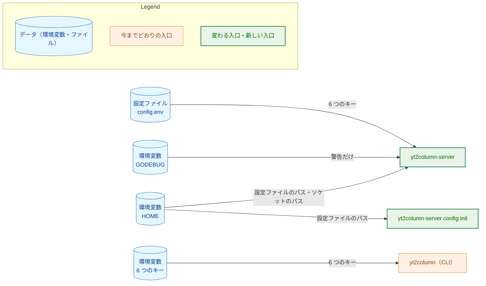
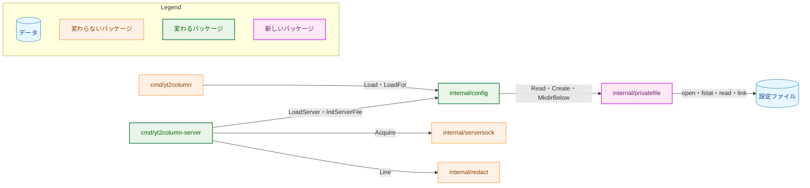
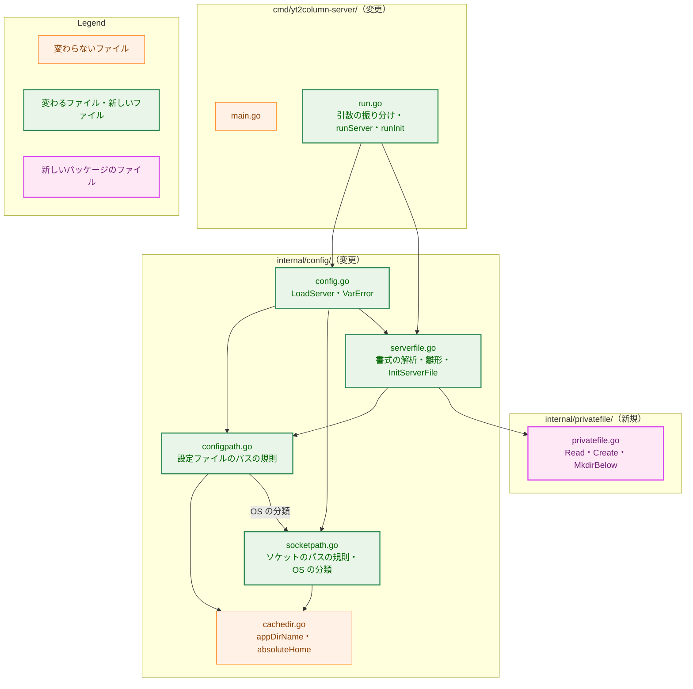
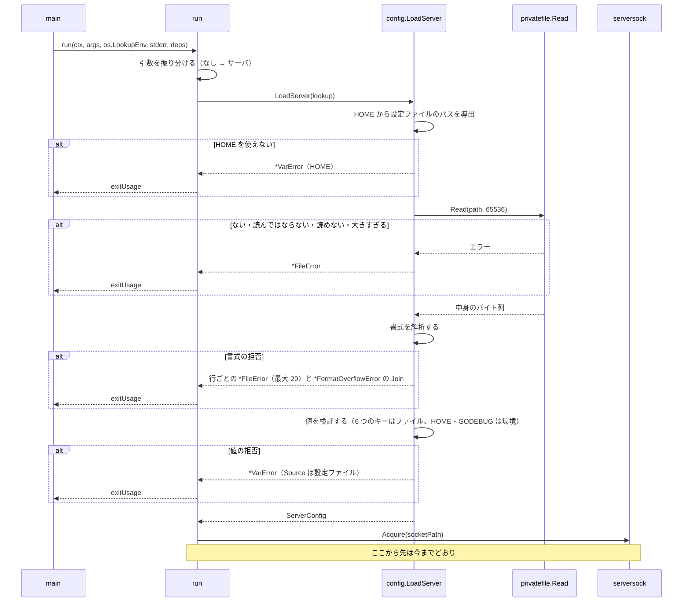
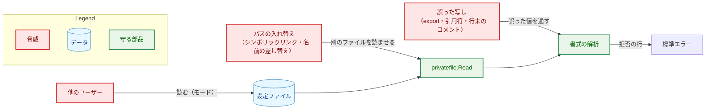
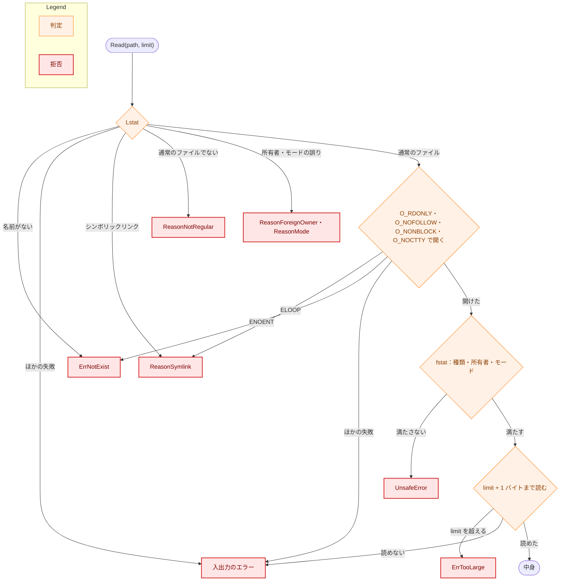
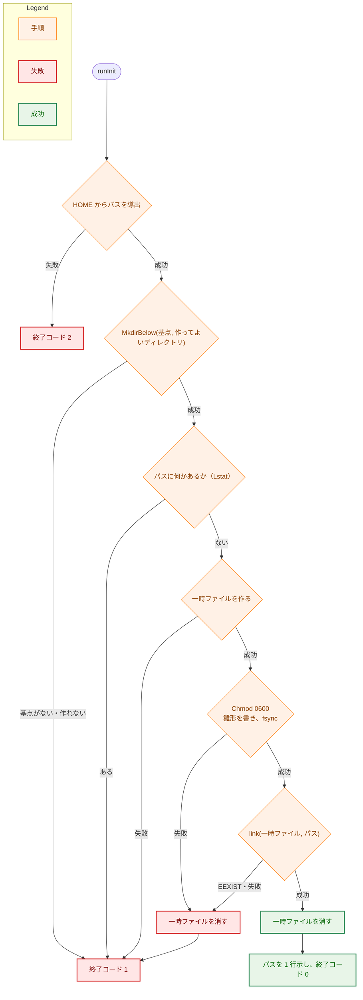

# 設計書：サーバが設定ファイルを読むようにする

## Document Status

| Item | Value |
|---|---|
| Status | `approved` |
| Created | 2026-11-06 |
| Review date | 2026-11-06 |
| Reviewer | isseis |
| Comments | - |

## 1. 設計の全体像 (Design Overview)

### 1.1. 目的と範囲

本書は、[01_requirements.md](01_requirements.md)（以下「要件」）の F-001 から F-008 を実現する設計を定める。localhost サーバ（`yt2column-server`）は、LLM と Webhook の設定（要件の「6 つのキー」）を、`HOME` から導出した決まった場所の設定ファイルから読む。サブコマンド `yt2column-server config init` は、その雛形を作る。CLI（`yt2column`）は今までどおり環境変数を読み、廃止した 5 つの LLM の変数の検査だけをやめる。

本書が引くコードの内容と行番号は、コミット `00682d91`（`main`）で確認したものである。見出しなどに付けた H-01 から H-10 は、[design_handoff.md](design_handoff.md)（設計への申し送り）の項目番号で、10 章に対応表がある。

### 1.2. 設計原則

-   **ファイルの操作と設定の意味を分ける。** ファイルを安全に開いて読み、安全に作る処理は、新しいパッケージ `internal/privatefile` に置く。このパッケージは設定のことを知らない。キーの名前・書式・雛形・パスの規則は `internal/config` が持つ。秘密の変数の名前を書けるのは `internal/config` だけだからである（`internal/config/envaccess_test.go:59` の `secretEnvNames`）。
-   **検査は開いた記述子に対して行う。** 種類・所有者・モードの検査と、中身の読み込みは、同じファイル記述子に対して行う。パスに対する `Lstat` は、メッセージを選ぶためと、FIFO などを開かずに早めに拒否するためだけに使う。`Lstat` の結果は拒否には使うが、許可には使わない。読んでよいと決めるのは、記述子に対する検査だけである（AC-19a）。
-   **値の検証は 1 つだけにする。** ファイルの値は、今の `loadLLM`・`loadSlackWebhook` に `LookupFunc` として渡して検証する。ファイル用の値の検証は書かない（要件 4.5）。ファイルに固有なのは書式だけで、空の値も環境変数のときと同じく値の検証で扱う（要件の「空の値は、環境変数と同じく値の検証で扱う」）。
-   **入口ごとに、読む場所を 1 つにする。** サーバのコードが環境から読むのは `HOME` と `GODEBUG` だけで、6 つのキーはファイルからだけ読む。どちらの `LookupFunc` から読むかは、`LoadServer` の中でキーごとに固定する。値の中身を見て選ぶことはしない。
-   **直さずに拒否する。** 書式の誤りと権限の誤りは、どちらも直さずに拒否する。サーバは設定ファイルにもその親にも書かない（`CLAUDE.md`「Reject, don't normalize」）。
-   **終了コードは失敗した手順で決める。** 今の `run` の規則（`cmd/yt2column-server/run.go:23-28`）を保ち、メッセージを見て選ばない。

### 1.3. 設計の際に決めたこと（2026-11-06）

-   **ファイルの操作は新しいパッケージ `internal/privatefile` に置く。** このパッケージが持つのは、所有者だけが読める通常のファイルを検査して読むこと、そういうファイルを新しく作ること、決まった親の下にディレクトリを作ること、の 3 つである。`internal/config` は、パスの規則・書式の解析・雛形・値の検証を持つ。理由: `internal/config` は今まで環境変数を読んで検証するだけのパッケージで（`internal/config/config.go:1-3`）、syscall と OS ごとのファイルを入れると責務が混ざる。ADR: なし（`internal/privatefile` を使うのは `internal/config` だけで、ほかの部品や後のタスクに使うことを求めない。境界は `package_reference.md` に記録する）。
-   **`internal/serversock` の検査の型と小さな関数は共有しない。** `serversock` にも、`ErrUnsafe`・`UnsafeError`・`UnsafeReason`（`String()` で利用者向けの文を持つ）と、所有者を確かめる `ownedBy`・特別なビットの `specialBits` がある（`internal/serversock/serversock.go:48-134`・`367-370`）。`privatefile` は同じ形の型を自分で持ち、`UnsafeReason` も `String()` で文を持つ形にそろえる。共有しない理由: `serversock` の `UnsafeReason` はディレクトリとソケットに関するもの（グループが書ける親、ソケットのモードなど）で、設定ファイルの `UnsafeReason`（通常のファイルでないこと、ファイルのモードなど）と重ならない。型を 1 つにすると、ソケットと設定ファイルの拒否の分類が互いのパッケージに漏れる。重なるのは数行の所有者とビットの判定だけで、`serversock`（信頼の境界にあるパッケージ）を変えるほどの重さはない。ADR: なし。
-   **ACL は検査も除去もしない。** 要件定義書の「ACL は検査せず、残余リスクとして受け入れる」のとおりである。そのため `internal/privatefile` は OS ごとのファイルを持たず、Unix に共通の 1 つの実装で書ける。`syscall.Syscall6` と `unsafe` は使わない。macOS の拡張 ACL を標準ライブラリだけで検出・除去できることは PoC で確かめたが（付録 B）、CGO を使わずに除去するには Apple が文書化していない syscall が要り、文書化された libc の API を使うには CGO が要る。どちらでも OS に依存するコードが入り、それを Linux だけで動く CI でテストできない。この実装と保守のコストを防げるリスクと比べて、採らなかった。ADR: [ADR-0018](../../dev/adr/0018-server-config-file.md) を更新する。
-   **書式の拒否は、拒否した行を行番号順に最大 20 行まで報告する。** 21 行目以降は、拒否した行の数だけを 1 行で示す。書式の拒否が 1 つでもあれば、値の検証には進まない。理由: `.envrc` から `export X="..."` を 6 行写した場合でも 1 回で直せ、値の検証の報告がすべてをまとめて示すのとも揃うため。上限は、64 KiB のファイルの拒否が標準エラーを埋め尽くさないためである。ADR: なし（このタスクの中で閉じる）。
-   **`config init` は、一時ファイルに書いてから `link` で置く。** 同じディレクトリに一時ファイルを作り、モードを整えて雛形を書き、`fsync` してから `os.Link` で設定ファイルのパスに置き、一時ファイルを消す。`link` は既存の名前を上書きしないので、パスに何かあれば作らない（AC-24）。プロセスが途中で強制終了されても、設定ファイルのパスに書きかけは現れない（AC-25）。理由: 設定ファイルのパスに直接 `O_EXCL` で作る案では、強制終了や電源断のときに書きかけが残りうるため。ADR: なし（このタスクの中で閉じる）。
-   **`LoadServer` の引数は、今と同じ 1 つの `LookupFunc` のままにする。** `LoadServer` が、`HOME` からの設定ファイルのパスの導出、ファイルの検査と読み込みと書式の解析、値の検証を順に行う。理由: `main` が `os.LookupEnv` を渡す場所は 1 つのまま保て（`cmd/yt2column-server/main.go:16-20`）、`run` の手順 1 の形も変わらないため。ADR: なし（関数の形で、このタスクの中で閉じる）。
-   **設定ファイルのキーの拒否は、`VarError` に出どころを持たせて示す。** `VarError` に `Source` を加える。ゼロ値は今の形（`<名前>: <理由>`）で、`LoadServer` は設定ファイルのキーの拒否の出どころを「設定ファイル」にする。理由: 値の検証のコード（`loadLLM` など）を CLI と共有したまま、拒否の行を設定ファイルのキーとして示せるため（AC-05）。ADR: なし（型の形で、このタスクの中で閉じる）。
-   **書式の解析は「Declare, don't infer」の新しい例外にしない。** 解析は、ファイルの中身（最初のバイトの `#` と最初の `=`）で行の種類を決める。これは、要件 F-003 が宣言した文法を読むことで、要件 5 章が許した「受理する形の解析（行の種類・キー）」の範囲に収まる。キーは 6 つの名前との完全な一致で決め、合わない行は広く読まずに拒否する。`CLAUDE.md` に例外を足す必要がない理由はこれである。ADR: なし。

### 1.4. 概念モデル

設定ファイルと環境変数のどちらから何を読むかを、次の図に示す。矢印 A → B は「A の値を B が読む」を表す。



サーバは、環境変数の 6 つのキーを読まない（図に矢印がない）。`config init` は 6 つのキーをどこからも読まない（AC-22）。

## 2. システム構成 (System Structure)

### 2.1. 全体構成

パッケージの依存を次の図に示す。矢印 A → B は「A が B を呼ぶ、または B のファイルを操作する」を表す。



`internal/privatefile` は `//go:build unix` で、OS ごとのファイルは持たない。`internal/config` はこれを import するので、Unix でだけビルドされる。3 つの実行ファイルは、すでに Unix だけを対象にしている（`internal/serversock/serversock.go:1`、`internal/cachelock/cachelock.go:1` が `//go:build unix`）。要件 4.4 も macOS と Linux だけを対象にする。


### 2.2. コンポーネント配置

矢印 A → B は「A が B の関数を呼ぶ」を表す。ファイルの分け方は実装計画で変えてよい。



### 2.3. データの流れ

サーバの起動を次の図に示す。



`config init` の流れは 6.3 に示す。

## 3. コンポーネント設計 (Component Design)

### 3.1. `internal/privatefile`（新規）

所有者だけが読める通常のファイルを、検査して読み、また新しく作る。設定のことは知らず、受け取ったパスとバイト列だけを扱う。

```go
//go:build unix

package privatefile

// Mode is the only mode Read accepts and Create sets: 0600, without the
// setuid, setgid, or sticky bit.
const Mode fs.FileMode = 0o600

// DirMode is the mode MkdirBelow sets on each directory it creates.
const DirMode fs.FileMode = 0o700

var (
	ErrNotExist    = errors.New("the file does not exist")
	ErrUnsafe      = errors.New("the file is not in the accepted form")
	ErrTooLarge    = errors.New("the file exceeds the size limit")
	ErrExist       = errors.New("a file already exists at the path")
	ErrBaseMissing = errors.New("the base directory does not exist or is not a directory")
)

// UnsafeReason is why Read refused a file. Its zero value, ReasonUnknown, is
// reported as "not in the accepted form" without a more specific reason.
type UnsafeReason int

const (
	ReasonUnknown UnsafeReason = iota
	ReasonSymlink
	ReasonNotRegular
	ReasonForeignOwner
	ReasonMode
)

// String returns the fixed user-facing text of the reason, as
// serversock.UnsafeReason does.
func (r UnsafeReason) String() string

// UnsafeError names the path and the reason. Mode is the file's mode as
// found (its permission and special bits), shown in the message; it is not
// secret. It wraps ErrUnsafe.
type UnsafeError struct {
	Path   string
	Reason UnsafeReason
	Mode   fs.FileMode
}

func (e *UnsafeError) Error() string
func (e *UnsafeError) Unwrap() error // ErrUnsafe

// MkdirBelow and Create report a missing base, ErrExist, and I/O failures as
// an *fs.PathError whose Path is the path the failure is about (the base
// directory for ErrBaseMissing, the configuration file's path for ErrExist).

// Read returns the content of the file at path when it is a regular file,
// not a symbolic link, owned by the effective user, with exactly Mode; the checks and
// the read use one descriptor. A file
// larger than limit bytes is ErrTooLarge, read no further than limit+1 bytes.
func Read(path string, limit int) ([]byte, error)

// Create puts a new file with exactly Mode at path, holding content. It never replaces or changes what is at path
// (ErrExist), and on failure it leaves nothing at path. After a success it
// returns the temporary file's name when it could not remove it, or "".
func Create(path string, content []byte) (leftoverTemp string, err error)

// MkdirBelow creates base/names[0], base/names[0]/names[1], ... that do not
// exist yet, each with exactly DirMode. base must exist (ErrBaseMissing); an
// existing directory is left as it is.
func MkdirBelow(base string, names []string) error
```

`Read` の手順:

1.  パスを `os.Lstat` する。名前がなければ `ErrNotExist` を返す。ほかの失敗（親を探索する権限がない `EACCES`、途中の要素がディレクトリでない `ENOTDIR` など）は、元のエラーを含めて返し、呼び出し側は「読めない」とする（AC-19）。シンボリックリンクなら `ReasonSymlink`、通常のファイルでなければ `ReasonNotRegular` で、開かずに拒否する。所有者とモードも `Lstat` の結果で確かめ、満たさなければ開かずに拒否する（モードが `0000` のファイルを、読めないではなく、モードの誤りとして示すため）。
2.  `os.OpenFile(path, O_RDONLY|O_NOFOLLOW|O_NONBLOCK|O_NOCTTY, 0)` で開く。`O_NOCTTY` は、手順 1 の後に名前が端末に替わった場合に、`fstat` で拒否する前にそれが制御端末になることを防ぐ。`O_NOFOLLOW` は、手順 1 の後に最後の要素がシンボリックリンクに替わった場合に `ELOOP` で失敗させる（`ReasonSymlink`）。`O_NONBLOCK` は、手順 1 の後に FIFO に替わった場合に書き手を待たずに開かせる（AC-16）。`ENOENT` は `ErrNotExist` にする。同じ開き方は `internal/cachelock/cachelock.go:78-82` にもある。
3.  開いた記述子を `File.Stat`（`fstat`）し、種類・所有者・モードを確かめ直す。読んでよいと決めるのは、この結果だけである。手順 1 の結果は拒否にだけ使い、許可には使わない。
4.  同じ記述子から、`limit + 1` バイトまで読む。`limit` を超えたら `ErrTooLarge` を返す。読み込みのエラーは、元のエラーを含めて返す。

`Create` の手順:

1.  パスを `os.Lstat` し、何かあれば（リンク先のないシンボリックリンクとディレクトリを含む）`ErrExist` を返す。この確認はメッセージを選ぶためだけのもので、上書きしないことを保証するのは手順 5 の `link` である。ディレクトリに書き込めない場合でも、すでにあるファイルを「作れなかった」ではなく「すでにある」と示すために置く（AC-24）。
2.  パスと同じディレクトリに `os.CreateTemp` で一時ファイルを作る（`O_CREATE|O_EXCL`）。名前は、決まった接頭辞 `.config.env.tmp-` に無作為の文字列を続けたものにし、利用者が残りを見つけて消せるようにする。
3.  `File.Chmod(Mode)` でモードを `0600` にそろえる（umask によらない。AC-21）。ACL は変えない。
4.  `content` を書き、`File.Sync` してから閉じる。
5.  `os.Link(一時ファイル, path)` で置く。`EEXIST` は `ErrExist` にする。`link(2)` は既存の名前（リンク先のないシンボリックリンクとディレクトリを含む）を上書きしないので、パスにあるものは変わらない（AC-24）。
6.  成功でも失敗でも、一時ファイルの名前を消す。途中で失敗したときも、パスには何も置かれない（AC-25）。成功した後に一時ファイルの名前を消せなかったときは、`Create` は成功とともにその名前を返し、呼び出し側がそれを 1 行で示す（終了コードは変えない）。失敗した後に消せなかったときは、その名前を失敗のエラーの文に含める。ディレクトリの `fsync` はしない。電源断の直後には、成功を示した後でも、設定ファイルの名前が消えていることがある。その場合も、パスに書きかけは残らない。

`MkdirBelow` は、`base` を `os.Stat`（シンボリックリンクをたどる）で確かめ、ないかディレクトリでなければ `ErrBaseMissing` を返す。基点の要素がシンボリックリンクでもたどるのは、親のディレクトリを検査しない要件（要件 2.3）に合わせ、`Read` が途中の要素のシンボリックリンクをたどるのと揃えるためである。`names` のうちまだない要素を順に作り、作った要素だけを、モードがちょうど `DirMode`（`0700`）になるようにそろえる。この保証は umask によらない。所有者の読み取りや探索の権限を落とす umask（例: `0400`）で作った場合も含む。モードをそろえる対象は、作ったディレクトリそのものに限る。作った後に名前がシンボリックリンクなどに替えられても、ほかのもののモードを変えず、作ったものがディレクトリでなくなっていれば「作れなかった」にする。これらを満たす具体的な手順（開き方・呼ぶ順）は実装計画で決める（[implementation_handoff.md](implementation_handoff.md) I-01）。`EEXIST` の要素は変えずに進む（AC-23）。`EEXIST` の要素がディレクトリでなければ（通常のファイル、リンク先のないシンボリックリンク）、次の要素か `Create` の一時ファイルの作成が失敗し、「作れなかった」になる。

### 3.2. `internal/config` の変更

#### 3.2.1. 設定ファイルのパスの規則（F-001、H-06）

`configpath.go` に OS ごとの規則を置く。規則は、存在しなければならない基点（`HOME` の下の部分）と、`config init` が作ってよいディレクトリの並びと、ファイル名からなる。OS の分類（`darwin`、`linux`、規則のない `windows`・`plan9`・`js`・`wasip1`、その他の Unix）は、`socketRule`（`internal/config/socketpath.go:30-41`）と設定ファイルの規則で 1 つの分類の関数を共有する。OS を足すときに、一方の規則にだけ足されることを防ぐためである。

| OS | 基点 | 作ってよいディレクトリ | ファイル名 |
|---|---|---|---|
| `darwin` | `$HOME/Library/Application Support` | `yt2column` | `config.env` |
| `linux` とその他の Unix | `$HOME` | `.config`、`yt2column` | `config.env` |
| `windows`・`plan9`・`js`・`wasip1` | 規則なし | - | - |

```go
// serverFileLocation is where the server's configuration file lives. Only
// serverFileLocationFor builds one, from HOME alone. It is unexported: the
// callers outside the package receive only the path (InitServerFile) or a
// test accessor.
type serverFileLocation struct {
	path string   // base + dirs + file name; absolute and clean
	base string   // must already exist for config init
	dirs []string // created below base by config init when missing
}
```

-   規則は `HOME` だけから導出し、`XDG_CONFIG_HOME` などの変数は読まない（AC-02）。`HOME` は今の `absoluteHome`（`internal/config/cachedir.go:74-80`）で読む。
-   `HOME` が未設定・空・相対パスのとき、または規則のない OS では、`HOME` を名指しする `*VarError`（`ErrMissing`）を返す。理由は新しい固定の文「no absolute configuration file path could be derived from HOME」で、値は含まない（AC-03）。
-   アプリケーションのディレクトリ名は、今の `appDirName`（`internal/config/cachedir.go:7`）を共有する。
-   macOS では、設定ファイルの親（`$HOME/Library/Application Support/yt2column`）がソケットのディレクトリの親と同じになる。`serversock.Acquire` は、この親が自分の所有で、グループと他人が書けないことを確かめ、なければ `0700` で作る（`internal/serversock/serversock.go:170-185`・`311-319`）。`config init` が作る親はモード `0700` で実行したユーザーの所有なので、この検査を通る。サーバが先に作っていれば、`config init` は既存の親を変えずに使う。Linux では、設定ファイルの親（`~/.config/yt2column`）とソケットの親（`~/.local/state/yt2column`）は別である。

#### 3.2.2. 書式の解析（F-003、H-04・H-09）

```go
// serverFileKeys are the six keys the configuration file accepts: the names
// of the variables the CLI reads, written once in config.go.
var serverFileKeys = []string{llmEnv, reviewLLMEnv, deepSeekAPIKeyEnv,
	anthropicAPIKeyEnv, anthropicWorkspaceIDEnv, slackEnv}

// serverFileMaxSize is the largest configuration file accepted, in bytes.
const serverFileMaxSize = 64 << 10

// serverFileMaxReported is how many rejected lines are reported one by one.
const serverFileMaxReported = 20

// serverFile is the accepted content of a configuration file: each key that
// appears, with its value as written. Only parseServerFile builds one.
type serverFile struct {
	values map[string]string
}

// lookup has the signature of LookupFunc, so the value loaders shared with
// the CLI read the file through it.
func (f serverFile) lookup(name string) (string, bool)

// parseServerFile returns the accepted content, or the rejections: one
// *FileError per rejected line, at most serverFileMaxReported of them, and a
// *FormatOverflowError when more lines were rejected.
func parseServerFile(path string, data []byte) (serverFile, []error)
```

-   6 つのキーの名前は、今の定数（`internal/config/config.go:32-38`）をそのまま使い、`serverFileKeys` の 1 か所で並べる。書式の解析、雛形の検査、文書のガードテスト（テスト用のアクセサ経由）はこれを使う（要件 4.5）。
-   **最初に、ファイル全体が UTF-8 として正しいことを `utf8.Valid` で確かめる。** 正しくなければ、ファイル全体の拒否 1 つだけを返し（行番号を示さない。AC-13）、行の検査はしない。
-   **次に、各行のバイトを検査する。** LF 以外の制御文字（U+0000 から U+001F）・DEL（U+007F）・U+FEFF を含む行は拒否する。CR もこの検査で拒否される。コメントの行もこの検査を受ける。
-   **行は `bytes.Split` で LF ごとに分ける。** `bufio.Scanner` は使わない。`ScanLines` は行末の CR を黙って取り除き、既定のトークンの上限で長い行を `bufio.ErrTooLong` にするためである（H-09）。最後の要素が空なら（ファイルが LF で終わるなら）、それは空行として読まれ、何も変えない。
-   各行は、要件 F-003 の受理する形だけを受け付ける。0 バイトなら空行、最初のバイトが `#` ならコメントの行で、それ以外は設定の行として最初の `=` で分ける。キーは `serverFileKeys` との完全な一致で決める（`HasPrefix` などで推し量らない。要件 5 章）。
-   拒否の固定の理由は、1 行につき 1 つだけ、次の順で最初に当たるものを選ぶ: 禁じたバイトを含む、空白で始まる（空白だけの行を含む）、`=` がない、キーが 6 つのどれでもない（キーの前後の空白を含む）、値の先頭か末尾が空白、値が `"` か `'` で始まる、値に「空白に続く `#`」がある、キーが重複している。キーが 6 つのどれでもないとき、ファイルから読んだキーの文字列は示さない（要件 3.1「値を出さない」）。
-   **重複:** キーの部分が 6 つのどれかに完全に一致する行は、その行がほかの理由で拒否されたとしても、そのキーの出現として数える。2 回目以降の出現の行のうち、ほかの理由に当たらない行を「重複」で拒否し、キーの名前を示す（AC-13）。
-   拒否した行は、行番号の小さい順に、最大 `serverFileMaxReported` 行まで 1 つずつ `*FileError` にする。超えた分は、その数を持つ `*FormatOverflowError`（4.1）1 つにまとめる。書式の拒否が 1 つでもあれば、`serverFile` を返さず、値の検証に進まない（AC-12）。
-   値が空の行（`KEY=`）は、この書式の段では拒否しない。`serverFile` の `LookupFunc` は、そのキーについて空の値と `ok` が真を返し、空の値の扱いは値の検証の段の今の規則に任せる（ADR-0003。使うキーなら `ErrMissing`、使わないプロバイダのキーは読まない。AC-11a）。

#### 3.2.3. `LoadServer` の変更（F-002、H-02・H-07）

```go
// LoadServer reads the server configuration. It derives the configuration
// file's path from HOME, reads and parses the file, and validates the six keys
// from it; HOME (the socket path) and GODEBUG (the warning) come from lookup.
// It reads no other variable. It returns the zero ServerConfig on any error,
// and stops at the first stage that fails: HOME, the file, its format, then
// the values.
func LoadServer(lookup LookupFunc) (ServerConfig, error)
```

`LoadServer` は次の 3 つの段を順に行う。

-   段 1: `serverFileLocationFor(lookup)`。失敗は `*VarError`（`HOME`）だけを返す。
-   段 2: `privatefile.Read(path, serverFileMaxSize)` と書式の解析。失敗は `*FileError`（4.1）を返す。`privatefile.ErrTooLarge` は、書式の分類（ファイル全体の拒否）の `*FileError` にする。書式の拒否が複数あれば、行ごとの `*FileError` と `*FormatOverflowError` を 1 段の `errors.Join` にまとめて返す。`run` の `splitJoined`（`cmd/yt2column-server/run.go:309-321`）が 1 段だけほどいて 1 つずつ 1 行に書くので、入れ子の `Join` にはしない。
-   段 3: 値の検証。`loadLLM` と `loadSlackWebhook` には `serverFile` の `LookupFunc` を渡し、`socketPath` と `hasHTTP2Debug` には `lookup`（環境）を渡す。今の `LoadServer` の組み立て（`internal/config/config.go:362-383`）のうち、変わるのは `LookupFunc` の渡し分けだけである。プロセスの環境にある 6 つのキーは、この渡し方では読まれない（AC-06）。
-   段 3 の拒否のうち、ファイルから読んだキーのもの（`loadLLM` と `loadSlackWebhook` が返す `*VarError`）は、`LoadServer` が `Source` を `VarSourceConfigFile` にして返す。`ErrMissing` の拒否では、同時に `Reason` を、キーがファイルにないなら固定の文「is not set」に、値が空なら「is empty」に置き換える（3.2.4）。`Error()` は書式を整えるだけで、理由を選ばない。`HOME` の拒否（ソケットのパスが長すぎるものを含む）は環境のものなので、`Source` はゼロ値のままである。
-   ソケットのパスの上限の検査（`internal/config/socketpath.go:59-61`）は段 3 に残る。そのため、`config init` はこの上限では止まらず、サーバは止まる（AC-03）。

**廃止した 5 つの変数の検査を削除する（H-07）。** 削除するのは、`retiredLLMVar`・`retiredLLMVars`（`internal/config/config.go:150-166`）、`reasonRetiredLLM`・`reasonRetiredReviewLLM`（`101-109`）、`reasonRetiredClaudeEffort`（`130-140`）、`retiredLLMErrors`（`512-523`）と、`loadLLM` の中の呼び出し（`482`）である。`LoadFor`（CLI）からも検査が消えるので、CLI は廃止した変数を読まず、拒否もしない（AC-10）。この削除で、`LoadFor` と `LoadServer` の注釈（`354-361`・`441-452`・`473-479`）の例外の記述も消える。`defaultProvider`（`65-67`）の注釈の「the retired variables' rejection names it too」も消える。パッケージの注釈（`1-3`、「from environment variables」）は、サーバの設定ファイルも読むことに合わせて直す。

#### 3.2.4. `VarError` の出どころ（H-03）

```go
// VarSource says where a rejected setting was read from. Its zero value is
// the form every existing rejection already has.
type VarSource int

const (
	// VarSourceUnspecified prints "<Name>: <Reason>", as today. The CLI's
	// variables and HOME use it.
	VarSourceUnspecified VarSource = iota
	// VarSourceConfigFile prints "configuration file key <Name>: <Reason>".
	VarSourceConfigFile
)

type VarError struct {
	Name   string
	Reason string
	Err    error     // ErrMissing or ErrInvalid
	Source VarSource // new
}
```

-   `Error()` は `Source` で `switch` し、書式だけを変える。`default` は今の形（`<Name>: <Reason>`）にする。
-   設定ファイルのキーの `ErrMissing` には、キーがファイルにない場合と、値が空の場合の 2 つがある。今の理由「is unset or empty」は環境変数に向けた言い方で、どちらなのかを示さない。そのため `LoadServer` は、出どころを付けるときに、`serverFile` がそのキーを持つかで `Reason` を選ぶ。持たなければ「is not set」（AC-06 の「設定ファイルに `ANTHROPIC_API_KEY` がないことを示す」）、持てば「is empty」（AC-11a）にする。選ぶ材料は解析済みのキーの有無で、理由の文字列の中身は見ない。
-   番兵 `ErrMissing`・`ErrInvalid` の文（`internal/config/config.go:173-178`）は「environment variable ...」から、出どころを言わない文に変える。`VarError.Error()` は番兵の文を含まないので、利用者に見える行は変わらない。
-   CLI の行（`cmd/yt2column/run.go:570` の `configuration: <Name>: <Reason>`）は変わらない。

#### 3.2.5. 雛形と `InitServerFile`（F-005、H-05）

```go
// serverFileTemplate is the content config init writes: blank lines and
// comment lines only, one description and one commented-out "# <KEY>=" line
// for each of serverFileKeys. It is English (CLAUDE.md, "Go Idioms").
const serverFileTemplate = "..."

// InitServerFile creates the configuration file's template. It derives the
// path from HOME alone (a *VarError naming HOME when it cannot), creates the
// missing directories below the base, and creates the file. It reads no other
// variable.
func InitServerFile(lookup LookupFunc) (InitResult, error)

// InitResult is what InitServerFile created. LeftoverTemp is the name of the
// temporary file it could not remove after a success, or "".
type InitResult struct {
	Path         string
	LeftoverTemp string
}
```

-   手順: `serverFileLocationFor(lookup)` → `privatefile.MkdirBelow(base, dirs)` → `privatefile.Create(path, serverFileTemplate)`。
-   `lookup` から読むのは `HOME` だけである。6 つのキーの値は読まないので、雛形に入りようがない（AC-22）。
-   雛形の文面は、実装で決める。雛形の行を書式の解析に通すテスト（7 章）が、文面が書式を通ることと、6 つのキーの名前がそれぞれコメントの行にあることを確かめる。

### 3.3. `cmd/yt2column-server` の変更（F-006）

-   `run` は、最初に引数を振り分ける。`len(args) == 0` ならサーバ、`args` がちょうど `["config", "init"]` なら `config init` を行う。それ以外は、受け付ける形（引数なし、または `config init`）を示す 1 行を書いて `exitUsage` を返す（AC-29）。比較は文字列の完全な一致で、大文字・小文字を区別する。今の「takes no arguments; the configuration is read from environment variables」の行（`cmd/yt2column-server/run.go:126-129`）を置き換える。
-   サーバの流れは今の `run` の手順 1 から 4 のままである（`run.go:109-195`）。手順 1 の `LoadServer` の拒否は、今までどおり 1 つずつ 1 行に書く（`run.go:133-138`）。`*FileError`・`*FormatOverflowError`・`*VarError` の `Error()` が、設定ファイルのパスと出どころを含む文を作り、`run` は今の `configuration: ` の接頭辞を付けて書く（4.2）。`run` の注釈のうち「Steps 1 and 2 touch no network and no file」（`run.go:110-112`）は、手順 1 が設定ファイルを読むようになるので直す。
-   `config init` の流れ（`runInit`）は 6.3 に示す。成功したら、作ったファイルのパスを示す 1 行を標準エラーに書き、`exitOK` を返す。標準出力には何も書かない（AC-21）。`InitServerFile` が一時ファイルの名前を消せなかったと知らせたときは、その名前を示す 1 行を足す（終了コードは変えない）。
-   どちらの流れも、行は今の `stderrWriter`（`redact.Line`。`run.go:82-93`）を通して書く。パスは `HOME` を含むので、今の起動の行と同じく `redact.Line` で制御文字をエスケープする（H-09）。`config init` の時点では秘密を知らないので、伏せ字にする値はない。
-   `main.go` の契約（`os.LookupEnv` を渡すのはここだけ。`main.go:16-20`）は変わらない。

**終了コード:**

| 流れ | 失敗した手順 | 終了コード |
|---|---|---|
| 共通 | 引数の誤り | `2` |
| サーバ | `LoadServer` の失敗（`HOME`・ファイル・書式・値） | `2`（今までどおり） |
| サーバ | 部品の組み立ての失敗 | `2`（今までどおり） |
| サーバ | ソケットの準備・待ち受けの失敗 | `1`（今までどおり） |
| `config init` | `HOME` の誤り（`*VarError`） | `2` |
| `config init` | 基点がない、すでにある、作れなかった | `1` |
| `config init` | 作れた | `0` |

`config init` は、失敗が `*VarError` かどうかで `2` と `1` を分ける。`InitServerFile` が `*VarError` を返すのはパスの導出だけなので、これは失敗した手順で選ぶことと同じである。

### 3.4. 拡張のビューアの案内（F-008）

`setWebhookStep` の文（`extension/src/core/i18n/en.ts:27`、`extension/src/core/i18n/ja.ts:24`）を、`SLACK_WEBHOOK_URL` を設定ファイルに書いて `yt2column-server` を起動し直す、という案内に変える。環境変数という語は使わない。案内に設定ファイルのパスは書かない（OS で異なるため、README に任せる）。

### 3.5. 文書（F-007、H-08）

要件 AC-30 から AC-33 の文書を書き換える。設計として決めるのは、ガードテストがどの値をどの文書と照合するかである（AC-34）。

| 値 | コードの出どころ（テスト用のアクセサ） | 照合する文書 | テスト |
|---|---|---|---|
| 設定ファイルのパス（macOS・その他の Unix） | `config` の設定ファイルの規則 | `README.md`・`README.en.md` のサーバの節 | `TestServerDocsContract`（確認を追加） |
| `config init` の終了コード | `cmd/yt2column-server` の終了コードの定数 | 両 README の `config init` の終了コードの表 | `TestServerDocsContract`（確認を追加） |
| 6 つのキーの名前 | `serverFileKeys` | 両 README の設定ファイルの節 | `TestServerDocsContract`（確認を追加） |
| 大きさの上限（64 KiB） | `serverFileMaxSize` | 両 README の設定ファイルの節 | `TestServerDocsContract`（確認を追加） |
| 設定ファイルのパス | 同上 | `docs/dev/security.md` §8.2 | `TestServerDocsContract`（確認を追加） |

-   同じ値を同じ文書について複数のテストで確かめない（`CLAUDE.md`「Document tests check values, structure, and executable examples, never prose」）。`project_overview.md` と `development.md` は、パスをコードと照合する対象にしない。正本は README と `security.md` に置き、ほかの文書はそこへ案内する。
-   `development.md` の「開発用に別のサーバを動かす」の手順は、実行できる例としては確かめない。手順はサーバを起動するので、テストで実行すると副作用が大きいためである。
-   廃止した変数を説明する README の節と段落（「廃止した LLM の変数からの移行」など）を削除するので、それらを読むガードテストは、削除か更新が要る。廃止した仕様が文書に残っていることを確かめるテストは置かない（`CLAUDE.md` の同じ節）。

### 3.6. コンポーネントの責務

| ファイル | 種別 | 責務・変更 | 更新が要る既存のテスト |
|---|---|---|---|
| `internal/privatefile/privatefile.go` | 新規 | `Read`・`Create`・`MkdirBelow`、エラーの型 | - |
| `internal/privatefile/test_helpers.go` | 新規 | `Lstat` の後に差し替えるフックの差し込み口（`//go:build test`。7.3） | - |
| `internal/config/configpath.go` | 新規 | 設定ファイルのパスの規則と `serverFileLocation`。OS の分類を `socketRule` と共有する | - |
| `internal/config/socketpath.go` | 変更 | OS の分類を共有の関数から取る | `TestSocketPath` |
| `internal/config/serverfile.go` | 新規 | 書式の解析、`serverFileKeys`、雛形、`InitServerFile`、`FileError`・`FormatOverflowError` | - |
| `internal/config/config.go` | 変更 | パッケージの注釈、`LoadServer` の段の組み立て、`VarError.Source`、番兵の文、廃止した変数の検査の削除 | `config_test.go` の `TestLoadErrorsOmitValues`・`TestLoadReportsAllInvalid`・`TestLoadFor`・`TestRetiredClaudeEffortReason`・`TestRetiredLLMVars`・`TestLoadRejectsRetiredLLMVars` と `LoadServer` のテスト |
| `internal/config/test_helpers.go` | 変更 | `RetiredLLMVarsForTest`・`RetiredLLMVarErrorForTest` を削除し、設定ファイルの規則・キー・上限のアクセサを加える | - |
| `internal/config/socketpath_test.go` | 変更 | `withRetiredLLMVars` を削除する | `TestLoadHost`・`TestLoadHostHome` |
| `cmd/yt2column-server/run.go` | 変更 | 引数の振り分け、`runInit`、`run` の注釈 | `run_test.go` の `TestStartupFailures`（廃止した変数の行 `88-106` は削除）と `lastRetiredLLMVar`（`337-342`、削除）、ほか環境変数で設定を渡すすべてのテスト |
| `cmd/yt2column-server/test_helpers.go` | 変更 | テスト用の `HOME` の下に設定ファイルを書く補助 | `relay_e2e_test.go`・`signal_test.go`・`server_test.go` |
| `cmd/yt2column-server/docs_test.go` | 変更 | 3.5 の値の照合 | `TestServerDocsContract` |
| `cmd/yt2column/run_test.go` | 変更 | 廃止した変数を拒否するテストを削除する | `TestRunRejectsRetiredLLMVars`、`467-471` の表の行 |
| `cmd/yt2column/makefile_test.go` | 変更 | 廃止した変数を Makefile が読まないことのテストを削除する | `TestMakeTargetsDoNotReadRetiredModelEnv`・`TestRetiredLLMEnvMentioned`・`TestRetiredModelEnvIsGone` |
| `cmd/yt2column-nmhost/main_test.go` | 変更 | `hostEnvs` の廃止した変数の組を削除する | `hostEnvs` を使うテスト |
| `extension/src/core/i18n/en.ts`・`ja.ts` | 変更 | `setWebhookStep` の文 | 拡張のカタログのテスト |
| `README.md`・`README.en.md` ほか 3.5 の文書 | 変更 | AC-30 から AC-33 | 3.5 の表、`cmd/yt2column` の README の設定の表を読むテスト |
| `docs/dev/conventions/package_reference.md` | 変更 | `internal/privatefile` の行を加え、`internal/config` と `cmd/yt2column-server` の行を直す | - |
| `CLAUDE.md` | 変更 | AC-33 の記述に加え、Architecture Overview のサーバを支えるパッケージに `internal/privatefile` を加える | - |

テストを削除するときは、削除だけのコミットにし、`make coverage-compare` で確かめる（`CLAUDE.md`「Deleting a test is a claim that must be checked」、H-07）。

## 4. エラーハンドリング設計 (Error Handling Design)

### 4.1. 拒否の分類と番兵

要件 4.2 の分類ごとに、番兵のエラーを 1 つ持つ。呼び出し側は `errors.Is` で分類を判定する。

| 分類 | 番兵 | 型 | AC | サーバの終了コード | `config init` の終了コード |
|---|---|---|---|---|---|
| `HOME` とパスの規則 | `config.ErrMissing`（今のもの）・`config.ErrInvalid`（ソケットのパスが長すぎる） | `*config.VarError`（`Name` は `HOME`） | AC-03 | `2` | `2` |
| ファイルがない | `config.ErrConfigFileMissing` | `*config.FileError` | AC-14 | `2` | - |
| 読んではならないファイル | `config.ErrConfigFileUnsafe` | `*config.FileError`（理由は `privatefile.UnsafeReason` から選ぶ） | AC-15 から AC-18 | `2` | - |
| 読めない | `config.ErrConfigFileUnreadable` | `*config.FileError`（OS のエラーの文は非公開の `detail`） | AC-19 | `2` | - |
| 書式 | `config.ErrConfigFileFormat` | `*config.FileError`（行ごと、またはファイル全体）と `*config.FormatOverflowError`（件数） | AC-12・AC-13 | `2` | - |
| 値の検証 | `config.ErrMissing`・`config.ErrInvalid`（今のもの） | `*config.VarError`（`Source` は `VarSourceConfigFile`） | AC-05 | `2` | - |
| `config init` ですでにある | `config.ErrConfigFileExists` | `*config.FileError` | AC-24 | - | `1` |
| `config init` で作れなかった | `config.ErrConfigFileCreate` | `*config.FileError`（基点がないときは `Path` が基点のパス） | AC-23・AC-25 | - | `1` |

```go
var (
	ErrConfigFileMissing    = errors.New("the configuration file does not exist")
	ErrConfigFileUnsafe     = errors.New("the configuration file must not be read")
	ErrConfigFileUnreadable = errors.New("the configuration file could not be read")
	ErrConfigFileFormat     = errors.New("the configuration file is not in the accepted format")
	ErrConfigFileExists     = errors.New("a configuration file already exists")
	ErrConfigFileCreate     = errors.New("the configuration file could not be created")
)

// FileError reports one rejection about the configuration file. Path is the
// path the rejection is about: the configuration file, or the base directory
// when config init finds it missing. Line is the line number, 0 when the
// rejection is not about one line. Key is set only when the reason names one
// of serverFileKeys (a duplicate). Reason is a fixed text chosen from code
// constants. It never holds a value, a line, or a key read from the file.
type FileError struct {
	Path   string
	Line   int
	Key    string
	Reason string
	Err    error // one of the ErrConfigFile* sentinels
	detail string // the OS error text or the mode found, for the message only
}

func (e *FileError) Error() string
func (e *FileError) Unwrap() error // Err only

// FormatOverflowError reports how many rejected lines were not reported one
// by one. It wraps ErrConfigFileFormat.
type FormatOverflowError struct {
	Path    string
	Omitted int
}

func (e *FormatOverflowError) Error() string
func (e *FormatOverflowError) Unwrap() error // ErrConfigFileFormat
```

-   `Unwrap` は番兵 1 つだけを返す（`Unwrap() error`）。`Unwrap() []error` にすると、`run` の `splitJoined`（`cmd/yt2column-server/run.go:309-321`）が、`Unwrap() []error` を持つ 1 つの `*FileError` を `errors.Join` の結果と見なして分解し、パスと案内のない行を書いてしまうためである。
-   `privatefile` のエラーは `FileError` の外に出さない。呼び出し側が分類に使えるのは `config` の番兵だけで、`privatefile` の番兵と型は `config` の中で文を選ぶためだけに使う（`CLAUDE.md`「Keep internals unobservable」）。OS のエラーの文と見つかったモードは、メッセージのためだけに非公開の `detail` に入れる。どちらも秘密ではなく、ファイルの中身を含まない。
-   `privatefile` の番兵から `config` の番兵への対応は、`errors.Is` による `switch` で決める。`privatefile.ErrNotExist` は「ない」、`privatefile.ErrUnsafe` は「読んではならない」、`privatefile.ErrTooLarge` は「書式」、`privatefile.ErrExist` は「すでにある」、`privatefile.ErrBaseMissing` は「作れなかった」（`Path` は `*fs.PathError` の基点のパス）に対応させる。どれにも当たらないものは、`Read` では「読めない」、`Create`・`MkdirBelow` では「作れなかった」にする。`default` は止める側に倒れる。
-   `Reason` の文は、`privatefile.UnsafeReason` の `String()` か、`config` の定数から選ぶ。`ReasonUnknown` は「is not in the accepted form」になる。

### 4.2. メッセージの形

標準エラーの行は、どれも `yt2column-server: ` で始まり、`redact.Line` を通る。値・ファイルの中身・未知のキーの文字列は含まない。設定ファイルのパスは、今の起動の行がソケットのパスを示すのと同じく示す。サーバの設定エラーの行は、今の `run` のとおり `configuration: ` の後にエラーの文を続ける（`run.go:136`）。下の表は、`yt2column-server: ` を除いた部分の形だけを示す。英語の文は実装で決める。

**直し方のコマンドの引用:** `redact.Line` は `strconv.Quote` と同じく `"` と `\` をエスケープする（`internal/redact/redact.go:196-199`）。また macOS のパスは空白を含む（`Application Support`）。そこで、行の中のコマンドのパスは、`'`・`"`・`\`・表示できない文字を含まないときだけ単引用符 `'` で囲む。これらを含むときは、引用符を閉じるための `\` や `"` も `redact.Line` がエスケープするので、写して実行できるコマンドは示せない。その場合はコマンドにパスを入れず、行の先頭に示したパスと `chmod 600` で直す。

| 分類 | 行の形 |
|---|---|
| `HOME` | `configuration: HOME: <理由>`（今の形） |
| ファイルがない | `configuration: configuration file <パス> does not exist; create it with yt2column-server config init` |
| シンボリックリンク | `configuration: configuration file <パス> is a symbolic link; nothing was changed` |
| 通常のファイルでない | `configuration: configuration file <パス> is not a regular file; nothing was changed` |
| 所有者が違う | `configuration: configuration file <パス> is owned by another user; nothing was changed` |
| モード | `configuration: configuration file <パス> has mode <見つかったモード>, not exactly 0600; run chmod 600 '<パス>'`（`'`・`"`・`\`・表示できない文字を含むパスでは、コマンドにパスを入れず `run chmod 600 on the file`） |
| 読めない | `configuration: configuration file <パス> could not be read: <OS のエラー>` |
| 書式（行） | `configuration: configuration file <パス>: line <n>: <理由>`（重複は理由にキーの名前を含む） |
| 書式（件数） | `configuration: configuration file <パス>: <m> more lines were rejected` |
| 書式（ファイル全体） | `configuration: configuration file <パス>: <理由>`（大きさ・UTF-8） |
| 値 | `configuration: configuration file key <キー>: <理由>` |
| 引数 | 受け付ける形（引数なし、または `config init`）を示す文 |
| `config init` の成功 | `created the configuration file <パス>` |
| `config init` で一時ファイルを消せなかった | `could not remove the temporary file <名前>; remove it by hand` |
| `config init` ですでにある | `configuration file <パス> already exists; nothing was changed` |
| `config init` で基点がない | `<基点> does not exist or is not a directory; nothing was created` |
| `config init` で作れなかった | `could not create the configuration file <パス>: <OS のエラー>` |

## 5. セキュリティ考慮事項 (Security Considerations)

本タスクは API キーと Webhook URL を持つファイルを読み書きするので、`docs/dev/security.md` を適用する。信頼の範囲は今の [ADR-0006](../../dev/adr/0006-threat-model.md) のままで、同一ユーザーのプロセスは信頼し、他のユーザーを排除する。

### 5.1. 脅威モデル

矢印 A → B は「A が B に働きかける、または A の結果が B に渡る」を表す。



| 脅威 | 対策 | AC |
|---|---|---|
| 他のユーザーがファイルを読む | モードがちょうど `0600`、所有者が実行したユーザー。満たさなければ起動しない。`config init` は `0600` で作る。ACL は検査しない（5.2） | AC-17・AC-18・AC-21 |
| シンボリックリンクで別のファイルを読ませる | `Lstat` で拒否し、`O_NOFOLLOW` で開き、開いた記述子に `fstat` する | AC-15 |
| 検査と読み込みの間にパスを入れ替える | 検査と読み込みに同じ記述子を使う。`Lstat` の結果では許可しない | AC-19a |
| FIFO で起動を止める | `Lstat` で開かずに拒否し、入れ替えには `O_NONBLOCK` で備える | AC-16 |
| 大きなファイル | `limit + 1` バイトまでしか読まない | 要件 4.1 |
| 設定をシェルとして実行させる | 書式の解析だけで、展開・置換・引用符の解釈をしない | 要件 4.2 |
| 拒否の行から秘密が漏れる | 値・行・未知のキーを含めない。固定の理由とパスと行番号とキーの名前（6 つのどれか）だけ | AC-05・AC-13 |
| 環境の値が混ざる | 6 つのキーは `serverFile` の `LookupFunc` からだけ読む | AC-06・AC-07 |
| 雛形に秘密が入る | `InitServerFile` は `HOME` しか読まない | AC-22 |
| `config init` が既存のファイルを壊す | `link` は既存の名前を上書きしない | AC-24 |

### 5.2. 受け入れるリスク

-   **親のディレクトリの入れ替え。** 親のディレクトリは検査しない（要件 2.3）。親の名前が入れ替えられた場合、サーバが読むのは入れ替え先のファイルである。そのファイルも、同じ記述子で種類・所有者・モードを検査してから読む。よって、実行したユーザーの所有でない、または他人が読めるファイルの中身は使わない。同一ユーザーのプロセスによる入れ替えは、ADR-0006 の信頼の範囲に入る。
-   **一時ファイルの差し替え。** `config init` の一時ファイルの名前は、`link` までの間に、親に書ける他のユーザーなら差し替えられる。差し替えられたファイルが設定ファイルのパスに置かれても、それは他のユーザーの所有なので、サーバは所有者の検査で読まない。起きうるのは起動の妨げだけである。同一ユーザーによる差し替えは ADR-0006 の信頼の範囲に入る。
-   **ACL（残余リスク）。** 要件定義書の「ACL は検査せず、残余リスクとして受け入れる」のとおり、ACL は検査も変更もしない。macOS では、モードがちょうど `0600` でも、ACL が他のユーザーに読む権利を与えていれば、サーバはそのファイルを受理し、他のユーザーが秘密情報を読める。サーバはこれを示さない。`config init` が作るファイルとディレクトリは、親が継承する ACL を持てばそれを受け継ぐ。README で、モードの検査が ACL を見ないことと、`ls -le` での確かめ方と `chmod -N` での取り除き方を示す。Linux では、モードがちょうど `0600` なら POSIX ACL のマスクは空で、名前を付けたユーザーやグループの項目は権利を与えない。
-   **`link` が使えないファイルシステム。** ハードリンクに対応しないファイルシステムでは、`config init` は「作れなかった」で終わる（終了コード `1`）。macOS の APFS と Linux の ext4 などはハードリンクに対応する。
-   **一時ファイルの残り。** `config init` が強制終了されると、設定ファイルの隣に `.config.env.tmp-` で始まる一時ファイルが残ることがある。`link` の前なら、中身は秘密を含まない雛形で、モードは `0600` である。`link` と一時ファイルの削除の間なら、残った名前は設定ファイルと同じファイルを指すハードリンクになる。利用者がその後、同じファイルのまま書き換えるエディタで設定ファイルに秘密を書くと、その秘密は残った名前からも読める。設定ファイルを消しても、秘密は残る。どちらの名前もモード `0600` で利用者の所有なので、他のユーザーは読めない（ADR-0006 の範囲）。決まった接頭辞を README に書き、残りを見つけて消せるようにする。強制終了が `link` と削除の間のごく短い時間に当たった場合にだけ起き、`config init` は 1 度しか実行しないので、ハードリンクの数を検査して拒否する仕組みは置かない。
-   **ディレクトリの `fsync` をしない。** 電源断の直後には、`config init` が成功を示した後でも、設定ファイルの名前が消えていることがある。その場合も書きかけは残らず、もう一度 `config init` を実行すればよい。

## 6. 処理フローの詳細 (Processing Flow Details)

### 6.1. 設定ファイルの検査と読み込み（`privatefile.Read`）



矢印 A → B は「A の結果が B に進む」を表す。記述子を開いた後のどの拒否でも、記述子は閉じる。

### 6.2. 書式の解析

1.  ファイル全体が UTF-8 として正しいことを確かめる。正しくなければ、ファイル全体の拒否 1 つだけを返す。
2.  LF で行に分け、各行を 3.2.2 の規則で判定する。1 行につき理由は 1 つで、禁じたバイトの検査が最初に当たる。キーの重複は 3.2.2 の「重複」の規則で判定する。
3.  拒否が 1 つでもあれば、行番号の小さい順に最初の 20 行を `*FileError` に、残りの数を `*FormatOverflowError` にして返す。なければ `serverFile` を返す。

### 6.3. `config init`



矢印 A → B は「A の結果が B に進む」を表す。`MkdirBelow` の呼び出しは `config` の手順で、パスの確認から `link` までは `privatefile.Create` の中の手順である。すでにファイルがあるとき（AC-24）は、パスの確認で終了コード `1` になる。確認の後に名前が現れても、`link` の `EEXIST` で同じ結果になる。どちらの場合も、親はすでにあるので `MkdirBelow` は何も作らない。ソケットのディレクトリ・起動のロック・ソケットは作らない（AC-21）。

## 7. テスト戦略 (Test Strategy)

### 7.1. 単体テスト

-   **`internal/privatefile`:** `t.TempDir` の下に実際のファイルを作って試す。
    -   `Read`: 通常のファイル（受理）、名前がない、シンボリックリンク（リンク先が正しいファイルの場合と、リンク先がない場合）、ディレクトリ、FIFO（書き手がいなくても待たずに拒否すること）、Unix ドメインソケット、モード `0644`・`0640`・`0400`・`0700`・`0000`、setuid・setgid・sticky の付いた `0600`、上限ちょうどと上限 + 1 バイト。所有者が違うファイルは root でないと作れないので、所有者の判定は `fstat` の結果を受け取る小さな関数として切り出して試す。
    -   `Create`: 既存のファイル・リンク先のないシンボリックリンク・ディレクトリがあるパスで `ErrExist` になり、それらが変わらないこと。umask `0077` と `0000` でモードがちょうど `0600` になること。書き込みに失敗させたときに、パスに何もないこと。
    -   `MkdirBelow`: 基点がない場合、基点が通常のファイルの場合、基点の最後の要素がディレクトリへのシンボリックリンクの場合（たどって作れること）、所有者の読み取りや探索の権限を落とすものを含め、umask によらず `0700` になること（I-01）。
    -   権限に頼るテスト: 読めない場合（AC-19）は、探索の権限を外した親の下のパスで試す。モード `0000` や探索できない親のテストは root では結果が変わるので、`os.Geteuid() == 0` のときは `t.Skip` する。
-   **`internal/config`:** 書式の解析は、要件 F-003 の「拒否するもの」のそれぞれの例と、受理する形の例（空白を伴わない `#` と `=` を含む値、LF で終わらない最後の行、値が空の行）を表で試す。拒否の行が値・行・未知のキーを含まないことを、表のすべての行について確かめる（今の `TestLoadErrorsOmitValues` と同じ考え方）。21 行以上の拒否で、20 行と件数の行になり、行番号の小さい順になることを試す。重複の判定で、ほかの理由で拒否された最初の出現も数えることを試す。`LoadServer` は、`HOME` を `t.TempDir` にして設定ファイルを置き、AC-04 から AC-07・AC-09・AC-11a を試す（AC-11a は、使うキーが空なら「is empty」の設定エラーになり、使わないプロバイダのキーが空なら起動することの両方）。環境に 6 つのキーと廃止した変数を入れても、結果が変わらないことを確かめる。雛形は、`serverFileTemplate` を書式の解析に通して受理されること、6 つのキーの名前がそれぞれコメントの行にあること、`LoadServer` が `ANTHROPIC_API_KEY` の欠落だけで止まること（AC-26）を試す。パスの規則は、今の `TestSocketPath` と同じく `goos` の文字列を変えて試す。
-   **`cmd/yt2column-server`:** 引数の振り分け（AC-27 から AC-29）、`config init` の終了コードと標準エラー・標準出力（AC-21・AC-24）、設定エラーのときにソケットのディレクトリが作られないこと（AC-20）を、今の `TestStartupFailures` の形で試す。21 行以上の書式の拒否が、標準エラーのちょうど 21 行になることを試す。モードの拒否の行の `chmod` のコマンドが、空白を含むパスでもそのまま実行できる形であることを試す。テスト用の補助は、環境変数の代わりにテスト用の `HOME` の下に設定ファイルを書く。
-   **CLI:** 廃止した変数があっても、CLI が止まらず、その値を使わないこと（AC-10）を試す。

### 7.2. 結合テスト

-   `relay_e2e_test.go` のホストとサーバの結合のテストは、テスト用の `HOME` の下に設定ファイルを置いてサーバを動かす形に変える。
-   `config init` で作ったファイルにキーを足してサーバが起動することを、`run` を通して 1 つ試す。

### 7.3. セキュリティのテスト

-   AC-19a（検査の後の入れ替え）は、タイミングに頼るテストにしない。`Read` が、許可の判定に `Lstat` の結果を使わず、開いた記述子の `fstat` の結果だけを使うことを、「`Lstat` の後に通常のファイルを別の所有者のファイルやモード `0644` のファイルに差し替える」フックをテスト用に差し込んで確かめる。差し込み口はテスト用のビルド（`//go:build test`）にだけ置く。
-   すべてのテストは、守っているものを外すと失敗することを確かめてからコミットする（`CLAUDE.md`「Every test must be able to fail for its stated reason」）。

## 8. 実装の優先順位 (Implementation Priorities)

1.  `internal/privatefile`（`Read`・`Create`・`MkdirBelow`）とそのテスト。
2.  `internal/config` の設定ファイルのパスの規則、書式の解析、`FileError`、雛形、`InitServerFile`。
3.  `LoadServer` の組み立ての変更と `VarError.Source`。
4.  廃止した変数の検査の削除。テストの削除は、削除だけのコミットにして `make coverage-compare` で確かめる。
5.  `cmd/yt2column-server` の引数の振り分けと `runInit`、テストの補助の書き換え。
6.  拡張のカタログ（`make ext-check`）。
7.  文書と、文書のガードテスト。README は `/mktrans` で `README.en.md` に同期する。

PR の区切りは実装計画で決める。

## 9. 将来の拡張性 (Future Extensibility)

-   **Keychain・libsecret。** 平文のファイルが問題になったときは、秘密の値だけを OS の保存庫に移せる。その場合も、書式の解析と値の検証の境界（`serverFile` の `LookupFunc`）は変えずに、秘密のキーの出どころを差し替えられる。
-   **CLI が設定ファイルを読むこと。** 要件の対象外である。読むようにするなら、`InitServerFile` と同じパスの規則と `privatefile.Read` を使える。ただし、どちらの値が効くかを決める規則が要る（ADR-0018 の「入口ごとに読む場所を 1 つにする」の変更になる）。
-   **キーの追加。** `serverFileKeys` に名前を足し、値の検証を `LoadServer` に足す。雛形のテストと文書のガードテストは `serverFileKeys` から作るので、足し忘れはテストで分かる。

## 10. 設計への申し送りへの対応

[design_handoff.md](design_handoff.md) の各項目への対応を示す。

| 項目 | 対応 |
|---|---|
| H-01 検査したファイルと読んだファイルを同じにする | `Lstat` で分類し、`O_NOFOLLOW`・`O_NONBLOCK` で開いた記述子に `fstat` で検査をし、同じ記述子から `limit + 1` バイトまで読む（3.1、6.1）。FIFO は `Lstat` の時点で開かずに拒否し、入れ替えには `O_NONBLOCK` で備える |
| H-02 `LookupFunc` の組み立て | `LoadServer(lookup)` の形を保ち、中で 6 つのキーはファイルの `LookupFunc`、`HOME`・`GODEBUG` は環境の `LookupFunc` から読む（3.2.3）。`main.go` の契約は保つ。CLI の `Load`・`LoadFor` は、廃止した変数の検査が消えることのほかは変えない |
| H-03 拒否の型と番兵、メッセージの語 | 分類ごとの番兵と `FileError`（4.1）、`VarError.Source`（3.2.4）。終了コードは失敗した手順で選ぶ（3.3） |
| H-04 書式の拒否をいくつ報告するか | 最大 20 行まで報告し、超えた分は件数だけ示す。書式の拒否があれば値の検証に進まない（1.3、3.2.2） |
| H-05 雛形の作り方と文面 | 一時ファイル + `Chmod` + `fsync` + `link`（3.1）。親は `MkdirBelow` で `0700`（3.1）。文面は実装で決め、書式の解析に通すテストで確かめる（3.2.5、7.1） |
| H-06 ソケットのパスとの規則の共有 | 規則は `socketRule` とは別の関数に置き、OS の分類の関数と `appDirName`・`absoluteHome` を共有する。macOS で `config init` が作る親は `serversock` の親の検査を通る（3.2.1） |
| H-07 廃止した変数の検査の削除 | 削除するコードとテストを 3.2.3 と 3.6 に挙げた。テストの削除は削除だけのコミットと `make coverage-compare` で確かめる（8 章） |
| H-08 文書のガードテスト | 照合する値・文書・テストを 3.5 の表に挙げた。`development.md` の手順は実行できる例としては確かめない |
| H-09 標準ライブラリの落とし穴と秘密の名前を書ける場所 | `bufio.Scanner` を使わず `bytes.Split` で分ける（3.2.2）。キーの名前を扱う解析と雛形は `internal/config` に置く（1.2）。行は `stderrWriter`（`redact.Line`）を通す（3.3） |
| H-10 macOS の拡張 ACL | 要件を見直し、ACL は検査も除去もしないことにした（要件定義書の「ACL は検査せず、残余リスクとして受け入れる」、1.3、5.2）。標準ライブラリの `syscall` だけで検出と除去ができることは PoC で確かめたが（付録 B）、除去に文書化されていない syscall が要り、OS 固有のコードを CI でテストできないので採らなかった |

## 11. 受け入れ基準と設計の対応

| AC | 設計 |
|---|---|
| AC-01・AC-02 | 3.2.1（パスの規則） |
| AC-03 | 3.2.1、3.2.3（段 1 と、段 3 のソケットのパス）、3.3（終了コード） |
| AC-04 から AC-07 | 3.2.3（`LookupFunc` の渡し分け）、3.2.4（出どころ） |
| AC-09 | 3.2.3（`GODEBUG` は環境から） |
| AC-10 | 3.2.3（廃止した変数の検査の削除。CLI は環境変数だけを読む） |
| AC-11 から AC-13（AC-11a を含む） | 3.2.2、3.2.3、3.2.4、4.1、4.2、6.2 |
| AC-14 から AC-19a | 3.1（`Read`）、4.1、4.2、5.1、6.1 |
| AC-20 | 2.3（`LoadServer` は `serversock.Acquire` の前） |
| AC-21 から AC-25 | 3.1（`Create`・`MkdirBelow`）、3.2.5、3.3、6.3 |
| AC-26 | 3.2.5、7.1（雛形のテスト） |
| AC-27 から AC-29 | 3.3（引数の振り分け） |
| AC-30 から AC-34 | 3.5 |
| AC-35 | 3.4 |

## 付録 A. ADR

-   [ADR-0018](../../dev/adr/0018-server-config-file.md) を更新する。ACL を検査せず残余リスクとして受け入れることを、決定・採らなかった案・結果・経緯に記す。この決定は、要件定義書を `draft` に戻して変えた。
-   [ADR-0003](../../dev/adr/0003-llm-config-contract.md) は、要件定義の PR（#702）で更新済みで、本書による変更はない。

## 付録 B. macOS の ACL の PoC（2026-11-06）

この PoC は、macOS の拡張 ACL を検査し、`config init` で取り除く案を判断するために行った。その案は採らず、ACL は残余リスクとして受け入れた（1.3）。

環境: macOS（Darwin 25.6.0、arm64）、Go 1.27.1。標準ライブラリだけの小さなプログラムで確かめた。

| 試したこと | 結果 |
|---|---|
| ACL のない `0600` のファイルに `fgetattrlist`（`ATTR_CMN_RETURNED_ATTRS`・`ATTR_CMN_EXTENDED_SECURITY`、`FSOPT_PACK_INVAL_ATTRS`） | ACL なし（返った属性に `ATTR_CMN_EXTENDED_SECURITY` がない） |
| `chmod +a "staff allow read"` を付けたファイル | ACL あり |
| `chmod +a "everyone allow read,file_inherit"` を付けたディレクトリの下に、umask `077` で作ったファイル | 継承した ACL あり（`ls -le` が `inherited allow read` を示す） |
| そのファイルに `fchmod_extended(fd, KAUTH_UID_NONE, KAUTH_GID_NONE, -1, 1)`（`_FILESEC_REMOVE_ACL`） | 成功し、その後の `fgetattrlist` は ACL なし。モードは `600` のまま |
| `chmod +a` の後に同じ項目を `chmod -a` で消したファイル | ACL あり（エントリ 0 個の枠が残る） |
| シンボリックリンクを `O_NOFOLLOW` で開く | `ELOOP`（too many levels of symbolic links） |
| 書き手のいない FIFO を `O_RDONLY\|O_NONBLOCK` で開く | 待たずに開けた |
| APFS のファイルの記述子に `fgetattrlist`（`ATTR_VOL_INFO`・`ATTR_VOL_ATTRIBUTES`） | ボリュームの有効な属性に `ATTR_CMN_EXTENDED_SECURITY` がある |
| `hdiutil` で作った FAT（MS-DOS）のボリュームのファイルに同じ呼び出し | `ATTR_CMN_EXTENDED_SECURITY` がない（ボリュームが ACL を扱わない） |

## 変更履歴

- 2026-11-06 承認（isseis、#706）
