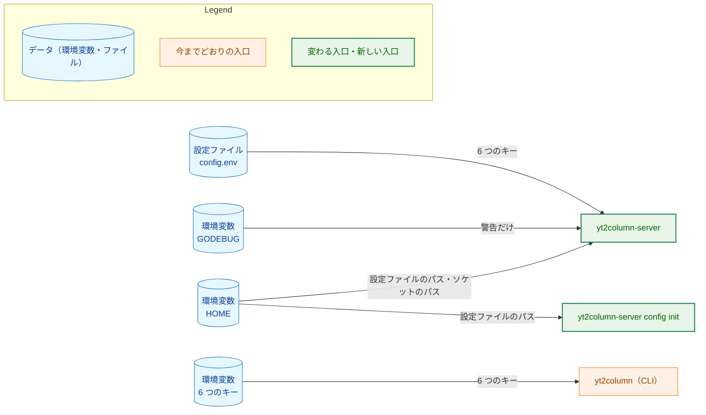
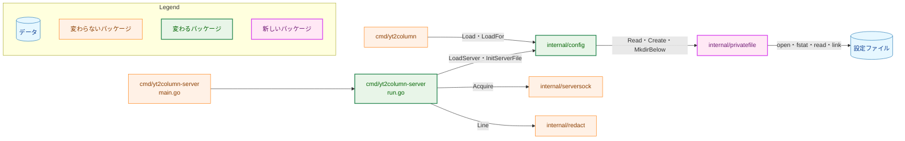
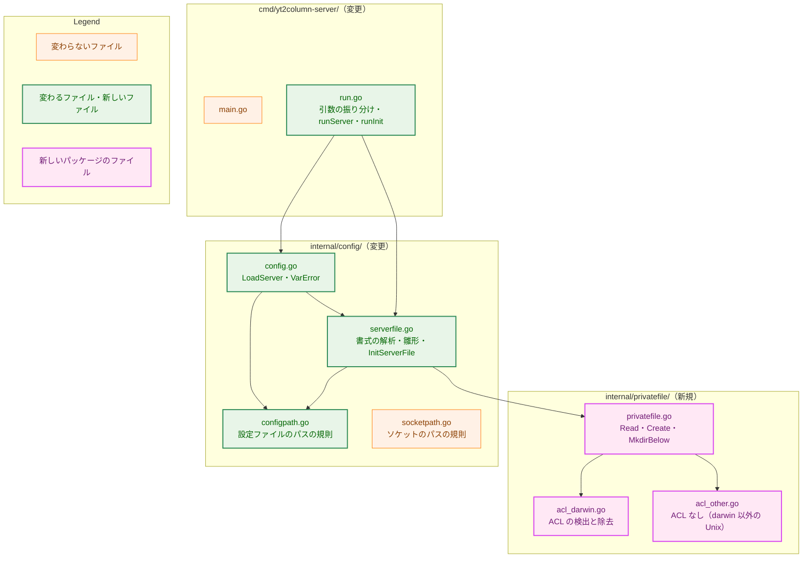
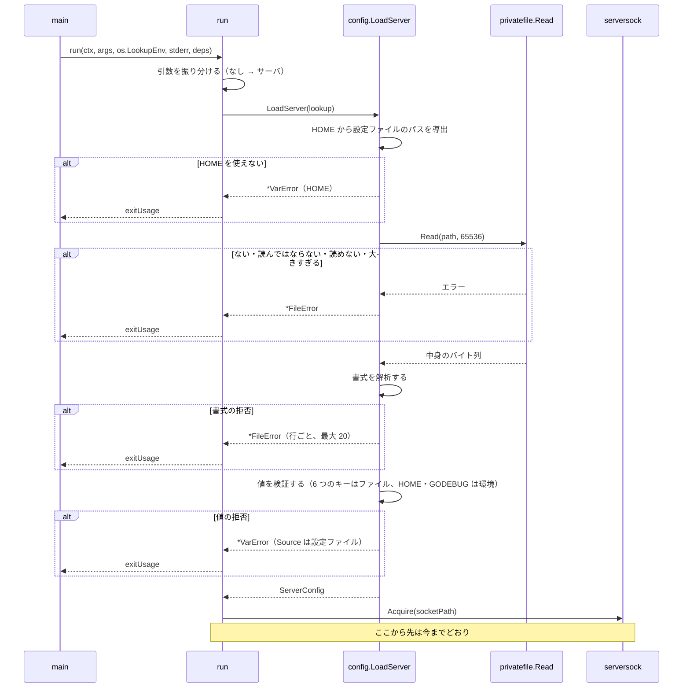
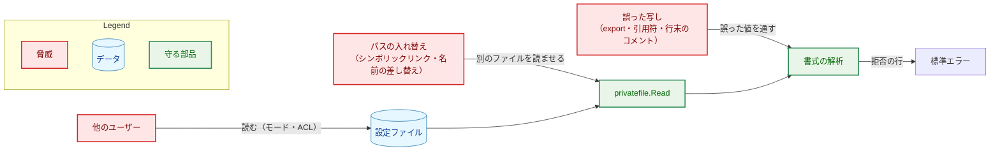
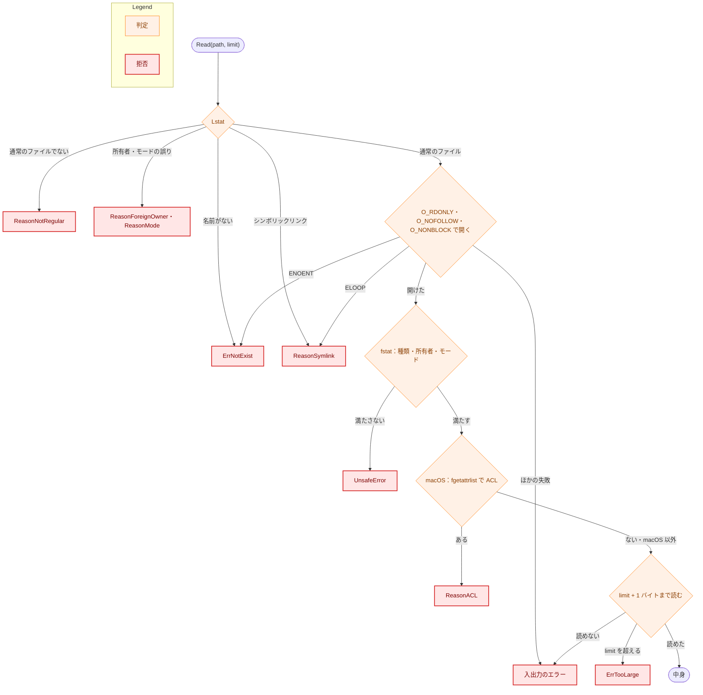
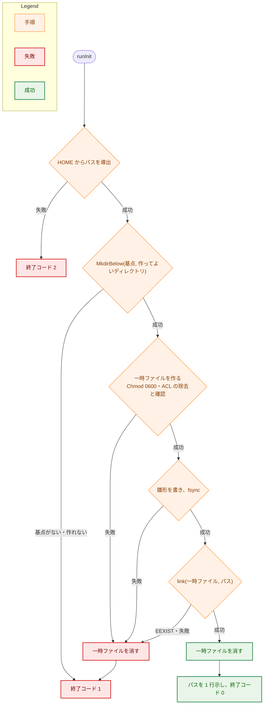

# 設計書：サーバが設定ファイルを読むようにする

## Document Status

| Item | Value |
|---|---|
| Status | `draft` |
| Created | 2026-11-06 |
| Review date | - |
| Reviewer | - |
| Comments | - |

## 1. 設計の全体像 (Design Overview)

### 1.1. 目的と範囲

本書は、[01_requirements.md](01_requirements.md)（以下「要件」）の F-001 から F-008 を実現する設計を定める。localhost サーバ（`yt2column-server`）は、LLM と Webhook の設定（要件の「6 つのキー」）を、`HOME` から導出した決まった場所の設定ファイルから読む。サブコマンド `yt2column-server config init` は、その雛形を作る。CLI（`yt2column`）は今までどおり環境変数を読み、廃止した 5 つの LLM の変数の検査だけをやめる。

コードの事実は、コミット `00682d91`（`main`）で読んだものである。

### 1.2. 設計原則

-   **ファイルの操作と設定の意味を分ける。** ファイルを安全に開いて読み、安全に作る処理は、新しいパッケージ `internal/privatefile` に置く。このパッケージは設定のことを知らない。キーの名前・書式・雛形・パスの規則は `internal/config` が持つ。秘密の変数の名前を書けるのは `internal/config` だけだからである（`internal/config/envaccess_test.go:59` の `secretEnvNames`）。
-   **検査は開いた記述子に対して行う。** 種類・所有者・モード・ACL の検査と、中身の読み込みは、同じファイル記述子に対して行う。パスに対する `Lstat` は、メッセージを選ぶためと、FIFO などを開かずに拒否するためだけに使う。読んでよいかどうかは、記述子に対する検査だけで決める（AC-19a）。
-   **値の検証は 1 つだけにする。** ファイルの値は、今の `loadLLM`・`loadSlackWebhook` に `LookupFunc` として渡して検証する。ファイル用の値の検証は書かない（要件 4.5）。ファイルに固有なのは書式（空の値の拒否を含む）だけである。
-   **入口ごとに、読む場所を 1 つにする。** サーバのコードが環境から読むのは `HOME` と `GODEBUG` だけで、6 つのキーはファイルからだけ読む。どちらの `LookupFunc` から読むかは、`LoadServer` の中でキーごとに固定する。値の中身を見て選ぶことはしない。
-   **直さずに拒否する。** 書式の誤り、権限の誤り、ACL は、どれも直さずに拒否する。サーバは設定ファイルにもその親にも書かない（`CLAUDE.md`「Reject, don't normalize」）。
-   **終了コードは失敗した段階で決める。** 今の `run` の規則（`cmd/yt2column-server/run.go:23-28`）を保ち、メッセージを見て選ばない。

### 1.3. 設計の際に決めたこと（2026-11-06）

-   **ファイルの操作は新しいパッケージ `internal/privatefile` に置く。** このパッケージが持つのは、持ち主だけが読める通常のファイルを検査して読むこと、そういうファイルを新しく作ること、決まった親の下にディレクトリを作ること、の 3 つで、OS ごとの ACL のコードもここに閉じ込める。`internal/config` は、パスの規則・書式の解析・雛形・値の検証を持つ。理由: `internal/config` は今まで環境変数を読んで検証するだけのパッケージで（`internal/config/config.go:1-3`）、syscall と OS ごとのファイルを入れると責務が混ざる。ADR: なし（パッケージの境界はこのタスクの中で閉じ、`package_reference.md` に記録する）。
-   **macOS の拡張 ACL は、`fgetattrlist` で検出し、`fchmod_extended` で取り除く。** 検出には、開いた記述子に `fgetattrlist(2)` を `ATTR_CMN_EXTENDED_SECURITY` 付きで呼ぶ。除去（`config init` が作るファイルだけ）には、`fchmod_extended` を `_FILESEC_REMOVE_ACL` で呼ぶ。どちらも標準ライブラリの `syscall.Syscall6` と `syscall.SYS_FGETATTRLIST`・`syscall.SYS_FCHMOD_EXTENDED` で呼べ、外部のモジュールも外部のコマンドも要らない。PoC で確かめた結果は付録 B にある。`fchmod_extended` は文書化されていない syscall で、公開の `fchmodx_np(3)` と `chmod -N` がこれを使っている。理由: 要件が外部のモジュールとコマンドを禁じ（`CLAUDE.md`「Dependencies」）、cgo は C コンパイラを要しクロスビルドを難しくするため。ADR: [ADR-0018](../../dev/adr/0018-server-config-file.md) を更新する。
-   **エントリが 0 個の ACL も「ACL を持つ」として拒否する。** macOS では、ACL のエントリを `chmod -a` ですべて消しても、ACL の枠が残り、`fgetattrlist` はそれを返す（付録 B）。この場合も拒否し、`chmod -N <パス>` で取り除くよう案内する。エントリの数を読んで受理する道は採らない。理由: 解析する形を増やさず、安全側に倒すため（`CLAUDE.md`「Reject, don't normalize」）。ADR: [ADR-0018](../../dev/adr/0018-server-config-file.md) に含める。
-   **書式の拒否は、拒否した行をすべて、最大 20 行まで報告する。** 21 行目以降は、拒否した行の数だけを 1 行で示す。書式の拒否が 1 つでもあれば、値の検証には進まない。理由: `.envrc` から `export X="..."` を 6 行写した場合でも 1 回で直せ、値の検証の報告がすべてをまとめて示すのとも揃うため。上限は、64 KiB のファイルが標準エラーをあふれさせないためである。ADR: なし（このタスクの中で閉じる）。
-   **`config init` は、一時ファイルに書いてから `link` で置く。** 同じディレクトリに一時ファイルを作り、モードと ACL を整えて雛形を書き、`fsync` してから `os.Link` で設定ファイルのパスに置き、一時ファイルを消す。`link` は既存の名前を上書きしないので、パスに何かあれば作らない（AC-24）。プロセスが途中で強制終了されても、設定ファイルのパスに書きかけは現れない（AC-25）。理由: 設定ファイルのパスに直接 `O_EXCL` で作る案では、強制終了や電源断のときに書きかけが残りうるため。ADR: なし（このタスクの中で閉じる）。
-   **`LoadServer` の引数は今の 1 つの `LookupFunc` のままにする。** `LoadServer` が、`HOME` からの設定ファイルのパスの導出、ファイルの検査と読み込みと書式の解析、値の検証を順に行う。理由: `main` が `os.LookupEnv` を渡す場所は 1 つのまま保て（`cmd/yt2column-server/main.go:16-20`）、`run` の段階 1 の形も変わらないため。ADR: なし（関数の形で、このタスクの中で閉じる）。
-   **設定ファイルのキーの拒否は、`VarError` に出どころを持たせて示す。** `VarError` に `Source` を加える。ゼロ値は今の形（`<名前>: <理由>`）で、`LoadServer` は設定ファイルのキーの拒否の出どころを「設定ファイル」にする。理由: 値の検証のコード（`loadLLM` など）を CLI と共有したまま、拒否の行を設定ファイルのキーとして示せるため（AC-05）。ADR: なし（型の形で、このタスクの中で閉じる）。

### 1.4. 概念モデル

設定ファイルと環境変数のどちらから何を読むかを、次の図に示す。矢印 A → B は「A の値を B が読む」を表す。



サーバは、環境変数の 6 つのキーを読まない（図に矢印がない）。`config init` は 6 つのキーをどこからも読まない（AC-22）。

## 2. システム構成 (System Structure)

### 2.1. 全体構成

パッケージの依存を次の図に示す。矢印 A → B は「A が B を呼ぶ（import する）」を表す。



`internal/privatefile` は `//go:build unix` で、OS ごとの ACL の処理を `darwin` 用とそれ以外の Unix 用のファイルに分ける。`internal/config` はこれを import するので、Unix でだけ組み立てられる。3 つの実行ファイルは、すでに Unix だけを対象にしている（`internal/serversock/serversock.go:1`、`internal/cachelock/cachelock.go:1` が `//go:build unix`）。要件 4.4 も macOS と Linux だけを対象にする。

### 2.2. コンポーネント配置



矢印 A → B は「A が B の関数を呼ぶ」を表す。ファイルの分け方は実装計画で変えてよい。

### 2.3. データの流れ

サーバの起動を次の図に示す。



`config init` の流れは 6.3 に示す。

## 3. コンポーネント設計 (Component Design)

### 3.1. `internal/privatefile`（新規）

持ち主だけが読める通常のファイルを、検査して読み、また新しく作る。設定のことは知らず、受け取ったパスとバイト列だけを扱う。

```go
//go:build unix

package privatefile

// Mode is the only mode Read accepts and Create sets: 0600, without the
// setuid, setgid, or sticky bit.
const Mode fs.FileMode = 0o600

// DirMode is the mode MkdirBelow sets on each directory it creates.
const DirMode fs.FileMode = 0o700

var (
	ErrNotExist    = errors.New("the file does not exist")
	ErrUnsafe      = errors.New("the file is not in the accepted form")
	ErrTooLarge    = errors.New("the file exceeds the size limit")
	ErrExist       = errors.New("a file already exists at the path")
	ErrBaseMissing = errors.New("the base directory does not exist")
)

// UnsafeReason is why Read refused a file. Its zero value, ReasonUnknown, is
// reported as "not in the accepted form" without a more specific reason.
type UnsafeReason int

const (
	ReasonUnknown UnsafeReason = iota
	ReasonSymlink
	ReasonNotRegular
	ReasonForeignOwner
	ReasonMode
	ReasonACL
)

// UnsafeError names the path and the reason. It wraps ErrUnsafe.
type UnsafeError struct {
	Path   string
	Reason UnsafeReason
}

// Read returns the content of the file at path when it is a regular file,
// not a symbolic link, owned by the effective user, with exactly Mode and, on
// macOS, no extended ACL; the checks and the read use one descriptor. A file
// larger than limit bytes is ErrTooLarge, read no further than limit+1 bytes.
func Read(path string, limit int) ([]byte, error)

// Create puts a new file with exactly Mode and, on macOS, no extended ACL at
// path, holding content. It never replaces or changes what is at path
// (ErrExist), and on failure it leaves nothing at path.
func Create(path string, content []byte) error

// MkdirBelow creates base/names[0], base/names[0]/names[1], ... that do not
// exist yet, each with exactly DirMode. base must exist (ErrBaseMissing); an
// existing directory is left as it is.
func MkdirBelow(base string, names []string) error
```

`Read` の手順:

1.  パスを `os.Lstat` する。名前がなければ `ErrNotExist` を返す。シンボリックリンクなら `ReasonSymlink`、通常のファイルでなければ `ReasonNotRegular` で、開かずに拒否する。所有者とモードも `Lstat` の結果で確かめ、満たさなければ開かずに拒否する（モードが `0000` のファイルを、読めないではなく、モードの誤りとして示すため）。
2.  `os.OpenFile(path, O_RDONLY|O_NOFOLLOW|O_NONBLOCK, 0)` で開く。`O_NOFOLLOW` は、手順 1 の後に最後の要素がシンボリックリンクに替わった場合に `ELOOP` で失敗させる（`ReasonSymlink`）。`O_NONBLOCK` は、手順 1 の後に FIFO に替わった場合に書き手を待たずに開かせる（AC-16）。`ENOENT` は `ErrNotExist` にする。同じ開き方は `internal/cachelock/cachelock.go:78-82` にもある。
3.  開いた記述子を `File.Stat`（`fstat`）し、種類・所有者・モードを確かめ直す。読んでよいかどうかは、この結果だけで決める。手順 1 の結果は使わない。
4.  macOS では、同じ記述子に `fgetattrlist` を呼び、拡張 ACL の有無を確かめる（`ReasonACL`）。macOS 以外の Unix では何もしない（要件 2.3）。
5.  同じ記述子から、`limit + 1` バイトまで読む。`limit` を超えたら `ErrTooLarge` を返す。読み込みのエラーは包んで返す。

`Create` の手順:

1.  パスと同じディレクトリに `os.CreateTemp` で一時ファイルを作る（`O_CREATE|O_EXCL`、名前は無作為）。
2.  `File.Chmod(Mode)` でモードを `0600` にそろえる（umask によらない。AC-21）。macOS では、`fchmod_extended` で継承した ACL を取り除き、`fgetattrlist` で ACL がないことを確かめる。残っていれば失敗にする。
3.  `content` を書き、`File.Sync` してから閉じる。
4.  `os.Link(一時ファイル, path)` で置く。`EEXIST` は `ErrExist` にする。`link(2)` は既存の名前（リンク先のないシンボリックリンクとディレクトリを含む）を上書きしないので、パスにあるものは変わらない（AC-24）。
5.  成功でも失敗でも、一時ファイルの名前を消す。途中で失敗したときも、パスには何も置かれない（AC-25）。

`MkdirBelow` は、`base` を `Lstat` してディレクトリがなければ `ErrBaseMissing` を返す。`names` の各段を `os.Mkdir(DirMode)` で作り、作った段だけを `os.Chmod(DirMode)` で `0700` にそろえる（umask によらない）。`EEXIST` の段は変えずに進む（AC-23）。

### 3.2. `internal/config` の変更

#### 3.2.1. 設定ファイルのパスの規則（F-001、H-06）

`configpath.go` に、OS ごとの規則を `socketRule`（`internal/config/socketpath.go:30-41`）と同じ形で置く。規則は、存在しなければならない基点（`HOME` の下の部分）と、`config init` が作ってよいディレクトリの並びと、ファイル名からなる。

| OS | 基点 | 作ってよいディレクトリ | ファイル名 |
|---|---|---|---|
| `darwin` | `$HOME/Library/Application Support` | `yt2column` | `config.env` |
| `linux` とその他の Unix | `$HOME` | `.config`、`yt2column` | `config.env` |
| `windows`・`plan9`・`js`・`wasip1` | 規則なし | - | - |

```go
// ServerFileLocation is where the server's configuration file lives. Its
// fields are unexported, so a non-zero value comes only from
// serverFileLocation, which derives it from HOME alone.
type ServerFileLocation struct {
	path string   // base + dirs + file name; absolute and clean
	base string   // must already exist for config init
	dirs []string // created below base by config init when missing
}
```

-   規則は `HOME` だけから導出し、`XDG_CONFIG_HOME` などの変数は読まない（AC-02）。`HOME` は今の `absoluteHome`（`internal/config/cachedir.go:74-80`）で読む。
-   `HOME` が未設定・空・相対パスのとき、または規則のない OS では、`HOME` を名指しする `*VarError`（`ErrMissing`）を返す。理由は新しい固定の文「no absolute configuration file path could be derived from HOME」で、値は含まない（AC-03）。
-   アプリケーションのディレクトリ名は、今の `appDirName`（`internal/config/cachedir.go:7`）を共有する。
-   macOS では、設定ファイルの親（`$HOME/Library/Application Support/yt2column`）がソケットのディレクトリの親と同じになる。`serversock.Acquire` は、この親が自分の所有で、グループと他人が書けないことを確かめ、なければ `0700` で作る（`internal/serversock/serversock.go:170-185`・`311-319`）。`config init` が作る親はモード `0700` で実行したユーザーの所有なので、この検査を通る。サーバが先に作っていれば、`config init` は既存の親を変えずに使う。Linux では、設定ファイルの親（`~/.config/yt2column`）とソケットの親（`~/.local/state/yt2column`）は別である。

#### 3.2.2. 書式の解析（F-003、H-04・H-09）

```go
// serverFileKeys are the six keys the configuration file accepts: the names
// of the variables the CLI reads, written once in config.go.
var serverFileKeys = []string{llmEnv, reviewLLMEnv, deepSeekAPIKeyEnv,
	anthropicAPIKeyEnv, anthropicWorkspaceIDEnv, slackEnv}

// serverFileMaxSize is the largest configuration file accepted, in bytes.
const serverFileMaxSize = 64 << 10

// serverFileMaxReported is how many rejected lines are reported one by one.
const serverFileMaxReported = 20

// serverFile is the accepted content of a configuration file: each key that
// appears, with its value as written. Only parseServerFile builds one.
type serverFile struct {
	values map[string]string
}
```

-   6 つのキーの名前は、今の定数（`internal/config/config.go:32-38`）をそのまま使い、`serverFileKeys` の 1 か所で並べる。書式の解析、雛形の検査、文書のガードテスト（テスト用のアクセサ経由）はこれを使う（要件 4.5）。
-   **行に分ける前に、ファイル全体のバイトを検査する。** `utf8.Valid`、LF 以外の制御文字（U+0000 から U+001F）・DEL（U+007F）・U+FEFF がないこと。CR はこの検査で拒否される。違反した場所の行番号は、それより前の LF の数から求める。UTF-8 として正しくないファイルは、ファイル全体の拒否で、行番号を示さない（AC-13）。
-   **行は `bytes.Split` で LF ごとに分ける。** `bufio.Scanner` は使わない。`ScanLines` は行末の CR を黙って取り除き、既定のトークンの上限で長い行を `bufio.ErrTooLong` にするためである（H-09）。最後の要素が空なら（ファイルが LF で終わるなら）、それは行として数えない。
-   各行は、要件 F-003 の受理する形だけを受け付ける。0 バイトなら空行、最初のバイトが `#` ならコメントの行で、それ以外は設定の行として最初の `=` で分ける。キーは `serverFileKeys` との完全な一致で決める（`HasPrefix` などで推し量らない。要件 5 章）。
-   拒否の固定の理由は、次の順に 1 つだけ選ぶ: 空白で始まる（空白だけの行を含む）、`=` がない、キーが 6 つのどれでもない（キーの前後の空白を含む）、値が空、値の先頭か末尾が空白、値が `"` か `'` で始まる、値に「空白に続く `#`」がある、キーが重複している。重複は 2 回目以降の行で拒否し、キーの名前を示す（AC-13）。キーが 6 つのどれでもないとき、ファイルから読んだキーの文字列は示さない（要件 3.1「値を出さない」）。
-   拒否した行は、最大 `serverFileMaxReported` 行まで 1 行ずつ報告する。超えた分は、その数を示す 1 行にまとめる。書式の拒否が 1 つでもあれば、`serverFile` を返さず、値の検証に進まない（AC-12）。
-   空の値を拒否するのはこの書式の段で、値の検証（ADR-0003 の「使わないプロバイダの変数は空でも拒否しない」）は変えない。ファイルでは空の値がこの段で拒否されるので、値の検証の段には届かない。

#### 3.2.3. `LoadServer` の変更（F-002、H-02・H-07）

```go
// LoadServer reads the server configuration. It derives the configuration
// file's path from HOME, reads and parses the file, and validates the six keys
// from it; HOME (the socket path) and GODEBUG (the warning) come from lookup.
// It reads no other variable. It returns the zero ServerConfig on any error,
// and stops at the first stage that fails: HOME, the file, its format, then
// the values.
func LoadServer(lookup LookupFunc) (ServerConfig, error)
```

-   段 1: `serverFileLocation(lookup)`。失敗は `*VarError`（`HOME`）だけを返す。
-   段 2: `privatefile.Read(path, serverFileMaxSize)` と書式の解析。失敗は `*FileError`（4.1）を返す。`privatefile.ErrTooLarge` は、書式の分類（ファイル全体の拒否）の `*FileError` にする。
-   段 3: 値の検証。`loadLLM` と `loadSlackWebhook` には `serverFile` の `LookupFunc` を渡し、`socketPath` と `hasHTTP2Debug` には `lookup`（環境）を渡す。今の `LoadServer` の組み立て（`internal/config/config.go:362-383`）のうち、変わるのは `LookupFunc` の渡し分けだけである。プロセスの環境にある 6 つのキーは、この形の上で読まれない（AC-06）。
-   段 3 の拒否のうち、ファイルから読んだキーのもの（`loadLLM` と `loadSlackWebhook` が返す `*VarError`）は、`Source` を `VarSourceConfigFile` にして返す。`HOME` の拒否（ソケットのパスが長すぎるものを含む）は環境のものなので、`Source` はゼロ値のままである。
-   ソケットのパスの上限の検査（`internal/config/socketpath.go:59-61`）は段 3 に残る。そのため、`config init` はこの上限では止まらず、サーバは止まる（AC-03）。

**廃止した 5 つの変数の検査を削除する（H-07）。** 削除するのは、`retiredLLMVar`・`retiredLLMVars`（`internal/config/config.go:150-166`）、`reasonRetiredLLM`・`reasonRetiredReviewLLM`（`101-109`）、`reasonRetiredClaudeEffort`（`130-140`）、`retiredLLMErrors`（`512-523`）と、`loadLLM` の中の呼び出し（`482`）である。`LoadFor`（CLI）からも検査が消えるので、CLI は廃止した変数を読まず、拒否もしない（AC-10）。この削除で、`LoadFor` と `LoadServer` の注釈（`354-361`・`441-452`・`473-479`）の例外の記述も消える。`defaultProvider`（`65-67`）の注釈の「the retired variables' rejection names it too」も消える。

#### 3.2.4. `VarError` の出どころ（H-03）

```go
// VarSource says where a rejected setting was read from. Its zero value is
// the form every existing rejection already has.
type VarSource int

const (
	// VarSourceUnspecified prints "<Name>: <Reason>", as today. The CLI's
	// variables and HOME use it.
	VarSourceUnspecified VarSource = iota
	// VarSourceConfigFile prints "configuration file key <Name>: <Reason>",
	// and an ErrMissing rejection gives the reason "is not set".
	VarSourceConfigFile
)

type VarError struct {
	Name   string
	Reason string
	Err    error     // ErrMissing or ErrInvalid
	Source VarSource // new
}
```

-   `Error()` は `Source` で `switch` する。`default` は今の形（`<Name>: <Reason>`）にする。設定ファイルのキーでは値が空のものは書式の段で拒否されるので、`ErrMissing` は「ファイルにキーがない」ことだけを意味する。そのため理由を「is not set」にする（AC-06 の「設定ファイルに `ANTHROPIC_API_KEY` がないことを示す」）。
-   番兵 `ErrMissing`・`ErrInvalid` の文（`internal/config/config.go:173-178`）は「environment variable ...」から、出どころを言わない文に変える。`VarError.Error()` は番兵の文を含まないので、利用者に見える行は変わらない。
-   CLI の行（`cmd/yt2column/run.go:570` の `configuration: <Name>: <Reason>`）は変わらない。

#### 3.2.5. 雛形と `InitServerFile`（F-005、H-05）

```go
// serverFileTemplate is the content config init writes: blank lines and
// comment lines only, one description and one commented-out "# <KEY>=" line
// for each of serverFileKeys. It is English (CLAUDE.md, "Go Idioms").
const serverFileTemplate = "..."

// InitServerFile creates the configuration file's template. It derives the
// path from HOME alone (a *VarError naming HOME when it cannot), creates the
// missing directories below the base, and creates the file. It reads no other
// variable and returns the path it created.
func InitServerFile(lookup LookupFunc) (string, error)
```

-   手順: `serverFileLocation(lookup)` → `privatefile.MkdirBelow(base, dirs)` → `privatefile.Create(path, serverFileTemplate)`。
-   `lookup` から読むのは `HOME` だけである。6 つのキーの値は読まないので、雛形に入りようがない（AC-22）。
-   雛形の文面は、実装で決める。雛形の行を書式の解析に通すテスト（7 章）が、文面が書式を通ることと、6 つのキーの名前がそれぞれコメントの行にあることを確かめる。

### 3.3. `cmd/yt2column-server` の変更（F-006）

-   `run` は、最初に引数を振り分ける。`len(args) == 0` ならサーバ、`args` がちょうど `["config", "init"]` なら `config init` を行う。それ以外は、受け付ける形（引数なし、または `config init`）を示す 1 行を書いて `exitUsage` を返す（AC-29）。比較は文字列の完全な一致で、大文字・小文字を区別する。今の「takes no arguments; the configuration is read from environment variables」の行（`cmd/yt2column-server/run.go:126-129`）を置き換える。
-   サーバの流れは今の `run` の段 1 から 4 のままである。段 1 の `LoadServer` の拒否は、今までどおり 1 つずつ 1 行に書く（`run.go:133-138`）。`*FileError` と `*VarError` の `Error()` が、設定ファイルのパスと出どころを含む文を作る。
-   `config init` の流れ（`runInit`）は 6.3 に示す。成功したら、作ったファイルのパスを示す 1 行を標準エラーに書き、`exitOK` を返す。標準出力には何も書かない（AC-21）。
-   どちらの流れも、行は今の `stderrWriter`（`redact.Line`。`run.go:82-93`）を通して書く。パスは `HOME` を含むので、今の起動の行と同じく `redact.Line` で制御文字をエスケープする（H-09）。`config init` の時点では秘密を知らないので、伏せ字にする値はない。
-   `main.go` の契約（`os.LookupEnv` を渡すのはここだけ。`main.go:16-20`）は変わらない。

**終了コード:**

| 流れ | 段 | 終了コード |
|---|---|---|
| 共通 | 引数の誤り | `2` |
| サーバ | `LoadServer` の失敗（`HOME`・ファイル・書式・値） | `2`（今までどおり） |
| サーバ | 部品の組み立ての失敗 | `2`（今までどおり） |
| サーバ | ソケットの準備・待ち受けの失敗 | `1`（今までどおり） |
| `config init` | `HOME` の誤り（`*VarError`） | `2` |
| `config init` | 基点がない、すでにある、作れなかった | `1` |
| `config init` | 作れた | `0` |

`config init` は、失敗が `*VarError` かどうかで `2` と `1` を分ける。`InitServerFile` が `*VarError` を返すのは段 1（パスの導出）だけなので、これは段で選ぶことと同じである。

### 3.4. 拡張のビューアの案内（F-008）

`setWebhookStep` の文（`extension/src/core/i18n/en.ts:27`、`extension/src/core/i18n/ja.ts:24`）を、`SLACK_WEBHOOK_URL` を設定ファイルに書いて `yt2column-server` を起動し直す、という案内に変える。環境変数という語は使わない。案内に設定ファイルのパスは書かない（OS で異なるため、README に任せる）。

### 3.5. 文書（F-007、H-08）

要件 AC-30 から AC-33 の文書を書き換える。設計として決めるのは、ガードテストが照らす値と場所である（AC-34）。

| 値 | コードの出どころ（テスト用のアクセサ） | 照らす文書 | テスト |
|---|---|---|---|
| 設定ファイルのパス（macOS・その他の Unix） | `config` の設定ファイルの規則 | `README.md`・`README.en.md` のサーバの節 | `TestServerDocsContract`（拡張） |
| `config init` の終了コード | `cmd/yt2column-server` の終了コードの定数 | 両 README の `config init` の終了コードの表 | `TestServerDocsContract`（拡張） |
| 6 つのキーの名前 | `serverFileKeys` | 両 README の設定ファイルの節 | `TestServerDocsContract`（拡張） |
| 大きさの上限（64 KiB） | `serverFileMaxSize` | 両 README の設定ファイルの節 | `TestServerDocsContract`（拡張） |
| 設定ファイルのパス | 同上 | `docs/dev/security.md` §8.2 | `TestServerDocsContract`（拡張） |

-   同じ値を同じ文書について複数のテストで確かめない（`CLAUDE.md`「Document tests check values, structure, and executable examples, never prose」）。`project_overview.md` と `development.md` は、パスを照らす対象にしない。正本は README と `security.md` に置き、ほかの文書はそこへ案内する。
-   `development.md` の「開発用に別のサーバを動かす」の手順は、実行できる例としては確かめない。手順はサーバを起動するので、テストで実行すると副作用が大きいためである。
-   廃止した変数を説明する README の節と段落（「廃止した LLM の変数からの移行」など）を削除するので、それらを読むガードテストは、削除か更新が要る。退役した仕様が文書に残っていることを確かめるテストは置かない（`CLAUDE.md` の同じ節）。

### 3.6. コンポーネントの責務

| ファイル | 種別 | 責務・変更 | 更新が要る既存のテスト |
|---|---|---|---|
| `internal/privatefile/privatefile.go` | 新規 | `Read`・`Create`・`MkdirBelow`、エラーの型 | - |
| `internal/privatefile/acl_darwin.go` | 新規 | `fgetattrlist` による ACL の検出、`fchmod_extended` による除去 | - |
| `internal/privatefile/acl_other.go` | 新規 | darwin 以外の Unix では ACL を検査しない | - |
| `internal/config/configpath.go` | 新規 | 設定ファイルのパスの規則と `ServerFileLocation` | - |
| `internal/config/serverfile.go` | 新規 | 書式の解析、`serverFileKeys`、雛形、`InitServerFile`、`FileError` | - |
| `internal/config/config.go` | 変更 | `LoadServer` の段の組み立て、`VarError.Source`、番兵の文、廃止した変数の検査の削除 | `config_test.go` の `TestLoadErrorsOmitValues`・`TestLoadReportsAllInvalid`・`TestLoadFor`・`TestRetiredClaudeEffortReason`・`TestRetiredLLMVars`・`TestLoadRejectsRetiredLLMVars` と `LoadServer` のテスト |
| `internal/config/test_helpers.go` | 変更 | `RetiredLLMVarsForTest`・`RetiredLLMVarErrorForTest` を削除し、設定ファイルの規則・キー・上限のアクセサを加える | - |
| `internal/config/socketpath_test.go` | 変更 | `withRetiredLLMVars` を削除する | `TestLoadHost`・`TestLoadHostHome` |
| `cmd/yt2column-server/run.go` | 変更 | 引数の振り分け、`runInit` | `run_test.go` の `TestStartupFailures` ほか、環境変数で設定を渡すすべてのテスト |
| `cmd/yt2column-server/test_helpers.go` | 変更 | テスト用の `HOME` の下に設定ファイルを書く補助 | `relay_e2e_test.go`・`signal_test.go`・`server_test.go` |
| `cmd/yt2column-server/docs_test.go` | 変更 | 3.5 の値の照合 | `TestServerDocsContract` |
| `cmd/yt2column/run_test.go` | 変更 | 廃止した変数を拒否するテストを削除する | `TestRunRejectsRetiredLLMVars`、`467-471` の表の行 |
| `cmd/yt2column/makefile_test.go` | 変更 | 廃止した変数を Makefile が読まないことのテストを削除する | `TestMakeTargetsDoNotReadRetiredModelEnv`・`TestRetiredLLMEnvMentioned`・`TestRetiredModelEnvIsGone` |
| `cmd/yt2column-nmhost/main_test.go` | 変更 | `hostEnvs` の廃止した変数の組を削除する | `hostEnvs` を使うテスト |
| `extension/src/core/i18n/en.ts`・`ja.ts` | 変更 | `setWebhookStep` の文 | 拡張のカタログのテスト |
| `README.md`・`README.en.md` ほか 3.5 の文書 | 変更 | AC-30 から AC-33 | 3.5 の表、`cmd/yt2column` の README の設定の表を読むテスト |
| `docs/dev/conventions/package_reference.md` | 変更 | `internal/privatefile` の行を加え、`internal/config` と `cmd/yt2column-server` の行を直す | - |

テストを削除するときは、削除だけのコミットにし、`make coverage-compare` で確かめる（`CLAUDE.md`「Deleting a test is a claim that must be checked」、H-07）。

## 4. エラーハンドリング設計 (Error Handling Design)

### 4.1. 拒否の分類と番兵

要件 4.2 の分類ごとに、番兵のエラーを 1 つ持つ。呼び出し側は `errors.Is` で分類を判定する。

| 分類 | 番兵 | 型 | AC | サーバの終了コード | `config init` の終了コード |
|---|---|---|---|---|---|
| `HOME` とパスの規則 | `config.ErrMissing`（今のもの）・`config.ErrInvalid`（ソケットのパスが長すぎる） | `*config.VarError`（`Name` は `HOME`） | AC-03 | `2` | `2` |
| ファイルがない | `config.ErrConfigFileMissing` | `*config.FileError` | AC-14 | `2` | - |
| 読んではならないファイル | `config.ErrConfigFileUnsafe` | `*config.FileError`（原因に `*privatefile.UnsafeError`） | AC-15 から AC-18a | `2` | - |
| 読めない | `config.ErrConfigFileUnreadable` | `*config.FileError`（原因に入出力のエラー） | AC-19 | `2` | - |
| 書式 | `config.ErrConfigFileFormat` | `*config.FileError`（行ごと、またはファイル全体） | AC-12・AC-13 | `2` | - |
| 値の検証 | `config.ErrMissing`・`config.ErrInvalid`（今のもの） | `*config.VarError`（`Source` は `VarSourceConfigFile`） | AC-05 | `2` | - |
| `config init` ですでにある | `config.ErrConfigFileExists` | `*config.FileError` | AC-24 | - | `1` |
| `config init` で作れなかった | `config.ErrConfigFileCreate` | `*config.FileError`（原因に入出力のエラー、または `privatefile.ErrBaseMissing`） | AC-23・AC-25 | - | `1` |

```go
var (
	ErrConfigFileMissing    = errors.New("the configuration file does not exist")
	ErrConfigFileUnsafe     = errors.New("the configuration file must not be read")
	ErrConfigFileUnreadable = errors.New("the configuration file could not be read")
	ErrConfigFileFormat     = errors.New("the configuration file is not in the accepted format")
	ErrConfigFileExists     = errors.New("a configuration file already exists")
	ErrConfigFileCreate     = errors.New("the configuration file could not be created")
)

// FileError reports a rejection of the configuration file. It holds the path,
// the line number (0 when the rejection is not about one line), the key when
// the reason names one of serverFileKeys (a duplicate), and a fixed reason. It
// never holds a value, a line, or a key read from the file.
type FileError struct {
	Path   string
	Line   int
	Key    string
	Reason string
	Err    error // one of the ErrConfigFile* sentinels
	Cause  error // the privatefile or I/O error, or nil
}

func (e *FileError) Error() string
func (e *FileError) Unwrap() []error // Err and, when non-nil, Cause
```

-   `privatefile` の番兵から `config` の番兵への対応は、`errors.Is` による `switch` で決める。`privatefile.ErrNotExist` は「ない」、`privatefile.ErrUnsafe` は「読んではならない」、`privatefile.ErrTooLarge` は「書式」、`privatefile.ErrExist` は「すでにある」、`privatefile.ErrBaseMissing` は「作れなかった」に対応させる。どれにも当たらないものは、`Read` では「読めない」、`Create`・`MkdirBelow` では「作れなかった」にする。`default` は止める側に倒れる。
-   `Reason` は、コードの定数から選ぶ固定の文だけである。`privatefile.UnsafeReason` からの選択も `switch` で行い、`default`（`ReasonUnknown`）は「is not in the accepted form」にする。
-   `Cause` に入る入出力のエラー（`*fs.PathError`）の文はパスと OS のエラーだけを含み、ファイルの中身は含まない。

### 4.2. メッセージの形

標準エラーの行は、どれも `yt2column-server: ` で始まり、`redact.Line` を通る。値・ファイルの中身・未知のキーの文字列は含まない。設定ファイルのパスは、今の起動の行がソケットのパスを示すのと同じく示す。英語の文は実装で決め、次は形だけを示す。

| 分類 | 行の形 |
|---|---|
| `HOME` | `configuration: HOME: <理由>`（今の形） |
| ファイルがない | `configuration file <パス> does not exist; create it with "yt2column-server config init"` |
| シンボリックリンク | `configuration file <パス> is a symbolic link; nothing was changed` |
| 通常のファイルでない | `configuration file <パス> is not a regular file; nothing was changed` |
| 所有者が違う | `configuration file <パス> is owned by another user; nothing was changed` |
| モード | `configuration file <パス> does not have exactly mode 0600; run "chmod 600 <パス>"` |
| ACL（macOS） | `configuration file <パス> has an access control list; run "chmod -N <パス>"` |
| 読めない | `configuration file <パス> could not be read: <OS のエラー>` |
| 書式（行） | `configuration file <パス>: line <n>: <理由>`（重複は理由にキーの名前を含む） |
| 書式（件数） | `configuration file <パス>: <m> more lines were rejected` |
| 書式（ファイル全体） | `configuration file <パス>: <理由>`（大きさ・UTF-8） |
| 値 | `configuration: configuration file key <キー>: <理由>` |
| 引数 | `takes no arguments or "config init"` に相当する文 |
| `config init` の成功 | `created the configuration file <パス>` |
| `config init` ですでにある | `configuration file <パス> already exists; nothing was changed` |
| `config init` で基点がない | `<基点> does not exist; nothing was created` |
| `config init` で作れなかった | `could not create the configuration file <パス>: <OS のエラー>` |

## 5. セキュリティ考慮事項 (Security Considerations)

本タスクは API キーと Webhook URL を持つファイルを読み書きするので、`docs/dev/security.md` を適用する。信頼の範囲は今の [ADR-0006](../../dev/adr/0006-threat-model.md) のままで、同一ユーザーのプロセスは信頼し、他のユーザーを排除する。

### 5.1. 脅威モデル

矢印 A → B は「A が B に働きかける」を表す。



| 脅威 | 対策 | AC |
|---|---|---|
| 他のユーザーがファイルを読む | モードがちょうど `0600`、所有者が実行したユーザー、macOS では ACL なし。満たさなければ起動しない。`config init` は `0600` で作り、継承した ACL を取り除く | AC-17・AC-18・AC-18a・AC-21 |
| シンボリックリンクで別のファイルを読ませる | `Lstat` で拒否し、`O_NOFOLLOW` で開き、開いた記述子に `fstat` する | AC-15 |
| 検査と読み込みの間にパスを入れ替える | 検査と読み込みに同じ記述子を使う。`Lstat` の結果では許可しない | AC-19a |
| FIFO で起動を止める | `Lstat` で開かずに拒否し、入れ替えには `O_NONBLOCK` で備える | AC-16 |
| 大きなファイル | `limit + 1` バイトまでしか読まない | 要件 4.1 |
| 設定をシェルとして実行させる | 書式の解析だけで、展開・置換・引用符の解釈をしない | 要件 4.2 |
| 拒否の行から秘密が漏れる | 値・行・未知のキーを含めない。固定の理由とパスと行番号とキーの名前（6 つのどれか）だけ | AC-05・AC-13 |
| 環境の値が混ざる | 6 つのキーは `serverFile` の `LookupFunc` からだけ読む | AC-06・AC-07 |
| 雛形に秘密が入る | `InitServerFile` は `HOME` しか読まない | AC-22 |
| `config init` が既存のファイルを壊す | `link` は既存の名前を上書きしない | AC-24 |

### 5.2. 受け入れるリスク

-   **親のディレクトリの入れ替え。** 親のディレクトリは検査しない（要件 2.3）。親の名前が入れ替えられた場合、サーバが読むのは入れ替え先のファイルである。そのファイルも、同じ記述子で種類・所有者・モード・ACL を検査してから読む。よって、実行したユーザーの所有でない、または他人が読めるファイルの中身は使わない。同一ユーザーのプロセスによる入れ替えは、ADR-0006 の信頼の範囲に入る。
-   **非公開の syscall への依存（macOS）。** ACL の除去に使う `fchmod_extended` の `_FILESEC_REMOVE_ACL` は、Apple が文書化していない。将来の macOS で振る舞いが変われば、`Create` は ACL が残ったことを `fgetattrlist` で検出して失敗する（3.1 の手順 2）。ACL を持つファイルを黙って作ることはない。検出に使う `getattrlist(2)` は文書化された API である。
-   **macOS のテストは CI で走らない。** CI は Linux だけで動く（`.github/workflows/ci.yml` の `runs-on: ubuntu-latest`）。ACL のテストは `darwin` のビルドでだけ動き、ローカルの `make test` で確かめる。
-   **Linux の POSIX ACL。** 検査しない（要件 2.3）。モードがちょうど `0600` なら ACL のマスクは空で、名前を付けたユーザーやグループの項目は権利を与えない。
-   **`link` が使えないファイルシステム。** ハードリンクを持たないファイルシステムでは、`config init` は「作れなかった」で終わる（終了コード `1`）。macOS の APFS と Linux の ext4 などはハードリンクを持つ。
-   **一時ファイルの残り。** `config init` が `link` の前に強制終了されると、設定ファイルの隣に一時ファイルが残る。中身は秘密を含まない雛形で、モードは `0600` である。

## 6. 処理フローの詳細 (Processing Flow Details)

### 6.1. 設定ファイルの検査と読み込み（`privatefile.Read`）



矢印 A → B は「A の結果が B に進む」を表す。記述子を開いた後のどの拒否でも、記述子は閉じる。

### 6.2. 書式の解析

1.  ファイル全体のバイトを検査する（UTF-8、制御文字・CR・DEL・U+FEFF）。違反があれば、その行（UTF-8 として正しくない場合はファイル全体）を拒否し、ほかの行の検査は続ける。
2.  LF で行に分け、各行を 3.2.2 の規則で判定する。キーの重複は、最初に現れた行を受理し、2 回目以降の行を拒否する。
3.  拒否が 1 つでもあれば、最初の 20 行と件数の行を `*FileError` として返す。なければ `serverFile` を返す。

### 6.3. `config init`



矢印 A → B は「A の結果が B に進む」を表す。すでにファイルがあるとき（AC-24）は、`link` の `EEXIST` で終了コード `1` になる。このとき `MkdirBelow` は、親がすでにあるので何も作らない。ソケットのディレクトリ・起動のロック・ソケットは作らない（AC-21）。

## 7. テスト戦略 (Test Strategy)

### 7.1. 単体テスト

-   **`internal/privatefile`:** `t.TempDir` の下に実際のファイルを作って試す。通常のファイル（受理）、名前がない、シンボリックリンク（リンク先が正しいファイルの場合と、リンク先がない場合）、ディレクトリ、FIFO（書き手がいなくても待たずに拒否すること）、Unix ドメインソケット、モード `0644`・`0640`・`0400`・`0700`・`0000`、setuid・setgid・sticky の付いた `0600`、上限ちょうどと上限 + 1 バイト。所有者が違うファイルは root でないと作れないので、所有者の判定は `fstat` の結果を受け取る小さな関数として切り出して試す。macOS では、`chmod +a` 相当の ACL を付けたファイル（`fchmod_extended` ではなく `/bin/chmod` で付ける。テストだけが外部のコマンドを使う）、エントリが 0 個の ACL を持つファイル、継承する ACL を持つディレクトリの下に `Create` で作ったファイル（ACL がないこと）を試す。`Create` は、既存のファイル・リンク先のないシンボリックリンク・ディレクトリがあるパスで `ErrExist` になり、それらが変わらないこと、umask `0077` と `0000` でモードがちょうど `0600` になること、書き込みに失敗させたときにパスに何もないことを試す。`MkdirBelow` は、基点がない場合と、umask によらず `0700` になることを試す。
-   **`internal/config`:** 書式の解析は、要件 F-003 の「拒否するもの」のそれぞれの例と、受理する形の例（空白を伴わない `#` と `=` を含む値、LF で終わらない最後の行）を表で試す。拒否の行が値・行・未知のキーを含まないことを、表のすべての行について確かめる（今の `TestLoadErrorsOmitValues` と同じ考え方）。21 行以上の拒否で、20 行と件数の行になることを試す。`LoadServer` は、`HOME` を `t.TempDir` にして設定ファイルを置き、AC-04 から AC-07・AC-09 を試す。環境に 6 つのキーと廃止した変数を入れても、結果が変わらないことを確かめる。雛形は、`serverFileTemplate` を書式の解析に通して受理されること、6 つのキーの名前がそれぞれコメントの行にあること、`LoadServer` が `ANTHROPIC_API_KEY` の欠落だけで止まること（AC-26）を試す。パスの規則は、今の `TestSocketPath` と同じく `goos` の文字列を変えて試す。
-   **`cmd/yt2column-server`:** 引数の振り分け（AC-27 から AC-29）、`config init` の終了コードと標準エラー・標準出力（AC-21・AC-24）、設定エラーのときにソケットのディレクトリが作られないこと（AC-20）を、今の `TestStartupFailures` の形で試す。テスト用の補助は、環境変数の代わりにテスト用の `HOME` の下に設定ファイルを書く。
-   **CLI:** 廃止した変数があっても、CLI が止まらず、その値を使わないこと（AC-10）を試す。

### 7.2. 結合テスト

-   `relay_e2e_test.go` のホストとサーバの結合のテストは、テスト用の `HOME` の下に設定ファイルを置いてサーバを動かす形に変える。
-   `config init` で作ったファイルにキーを足してサーバが起動することを、`run` を通して 1 つ試す。

### 7.3. セキュリティのテスト

-   AC-19a（検査の後の入れ替え）は、タイミングに頼るテストにしない。`Read` が、許可の判定に `Lstat` の結果を使わず、開いた記述子の `fstat` の結果だけを使うことを、「`Lstat` の後に通常のファイルを別の持ち主のファイルやモード `0644` のファイルに差し替える」フックを試験用に差し込んで確かめる。差し込み口は試験用のビルド（`//go:build test`）にだけ置く。
-   すべてのテストは、守っているものを外すと失敗することを確かめてからコミットする（`CLAUDE.md`「Every test must be able to fail for its stated reason」）。

## 8. 実装の優先順位 (Implementation Priorities)

1.  `internal/privatefile`（`Read`・`Create`・`MkdirBelow`、ACL）とそのテスト。
2.  `internal/config` の設定ファイルのパスの規則、書式の解析、`FileError`、雛形、`InitServerFile`。
3.  `LoadServer` の組み立ての変更と `VarError.Source`。
4.  廃止した変数の検査の削除。テストの削除は、削除だけのコミットにして `make coverage-compare` で確かめる。
5.  `cmd/yt2column-server` の引数の振り分けと `runInit`、テストの補助の書き換え。
6.  拡張のカタログ（`make ext-check`）。
7.  文書と、文書のガードテスト。README は `/mktrans` で `README.en.md` に同期する。

PR の区切りは実装計画で決める。

## 9. 将来の拡張性 (Future Extensibility)

-   **Keychain・libsecret。** 平文のファイルが問題になったときは、秘密の値だけを OS の保存庫に移せる。その場合も、書式の解析と値の検証の境界（`serverFile` の `LookupFunc`）は変えずに、秘密のキーの出どころを差し替えられる。
-   **CLI が設定ファイルを読むこと。** 要件の対象外である。読むようにするなら、`InitServerFile` と同じパスの規則と `privatefile.Read` を使える。ただし、どちらの値が効くかを決める規則が要る（ADR-0018 の「入口ごとに読む場所を 1 つにする」の変更になる）。
-   **キーの追加。** `serverFileKeys` に名前を足し、値の検証を `LoadServer` に足す。雛形のテストと文書のガードテストは `serverFileKeys` から作るので、足し忘れはテストで分かる。

## 10. 設計への申し送りへの対応

[design_handoff.md](design_handoff.md) の各項目への対応を示す。

| 項目 | 対応 |
|---|---|
| H-01 検査したファイルと読んだファイルを同じにする | `Lstat` で分類し、`O_NOFOLLOW`・`O_NONBLOCK` で開いた記述子に `fstat` と ACL の検査をし、同じ記述子から `limit + 1` バイトまで読む（3.1、6.1）。FIFO は `Lstat` の段で開かずに拒否し、入れ替えには `O_NONBLOCK` で備える |
| H-02 `LookupFunc` の組み立て | `LoadServer(lookup)` の形を保ち、中で 6 つのキーはファイルの `LookupFunc`、`HOME`・`GODEBUG` は環境の `LookupFunc` から読む（3.2.3）。`main.go` の契約は保つ。CLI の `Load`・`LoadFor` は、廃止した変数の検査が消えることのほかは変えない |
| H-03 拒否の型と番兵、メッセージの語 | 分類ごとの番兵と `FileError`（4.1）、`VarError.Source`（3.2.4）。終了コードは段で選ぶ（3.3） |
| H-04 書式の拒否をいくつ報告するか | すべて、最大 20 行まで報告し、超えた分は件数だけ示す。書式の拒否があれば値の検証に進まない（1.3、3.2.2） |
| H-05 雛形の作り方と文面 | 一時ファイル + `Chmod` + ACL の除去 + `fsync` + `link`（3.1）。親は `MkdirBelow` で `0700`（3.1）。文面は実装で決め、書式の解析に通すテストで確かめる（3.2.5、7.1） |
| H-06 ソケットのパスとの規則の共有 | 規則は `socketRule` と同じ形の別の関数に置き、`appDirName` と `absoluteHome` を共有する。macOS で `config init` が作る親は `serversock` の親の検査を通る（3.2.1） |
| H-07 廃止した変数の検査の削除 | 削除するコードとテストを 3.2.3 と 3.6 に挙げた。テストの削除は削除だけのコミットと `make coverage-compare` で確かめる（8 章） |
| H-08 文書のガードテスト | 照らす値・文書・テストを 3.5 の表に挙げた。`development.md` の手順は実行できる例としては確かめない |
| H-09 標準ライブラリの落とし穴と秘密の名前を書ける場所 | `bufio.Scanner` を使わず `bytes.Split` で分ける（3.2.2）。キーの名前を扱う解析と雛形は `internal/config` に置く（1.2）。行は `stderrWriter`（`redact.Line`）を通す（3.3） |
| H-10 macOS の拡張 ACL | `fgetattrlist` で検出し、`fchmod_extended` で除去する。標準ライブラリの `syscall` だけで書け、PoC で確かめた（1.3、付録 B）。要件の見直しは要らない |

## 付録 A. ADR

-   [ADR-0018](../../dev/adr/0018-server-config-file.md) を更新する。macOS の ACL の検出と除去の手段（非公開の syscall への依存を含む）と、エントリが 0 個の ACL も拒否することを、決定と結果と経緯に加える。
-   [ADR-0003](../../dev/adr/0003-llm-config-contract.md) は、要件定義の PR（#702）で更新済みで、本書による変更はない。

## 付録 B. macOS の ACL の PoC（2026-11-06）

環境: macOS（Darwin 25.6.0、arm64）、Go 1.27.1。標準ライブラリだけの小さなプログラムで確かめた。

| 試したこと | 結果 |
|---|---|
| ACL のない `0600` のファイルに `fgetattrlist`（`ATTR_CMN_RETURNED_ATTRS`・`ATTR_CMN_EXTENDED_SECURITY`、`FSOPT_PACK_INVAL_ATTRS`） | ACL なし（返った属性に `ATTR_CMN_EXTENDED_SECURITY` がない） |
| `chmod +a "staff allow read"` を付けたファイル | ACL あり |
| `chmod +a "everyone allow read,file_inherit"` を付けたディレクトリの下に、umask `077` で作ったファイル | 継承した ACL あり（`ls -le` が `inherited allow read` を示す） |
| そのファイルに `fchmod_extended(fd, KAUTH_UID_NONE, KAUTH_GID_NONE, -1, 1)`（`_FILESEC_REMOVE_ACL`） | 成功し、その後の `fgetattrlist` は ACL なし。モードは `600` のまま |
| `chmod +a` の後に同じ項目を `chmod -a` で消したファイル | ACL あり（エントリ 0 個の枠が残る） |
| シンボリックリンクを `O_NOFOLLOW` で開く | `ELOOP`（too many levels of symbolic links） |
| 書き手のいない FIFO を `O_RDONLY\|O_NONBLOCK` で開く | 待たずに開けた |
