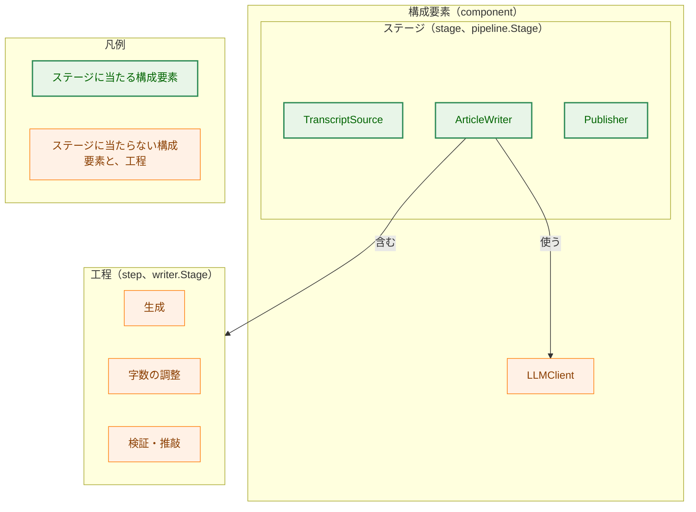
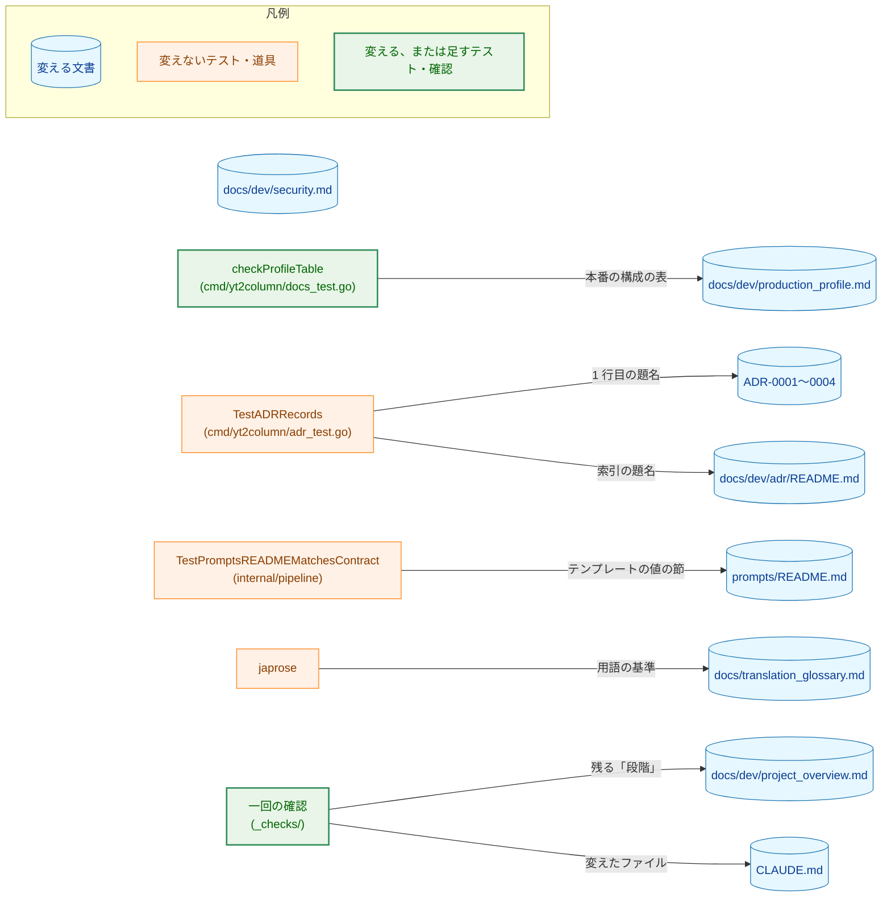
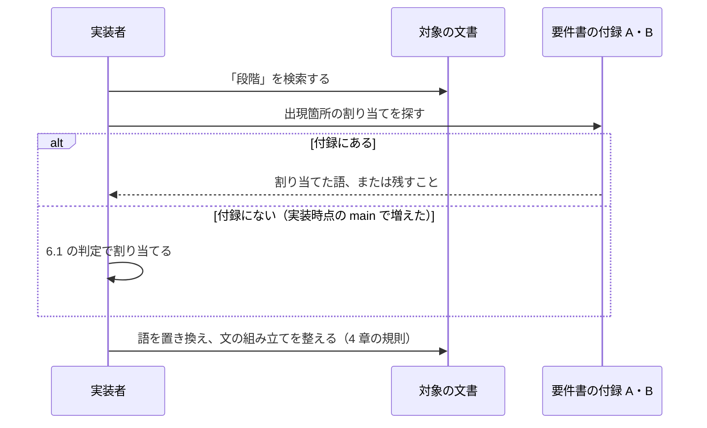
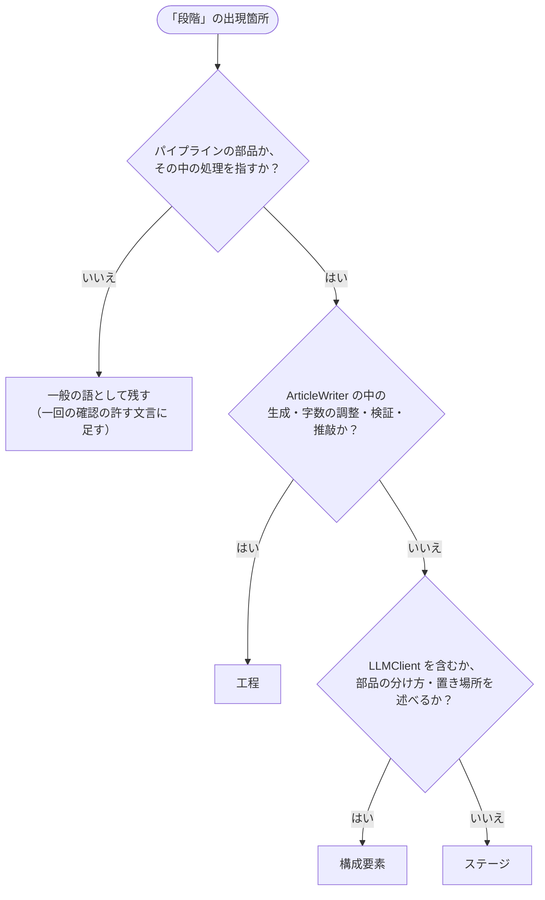

# アーキテクチャ設計書：用語「段階」（stage）を「ステージ」に改め、「構成要素」「工程」と使い分ける

## Document Status

| Item | Value |
|---|---|
| Status | `draft` |
| Created | 2026-11-06 |
| Review date | - |
| Reviewer | - |
| Comments | - |

本書は [01_requirements.md](01_requirements.md)（要件定義書。以下、要件書）の設計である。既存のファイルについての記述は、コミット `7fd249d6` のファイルで確かめた。`file:line` は、このコミットでの行番号を指す。F-NNN・AC-NN は要件書の項番、H-NN は [design_handoff.md](design_handoff.md) の項番を指す。申し送りの H-02・H-03 への対応は付録 A に、受け入れ基準との対応は付録 B にまとめる。

本書は、要件書 1 章の表と 6 章の用語（ステージ・構成要素・工程）を同じ意味で使う。そのほかに、次の用語を使う。

-   **対象の文書:** 要件書 2.2 の定義のとおり、実装時点の `main` の `docs/dev/` の下（ADR とその索引を含む）、`prompts/README.md`、用語集 `docs/translation_glossary.md` である。
-   **出現箇所:** 対象の文書の中で「段階」という語が現れる 1 か所。1 行に複数あれば、それぞれを 1 つと数える。
-   **割り当て:** 出現箇所ごとに、それが指すもの（ステージ・構成要素・工程・一般の語）を決め、置き換える語を決めること。2026-11-06 時点の割り当ては要件書の付録 A・付録 B にある。
-   **一回の確認:** タスクのディレクトリの `_checks/` の下に置き、PR の基点に対して一度だけ走らせるスクリプト（`CLAUDE.md` の「Testing Strategy」、要件書の手続き `requirements_process.md` §4）。恒久的なテストではない。

## 1. 設計の全体像 (Design Overview)

### 1.1. 設計原則

-   **語は、出現箇所が指すもので選ぶ。** すべてを「ステージ」にはしない（要件書 1 章）。出現箇所ごとに、1.4 の概念モデルと 6.1 の判定の流れで、ステージ・構成要素・工程・一般の語のどれかに割り当てる。
-   **文の意味は変えない。** 変えるのは語と、語を変えたことで必要になる文の組み立て（助数詞など）だけである。例外は、用語集の定義（F-001）と `production_profile.md` の定義の文（AC-10）の 2 つで、どちらも要件書が書き換えを定めている。
-   **コードは変えず、文書のテストの locator だけを変える。** Go の変更は `cmd/yt2column/docs_test.go` の 1 か所の locator と、その失敗のメッセージだけである（AC-16、3.3）。識別子・コメント・ほかのメッセージの英語の stage は変えない（要件書 2.3）。
-   **恒久的なテストは足さない。** 文言の変更は PR のレビューで読む（`CLAUDE.md` の「Document tests check values, structure, and executable examples, never prose」）。範囲と「変えないもの」は一回の確認で確かめる（7 章）。

### 1.2. 設計の際に決めたこと（2026-11-06）

利用者に確かめて決めたこと:

-   **ADR-0002 の題名は「生成の後に字数の調整と検証・推敲の 2 つの工程を置き、検証・推敲は直す箇所の一覧だけを返す」とする（H-02）。** 理由: 語を置き換え、助数詞「つの」を補うだけで、文の組み立てが変わらないため。索引 `docs/dev/adr/README.md:10` の題名も同じ文言にする（AC-07）。ADR の判断: ADR は作らない。文言の決定で、`CLAUDE.md` の「Design decisions (ADR)」の基準では主要な決定ではない（「a wording」に当たる）。
-   **ADR-0004 の題名は「本番の構成を 3 つの工程とも claude-opus-5-5（effort high）とし、品質の目標と製品の制約を共通の文書に置く」とする（H-02）。** 理由: 今の題名（`docs/dev/adr/0004-production-profile.md:1`）の「段階」を「工程」に置き換えるだけでは、「本番の構成を 3 つの工程とする」と読め、構成が工程の数を決めるように見えるため。決定の中身（3 つの工程のすべてを同じモデルと effort で行う。同 `:17`）は変えない（AC-09）。索引 `docs/dev/adr/README.md:12` も同じ文言にする（AC-07）。ADR の判断: 同上。
-   **`docs_test.go` の表の失敗のメッセージは、列名の locator の定数から組み立てる（H-03）。** 列名「工程」を定数に置き、`doctestutil.FindTable` の引数と失敗のメッセージの両方がその定数を使う（3.3）。理由: 日本語の literal が locator の 1 か所にまとまり、guard-test literal exception（`CLAUDE.md` の「Go Idioms」）の範囲に収まるため。同じ関数の「the profile table has no %s column」（`cmd/yt2column/docs_test.go:582`）と同じ書き方になる。メッセージを英語だけで書く案は、表が見つからないときに、どの列名で探したかが分からなくなるので採らない。ADR の判断: ADR は作らない。テストの書き方の決定で、タスクの中で閉じる。
-   **`docs_test.go` の識別子・コメント・ほかのメッセージの英語の stage は変えない。** 例は `profileStages`（`cmd/yt2column/docs_test.go:552`）、「which is not a stage of the profile」（同 `:587`）である。理由: 要件書 2.3 は、コードの識別子とコメントを範囲外とし、文書のテストの例外を列名の literal とそのメッセージに限っているため。ADR の判断: ADR は作らない。このタスクの範囲の決定で、主要な決定ではない。

レビュアーに個別には確かめず、要件書と現行の規則から導いたこと（PR のレビューで異論があれば改める）:

-   **`production_profile.md` の 9 行目は、3.2 の文に書き換える（AC-10）。** 要件書は「ステージと工程を述べる文」と定め、文言を設計に委ねた。
-   **PR は 1 本にする。** 変更は文書の文言とテストの 1 か所で、互いに依存する（列名とテストの literal、ADR の題名と索引）。分けると、途中の `main` で「段階」と新しい語が混在する。
-   **CLAUDE.md の 3 か所の英文は 3.4 の文にする（AC-11・AC-12）。** 要件書が指すもの（component の 4 つ、step）を定めているので、残る選択は英文の組み立てだけである。

### 1.3. なぜ「段階」を一律に「ステージ」へ置き換えないか

一律の置き換えは最も簡単だが、要件を満たさない。2026-11-06 時点の出現箇所の多くは、`ArticleWriter` の中の生成・字数の調整・検証・推敲（工程）を指している（要件書の付録 A）。たとえば `docs/dev/project_overview.md:58` の「`--after <stage>` でその段階から再開して」は、`writer.Stage` の値（`draft`・`shorten`・`review`）を指す。これを「ステージ」にすると、パイプラインの `pipeline.Stage`（`transcript`・`write`・`publish`）と取り違える。要件書 F-002 は、指すものに従って語を選ぶことを求めている。

### 1.4. 概念モデル

3 つの語が指すものの関係を図 1 に示す。矢印 A → B は、「A が B を含む」を表す。



図 1 の矢印のうち「使う」だけは、「含む」ではなく、`ArticleWriter` が `LLMClient` を呼ぶことを表す（`internal/writer/writer.go:77` の `ArticleWriter` の実装が `internal/llm/llm.go:76` の `LLMClient` を呼ぶ）。図の色は、この図に限り、変更の有無ではなく語の区別を表す。

-   **ステージ:** パイプラインが順に呼ぶ 3 つ。`internal/pipeline/pipeline.go:19` の `Stage` の値（`transcript`・`write`・`publish`）が対応する。
-   **構成要素:** interface と fake を持つパイプラインの部品の全体で、ステージの 3 つに `LLMClient` を加えた 4 つ。4 つは、どれも interface（`internal/transcript/transcript.go:26`・`internal/writer/writer.go:77`・`internal/llm/llm.go:76`・`internal/publisher/publisher.go:17`）と fake（各パッケージの `testutil/mocks.go`。`ArticleWriter` は `internal/writer/testutil/mocks.go:30` の `FakeArticleWriter`）を持つ。`LLMClient` を含むかどうかが、構成要素とステージの区別の決め手である。
-   **工程:** ステージ `ArticleWriter` の中の 3 つ。`internal/writer/artifact.go:18` の `Stage` と、API の `steps` が対応する。

## 2. システム構成 (System Structure)

### 2.1. 全体構成

変える文書と、それを読むテスト・道具の関係を図 2 に示す。矢印 A → B は、「A が B を読む」を表す。



-   一回の確認（`CHECKS`）は、対象の文書のすべてと `CLAUDE.md`、PR の差分を読む。図では矢印を 2 本に省いた（7.3）。
-   `TestPromptsREADMEMatchesContract`（`internal/pipeline/pipeline_test.go:709`）は `prompts/README.md` の「…で参照できる値」の節だけを読む。変える 3 行目は、どの節にも入らないので、このテストの結果は変わらない。
-   `docs/dev/security.md` を読むテストのうち、変える行（58・59・66・80 行目）を読むものはない。`cmd/yt2column/docs_test.go` と `internal/` の Go のテストで「段階」を含む literal は、`cmd/yt2column/docs_test.go:574`・`:576` だけである（`7fd249d6` で `grep -rn 段階 --include='*.go'` を実行して確かめた）。

### 2.2. コンポーネント配置

| ファイル | 変更 | 要件 |
|---|---|---|
| `docs/translation_glossary.md` | 「段階」の項を「ステージ」の項にし、「工程」「構成要素パッケージ」「フェーズ」の項の説明を直す（3.1） | F-001 |
| `docs/dev/project_overview.md` | 出現箇所の語の置き換え | F-002 |
| `docs/dev/adr/0001-llm-adapter-stdlib.md` | 37 行目の語の置き換え | F-002 |
| `docs/dev/adr/0002-post-generation-steps.md` | 題名と本文の語の置き換え（17 行目は「処理の順序」） | F-002・AC-07 |
| `docs/dev/adr/0003-llm-config-contract.md` | 11 行目の語の置き換え | F-002 |
| `docs/dev/adr/0004-production-profile.md` | 題名と本文の語の置き換え（19 行目の「観点と段階の基準」は残す） | F-002・AC-07・AC-15 |
| `docs/dev/adr/README.md` | ADR-0002・ADR-0004 の題名 | AC-07 |
| `docs/dev/production_profile.md` | 9 行目の定義の文、2 つの表の列名、ほかの出現箇所（3.2） | F-002・AC-08・AC-10 |
| `docs/dev/security.md` | 58・59・66・80 行目の語の置き換え（145 行目は残す） | F-002・AC-15 |
| `prompts/README.md` | 3 行目の語の置き換え | F-002 |
| `cmd/yt2column/docs_test.go` | 表の locator を定数にし、列名を「工程」にする（3.3） | AC-08・AC-16 |
| `CLAUDE.md` | 9・363〜364・650 行目の英文（3.4） | F-003 |
| `docs/tasks/0067_stage_terminology/_checks/` | 一回の確認のスクリプト（新規、7.3） | AC-06・AC-09・AC-13〜AC-16 |

`docs/dev/guides/cli.md` と `docs/dev/guides/mergepr_guide.md` は対象の文書に入るが、「段階」は一般の語だけなので変えない（要件書の付録 B）。`README.md`・`README.en.md`・`docs/dev/conventions/package_reference.md`・`docs/tasks/` の下（このタスクのディレクトリを除く）は変えない（AC-14）。

### 2.3. データフロー：1 つの出現箇所を直す

1 つの出現箇所を直す流れを図 3 に示す。判定の中身は 6.1 にある。



## 3. コンポーネント設計 (Component Design)

### 3.1. 用語集（F-001）

-   **ステージの項:** 今の「段階」の項（`docs/translation_glossary.md:49`）の日本語の列を「ステージ」にする。説明は、指すもの（`TranscriptSource`・`ArticleWriter`・`Publisher`。`pipeline.Stage` の `transcript`・`write`・`publish`）を述べ、`ArticleWriter` の中の 3 つを「工程」と呼んで区別することと、英語の "post-generation steps" の記述は今の説明から引き継ぐ。備考の末尾に「旧称: 段階」を足す（用語集の規則 4、`docs/translation_glossary.md:10`）。項の位置（表の中の行の順）は変えない（AC-01・AC-04）。
-   **構成要素パッケージの項:** 今の説明（`docs/translation_glossary.md:56`）の「3 つの段階」を「3 つのステージ」にする。加えて、次の 3 点を述べる（AC-02）。
    -   構成要素は、3 つのステージと `LLMClient` の 4 つを指す。
    -   ステージ・構成要素・工程の使い分け（要件書 1 章の表の「使い分けの手がかり」の列）。`LLMClient` を含むかどうかが、構成要素とステージの区別の決め手である。
    -   一般の語としての「構成要素」（`README.md:240` の「構成要素の組み立て」など）は、この定義の外である。
-   **工程とフェーズの項:** 「パイプラインの「段階」（stage）とは区別する」（`:42`・`:116`）を「パイプラインの「ステージ」（stage）とは区別する」にする（AC-03）。

使い分けを「構成要素パッケージ」の項に置くのは、要件書 AC-02 の定めによる。新しい項（「構成要素」だけの項）は足さない。

### 3.2. `production_profile.md`（AC-08・AC-10）

-   **9 行目の定義の文:** 次の文に書き換える（AC-10）。

    > 記事ができるまでの処理と、各処理の役割、その処理を実行する部品を示す。表の行は、パイプラインのステージ（コピーした字幕の取得・投稿）と、ステージ `ArticleWriter` の中の工程（生成・字数の調整・検証・推敲）である。

    今の文は「段階」がステージと工程の両方を指すと定義している（`docs/dev/production_profile.md:9`）。新しい文は、表の行がどちらに当たるかを述べ、「段階」を使わない。
-   **パイプラインの表（11 行目）:** 1 列目の名前を「処理」にする。行は変えない。
-   **本番の構成の表（25 行目）:** 1 列目の名前を「工程」にする。行は変えない。この表を `checkProfileTable` が読む（3.3）。
-   **そのほかの出現箇所（3・19・23・38・81 行目）:** 要件書の付録 A の割り当てのとおりに置き換える。19 行目の「最初の段階」は、表の 1 行目（コピーした字幕の取得、ステージ `TranscriptSource`）を指すので「最初のステージ」にする。

### 3.3. `docs_test.go` の locator（AC-08・AC-16・H-03）

`checkProfileTable`（`cmd/yt2column/docs_test.go:572`）は、本番の構成の節から、列名「段階」を持つ表を `doctestutil.FindTable` で探す（同 `:574`）。表がないときの失敗のメッセージは、列名を日本語のまま書いている（同 `:576`）。

列名を定数に置き、`FindTable` の引数とメッセージの両方がこの定数を使う。メッセージは書式の引数として列名を受け取る。

```go
// profileTableColumn is the name of a column of the production profile
// table, by which checkProfileTable finds the table.
const profileTableColumn = "工程"
```

-   定数の literal は locator なので、guard-test literal exception の範囲に入る。
-   `FindTable` は、ヘッダーのどの列の名前でも一致を探す（`internal/doctestutil/tables.go:63`）。探す範囲は本番の構成の節だけ（`productionProfileSection`、`cmd/yt2column/docs_test.go:39`）なので、パイプラインの節の表（列名「処理」）を拾うことはない。
-   識別子 `profileStages`・`reviewProfileStage`、コメント、ほかのメッセージは変えない（1.2）。

### 3.4. `CLAUDE.md` の英文（F-003）

| 行 | 今の文言 | 変えた後 |
|---|---|---|
| 9 | 「(the template, provider, model, and effort of each stage)」 | 「(the template, provider, model, and effort of each step)」 |
| 363〜364 | 「Every pipeline stage (`TranscriptSource`, `LLMClient`, `Publisher`) is an interface with a fake for tests.」 | 「Every pipeline component (`TranscriptSource`, `ArticleWriter`, `LLMClient`, `Publisher`) is an interface with a fake for tests.」 |
| 650 | 「the production profile's configuration block and stage table」 | 「the production profile's configuration block and step table」 |

-   363〜364 行目の 4 つは、どれも interface と fake を持つ（1.4）ので、新しい文は事実と合う。
-   ほかの stage（`CLAUDE.md:300`・`:334`・`:337` はパイプラインのステージを、`:543` は一般の語を指す）は変えない（AC-13）。

### 3.5. 変えるテストと変えないテスト

-   **変える:** `checkProfileTable` の locator とメッセージ（3.3）。
-   **変えないが、結果が変わりうる:** `TestADRRecords`（`cmd/yt2column/adr_test.go:434`）は、ADR の 1 行目の題名と索引の題名の一致を確かめる（同 `:98` の `adrTitleMismatch`）。ADR-0002・ADR-0004 と索引を同じコミットで直せば成功する（AC-07）。
-   **既存のテストで、古い振る舞いを確かめるもの:** `checkProfileTable` の列名「段階」だけである（2.1）。

## 4. エラーハンドリング設計 (Error Handling Design)

実行時のエラーはない。失敗しうるのは文書のテストと一回の確認で、それぞれ次のとおり扱う。

| 失敗 | 原因 | 対処 |
|---|---|---|
| `checkProfileTable` の「no table with a 工程 column」 | `production_profile.md` の 25 行目の列名と定数が食い違う | 列名か定数を直す。メッセージは探した列名を示す（3.3） |
| `TestADRRecords` の題名の不一致 | ADR の 1 行目と索引の片方だけを直した | 両方を同じ文言にする |
| 一回の確認が、許されない「段階」を報告する | 置き換え忘れ、または実装時点の `main` で増えた出現箇所 | 6.1 の判定で割り当てる。一般の語なら、確認の許す文言に足し、PR の説明に書く |
| 一回の確認が、許されないファイルの変更を報告する | 範囲外のファイルを変えた | 変更を戻す |

文の組み立ての規則（H-02）:

-   **助数詞:** 「N 段階」「N 段階を」は「N つの<語>」にする（例: 「3段階を束ねる」→「3 つのステージを束ねる」、「2 段階を置き」→「2 つの工程を置き」）。
-   **ADR の題名:** 1.2 の文言にする。
-   **ADR-0002 の 17 行目:** 「段階の順序は、…」を「処理の順序は、…」にする。列挙に工程でない後処理（最終の字数の確認、出典の付与）が入るため（要件書の付録 A）。
-   **そのほか:** 語を置き換えて文が自然な日本語にならないときは、意味を変えない範囲で組み立てを直す。直した文は PR のレビューで読む（7.4）。

## 5. セキュリティ考慮事項 (Security Considerations)

N/A。要件書 4.2 のとおり、このタスクは条件付きのガイド `docs/dev/security.md` の適用の条件のどれにも当たらない。`docs/dev/security.md` の 58・59・66・80 行目の語を置き換えるが、述べる規則（LLM に送るもの、中間生成物の名前と中身）は変えない（AC-17）。145 行目の Native Messaging ホストのログの「段階」（ログの属性 `stage`、`internal/nmhost/relay.go:166`）は、パイプラインの語ではないので残す（要件書の付録 B）。脅威モデルの図は要らない。

## 6. 処理フロー詳細 (Processing Flow Details)

### 6.1. 出現箇所の割り当ての判定

要件書の付録 A・付録 B にない出現箇所（実装時点の `main` で増えたもの）は、図 4 の判定で割り当てる。付録にある出現箇所も、同じ判定に合うことを実装者が確かめる。



-   Q1 の「いいえ」の例: 評価の尺度（ADR-0004 の「観点と段階の基準」）、手順の区切り（`mergepr_guide.md`）、ホストのログの属性（`security.md:145`）。
-   Q2 に工程と工程でない処理が混ざる列挙（ADR-0002 の 17 行目）は、一般の語「処理」にする（要件書の付録 A）。
-   Q3 の例: ADR-0001 の 37 行目は、パッケージの依存（LLM のアダプタが `internal/transcript` に依存すること）を述べるので「構成要素」にする。

### 6.2. タスク 0065 の PR ② との順序

タスク 0065 の設計書（`docs/tasks/0065_adr_remaining/02_architecture.md`）の PR ② は、ADR-0001 の 36〜37 行目と ADR-0004 の 22 行目を、新しい ADR-0019・ADR-0024 へ文面のまま移す。どちらの PR が先にマージされても、「段階」は残らない。

-   **0065 の PR ② が先:** 移した文は `docs/dev/adr/` の下の新しい ADR にあり、対象の文書に入る。このタスクの PR は `main` を取り込み、6.1 の判定で直す。一回の確認は、取り込んだ後の状態で走らせる（AC-06）。
-   **このタスクの PR が先:** 0065 の PR ② は、PR の基点の文面（直した後の語）のまま移す。このタスクには何も残らない。

## 7. テスト戦略 (Test Strategy)

### 7.1. ユニットテスト

-   `checkProfileTable` の変更は、既存のテスト（`go test -tags test ./cmd/yt2column`）で確かめる（AC-08）。テストが列名で失敗できることを、`production_profile.md` の 25 行目の列名を一時的に別の語にして、テストが失敗することで確かめる（`CLAUDE.md` の「Every test must be able to fail for its stated reason」）。確かめたことはコミットのメッセージに書く。
-   `TestADRRecords` の成功で AC-07 を確かめる。

### 7.2. 結合テスト

-   `make test`・`make lint` が成功し、CI の `doc-guard` ジョブのテストが成功する（要件書 4.5）。拡張は変えないので `make ext-test` は要らない（`CLAUDE.md` の「Development Notes」。`README.md`・`README.en.md`・`docs/dev/guides/development.md` を変えない）。

### 7.3. 一回の確認（`_checks/`）

PR の基点（`git merge-base origin/main HEAD`）と `HEAD` に対して、次を確かめるスクリプトを 1 つ置く。恒久的なテストにはしない（要件書 2.3、`CLAUDE.md` の「Document tests …」の「Do not add a permanent test that a document still holds a retired specification」）。

| 確かめること | 方法 | AC |
|---|---|---|
| 対象の文書（用語集を除く）に残る「段階」は、付録 B の文言だけ | 「段階」を含む行から付録 B の文言を除き、なお「段階」が残る行がないこと | AC-06 |
| 用語集の「段階」は旧称の記述だけ | 用語集で「段階」を含む行が 1 行で、その行が「旧称: 段階」を含むこと | AC-04 |
| 付録 B の文言は残る | 付録 B の各文言が、変更の後の文書にあること | AC-15 |
| 変えたファイルは範囲の中 | 差分のファイルの一覧が 2.2 の表のファイルと、このタスクのディレクトリだけであること | AC-14・AC-16 |
| `CLAUDE.md` の変更は 3 か所だけ | `CLAUDE.md` の差分で消えた行が、3.4 の 3 か所の行だけであること | AC-13 |
| ADR の経緯の節は変わらない | ADR-0001〜0004 の「## 経緯」から末尾までが、基点と `HEAD` で同じであること | AC-09（経緯） |

スクリプトの言語・ファイル名・付録 B の文言の持ち方は、実装計画で決める。

### 7.4. 読んで確かめる（manual）

文の意味の同一性は、テストでは確かめられない（`CLAUDE.md` の「a test cannot tell a reworded sentence from a reversed one」）。PR のレビューで、次を読んで確かめる。

-   AC-05: 各出現箇所の語が、付録 A の割り当てのとおりであること。
-   AC-02・AC-03: 用語集の説明。
-   AC-09: ADR の決定・背景・結果・採らなかった案が、同じことを述べていること。
-   AC-10: `production_profile.md` の 9 行目の文。
-   AC-11・AC-12: `CLAUDE.md` の 3 か所。
-   AC-17: ADR を除く対象の文書で変えた文が、同じ事実・規則を述べていること。

### 7.5. セキュリティテスト

N/A（5 章）。

## 8. 実装の優先順位 (Implementation Priorities)

PR は 1 本にする（1.2）。実装の順序は次のとおりとする。

1. 用語集（3.1）。以降の置き換えは、この定義を基準にする。
2. `production_profile.md` と `docs_test.go`（3.2・3.3）。列名と locator を同じコミットで変え、テストが成功する状態を保つ。
3. ADR-0001〜0004 と索引（AC-07）。題名と索引を同じコミットで変える。
4. `project_overview.md`・`security.md`・`prompts/README.md`。
5. `CLAUDE.md`（3.4）。
6. 一回の確認のスクリプトを置き、PR の基点に対して走らせる（7.3）。

## 9. 将来の拡張 (Future Extensibility)

-   新しい文書や ADR がパイプラインの処理の単位を述べるときは、用語集の使い分けに従う。用語集の項が正本なので、後のタスクが訳語を変えるときも、用語集から変える。
-   コードの識別子（`writer.Stage`・`pricing.StageCost` など）の英語の stage は、工程を指したまま残る（要件書 2.3）。識別子の名前を step に揃えることは、コードの変更を伴う別のタスクで扱う。

## 付録 A: 申し送り（design_handoff.md）への対応

| 項目 | 対応 |
|---|---|
| H-02（言い換えた文の文言） | 助数詞の規則と ADR-0002 の 17 行目の扱いを 4 章に、ADR-0002・ADR-0004 の題名を 1.2 に、`production_profile.md` の 9 行目の文を 3.2 に定めた。そのほかの文は 4 章の規則で直し、PR のレビューで読む（7.4） |
| H-03（表が見つからないときの失敗のメッセージ） | 列名を locator の定数に置き、メッセージをその定数から組み立てる（1.2・3.3） |

## 付録 B: 受け入れ基準との対応

| AC | 設計 | 確かめ方 |
|---|---|---|
| AC-01 | 3.1 | 読む（7.4）・一回の確認（AC-04 の行） |
| AC-02 | 3.1 | 読む |
| AC-03 | 3.1 | 読む |
| AC-04 | 3.1 | 一回の確認 |
| AC-05 | 4 章・6.1 | 読む |
| AC-06 | 6.1・6.2 | 一回の確認 |
| AC-07 | 1.2・3.5 | `TestADRRecords` |
| AC-08 | 3.2・3.3 | `checkProfileTable`（7.1） |
| AC-09 | 1.1 | 一回の確認（経緯）・読む（中身） |
| AC-10 | 3.2 | 読む |
| AC-11 | 3.4 | 読む |
| AC-12 | 3.4 | 読む |
| AC-13 | 3.4 | 一回の確認 |
| AC-14 | 2.2 | 一回の確認 |
| AC-15 | 2.2・5 章 | 一回の確認 |
| AC-16 | 3.3 | 一回の確認 |
| AC-17 | 1.1 | 読む |
