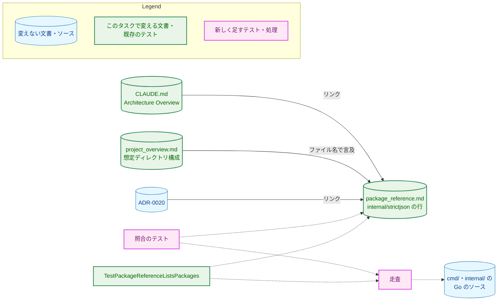
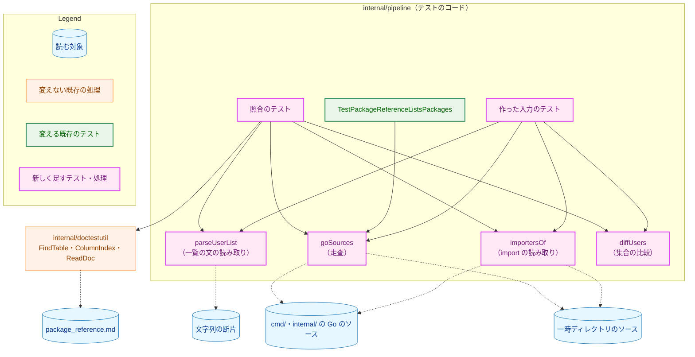
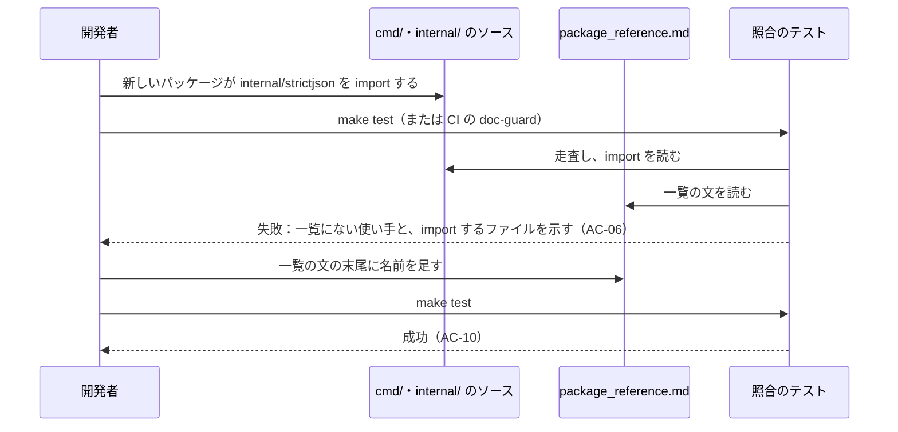
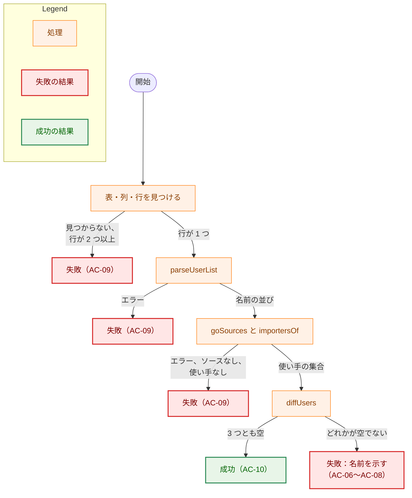

# アーキテクチャ設計書：internal/strictjson の使い手の一覧をコードに合わせ、一覧の置き場所を 1 か所にする

## Document Status

| Item | Value |
|---|---|
| Status | `draft` |
| Created | 2026-11-09 |
| Review date | - |
| Reviewer | - |
| Comments | - |

本書は [01_requirements.md](01_requirements.md)（要件定義書。以下、要件書）の設計である。既存のファイルの内容は、コミット `68d84224` で確かめた。`file:line` の行番号は、このコミットでの行番号である。F-NNN・AC-NN は要件書の項番を、H-NN は [design_handoff.md](design_handoff.md) の項番を指す。申し送りへの対応は付録 A に、受け入れ基準との対応は付録 B にまとめる。

本書は、要件書 6 章の用語（部品・使い手・使い手の一覧・正本）を、要件書と同じ意味で使う。そのほかに、次の用語を使う。

-   **一覧の文:** `package_reference.md` の `internal/strictjson` の行の Responsibility のセルのうち、`Shared by ` で始まり、セルの末尾で終わる部分。使い手の一覧はこの文に書く。
-   **照合のテスト:** F-003 で足す Go のテスト。実際のリポジトリの使い手の一覧とコードの使い手を比べる。
-   **表のテスト:** 既存の `TestPackageReferenceListsPackages`。`package_reference.md` の表に、`cmd/` と `internal/` のパッケージのそれぞれの行があることを確かめる。
-   **走査:** `cmd/` と `internal/` の下を歩き、Go のソースファイルを、それが属するパッケージとともに列挙する処理（3.4）。
-   **作った入力のテスト:** 照合のテストの部品に、テストの中で作った文書の断片や一時ディレクトリのソースを与え、失敗の経路を確かめるテスト（H-05）。

## 1. 設計の全体像 (Design Overview)

### 1.1. 設計原則

-   **使い手の一覧は `package_reference.md` の 1 か所にだけ書く。** ほかの文書は一覧を写さず、要約して `package_reference.md` を指す（F-002）。使い手を足すか外す変更では、その 1 か所を直せばよい。
-   **一覧はコードから求めた集合と比べ、写しは持たない。** 照合のテストに書かれている名前は、部品のパッケージ名 `internal/strictjson` と import のパスだけである（AC-12）。比べる相手はテストの実行のたびにソースから求める。
-   **形に合わない書き方は直さず、拒否する。** 一覧の文が決めた形（3.2）に合わないときは、読み取れたところまでで比べるのではなく、テストを失敗させる（CLAUDE.md「Reject, don't normalize」）。
-   **表のテストと照合のテストで、パッケージを数える範囲をそろえる。** 走査は、`package_reference.md` の表に行を求める既存のテスト `TestPackageReferenceListsPackages` と照合のテストの 2 つで共有する（要件書 3 章の冒頭）。同じパッケージのほかの走査は変えない（3.4）。

### 1.2. 設計の際に決めたこと（2026-11-09）

レビュアーに確かめて決めたこと:

-   **一覧は今の並びの末尾に 4 つのパッケージを足し、照合のテストは順序を確かめない（H-01）。** 足すのは `internal/server`・`internal/nmhost`・`internal/codexreview`・`internal/coveragecompare` の 4 つである。理由: 照合のテストがずれを見つけるので、読み手が一覧を目で探して確かめる必要はない。順序まで確かめると、失敗の種類が増えるわりに、防げる誤りがない。ADR の判断: ADR は作らない。この決定はこのタスクの中で閉じている（CLAUDE.md「Design decisions (ADR)」の「a wording」の類）。
-   **一覧の文は厳格な形で読み、形に合わない書き方は失敗にする（H-01）。** 形は 3.2 で定める。理由: コードスパンの後の名前だけを拾う寛容な読み方では、コードスパンにし忘れた名前が黙って無視される。その名前が使い手でなくても、読み取られないので「使い手でない名前」として検出されず、AC-07 をすり抜ける。ADR の判断: ADR は作らない。テストの読み取り方の決定で、このタスクの中で閉じている。
-   **コードの使い手は、`go/parser` で import の宣言だけを読んで求める。走査は `TestPackageReferenceListsPackages` と共有し、両方のテストで、`testdata` と、名前が `_` か `.` で始まるディレクトリとファイルを数えない（H-02）。** 理由: `go/parser` はビルドタグにかかわらずファイルを読むので、`//go:build test` のファイルも数えられる。`go list` を使うと、使うタグを列挙しなければならず、子プロセスも起動する。走査を共有すれば、要件書が求める「表と一覧で数える範囲をそろえる」ことを、コードの 1 か所で保てる。変更の時点で、既存のテストの結果は変わらない（3.4）。ADR の判断: ADR は作らない。テストの書き方の決定で、このタスクの中で閉じている。
-   **失敗の経路は、作った入力のテストと、実物を壊して確かめることの両方で確かめる（H-05）。** 作った入力のテストは恒久的に残し、AC-06〜AC-08 の経路、一覧の文の読み取りの失敗、走査が数えるものと数えないもの（7.1）を確かめる。そのうえで、実装のときに実際の `package_reference.md` と照合のテストの入力を壊して失敗することを確かめ、そのことをコミットメッセージに書く（7.2。CLAUDE.md「Every test must be able to fail for its stated reason」）。理由: 実際のリポジトリは AC-01 を満たすので、照合のテストを実物に当てるだけでは失敗の経路を通らない。作った入力のテストがあれば、後の変更で読み取りや比較が壊れたときにも気づける。ADR の判断: ADR は作らない。同上。

レビュアーに個別には確かめず、要件書と現行の規則から導いたこと（PR のレビューで異論があれば改める）:

-   **照合のテストは `internal/pipeline` に置く（H-03）。** このパッケージは CI の `doc-guard` ジョブの対象で（`.github/workflows/ci.yml:187`）、AC-11 を変更なしに満たす。走査を共有する `TestPackageReferenceListsPackages` も同じパッケージにある。ほかのパッケージに置くと、`doc-guard` の対象を変えることになり、CLAUDE.md・`ci.yml`・ADR-0016 をそろえる変更が要る（要件書 5 章）。
-   **表の読み取りには `internal/doctestutil` の関数を使い、`packageReferenceRows` は使わない（H-03）。** `packageReferenceRows`（`internal/pipeline/pipeline_test.go:690-701`）は、表の各行の最初のコードスパンだけを集合にして返し、セルの中身を捨てるので、一覧の文を読めない。`TestPackageReferenceListsPackages` は今のまま `packageReferenceRows` を使う。
-   **CLAUDE.md「Development Notes」の guard の列挙には足さない（H-04）。** その列挙（`CLAUDE.md:645-656`）は、文書を読む Go の guard のうち、node を要しないことを読み手に伝えたいものを挙げている。網羅的な一覧ではない。同じ文書を読む `TestPackageReferenceListsPackages` も載っていない。足さないので、AC-05 が許す CLAUDE.md の変更の範囲にも収まる。
-   **ADR-0020 には触れない。** ADR-0020 は #716 で `main` に入っており、「決定」に、一覧に 4 つのパッケージがないことを #713 で扱うと書いた文がある（`docs/dev/adr/0020-strict-json.md:23`）。要件書 1 章の決定のとおり、この文はタスク 0065 の後続の PR が、本タスクの一覧の修正が `main` に入った後に削除する。本タスクの PR の説明には、この文が不要になったことを書く（要件書 2.3）。
-   **PR は 1 本にする。** 一覧の修正と照合のテストは同じコミットに入れる。テストを先に入れると `make test` が失敗し、一覧を先に直すと、テストのない状態で一覧が `main` に入る。CLAUDE.md と `project_overview.md` の書き換えも小さいので、同じ PR に入れる。

### 1.3. なぜ既存の表のテストを広げないか

既存の `TestPackageReferenceListsPackages` は、`package_reference.md` の各行の最初のコードスパンだけを読み、パッケージの表に行があることを確かめる（`internal/pipeline/pipeline_test.go:690-701`）。セルの中の依存や使い手の記述は読まない。このテストを、すべての行の依存の記述まで、コードと照合するように広げることは、要件書の範囲外である（2.3 の「`internal/strictjson` のほかの部品の一覧」）。また、行ごとに文の形が違うので、コードと照合できる形への書き換えが表の全体に及ぶ（YAGNI）。そのため、走査だけを共有し、照合は `internal/strictjson` の行に限った別のテストにする。

2 つのテストは、同じ文書の違う値を確かめる。表のテストは各行の最初のセル（パッケージ名）を、パッケージの集合と比べる。照合のテストは `internal/strictjson` の行の一覧の文を、使い手の集合と比べる。要件書 5 章の「同じ文書の同じ値を、同じ照合先と比べるテストを 2 つ作らない」には当たらない。

### 1.4. 概念モデル

使い手の一覧と、それを指す文書、照合するテストの関係を図 1 に示す。実線の矢印 A → B は「文書 A が文書 B を指す」を、破線の矢印 A -.-> B は「テストや処理 A が B を読む、または呼ぶ」を表す。



`TestPackageReferenceListsPackages` は、走査を共有の処理に置き換える点で変わる（3.4）。照合の対象は変わらない。

## 2. システム構成 (System Structure)

### 2.1. 全体構成

変更は、文書 3 つと、`internal/pipeline` のテストのコードである。製品のコードは変えない。

| 種類 | 対象 | 変更 |
|---|---|---|
| 文書 | `docs/dev/conventions/package_reference.md` の `internal/strictjson` の行 | 一覧の文の末尾に 4 つを足す（F-001、3.1） |
| 文書 | `CLAUDE.md` の「Architecture Overview」の `internal/strictjson` の項目 | 使い手の列挙を、要約と `package_reference.md` へのリンクに置き換える（F-002、3.5） |
| 文書 | `docs/dev/project_overview.md` の「想定ディレクトリ構成」の `internal/strictjson/` の行 | 使い手の列挙を、要約に置き換える（F-002、3.5） |
| テスト | `internal/pipeline` | 走査を共有の処理にし、照合のテストと、作った入力のテストを足す（F-003、3.2〜3.4） |

### 2.2. コンポーネント配置

照合のテストとその部品の配置を図 2 に示す。実線の矢印 A → B は「A が B を呼ぶ」を、破線の矢印 A -.-> B は「A が B を読む」を表す。



-   `goSources`・`importersOf`・`parseUserList`・`diffUsers` の名前は、設計で役割を区別するための仮の名前である。名前とファイルの分け方は実装計画で決める。
-   文書の表の読み取りは、既存の `internal/doctestutil` の `FindTable`・`ColumnIndex`（`internal/doctestutil/tables.go:63-86`）と `ReadDoc` を使い、新しく書かない（CLAUDE.md「DRY」）。

### 2.3. データフロー：使い手を足す変更

使い手が 1 つ増える変更で、照合のテストがどう働くかを図 3 に示す。



CLAUDE.md と `project_overview.md` は一覧を持たないので、この変更で直す必要はない（要件書 4.5）。

## 3. コンポーネント設計 (Component Design)

### 3.1. `package_reference.md` の一覧（F-001）

`docs/dev/conventions/package_reference.md:29` の一覧の文を、次の形にする。今の 7 つの並びは変えず、その末尾に 4 つを足す（1.2）。

```
Shared by `internal/transcript`, `internal/llm/deepseek`, `internal/llm/claude`, `internal/publisher`, `internal/writer`, `internal/artifact`, `internal/fixprguard`, `internal/server`, `internal/nmhost`, `internal/codexreview`, and `internal/coveragecompare`
```

セルのうち、一覧の文より前の部品の契約の説明と、表のほかの行は変えない（AC-02）。この形は、3.2 の厳格な形に合う。

この 11 個は、`git grep -l '"github.com/isseis/yt2column/internal/strictjson"' -- '*.go'` の結果から `_test.go` と `docs/` の下のファイル（要件書 2.3 の `_material_check`）を除き、ディレクトリにまとめたものである（コミット `68d84224`）。実装の PR の head での集合は、照合のテストが確かめる（AC-01）。

### 3.2. 一覧の文の形と読み取り（H-01、AC-07〜AC-09）

照合のテストは、次の手順で一覧の文を見つける。

1.  `doctestutil.FindTable` で、見出しに `Package` を持つ表を見つけ、`doctestutil.ColumnIndex` で `Responsibility` の列を見つける。
2.  その表の本体の行のうち、最初のセルが `internal/strictjson` の行が、ちょうど 1 つあることを確かめる。`doctestutil.TableRow` は最初に一致した行だけを返し、2 つ目の行を見落とすので（`internal/doctestutil/tables.go:88-97`）、行を数えて確かめる。2 つ目の行に古い一覧が残ったときにも、失敗させるためである。
3.  その行の Responsibility のセルを、`parseUserList` に渡す。

表・列が見つからないとき、行がないとき、行が 2 つ以上あるときは、照合のテストは失敗する（AC-09）。

`parseUserList` は、セルの中の一覧の文を次の形として読む。

-   セルの中に `Shared by ` がちょうど 1 回現れ、一覧の文はそこからセルの末尾までである。
-   `Shared by ` の後には、コードスパン（`` `名前` ``）の項目が 1 つ以上並ぶ。項目が 1 つなら `` `a` ``、2 つなら `` `a` and `b` ``、3 つ以上なら `` `a`, `b`, and `c` `` の形にする（英語の列挙の書き方。最後の項目の前の `, and ` を含む）。
-   最後の項目の後には何も書かない（句点も書かない。今のセルと同じである）。

次の場合、`parseUserList` は名前の並びを返さず、エラーを返す。照合のテストは、そのエラーで失敗する（AC-09）。

-   `Shared by ` がない、または 2 回以上現れる。
-   `Shared by ` の後に項目が 1 つもない。
-   項目にコードスパンでない名前がある、区切りが上の形と違う、または最後の項目の後に文字がある。

エラーの文には、形に合わなかった箇所の文字列を含める。どこを直せばよいかが分かるようにするためである。

`parseUserList` は名前の並びを、重複を残したまま、書かれた順に返す。重複は 3.3 の比較で見つける（AC-08）。順序は確かめない（1.2）。

`Shared by ` は、表の英語の文の一部である。ここでは、一覧の文の始まりを示す構造の目印として使い、文の意味を確かめるためには使わない（CLAUDE.md「Document tests check values, structure, and executable examples, never prose」）。

### 3.3. 集合の比較（AC-06〜AC-08、AC-12）

`diffUsers` は、一覧の名前の並びとコードの使い手の集合を受け取り、次の 3 つを、それぞれ名前の順に並べて返す。

| 返すもの | 内容 | 対応する AC |
|---|---|---|
| 一覧にない使い手 | コードの使い手の集合にあり、一覧にない名前 | AC-06 |
| 使い手でない名前 | 一覧にあり、コードの使い手の集合にない名前。存在しないパッケージ、`_test.go` だけが import するパッケージ、`internal/strictjson` 自身、`cmd/`・`internal/` の外のパッケージ（`prompts` など）がここに入る | AC-07 |
| 重複した名前 | 一覧に 2 回以上現れる名前 | AC-08 |

照合のテストは、3 つのうち空でないものを、それぞれ名前を並べて `t.Errorf` で報告する。一覧にない使い手には、そのパッケージで部品を import するファイルも並べる。`//go:build test` の補助のファイルで使い手になった場合などに、なぜ使い手と数えられたかが分かるようにするためである。3 つとも空のときに成功する（AC-10）。

`internal/strictjson` 自身が使い手の集合に入ることはない。Go のパッケージは自分自身を import できないためである。一覧に `internal/strictjson` を書けば、「使い手でない名前」として報告される。

照合のテストに書かれているパッケージの名前は、行を見つけるための `internal/strictjson` と、import のパス `github.com/isseis/yt2column/internal/strictjson` だけである（AC-12）。

### 3.4. 走査と import の読み取り（H-02、AC-09）

**走査（`goSources`）。** 起点のディレクトリの下の `cmd/` と `internal/` を歩き、名前が `.go` で終わるファイルを、それが属するパッケージ（起点からのディレクトリの相対パスを `/` 区切りにしたもの）とともに返す。実際のリポジトリでは、起点は同じパッケージの既存の定数 `repoRoot`（`internal/pipeline/relay_guard_test.go:21`）である。`_test.go` のファイルも返し、それを除くかどうかは呼び出し側が決める。次のものは返さない。

-   名前が `testdata` であるか、`_` または `.` で始まるディレクトリと、その下のすべて。
-   名前が `_` または `.` で始まるファイル。

この規則は、`cmd/` と `internal/` より下のエントリの名前（`fs.DirEntry.Name()`）だけに当てはめる。起点のパス（`../..`）や、一時ディレクトリの親（`.` で始まる名前を含むことがある）には当てはめない。

ビルドタグ（`//go:build test` や `//go:build ignore` など）と、ファイル名の GOOS・GOARCH の接尾辞（`_windows.go` など）は見ない。どのファイルも数える（要件書 3 章の冒頭）。入れ子のモジュール（自分の `go.mod` を持つディレクトリ）と `vendor` は飛ばさない。コミット `68d84224` では、`go.mod` はリポジトリのルートの 1 つだけで、`vendor` のディレクトリもシンボリックリンクもない。歩く途中のエラーは、走査のエラーとして返す。

**`TestPackageReferenceListsPackages` の変更。** このテストは、今の走査（`internal/pipeline/pipeline_test.go:639-659`）をやめ、`goSources` が返すファイルから次のパッケージを数える。

-   `_test.go` でないファイルのパッケージ（今の `:650-653` と同じ）。
-   パスの要素に `testutil` を含むパッケージ。今のテストは、`testutil` を含むディレクトリを、`.go` ファイルの有無にかかわらず数える（`:644-647`）。変更の後は、`.go` ファイルを 1 つ以上持つディレクトリだけを数える。コミット `68d84224` では、パスの要素に `testutil` を含むディレクトリは 9 つで、どれも `.go` ファイルを 2 つ以上持つ（`git ls-tree` で確かめた）。そのため、変更の時点で結果に違いは出ない。
-   `prompts`（今の `:660` と同じ）。

数えたパッケージが 1 つもないときに失敗する今の確かめ（`:661-663`）は残す。

この変更で、このテストは `testdata` と、名前が `_` か `.` で始まるディレクトリとファイルを数えなくなる。コミット `68d84224` では、`cmd/` と `internal/` の下の該当するディレクトリは `internal/coveragecompare/testdata`・`internal/publisher/testdata`・`internal/codexreview/testdata` の 3 つで、どれにも `.go` ファイルはない。名前が `_` か `.` で始まるファイルもない（`find cmd internal \( -name testdata -o -name '_*' -o -name '.*' \)` で確かめた）。そのため、変更の時点でテストの結果は変わらない。

**変えない走査。** 同じパッケージには、ほかに 2 つの走査がある。どちらも本タスクでは変えない。

-   `productionGoFiles`（`internal/pipeline/relay_guard_test.go:26-64`）。`testdata` だけを飛ばし、`//go:build test` などのテスト用のファイルを除いた製品のファイルを返す。数える範囲が要件書の使い手の定義（タグ付きのファイルを含む）と違う。この走査を使っているのは、中継の guard（同 `:310`、`:361`、`:408`）だけである。
-   `TestFakesCarryBuildTag` の中の走査（`internal/pipeline/pipeline_test.go:555-575`）。`_test.go` を含むファイルを、`testutil`・`test_helpers`・テスト専用のパッケージに分け、件数を固定して確かめる。

どちらも、`package_reference.md` の表と一覧の数える範囲には関わらない。`goSources` に載せ替えると、それぞれのテストの範囲も変わり、要件書の範囲を超える。

**import の読み取り（`importersOf`）。** `goSources` が返したファイルのうち `_test.go` でないものを `go/parser` の `ImportsOnly` で読み、import のパスが与えたパスと等しいファイルを、パッケージごとにまとめて返す。別名の import（`sj "…"`）、`_` の import（`_ "…"`）、`.` の import も数える。ファイルを読めない、または構文を解析できないときはエラーを返す。同じパッケージの `TestWriterImports`・`TestConfigImports` も、`ImportsOnly` で import を読む（`internal/pipeline/pipeline_test.go:801`、`:859`）。この 2 つは、決まったディレクトリのファイルごとに、禁止した import とテスト用のファイルの例外を確かめるもので、パッケージの集合を求めない。そのため `importersOf` は使わず、変えない。

照合のテストは、次のときに失敗する（AC-09）。

-   走査または import の読み取りがエラーを返す。
-   走査が Go のソースファイルを 1 つも返さない。
-   使い手の集合が空である。このとき、メッセージには探した import のパスと起点を示す。モジュールのパスの変更など、原因を見つけやすくするためである。

### 3.5. CLAUDE.md と project_overview.md（F-002）

**CLAUDE.md**（英語）。`CLAUDE.md:312-315` の項目を、次の文にする。使い手の名前を挙げず、複数のパッケージが共有することと、一覧が `package_reference.md` にあることを述べ、そこへのリンクを付ける。部品が拒否するものの記述は残す（AC-03）。

```
- `internal/strictjson`: strict JSON extraction shared by several packages
  (the list of them is in [package_reference.md](docs/dev/conventions/package_reference.md));
  rejects the byte sequences and structural shapes `encoding/json` would
  silently repair.
```

**project_overview.md**（日本語）。`docs/dev/project_overview.md:112` の行は、コードブロック（同 `:100` から始まる「想定ディレクトリ構成」）の中にあるので、リンクは書けない。行を次のようにし、使い手の名前を挙げずに、一覧が `package_reference.md` にあることを述べる。部品の説明は残す（AC-04）。

```
internal/strictjson/      # 検証を通った JSON 文書から値を取り出す厳格な部品（複数のパッケージが共有。使うパッケージの一覧は package_reference.md）
```

両方とも、使い手の記述でない部分の意味は変えない（AC-05）。CLAUDE.md と `project_overview.md` のほかの記述は変えない。テストの追加のために変える必要のある記述はない（1.2 の H-03・H-04）。

文言は PR のレビューで読む（7.4）。CLAUDE.md の項目の文言と `project_overview.md` の行を確かめる既存のテストはない（`git grep` で `*_test.go` を `Architecture Overview` と `想定ディレクトリ構成` について確かめた。コミット `68d84224`）。CLAUDE.md に足すリンクの行き先があることは、既存の `TestInstructionDocPaths`（`cmd/yt2column/docpaths_test.go:140`）が確かめる。

### 3.6. テストの部品の型（高水準）

テストの部品が返すエラーは、作った入力のテストが `errors.Is` で区別できるように、番兵で定める（CLAUDE.md「Error Testing」）。

```go
// goSource is one Go source file found by the walk, with the package
// (the slash-separated directory relative to the walk root) it belongs to.
type goSource struct {
	pkg  string
	path string
}

var (
	// errNoUserList reports that the cell has no "Shared by " list, or has it
	// more than once.
	errNoUserList = errors.New("no single user list")
	// errMalformedUserList reports that the list does not have the form of 3.2.
	errMalformedUserList = errors.New("malformed user list")
)
```

### 3.7. 変わるファイルとテスト

| ファイル | 変更 | 対応 |
|---|---|---|
| `docs/dev/conventions/package_reference.md` | `internal/strictjson` の行の一覧の文に 4 つを足す | F-001 |
| `CLAUDE.md` | 「Architecture Overview」の `internal/strictjson` の項目を 3.5 の文にする | F-002 |
| `docs/dev/project_overview.md` | 「想定ディレクトリ構成」の `internal/strictjson/` の行を 3.5 の文にする | F-002 |
| `internal/pipeline/pipeline_test.go` | `TestPackageReferenceListsPackages` の走査を `goSources` に置き換える | H-02 |
| `internal/pipeline` の新しいテストのファイル（名前は実装計画で決める） | 照合のテスト、`goSources`・`importersOf`・`parseUserList`・`diffUsers`、作った入力のテスト | F-003 |

挙動の変わる既存のテストは、`TestPackageReferenceListsPackages` だけである。変わるのは数える範囲で、3.4 の 2 点（無視するディレクトリとファイル、`.go` ファイルのない `testutil` のディレクトリ）である。今のリポジトリでは結果は変わらない（3.4）。

## 4. エラーハンドリング設計 (Error Handling Design)

照合のテストは、製品のエラーを定めない。テストの部品のエラーは 3.6 の番兵と、走査と import の読み取りが返す `io/fs` と `go/parser` のエラーである。

照合のテストの失敗のメッセージは、次の形にする。どれも、どのパッケージ、またはどの箇所が原因かを示す（AC-06〜AC-09）。

| 状況 | メッセージが示すもの |
|---|---|
| 一覧にない使い手がある | その名前と、部品を import するファイル（AC-06） |
| 使い手でない名前がある | その名前の並び（AC-07） |
| 重複した名前がある | その名前の並び（AC-08） |
| 表・列が見つからない、行がない、行が 2 つ以上ある | 探した見出し・列名・パッケージ名と、見つかった行の数（AC-09） |
| 一覧の文を読めない | `parseUserList` のエラー。形に合わなかった箇所を含む（AC-09） |
| 走査・import の読み取りが失敗した、またはソースが 1 つもない | そのエラー、または起点（AC-09） |
| 使い手が 1 つもない | 探した import のパスと起点（AC-09） |

最初の 3 つは `t.Errorf` で、同じ実行の中で 3 つとも報告する。残りは比べる前提が崩れているので `t.Fatalf` にする。どの場合も、成功扱いにはしない（fail closed）。

## 5. セキュリティ考慮事項 (Security Considerations)

N/A。要件書 4.2 のとおり、本タスクは `docs/dev/security.md` を適用する条件に当たらない。照合のテストは、リポジトリの中の文書と Go のソースだけを読み、外部のコマンドを起動せず、ネットワークに触れない。脅威モデルの図は要らない。

## 6. 処理フロー詳細 (Processing Flow Details)

### 6.1. 照合のテストの流れ

図 4 に、照合のテストの判定の流れを示す。矢印は処理の順序を表す。この図のノードの色は、変更の有無ではなく、処理と結果の種類を表す（Legend）。



### 6.2. ADR-0020 の文との順序

ADR-0020 の「決定」の #713 の文（`docs/dev/adr/0020-strict-json.md:23`）は、本タスクの PR が `main` に入ると古くなる。要件書 1 章の決定のとおり、本タスクの PR はこの ADR に触れない。削除は、本タスクの PR が `main` に入った後に、タスク 0065 の後続の PR が行う。本タスクの PR の説明には、この文が不要になったことを書く。

## 7. テスト戦略 (Test Strategy)

### 7.1. ユニットテスト（作った入力のテスト）

外部のプロセスもネットワークも使わない。どれも `make test` と `doc-guard` で実行される。

-   **一覧の文の読み取り（`parseUserList`）。** 文字列の断片を与える表駆動のテスト。成功の行は、項目が 1 つ・2 つ・3 つ以上の形と、契約の説明の後に一覧の文が続くセルである。失敗の行は、`Shared by ` がない、2 回ある、項目がない、コードスパンでない名前がある、区切りが違う（`,` の後の `and` がない、など）、最後の項目の後に文字がある、である。失敗の行は `errors.Is` で番兵を確かめる（AC-09）。重複した名前は、読み取りでは失敗せず、重複を残したまま返すことを確かめる（AC-08 の前提）。
-   **集合の比較（`diffUsers`）。** 一覧にない使い手（AC-06）、使い手でない名前（AC-07。存在しない名前と `internal/strictjson` 自身）、重複した名前（AC-08）、3 つとも空（AC-10）の行を持つ表駆動のテスト。
-   **走査と import の読み取り（`goSources`・`importersOf`）。** `t.TempDir` の下に `cmd/` と `internal/` の小さなソースを作るテスト。次のことを確かめる。
    -   `_test.go` だけが対象を import するパッケージは、使い手に入らない（AC-07）。
    -   `//go:build test` の付いたファイルだけが import するパッケージは、使い手に入る（要件書 3 章の冒頭）。
    -   別名の import と `_` の import も数える。
    -   `testdata`、`_` で始まるディレクトリ、`.` で始まるディレクトリ、`_` で始まるファイルの下の import は数えない（H-02）。
    -   構文を解析できないファイルがあれば、エラーになる（AC-09）。
    -   `cmd/` と `internal/` に `.go` ファイルが 1 つもない起点では、何も返さない（AC-09 の「ソースが 1 つもない」の前提）。

    作った入力の中のパッケージ名は、AC-12 の対象外である（要件書 AC-12）。

各テストは、対象を壊して失敗することを確かめてからコミットし、そのことをコミットメッセージに書く（CLAUDE.md「Every test must be able to fail for its stated reason」）。

### 7.2. 結合テスト（照合のテスト）

照合のテストは、実際のリポジトリの `package_reference.md` と `cmd/`・`internal/` のソースを比べる（AC-01、AC-10）。`internal/pipeline` にあるので、`make test` と CI の `doc-guard` ジョブで実行される（AC-11）。

実装のときに、次のように一時的に壊し、照合のテストが失敗して原因を示すことを確かめる。壊した変更はコミットせず、結果を、照合のテストと一覧の修正を入れるコミットのメッセージに書く（H-05）。

-   一覧から 1 つを消す（AC-06）。一覧に 4 つを足す前の状態で照合のテストを走らせることも、この確認になる。
-   存在しないパッケージを足す（AC-07）。
-   1 つを 2 回書く（AC-08）。
-   一覧の文を消す（AC-09）。
-   `internal/strictjson` の行を消す、および同じ行を 2 つにする（AC-09）。
-   照合のテストの import のパスを、存在しないパスに変えて使い手を 0 にする（AC-09）。

### 7.3. 一回の確認（`_checks/`）

AC-02 と AC-05 は変更の前後の関係を述べるので、恒久的なテストにしない。タスクのディレクトリの `_checks/` に、マージの基点と PR の head を比べるスクリプトを置き、PR のブランチで 1 回だけ実行する（`requirements_process.md` §4、ADR-0016）。

-   **AC-02:** `package_reference.md` の差分が、`internal/strictjson` の行の一覧の文の中だけにあること。
-   **AC-05（範囲）:** CLAUDE.md と `project_overview.md` の差分が、3.5 の項目と行の中だけにあること。

### 7.4. 読んで確かめる（manual）

-   **AC-03・AC-04・AC-05（意味）:** 3.5 の文が、使い手の名前を挙げず、一覧の置き場所を述べ、部品の説明の意味を変えていないこと。文の意味は PR のレビューで読む（CLAUDE.md「Document tests check values, structure, and executable examples, never prose」）。
-   **AC-12:** 照合のテストのコードが、`internal/strictjson` と import のパスのほかに、パッケージの名前を持たないこと。

### 7.5. セキュリティテスト

N/A（5 章）。

## 8. 実装の優先順位 (Implementation Priorities)

1 本の PR で、次の順に進める（1.2）。コミットの分け方は実装計画で決める。どのコミットでも `make test` が通るようにする。

1.  走査を `goSources` にし、`TestPackageReferenceListsPackages` をそれに載せ替える。テストの結果が変わらないことを確かめる。
2.  `importersOf`・`parseUserList`・`diffUsers` と、作った入力のテストを足す。
3.  照合のテストを足し、`package_reference.md` の一覧に 4 つを足す。一覧を直す前に照合のテストが失敗することと、7.2 の壊す確認は、コミットせずに手元で確かめる。
4.  CLAUDE.md と `project_overview.md` を書き換える。
5.  `_checks/` のスクリプトを置き、実行する。

## 9. 将来の拡張 (Future Extensibility)

-   **ほかの部品の使い手の一覧も照合する。** 必要になれば、`parseUserList` と `importersOf` を、行の名前と import のパスを引数にして使い回せる。今は `internal/strictjson` だけを対象にする（YAGNI、1.3）。
-   **ADR-0001 との関係。** ADR-0001 の使い手の一覧は #716 で ADR-0020 へ移され、ADR-0020 は一覧を写さずに `package_reference.md` へリンクしている（`docs/dev/adr/0001-llm-adapter-stdlib.md:27`、`docs/dev/adr/0020-strict-json.md:23`）。そのため、本タスクの PR が `main` に入った時点で、使い手の一覧を持つ文書は `package_reference.md` の 1 か所になる。

## 付録 A: 申し送り（design_handoff.md）への対応

| 項目 | 採った方法 | 本書の箇所 |
|---|---|---|
| H-01 一覧の文の形と読み取り方 | 厳格な形（`Shared by ` に続くコードスパンの英語の列挙で、セルの末尾まで）。形に合わなければ失敗。順序は決めず、確かめない | 1.2、3.1、3.2 |
| H-02 コードの使い手の求め方 | `go/parser` の `ImportsOnly`。ビルドタグを見ずに全ファイルを読む。`testdata` と、名前が `_` か `.` で始まるディレクトリとファイルは数えない。走査は `TestPackageReferenceListsPackages` と共有する | 1.2、3.4 |
| H-03 テストの置き場所 | `internal/pipeline`。`doc-guard` の対象で、走査を共有するテストと同じパッケージ。表の読み取りは `internal/doctestutil` の既存の関数を使い、`packageReferenceRows` はセルの中身を返さないので使わない | 1.2、2.2 |
| H-04 CLAUDE.md の guard の列挙 | 足さない。列挙は網羅的でなく、`TestPackageReferenceListsPackages` も載っていない | 1.2 |
| H-05 失敗の経路の確かめ方 | 両方。作った入力のテストを恒久的に残し、実物を壊して失敗することも確かめてコミットメッセージに書く | 1.2、7.1、7.2 |

## 付録 B: 受け入れ基準との対応

| AC | 設計 | 確かめ方 |
|---|---|---|
| AC-01 | 3.1 | 照合のテスト（7.2） |
| AC-02 | 3.1 | 一回の確認（7.3） |
| AC-03 | 3.5 | manual（7.4） |
| AC-04 | 3.5 | manual（7.4） |
| AC-05 | 3.5 | 一回の確認（範囲）と manual（意味）（7.3、7.4） |
| AC-06 | 3.3 | 作った入力のテスト、実物を壊す確認（7.1、7.2） |
| AC-07 | 3.3、3.4 | 作った入力のテスト、実物を壊す確認（7.1、7.2） |
| AC-08 | 3.2、3.3 | 作った入力のテスト、実物を壊す確認（7.1、7.2） |
| AC-09 | 3.2、3.4、4 章 | 一覧の文の読み取りと走査の失敗は作った入力のテスト（7.1）。行の欠落・重複と使い手が 0 の場合は実物を壊す確認（7.2） |
| AC-10 | 3.3 | 照合のテスト（7.2） |
| AC-11 | 1.2（H-03） | 静的確認：テストが `internal/pipeline` にあり、`ci.yml:187` の `doc-guard` の対象であること |
| AC-12 | 3.3 | manual（7.4） |
