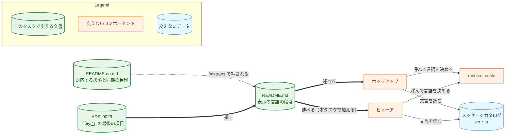
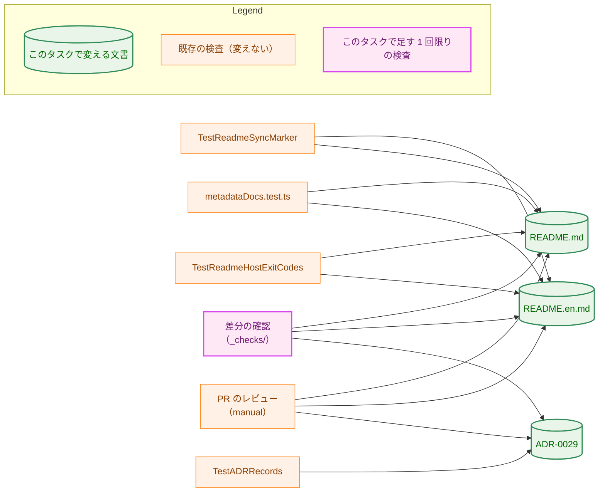
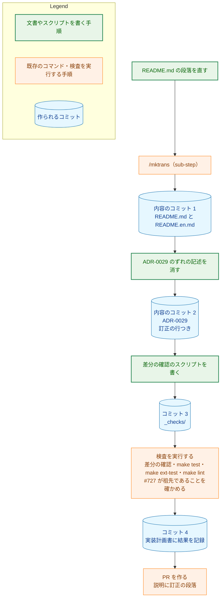

# アーキテクチャ設計書：README の表示の言語の段落を、ビューアにも触れる形に直す

## Document Status

| Item | Value |
|---|---|
| Status | `draft` |
| Created | 2026-11-09 |
| Review date | - |
| Reviewer | - |
| Comments | - |

本書は [01_requirements.md](01_requirements.md)（要件定義書。以下、要件書）の設計である。既存のファイルの内容は、コミット `960e3737` で確かめた。`file:line` の行番号は、このコミットでの行番号である。F-NNN・AC-NN は要件書の項番を指す。受け入れ基準との対応は付録 A にまとめる。本タスクに `design_handoff.md` はない。

本書は、要件書 6 章の用語（ビューア・ポップアップ・表示の言語・ずれの記述）を、要件書と同じ意味で使う。そのほかに、次の用語を使う。

-   **表示の言語の段落:** `README.md` の「ブラウザ拡張」節で、表示の言語を述べる段落（`README.md:574-575`）。英語版では `README.en.md:786-789` の段落が対応する。
-   **実装の PR:** `README.md`・`README.en.md`・ADR-0029 の変更を入れる 1 本の PR（1.2）。本書の PR と、実装計画書の PR は含まない。
-   **内容のコミット:** 実装の PR のうち、`README.md`・`README.en.md`・ADR-0029 を変えるコミット（1.2）。差分の確認（次の項目）のスクリプトを足すコミットと、実装計画書に結果を記録するコミットは含まない。
-   **差分の確認:** 変更の前後の関係を述べる受け入れ基準を、マージベースと PR の先頭（最新のコミット）を比べて確かめるスクリプト。タスクの `_checks/` の下に置く（`docs/dev/conventions/requirements_process.md`「4. Acceptance Tests」）。恒久的なテストではなく、PR のブランチの上でだけ実行する（7.2）。
-   **編集上の訂正・訂正の行・訂正の段落:** `docs/dev/conventions/requirements_process.md` の「Editorial correction」と「Recording in the PR description」の用語（correction、correction line、correction paragraph）。決定を変えない修正と、それをコミットのメッセージと PR の説明に記録する形を指す（3.3）。

## 1. 設計の全体像 (Design Overview)

### 1.1. 設計原則

-   **README の記述を、コードの今の振る舞いに合わせる。コードは変えない。** ポップアップとビューアは、どちらも `resolveLocale` で表示の言語を決める（`extension/src/launch.ts:681`、`extension/src/viewerApp.ts:178`）。段落はこの事実を述べる形にする（F-001）。拡張のコードとメッセージカタログは変えない（要件書 2.3）。
-   **日本語の `README.md` を正とし、英語版は `/mktrans` で写す。** `README.md` を先に直し、`/mktrans` で `README.en.md` に写し、2 つを 1 つのコミットに入れる（F-002、CLAUDE.md「Translation Guidelines」）。`/mktrans` は、`/runplan` が README の同期の確認から呼ぶ sub-step として実行する（3.2）。同期の目印（`README.en.md:1`）も `/mktrans` が更新する。
-   **製品の文書と ADR の変更は、要件書が定めた 3 か所の中だけに閉じる。** `README.md` の表示の言語の段落、`README.en.md` の対応する段落と 1 行目の同期の目印、ADR-0029 のずれの記述の 3 文である（AC-04・AC-07・AC-09）。実装の PR がほかに変えてよいのは、このタスクのディレクトリ（`docs/tasks/0069_readme_display_language/`）の下だけである。この 2 点（3 か所の中だけを変えること、ほかはこのタスクのディレクトリの下だけを変えること）は、どちらも差分の確認で確かめる（7.2）。
-   **ADR-0029 の変更は、決定を変えない編集上の訂正として扱う。** ずれの記述は、README を直すと事実でなくなる記述である。消しても ADR-0029 の決定は変わらないので、経緯の項目は足さない。この扱いが ADR の規約の例外であることは、要件書 1 章で決まっている（3.3）。

### 1.2. 設計の際に決めたこと（2026-11-09）

要件書が、直す箇所・述べる内容・ADR の扱い・マージの順序まで決めているので、レビュアーに確認してもらうべき未決の判断はなかった。次のことは、要件書と現行の規則から導いた（PR のレビューで異論があれば改める）。

-   **PR は 1 本にする。** 要件書は、README を直す PR と同じ PR で ADR-0029 のずれの記述を消すことを求めている（F-003）。`README.en.md` も `README.md` と同じコミットに入れる規則なので（CLAUDE.md「Translation Guidelines」）、3 つのファイルの変更を分けられる PR の境目はない。ADR の判断：ADR は作らない。PR の分け方の決定で、このタスクの中で閉じている。
-   **内容のコミットは 2 つに分ける。README の 2 つのファイルで 1 つ、ADR-0029 で 1 つ。** ADR-0029 のコミットだけが訂正の行を持つ（AC-10、3.3）。README のコミットと分けると、どのコミットが ADR を変えたかが履歴から 1 つに決まり、AC-10 の「ADR-0029 を変えるコミットのメッセージ」が指すものもはっきりする。ADR の判断：ADR は作らない。コミットの分け方の決定で、このタスクの中で閉じている。
-   **AC-11 の順序の条件は、本書を書いた時点で満たされている。** [#727](https://github.com/isseis/yt2column/pull/727) は `main` に入っている（コミット `cf76c1f622df0883230e9b1de0c426f6aef9cb88`、`960e3737` の祖先）。`main` から作る実装の PR のブランチは必ずこのコミットを含むので、要件書 1 章の「実装の PR が #727 より先にマージされそうなとき」は起こらない。PR を作るときに、このコミットが実装の PR の先頭の祖先であることを 1 回確かめて記録すれば足りる（6.2）。ADR の判断：ADR は作らない。この順序の確認はこのタスクの中で閉じている。
-   **新しい文書のテストは足さない。** 段落の文の意味（AC-01〜AC-03・AC-05・AC-08）は、PR のレビューで読んで確かめる（要件書 2.3、[ADR-0016](../../dev/adr/0016-document-test-policy.md)）。前後の関係（AC-04・AC-07・AC-09）は差分の確認で確かめ、恒久的なテストにしない。ADR の判断：ADR は作らない。既存の ADR-0016 の方針に従うだけで、決定を変えない。

### 1.3. 概念モデル

表示の言語の段落と、それが述べるコードの振る舞い、段落を参照する文書の関係を図 1 に示す。太い矢印 A ==> B は「文書 A が B を述べる、または指す」を、破線の矢印 A -.-> B は「文書 A が文書 B から写される」を、実線の矢印 A → B は「コンポーネント A が B を呼ぶ、または読む」を表す。



図 1 のうち、ポップアップとビューアから `resolveLocale` とメッセージカタログへの矢印は、今のコードの関係である。ポップアップは `extension/src/launch.ts:681-682` で、ビューアは `extension/src/viewerApp.ts:178-179` で `resolveLocale` を呼び、ページの `lang` を決める。ポップアップは文言をカタログから読み（`extension/src/ui/render.ts:1`・`:109`）、ビューアも同じカタログから読む（`extension/src/ui/renderJob.ts:51`・`:109`）。`README.md` からビューアへの矢印だけが、本タスクで加える関係である。

## 2. システム構成 (System Structure)

### 2.1. 全体構成

本タスクは文書だけを変える。実行時に動くコンポーネント（拡張・Native Messaging のホスト・サーバ・CLI）は変わらない。変える文書と、その変更を確かめる仕組みを図 2 に示す。矢印 A → B は「A が B を読んで確かめる」を表す。



既存の検査は、どれも変えない。図 2 は主な検査だけを示す。それぞれが受ける影響と、CI で実行されるかどうかは 3.4 に書く。

### 2.2. コンポーネント配置

| ファイル | 変更 | 内容 |
|---|---|---|
| `README.md` | 変更 | 表示の言語の段落（`README.md:574-575`）を、ポップアップとビューアの両方に触れる形に改める（F-001、3.1） |
| `README.en.md` | 変更 | `/mktrans README.md` が、対応する段落（`README.en.md:786-789`）と 1 行目の同期の目印を更新する（F-002、3.2） |
| `docs/dev/adr/0029-extension-ui-languages.md` | 変更 | 「決定」の最後の項目（`docs/dev/adr/0029-extension-ui-languages.md:24`）から、ずれの記述の 3 文を消す（F-003、3.3） |
| `docs/tasks/0069_readme_display_language/_checks/` | 追加 | AC-04・AC-07・AC-09 の差分の確認のスクリプト（7.2）。`go list ./...` は `_` で始まるディレクトリを無視する |
| `docs/tasks/0069_readme_display_language/03_implementation_plan.md` | 変更 | 実装計画書（`/mkplan` の PR が作る）。実装の PR は、進み具合と検証の結果を記録する |

拡張のコード、メッセージカタログ、Go のコードとテスト、ADR の索引（`docs/dev/adr/README.md`）は変えない。ADR-0029 の表題は変わらないので、索引の行も変わらない。

### 2.3. データフロー

本タスクで動くデータは、`README.md` の段落の文面だけである。`README.md` の文面を `/mktrans` が英語にして `README.en.md` に写し、同時に `README.en.md` の同期の目印を、変更後の `README.md` の blob に更新する。この流れは既存の README の運用そのもので、本タスクは変えない（CLAUDE.md「Translation Guidelines」）。

## 3. コンポーネント設計 (Component Design)

本タスクに型・インターフェースの追加や変更はない。この章では、変える文書ごとに、変更後に満たす内容を定める。正確な文面は、要件書のとおり実装で決める（`README.en.md` の文面は `/mktrans` が決める）。

### 3.1. `README.md` の表示の言語の段落（F-001）

今の段落（`README.md:574-575`）は、次の 3 文からなる。

1.  ポップアップは、ブラウザの UI の言語が日本語のときは日本語で、それ以外のときは英語で表示する。
2.  拡張に言語の設定はない。
3.  この README が引用するポップアップの文言（下の、概要欄が折りたたまれているときのメッセージなど）は日本語の版である。

変更後の段落は、次の内容を述べる。

| 文 | 変更後に述べる内容 | AC |
|---|---|---|
| 1 文目 | ポップアップとビューアの文言が、ブラウザの UI の言語が日本語のときは日本語で、それ以外のときは英語で表示されること。主語は「ポップアップとビューアの文言」のように、画面の文言だけを指す語にする | AC-01 |
| 2 文目 | 拡張に言語の設定がないこと（今と同じ） | AC-02 |
| 3 文目 | この README が引用するポップアップとビューアの文言が、日本語の版であること | AC-03 |

-   **記事の本文には触れない（AC-01）。** ビューアの記事の本文は、UI の言語によらず `lang="ja"` を持つ（ADR-0029「決定」の `lang` の項目）。1 文目の主語を「ビューア」や「ビューアの画面」にすると、ビューアの記事の本文も英語になると読めてしまう。そのため 1 文目は、ポップアップとビューアの「文言」が、UI の言語に応じて決まった言語で表示されることを述べる形にする。記事の本文の言語を段落に書き足すことは、スコープ外である（要件書 2.3）。
-   **3 文目の括弧の例は残してよい。** 今の例（概要欄が折りたたまれているときのメッセージ）はポップアップの文言で、すぐ下で引用される。ビューアの文言の例を足すかどうかは文面の判断で、実装で決める。足すときは、README がすでに太字で引用しているビューアの文言（たとえば **Slack に投稿する**、`README.md:628`）を使う。
-   段落は 1 つのまま、場所も変えない。段落の外の記述は変えない（AC-04）。

### 3.2. `README.en.md` の対応する段落（F-002）

`/mktrans` は、`/runplan` が `TestReadmeSyncMarker` の失敗を受けて呼ぶ sub-step として実行する（`.claude/commands/runplan.md` 手順 5、`.claude/commands/mktrans.md`「When a caller runs it」）。sub-step の `/mktrans` は、同期の目印が指す blob と今の `README.md` の差分を訳し、目印を更新する。翻訳の用語集（`docs/translation_glossary.md`）は変えず、コミットもしない。用語集にない語は `/mktrans` が報告するので、実装の PR の説明に載せる（`.claude/commands/_lib/task-pr-handoff.md` Part B 手順 3）。単独で実行すると用語集を変えて別にコミットするので、単独では実行しない。

変更後の英語の段落が満たすことは次のとおりである。

-   1 文目と 2 文目は、3.1 の 1 文目と 2 文目の内容を英語で述べる（AC-05）。
-   3 文目は、この README が引用するポップアップとビューアの文言が、**英語の版**であることを述べる（AC-05）。英語版の README は英語のカタログの文言を引用している（`extension/test/metadataDocs.test.ts:30-31` のコメント、`extension/test/helpers/readmeVersions.ts:10`）ので、ここは日本語版の直訳ではない。今の英語版の段落も「is the English version」と書いている（`README.en.md:788-789`）。`/mktrans` の訳の規則も、引用の言語を述べる文では「英語の版」とすると定めている（`.claude/commands/mktrans.md:141-144`）。それでも訳が日本語版をそのまま直訳していたときは、`README.en.md` を `/mktrans` の前の状態に戻して `/mktrans` をやり直す。
-   1 行目の同期の目印は、変更後の `README.md` の blob を指す（AC-06）。

### 3.3. ADR-0029 のずれの記述（F-003）

ADR-0029 の「決定」の最後の項目（`docs/dev/adr/0029-extension-ui-languages.md:24`）は、次の 4 文からなる。

1.  **表示の言語の決まり方を利用者に説明するのは README.md の「ブラウザ拡張」節の段落である。**（太字）
2.  この段落は、ポップアップの言語だけを述べている。
3.  現在のコードでは、ビューアも同じ規則で選んだ言語で表示する。
4.  段落がビューアに触れていないことは、記録した issue #719 で扱う。

2〜4 文目がずれの記述である。変更後の項目は 1 文目だけからなる（AC-08）。1 文目の太字と README へのリンクはそのまま残す。

-   **決定は変わらない。** 1 文目が述べる「README の段落が利用者に説明する」という決定は残る。2〜4 文目は、その段落の当時の状態と、それを扱う issue を述べていただけで、決定ではない。そのため「経緯」に項目を足さない（AC-09）。ADR-0029 の「状態」も `有効` のままである。
-   **編集上の訂正として記録する（AC-10）。** ADR-0029 を変えるコミットのメッセージに、`docs/dev/conventions/requirements_process.md`「Recording in the PR description」の形の訂正の行を 1 行書く。その節の `<document path>` はタスクの文書のパスを想定しているが、AC-10 は同じ形を ADR に当てはめる。この行の形を機械で確かめる仕組みはないので、ADR のパスを書いても検査には影響しない。行は次の形にする。

    ```text
    Editorial correction: docs/dev/adr/0029-extension-ui-languages.md: <what was changed to what>; no decision changed
    ```

    PR の説明には、同じ節の「編集上の訂正（PR の作成、YYYY-MM-DD）:」の段落を、この行から書く。PR を作る手順（`.claude/commands/_lib/task-pr-handoff.md` Part B 手順 3）は、`git log origin/main..HEAD` の訂正の行からこの段落を書くので、コミットのメッセージに行があれば PR の説明にも載る。
-   **ADR の規約の例外であること。** ADR の規約は、ADR の決定を作るか変える PR 以外は ADR を変えないと定める（`docs/dev/conventions/adr.md:213-219`「Approval and the PR」）。本タスクの実装の PR は ADR の決定を作りも変えもしないので、この変更は規約の例外になる。例外とする理由と範囲は、要件書 1 章「要件定義の際に決めたこと」の「ADR のずれの記述は、本タスクの実装の PR が消す」にある。範囲はずれの記述の 3 文の削除だけで、規約そのものは変えない。この例外を確かめる既存のテストはない。`TestADRRecords`（`cmd/yt2column/adr_test.go:434`）は ADR の構造と索引を確かめるテストで、どの PR が ADR を変えたかは見ない。
-   **ADR-0029 のほかの記述と、ほかの ADR は変えない（AC-09）。** 「決定」の後の「この決定の仕様の正本は、…README.md の「ブラウザ拡張」節の表示の言語の段落である。」という段落（`docs/dev/adr/0029-extension-ui-languages.md:26`）も、そのまま正しいので変えない。

### 3.4. 既存の検査が受ける影響

変更後も通ることを、ローカルの `make test` と `make ext-test` で確かめる（AC-12）。どの検査も変えない。次の表は、変える箇所を読む検査と、README の段落の書き方によっては影響を受けうる検査を挙げる。2 つの README を読むその他の検査は、別の節や値を読むので、本タスクの変更とは関係しない。

実装の PR は `.md` と `docs/` の下しか変えないので、CI の `check-changes` はコードの変更なしと判定し、`test` と `lint` のジョブは動かない（`.github/workflows/ci.yml:32-36`）。動くのは、`doc-guard` ジョブ（`ci.yml:187` の `go test`）と、README の変更で動く拡張のジョブである。

| 検査 | 読むもの | 本タスクの変更との関係 | CI での実行 |
|---|---|---|---|
| `TestReadmeSyncMarker`（`cmd/yt2column/readme_sync_test.go`） | `README.en.md` の 1 行目と `README.md` | `README.md` を変えると、`README.en.md` の目印を更新するまで失敗する。`/mktrans` が目印を更新するので通る（AC-06）。`make readme-sync-check` と、2 つの README の pre-commit hook も実行する | `doc-guard` |
| `TestReadmeVersionsShareStructure`（`cmd/yt2column/readme_structure_test.go:18`） | 2 つの README の見出しとコードブロック | 段落に見出しもコードブロックも足さないので、影響しない | `doc-guard` |
| `TestReadmeLinks`（`cmd/yt2column/docs_test.go:672`） | 2 つの README のリンク | 段落にリンクを足すときは、そのリンクが解決できなければ失敗する。足さなければ影響しない | `doc-guard` |
| `metadataDocs.test.ts`（`extension/test/metadataDocs.test.ts:29-67`） | 2 つの README の「ブラウザ拡張」節 | 節の中にカタログの文言（展開の案内・手順の名前・ポップアップとビューアの名前）があることを確かめる。表示の言語の段落にはカタログの文言の引用がないので、段落を変えても結果は変わらない。段落に太字のビューアの文言を足しても、確かめるのは「節の中にある」ことなので失敗しない | 拡張のジョブ |
| `TestReadmeHostExitCodes`（`cmd/yt2column-nmhost`） | 2 つの README のホストの終了コード | 表示の言語の段落は終了コードに触れないので、影響しない | なし（ローカルの `make test` だけ。CLAUDE.md「Development Notes」） |
| `TestADRRecords`（`cmd/yt2column/adr_test.go:434`） | ADR の構造と索引 | 「決定」の 1 項目の中の文を消すだけで、見出し・状態・表題は変わらないので、影響しない | `doc-guard` |

## 4. エラーハンドリング設計 (Error Handling Design)

### 4.1. 実行時のエラー

N/A。実行時のコードを変えないので、エラーの型もメッセージも変わらない。

### 4.2. 実装の手順の中の失敗

-   **`/mktrans` が止まった場合。** `README.md` だけをコミットしない。止まった理由を利用者に報告する。`README.md` だけのコミットは、pre-commit hook が実行する `TestReadmeSyncMarker` が先に拒む。hook が動かない環境でも、CI の `doc-guard` ジョブが同じテストを実行するので、目印のずれた README はマージされない（3.4）。
-   **差分の確認が失敗した場合。** 確認が失敗したままでは PR を作らない。`/mktrans` が段落の外の行を変えたときは、`README.en.md` を `/mktrans` の前の状態に戻して `/mktrans` をやり直す。それでも失敗するときは、止まって利用者に報告する。

## 5. セキュリティ考慮事項 (Security Considerations)

N/A。文書だけの変更で、外部のコマンドの呼び出し、API キーと Webhook の URL、キャッシュ、ネットワークへの送信、信頼できない文字列のプロンプトや記事への埋め込みのどれにも当たらない（要件書 4.2）。脅威モデルの図も要らない。

## 6. 処理フロー詳細 (Processing Flow Details)

### 6.1. 実装の PR の流れ

実装の PR の作り方を図 3 に示す。矢印は手順の順序を表す。



-   内容のコミット 1 は、`README.md` と `README.en.md` を 1 つのコミットに入れる（CLAUDE.md「Translation Guidelines」）。
-   内容のコミット 2 のメッセージには、3.3 の訂正の行を書く（AC-10）。
-   差分の確認（7.2）は、コミット 3 を先頭として実行し、その先頭のコミット ID を記録する。コミット 4 はタスクのディレクトリの下しか変えないので、記録した結果は変わらない。コミットの数と分け方の細部は、実装計画書で決める。

### 6.2. マージの前の順序の確認（AC-11）

ADR-0029 の削除を含む PR は、#727 がマージされた後にだけマージする。#727 のマージのコミット `cf76c1f622df0883230e9b1de0c426f6aef9cb88` は、本書を書いた時点の `main`（`960e3737`）の祖先なので、`main` から作った実装の PR の先頭は必ずこれを含み、後のコミットで含まなくなることもない。そのため、PR を作る前に、このコミットが PR の先頭の祖先であることを 1 回確かめ、その結果を完全なコミット ID とともに実装計画書の AC-11 の行に記録する。マージの直前にもう一度確かめる必要はない。

## 7. テスト戦略 (Test Strategy)

### 7.1. ユニットテスト

新しいテストは足さない（1.2）。既存のテストが通ることを、`make test` と `make ext-test` で確かめる（AC-12、3.4）。`make readme-sync-check` は AC-06 の確認として別に実行する。

### 7.2. 差分の確認（`_checks/`）

AC-04・AC-07・AC-09 は変更の前後の関係を述べるので、差分の確認で確かめる。スクリプトは `docs/tasks/0069_readme_display_language/_checks/` に置き、マージベースと PR の先頭を比べて、次のことを確かめる。

| AC | 確かめること |
|---|---|
| AC-04 | `README.md` のうち、表示の言語の段落の外が、前後で 1 バイトも違わない。変更後の段落は 1 つの段落のまま（空行を含まない） |
| AC-07 | `README.en.md` のうち、1 行目の同期の目印と表示の言語の段落の外が、前後で 1 バイトも違わない。変更後の段落は 1 つの段落のまま |
| AC-09 | `docs/dev/adr/` の下で、追加・削除・名前の変更されたファイルがなく、変わったファイルは ADR-0029 だけである。ADR-0029 の変更後の項目は、変更前の項目を 1 文目の末尾で切ったものに等しく、ほかの部分は前後で違わない |
| 1.1 の範囲 | 実装の PR が変えたファイルが、`README.md`・`README.en.md`・ADR-0029 と、このタスクのディレクトリの下だけである |

スクリプトは、次の性質を持つ。手順の細部（段落の位置の取り方、言語、構成）は実装計画書で決める。

-   **比べる 2 つのコミットを引数で受け取る。** 作業ツリーではなく、その 2 つのコミットの内容を比べる。前者が後者の祖先でなければ失敗する。
-   **段落の位置は、段落の中身ではなく、前後の変わらない段落で決める。** 段落の 1 文目は文面が変わるので、段落自身の文面や行番号では位置を決められない。目印にする段落が見つからないか、2 回以上見つかるときは失敗する。
-   **違反でも読み取りの失敗でも、0 でない終了コードで終わる。** 結果を表示するだけで成功として終わらない。

スクリプトは PR のブランチの上で実行し、その出力と、比べた 2 つのコミットの完全な ID を実装計画書の検証の行に記録する。`make test` と CI は実行しない（`docs/dev/conventions/requirements_process.md`「4. Acceptance Tests」）。

記録したコミットより後に、`README.md`・`README.en.md`・`docs/dev/adr/` を変えるコミットや、`main` を取り込むコミットが入ったときは、スクリプトを実行し直して記録を改める。たとえば `/fixpr` が段落の文面を直したときや、README を変える別のタスク（タスク 0066 の残りの手順など）が先にマージされ、`main` を取り込むときである。後者では `README.en.md` の目印が必ず衝突し、`/mktrans` をやり直すことになる（`.claude/commands/mktrans.md`「Taking in `main`」）。そのときは AC-05 の段落も読み直す。

### 7.3. 読んで確かめる（manual）

文の意味を述べる AC は、PR のレビューで読んで確かめる（ADR-0016）。

-   AC-01・AC-02・AC-03：変更後の `README.md` の段落を読む。とくに、記事の本文まで UI の言語で表示されると読めてしまう書き方になっていないことを確かめる（3.1）。
-   AC-05：変更後の `README.en.md` の段落を読む。3 文目が「英語の版」と述べていることを確かめる（3.2）。
-   AC-08：変更後の ADR-0029 の「決定」の最後の項目を読む。
-   AC-10：ADR-0029 を変えるコミットのメッセージの訂正の行と、PR の説明の訂正の段落を読む。

### 7.4. 結合テスト・セキュリティテスト

N/A。実行時の振る舞いを変えないので、結合テストの対象がない。セキュリティの考慮事項もない（5 章）。

## 8. 実装の優先順位 (Implementation Priorities)

実装の PR は 1 本で、次の順に進める（6.1）。

1.  `README.md` の段落を直し、sub-step の `/mktrans` で `README.en.md` に写し、2 つを 1 つのコミットにする（F-001・F-002）。
2.  ADR-0029 のずれの記述を消し、訂正の行つきでコミットする（F-003）。
3.  差分の確認のスクリプトを書いてコミットする（AC-04・AC-07・AC-09）。
4.  差分の確認、`make test`・`make ext-test`・`make lint`、#727 が祖先であることの確認を実行し（AC-11・AC-12）、結果を実装計画書に記録してコミットする。
5.  PR を作る。

## 9. 将来の拡張 (Future Extensibility)

-   **画面を足すとき。** 新しい画面も `resolveLocale` で決めた言語とカタログを使う（ADR-0029「結果」）。その画面の文言を README が引用するなら、表示の言語の段落がその画面にも当てはまるように、同じ変更で段落を直す。
-   **言語を足すとき。** `Locale` に言語を加えると、段落の「日本語のときは日本語で、それ以外のときは英語で」という規則も変わる。そのときは、言語を加える変更と同じ変更で段落を直す。
-   本タスクは、段落とコードのずれを検出するテストを足さない（1.2）。ずれは、画面や言語を足す変更の PR のレビューで見つける。

## 付録 A: 受け入れ基準との対応

| AC | 設計の箇所 | 確かめ方 |
|---|---|---|
| AC-01 | 3.1 | manual（7.3） |
| AC-02 | 3.1 | manual（7.3） |
| AC-03 | 3.1 | manual（7.3） |
| AC-04 | 3.1、7.2 | diff（`_checks/`） |
| AC-05 | 3.2 | manual（7.3） |
| AC-06 | 3.2、3.4 | test（`TestReadmeSyncMarker`、`make readme-sync-check`） |
| AC-07 | 3.2、7.2 | diff（`_checks/`） |
| AC-08 | 3.3 | manual（7.3） |
| AC-09 | 3.3、7.2 | diff（`_checks/`） |
| AC-10 | 3.3、6.1 | manual（7.3） |
| AC-11 | 1.2、6.2 | #727 のコミットが PR の先頭の祖先であることを、PR を作る前に確かめて記録する |
| AC-12 | 3.4、7.1 | test（`make test`、`make ext-test`） |
