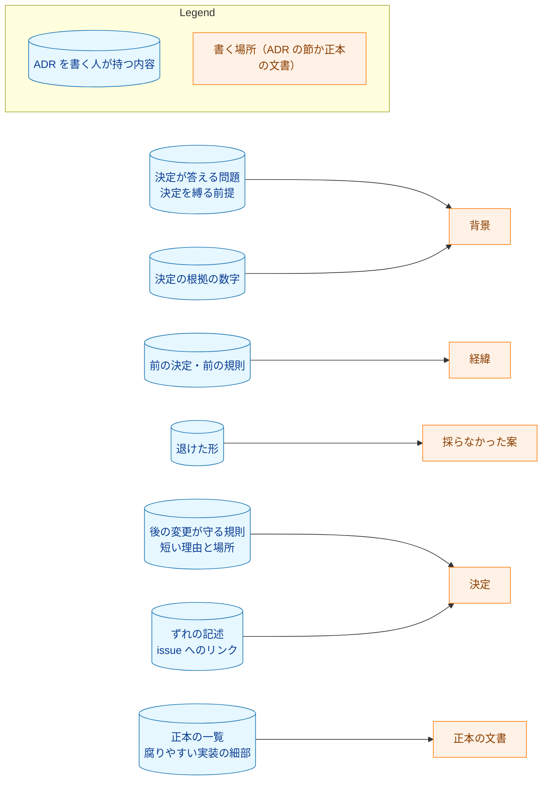
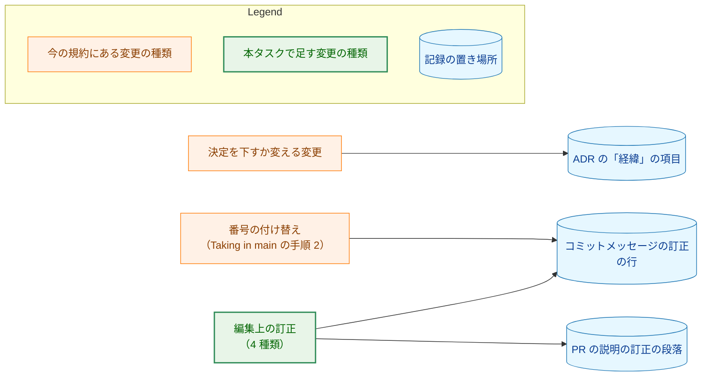
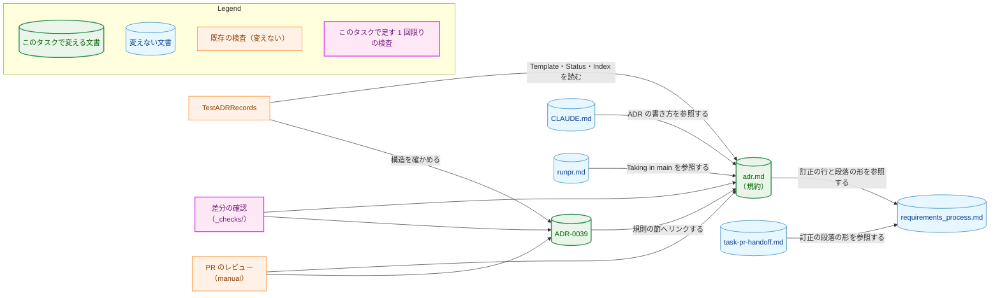
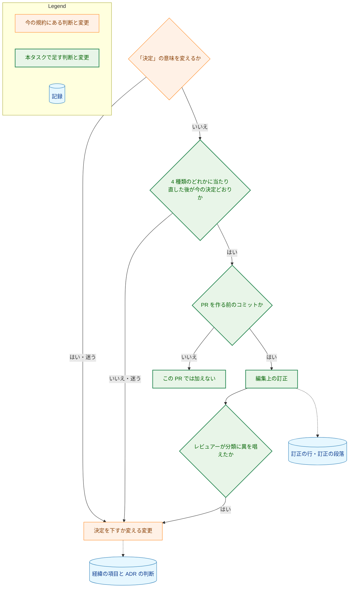
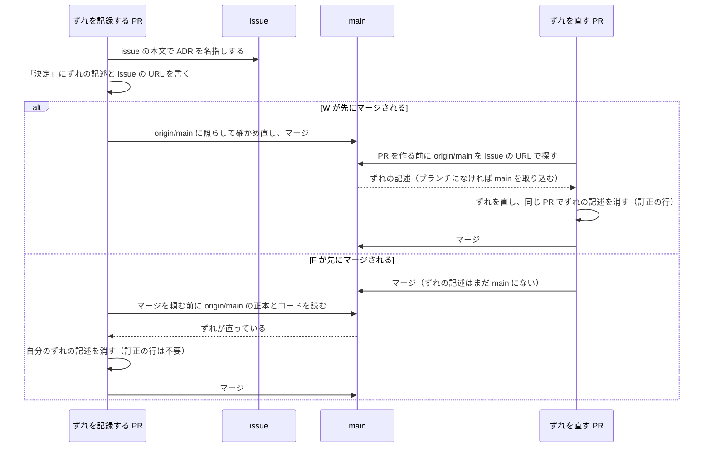

# アーキテクチャ設計書：ADR の規約に、背景と決定に書く内容と詳細度の基準を足す

## Document Status

| Item | Value |
|---|---|
| Status | `draft` |
| Created | 2026-11-09 |
| Review date | - |
| Reviewer | - |
| Comments | - |

本書は [01_requirements.md](01_requirements.md)（要件定義書。以下、要件書）の設計である。既存のファイルの内容は、コミット `2ea9103d` で確かめた。`file:line` の行番号は、このコミットでの行番号である。F-NNN・AC-NN は要件書の項番を、H-NN は [design_handoff.md](design_handoff.md)（以下、申し送り）の項番を指す。申し送りへの対応は付録 A に、受け入れ基準との対応は付録 B にまとめる。

本書は、要件書 6 章の用語（正本の文書・ずれの記述・編集上の訂正・基準に合わせる書き直し・腐りやすい実装の細部）を、要件書と同じ意味で使う。ただし、ずれの記述の範囲は、3.1.2 で要件書の定義より広げる。そのほかに、次の用語を使う。

-   **規約:** `docs/dev/conventions/adr.md`。
-   **実装の PR:** 規約と ADR-0039 の変更を入れる 1 本の PR（1.2）。本書の PR と、実装計画書の PR は含まない。
-   **分担の文:** 規約の「Writing an ADR」の「決定」の箇条（`docs/dev/conventions/adr.md:124-130`）。ADR と正本の文書の分担を述べ、CLAUDE.md の「Design decisions (ADR)」も同じ分担を持つ（`adr.md:138-141`）。
-   **そろえる段落:** 規約の中で、CLAUDE.md と同じ文で持つ部分を変えたら両方をそろえる、と指示する段落。「What counts as a major decision」の `adr.md:111-112`、「Writing an ADR」の `adr.md:138-141`、「Approval and the PR」の `adr.md:221-222` の 3 つである。
-   **基準の段落:** 「Writing an ADR」に足す 3 つの段落（3.1）。
-   **訂正の節:** 規約に足す `## Editorial corrections` の節（3.2）。
-   **訂正の行・訂正の段落:** `docs/dev/conventions/requirements_process.md` の「Recording in the PR description」の correction line と correction paragraph（`requirements_process.md:377-408`）。
-   **ずれを記録する PR・ずれを直す PR:** ずれの記述を ADR に足す PR と、そのずれを正本の文書かコードの側で直す PR。
-   **差分の確認:** 変更の前後の関係を述べる受け入れ基準を、マージベースと PR の先頭（最新のコミット）を比べて確かめるスクリプト。タスクの `_checks/` の下に置く（`requirements_process.md`「4. Acceptance Tests」）。恒久的なテストではない（7.2）。

## 1. 設計の全体像 (Design Overview)

### 1.1. 設計原則

-   **基準と訂正の規則は、規約の 1 か所だけに書く。** ADR-0039 は規則を書き写さず、決定と理由を要約して規約の節へリンクする（要件書 4.5）。コマンドの定義と `requirements_process.md` は変えない（AC-20）。
-   **CLAUDE.md とそろえる文の意味を変えない。** 分担の文と、「Approval and the PR」の最初の 3 文（決定を下すか変える PR が同じ PR で ADR を作るか更新し、その PR のレビューとマージが承認になる、という規則）は、CLAUDE.md も持つ（`CLAUDE.md:124-129`・`:148-150`）。基準と訂正の規則はこれらの文の外に置き、これらの文とそろえる段落はバイト単位で変えない（AC-08・AC-20・AC-22、H-01）。
-   **`TestADRRecords` が読む 3 つの節に触れない。** このテストは、規約の「Template」「Status」「Index」の節を見出しで探し、それぞれの 1 つのコードブロックか表を読む（`cmd/yt2column/adr_test.go:190-205`・`:249-255`）。ほかの節に段落や `##` の節を足しても、テストが読むものは変わらない（AC-21、要件書 4.4）。
-   **迷ったら、記録を失わない側に倒す。** 編集上の訂正は「経緯」に残らないので、決定の変更を訂正と誤って分類すると、決定の変遷が失われる。分類に迷う変更と、記録の道筋がない時点の変更は、訂正として扱わない（3.2）。
-   **規約の今の書き方に合わせる。** 規約は英語で書き（`CLAUDE.md`「Document language」の原則 (b)）、補足の規則を太字で始まる段落（「**Links.**」、`adr.md:143`）か箇条で述べる。基準の段落と訂正の節も、この形にする。
-   **文の意味は PR のレビューで読んで確かめ、新しいテストを足さない。** 基準は文の意味についての規則だからである（要件書 2.3、[ADR-0016](../../dev/adr/0016-document-test-policy.md)）。変えないことを求める受け入れ基準は、差分の確認で確かめる（7.2）。

### 1.2. 設計の際に決めたこと（2026-11-09）

-   **基準は「Writing an ADR」の中の段落に置き、分担の文を変えない（H-01）:** 「Writing an ADR」の箇条と、`adr.md:138-141` のそろえる段落の後ろ、「**Links.**」の段落の前に、基準の段落を足す。「決定」の箇条（分担の文）はバイト単位で変えない。「背景」の箇条は AC-01 の言い方に改め、基準の段落を指す（3.1）。
    -   **理由:** 分担の文の中に基準を書き足すと、そろえる段落が指す「上の分担」に基準も含まれると読め、CLAUDE.md もそろえる必要が生じて AC-20 と食い違う。分担の文の外に置けば、そろえる段落の対象は今と同じになる。
    -   **採らなかった案:** 「背景」と「決定」の箇条に基準を書き足す案は、上の理由で採らない。
    -   ADR：なし。規約の中の配置の決定で、本タスクの中で閉じる。
-   **編集上の訂正の規則は、新しい `## Editorial corrections` の節にまとめる:** 「Approval and the PR」の後、「Taking in `main`」の前に節を足す。そこに、4 種類、訂正にならない変更、記録、PR を作った後の制限、異論の扱い、ずれの記述の扱いを置く。「Approval and the PR」の「決定を下すか変える PR 以外は ADR を変えない」という文は、この節と番号の付け替えの直しを除く形に改める。「History entries」には 2 つの項目を、「Taking in `main`」には番号の付け替えの直しの対象を明示する文を足す（3.2〜3.5）。
    -   **理由:** 「Approval and the PR」の中にすべて書くと、そろえる段落（`adr.md:221-222`）が「同じ規則」と呼ぶものに訂正の規則も含まれると読め、CLAUDE.md とそろえる対象が曖昧になる。
    -   **採らなかった案:** 「Approval and the PR」の中に全部書く案は、上の理由で採らない。
    -   ADR：なし。規約の中の配置の決定で、本タスクの中で閉じる。ADR-0039 の「決定」は、規則を足す先の節の名前を書いていたので、本書の PR で「規約に足す」という言い方に改めた。
-   **ずれの記述を見つけて消す手段は、issue・`main` の検索・マージ前の確かめ直しの 3 つにする（H-03・H-05）:**
    1.  ずれを記録する PR は、ずれを扱う issue の本文が ADR を名指しするようにする（issue を作るか、既存の issue の本文に書き足す）。ずれの記述は、その issue へ完全な URL（`https://github.com/isseis/yt2column/issues/<N>`）でリンクする。
    2.  ずれを直す PR は、PR を作る前に、取得した `origin/main` の `docs/dev/adr/` を、扱う issue へのリンクで探す。規約は検索の形を `git grep -nE 'issues/<N>([^0-9]|$)' origin/main -- docs/dev/adr/` として示す。当たった箇所は 1 件ずつ読み、「決定」の中でそのずれを述べる記述だけを消す。当たった記述が PR のブランチにまだないときは、`main` を取り込んでから消す。
    3.  ずれを記録する PR は、マージを頼む前と、`main` を取り込むたびに、取得するか取り込んだ `main` の正本の文書とコードに照らして、足すずれの記述を確かめ直す。ずれが直っていれば、記述を消すか、残りのずれを述べる形に書き換える。
    -   **理由:**
        -   **issue の名指し:** ずれを直す PR は、ずれの記述とは別の主題の変更であることが多く、規約を読む機会がない。issue が ADR を名指しすれば、その issue を扱う人が気づく。
        -   **`origin/main` を、PR を作る前に探す:** ずれを直す PR がブランチを作った後に `main` に入ったずれの記述も見つけるためである。PR を作る前に探すのは、記述を消す操作が編集上の訂正（2 つ目の種類）にあたり、PR を作った後には加えられないためである（下の「PR を作った後には」の決定）。
        -   **マージを頼む前にも確かめ直す:** このリポジトリでは、`main` を取り込むのは衝突を解くときだけである（`.claude/commands/runpr.md:270-271`）。マージは squash で、PR のブランチに `main` を取り込まずに行う（`docs/dev/guides/mergepr_guide.md:5-7`）。そのため、確かめ直しの契機を `main` の取り込みにすると、確かめ直しがほとんど行われない。
        -   **新しいネットワークの操作が要らない:** `origin/main` は、PR を作るときとマージの準備のときに、コマンドがすでに取得している（`.claude/commands/_lib/task-pr-handoff.md` の Part A 手順 2、`.claude/commands/mergepr.md:35`）。
    -   **採らなかった案:** 検索の 1 文だけを書く案は、ずれを直す PR より後に `main` に入るずれの記述が事実でないまま残るので採らない。`main` を取り込むときだけ確かめ直す案は、上の理由で確かめ直しがほとんど起きないので採らない。`gh issue view` で issue が閉じたかを見る案は、issue が閉じてもずれが直ったとは限らないので採らない。
    -   **残るリスク:** 2 と 3 はコマンドの手順にない（AC-20 でコマンドを変えない）ので、守られるかは規約を読む人に頼る。また、ずれを直す PR を作った後、そのマージより前に `main` に入ったずれの記述は、その PR では消せず、後の PR が消すのを待つ（5.2）。
    -   **AC-14 との関係:** AC-14 は、ずれを直す PR より後に `main` に入る ADR のずれの記述を、「その ADR の PR が `main` を取り込んだときに消す」と述べる。本書は、`main` を取り込んだときの確かめ直しを残したうえで、マージを頼む前の確かめ直しを加える。`main` の取り込みがほとんど起きないので、AC-14 の文字どおりの契機だけでは、消すべき記述が消えないためである。消す主体（その ADR の PR）と、消す対象は AC-14 と同じである。また、AC-14 の「ずれを直す PR が同じ PR で消す」は、PR を作る時点で `main` にある記述について満たし、PR を作った後に `main` に入った記述は満たせない（上の残るリスク）。どちらの点も、要件書の AC-14 から変わる箇所なので、PR のレビューで確認を求める。
    -   ADR：[ADR-0039](../../dev/adr/0039-adr-writing-criteria.md) を更新する。ずれを記録する後のすべてのタスクと、ずれを直すすべての PR を縛る手順だからである。
-   **訂正の種類に、決定の変更を紛れ込ませない条件を足す（レビューで決めた）:** 2 つ目の種類（ずれの記述の削除）と 3 つ目の種類（参照の訂正）は、直した後の状態が ADR の今の「決定」どおりのときだけ編集上の訂正になる。たとえば次の場合は決定の変更である。訂正かどうか迷う変更も、決定の変更として扱う（3.2）。
    -   正本の文書の側を変えてずれを直し、ADR が要約する振る舞いが変わったとき。
    -   環境変数の名前の変更のように、名前の変更そのものが決定であるとき。
    -   **理由:** 「ずれが直った」は、どちらの側を直したかを問わない。条件がないと、決定の変更が訂正として「経緯」から落ちる。迷ったときに決定の変更として扱えば、記録を失わない（要件書「要件定義の際に決めたこと」の紛らわしい場合の扱いの理由と同じ）。
    -   **採らなかった案:** 条件を足さず、レビュアーの異論だけで防ぐ案は、異論が出ない限り誤った分類が通るので採らない。
    -   ADR：ADR-0039 を更新する。
-   **PR を作った後には、ADR に編集上の訂正を加えない（レビューで決めた）:** PR を作った後の回（`/fixpr`、ローカルの CLI レビューの修正）では、どの ADR にも新しい訂正を加えない。PR 自身が ADR に足し、まだ `main` にない文を直すことは、自分の変更の手直しで、訂正ではないので、この制限を受けない。すでに記録した訂正の文面は、訂正の行がその変更をなお正しく述べる範囲で直してよい。この制限は、コマンドが ADR の訂正を運ぶようになったとき（[#732](https://github.com/isseis/yt2column/issues/732)）に見直す。
    -   **理由:** PR を作った後に、ADR の訂正を記録する道筋がないためである。
        -   **PR の説明への道筋:** PR を作った後に訂正の段落を PR の説明に足す道筋は `/fixpr` の `editorial` だけで、これはタスク文書の訂正だけを運ぶ（`.claude/commands/fixpr.md:484-489`）。
        -   **コミットの本文:** `/fixpr` のコミットの本文は、`fixprguard finish` が確かめる。`finish` は、訂正の行以外の行を拒む（`internal/fixprguard/write.go:112-127`）。そのため、`editorial` の一覧にない ADR の訂正の行を、本文に足す道筋もない。
        -   **ローカルの CLI レビュー:** その修正も、タスク文書の訂正だけを記録する（`.claude/commands/_lib/local-cli-review.md:234`）。

        そのため、PR を作った後の ADR の訂正は、訂正の行にも PR の説明にも載らず、レビュアーが分類に異を唱える機会がない。
    -   **採らなかった案:** PR を作った後の訂正も認め、記録が漏れうることを残余のリスクとする案は、ADR の変更が記録なしに通る側に倒れるので採らない。
    -   ADR：ADR-0039 を更新する。
-   **異論の出た変更は決定の変更として扱い、タスク文書のない PR では PR の説明に記録する（レビューで決めた）:** 決定と ADR の判断は、その PR が決定を記録する場所に書く。タスク文書のある PR では「…で決めたこと（YYYY-MM-DD）」の節に、タスク文書のない PR では PR の説明に書く。この場合の「経緯」の項目は、出典として PR へリンクする（3.2・3.4）。
    -   **理由:** AC-16 は、異論の出た変更を決定の変更として扱うことを求める。「経緯」の項目は出典の文書へリンクする（`adr.md:164`）が、タスク文書のない PR には決定を記録した文書がない。
    -   **採らなかった案:** タスク文書のない PR では異論の出た差分を戻す案は、AC-16 から外れ、要件書を `draft` に戻す必要があるので採らない。
    -   ADR：ADR-0039 を更新する。出典の形を、この場合に限って PR へ広げる。
-   **場所の粒度を規約に書き、数字の例は一般形にする（H-02・H-04）:** 「決定」の各項目に添える場所は、「文書とその節の見出し」か「パッケージかファイル」で示し、行番号を使わない、と規約に書く。「背景」に残す数字の例は、特定の ADR の値ではなく、「どのビルドで時間の期限を確かめるかを決める、計測した遅さの倍率」のような一般形にする。
    -   **理由:** AC-04（場所を添える）と AC-06（呼び出し箇所を列挙しない）と「Links」（行番号を使わない、`adr.md:143-149`）は、粒度を書かないと互いに食い違うように読める。特定の ADR の値を例にすると、その ADR が変わったときに例が古くなる。
    -   **採らなかった案:** ADR-0038 の約 23〜31 倍を例として名指しする案は、例が古くなりうるので採らない。粒度も例も書かない案は、行番号や列挙を書く余地が残るので採らない。
    -   ADR：粒度は ADR-0039 の「決定」の 3 つ目の項目（正本の文書かコードの場所）の範囲の中の文面なので、ADR-0039 の更新は要らない。例の選び方は文面の決定で、ADR は要らない。

次のことは、要件書と上の決定から導いた（PR のレビューで異論があれば改める）。

-   **ずれの記述の範囲を、要件書の定義より広げる。**
    -   **要件書の定義と使い方の食い違い:** 要件書 6 章は、ずれの記述を「正本の文書とコードが食い違っていること」を述べる記述とする。一方、要件書 1 章と AC-23 は、ADR-0039 の「#728 で扱う」という記述（ADR と規約の食い違い）をずれの記述として扱う。
    -   **今の ADR の例:** 正本の文書の中の食い違い（`docs/dev/adr/0028-no-automatic-resend.md:24`）や、正本の文書が今のコードを述べ切っていないこと（`docs/dev/adr/0029-extension-ui-languages.md:24`）を述べる記述もある。
    -   **規約の定義:** そのため規約は、ADR の決定・正本の文書・コードのどれかが互いに食い違っていることを述べる記述を、ずれの記述とする（3.1.2）。AC-07 と AC-14 が求める扱いは、広げた範囲にそのまま当てはまる。
    -   ADR：なし。要件書の用語の範囲を、要件書自身の使い方に合わせるだけである。
-   **ずれの記述を足すことは、編集上の訂正ではない。** AC-09 は訂正を 4 種類に限り、どれも記述を足すことを含まない。そのため、ずれの記述を足せるのは、その ADR の決定を下すか変える PR だけである。それ以外の PR は、見つけたずれを issue にする（ADR-0039「経緯」の 2026-11-06 の項目の原則）。この制約を規約の訂正の節に明示し、残余のリスクに書く（3.2、5.2）。ADR：ADR-0039 の「結果」に書く。
-   **実装の PR は 1 本にする。** ADR-0039 のずれの記述は、規約に規則を足す PR が同じ PR で消す（AC-14・AC-23）。そのため、規約の変更と ADR-0039 の変更を分ける PR の境目はない。ADR：なし。PR の分け方の決定で、本タスクの中で閉じる。
-   **実装の PR の ADR-0039 の変更は、編集上の訂正の 2 つ目の種類として、PR を作る前のコミットで記録する。** 実装の PR は ADR-0039 の決定を変えず、ずれの記述を規約の節へのリンクに置き換えるだけである（AC-23）。PR を作った後の回では ADR-0039 に新しい訂正を加えない（上の決定）。ADR：なし。
-   **本書の PR から実装の PR までの間は、規約の今の文が効く。** その間、`main` の ADR-0039 は編集上の訂正を認めると述べるが、規約はまだ認めない。ADR-0039 の「決定」は、規則を規約に足すことを #728 で扱うと述べ、まだ規約にないことを示している。規約の規則で ADR を直す PR は、実装の PR のマージを待つ。ADR：なし。

### 1.3. なぜ今の書き方では足りないか

-   **基準:** 今の「Writing an ADR」は、各節の用途を 1 行で述べるだけである（`adr.md:121-136`）。何を書かないかを述べていないので、要件書 1 章の、背景に経緯が並び、決定に一覧の写しが入る問題を防げない。PR #727 で決めた基準は PR の説明にしかなく、後の ADR を書く人もエージェントも読まない（要件書 1 章）。
-   **編集上の訂正:** 今の規約は、決定を下すか変える PR 以外が ADR を変えることを認めない（`adr.md:217-219`）。タスク 0069 は、ずれの記述 1 つを消すために、その削除に限った例外を要件書で作った（`docs/tasks/0069_readme_display_language/01_requirements.md:57-63`）。この方法では、ADR-0001〜0030 の見直し（[#729](https://github.com/isseis/yt2column/issues/729)）のたびに例外が要る。

### 1.4. 進行中のタスクとの関係

-   **タスク 0068:** ADR-0020 のずれの記述を消す PR で、「結果」に 1 文と「経緯」に 1 項目を足す（要件書 1 章）。
    -   **今の規約との関係:** 「結果」を足すので、決定を変える PR にあたる。そのため、実装の PR の前でも後でも規約に合う。
    -   **実装の PR の後の規約との関係:** ずれの記述の削除そのものは訂正で、「経緯」に足さない。しかし、同じ PR が決定の変更も含むときは、決定の変更を「経緯」に書く（AC-15）。そのため、0068 の項目は誤りにならない。
-   **タスク 0069:** ADR-0029 のずれの記述の削除を、その削除に限った例外として、編集上の訂正の形で記録する。
    -   **実装の PR の後:** この削除は 2 つ目の種類の訂正にあたり、例外は要らなくなる。
    -   **マージの順:** どちらの順でマージされても、記録の形（訂正の行と訂正の段落）は同じである。
-   どちらのタスクの文書も変えない（要件書 2.3）。

### 1.5. 概念モデル

ADR の節と、そこに書くもの・別の場所へ移すものの関係を図 1 に示す。矢印 A → B は「A に当たる内容は B に書く」を表す。



ADR への変更の分け方と、それぞれの記録の置き場所を図 2 に示す。矢印 A → B は「A に分けた変更を B に記録する」を表す。



図 2 の矢印のうち、次の 2 本は今の規約の関係である（`adr.md:167-169`・`:236-238`）。

-   決定を下すか変える変更から「経緯」への矢印。
-   番号の付け替えから訂正の行への矢印。PR を作るときに訂正の行から訂正の段落を書くので、番号の付け替えも PR の説明に載る（`.claude/commands/_lib/task-pr-handoff.md` の Part B 手順 3）。ただし、規約が述べる記録は訂正の行だけなので、図 2 にはその矢印だけを示す。

編集上の訂正からの 2 本の矢印が、本タスクで足す関係である。同じ PR が決定の変更と編集上の訂正の両方を含むときは、それぞれを自分の矢印の先に記録する（AC-15）。

## 2. システム構成 (System Structure)

### 2.1. 全体構成

本タスクは文書だけを変える。実行時に動くコンポーネント（拡張・Native Messaging のホスト・サーバ・CLI）は変わらない。変える文書と、それを読む文書・検査の関係を図 3 に示す。矢印 A → B は「A が B を読む、または参照する」を表す。



図 3 のうち、差分の確認からの矢印と、ADR-0039 から規約への「規則の節へリンクする」矢印は、実装の PR で加わる関係である。ほかの矢印は今の関係で、それぞれ次の箇所による。

-   CLAUDE.md は規約を参照する（`CLAUDE.md:120-122`）。
-   規約は訂正の行の形を `requirements_process.md` に頼る（`adr.md:236-238`）。
-   `/runpr` は「Taking in `main`」を参照する（`.claude/commands/runpr.md:276-277`）。
-   `task-pr-handoff.md` は、訂正の段落を `requirements_process.md` の形で書く（Part B 手順 3）。
-   `TestADRRecords` は、規約の 3 つの節と各 ADR を読む（`cmd/yt2column/adr_test.go:190-205`）。

### 2.2. コンポーネント配置

| ファイル | 変更 | 内容 |
|---|---|---|
| `docs/dev/conventions/adr.md` | 変更 | 「Writing an ADR」に基準の段落を足し、「背景」の箇条を改める（3.1）。「Approval and the PR」の 1 文を改め、訂正の節を足す（3.2・3.3）。「History entries」に 2 つの項目を足す（3.4）。「Taking in `main`」の、`main` の上のガードの失敗の段落の対象を明示する（3.5） |
| `docs/dev/adr/0039-adr-writing-criteria.md` | 変更 | 実装の PR で、「決定」の、規則が規約にまだないと述べる記述と #728 へのリンクを、規約の節へのリンクに置き換える（AC-23、3.6）。本書の PR でも、1.2 の決定を足した |
| `docs/tasks/0070_adr_writing_criteria/_checks/` | 追加 | 差分の確認のスクリプト（7.2）。`go list ./...` は `_` で始まるディレクトリを無視する |
| `docs/tasks/0070_adr_writing_criteria/03_implementation_plan.md` | 変更 | 実装計画書（`/mkplan` の PR が作る）。実装の PR は、進み具合と検証の結果を記録する |

`CLAUDE.md`、`.claude/commands/` の下のファイル、`requirements_process.md` は変えない（AC-20）。ADR の索引（`docs/dev/adr/README.md`）も、ADR-0039 の題名が変わらないので変えない。ADR-0036 も、実装の PR では変えない。ADR-0036 は、ADR の編集上の訂正の記録が ADR-0039 にあると述べるだけで（ADR-0036「決定」の 1 つ目の項目）、規約の節を名指ししていないからである。

### 2.3. データフロー

本タスクで新しく動くデータはない。編集上の訂正の記録は、今のタスク文書の訂正と同じ経路を通る。

1.  訂正を加えるコミットのメッセージに、訂正の行を 1 行ずつ書く。`<document path>` には、ADR のリポジトリからの相対パスを書く（3.2）。
2.  PR を作るとき、`task-pr-handoff.md` の Part B 手順 3 が、`git log origin/main..HEAD` の訂正の行から訂正の段落を書く。この手順は、行が `Editorial correction: ` で始まるかだけを見て、パスがタスク文書かどうかは見ない。そのため、ADR のパスの行も段落に載る。
3.  `fixprguard` の `finish` がコミットの本文を確かめるときも、行の先頭と文字の種類だけを見て、パスは見ない（`internal/fixprguard/write.go:112-127`）。

PR を作った後には、ADR の訂正の行を PR の説明に足す道筋がない（1.2）。そのため訂正の節は、PR を作った後に ADR に新しい訂正を加えることを認めない（3.2）。

**squash マージの後に残るもの。** マージは squash で、`main` に残るのは squash コミットだけであり、PR のコミットは `main` から辿れなくなる（`docs/dev/guides/mergepr_guide.md:5-7`）。`/mergepr` が squash の本文に引き継ぐのは CLAUDE.md がコミットメッセージに求める記録で、訂正の行はその中にない（`.claude/commands/mergepr.md` の手順 2）。そのため、マージの後に ADR の訂正の理由を知る手がかりは、squash の件名の `(#<PR 番号>)` からたどる PR の説明の訂正の段落だけである。これは、今のタスク文書の訂正と同じである（ADR-0039「結果」）。

## 3. コンポーネント設計 (Component Design)

本タスクに型・インターフェースの追加や変更はない。この章では、規約の節ごとに、実装の PR の後に規約が述べる内容と、その英語の文面の案を定める。文面の案は、要件書が設計に委ねたもの（要件書 1 章「本書の記述範囲」）で、本タスクのインターフェースにあたる。実装は、この案の意味を変えない範囲で言い回しを整えてよい。意味を変えるときは、本書を改める。

### 3.1. 「Writing an ADR」の基準の段落（F-001・F-002、H-01・H-02・H-04）

#### 3.1.1. 箇条の変更

-   **「背景」の箇条（`adr.md:122-123`）** を、次の文に改める（AC-01）。

    ```text
    - **背景:** only the problem the decision answers and the assumptions that
      bind it ("What 背景 holds" below).
    ```

-   **「決定」の箇条（`adr.md:124-130`、分担の文）** は、バイト単位で変えない（AC-08、1.2）。「決定」には今効いている決定だけを書き、前の決定は「経緯」に置くこと、正本の文書がある主題では要約してリンクすることは、この箇条が今のまま述べ続ける。
-   ほかの箇条、そろえる段落（`adr.md:138-141`）、「**Links.**」の段落とその後の段落とコードブロック（`adr.md:143-157`）も変えない（AC-22、要件書 2.3）。

#### 3.1.2. 足す段落

そろえる段落（`adr.md:138-141`）と「**Links.**」の段落（`adr.md:143`）の間に、次の 3 つの段落を足す。

```text
**Who 背景 and 決定 are for.** A later developer reads an ADR to learn the
decision on a subject they are about to change, and why it was made. Write
背景 and 決定 for that reader, as the next two paragraphs say.

**What 背景 holds.** Write only the problem the decision answers and the
assumptions that bind it. Do not write the content of an earlier rule, the
figures of an investigation, or where a rule came from, unless it is itself a
ground of the decision: an earlier decision goes in 経緯, and a rejected form
in 採らなかった案. A figure the decision rests on stays in 背景, such as a
measured slowdown that decides which build checks a time limit.

**What 決定 holds.** Write one item for each rule a later change must keep.
Give each item a short reason and the place of its specification: a document
and the heading of its section, or a package or a file, without line numbers
("Links" below). When the source document gives no reason for an item, write
`理由は記録されていない`; do not supply one. Do not copy into 決定 a list that
the document holding the specification has (a list of syntax, a list of
exceptions), and do not write implementation details that go stale while the
decision stays the same (the order of function calls, a list of call sites,
the details of a procedure). When the decision, the document holding its
specification, and the code disagree with one another, keep in 決定 a
statement of the discrepancy (a discrepancy statement), linked to the issue
that handles it by the issue's full URL. "Editorial corrections", its
"Discrepancy statements" paragraph, says who adds and removes one.
```

| 文 | 述べること | AC・H |
|---|---|---|
| 「Who 背景 and 決定 are for」 | 基準の観点（後の開発者が、変えようとしている主題の決定とその理由を知る）。背景と決定の両方にかかる | 要件書「issue #728 で決めたこと」の 2 つ目 |
| 「What 背景 holds」の 1 文目 | 背景には問題と前提だけを書く | AC-01 |
| 同 2 文目 | 前の規則の中身・調査の数字・規則の由来は、根拠そのものでなければ書かない。前の決定は経緯へ、退けた形は採らなかった案へ | AC-02 |
| 同 3 文目 | 根拠の数字は残す。例は一般形 | AC-03、H-04 |
| 「What 決定 holds」の 1・2 文目 | 規則を 1 項目ずつ、短い理由と場所とともに書く。場所の粒度は文書と節の見出しか、パッケージかファイル。行番号は使わない | AC-04、H-02 |
| 同 3 文目 | 出典に理由がなければ `理由は記録されていない` と書き、補わない | AC-04 |
| 同 4 文目 | 正本の一覧を写さない。腐りやすい実装の細部（呼び出しの順序・呼び出し箇所の列挙・手順の細部）を書かない | AC-05・AC-06、H-02 |
| 同 5・6 文目 | ずれの記述と issue へのリンク（完全な URL）は残す。誰が足し、誰が消すかは訂正の節で述べる | AC-07、H-03 |

-   **AC-08 が求める「今と同じ意味」は、「決定」の箇条をそのまま残すことで満たす。** 基準の段落は、分担の文を言い換えず、その外で足りないことだけを述べる。
-   **ずれの記述の範囲。** 5 文目は、決定・正本の文書・コードのどれかが互いに食い違うことを述べる記述を、ずれの記述とする。要件書 6 章の定義（正本の文書とコード）より広い。理由は、1.2 で導いたことの 1 つ目（「ずれの記述の範囲を、要件書の定義より広げる」）に書いた。ADR-0039 の「#728 で扱う」という記述（決定と規約の食い違い）も、この範囲に入る。
-   **完全な URL を求める理由。** 今の ADR には、issue を `#504` のように番号だけで書く箇所がある（たとえば `docs/dev/adr/0017-viewer-markdown-rendering.md`）。番号だけでは、3.2 の検索で見つからない。そのため、ずれの記述には完全な URL を求め、検索の形をそれに合わせる。

### 3.2. 訂正の節（F-003、H-03・H-05）

「Approval and the PR」の後、「Taking in `main`」の前に、次の節を足す。

```text
## Editorial corrections

An editorial correction changes how an ADR is written without changing its
decision. Any PR, including one that makes or changes no ADR decision, may
make an editorial correction of these four kinds, and only these, to any ADR,
an obsolete (`廃止`) one included:

1. **A rewrite to the criteria** of "Writing an ADR". It may move content that
   the ADR or its source documents already hold to another section, such as
   an earlier decision out of 背景 into 経緯 or a rejected form into
   採らなかった案, and it adds no new fact. It may rewrite the title without
   changing its meaning; the index row then changes in the same PR.
2. **Removing a discrepancy statement** once the discrepancy is fixed, or
   rewriting it to state what remains when only part of it is fixed
   ("Discrepancy statements" below).
3. **Fixing a stale reference**: a link, a name, or a heading that no longer
   matches what it refers to.
4. **Fixing a typo** that does not change the meaning.

The second and third kinds are editorial only when the result matches the
ADR's 決定 as it stands. When the fix changed the behavior or the
specification that 決定 states, or a renamed thing is itself part of the
decision (an environment variable, a protocol member), the change is a
decision change. Writing an existing decision into the document that holds
its specification does not change 決定.

Renumbering an ADR when taking in `main` ("Taking in `main`", step 2) is also
recorded as an editorial correction, but it has its own rule and is not one
of the four kinds.

A change to the meaning of 決定 is not an editorial correction: only a PR that
makes or changes the decision makes it ("Approval and the PR"). When you are
not sure whether a change is editorial, treat it as a decision change.

**Recording.** Record each editorial correction in the message of the commit
that makes it, as a correction line, and in the PR description, as a
correction paragraph, in the forms of
`docs/dev/conventions/requirements_process.md`, "Recording in the PR
description"; the document path in them is the ADR's repository-relative
path. The line says what was changed to what and that no decision changed.
The PR description names the change as an editorial correction, so the PR's
reviewer can dispute the classification. An editorial correction adds no
経緯 entry ("History entries").

**After the PR is created.** Make editorial corrections to an ADR only in
commits made before the PR is created. After that, the commands do not carry
an ADR's correction lines into the PR description (#732), so the reviewer
would not see the classification. A correction already recorded may still be
reworded, as long as its correction line still describes it. Revising text
that the PR itself added to an ADR, and is not yet on `main`, is not an
editorial correction and is not limited by this paragraph.

**Classifying a change.**

- When one PR changes an ADR's decision and also makes editorial corrections
  to the same ADR, record the decision change in 経緯 and the corrections in
  the commit message and the PR description.
- When the PR's reviewer disputes that a change is editorial, treat it as a
  decision change: add a 経緯 entry, and record the decision and its ADR
  judgement where the PR records its decisions
  (`.claude/commands/_lib/settle-decisions.md`): in the task document, or in
  the PR description when the PR has no task document ("History entries").
- A PR that changes the decision of an ADR written before these criteria
  brings only the part it changes to the criteria.

**Discrepancy statements.**

- Adding a discrepancy statement is not an editorial correction. Only a PR
  that makes or changes the ADR's decision adds one; that PR makes sure the
  body of the issue the statement links to names the ADR. A PR that finds a
  discrepancy in an ADR whose decision it does not change opens such an issue
  instead.
- Before asking for the merge, and again whenever it takes in `main`, the PR
  that adds a discrepancy statement checks it against the document and the
  code on the `main` it has fetched or taken in. When the discrepancy is gone there, it removes the statement or
  rewrites it to state what remains. The statement was never on `main`, so
  this revises the PR's own change and needs no correction line.
- The PR that fixes a discrepancy removes its statement in the same PR, or
  rewrites it to state what remains when the PR fixes only part. Before
  the PR is created, find the statements on `origin/main`:
  `git grep -nE 'issues/<N>([^0-9]|$)' origin/main -- docs/dev/adr/`, where
  `<N>` is the number of the issue the PR handles. Read each hit: remove only
  a statement in 決定 that describes this discrepancy. When the statement is
  not on the PR's branch yet, take in `main` first. A statement that reaches
  `main` after the PR is created is left to a later PR ("After the PR is
  created").
- A statement that a later PR finds stale may be removed by that PR, as the
  second kind above.
```

| 部分 | 述べること | AC |
|---|---|---|
| 1 段落目 | どの PR も、どの ADR（`廃止` を含む）にも、4 種類の訂正だけを加えてよい | AC-09・AC-17 |
| 1 つ目の種類 | 別の節への移動を含み、新しい事実を足さない。題名の意味を変えない書き直しを含み、索引の行を同じ PR でそろえる | AC-10 |
| 2・3 つ目の種類の条件の段落 | 直した後の状態が今の決定どおりのときだけ訂正になる | AC-11（1.2） |
| 番号の付け替えの段落 | 番号の付け替えも訂正として記録するが、4 種類とは別の規則による | AC-09・AC-19 |
| 「決定」の意味の段落 | 意味を変える変更は訂正ではなく、決定を下すか変える PR だけが行う。迷ったら決定の変更として扱う | AC-11 |
| 「Recording」 | 訂正の行と訂正の段落の形を ADR のパスにも当てはめる。何を何に変えたかと、決定を変えないことを書く。PR の説明で訂正と明示する。経緯に足さない | AC-12・AC-13 |
| 「After the PR is created」 | PR を作った後は、ADR に訂正を加えない。PR 自身が足した文の手直しは訂正ではない | AC-09（1.2） |
| 「Classifying a change」 | 混ざった変更、異論の扱いと記録の場所、古い ADR に触れる PR | AC-15・AC-16・AC-17 |
| 「Discrepancy statements」 | 足せる PR、issue の名指し、ずれを記録する PR の確かめ直し、ずれを直す PR の削除と検索、見落としの削除 | AC-07・AC-14、H-03・H-05 |

-   **AC-09 との関係。** AC-09 は「どの PR も訂正を加えてよい」と述べる。「After the PR is created」は、加えてよい時点を PR を作る前のコミットに限るだけで、加えてよい PR を限らない。決定を下しも変えもしない PR も、PR を作る前なら訂正を加えられる。
-   **訂正の行の `<document path>`。** `requirements_process.md` は、これをタスク文書のパスと書いている（`requirements_process.md:388`）。`requirements_process.md` は変えない（AC-20）ので、訂正の節が「ADR のパスにも当てはめる」と述べる。訂正の行を読む道具がパスを確かめないことは、2.3 で確かめた。
-   **検索の形。**
    -   `origin/main` の木を探すので、ずれを直す PR がブランチを作った後に `main` に入ったずれの記述も見つかる。
    -   番号の後に数字が続かないことを条件にするのは、`issues/71` を探して `issues/713` に当たらないためである。`issues/713#issuecomment-…` のようなアンカーつきのリンクと、`)` で終わるリンクには当たる。
    -   同じ issue へのリンクが「背景」や「結果」にもありうるので、当たった箇所は 1 件ずつ読む。
-   **「Discrepancy statements」の 2 つ目の項目は、訂正ではない。** ずれを記録する PR が自分の足した記述を消すか書き換えるのは、`main` にまだない自分の変更の手直しなので、訂正の行は要らない。これを「Taking in `main`」ではなく訂正の節に置くのは、ずれの記述の規則を 1 か所にまとめるためである。また、`main` の取り込みがほとんど起きないので、「Taking in `main`」に置いても働かない（1.2）。

### 3.3. 「Approval and the PR」（F-003）

-   最初の段落の最初の 3 文（`adr.md:215-217`）と、そろえる段落（`adr.md:221-222`）は、バイト単位で変えない（AC-22）。これらの文が、CLAUDE.md の「Rule」の項目（`CLAUDE.md:124-129`）と同じ規則を持つ。
-   最初の段落の最後の文（`adr.md:217-219`、「An ADR is therefore never added or changed by a PR other than the one that makes or changes its decision.」）を、次の文に改める（AC-18）。

    ```text
    An ADR is added only by the PR that makes its decision. Apart from that
    PR and a PR that changes its decision, only two kinds of PR change an
    ADR: any PR may make the editorial corrections of "Editorial
    corrections" below, and a PR of its own renumbers ADRs when
    `TestADRRecords` fails on `main` ("Taking in `main`").
    ```

-   **「therefore」を外し、例外を 2 つとも名指しする理由。** 前の 3 文は例外を述べないので、例外を足すと「therefore」が前の文から導けなくなる。2 つ目の例外（番号の付け替えの直し）は、今の規約にもある（`adr.md:244-248`）。
-   **CLAUDE.md との関係。** 改める文は CLAUDE.md にない（要件書 1 章「CLAUDE.md は変えない」の理由）。そろえる段落が「同じ規則」と呼ぶのは、その前の 3 文である。ADR を足すのは決定を下す PR だけ、という意味は変わらない。

### 3.4. 「History entries」（F-003）

「One entry per event」の箇条（`adr.md:167-169`）の後に、次の 2 つの箇条を足す（AC-13・AC-16）。

```text
- **No entry for an editorial correction** ("Editorial corrections"). When a
  rewrite to the criteria moves into 経緯 an earlier decision that the ADR or
  its source documents already hold, and 経緯 has no entry for that decision,
  put it there as the entry of that decision, in the form above, dated as
  "Date of an entry copied from an existing decision" below says. It is not an
  entry for a new event, so it goes in its place by date, not at the end as
  "Order" says for a new entry. When 経緯 already has its entry, only remove it
  from where it was.
- **A disputed correction in a PR with no task document.** When a change
  becomes a decision change because the PR's reviewer disputed it
  ("Editorial corrections") and the PR has no task document, the entry links
  to the PR, whose description records the decision.
```

-   **移した項目の位置と日付。** 「Order」の箇条（`adr.md:170-171`）は、新しい項目を末尾に置くと定める。移した項目は前の決定なので、日付の順の位置に置くと、足す箇条自身が述べる。そうすれば、「Date of a new entry」の箇条（`adr.md:172-175`）が守る、日付が逆に進まない並びを保てる。日付は、出典の文書から写す項目の決め方（`adr.md:176-190`）に従う。
-   **出典が PR の項目。** 出典の文書への相対リンク（`adr.md:164`）の例外を、異論の出た訂正をタスク文書のない PR が決定の変更として扱う場合に限って設ける（1.2）。PR の説明はリポジトリの外にあり書き換えられるが、決定を記録した場所はほかにない。
-   ほかの箇条は変えない。

### 3.5. 「Taking in `main`」（F-003）

-   **節の最初の文と手順 1〜3（`adr.md:226-242`）は変えない。** 手順 2 の番号の付け替えは、今と同じく、コミットメッセージに編集上の訂正として記録する（AC-19）。ずれの記述の規則は、この節には置かない（3.2）。
-   **「When `TestADRRecords` fails on `main`」の段落（`adr.md:244-248`）** の最後の文を、番号を付け替える直しを対象とすることが分かる形に改め、1 文を足す（AC-19）。段落の最初の 2 文は変えない。

    ```text
    Fix it, renumbering the ADRs so that no number is duplicated or missing,
    in a PR of its own that fixes only that, not inside an unrelated PR: that
    PR's reviewer is not in a position to approve a change of an ADR's number.
    This fix is not one of the four kinds of editorial correction that any PR
    may make ("Editorial corrections").
    ```

### 3.6. ADR-0039 の「決定」（F-004、AC-23）

本書の PR の後、ADR-0039 の「決定」は、次の 4 つの項目で、規則が規約にまだないこと（#728 で扱う）を述べている。

| 項目 | 実装の PR の後 |
|---|---|
| 2 つ目（背景） | 規則は規約の「Writing an ADR」にある |
| 3 つ目（決定） | 規則は規約の「Writing an ADR」にある |
| 4 つ目（編集上の訂正） | 規則は規約の「Approval and the PR」「Editorial corrections」「History entries」にある |
| 5 つ目（ずれの記述） | 規則は規約の「Writing an ADR」「Editorial corrections」にある |

-   各項目のほかの文（太字の決定と理由）は変えない。リンクは `[adr.md](../conventions/adr.md)` の形にし、節は見出しを本文で名指しする（`adr.md:143-149`「Links」）。
-   **編集上の訂正の 2 つ目の種類として、PR を作る前のコミットで記録する。** ADR-0039 を変えるコミットのメッセージに、項目ごとに訂正の行を書く。

    ```text
    Editorial correction: docs/dev/adr/0039-adr-writing-criteria.md: <what was changed to what>; no decision changed
    ```

    「経緯」に項目を足さない。「状態」も `有効` のままで、索引も変えない。直した後の状態（規則が規約にあること）は ADR-0039 の決定どおりなので、3.2 の条件を満たす。
-   **「結果」の項目は残す。** ADR-0039 の「結果」の、コマンドがまだ ADR の訂正を運ばないという項目と、確かめ直しと検索がコマンドの手順にないという項目は、受け入れたコストの記述で、ずれの記述ではないからである。

## 4. エラーハンドリング設計 (Error Handling Design)

### 4.1. 実行時のエラー

N/A。実行時のコードを変えないので、エラーの型もメッセージも変わらない。

### 4.2. 手順の中の失敗

-   **差分の確認が失敗した場合。** 失敗したままでは PR を作らない。変えてはならない部分を変えていれば、その部分を戻して確認をやり直す。
-   **`TestADRRecords` が失敗した場合。** 実装の PR は「Template」「Status」「Index」の節に触れない。
    -   **PR のブランチの変更による失敗（ADR-0039 の構造を壊したなど）:** このブランチで直す。
    -   **`origin/main` でも起きる失敗（本タスクと関係のない 2 つの PR がマージされて生じた、番号の重複や欠け）:** 規約のとおり直しだけの PR で直し（3.5）、実装の PR はそのマージを待つ。
-   **レビュアーが編集上の訂正という分類に異を唱えた場合。** 訂正の節のとおり、その変更を決定の変更として扱う。ADR-0039 に「経緯」の項目を足し、決定と ADR の判断を実装計画書の「実装の際に決めたこと」の節に記録する（3.2）。

## 5. セキュリティ考慮事項 (Security Considerations)

### 5.1. 脅威モデル

N/A。文書だけの変更で、外部のコマンドの呼び出し、API キーと Webhook の URL、キャッシュ、ネットワークへの送信、信頼できない文字列のプロンプトや記事への埋め込みのどれにも当たらない（要件書 4.2）。脅威モデルの図も要らない。

### 5.2. 残余のリスクと注意

セキュリティの脅威ではないが、規則の運用で残るリスクを記す。

-   **決定の変更を編集上の訂正と誤って分類する。** 訂正は「経緯」に残らないので、誤った分類は決定の変遷を失わせる。2・3 つ目の種類の条件と「迷ったら決定の変更」で入り口を狭め、PR の説明で訂正と明示してレビュアーが分類を確かめることで防ぐ（3.2）。機械では確かめない。
-   **確かめ直しと検索は手順に頼る。** ずれを記録する PR の確かめ直しと、ずれを直す PR の検索（3.2「Discrepancy statements」）は、コマンドの手順にない（AC-20）。
    -   **残る場合:** 次の場合に、事実でなくなったずれの記述が `main` に残る。
        -   確かめ直しか検索が行われなかったとき。
        -   ずれを直す PR が、ずれの issue を扱わずに（別の issue か issue なしで）ずれを直したとき。
        -   ずれを直す PR を作った後、そのマージより前に、ずれの記述を持つ ADR が `main` に入ったとき。ずれを直す PR は、PR を作った後には訂正を加えない。
    -   **見つける手段:** 検出する仕組みはない。後の PR が読んで見つけ、2 つ目の種類の訂正として消すのを待つ。[#729](https://github.com/isseis/yt2column/issues/729) の見直しは、`docs/dev/adr/` の issue へのリンクを洗い出す機会になる。
-   **ずれの記述を足せる PR が限られる。** ADR の決定を変えない PR は、見つけたずれを ADR に書けず、issue にするだけである（3.2）。誤って消されたずれの記述も、決定を下すか変える PR でしか書き戻せない。issue が残るので、ずれそのものの記録は失われない。
-   **PR を作った後の訂正の制限は、手順に頼る。** `/fixpr` が ADR に訂正を加えても、道具は止めない。訂正の行がないので、PR の説明にも載らない。#732 でコマンドが ADR の訂正を運ぶようになるまで、このリスクは残る。
-   **squash マージの後の記録。** 訂正の理由は、`main` の履歴には残らず、PR の説明にだけ残る（2.3）。PR の説明はリポジトリの外にあり、書き換えられる。これは、タスク文書の訂正と同じ前提である（ADR-0036「結果」）。
-   **訂正の行の文面。** ADR の訂正の行も、タスク文書の訂正の行と同じく、`@` と `<` を含めず、レビューのスレッドや PR の説明を引用しない（`requirements_process.md:388-391`）。訂正の節は形を `requirements_process.md` に頼るので、この制約もそのまま当てはまる。

## 6. 処理フロー詳細 (Processing Flow Details)

### 6.1. ADR を変える PR の判断

規約の規則を当てはめて、PR が ADR への変更をどう扱うかを図 4 に示す。実線の矢印は判断の順序を、破線の矢印 A -.-> B は「A に分けた変更を B に記録する」を表す。



-   図 4 の判断は、`main` にすでにある ADR の文への変更についてのものである。PR 自身が足し、まだ `main` にない文を直すことは、自分の変更の手直しで、図 4 の対象ではない（3.2「After the PR is created」）。
-   `D1` に進んだ変更は、決定を下すか変える PR だけが行える。今の規約の扱いと同じである。
-   番号の付け替えは図 4 に含めない。「Taking in `main`」の手順 2 と、`main` の上のガードの失敗の段落が、別に扱う（3.5）。

### 6.2. ずれの記述の流れ

ずれの記述が記録されてから消えるまでを図 5 に示す。矢印は、時間の順の操作を表す。



図 5 は sequence diagram で、色分けしたノードを持たないので、Legend を置かない（`docs/dev/conventions/mermaid_reference.md` の 4 章の例も同じである）。どちらの順でも、確かめ直しと検索が行われることを前提にしている。次の 2 つの場合は、5.2 の 2 つ目のリスクになる。1 つは、確かめ直しか検索が行われなかったときである。もう 1 つは、F の PR を作った後、そのマージより前に W が `main` に入ったときである（F の検索は W の記述を見つけられず、W の確かめ直しの時点ではずれがまだ直っていない）。

## 7. テスト戦略 (Test Strategy)

### 7.1. ユニットテスト

新しいテストは足さない（1.1）。実装の PR の後も既存のテストが通ることを、`make test` で確かめる。とくに次の 2 つが、変える文書を読む。

| 検査 | 読むもの | 本タスクの変更との関係 | CI での実行 |
|---|---|---|---|
| `TestADRRecords`（`cmd/yt2column/adr_test.go`） | 規約の「Template」「Status」「Index」の節、各 ADR、索引 | 3 つの節は変えない。ADR-0039 は「決定」の項目の文を変えるだけで、見出し・状態・題名は変わらないので、通る（AC-21） | `doc-guard` |
| `TestInstructionDocPaths` | 文書のリンクとパス | 規約に足すパス（`docs/dev/adr/`、`docs/dev/conventions/requirements_process.md`、`.claude/commands/_lib/settle-decisions.md`）と、ADR-0039 に足すリンク（`../conventions/adr.md`）は存在するので、通る | `doc-guard` |

実装の PR は `docs/` の下しか変えないので、CI の `check-changes` はコードの変更なしと判定する。動くのは `doc-guard` ジョブである。

### 7.2. 差分の確認（`_checks/`）

変えないことを求める受け入れ基準と、1.1・3 章で「変えない」とした部分は、差分の確認で確かめる。スクリプトは `docs/tasks/0070_adr_writing_criteria/_checks/` に置き、マージベースと PR の先頭を比べて、次のことを確かめる。

| 対象 | 確かめること |
|---|---|
| AC-20 | 実装の PR が変えたファイルが、規約・ADR-0039・このタスクのディレクトリの下だけである。とくに `CLAUDE.md`、`.claude/commands/` の下、`requirements_process.md` を変えていない |
| AC-21 | 規約の「Template」「Status」「Index」の節が、見出しから次の `##` の見出しの前まで、前後で 1 バイトも違わない |
| AC-08・AC-22、3.1.1 | 次の部分が、前後で 1 バイトも違わない。規約の「決定」の箇条（分担の文）、3 つのそろえる段落、「Writing an ADR」の「背景」以外の箇条、「**Links.**」の段落からその節の終わりまで |
| AC-18・AC-19、3.3〜3.5 | 次の部分が、前後で 1 バイトも違わない。「Approval and the PR」の最初の 3 文、「History entries」の今ある箇条とコードブロック、「Taking in `main`」の最初の文と手順 1〜3、「When `TestADRRecords` fails on `main`」の段落の最初の 2 文 |
| 節の構成 | 規約の `##` の見出しの並びが、変更前の並びの「Approval and the PR」と「Taking in `main`」の間に「Editorial corrections」を 1 つ足したものに等しい |
| AC-23 | ADR-0039 の「決定」の外が、前後で違わない（とくに「経緯」に項目が増えていない。ただし、レビュアーの異論で決定の変更として扱った項目は、実装計画書に記録したうえで許す（4.2））。変更後の「決定」が `issues/728` へのリンクを持たず、「#728 で扱う」「規約に足す」の語句も持たない |

スクリプトは次の性質を持つ。手順の細部（言語・構成）は実装計画書で決める。

-   **比べる 2 つのコミットを引数で受け取る。** 作業ツリーではなく、その 2 つのコミットの内容を比べる。前者が後者の祖先でなければ失敗する。
-   **部分の位置は、見出しと、変えない文の内容で決める。** 行番号では決めない。目印が見つからないか、2 回以上見つかるときは失敗する。
-   **違反でも読み取りの失敗でも、0 でない終了コードで終わる。**

スクリプトは PR のブランチの上で実行し、その出力と、比べた 2 つのコミットの完全な ID を、実装計画書の検証の行に記録する。`make test` と CI は実行しない（`requirements_process.md`「4. Acceptance Tests」）。記録した後に、規約か ADR-0039 を変えるコミットや、`main` を取り込むコミットが入ったときは、実行し直して記録を改める。

### 7.3. 読んで確かめる（manual）

文の意味を述べる AC は、PR のレビューで規約を読んで確かめる（ADR-0016）。

-   AC-01〜AC-07：基準の段落と「背景」の箇条を読む（3.1）。
-   AC-08：「決定」の箇条が変わらないことは差分の確認で確かめ（7.2）、基準の段落がそれと食い違わないことを読む。
-   AC-09〜AC-17：訂正の節と「History entries」の箇条を読む（3.2・3.4）。番号の付け替えを訂正として記録する手順 2 と、訂正の節の 4 種類の定めが食い違わないことも読む。
-   AC-18：「Approval and the PR」の改めた文が、2 つの例外を名指しし、ADR を足すのは決定を下す PR だけと述べていることを読む（3.3）。
-   AC-19：「Taking in `main`」の手順 2 と、`main` の上のガードの失敗の段落を読む（3.5）。
-   AC-22：3 つのそろえる段落が今の意味で残り、CLAUDE.md と同じ文で持つ部分を変えていないことを読む。
-   AC-23：ADR-0039 の「決定」と、ADR-0039 を変えるコミットの訂正の行、PR の説明の訂正の段落を読む（3.6）。

### 7.4. 結合テスト・セキュリティテスト

N/A。実行時の振る舞いを変えないので、結合テストの対象がない。セキュリティの考慮事項もない（5 章）。

## 8. 実装の優先順位 (Implementation Priorities)

実装の PR は 1 本で、次の順に進める。コミットの数と分け方の細部は、実装計画書で決める。

1.  規約を 3.1〜3.5 のとおりに変えてコミットする（F-001〜F-003）。
2.  ADR-0039 を 3.6 のとおりに変え、訂正の行つきでコミットする（AC-23）。規約の節の名前が決まった後に書くので、1 の後にする。PR を作る前に行う（3.2「After the PR is created」）。
3.  差分の確認のスクリプトを書いてコミットする（7.2）。
4.  差分の確認と `make test`・`make lint` を実行し、結果を実装計画書に記録してコミットする。
5.  PR を作る。説明に訂正の段落を載せる。

## 9. 将来の拡張 (Future Extensibility)

-   **コマンドが ADR の訂正を運ぶようにする。** `/fixpr`・`/runplan`・ローカルの CLI レビューの記録の手順を ADR の訂正に広げることは、[#732](https://github.com/isseis/yt2column/issues/732) で扱う（要件書 2.3）。そのときに、訂正の節の「After the PR is created」の制限を見直す。squash の本文に ADR の訂正の行を引き継ぐかどうかも、同じ issue で検討できる。
-   **ずれの記述の確かめ直しと検索をコマンドの手順に入れる。** `/runpr` か `/mergepr` のマージの前の手順に、3.2「Discrepancy statements」の確かめ直しと検索を入れれば、5.2 の 2 つ目のリスクが小さくなる。コマンドの変更なので、本タスクでは行わない。#732 か別の issue で扱う。
-   **ADR の決定を変えない PR がずれの記述を足せるようにする。** 5 つ目の種類として認めるには、AC-09 の「4 種類だけ」を変える要件の変更が要る。必要になったら別のタスクで扱う。
-   **ADR-0001〜0030 の見直し。** [#729](https://github.com/isseis/yt2column/issues/729) が、訂正の節の 1 つ目の種類として行う。
-   **基準を足すとき。** ほかの節（「採らなかった案」「結果」など）にも基準を足すときは、基準の段落と同じ形の段落を「Writing an ADR」に足し、分担の文とそろえる段落の外に置く。

## 付録 A: 申し送り（design_handoff.md）への対応

| 項目 | 対応 |
|---|---|
| H-01 | 基準を分担の文の外の段落に置き、分担の文とそろえる段落を変えない（1.2、3.1） |
| H-02 | 場所の粒度を「文書とその節の見出し」か「パッケージかファイル」とし、行番号を使わないと規約に書く（1.2、3.1） |
| H-03 | ずれを記録する PR は、issue の本文で ADR が名指しされるようにし、ずれの記述を issue の完全な URL でリンクする。ずれを直す PR は、PR を作る前に `origin/main` の `docs/dev/adr/` を issue へのリンクで探し、当たった箇所を 1 件ずつ読む。検索の形は規約に示す。コマンドの手順には入れない（1.2、3.1、3.2） |
| H-04 | 例は、ADR-0038 の値ではなく一般形にする（1.2、3.1） |
| H-05 | ずれを記録する PR は、マージを頼む前と `main` を取り込むたびに、`main` の正本の文書とコードに照らして確かめ直す。規則は訂正の節の「Discrepancy statements」に置く。手順に頼る点は、残余のリスクとして記す（1.2、3.2、5.2） |

## 付録 B: 受け入れ基準との対応

| AC | 設計の箇所 | 確かめ方 |
|---|---|---|
| AC-01 | 3.1 | manual（7.3） |
| AC-02 | 3.1 | manual（7.3） |
| AC-03 | 3.1 | manual（7.3） |
| AC-04 | 3.1 | manual（7.3） |
| AC-05 | 3.1 | manual（7.3） |
| AC-06 | 3.1 | manual（7.3） |
| AC-07 | 3.1、3.2 | manual（7.3） |
| AC-08 | 3.1.1 | diff（`_checks/`）と manual（7.3） |
| AC-09 | 3.2 | manual（7.3） |
| AC-10 | 3.2 | manual（7.3） |
| AC-11 | 3.2 | manual（7.3） |
| AC-12 | 3.2、2.3 | manual（7.3） |
| AC-13 | 3.2、3.4 | manual（7.3） |
| AC-14 | 3.2、6.2（契機を改めた点は 1.2） | manual（7.3） |
| AC-15 | 3.2 | manual（7.3） |
| AC-16 | 3.2、3.4 | manual（7.3） |
| AC-17 | 3.2 | manual（7.3） |
| AC-18 | 3.3 | diff（`_checks/`）と manual（7.3） |
| AC-19 | 3.5 | diff（`_checks/`）と manual（7.3） |
| AC-20 | 2.2 | diff（`_checks/`） |
| AC-21 | 1.1、7.1 | diff（`_checks/`）と test（`TestADRRecords`） |
| AC-22 | 3.1.1、3.3 | diff（`_checks/`）と manual（7.3） |
| AC-23 | 3.6 | diff（`_checks/`）と manual（7.3） |
