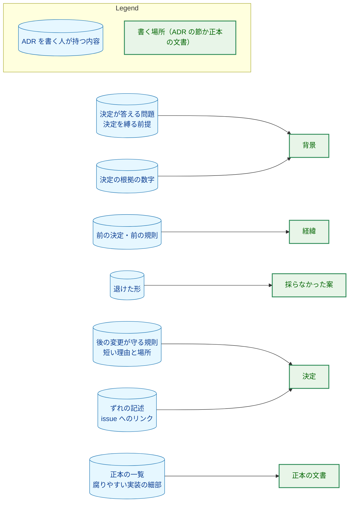
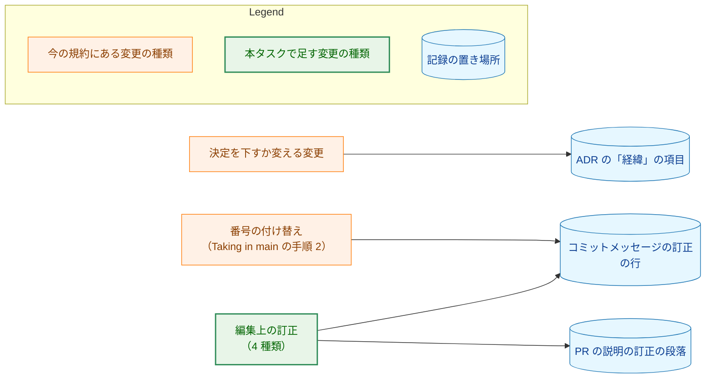
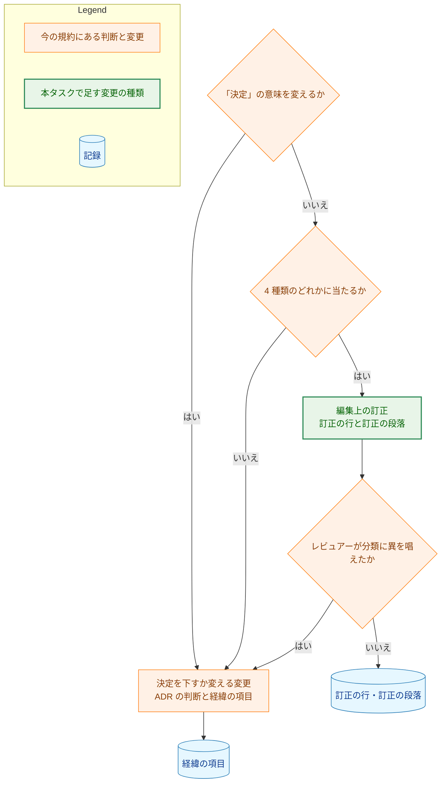
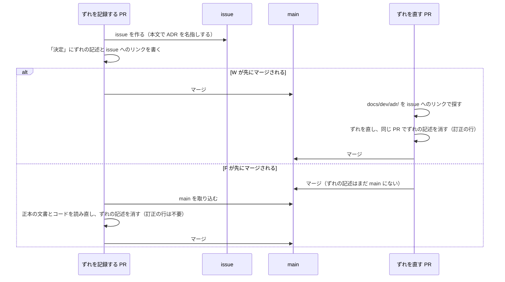

# アーキテクチャ設計書：ADR の規約に、背景と決定に書く内容と詳細度の基準を足す

## Document Status

| Item | Value |
|---|---|
| Status | `draft` |
| Created | 2026-11-09 |
| Review date | - |
| Reviewer | - |
| Comments | - |

本書は [01_requirements.md](01_requirements.md)（要件定義書。以下、要件書）の設計である。既存のファイルの内容は、コミット `2ea9103d` で確かめた。`file:line` の行番号は、このコミットでの行番号である。F-NNN・AC-NN は要件書の項番を、H-NN は [design_handoff.md](design_handoff.md)（以下、申し送り）の項番を指す。申し送りへの対応は付録 A に、受け入れ基準との対応は付録 B にまとめる。

本書は、要件書 6 章の用語（正本の文書・ずれの記述・編集上の訂正・基準に合わせる書き直し・腐りやすい実装の細部）を、要件書と同じ意味で使う。そのほかに、次の用語を使う。

-   **規約:** `docs/dev/conventions/adr.md`。
-   **実装の PR:** 規約と ADR-0039 の変更を入れる 1 本の PR（1.2）。本書の PR と、実装計画書の PR は含まない。
-   **分担の文:** 規約の「Writing an ADR」の「決定」の箇条（`docs/dev/conventions/adr.md:124-130`）。ADR と正本の文書の分担を述べ、CLAUDE.md の「Design decisions (ADR)」も同じ分担を持つ（`docs/dev/conventions/adr.md:138-141`）。
-   **そろえる段落:** 規約の中で、CLAUDE.md と同じ文で持つ部分を変えたら両方をそろえる、と指示する段落。「What counts as a major decision」の `adr.md:111-112`、「Writing an ADR」の `adr.md:138-141`、「Approval and the PR」の `adr.md:221-222` の 3 つである。
-   **基準の段落:** 「Writing an ADR」に足す 2 つの段落、「What 背景 holds」と「What 決定 holds」（3.1）。
-   **訂正の節:** 規約に足す `## Editorial corrections` の節（3.2）。
-   **訂正の行・訂正の段落:** `docs/dev/conventions/requirements_process.md` の「Recording in the PR description」の correction line と correction paragraph（`requirements_process.md:377-408`）。
-   **差分の確認:** 変更の前後の関係を述べる受け入れ基準を、マージベースと PR の先頭（最新のコミット）を比べて確かめるスクリプト。タスクの `_checks/` の下に置く（`requirements_process.md`「4. Acceptance Tests」）。恒久的なテストではない（7.2）。

## 1. 設計の全体像 (Design Overview)

### 1.1. 設計原則

-   **基準と訂正の規則は、規約の 1 か所だけに書く。** ADR-0039 は規則を書き写さず、要約して規約の節へリンクする（要件書 4.5）。コマンドの定義と `requirements_process.md` は、規約を参照するだけで、規則を持たない（AC-20）。
-   **CLAUDE.md とそろえる文の意味を変えない。** 分担の文と、「Approval and the PR」の最初の 2 文（決定を下すか変える PR が ADR を作るか更新し、その PR のレビューとマージが承認になる、という規則）は、CLAUDE.md も持つ（`CLAUDE.md:124-129`・`:148-150`）。基準と訂正の規則はこれらの文の外に置き、これらの文とそろえる段落はバイト単位で変えない（AC-08・AC-20・AC-22、H-01）。
-   **`TestADRRecords` が読む 3 つの節に触れない。** このテストは、規約の「Template」「Status」「Index」の節を見出しで探し、それぞれの 1 つのコードブロックか表を読む（`cmd/yt2column/adr_test.go:190-205`・`:249-255`）。ほかの節に段落や `##` の節を足しても、テストが読むものは変わらない（AC-21、要件書 4.4）。
-   **規約の今の書き方に合わせる。** 規約は英語で書き（`CLAUDE.md`「Document language」の原則 (b)）、補足の規則を太字で始まる段落（「**Links.**」、`adr.md:143`）か箇条で述べる。基準の段落と訂正の節も、この形にする。
-   **文の意味は PR のレビューで読んで確かめ、新しいテストを足さない。** 基準は文の意味についての規則だからである（要件書 2.3、[ADR-0016](../../dev/adr/0016-document-test-policy.md)）。変えないことを求める受け入れ基準は、差分の確認で確かめる（7.2）。

### 1.2. 設計の際に決めたこと（2026-11-09）

-   **基準は「Writing an ADR」の中の 2 つの段落に置き、分担の文を変えない（H-01）:** 箇条と、`adr.md:138-141` のそろえる段落の後、「**Links.**」の段落の前に、「**What 背景 holds.**」と「**What 決定 holds.**」の 2 つの段落を足す。「決定」の箇条（分担の文）はバイト単位で変えない。「背景」の箇条は AC-01 の言い方に改め、基準の段落を指す。
    -   **理由:** 分担の文の中に基準を書き足すと、そろえる段落が指す「上の分担」に基準も含まれると読め、CLAUDE.md もそろえる必要が生じて AC-20 と食い違う。分担の文の外に置けば、そろえる段落の対象は今と同じになる。
    -   **採らなかった案:** 「背景」と「決定」の箇条に基準を書き足す案は、1 か所で読めるが、上の理由で採らない。
    -   ADR：なし。規約の中の配置の決定で、本タスクの中で閉じる。
-   **編集上の訂正の規則は、新しい `## Editorial corrections` の節にまとめる:** 「Approval and the PR」の後、「Taking in `main`」の前に節を足し、4 種類・記録・紛らわしい場合・`廃止` の ADR・ずれの記述の扱いを置く。「Approval and the PR」の「決定を下すか変える PR 以外は ADR を変えない」という文は、この節を除く形に改める。「History entries」には 1 項目を、「Taking in `main`」にはずれの記述の段落と、番号の付け替えの直しの対象を明示する文を足す（3.2〜3.5）。
    -   **理由:** 「Approval and the PR」の中にすべて書くと、そろえる段落（`adr.md:221-222`）が「同じ規則」と呼ぶものに訂正の規則も含まれると読め、CLAUDE.md とそろえる対象が曖昧になる。節を分ければ、「Approval and the PR」は CLAUDE.md と同じ規則と 1 つの例外の文だけを持つ。
    -   **採らなかった案:** 「Approval and the PR」の中に全部書く案は、上の理由で採らない。
    -   ADR：なし。規約の中の配置の決定で、本タスクの中で閉じる。ADR-0039 の「決定」が規則を足す先の節の名前を持っていたので、本書の PR で「規約に足す」という言い方に改めた。
-   **ずれの記述の手がかりは、issue・検索・読み直しの 3 つにする（H-03・H-05）:**
    1.  ずれを扱う issue は、本文で ADR を名指しする。ずれを直す人が、issue から ADR にたどり着けるようにするためである。
    2.  ずれを直す PR は、`docs/dev/adr/` を、扱う issue へのリンクで探す。規約は検索の形を `git grep -nE 'issues/<N>([^0-9]|$)' -- docs/dev/adr/` として示す。`#71` を探して `#713` に当たらないように、番号の後に数字が続かないことを条件にする。
    3.  ずれの記述を足す PR は、`main` を取り込むたびに、取り込んだ `main` の正本の文書とコードを読み直す。ずれが直っていれば、記述を消すか、残りのずれを述べる形に書き換える。`main` の側で `docs/dev/adr/` が変わったかどうかによらない。
    -   **理由:** ずれを直す PR は、ずれの記述とは別の主題の変更であることが多く、規約を読む機会がない。issue が ADR を名指しすれば、その issue を扱う人が気づく。後から `main` に入る ADR の PR については、git は衝突を起こさないので、PR の側で読み直す必要がある。探すのも読み直すのも手元の木で行え、ネットワークを使わない（CLAUDE.md「Tool Execution Safety」）。見落としたずれの記述は、後のどの PR も 2 つ目の種類の訂正として消せるので、見落としの害は限られる。
    -   **採らなかった案:** 検索の 1 文だけを書く案は、後から `main` に入る ADR のずれの記述が事実でないまま残るので採らない。`main` を取り込むときに `gh issue view` で issue が閉じたかを見る案は、ネットワークを使うのでそのたびに承認が要り、issue が閉じてもずれが直ったとは限らないので採らない。
    -   **残るリスク:** `/runpr` が規約の「Taking in `main`」に従うのは、取り込んだ `main` で `docs/dev/adr/` が変わったときだけである（`.claude/commands/runpr.md:276-277`）。コマンドは本タスクで変えない（AC-20）ので、`/runpr` の中で `main` を取り込む PR では、手順 3 の読み直しが行われないことがある（5.2、9 章）。
    -   ADR：[ADR-0039](../../dev/adr/0039-adr-writing-criteria.md) を更新する。ずれを記録する後のすべてのタスクと、ずれを直すすべての PR を縛る手順だからである。
-   **場所の粒度を規約に書き、数字の例は一般形にする（H-02・H-04）:** 「決定」の各項目に添える場所は、「文書とその節の見出し」か「パッケージかファイル」で示し、行番号と呼び出し箇所の列挙は書かない、と規約に書く。「背景」に残す数字の例は、特定の ADR の値ではなく、「どのビルドで時間の期限を確かめるかを決める、計測した遅さの倍率」のような一般形にする。
    -   **理由:** AC-04（場所を添える）と AC-06（呼び出し箇所を列挙しない）と「Links」（行番号を使わない、`adr.md:143-149`）は、粒度を書かないと互いに食い違うように読める。特定の ADR の値を例にすると、その ADR が変わったときに例が古くなる。
    -   **採らなかった案:** ADR-0038 の約 23〜31 倍を例として名指しする案は、例が古くなりうるので採らない。粒度も例も書かない案は、行番号や列挙を書く余地が残るので採らない。
    -   ADR：なし。規約の文面の決定で、本タスクの中で閉じる。

次のことは、要件書と上の決定から導いた（PR のレビューで異論があれば改める）。

-   **実装の PR は 1 本にする。** ADR-0039 のずれの記述は、規約に規則を足す PR が同じ PR で消す（AC-14・AC-23）。そのため、規約の変更と ADR-0039 の変更を分ける PR の境目はない。ADR：なし。PR の分け方の決定で、本タスクの中で閉じる。
-   **実装の PR の ADR-0039 の変更は、編集上の訂正の 2 つ目の種類として記録する。** 実装の PR は ADR-0039 の決定を変えず、ずれの記述を規約の節へのリンクに置き換えるだけである（AC-23）。訂正の行を書き、「経緯」に項目を足さない（3.6）。ADR：なし。

### 1.3. なぜ今の書き方では足りないか

-   **基準:** 今の「Writing an ADR」は、各節の用途を 1 行で述べるだけである（`adr.md:121-136`）。何を書かないかを述べていないので、要件書 1 章の、背景に経緯が並び、決定に一覧の写しが入る問題を防げない。PR #727 で決めた基準は PR の説明にしかなく、後の ADR を書く人もエージェントも読まない（要件書 1 章）。
-   **編集上の訂正:** 今の規約は、決定を下すか変える PR 以外が ADR を変えることを認めない（`adr.md:217-219`）。タスク 0069 は、ずれの記述 1 つを消すために、その削除に限った例外を要件書で作った（`docs/tasks/0069_readme_display_language/01_requirements.md:57-63`）。この方法では、ADR-0001〜0030 の見直し（[#729](https://github.com/isseis/yt2column/issues/729)）のたびに例外が要る。

### 1.4. 概念モデル

ADR の節と、そこに書くもの・別の場所へ移すものの関係を図 1 に示す。矢印 A → B は「A に当たる内容は B に書く」を表す。



ADR への変更の分け方と、それぞれの記録の置き場所を図 2 に示す。矢印 A → B は「A に分けた変更を B に記録する」を表す。



図 2 で、決定を下すか変える変更から「経緯」への矢印と、番号の付け替えから訂正の行への矢印は、今の規約の関係である（`adr.md:167-169`・`:236-238`）。編集上の訂正からの 2 本の矢印が、本タスクで足す関係である。同じ PR が決定の変更と編集上の訂正の両方を含むときは、それぞれを自分の矢印の先に記録する（AC-15）。番号の付け替えは、今の規約のとおり PR の説明にも訂正の段落として載る（`.claude/commands/_lib/task-pr-handoff.md` の Part B 手順 3 が、ブランチのすべての訂正の行から段落を書くため）。図 2 では、今の規約が述べる訂正の行だけを示す。

## 2. システム構成 (System Structure)

### 2.1. 全体構成

本タスクは文書だけを変える。実行時に動くコンポーネント（拡張・Native Messaging のホスト・サーバ・CLI）は変わらない。変える文書と、それを読む文書・検査の関係を図 3 に示す。矢印 A → B は「A が B を読む、または参照する」を表す。


図 3 のうち、差分の確認からの矢印と、ADR-0039 から規約への「規則の節へリンクする」矢印は、実装の PR で加わる関係である。ほかの矢印は今の関係である。CLAUDE.md は規約を参照する（`CLAUDE.md:120-122`）。規約は訂正の行の形を `requirements_process.md` に頼る（`adr.md:236-238`）。`/runpr` は「Taking in `main`」を参照する（`.claude/commands/runpr.md:276-277`）。`task-pr-handoff.md` は訂正の行から訂正の段落を書く（Part B 手順 3）。`TestADRRecords` は規約の 3 つの節と各 ADR を読む（`cmd/yt2column/adr_test.go:190-205`）。

### 2.2. コンポーネント配置

| ファイル | 変更 | 内容 |
|---|---|---|
| `docs/dev/conventions/adr.md` | 変更 | 「Writing an ADR」に基準の段落を足し、「背景」の箇条を改める（3.1）。「Approval and the PR」の 1 文を改め、訂正の節を足す（3.2・3.3）。「History entries」に 1 項目を足す（3.4）。「Taking in `main`」にずれの記述の段落と、`main` の上のガードの失敗の段落の対象を明示する文を足す（3.5） |
| `docs/dev/adr/0039-adr-writing-criteria.md` | 変更 | 実装の PR で、「決定」の、規則が規約にまだないと述べる記述と #728 へのリンクを、規約の節へのリンクに置き換える（AC-23、3.6）。本書の PR でも、ずれの記述の手がかりの決定を足した（1.2） |
| `docs/tasks/0070_adr_writing_criteria/_checks/` | 追加 | 差分の確認のスクリプト（7.2）。`go list ./...` は `_` で始まるディレクトリを無視する |
| `docs/tasks/0070_adr_writing_criteria/03_implementation_plan.md` | 変更 | 実装計画書（`/mkplan` の PR が作る）。実装の PR は、進み具合と検証の結果を記録する |

`CLAUDE.md`、`.claude/commands/` の下のファイル、`requirements_process.md` は変えない（AC-20）。ADR の索引（`docs/dev/adr/README.md`）も変えない。ADR-0039 の題名は変わらないからである。ADR-0036 も、実装の PR では変えない。ADR-0036 は、ADR の編集上の訂正の記録が ADR-0039 にあると述べるだけで（ADR-0036「決定」の 1 つ目の項目）、規約の節を名指ししていないからである。

### 2.3. データフロー

本タスクで新しく動くデータはない。編集上の訂正の記録は、今のタスク文書の訂正と同じ経路を通る。

1.  訂正を加えるコミットのメッセージに、訂正の行を 1 行ずつ書く。`<document path>` には ADR のリポジトリからの相対パスを書く（3.2）。
2.  PR を作るとき、`task-pr-handoff.md` の Part B 手順 3 が、`git log origin/main..HEAD` の訂正の行から訂正の段落を書く。この手順は、行が `Editorial correction: ` で始まるかだけを見て、パスがタスク文書かどうかは見ない。そのため、ADR のパスの行も段落に載る。
3.  `fixprguard` の `finish` がコミットの本文を確かめるときも、行の先頭と文字の種類だけを見て、パスは見ない（`internal/fixprguard/write.go:112-127`）。

ただし、`/fixpr` の修正の担当がタスク文書の訂正だけを返す（`.claude/commands/fixpr.md:484-489`）ので、`/fixpr` の回で加えた ADR の訂正は、訂正の行に自動では載らない。これを広げることは [#732](https://github.com/isseis/yt2column/issues/732) で扱う（要件書 2.3、ADR-0039「結果」）。

## 3. コンポーネント設計 (Component Design)

本タスクに型・インターフェースの追加や変更はない。この章では、規約の節ごとに、実装の PR の後に規約が述べる内容と、その英語の文面の案を定める。文面の案は要件書が設計に委ねたもの（要件書 1 章「本書の記述範囲」）である。実装は、この案の意味を変えない範囲で言い回しを整えてよい。意味を変えるときは、本書を改める。

### 3.1. 「Writing an ADR」の基準の段落（F-001・F-002、H-01・H-02・H-04）

#### 3.1.1. 箇条の変更

-   **「背景」の箇条（`adr.md:122-123`）** を、次の文に改める（AC-01）。

    ```text
    - **背景:** only the problem the decision answers and the assumptions that
      bind it ("What 背景 holds" below).
    ```

-   **「決定」の箇条（`adr.md:124-130`、分担の文）** は、バイト単位で変えない（AC-08、1.2）。「決定」には今効いている決定だけを書き、前の決定は「経緯」に置くこと、正本の文書がある主題では要約してリンクすることは、この箇条が今のまま述べ続ける。
-   ほかの箇条と、そろえる段落（`adr.md:138-141`）も変えない（AC-22、要件書 2.3）。

#### 3.1.2. 足す段落

そろえる段落（`adr.md:138-141`）と「**Links.**」の段落（`adr.md:143`）の間に、次の 2 つの段落を足す。

```text
**What 背景 holds.** A later developer reads an ADR to learn the decision on
a subject they are about to change, and why it was made; write 背景 for that
reader. Write only the problem the decision answers and the assumptions that
bind it. Do not write the content of an earlier rule, the figures of an
investigation, or where a rule came from, unless it is itself a ground of the
decision: an earlier decision goes in 経緯, and a rejected form in
採らなかった案. A figure the decision rests on stays in 背景, such as a
measured slowdown that decides which build checks a time limit.

**What 決定 holds.** Write one item for each rule a later change must keep.
Give each item a short reason and the place of its specification: a document
and the heading of its section, or a package or a file, without line numbers
("Links" below). When the source document gives no reason for an item, write
`理由は記録されていない`; do not supply one. Do not copy into 決定 a list that
the document holding the specification has (a list of syntax, a list of
exceptions), and do not write implementation details that go stale while the
decision stays the same (the order of function calls, a list of call sites,
the details of a procedure). When the document holding the specification and
the code disagree, keep in 決定 a statement of the discrepancy with a link to
the issue that handles it (a discrepancy statement). The issue names the ADR,
so whoever fixes the discrepancy finds the statement ("Editorial
corrections", "Discrepancy statements").
```

| 文 | 述べること | AC・H |
|---|---|---|
| 「What 背景 holds」の 1 文目 | 基準の観点（後の開発者が、変えようとしている主題の決定とその理由を知る） | 要件書「issue #728 で決めたこと」の 2 つ目 |
| 同 2 文目 | 背景には問題と前提だけを書く | AC-01 |
| 同 3 文目 | 前の規則の中身・調査の数字・規則の由来は、根拠そのものでなければ書かない。前の決定は経緯へ、退けた形は採らなかった案へ | AC-02 |
| 同 4 文目 | 根拠の数字は残す。例は一般形 | AC-03、H-04 |
| 「What 決定 holds」の 1・2 文目 | 規則を 1 項目ずつ、短い理由と場所とともに。場所の粒度は文書と節の見出しか、パッケージかファイル。行番号は使わない | AC-04、H-02 |
| 同 3 文目 | 出典に理由がなければ `理由は記録されていない` と書き、補わない | AC-04 |
| 同 4 文目 | 正本の一覧を写さない。腐りやすい実装の細部（呼び出しの順序・呼び出し箇所の列挙・手順の細部）を書かない | AC-05・AC-06、H-02 |
| 同 5・6 文目 | ずれの記述と issue へのリンクは残す。issue は ADR を名指しする | AC-07、H-03 |

-   **AC-08 の今と同じ意味は、「決定」の箇条をそのまま残すことで満たす。** 基準の段落は、分担の文を言い換えず、その外で足りないことだけを述べる。
-   **段落の名前に節の日本語の名前を使う。** 規約の箇条は「**背景:**」のように ADR の節の名前で始まる（`adr.md:121-136`）。基準の段落も同じ名前で節を指す。
-   **「issue は ADR を名指しする」は、issue の書き方の規則である。** issue の書式を定める文書は今ない。この規則は、ずれの記述を書く ADR の PR が issue を作るか書き換えるときに守る（ずれを見つけたら issue にしてリンクする、というタスク 0065 の原則による。ADR-0039「経緯」の 2026-11-06 の項目）。

### 3.2. 訂正の節（F-003、H-03）

「Approval and the PR」の後、「Taking in `main`」の前に、次の節を足す。

```text
## Editorial corrections

An editorial correction changes how an ADR is written without changing its
decision. Any PR may make one, including a PR that makes or changes no ADR
decision. Only these four kinds are editorial corrections:

1. **A rewrite to the criteria** of "Writing an ADR". It may move content that
   the ADR or its source documents already hold to another section, such as
   an earlier decision out of 背景 into 経緯 or a rejected form into
   採らなかった案, and it adds no new fact. It may rewrite the title without
   changing its meaning; the index row then changes in the same PR.
2. **Removing a discrepancy statement** once the discrepancy is fixed, or
   rewriting it to state what remains when only part of it is fixed
   ("Discrepancy statements" below).
3. **Fixing a stale reference**: a link, a name, or a heading that no longer
   matches what it refers to.
4. **Fixing a typo** that does not change the meaning.

Renumbering an ADR when taking in `main` ("Taking in `main`", step 2) is a
separate correction with its own rule, not one of these kinds.

A change to the meaning of 決定 is not an editorial correction: only a PR that
makes or changes the decision makes it ("Approval and the PR").

**Recording.** Record each editorial correction in the message of the commit
that makes it, as a correction line, and in the PR description, as a
correction paragraph, in the forms of
`docs/dev/conventions/requirements_process.md`, "Recording in the PR
description"; the document path in them is the ADR's repository-relative
path. The line says what was changed to what and that no decision changed.
The PR description names the change as an editorial correction, so the PR's
reviewer can dispute the classification. An editorial correction adds no
経緯 entry ("History entries").

**Mixed and disputed changes.**

- When one PR changes an ADR's decision and also makes editorial corrections
  to the same ADR, record the decision change in 経緯 and the corrections in
  the commit message and the PR description.
- When the PR's reviewer disputes that a change is editorial, treat it as a
  decision change: add a 経緯 entry and the ADR judgement.
- The same rules apply to an obsolete (`廃止`) ADR.
- A PR that changes the decision of an ADR written before these criteria
  brings only the part it changes to the criteria.

**Discrepancy statements.**

- The PR that fixes a discrepancy removes its statement in the same PR, or
  rewrites it to state what remains when the PR fixes only part. To find the
  statements, search `docs/dev/adr/` for links to the issue the PR handles:
  `git grep -nE 'issues/<N>([^0-9]|$)' -- docs/dev/adr/`.
- When an ADR's discrepancy statement reaches `main` after the PR that fixed
  the discrepancy, the ADR's own PR removes it when it takes in `main`
  ("Taking in `main`").
- A statement that a later PR finds stale may be removed by that PR, as the
  second kind above.
```

| 部分 | 述べること | AC |
|---|---|---|
| 1 段落目 | どの PR も編集上の訂正を加えてよい。4 種類だけ | AC-09 |
| 1 つ目の種類 | 別の節への移動を含み、新しい事実を足さない。題名の意味を変えない書き直しを含み、索引の行を同じ PR でそろえる | AC-10 |
| 番号の付け替えの段落 | 番号の付け替えは 4 種類とは別の訂正 | AC-09・AC-19 |
| 「決定」の意味の段落 | 意味を変える変更は訂正ではなく、決定を下すか変える PR だけが行う | AC-11 |
| 「Recording」 | 訂正の行と訂正の段落の形を ADR のパスにも当てはめる。何を何に変えたかと、決定を変えないことを書く。PR の説明で訂正と明示する。経緯に足さない | AC-12・AC-13 |
| 「Mixed and disputed changes」 | 混ざった変更、異論、`廃止` の ADR、古い ADR に触れる PR | AC-15・AC-16・AC-17 |
| 「Discrepancy statements」 | ずれを直す PR が同じ PR で消す。探し方。後から `main` に入るときと、見落としたとき | AC-14、H-03・H-05 |

-   **訂正の行の `<document path>` は、`requirements_process.md` ではタスク文書のパスと書かれている（`requirements_process.md:388`）。** `requirements_process.md` は変えない（AC-20）ので、訂正の節が「この形を ADR のパスにも当てはめる」と述べる。訂正の行を読む道具がパスを確かめないことは、2.3 で確かめた。
-   **検索の形は、番号の後に数字が続かないことを条件にする。** issue へのリンクは `https://github.com/isseis/yt2column/issues/<N>` の形で書かれている（例：`docs/dev/adr/0029-extension-ui-languages.md:24`）。条件がないと、`issues/71` を探して `issues/713` に当たる。
-   **ADR の判断を加える先。** 異論のときに加える「ADR の判断」は、その PR が決定を記録する文書（タスク文書の「…で決めたこと」の節、またはタスクのない PR の説明）に、`settle-decisions.md` の手順 5 と同じ形で書く。

### 3.3. 「Approval and the PR」（F-003）

-   最初の段落の最初の 3 文（`adr.md:215-217`）と、そろえる段落（`adr.md:221-222`）は、バイト単位で変えない（AC-22）。これらの文が、CLAUDE.md の「Rule」の項目（`CLAUDE.md:124-129`）と同じ規則を持つ。
-   最初の段落の最後の文（`adr.md:217-219`、「An ADR is therefore never added or changed by a PR other than the one that makes or changes its decision.」）を、次の文に改める（AC-18）。

    ```text
    An ADR is therefore added only by the PR that makes its decision, and
    changed only by a PR that makes or changes its decision, with one
    exception: any PR may make the editorial corrections of "Editorial
    corrections" below.
    ```

-   この文は CLAUDE.md にない（要件書 1 章「CLAUDE.md は変えない」の理由）。そろえる段落が「同じ規則」と呼ぶのは、その前の 3 文である。ADR を足すのは決定を下す PR だけ、という意味は変わらない。

### 3.4. 「History entries」（F-003）

「One entry per event」の箇条（`adr.md:167-169`）の後に、次の箇条を足す（AC-13）。

```text
- **No entry for an editorial correction** ("Editorial corrections"). When a
  rewrite to the criteria moves into 経緯 an earlier decision that the ADR or
  its source documents already hold, put it there as the entry of that
  decision, in the form above, dated as "Date of an entry copied from an
  existing decision" below says, and in its place by date among the other
  entries; it is not an entry for a new event.
```

-   **移した項目の位置。** 「Order」の箇条（`adr.md:170-171`）は、新しい項目を末尾に置くと定める。移した項目は前の決定なので、末尾ではなく日付の順の位置に置く。そうすれば「日付が逆に進まない」という同じ箇条の条件を保てる。
-   **移した項目の日付。** 出典の文書から写す項目の日付の決め方（`adr.md:176-190`）に従う。
-   ほかの箇条は変えない。

### 3.5. 「Taking in `main`」（F-003、H-05）

-   **手順 1〜3（`adr.md:229-242`）は変えない。** 手順 2 の番号の付け替えは、今と同じく、コミットメッセージに編集上の訂正として記録する（AC-19）。
-   **手順 3 の後、「When `TestADRRecords` fails on `main`」の段落の前に、次の段落を足す（AC-14、H-05）。** 節の最初の文（`adr.md:226-227`）は手順 1〜3 の条件で、この段落には当てはまらないことを、段落自身の最初の句で述べる。

    ```text
    **Discrepancy statements the PR adds.** Whenever the branch takes in
    `main`, whether or not `docs/dev/adr/` changed there, read again, on the
    `main` taken in, the document and the code that each discrepancy statement
    the PR adds describes. When the discrepancy is gone, remove the statement,
    or rewrite it to state what remains. The statement was never on `main`,
    so this revises the PR's own change and needs no correction line.
    ```

-   **「When `TestADRRecords` fails on `main`」の段落（`adr.md:244-248`）** の最後の文を、番号を付け替える直しを対象とすることが分かる形に改め、1 文を足す（AC-19）。

    ```text
    Fix it, renumbering the ADRs so that no number is duplicated or missing,
    in a PR of its own that fixes only that, not inside an unrelated PR: that
    PR's reviewer is not in a position to approve a change of an ADR's number.
    This fix is not one of the editorial corrections of "Editorial
    corrections", which change neither a number nor a decision and which any
    PR may make.
    ```

-   **足した段落は、PR が足したずれの記述にだけ当てはまる。** `main` にすでにあるずれの記述は、ずれを直す PR が消す（3.2「Discrepancy statements」の 1 つ目）。PR がまだ `main` にないずれの記述を消すのは、自分の変更の手直しなので、訂正の行は要らない。

### 3.6. ADR-0039 の「決定」（F-004、AC-23）

本書の PR の後、ADR-0039 の「決定」は、次の 4 つの項目で、規則が規約にまだないこと（#728 で扱う、または規約に足す）を述べている。

| 項目 | 今の記述 | 実装の PR の後 |
|---|---|---|
| 2 つ目（背景） | 基準を規約の「Writing an ADR」に足すことは #728 で扱う | 規則は規約の「Writing an ADR」にある |
| 3 つ目（決定） | 同上 | 規則は規約の「Writing an ADR」にある |
| 4 つ目（編集上の訂正） | 訂正の種類・記録の置き場所・経緯に足さないことは、規約に足す（#728） | 規則は規約の「Approval and the PR」「Editorial corrections」「History entries」にある |
| 5 つ目（ずれの記述） | 規則を規約に足すことは #728 で扱う | 規則は規約の「Writing an ADR」「Editorial corrections」「Taking in `main`」にある |

-   各項目のほかの文（太字の決定と理由）は変えない。リンクは `[adr.md](../conventions/adr.md)` の形にし、節は見出しを本文で名指しする（`adr.md:143-149`「Links」）。
-   **編集上の訂正の 2 つ目の種類として記録する。** ADR-0039 を変えるコミットのメッセージに、項目ごとに訂正の行を書く。

    ```text
    Editorial correction: docs/dev/adr/0039-adr-writing-criteria.md: <what was changed to what>; no decision changed
    ```

    「経緯」に項目を足さない。「状態」も `有効` のままで、索引も変えない。
-   ADR-0039 の「結果」の、コマンドがまだ ADR の訂正を運ばないという項目と、`/runpr` の読み直しについての項目は、規約とのずれではなく、受け入れたコストの記述なので残す。

## 4. エラーハンドリング設計 (Error Handling Design)

### 4.1. 実行時のエラー

N/A。実行時のコードを変えないので、エラーの型もメッセージも変わらない。

### 4.2. 手順の中の失敗

-   **差分の確認が失敗した場合。** 失敗したままでは PR を作らない。変えてはならない部分を変えていれば、その部分を戻して確認をやり直す。
-   **`TestADRRecords` が失敗した場合。** 実装の PR は「Template」「Status」「Index」の節に触れないので、失敗は規約以外の原因（ADR-0039 の構造を壊したなど）による。原因を直してから PR を作る。
-   **レビュアーが編集上の訂正という分類に異を唱えた場合。** 訂正の節のとおり、その変更を決定の変更として扱い、ADR-0039 に「経緯」の項目を足し、ADR の判断を本書か実装計画書の「…で決めたこと」の節に記録する（3.2）。

## 5. セキュリティ考慮事項 (Security Considerations)

### 5.1. 脅威モデル

N/A。文書だけの変更で、外部のコマンドの呼び出し、API キーと Webhook の URL、キャッシュ、ネットワークへの送信、信頼できない文字列のプロンプトや記事への埋め込みのどれにも当たらない（要件書 4.2）。脅威モデルの図も要らない。

### 5.2. 残余のリスクと注意

セキュリティの脅威ではないが、規則の運用で残るリスクを記す。

-   **決定の変更を編集上の訂正と誤って分類する。** 訂正は「経緯」に残らないので、誤った分類は決定の変遷を失わせる。PR の説明で訂正と明示し、レビュアーが分類を確かめ、異論があれば決定の変更として扱うことで防ぐ（3.2）。機械では確かめない。
-   **後から `main` に入るずれの記述の見落とし。** `/runpr` は、`main` の側で `docs/dev/adr/` が変わったときだけ規約の「Taking in `main`」を参照する（`.claude/commands/runpr.md:276-277`）。そのため、3.5 の読み直しは `/runpr` の中では行われないことがある。見落とされたずれの記述は、後のどの PR も 2 つ目の種類の訂正として消せる（ADR-0039「結果」）。
-   **訂正の行の文面。** ADR の訂正の行も、タスク文書の訂正の行と同じく、`@` と `<` を含めず、レビューのスレッドや PR の説明を引用しない（`requirements_process.md:388-391`）。訂正の節は形を `requirements_process.md` に頼るので、この制約もそのまま当てはまる。

## 6. 処理フロー詳細 (Processing Flow Details)

### 6.1. ADR を変える PR の判断

規約の規則を当てはめて、PR が ADR への変更をどう扱うかを図 4 に示す。矢印は判断の順序を表す。



-   「4 種類のどれかに当たるか」で「いいえ」のとき、つまり意味を変えないが 4 種類のどれにも当たらない変更は、決定を下すか変える PR だけが行える。今の規約の扱いと同じである。
-   番号の付け替えは図 4 に含めない。「Taking in `main`」の手順 2 と、`main` の上のガードの失敗の段落が、別に扱う（3.5）。

### 6.2. ずれの記述の流れ

ずれの記述が記録されてから消えるまでを図 5 に示す。矢印は時間の順序を表す。



図 5 は sequence diagram で、色分けしたノードを持たないので、Legend を置かない（`docs/dev/conventions/mermaid_reference.md` の 4 章の例も同じである）。`F が先にマージされる` の場合で W が読み直しを行わずにマージされたときは、5.2 の 2 つ目のリスクになる。

## 7. テスト戦略 (Test Strategy)

### 7.1. ユニットテスト

新しいテストは足さない（1.1）。実装の PR の後も既存のテストが通ることを、`make test` で確かめる。とくに次の 2 つが、変える文書を読む。

| 検査 | 読むもの | 本タスクの変更との関係 | CI での実行 |
|---|---|---|---|
| `TestADRRecords`（`cmd/yt2column/adr_test.go`） | 規約の「Template」「Status」「Index」の節、各 ADR、索引 | 3 つの節は変えない。ADR-0039 は「決定」の項目の文を変えるだけで、見出し・状態・題名は変わらないので、通る（AC-21） | `doc-guard` |
| `TestInstructionDocPaths` | 文書のリンクとパス | 規約に足すパス（`docs/dev/adr/`、`docs/dev/conventions/requirements_process.md`）と、ADR-0039 に足すリンク（`../conventions/adr.md`）は存在するので、通る | `doc-guard` |

実装の PR は `docs/` の下しか変えないので、CI の `check-changes` はコードの変更なしと判定する。動くのは `doc-guard` ジョブである。

### 7.2. 差分の確認（`_checks/`）

変えないことを求める受け入れ基準と、1.1・1.2 の設計の制約は、差分の確認で確かめる。スクリプトは `docs/tasks/0070_adr_writing_criteria/_checks/` に置き、マージベースと PR の先頭を比べて、次のことを確かめる。

| 対象 | 確かめること |
|---|---|
| AC-20 | 実装の PR が変えたファイルが、規約・ADR-0039・このタスクのディレクトリの下だけである。とくに `CLAUDE.md`、`.claude/commands/` の下、`requirements_process.md` を変えていない |
| AC-21 | 規約の「Template」「Status」「Index」の節が、見出しから次の `##` の見出しの前まで、前後で 1 バイトも違わない |
| AC-08・AC-22、1.2 | 規約の「決定」の箇条（分担の文）と、3 つのそろえる段落が、前後で 1 バイトも違わない |
| AC-19、3.3・3.5 | 規約の「Approval and the PR」の最初の 3 文と、「Taking in `main`」の手順 1〜3 が、前後で 1 バイトも違わない |
| 節の構成 | 規約の `##` の見出しの並びが、変更前の並びの「Approval and the PR」と「Taking in `main`」の間に「Editorial corrections」を 1 つ足したものに等しい |
| AC-23 | ADR-0039 の「決定」の外が前後で違わない（とくに「経緯」に項目が増えていない）。変更後の「決定」が `issues/728` へのリンクを持たない |

スクリプトは次の性質を持つ。手順の細部（言語・構成）は実装計画書で決める。

-   **比べる 2 つのコミットを引数で受け取る。** 作業ツリーではなく、その 2 つのコミットの内容を比べる。前者が後者の祖先でなければ失敗する。
-   **部分の位置は、見出しと、変えない文の内容で決める。** 行番号では決めない。目印が見つからないか、2 回以上見つかるときは失敗する。
-   **違反でも読み取りの失敗でも、0 でない終了コードで終わる。**

スクリプトは PR のブランチの上で実行し、その出力と、比べた 2 つのコミットの完全な ID を実装計画書の検証の行に記録する。`make test` と CI は実行しない（`requirements_process.md`「4. Acceptance Tests」）。記録した後に規約か ADR-0039 を変えるコミットや、`main` を取り込むコミットが入ったときは、実行し直して記録を改める。

### 7.3. 読んで確かめる（manual）

文の意味を述べる AC は、PR のレビューで規約を読んで確かめる（ADR-0016）。

-   AC-01〜AC-07：基準の段落と「背景」の箇条を読む（3.1）。
-   AC-08：「決定」の箇条が変わらないことは差分の確認で確かめ（7.2）、基準の段落がそれと食い違わないことを読む。
-   AC-09〜AC-17：訂正の節と「History entries」の箇条を読む（3.2・3.4）。
-   AC-18：「Approval and the PR」の改めた文を読む（3.3）。
-   AC-19：「Taking in `main`」の手順 2 と、`main` の上のガードの失敗の段落を読む（3.5）。
-   AC-22：3 つのそろえる段落が今の意味で残り、CLAUDE.md と同じ文で持つ部分を変えていないことを読む。
-   AC-23：ADR-0039 の「決定」と、ADR-0039 を変えるコミットの訂正の行、PR の説明の訂正の段落を読む（3.6）。

### 7.4. 結合テスト・セキュリティテスト

N/A。実行時の振る舞いを変えないので、結合テストの対象がない。セキュリティの考慮事項もない（5 章）。

## 8. 実装の優先順位 (Implementation Priorities)

実装の PR は 1 本で、次の順に進める。コミットの数と分け方の細部は、実装計画書で決める。

1.  規約を 3.1〜3.5 のとおりに変えてコミットする（F-001〜F-003）。
2.  ADR-0039 を 3.6 のとおりに変え、訂正の行つきでコミットする（AC-23）。規約の節の名前が決まった後に書くので、1 の後にする。
3.  差分の確認のスクリプトを書いてコミットする（7.2）。
4.  差分の確認と `make test`・`make lint` を実行し、結果を実装計画書に記録してコミットする。
5.  PR を作る。説明に訂正の段落を載せる。

## 9. 将来の拡張 (Future Extensibility)

-   **コマンドが ADR の訂正を運ぶようにする。** `/fixpr`・`/runplan`・ローカルの CLI レビューの記録の手順を ADR の訂正に広げることは、[#732](https://github.com/isseis/yt2column/issues/732) で扱う（要件書 2.3）。
-   **`/runpr` がずれの記述の読み直しを行うようにする。** `/runpr` が規約の「Taking in `main`」を参照する条件（`.claude/commands/runpr.md:276-277`）を、PR がずれの記述を足すときにも広げれば、5.2 の 2 つ目のリスクが小さくなる。コマンドの変更なので、本タスクでは行わない。#732 か別の issue で扱う。
-   **ADR-0001〜0030 の見直し。** [#729](https://github.com/isseis/yt2column/issues/729) が、訂正の節の 1 つ目の種類として行う。
-   **基準を足すとき。** ほかの節（「採らなかった案」「結果」など）にも基準を足すときは、基準の段落と同じ形の段落を「Writing an ADR」に足し、分担の文とそろえる段落の外に置く。

## 付録 A: 申し送り（design_handoff.md）への対応

| 項目 | 対応 |
|---|---|
| H-01 | 基準を分担の文の外の 2 つの段落に置き、分担の文とそろえる段落を変えない（1.2、3.1） |
| H-02 | 場所の粒度を「文書とその節の見出し」か「パッケージかファイル」とし、行番号と呼び出し箇所の列挙を書かないと規約に書く（1.2、3.1） |
| H-03 | ずれを扱う issue が ADR を名指しし、ずれを直す PR が `docs/dev/adr/` を issue へのリンクで探す。検索の形を規約に示す。コマンドの手順には入れない（1.2、3.1、3.2） |
| H-04 | 例は ADR-0038 の値ではなく一般形にする（1.2、3.1） |
| H-05 | ずれの記述を足す PR は、`main` を取り込むたびに正本の文書とコードを読み直す。規則は「Taking in `main`」に置く。`/runpr` の中では行われないことがある点は、残るリスクとして記す（1.2、3.5、5.2） |

## 付録 B: 受け入れ基準との対応

| AC | 設計の箇所 | 確かめ方 |
|---|---|---|
| AC-01 | 3.1 | manual（7.3） |
| AC-02 | 3.1 | manual（7.3） |
| AC-03 | 3.1 | manual（7.3） |
| AC-04 | 3.1 | manual（7.3） |
| AC-05 | 3.1 | manual（7.3） |
| AC-06 | 3.1 | manual（7.3） |
| AC-07 | 3.1 | manual（7.3） |
| AC-08 | 3.1.1 | diff（`_checks/`）と manual（7.3） |
| AC-09 | 3.2 | manual（7.3） |
| AC-10 | 3.2 | manual（7.3） |
| AC-11 | 3.2 | manual（7.3） |
| AC-12 | 3.2、2.3 | manual（7.3） |
| AC-13 | 3.2、3.4 | manual（7.3） |
| AC-14 | 3.2、3.5、6.2 | manual（7.3） |
| AC-15 | 3.2 | manual（7.3） |
| AC-16 | 3.2 | manual（7.3） |
| AC-17 | 3.2 | manual（7.3） |
| AC-18 | 3.3 | manual（7.3） |
| AC-19 | 3.5 | diff（`_checks/`）と manual（7.3） |
| AC-20 | 2.2 | diff（`_checks/`） |
| AC-21 | 1.1、7.1 | diff（`_checks/`）と test（`TestADRRecords`） |
| AC-22 | 3.1.1、3.3 | diff（`_checks/`）と manual（7.3） |
| AC-23 | 3.6 | diff（`_checks/`）と manual（7.3） |
