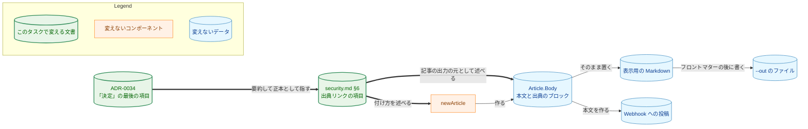

# アーキテクチャ設計書：security.md §6 の出典リンクの項目を、どの記事にも当てはまる形に直す

## Document Status

| Item | Value |
|---|---|
| Status | `approved` |
| Created | 2026-11-09 |
| Review date | 2026-11-09 |
| Reviewer | isseis |
| Comments | - |

本書は [01_requirements.md](01_requirements.md)（要件定義書。以下、要件書）の設計である。既存のファイルの内容は、コミット `bd00f1c7` で確かめた。`file:line` の行番号は、このコミットでの行番号である。F-NNN・AC-NN は要件書の項番を指す。受け入れ基準との対応は付録 A にまとめる。本タスクに `design_handoff.md` はない。

本書は、要件書 6 章の用語（出典リンク・出典のブロック・ビューア・編集上の訂正）を、要件書と同じ意味で使う。そのほかに、次の用語を使う。

-   **出典リンクの項目:** `docs/dev/security.md` §6 の、出典リンクを述べる 1 つの箇条（`docs/dev/security.md:71`）。
-   **記事の出力:** 記事の本文（`Article.Body`）から作る 3 つの出力。`--out` のファイル、サーバが返す表示用の Markdown（ビューアでの表示・保存・コピーに使う）、Webhook への投稿である（1.1）。
-   **ずれの記述:** 要件書 6 章は、ADR-0034 の 3 文をこう呼ぶ。本書ではそれに加え、6.2 の検索で見つかる、ほかの ADR の、issue #725 で扱うずれを述べる記述も含める（ADR-0039「決定」と同じ広さ）。
-   **実装の PR:** `security.md` と ADR の変更を入れる 1 本の PR（1.2）。本書の PR と、実装計画書の PR は含まない。
-   **0070 の実装の PR:** タスク 0070 の、規約 `docs/dev/conventions/adr.md` に `## Editorial corrections` の節を足す PR。0070 の実装計画書（`docs/tasks/0070_adr_writing_criteria/03_implementation_plan.md`）の、`adr.md` を変える PR の境目の `PR を作成した` の行に URL が記録される PR で特定する。issue #728 を参照する PR はほかにもある（0070 の実装計画書の PR など）ので、issue の参照では特定しない。
-   **差分の確認:** 変更の前後の関係を述べる受け入れ基準を、2 つのコミットを比べて確かめるスクリプト。タスクの `_checks/` の下に置き、`make test` と CI は実行しない（`docs/dev/conventions/requirements_process.md`「4. Acceptance Tests」）。
-   **訂正の行・訂正の段落:** `docs/dev/conventions/requirements_process.md`「Recording in the PR description」の correction line と correction paragraph。ADR に当てはめるときは、文書のパスに ADR のパスを書く（0070 の実装の PR が `adr.md` に足す「Editorial corrections」の「Recording」。`docs/tasks/0070_adr_writing_criteria/02_architecture.md` 3.2）。

## 1. 設計の全体像 (Design Overview)

### 1.1. 設計原則

-   **文書を今のコードに合わせる。コードは変えない。** 出典の URL は、`validateTranscript` が検証済みの動画 ID から組み立てる（`internal/writer/writer.go:398`）。`newArticle` は、その URL から作った出典のブロックを本文の末尾に付ける（`internal/writer/output.go:210-227`・`:238-240`）。記事の出力は、どれもこの本文から作る（`internal/publisher/display_render.go:28-35`、`internal/publisher/file_render.go:66`、`internal/publisher/slack_render.go:74`）。項目は、この事実を規則として述べる（F-001）。
-   **変える箇所は、出典リンクの項目とずれの記述だけにする。** どちらも差分の確認で確かめる（AC-04〜AC-06、7.2）。
-   **ADR の変更は、決定を変えない編集上の訂正とする。** 扱いは、ADR-0039 の「決定」と、0070 の実装の PR が規約に足す節に従う（F-002、3.2）。

### 1.2. 設計の際に決めたこと（2026-11-09）

-   **実装は、0070 の実装の PR が `main` にマージされた後に始め、その後に PR を作る:** AC-09 はマージの順序だけを定め、作業と PR を作る時期を定めていない。実装の PR のブランチは、0070 の実装の PR のマージを含む `origin/main` から作る（6.2）。
    -   **理由:** PR を作る時点で、規約に訂正の節がすでにある。そのため、コミットと PR の説明はその節を根拠に書ける。AC-06 の検索も、0070 の実装の PR が入った後の `main` に対して行える。また、先にマージしてしまう余地がない。
    -   **採らなかった案:** PR を先に作り、マージだけを待つ案。マージの前に順序を確かめる手順が別に要るうえ、PR を作った後に `main` に入ったずれの記述をこの PR で消せない（ADR-0039「決定」の、PR を作った後には訂正を加えない規則）。
    -   ADR の判断：ADR は作らない。作業の時期の決定で、本タスクの中で閉じている。

次のことは、要件書と現行の規則から導いた（PR のレビューで異論があれば改める）。

-   **実装の PR は 1 本にする。** ずれの記述は、§6 を直すのと同じ PR で消す（F-002）ので、2 つの変更を分ける PR の境目はない。ADR の判断：ADR は作らない。PR の分け方の決定で、本タスクの中で閉じている。
-   **新しい文書のテストは足さない。** 項目の文の意味は PR のレビューで読んで確かめ（[ADR-0016](../../dev/adr/0016-document-test-policy.md)、要件書 2.3）、前後の関係は差分の確認で確かめる。ADR の判断：ADR は作らない。ADR-0016 の方針に従うだけである。

### 1.3. 概念モデル

変える 2 つの文書と、それが述べるコードの関係を図 1 に示す。太い矢印 A ==> B は「文書 A が B を述べる、または指す」を、細い矢印 A → B は「A から B が作られる」を表す。



図 1 の細い矢印は、どれも今のコードの関係である（1.1 の `file:line`）。ビューアでの表示・保存・コピーは、表示用の Markdown を変えずに使う（`docs/dev/security.md` §8.1 の「記事を untrusted テキストとして描画する」の項目）。

次の 2 つは記事の出力ではないので、図 1 にない。§6 にはそれぞれの箇条がある。

-   **`--artifacts` の保存した出力:** 本文を、出典のブロックを含まない形で持つ（`internal/writer/artifact.go:61`）。保存した出力から再開するときも、`newArticle` が出典のブロックを付ける。
-   **`--review-log` の一覧:** 出典の URL を `Article.SourceURL` から書く（`internal/publisher/reviewlog.go:77`）。この値も、同じ検証済みの動画 ID から作る。

## 2. システム構成 (System Structure)

### 2.1. 全体構成

本タスクは文書だけを変える。実行時に動くコンポーネント（拡張・Native Messaging のホスト・サーバ・CLI）は変わらないので、構成とデータフローの図は図 1 で足りる。

### 2.2. コンポーネント配置

| ファイル | 変更 | 内容 |
|---|---|---|
| `docs/dev/security.md` | 変更 | 出典リンクの項目（`:71`）を 3.1 の形に改める（F-001） |
| `docs/dev/adr/0034-template-allowlist.md` | 変更 | 「決定」の最後の項目（`:24`）から、ずれの記述の 3 文を消す（F-002、3.2） |
| `docs/dev/adr/` のほかの ADR | 変更（見つかったときだけ） | 6.2 の検索で見つかったずれの記述を消す。本書を書いた時点では該当はない（`bd00f1c7` で `issues/725` へのリンクは ADR-0034 の 1 か所だけ） |
| `docs/tasks/0071_security_source_link/_checks/` | 追加 | 差分の確認のスクリプト（7.2）。`go list ./...` は `_` で始まるディレクトリを無視する |
| `docs/tasks/0071_security_source_link/03_implementation_plan.md` | 変更 | 実装計画書（`/mkplan` の PR が作る）。実装の PR は、進み具合と検証の結果を記録する |

Go と拡張のコード、ADR の索引（`docs/dev/adr/README.md`）は変えない。ADR-0034 の表題は変わらないので、索引の行も変わらない。

## 3. コンポーネント設計 (Component Design)

型・インターフェースの追加や変更はない。この章では、変える文書ごとに、変更後に満たす内容を定める。正確な文面は、要件書のとおり実装で決める。

### 3.1. 出典リンクの項目（F-001）

今の項目は、「生成記事を Slack に投稿する前に」出典リンクがコードで付いていることを「確認する」と述べる 1 文である（`docs/dev/security.md:71`）。変更後の項目は、1 つの箇条のまま、次の要素をこの順に述べる。

| 順 | 述べる内容 | AC |
|---|---|---|
| 1 | 出典リンクは LLM の出力ではなくコードで付ける。URL は検証済みの動画 ID から組み立て、生成したテキストの URL は使わない | AC-01・AC-03 |
| 2 | 出典リンクは、生成に成功した記事の本文の一部である。記事の出力はどれもこの本文から作るので、どの出力にも付く。例として、`--out` のファイルへの保存、ビューアでの表示、Webhook への投稿を挙げてよい | AC-02 |

-   **点検ではなく規則の形にする（AC-03）。** 「投稿する前に」などの時点と、「確認する」の述語を使わない。§6 のほかの項目と同じく、守る内容を述べる形にする。
-   **Slack に限る文を残さない（AC-02）。** 「Slack」「投稿」の語を使うのは、出力の例を挙げるときだけにする。
-   **保証の対象は記事とその出力である。** 項目は、記事の出力がどれも出典リンクを含むことを述べ、届いたメッセージの単位では述べない。Webhook への投稿は分割したメッセージを順に送り、出典の行は最後のメッセージに入る。そのため、途中で失敗した投稿には出典の行が届かないことがある。
-   **§6 のほかの箇条と矛盾させない。** `--artifacts` と `--review-log` は記事の出力ではない（1.3）。項目の「どの出力」に、これらの箇条の対象が含まれると読めてしまわない書き方にする。
-   **項目の位置と、§6 のほかの箇条は変えない（AC-04）。** 1 つ目の箇条（プロンプトインジェクションの前提）の後、LLM の空応答の箇条の前に置いたままにする。
-   ADR-0034 へのリンクを項目に足すかどうかは文面の判断で、実装で決める。足すときも、項目は仕様の正本の側であり、ADR-0034 が §6 を要約する関係は変わらない（要件書 4.5）。

### 3.2. ずれの記述の削除（F-002）

ADR-0034 の「決定」の最後の項目（`docs/dev/adr/0034-template-allowlist.md:24`）は 6 文からなる。1〜3 文目（太字の 1 文目、記事の出力が本文から作られること、正本が §6 であること）を残し、4〜6 文目（§6 が投稿に限って読めること、コードは投稿しない記事にも付け CLI は Webhook へ投稿しないこと、#725 で扱うこと）を消す（AC-05）。変更後の行は、変更前の行の 3 つ目の「。」までを残し、その後に改行を付けたものに等しい。

-   **決定は変わらない。** 残る 3 文が決定であり、消す 3 文は §6 の当時の状態を述べるだけである。そのため「経緯」に項目を足さず、「状態」も `有効` のままにする（AC-07）。§6 の側は変えるが、ADR-0034 の今の決定（出典のブロックはどの記事の出力にも付く）を正本の文書に書き込むだけである。0070 の訂正の節は、これを決定の変更としない（「Writing an existing decision into the document that holds its specification does not change 決定.」、`docs/tasks/0070_adr_writing_criteria/02_architecture.md` 3.2）。0070 の実装の PR で、上に引用した 0070 の記述が変わったときは、6.2 の 1 で止まり、要件書 1 章「分類に異論が出たとき」の扱いを利用者と決める。
-   **記録（AC-07）。** ずれの記述を消した ADR ごとに、PR を作る前のコミットのメッセージに、次の形の訂正の行を 1 行書く。PR を作る手順（`.claude/commands/_lib/task-pr-handoff.md` Part B 手順 3）が、これらの行から PR の説明の訂正の段落を書く。差分の確認は、変わった ADR ごとに訂正の行があることを確かめる（7.2）。

    ```text
    Editorial correction: docs/dev/adr/<file>: <what was changed to what>; no decision changed
    ```

-   **PR を作った後には、ADR に訂正を加えない（AC-08）。** `/fixpr` やローカルの CLI レビューの修正で ADR の文面を直したくなったときは、別の PR にする。PR を作った後に `main` に入ったずれの記述も、後の PR が消す（ADR-0039「決定」が定める、PR を作った後に残るずれの扱い）。レビュアーが分類に異を唱えたときは、要件書 1 章「分類に異論が出たとき」のとおり、決定の変更として扱う。

### 3.3. 既存の検査が受ける影響

どの検査も変えない（AC-10）。`security.md` を読む Go のテスト（`TestSlackDocsContract` など、`cmd/yt2column/docs_test.go:165`、`cmd/yt2column/extension_docs_test.go`、`cmd/yt2column-server/docs_test.go`）は、環境変数の名前・拡張の ID・権限・§8 の値を読み、§6 の出典リンクの項目は読まない。`TestADRRecords`（`cmd/yt2column/adr_test.go:434`）は ADR の構造と索引を確かめる。「決定」の 1 項目の中の文を消しても、見出し・状態・表題は変わらない。実装の PR は `docs/` の下しか変えないので、CI では `doc-guard` ジョブがこれらを実行する。

## 4. エラーハンドリング設計 (Error Handling Design)

N/A。実行時のコードを変えないので、エラーの型もメッセージも変わらない。手順の中の失敗（0070 の実装の PR が未マージ、差分の確認の失敗）の扱いは 6.2 と 7.2 に書く。

## 5. セキュリティ考慮事項 (Security Considerations)

本タスクは §6 の規則の記述そのものを直すが、保証は今のコードのとおりで、強めも弱めもしない（要件書 4.2）。外部のコマンド・秘密情報・キャッシュ・ネットワークへの送信の扱いと、信頼できない入力の受け入れの規則は変わらないので、脅威モデルの図は要らない。記述が保証を言い過ぎないための条件は 3.1 に書いた。

## 6. 処理フロー詳細 (Processing Flow Details)

### 6.1. 実装の PR の流れ

1.  6.2 の 1 を確かめてから、`origin/main` からブランチを作る。
2.  `security.md` の出典リンクの項目を直してコミットする（F-001）。
3.  6.2 の 2 の検索で見つかったずれの記述を消し、訂正の行つきでコミットする（F-002）。
4.  差分の確認のスクリプトを書いてコミットし、実行する（7.2）。
5.  `make test`・`make lint` を実行し、結果を実装計画書に記録する（AC-10）。
6.  PR を作る直前に、6.2 を確かめ直す。
7.  PR を作り、その時点の PR の先頭のコミット ID を実装計画書に記録する（AC-08 の確認に使う、7.2）。

コミットの数と分け方の細部は、実装計画書で決める。

### 6.2. 作業を始める前と、PR を作る直前の確認（AC-06・AC-09）

`git fetch origin main` の後に、次の 2 つを確かめる。作業を始める前に 1 回、PR を作る直前（`task-pr-handoff.md` Part B 手順 3 の直前）にもう 1 回行い、どちらも取得した `origin/main` のコミット ID とともに実装計画書に記録する。

1.  **0070 の実装の PR がマージ済みであること。** 0070 の実装計画書の、`adr.md` を変える PR の境目の `PR を作成した` の行から PR を特定する。計画書がない、その行がない、または該当する行が 2 つ以上あるときは、止まって利用者に尋ねる。
    -   その PR がマージ済みで、マージのコミットが `origin/main` の祖先であり、ブランチがあるときはそのブランチの祖先でもあることを確かめ、そのコミットの ID を記録する。
    -   `origin/main` の `adr.md` に `## Editorial corrections` の節があることを確かめる。
    -   上の確認のどれかを満たさなければ、作業を始めずに（PR を作る直前なら PR を作らずに）止まり、利用者に報告する。0070 より前の `main` から作ったブランチがあれば、捨てて `origin/main` から作り直す（PR がまだないので、失うのはこのタスクの作業だけである）。
2.  **ずれの記述を探すこと。** `git grep -nE 'issues/725([^0-9]|$)' origin/main -- docs/dev/adr/` で探す。当たった箇所は 1 件ずつ読み、そのずれを述べる記述だけを消す（ADR-0039「決定」）。PR を作る直前の検索で新しい箇所が見つかったときは、`main` を取り込んでから消し、訂正の行つきでコミットし、差分の確認・`make test`・`make lint` を実行し直す。そのコミットは、`/runplan` の手順どおりにローカルの CLI レビューを通す。

## 7. テスト戦略 (Test Strategy)

### 7.1. ユニットテスト

新しいテストは足さない（1.2）。既存のテストが通ることを `make test` で確かめる（AC-10、3.3）。

### 7.2. 差分の確認（`_checks/`）

スクリプトは、比べるコミットを引数で受け取り、作業ツリーではなくそのコミットの内容を比べる。結果は引数のコミットだけで決まる。違反でも読み取りの失敗でも 0 でない終了コードで終わる。

| AC | 確かめること |
|---|---|
| AC-04 | `security.md` のうち、出典リンクの項目の外が前後で 1 バイトも違わない。項目は §6 の中の 1 つの箇条のまま、前後の箇条の間にある |
| AC-05 | ADR-0034 の該当の行が、変更前の行の 3 つ目の「。」までを残し、その後に改行を付けたものに等しい |
| AC-06 | 変わった ADR は、ベースのコミットで `issues/725` へリンクする ADR だけである（スクリプトが同じ `git grep` をベースのコミットに対して実行して求める）。どの ADR も、変更は文字の削除だけで（変更後の各行は、変更前の対応する行から文字を取り除いたものか、行ごと消したもの）、ファイルの追加・削除・名前の変更がない。ADR-0034 以外の ADR では、消した記述がずれの記述であることを 7.3 で読んで確かめる |
| AC-07 | 変わった ADR ごとに、ベースから先頭までのコミットのメッセージに、その ADR のパスの訂正の行がある |
| AC-08 | PR を作った時点の先頭のコミットと、マージの前の先頭のコミットで、PR 自身の `docs/dev/adr/` の差分（それぞれのマージベースとの差分）が等しい。`main` の取り込みで入った ADR の変更は比べない |
| AC-09 | 0070 の実装の PR のマージのコミット（実装計画書に記録した ID）が、先頭の祖先である |
| 範囲 | 実装の PR が変えたファイルが、`security.md`・`docs/dev/adr/` の上のもの・このタスクのディレクトリの下だけである |

項目の位置は、項目自身の文面ではなく、前後の変わらない箇条で決める。目印が見つからないか 2 回以上見つかるときは失敗する。出力と、比べたコミットの完全な ID を実装計画書の検証の行に記録する。AC-08 と AC-09 の確認は、マージの前にも実行する（実装計画書の項目と、PR の説明のレビュー観点に載せる）。

### 7.3. 読んで確かめる（manual）

-   AC-01・AC-02・AC-03：変更後の出典リンクの項目を読む。§6 の `--artifacts` と `--review-log` の箇条と矛盾しないことも読む（3.1）。
-   AC-05：変更後の ADR-0034 の項目を読む（差分の確認に加えて）。
-   AC-06：ADR-0034 以外の ADR を変えたときは、消した記述が #725 のずれを述べる記述だけであることを読む。
-   AC-07：訂正の行と、PR の説明の訂正の段落を読む。

### 7.4. 結合テスト・セキュリティテスト

N/A。実行時の振る舞いを変えないので、対象がない。

## 8. 実装の優先順位 (Implementation Priorities)

実装の PR は 1 本で、6.1 の順に進める。実装（`/runplan`）は、0070 の実装の PR のマージの後に始める。先に始めたときは、6.2 の 1 で、何も書かずに止まる。

## 9. 将来の拡張 (Future Extensibility)

-   **出力先を足すとき。** 新しい出力先も `Article.Body` から作れば、出典リンクの項目はそのまま当てはまる。本文を使わない出力先を足すときは、同じ変更で項目を見直す。
-   本タスクは、項目とコードのずれを検出するテストを足さない（1.2）。ずれは、出力の作り方を変える PR のレビューで見つける。

## 付録 A: 受け入れ基準との対応

| AC | 設計の箇所 | 確かめ方 |
|---|---|---|
| AC-01 | 3.1 | manual（7.3） |
| AC-02 | 3.1 | manual（7.3） |
| AC-03 | 3.1 | manual（7.3） |
| AC-04 | 3.1、7.2 | diff（`_checks/`） |
| AC-05 | 3.2、7.2 | diff（`_checks/`）と manual（7.3） |
| AC-06 | 6.2、7.2 | diff（`_checks/`）と manual（7.3） |
| AC-07 | 3.2、7.2 | diff（`_checks/`）と manual（7.3） |
| AC-08 | 3.2、7.2 | diff（`_checks/`、マージの前に実行） |
| AC-09 | 1.2、6.2、7.2 | diff（`_checks/`、マージの前にも実行） |
| AC-10 | 3.3、7.1 | test（`make test`） |

## 変更履歴

- 2026-11-09 承認（isseis、#742）
