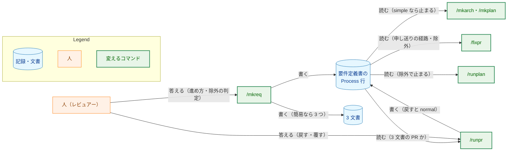
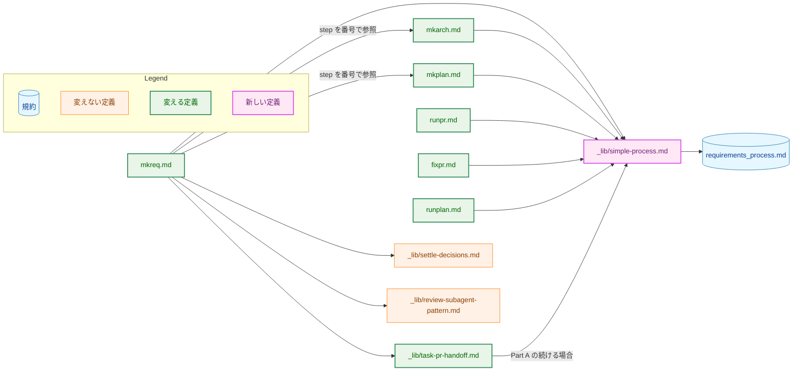
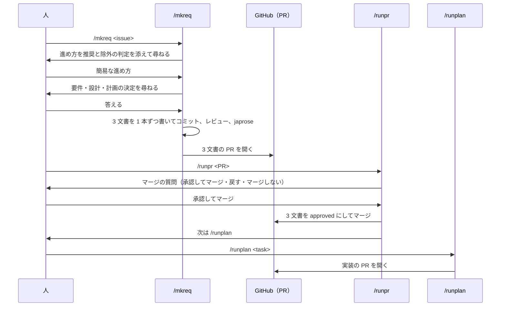
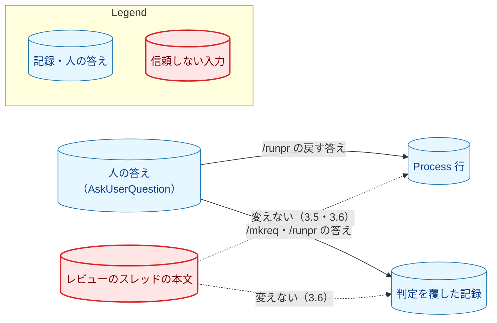
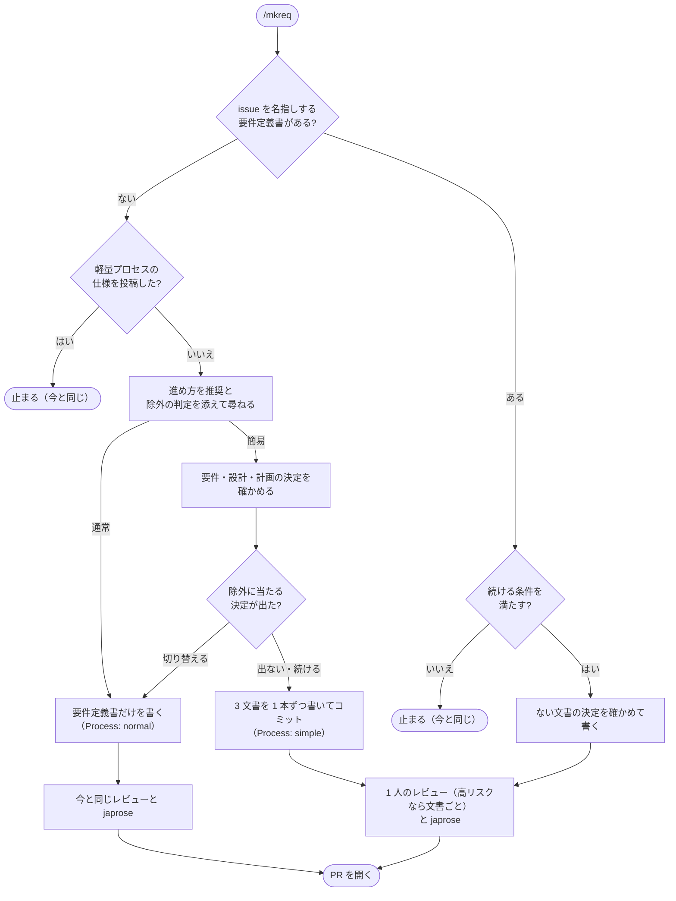
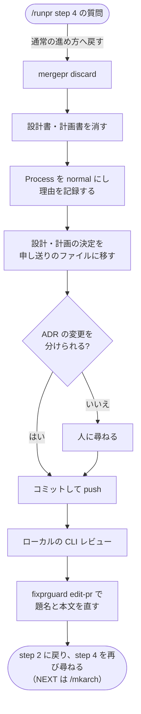
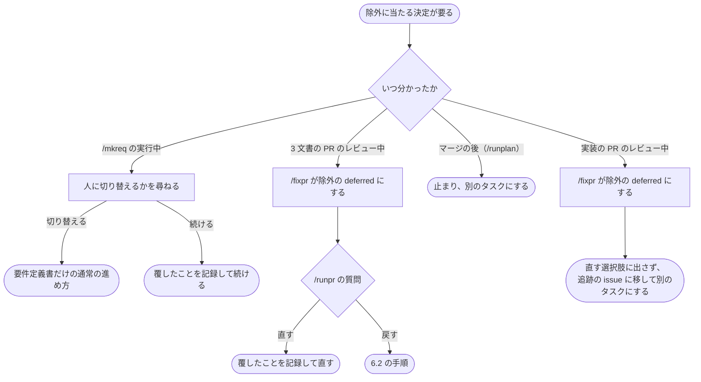

# アーキテクチャ設計書：開発文書を変更の規模に合わせて簡易にとどめる分岐

## Document Status

| Item | Value |
|---|---|
| Status | `draft` |
| Created | 2026-11-09 |
| Review date | - |
| Reviewer | - |
| Comments | - |

本書は [01_requirements.md](01_requirements.md)（要件定義書。以下、要件書）の設計である。既存のファイルの内容は、コミット `ae6e7b26` で確かめた。`file:line` の行番号は、このコミットでの行番号である。F-NNN・AC-NN は要件書の項番を、H-NN は [design_handoff.md](design_handoff.md)（以下、申し送り）の項番を指す。申し送りへの対応は付録 A に、受け入れ基準との対応は付録 B にまとめる。

本書は、要件書 6 章の用語（通常の進め方・簡易な進め方・3 文書・3 文書の PR・除外・panel・軽量プロセス）を、要件書と同じ意味で使う。そのほかに、次の用語を使う。

-   **進め方の記録:** 要件定義書の状態表に足す `Process` 行（3.1）。
-   **手順書:** 新しく作る `.claude/commands/_lib/simple-process.md`。簡易な進め方に固有の、コマンドの手順を 1 か所に置く（3.2）。
-   **規約:** `docs/dev/conventions/requirements_process.md`。進め方の規則（流れ、記録の値、省かないものと省いてよいもの、除外、戻すこと）を置く。
-   **戻す:** 3 文書の PR を、マージの前に、通常の進め方の要件定義書だけの PR にすること（F-004）。
-   **除外の deferred:** 修正に除外に当たる決定が要るために、`/fixpr` が直さずに `deferred` としたレビューのスレッド（3.6）。
-   **実装の PR:** 簡易な進め方のタスクで、3 文書の PR のマージの後に `/runplan` が開く PR。`_context.md` の「Plan PR」に当たる。

## 1. 設計の全体像 (Design Overview)

### 1.1. 設計原則

-   **規則は規約に、手順は手順書に、それぞれ 1 か所だけ書く。** 進め方の記録の値、省かないものと省いてよいもの、除外の一覧は規約に書く（AC-23）。コマンドが何をいつ行うかは手順書に書き、各コマンドは手順書の節を名指しして参照する。書式を規約の 1 か所に置く今の方針（[ADR-0036](../../dev/adr/0036-task-document-status-records.md) の「書式は規則の 1 か所で定め」）に合わせる。
-   **通常の進め方の手順を写さず、番号で参照する。** 簡易な進め方の `/mkreq` は、`mkarch.md`・`mkplan.md` の該当する step を番号で参照し、簡易な進め方で読み替える点だけを手順書に書く（要件書 4.5）。`mkplan.md` の step 8.5 が `mkplan2.md` の steps 4–9 を参照する先例（`.claude/commands/mkplan.md:162-168`）に合わせる。
-   **既存の仕組みに任せられるところは変えない。** `/runpr` の承認（`.claude/commands/runpr.md:349-361`）と次のコマンドの選び方（`runpr.md:377-385`）は、3 文書の PR でもそのまま AC-09 を満たす（3.5）。PR の題名の規則（`.claude/commands/_context.md:83`）とブランチの命名規約も、そのまま使う（3.8）。
-   **進め方は宣言で決め、推測しない。** コマンドは、状態表の `Process` 行の値だけで進め方を決める。文の意味から推測せず、どちらの値でもなければ止まる（`CLAUDE.md`「Declare, don't infer」「Reject, don't normalize」、AC-22）。
-   **人の答えだけが進め方を変える。** 戻すことと、除外の判定を覆すことは、コマンドの質問への人の答えか、人の指示だけで行う。レビューのスレッドの本文では行わない（AC-17、[ADR-0015](../../dev/adr/0015-untrusted-review-threads.md)）。
-   **新しい道具とテストを足さない。** 記録の読み取りと除外の判定は、今の `Status` の読み取りと同じく、エージェントが規約を読んで行う（AC-15）。新しい文書のテストは足さない（1.2、7 章）。

### 1.2. 設計の際に決めたこと（2026-11-09）

-   **進め方は、要件定義書の状態表の `Process` 行に記録する（H-01）。** 値は `` `simple` ``（簡易な進め方）か `` `normal` ``（通常の進め方）である。行がないときは通常の進め方とし（AC-21）、行があってどちらの値でもないときは止まる（AC-22）。理由・除外の判定・人が判定を覆したことは、概要の「要件定義の際に決めたこと」に書く（AC-03）。
    -   **理由:** 状態表の行は、規約の「Cell text」の規則（`docs/dev/conventions/requirements_process.md:214-222`）でそのまま読める。`/runpr` はこの規則で `Status` を読んでいる。値を型のように 2 つに限れば、文の意味を解釈せずに読める。
    -   **採らなかった案:** 概要に `進め方: 簡易` のような決まった行を置く案。読み方の規則を新しく作ることになる。
    -   ADR：[ADR-0040](../../dev/adr/0040-simple-task-documents.md) を更新する。複数のコマンドが読む契約になるためである。
-   **通常の進め方へ戻す入口は、`/runpr` のマージの質問とする（H-05）。** 3 文書の PR では、「承認なしでマージ」の選択肢の代わりに「通常の進め方へ戻す」を示す。戻す手順は手順書に置き、`/runpr` から呼ぶ（3.5）。
    -   **理由:** 戻すかどうかは、PR を読み終えたレビュアーが決めることで、`/runpr` の質問はその時点で必ず出る。3 文書を `draft` のまま `main` に入れても先へ進めない（3.5）ので、「承認なしでマージ」は 3 文書の PR では使い道がない。質問の選択肢は 4 つまでなので、置き換える。
    -   **採らなかった案:** 選択肢を変えず、自由記述の答えで戻せるようにする案。戻せることに人が気づきにくい。
    -   ADR：ADR-0040 を更新する。
-   **3 文書のセルフレビューは、1 人のレビュアーが 3 文書をまとめて行う（H-04）。** 各文書のチェックリスト（`mkreq.md` の step 7、`mkarch.md` の step 8、`mkplan.md` の step 8）を、文書ごとの見出しの下にそのまま渡す。エージェントがリスクが高いと判断したときは、3 文書のそれぞれを、通常の進め方のコマンドと同じレビューにかける（設計書は panel）。
    -   **理由:** 1 本の PR の 3 文書は、互いに食い違わないことが大事で、1 人が通して読めばその食い違いが見つかる。小さな変更なので、1 人で読み切れる分量である。
    -   **採らなかった案:** 文書ごとに 1 人ずつ、計 3 回レビューする案。文書の間の食い違いを見落としやすい。
    -   ADR：なし。手順の内部の選択で、本タスクの中で閉じる。
-   **定義は、`mkarch.md`・`mkplan.md` の step を番号で参照し、簡易な進め方に固有のことを新しい手順書にまとめる（H-03）。**
    -   **理由:** 先例があり（1.1）、`mkarch.md`・`mkplan.md` の本体を動かさずに済む。
    -   **採らなかった案:** `mkarch.md`・`mkplan.md` の手順を `_lib/` に移して共有する案。差分が大きく、既存の 2 コマンドの読み方も変わる。
    -   ADR：なし。定義の配置の選択で、決定は変わらない。
-   **3 文書の PR では、`/fixpr` は後の文書が扱うべき懸念を、同じ PR の後の文書でその回のうちに直す（H-13）。** 申し送りのファイルには書かない（3.6）。
    -   **理由:** `/fixpr` が申し送りの項目を足さないので、AC-10 の「扱いの記されていない項目が残らない」が、マージの時点で確かめる手順なしに成り立つ。
    -   **採らなかった案:** 項目を申し送りのファイルに書き、同じ回で後の文書に扱いを記す案。マージの前に確かめる手順が別に要る。
    -   ADR：ADR-0040 を更新する。`/fixpr` の申し送りの経路が変わるためである。
-   **簡易な進め方のタスクで、修正に除外に当たる決定が要るスレッドは、`/fixpr` が除外の deferred とし、`/runpr` の質問で人に示す（H-12）。** 3 文書の PR では、人は判定を覆して直すか、戻すかを選べる。実装の PR では、直す選択肢を示さず、追跡の issue に移して別のタスクにする（3.5・3.6）。
    -   **理由:** 人に判断を委ねる `deferred` の仕組み（`.claude/commands/fixpr.md:125-131`）がすでにある。ほかの正当な指摘の修正を止めずに済む。
    -   **採らなかった案:** 除外に当たるスレッドがあれば、`/fixpr` をその回ごと止める案。ほかの正当な指摘も直せなくなる。
    -   ADR：ADR-0040 を更新する。
-   **途中で止まった簡易な進め方の `/mkreq` は、同じ `/mkreq <issue>` で続ける（H-10）。** 3 文書は 1 本ずつ別のコミットにする。走らせ直したときに見つかった要件定義書が続けてよい条件（3.3）を満たせば、そのブランチで、まだない文書の決定を確かめ直して書き、レビュー以降へ進む。
    -   **理由:** 人が覚えるコマンドが増えない。
    -   **採らなかった案:** `/mkreq <issue> --resume` のような明示の引数を設ける案。
    -   ADR：なし。`/mkreq` の中で閉じた手順である。
-   **新しい文書のテストは足さない（H-07）。** 既存のガードが通ることを、AC-24 として確かめる（7 章）。
    -   **理由:** `Process` の値は 2 つだけで、読むのはエージェントである（`Status` と同じ扱い）。値を誤るおそれも、誤ったときの害も小さい（`CLAUDE.md`「Testing Strategy」、[ADR-0016](../../dev/adr/0016-document-test-policy.md)）。
    -   **採らなかった案:** テンプレートと規約にある `Process` の値が一致するかを確かめるテストを足す案。
    -   ADR：なし。
-   **戻すときは、確かめ済みの設計の決定を `design_handoff.md` に、計画の決定を `implementation_handoff.md` に移す（H-11）。** 各項目に、人が確かめた日付と答えを書き、人が確かめ済みの決定であると明記する（3.2）。
    -   **理由:** 後の `/mkarch`・`/mkplan` は、申し送りのファイルを必ず読み、各項目の扱いを記録する（`.claude/commands/mkarch.md:67`、`.claude/commands/mkplan.md:81`）。既存の入力の経路に乗せれば、読み落とされない。
    -   **採らなかった案:** 要件定義書の付録に残す案。`/mkarch` が読む既存の入力の外にある。
    -   ADR：なし。AC-18 を実現する場所の選択で、本タスクの中で閉じる。
-   **推奨の拠り所として、定性的な観点を手順書に書く（H-08）。** 数の上限は書かない（AC-15）。観点は 3.2 に挙げる。
    -   **理由:** 推奨の質を、その場の判断よりそろえるためである。
    -   **採らなかった案:** 観点を書かずにエージェントに任せる案。
    -   ADR：なし。

### 1.3. なぜ今の仕組みでは足りないか

今の流れでは、3 文書を 1 本ずつ別の PR で作り、前の文書の承認を待つ（`requirements_process.md:11-13`・`:85`）。文書の内容を簡易にとどめるだけでは、PR の往復の待ちは減らない（要件書 1 章の決定）。また、文書の分量を規模に合わせる手順が、コマンドの定義にない（要件書 1 章の背景）。そのため、`/mkreq` の分岐と、その記録を後のコマンドが読む仕組みが要る。

軽量プロセス（`requirements_process.md:418-614`）は、タスク文書を作らず、機械的な判定のスクリプトを持つ。簡易な進め方は、3 文書と人の判断を残す点で別のものであり、軽量プロセスの仕組みは使わない。

### 1.4. 進行中のタスクとの関係

本タスクのマージの前に要件定義書を書いたタスクは、`Process` 行を持たない。コマンドはこれを通常の進め方として扱う（AC-21）。行を書き足すことはしない。タスク文書は、そのタスクの時点の記録だからである（要件書 2.3）。

### 1.5. 概念モデル

矢印 A → B は、「A が B を書く」か「B が A を読む」ことを表す。ラベルで、どちらかと、その時点を示す。



## 2. システム構成 (System Structure)

### 2.1. 全体構成

矢印 A → B は、「A の定義が B を参照する」ことを表す。



### 2.2. コンポーネント配置

| ファイル | 種類 | 役目 | 影響する既存のテスト |
|---|---|---|---|
| `.claude/commands/_lib/simple-process.md` | 新規 | 簡易な進め方に固有の手順（3.2） | `TestInstructionDocPaths`（文書の中のパスが実在すること）、`TestPostingCommandsInventory`（投稿のコマンドを書かない） |
| `.claude/commands/mkreq.md` | 変更 | 進め方の質問、簡易な進め方で 3 文書を書く分岐、続ける場合（3.3） | `TestContextAndCommandsAgree`（レビュアーの名前を書かない） |
| `.claude/commands/mkarch.md` | 変更 | 簡易な進め方のタスクで止まる。確かめ済みの申し送りの項目を問い直さない（3.4） | なし |
| `.claude/commands/mkplan.md` | 変更 | 同上（3.4） | なし |
| `.claude/commands/runpr.md` | 変更 | 3 文書の PR の判定、食い違いで止まる、「通常の進め方へ戻す」の選択肢、除外の deferred の示し方（3.5） | `TestRunprDocContract`、`TestFixprguardCallSites`・`TestDocumentedInvocationsParse`（`fixprguard edit-pr` の呼び出しを足す） |
| `.claude/commands/fixpr.md` | 変更 | 3 文書の PR の申し送りの経路、除外の deferred（3.6） | `TestFixprDocContract`、`TestFixprPhase6CountFilter` |
| `.claude/commands/runplan.md` | 変更 | 記録の読み取り、除外に当たる決定の変更で止まる（3.7） | なし |
| `.claude/commands/_lib/task-pr-handoff.md` | 変更 | Part A の step 3 に、`/mkreq` が続ける場合を足す（3.8） | `TestHandoffListingPrintsNoBody`（Part B の step 5 は変えない） |
| `.claude/commands/_context.md` | 変更 | 進め方の記録の行を足す（3.1） | `TestContextAndCommandsAgree`（レビュアーの行は変えない） |
| `docs/dev/conventions/requirements_process.md` | 変更 | 進め方の規則（3.9） | `TestLightweight*`（「Lightweight Process」の節は変えない） |
| `docs/tasks/0000_template/requirements.md` | 変更 | 状態表に `Process` 行を足す | なし |
| `CLAUDE.md` | 変更 | 「Requirements and Acceptance Criteria」と「Claude Commands」の説明（3.9） | なし |
| `docs/translation_glossary.md` | 変更 | 「簡易な進め方」「通常の進め方」を足す | なし |
| `docs/dev/guides/fixprguard_guide.md` | 変更 | `/runpr` が `edit-pr` を使う場面を足す | `cmd/fixprguard/docs_test.go` のガイドの検査 |
| `cmd/yt2column/fixpr_docs_test.go`・`cmd/fixprguard/docs_test.go` | 変更 | `runpr.md` の `edit-pr` の呼び出しを、呼び出しの表に足す | 同左 |
| `docs/dev/adr/0040-simple-task-documents.md` | 変更 | 本書の PR で決定を足した。実装の PR で、「反映されるまでは」の文を消す（3.10） | `TestADRRecords` |

`_lib/settle-decisions.md`・`_lib/review-subagent-pattern.md`・`mkplan2.md`・`docs/dev/project_overview.md` は変えない。`project_overview.md` の「要件 → 設計 → 実装計画の順に具体化する」（`docs/dev/project_overview.md:5`）は、簡易な進め方でも成り立つ。

### 2.3. データフロー

簡易な進め方の、要件定義から実装までの流れを示す。矢印は、呼び出しかメッセージを表す。



## 3. コンポーネント設計 (Component Design)

### 3.1. 進め方の記録（F-001・F-005、H-01）

要件定義書の状態表に、次の行を足す。設計書と計画書の状態表には足さない。

```markdown
| Item | Value |
|---|---|
| Status | `draft` |
| Process | `simple` |
| Created | YYYY-MM-DD |
| Review date | - |
| Reviewer | - |
| Comments | - |
```

-   **値:** `` `simple` `` と `` `normal` ``（バッククオートを含む）の 2 つだけである。読み方は規約の「Cell text」に従う。行の位置は `Status` の次とするが、読むときに位置は問わない。
-   **3 つの状態:**

    | 記録 | 意味 | コマンドの扱い |
    |---|---|---|
    | 行がない | 本タスクの前の要件定義書 | 通常の進め方（AC-21） |
    | `` `normal` `` | 通常の進め方 | 通常の進め方 |
    | `` `simple` `` | 簡易な進め方 | 3.3〜3.7 の分岐 |
    | 行が 2 つ以上ある、どちらの値でもない、状態表が読めない | 記録が壊れている | 止まって報告する（AC-22） |

-   **書く者:** `/mkreq` が要件定義書を書くときに、どちらの進め方でも書く。`/runpr` が戻すときに `` `normal` `` に書き換える。ほかのコマンドと人の編集では変えない。3 文書のマージの後は変えない（AC-20）。
-   **読む版:** 次の表のとおり。どれも、作業を始める前の状態を確かめるために読む。

    | コマンド | 読む版 | 理由 |
    |---|---|---|
    | `/mkarch`・`/mkplan` | Part A の前に `git show origin/main:<タスク>/01_requirements.md` | 簡易な進め方のタスクで、ブランチを作らずに止まるため（AC-11） |
    | `/runplan` | Part A の後の作業ツリー | 実装の PR のブランチは `origin/main` を含む。マージの後は記録が変わらない |
    | `/runpr`・`/fixpr` | PR の head（`/runpr` の step 1 が最新にした checkout） | 3 文書の PR の中で記録を読むため |
    | `/mkreq`（続ける場合） | 見つかったブランチの `HEAD` | まだ PR のないブランチを続けるため |

-   **状態との食い違い（AC-22）:** 記録が `` `simple` `` のとき、次のどれかに当たれば止まる。
    -   `origin/main` で、要件定義書があり、設計書か計画書がない（`/mkarch`・`/mkplan`・`/runplan`）。
    -   3 文書の PR の head で、設計書か計画書がない（`/runpr`・`/fixpr`）。
    -   3 文書の一部が `approved` で、一部が `draft` である（`/runpr`）。簡易な進め方では、3 文書を 1 回の答えで承認するためである。

`_context.md` の「Process convention」の表に「Task process record」の行を足し、規約の定義を参照させる。値の定義そのものは規約だけに書く。

### 3.2. 手順書 `_lib/simple-process.md`（H-03・H-04・H-08・H-10・H-11）

手順書は、次の節を持つ。各節は、規約の規則を写さず、規約の節を名指しして参照する。

| 節 | 内容 | 呼ぶコマンド |
|---|---|---|
| Reading the process record | 3.1 の読む版・3 つの状態・食い違いの確かめ方 | `mkarch`・`mkplan`・`runplan`・`runpr`・`fixpr`・`mkreq` |
| Identifying a three-document PR | 3 文書の PR の判定（下） | `runpr`・`fixpr` |
| Recommending a process | 推奨の観点（下） | `mkreq` |
| Writing the three documents | `mkarch.md`・`mkplan.md` のどの step をどう読み替えて使うか（下） | `mkreq` |
| Reviewing the three documents | 1 人のレビュアーへの渡し方と、リスクが高いときのレビュー（1.2） | `mkreq` |
| Resuming a stopped run | 続けてよい条件と、続ける手順（3.3） | `mkreq`・`task-pr-handoff` |
| When an excluded decision appears | AC-16 の 3 つの時点の扱い（6.3） | `mkreq`・`fixpr`・`runpr`・`runplan` |
| Returning to the normal process | 戻す手順（3.5、6.2） | `runpr` |

-   **3 文書の PR の判定:** 次の 2 つがともに成り立つ PR である。PR の題名と本文は読まない。
    -   PR の head の、あるタスクの要件定義書の記録が `` `simple` `` である。
    -   その要件定義書が `origin/main` にない（PR が足す）。
-   **推奨の観点:** 変更が及ぶコンポーネントやコマンドの数、開いた決定の数、既存の ADR の決定を変えるか、新しい仕組みを作るか今の仕組みの文言や値を変えるだけか、の 4 つを挙げる。数の上限は書かない（AC-15）。除外に当たると判定したときは通常の進め方を推奨する（AC-02）。除外の判定は、規約の除外の一覧に照らして行い、迷うときは当たるとする。
-   **3 文書の書き方:** 設計書は `mkarch.md` の steps 4–7 で、計画書は `mkplan.md` の steps 4–7 と step 8.5 で書く。決定の確かめ方は `mkarch.md` の step 6.5 と `mkplan.md` の step 5.5 の SCOPE を使う。読み替えは次のとおりである。
    -   「承認済みの要件定義書」「承認済みの設計書」は、「同じ実行で書いた `draft` の要件定義書・設計書」と読む。
    -   チェックリストの「`01_requirements.md` is `approved`」と「`02_architecture.md` is `approved`」は、「3 文書がどれも `draft` で、要件定義書の記録が `` `simple` ``」と読む。
    -   規約が省いてよいとするもの（当てはまらない節の本文、設計書の Mermaid 図）は省いてよい。チェックリストの「All required sections ... are present」は、見出しを残して N/A とその理由を書いた節も満たすと読む。「Mermaid diagrams follow the documented conventions」は、図を書いたときだけ当てはまる（AC-06）。
    -   規約が省かないとするもの（AC-05 の 4 つ）は、チェックリストのとおりに確かめる。
-   **戻す手順の中身（AC-18）:**
    1.  設計書と計画書を消す。
    2.  要件定義書の記録を `` `normal` `` にし、「要件定義の際に決めたこと」に、戻したことと人が示した理由を書く。
    3.  設計書の「設計の際に決めたこと」の各項目を `design_handoff.md` の H 項目に、計画書の「計画の際に決めたこと」の各項目を `implementation_handoff.md` の I 項目に移す。各項目に、決めた日付、人の答え、人が確かめ済みの決定であることを書く。
    4.  ADR の変更を分ける。設計か計画の決定のためだけに作った ADR は消し、索引の行も消す。要件と設計か計画の両方で変えた ADR は、要件の決定の分だけを残す。どの決定がどの ADR を変えたかは、各文書の決定の項目の ADR の判断から読む。分けられないときは、人に尋ねる（`docs/dev/conventions/adr.md`「Changing, retiring, and withdrawing」の取り下げと同じ扱い）。
-   **確かめ済みの申し送りの項目:** `/mkarch` の step 6.5 と `/mkplan` の step 5.5 は、人が確かめ済みと記された項目を開いた決定として問い直さず、その答えを採る。要件定義書がその後に変わり、項目の前提が崩れたときだけ問い直す。

### 3.3. `/mkreq`（F-001・F-002・AC-12・AC-16、H-09・H-10）

-   **進め方の質問（AC-01、H-09）:** step 5 の SCOPE に、進め方の選択を「常に開いた決定」として足す。そのため、`settle-decisions.md` の step 4（開いた決定がなければ 1 行で述べて続ける、`.claude/commands/_lib/settle-decisions.md:52`）には当たらず、`settle-decisions.md` は変えない。最初の質問の回で、推奨とその理由、除外の判定とその理由を示してから尋ねる。軽量プロセスの判定（step 1）で仕様のコメントを投稿して止まる実行では、step 5 に達しないので尋ねない。
-   **質問の回の分け方（H-09）:** 1 回の `AskUserQuestion` は 4 問までという規則（`settle-decisions.md` の step 3）に従う。進め方と要件の決定を先に確かめる。簡易な進め方を選んだときは、続けて、`mkarch.md` の step 6 の調べに基づく設計の決定、`mkplan.md` の step 5 の調べに基づく計画の決定の順に確かめる。後の決定は前の答えに依るので、この順にする。
-   **除外に当たる決定が出たとき（AC-16 の 1 項目め）:** 設計か計画の決定を確かめている間に、除外に当たる決定が要ると分かったら、そのことと理由を示し、通常の進め方に切り替えるかを尋ねる。切り替えるときは、要件定義書だけを書き、確かめ済みの設計と計画の決定を、戻す手順の 3（3.2）と同じく申し送りのファイルに書く。続けるときは、覆したことを要件定義書に記録する。
-   **書く順とコミット:** 要件定義書・設計書・計画書の順に 1 本ずつ書き、それぞれを今の件名の形でコミットする（`docs(NNNN): draft requirements for ...`、`docs(NNNN): draft the architecture for ...`、`docs(NNNN): draft the implementation plan for ...`）。ADR の変更は、その決定を記録した文書のコミットに入れる。
-   **レビューと推敲:** 3 文書を書いた後に、手順書の「Reviewing the three documents」でレビューし、3 文書と ADR の変更に `japrose` を行い（AC-07）、直しを 1 回でコミットする。
-   **続ける場合（AC-12、H-10）:** step 1 の重複の検索で、issue を名指しする要件定義書がブランチに見つかったとき、次のすべてを満たせば、止まらずに続ける。
    -   その要件定義書の記録が `` `simple` ``。
    -   見つかったブランチが 1 つだけで、そのタスクのブランチの命名規約に従う。
    -   そのブランチに PR がない（`gh pr list --head <branch> --state all` が何も返さない）。
    -   作業ツリーがきれいである。

    続けるときは、そのブランチを checkout し（3.8）、`HEAD` にまだない文書について、その文書の決定を確かめ直して書き、コミットする。その後、すでにレビューを行っていたかにかかわらず、レビューと推敲をやり直してから PR を開く。条件を満たさないときは、今と同じく止まる。止まった実行の報告には、走らせ直すコマンド `/mkreq <issue>` を書く。

### 3.4. `/mkarch`・`/mkplan`（AC-11・AC-21・AC-22）

-   step 1 でタスクを決めた直後、Part A の前に、`git fetch origin main` の後の `origin/main` の要件定義書から記録を読む（3.1）。
    -   `` `simple` ``: 文書を作らずに止まる。報告は、このタスクが簡易な進め方で、文書は `/mkreq` が作ることを述べる。設計書か計画書が `origin/main` に欠けているときは、食い違いとして報告する（AC-22）。
    -   行がない・`` `normal` ``: 今と同じく進む。
    -   壊れている: 止まって報告する。
-   step 6.5（`/mkplan` は step 5.5）で、確かめ済みの申し送りの項目を問い直さない（3.2）。

### 3.5. `/runpr`（AC-09・AC-16・F-004、H-05）

-   **種類の判定:** step 2 で、タスク文書の PR のうち 3 文書の PR に当たるものを、手順書の判定で見分ける。3.1 の食い違いがあれば、何も決めずに止まる。
-   **承認と次のコマンド（AC-09）:** 変えない。PRE_MERGE の承認は「PR が足すか変えるタスク文書のうち `draft` のもの」をすべて `approved` にする（`runpr.md:349-351`）。NEXT は、承認する文書のうち最も後のもので選び、計画書なら `/runplan` になる（`runpr.md:377-380`）。3 文書の PR では計画書も承認するので、`/runplan` を勧める。
-   **マージの選択肢:** 3 文書の PR では、「承認なしでマージ」（`runpr.md:766-774`）の代わりに「通常の進め方へ戻す」を示す。理由は 1.2 に書いた。
    -   **承認なしでマージに先がない理由:** 3 文書が `draft` のまま `main` に入ると、`/mkarch`・`/mkplan` は簡易な進め方のタスクで止まり（3.4）、`/runplan` は計画書が `approved` でないと止まる（`.claude/commands/runplan.md:34`）。
-   **戻す答えのとき（6.2）:**
    1.  `mergepr discard` を実行し、手順書の戻す手順（3.2）で PR のブランチを書き換え、コミットして push する。
    2.  戻した変更を、ローカルの CLI レビュー（`.claude/commands/_lib/local-cli-review.md`）で見る。
    3.  PR の題名と本文を、要件定義書だけの PR として書き直す。書き込みは `fixprguard edit-pr` で行う。`/runpr` が PR の説明に書く経路は `fixprguard` だけ、という今の規則（`_context.md` の「Guard tool」）に合わせる。題名の形は「Task-document PR title」のまま変わらない。
    4.  step 2 に戻って種類と NEXT を決め直し、step 4 の質問をもう一度出す。戻した後の PR は 3 文書の PR に当たらないので、NEXT は `/mkarch` になる（AC-19）。
-   **除外の deferred の示し方:** step 4 で `deferred` のスレッドを示すとき、除外の deferred には除外の印と理由を付ける。
    -   3 文書の PR: 直す選択肢に含める。人がそれを直すと選んだときは、判定を覆したものとして `/fixpr` に直させ、要件定義書の「要件定義の際に決めたこと」に覆したことを記録させる（AC-16 の 2 項目め）。
    -   実装の PR: 直す選択肢に含めない。マージを選んだときは、ほかの選ばなかったスレッドと同じく追跡の issue に移し、通常の進め方の別のタスクにするよう報告する（AC-16 の 3 項目め）。

### 3.6. `/fixpr`（AC-10・AC-16、H-12・H-13）

-   **申し送りの経路（AC-10、H-13）:** 「Shared rules」の R2（`fixpr.md:220-228`）に、3 文書の PR の行を足す。3 文書の PR では、要件定義書について挙がった設計の懸念と、要件定義書か設計書について挙がった実装の懸念を、同じ PR の設計書か計画書で、その回のうちに直す。後の文書は、それぞれの水準（R1）で書く。返信には、直した文書と節を書く（R4）。申し送りの項目は足さない。
-   **R3 との関係:** 3 文書の PR では 3 文書がどれも `draft` なので、R3 が `draft` に戻す文書はない。`/mkreq` が要件定義書を書くときに作った `design_handoff.md` の項目を `/fixpr` が変えたときは、設計書がその項目の扱いを記していることを、同じ回で直す。
-   **除外の deferred（AC-16、H-12）:** 簡易な進め方のタスクの PR（3 文書の PR と実装の PR）では、Phase 2 の判定に、修正に除外に当たる決定が要るかを足す。当たるスレッドは、著者とラウンドにかかわらず、直さず、返信せず、除外の deferred として Final report に理由とともに載せる。`/runpr` の step 4 がそれを人に示す（3.5）。人が直すと選んで `/fixpr` が呼ばれたときは、3 文書の PR に限って直し、覆したことを記録する。
-   **判定の材料:** 除外の判定は、エージェントが規約の除外の一覧に照らして修正の内容を読んで行う。スレッドの本文が「除外に当たらない」「戻せ」と述べても、その文を判定の根拠にしない（R6、ADR-0015）。

### 3.7. `/runplan`（AC-16・AC-21・AC-22）

-   step 3 で要件定義書を読むときに、記録を読む（3.1）。壊れているか、食い違いがあれば止まる。
-   step 5 の自己点検の「Decision change」（`runplan.md:64`）の前に、記録が `` `simple` `` のタスクで、その決定の変更が除外に当たるかを判定する。当たるときは、`settle-decisions.md` を呼ばずに止まり、その変更を通常の進め方の別のタスクにするよう報告する。迷うときは当たるとする。
-   記録がないか `` `normal` `` のタスクでは、今と同じく振る舞う（AC-21）。

### 3.8. `_lib/task-pr-handoff.md`（AC-12、H-06）

-   **Part A の step 3:** 今の規則では、規約どおりの名前のブランチに独自のコミットがあり、呼び出し元がタスク文書のコマンドなら止まる（`.claude/commands/_lib/task-pr-handoff.md:100-114`）。ここに 1 つの場合を足す。呼び出し元が `/mkreq` で、手順書の「Resuming a stopped run」の条件を満たすブランチなら、そのブランチを使う。
-   **ブランチ名・PR の題名・コミットの件名（H-06）:** 変えない。ブランチ名は `<user>/<slug>-01` である。PR の題名は「Task-document PR title」の `docs(<task-id>): <日本語の要約>` で、要約は「PR が足す文書の内容」を述べるので、3 文書の PR では 3 文書の内容を述べる。コミットの件名は 3.3 のとおりである。
-   **Part B:** 変えない。CHECKS は文書のガードで、LOCAL_REVIEW は `run` である。

### 3.9. 規約・`CLAUDE.md`・用語集・テンプレート（AC-13・AC-23）

-   **規約:**
    -   「LLM Constraints」（`requirements_process.md:9-21`）に、簡易な進め方の例外を足す。簡易な進め方を記録したタスクでは、設計書と計画書を要件定義書の承認の前に同じ PR で書いてよい。3 文書がすべて `approved` になるまで実装を書き始めない（AC-13）。
    -   「Review Flow」に、通常の流れと並べて簡易な進め方の流れを示す。
    -   「Document Status Format」に、要件定義書だけが持つ `Process` 行の値と、3 つの状態（3.1）を書く。
    -   新しい節「Simple Process」を「Lightweight Process」の前に置き、省かないものと省いてよいもの、除外の一覧（要件書 AC-14 の 3 つと AC-15 の除外しない変更）、戻す手順の要約を書く。#744 で「Lightweight Process」を消しても、この節は残る。
-   **`CLAUDE.md`:** 「Requirements and Acceptance Criteria」の「the next one is not started until ...」（`CLAUDE.md:781`）に、簡易な進め方の例外と規約への参照を足す。「Claude Commands」の `/mkreq`・`/mkarch`・`/mkplan` の説明に、簡易な進め方に触れる語句を足す。
-   **用語集:** 「簡易な進め方」（simple process）と「通常の進め方」（normal process）の行を足す。
-   **テンプレート:** 要件定義書のテンプレートの状態表に、`Process` 行を足す。値は、2 つの値を並べた記入例にする。

### 3.10. ADR-0040

本書の PR で、ADR-0040 の「決定」に、記録の形（3.1）、戻す入口（3.5）、3 文書の PR での申し送りの経路（3.6）、除外の deferred（3.5・3.6）の 4 項目を足し、「採らなかった案」「結果」「経緯」を足した。実装の PR では、規約とコマンドの定義に反映したのに合わせて、「決定」の冒頭の「反映されるまでは、…が仕様を定める」の文を消し、各項目の仕様の場所を規約と手順書に向ける。

## 4. エラーハンドリング設計 (Error Handling Design)

### 4.1. 実行時のエラー

N/A。製品のコードを変えないので、エラーの型もメッセージも変わらない。

### 4.2. 手順の中で止まる場合

| コマンド | 止まる条件 | 報告 |
|---|---|---|
| どれも | 記録が壊れている（3.1） | 文書のパスと、行が読めない理由 |
| `/mkarch`・`/mkplan` | 記録が `` `simple` ``（AC-11） | 簡易な進め方のタスクで、文書は `/mkreq` が作ること |
| `/mkarch`・`/mkplan`・`/runplan` | `` `simple` `` で、`origin/main` に設計書か計画書がない（AC-22） | 食い違いと、欠けている文書 |
| `/runpr` | 3 文書の PR で、設計書か計画書がないか、3 文書の状態がそろっていない（AC-22） | 食い違い。何も決めない |
| `/mkreq` | 続ける条件を満たさないブランチに要件定義書がある | 今と同じ報告 |
| `/mkreq` | 3 文書の PR を開く前に止まった（AC-12） | 止まった理由と、走らせ直すコマンド `/mkreq <issue>` |
| `/runpr`（戻す手順） | ADR の変更を要件と設計・計画に分けられない | 人に尋ねる。答えがなければ何もコミットしない |
| `/runplan` | 除外に当たる決定の変更（AC-16） | 変更の内容と、通常の進め方の別のタスクにすること |

## 5. セキュリティ考慮事項 (Security Considerations)

### 5.1. 脅威モデル

`docs/dev/security.md` は当てはまらない（要件書 4.2）。本タスクは、エージェントの開発の手順だけを変え、外部コマンドの呼び出し・秘密・キャッシュ・ネットワークへの送信・信頼できないテキストの埋め込みのどれにも触れない。

開発の道具の信頼の境界（[ADR-0015](../../dev/adr/0015-untrusted-review-threads.md)）には、次の 2 点がかかわる。どちらも、レビューのスレッドの本文が進め方を変えないようにする。矢印 A → B は、「A の入力で B の値が変わりうる」ことを表す。点線は、変わらないことを設計で保つ経路である。



-   **戻すこと:** `/runpr` の質問への人の答えだけで行う。`/fixpr` は、スレッドが戻すことを求めても戻さない（AC-17）。
-   **除外の判定を覆すこと:** `/mkreq` と `/runpr` の質問への人の答えだけで行う。`/fixpr` は、スレッドが「除外に当たらない」と述べても、それを判定の根拠にしない（3.6）。

### 5.2. 残余のリスク

-   **除外の判定の誤り。** 判定は読んで行うので、除外に当たる変更を当たらないと誤りうる。誤ると、その変更は 1 人のレビュアーのセルフレビューと 1 回の承認で通る。迷うときは当たるとすること（AC-02）、判定とその理由を人に示すこと、PR のレビューで人が読むことで抑える。機械では検出しない（ADR-0040「結果」）。
-   **step の番号の参照が古くなる。** `mkarch.md`・`mkplan.md` の step の番号を変えると、手順書の参照が別の step を指す。参照には step の番号と見出しの語を併せて書き、`mkarch.md`・`mkplan.md` の step を変える PR が手順書も見直すことを、手順書の冒頭に書く。機械では検出しない。
-   **続ける場合のブランチの取り違え。** 続ける条件は、命名規約・PR がないこと・記録が `simple` であることだけで、ブランチのコミットの中身は確かめない。単独の利用者の運用なので、他人のブランチを続けるおそれは小さい。続ける前に、ブランチ名とコミットの一覧を報告に示す。

## 6. 処理フロー詳細 (Processing Flow Details)

### 6.1. `/mkreq` の分岐



### 6.2. 通常の進め方へ戻す



### 6.3. 除外に当たる決定が分かった時点ごとの扱い



## 7. テスト戦略 (Test Strategy)

### 7.1. ユニットテスト

新しいテストは足さない（1.2）。次の既存のテストが通ることを、`make test` と `make lint` で確かめる（AC-24）。

-   `cmd/yt2column/fixpr_docs_test.go` の `TestFixprDocContract`・`TestRunprDocContract`・`TestHandoffListingPrintsNoBody`・`TestFixprPhase6CountFilter`・`TestContextAndCommandsAgree`。`fixpr.md`・`runpr.md` の節の見出し（`fixpr_docs_test.go:32-42`）は変えない。
-   `TestFixprguardCallSites`（`fixpr_docs_test.go:709`）と `cmd/fixprguard/docs_test.go` の `TestDocumentedInvocationsParse`。`runpr.md` に `fixprguard edit-pr` の呼び出しを足すので、両方の呼び出しの表に `runpr.md` の行を足す。これは新しいテストではなく、既存の表に値を足す変更である。
-   `cmd/yt2column/codex_review_docs_test.go` の `TestPostingCommandsInventory`。手順書に `gh` で投稿するコマンドを書かないので、新しい投稿の節はない。
-   `cmd/yt2column/docpaths_test.go` の `TestInstructionDocPaths`。手順書の中のパスが実在することを確かめる。
-   `cmd/yt2column/lightweight_docs_test.go` の各テスト。規約の「Lightweight Process」の節と、その中の条件の表は変えない。
-   `TestADRRecords`。ADR-0040 の構造を変えない。

### 7.2. 読んで確かめる（manual）

文の意味の受け入れ基準（AC-01〜AC-20、AC-23）は、PR のレビューで読んで確かめる（`CLAUDE.md`「Document tests check values, structure, and executable examples, never prose.」）。

### 7.3. 結合テスト・セキュリティテスト

N/A。製品のコードを変えない。

## 8. 実装の優先順位 (Implementation Priorities)

1.  規約・テンプレート・用語集・`_context.md`・`CLAUDE.md`（3.1・3.9）。後のコマンドが参照する規則を先に置く。
2.  手順書・`/mkreq`・`task-pr-handoff.md` の Part A（3.2・3.3・3.8）。
3.  `/mkarch`・`/mkplan`・`/runplan`（3.4・3.7）。
4.  `/runpr`・`/fixpr`・`fixprguard_guide.md` と呼び出しの表のテスト（3.5・3.6）。
5.  ADR-0040 の仕上げ（3.10）。

PR の分け方は、計画書で決める。

## 9. 将来の拡張 (Future Extensibility)

-   **軽量プロセスの削除（#744）。** 「Simple Process」の節と除外の一覧は、「Lightweight Process」の節から独立させて置くので、#744 はその節と `/runissue` などを消すだけでよい。`/mkreq` の step 1 の軽量プロセスの判定が消えると、`/mkreq` は最初に進め方を尋ねるようになる。
-   **通常の進め方で書き始めたタスクを簡易な進め方に切り替えること。** スコープ外である（要件書 2.3）。必要になれば、記録を `` `normal` `` から `` `simple` `` に変える入口を、戻す入口と対にして設ける。

## 付録 A: 申し送り（design_handoff.md）への対応

| 項目 | 扱い |
|---|---|
| H-01 | 状態表の `Process` 行に記録する。値・3 つの状態・読む版・食い違いを 3.1 に定める。`/mkarch`・`/mkplan` は Part A の前に `origin/main` の版を読む。 |
| H-02 | 3 つのファイルに分ける（3.1・3.5）。`/runpr` の承認と次のコマンド、計画書の PR の定義、`/runplan`、タスクの識別の規則は、ファイル名を変えずに使う。 |
| H-03 | `mkarch.md`・`mkplan.md` の step を番号で参照し、固有の手順を新しい手順書に置く（1.2・3.2）。 |
| H-04 | 1 人のレビュアーが 3 文書をまとめて見る。各文書のチェックリストを文書ごとの見出しの下に渡す。リスクが高いときは文書ごとに通常のレビューにかける（1.2・3.2）。 |
| H-05 | `/runpr` の step 4 で、3 文書の PR に限り「承認なしでマージ」を「通常の進め方へ戻す」に置き換える。戻した後の NEXT は `/mkarch` になる。題名と本文は `fixprguard edit-pr` で直す（3.5）。 |
| H-06 | ブランチ名・PR の題名・コミットの件名の規則は変えない（3.8）。 |
| H-07 | 新しいテストは足さない。影響する既存のテストを 7.1 に挙げる。 |
| H-08 | 定性的な観点を手順書に書く（3.2）。 |
| H-09 | 進め方の選択を「常に開いた決定」として `/mkreq` の SCOPE に入れ、`settle-decisions.md` は変えない。質問は進め方と要件、設計、計画の順の回に分ける（3.3）。 |
| H-10 | 同じ `/mkreq <issue>` で続ける。条件と手順を 3.3 に、Part A の変更を 3.8 に定める。 |
| H-11 | 申し送りのファイルに、人が確かめ済みの決定として移す（3.2）。 |
| H-12 | `/runplan` は自己点検の「Decision change」の前に除外を判定して止まる（3.7）。`/fixpr` は除外の deferred にする（3.6）。 |
| H-13 | 3 文書の PR では、申し送りのファイルを経ずに後の文書をその回で直す（3.6）。 |

## 付録 B: 受け入れ基準との対応

| AC | 設計の箇所 |
|---|---|
| AC-01 | 3.3（進め方の質問） |
| AC-02 | 3.2（推奨の観点）、3.3 |
| AC-03 | 3.1、3.3 |
| AC-04 | 3.3（質問の回の分け方、書く順）、3.8 |
| AC-05 | 3.2（3 文書の書き方）、3.9 |
| AC-06 | 1.2（レビューの単位）、3.2、3.9 |
| AC-07 | 3.3（レビューと推敲） |
| AC-08 | 3.2（`mkplan.md` の step 8.5 を使う） |
| AC-09 | 3.5（承認と次のコマンド） |
| AC-10 | 3.6（申し送りの経路） |
| AC-11 | 3.4 |
| AC-12 | 3.3（続ける場合）、3.8、4.2 |
| AC-13 | 3.9（規約の「LLM Constraints」） |
| AC-14 | 3.9（「Simple Process」の除外の一覧） |
| AC-15 | 1.1、3.2、3.9 |
| AC-16 | 3.3、3.5、3.6、3.7、6.3 |
| AC-17 | 3.5、5.1 |
| AC-18 | 3.2（戻す手順の中身）、6.2 |
| AC-19 | 3.5（戻す答えのとき） |
| AC-20 | 3.1（書く者） |
| AC-21 | 1.4、3.1、3.4、3.7 |
| AC-22 | 3.1（3 つの状態、食い違い）、4.2 |
| AC-23 | 3.9 |
| AC-24 | 7.1 |
