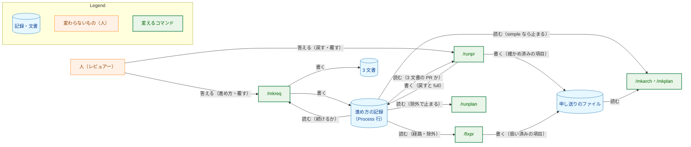
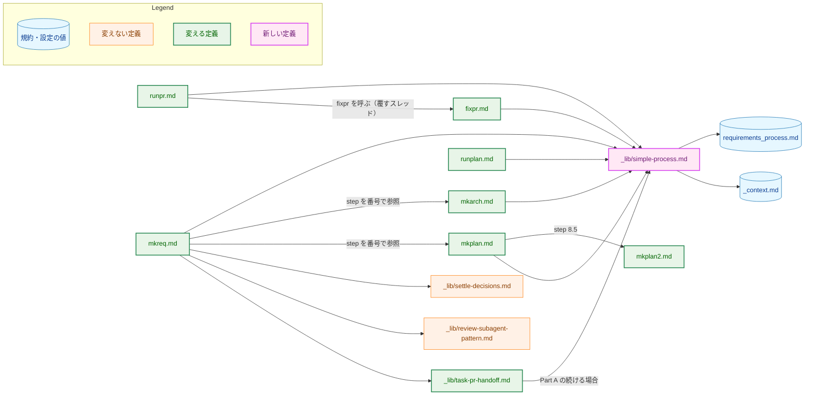
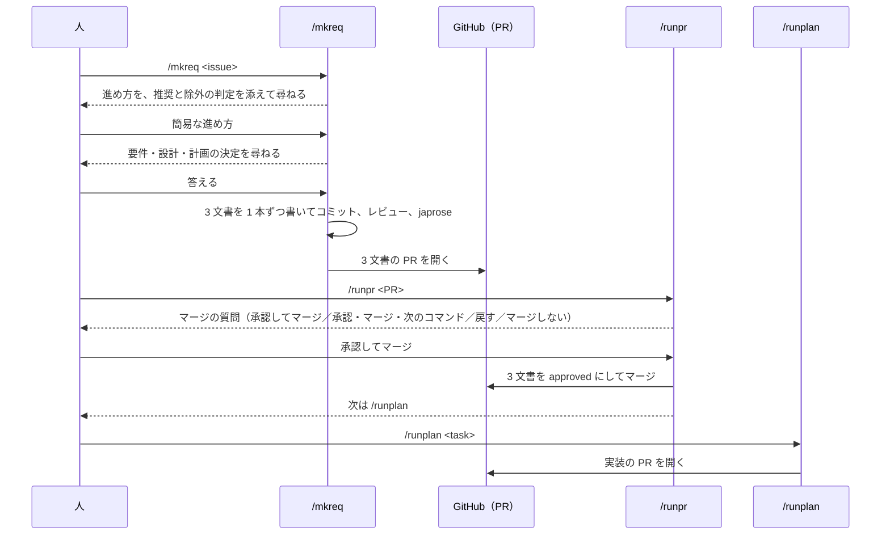
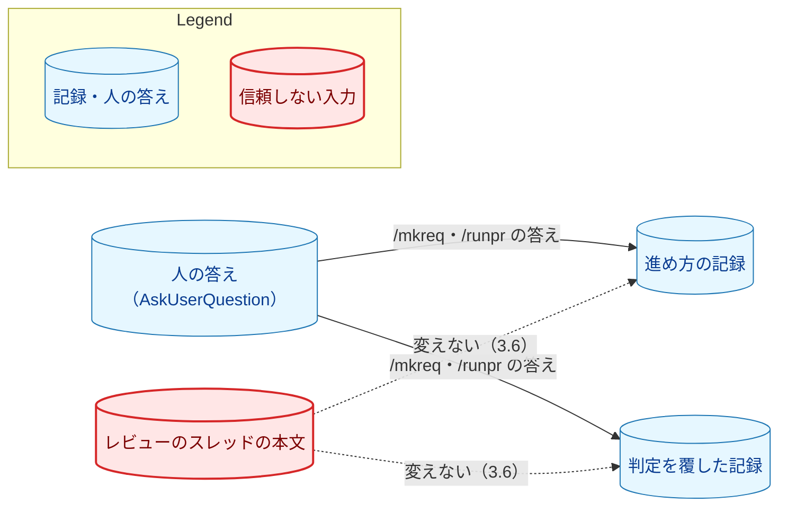
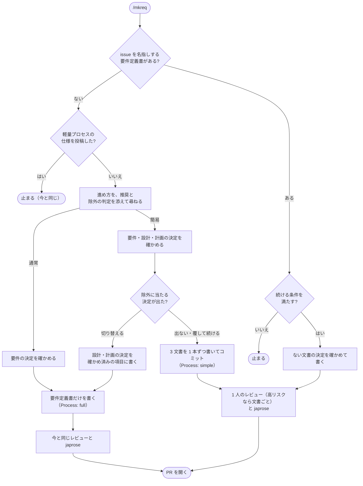
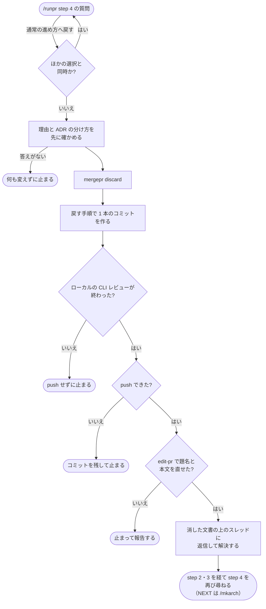
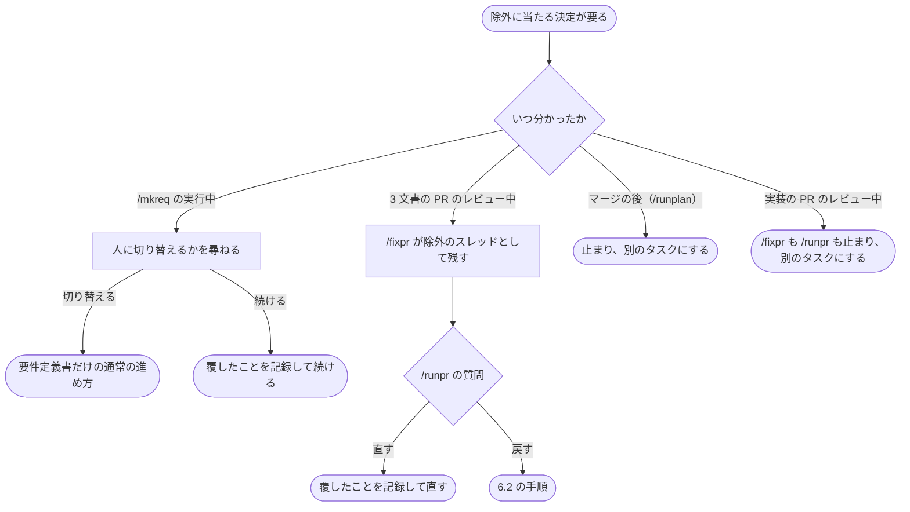

# アーキテクチャ設計書：開発文書を変更の規模に合わせて簡易にとどめる分岐

## Document Status

| Item | Value |
|---|---|
| Status | `approved` |
| Created | 2026-11-09 |
| Review date | 2026-11-09 |
| Reviewer | isseis |
| Comments | - |

本書は [01_requirements.md](01_requirements.md)（要件定義書。以下、要件書）の設計である。既存のファイルの内容は、コミット `ae6e7b26` で確かめた。`file:line` の行番号は、このコミットでの行番号である。F-NNN・AC-NN は要件書の項番を、H-NN は [design_handoff.md](design_handoff.md)（以下、申し送り）の項番を指す。申し送りへの対応は付録 A に、受け入れ基準との対応は付録 B に、本書のレビューで改めた決定の経緯は付録 C にまとめる。

本書は、要件書 6 章の用語（通常の進め方・簡易な進め方・3 文書・3 文書の PR・除外・panel・軽量プロセス）を、要件書と同じ意味で使う。そのほかに、次の用語を使う。

-   **進め方の記録:** 要件定義書の状態表に足す `Process` 行（3.1）。
-   **`simple-process.md`:** 新しく作る `.claude/commands/_lib/simple-process.md`。簡易な進め方に固有の、コマンドの手順を 1 か所に置く（3.2）。
-   **要件プロセスの規約:** `docs/dev/conventions/requirements_process.md`。進め方の規則（流れ、記録の値、省かないものと省いてよいもの、除外、申し送りの項目の形）を置く。
-   **戻す:** 3 文書の PR を、マージの前に、通常の進め方の要件定義書だけの PR に作り直すこと（F-004）。本書では、この意味にだけ使う。
-   **除外のスレッド:** 修正に除外に当たる決定が要るために、`/fixpr` が直さずに残したレビューのスレッド（3.6）。
-   **実装の PR:** 簡易な進め方のタスクで、3 文書の PR のマージの後に `/runplan` が開く PR。`.claude/commands/_context.md` の「Plan PR」に当たる。
-   **確かめ済みの項目・扱い済みの項目:** 申し送りのファイルの項目の 2 つの種類（3.9）。前者は人が確かめた設計か計画の決定、後者は同じ PR の後の文書で扱った懸念である。

## 1. 設計の全体像 (Design Overview)

### 1.1. 設計原則

-   **規則は要件プロセスの規約に、手順は `simple-process.md` に、それぞれ 1 か所だけ書く。** 進め方の記録の値と状態、省かないものと省いてよいもの、除外の一覧、申し送りの項目の形は規約に書く（AC-23）。コマンドが何をいつ行うかは `simple-process.md` に書き、規約の規則を写さずに節を名指しして参照する。書式を規約の 1 か所に置く今の方針（[ADR-0036](../../dev/adr/0036-task-document-status-records.md)「書式は規則の 1 か所で定め」）に合わせる。
-   **通常の進め方の手順を写さず、番号で参照する。参照される側にも、参照されていることを書く。** 簡易な進め方の `/mkreq` は、`mkarch.md`・`mkplan.md` の該当する step を番号で参照し、読み替える点だけを `simple-process.md` に書く（要件書 4.5）。先例は、`mkplan.md` の step 8.5 が `mkplan2.md` の steps を参照し（`.claude/commands/mkplan.md:162-168`）、参照される `mkplan2.md` が冒頭でそのことを書いている形である（`.claude/commands/mkplan2.md:16`）。
-   **既存の仕組みに任せられるところは変えない。** `/runpr` の承認（`.claude/commands/runpr.md:349-361`）と次のコマンドの選び方（`runpr.md:377-385`）は、3 文書の PR でもそのまま AC-09 を満たす（3.5）。PR の題名の規則（`_context.md:83`）とブランチ名の決まりも、そのまま使う（3.8）。
-   **進め方は宣言で決め、推測しない。食い違いは止まる。** コマンドは、状態表の `Process` 行の値だけで進め方を決める。どちらの値でもないとき、記録と文書の形が食い違うときは、どちらの向きの食い違いでも止まる（`CLAUDE.md`「Declare, don't infer」「Reject, don't normalize」、AC-22）。
-   **人の答えだけが進め方を変える。** 進め方の記録、判定を覆したことの記録、戻したことの記録を書くのは、人の答えを受けたコマンドだけである。レビューのスレッドの本文では変えない（AC-17、[ADR-0015](../../dev/adr/0015-untrusted-review-threads.md)）。
-   **新しい道具とテストを足さない。** 記録の読み取りと除外の判定は、今の `Status` の読み取りと同じく、エージェントが規約を読んで行う（AC-15）。新しい文書のテストは足さない（1.2、7 章）。

### 1.2. 設計の際に決めたこと（2026-11-09）

-   **進め方は、要件定義書の状態表の `Process` 行に、`` `simple` ``（簡易な進め方）か `` `full` ``（通常の進め方）で記録する（H-01）。** 行がないときは通常の進め方とし（AC-21）、どちらの値でもないときや、記録と文書の形が食い違うときは止まる（AC-22、3.1）。理由・除外の判定・人が判定を覆したことは、要件定義書の概要にある「要件定義の際に決めたこと」に書く（AC-03）。
    -   **理由:** 状態表の行は、要件プロセスの規約の「Cell text」の規則（`requirements_process.md:214-222`）でそのまま読める。`/runpr` はこの規則で `Status` を読んでいる。値を 2 つに限れば、文の意味を解釈せずに読める。値を `normal` としないのは、軽量プロセスの文書がすでに "normal process" を「軽量プロセスでない進め方」の意味で使っている（`.claude/commands/mkreq.md:73-75`、`requirements_process.md:493`）ためである。
    -   **採らなかった案:** 概要に `進め方: 簡易` のような決まった行を置く案。読み方の規則を新しく作ることになる。
    -   ADR：[ADR-0040](../../dev/adr/0040-simple-task-documents.md) を更新する。複数のコマンドが読む契約になるためである。
-   **進め方の記録を書くのは、`/mkreq`（要件定義書を書くとき）と `/runpr`（戻すとき）だけとする。** `/fixpr` は、進め方の記録と、戻したことの記録を変えない。判定を覆したことの記録を `/fixpr` が書くのは、`/runpr` が人の答えを受けて渡したスレッドについてだけである（3.6）。
    -   **理由:** 要件定義書は `/fixpr` の範囲の規則の中にあり、自動レビュアーのスレッドは信頼して直す（`docs/dev/guides/fixprguard_guide.md` 7 章）。レビューの指摘で記録が変わると、簡易な進め方の守りが人の答えなしに外れる。
    -   ADR：ADR-0040 を更新する。
-   **通常の進め方へ戻す入口は、`/runpr` のマージの質問とする（H-05）。** 3 文書の PR では、「承認なしでマージ」の選択肢の代わりに「通常の進め方へ戻す」を示す。戻す手順は `simple-process.md` に置き、`/runpr` から呼ぶ（3.5）。
    -   **理由:** 戻すかどうかは、PR を読み終えたレビュアーが決めることで、`/runpr` の質問はその時点で必ず出る。3 文書を `draft` のまま `main` に入れても先へ進めない（3.5）ので、「承認なしでマージ」は 3 文書の PR では使い道がない。1 つの質問の選択肢は 4 つまでなので、置き換える。
    -   **採らなかった案:** 選択肢を変えず、自由記述の答えで戻せるようにする案。戻せることに人が気づきにくい。
    -   ADR：ADR-0040 を更新する。
-   **3 文書のセルフレビューは、1 人のレビュアーが 3 文書をまとめて行う（H-04）。** 各文書のチェックリストを、文書ごとの見出しの下にそのまま渡す（3.2）。エージェントがリスクが高いと判断したときは、3 文書のそれぞれを、通常の進め方のコマンドと同じレビューにかける（設計書は panel）。
    -   **理由:** 1 本の PR の 3 文書は、互いに食い違わないことが大事で、1 人が通して読めば食い違いが見つかる。小さな変更なので、1 人で読み切れる分量である。
    -   **採らなかった案:** 文書ごとに 1 人ずつ、計 3 回レビューする案。文書の間の食い違いを見落としやすい。
    -   ADR：なし。手順の内部の選択で、本タスクの中で閉じる。
-   **簡易な進め方の手順は、`mkarch.md`・`mkplan.md` の step を番号で参照し、簡易な進め方に固有のことを `simple-process.md` にまとめる（H-03）。**
    -   **理由:** 先例があり（1.1）、`mkarch.md`・`mkplan.md` の本体を動かさずに済む。固有のことを 1 つのファイルに集めると、`mkreq.md`（今 303 行）を読みやすく保てる。
    -   **採らなかった案:** `mkarch.md`・`mkplan.md` の手順を `_lib/` に移して共有する案。差分が大きく、既存の 2 コマンドの読み方も変わる。
    -   ADR：なし。定義の配置の選択で、決定は変わらない。
-   **3 文書の PR では、`/fixpr` は後の文書が扱うべき懸念を扱い済みの項目として申し送りのファイルに書き、同じ回で後の文書を直す（H-13）。** 項目には、後の文書で扱った箇所を書く（3.6）。
    -   **理由:** 項目を書くときに扱いも記すので、AC-10 の「扱いの記されていない項目が残らない」が、マージの時点で確かめる手順なしに成り立つ。項目が残るので、戻して後の文書を消しても、懸念は失われない（AC-18）。
    -   **採らなかった案:** 項目を書かずに後の文書だけを直す案。戻すと懸念が失われる。
    -   ADR：ADR-0040 を更新する。`/fixpr` の申し送りの経路が変わるためである。
-   **除外のスレッドは、3 文書の PR と実装の PR で扱いを分ける（H-12）。**
    -   3 文書の PR: `/fixpr` は直さずに残し、`/runpr` のマージの質問で人に示す。人は、判定を覆して直すか、戻すかを選べる（AC-16 の 2 項目め）。
    -   実装の PR: `/fixpr` はその回の修正を加えずに止まる。そのスレッドが残る間、`/runpr` はマージせずに止まり、通常の進め方の別のタスクにするよう報告する（AC-16 の 3 項目め）。
    -   **理由:** 3 文書の PR では、判定を人に委ねつつ、ほかの正当な指摘の修正を止めずに済む。実装の PR では、除外に当たる変更が簡易な設計のまま `main` に入らないようにする。
    -   **採らなかった案（3 文書の PR）:** `/fixpr` をその回ごと止める案。ほかの正当な指摘も直せなくなる。
    -   **採らなかった案（実装の PR）:** スレッドを追跡の issue に移してマージする案。AC-16 と食い違い、除外に当たる指摘が残ったまま実装が入る。
    -   ADR：ADR-0040 を更新する。
-   **途中で止まった簡易な進め方の `/mkreq` は、同じ `/mkreq <issue>` で続ける（H-10）。** 3 文書は 1 本ずつ別のコミットにし、続けてよい条件（3.3）を満たせば、そのブランチで、まだない文書を書いてレビュー以降へ進む。
    -   **理由:** 人が覚えるコマンドが増えない。
    -   **採らなかった案:** `/mkreq <issue> --resume` のような明示の引数を設ける案。
    -   ADR：なし。`/mkreq` の中で閉じた手順である。
-   **戻すときは、確かめ済みの設計の決定を `design_handoff.md` に、計画の決定を `implementation_handoff.md` に、確かめ済みの項目として移す（H-11）。** 項目の形は要件プロセスの規約に定め（3.9）、後の `/mkarch`・`/mkplan` はそれを問い直さずに採る（3.4）。
    -   **理由:** 後の `/mkarch`・`/mkplan` は、申し送りのファイルを必ず読み、各項目の扱いを記録する（`.claude/commands/mkarch.md:67`、`mkplan.md:81`）。既存の入力の経路に乗せれば、読み落とされない。
    -   **採らなかった案:** 要件定義書の付録に残す案。`/mkarch` が読む既存の入力の外にある。
    -   ADR：ADR-0040 を更新する。申し送りのファイルを書くコマンドと項目の種類が増え、`/fixpr`・`/runpr`・`/mkreq`・`/mkarch`・`/mkplan` にまたがる契約になるためである。
-   **新しい文書のテストは足さない（H-07）。** 既存のガードが通ることを、AC-24 として確かめる（7 章）。
    -   **理由:** `Process` の値は 2 つだけで、読むのはエージェントである（`Status` と同じ扱い）。値を誤るおそれも、誤ったときの害も小さい（`CLAUDE.md`「Testing Strategy」、[ADR-0016](../../dev/adr/0016-document-test-policy.md)）。
    -   **採らなかった案:** テンプレートと規約にある `Process` の値が一致するかを確かめるテストを足す案。
    -   ADR：なし。
-   **推奨の拠り所として、定性的な観点を `simple-process.md` に書く（H-08）。** 数の上限は書かない（AC-15）。観点は 3.2 に挙げる。
    -   **理由:** 推奨の質を、その場の判断に任せるより安定させるためである。
    -   **採らなかった案:** 観点を書かずにエージェントに任せる案。
    -   ADR：なし。

### 1.3. なぜ今の仕組みでは足りないか

今の流れでは、3 文書を 1 本ずつ別の PR で作り、前の文書の承認を待つ（`requirements_process.md:11-13`・`:85`）。文書の内容を簡易にとどめるだけでは、PR の往復の待ちは減らない（要件書 1 章の決定）。また、文書の分量を規模に合わせる手順が、コマンドの定義にない（要件書 1 章の背景）。そのため、`/mkreq` の分岐と、その記録を後のコマンドが読む仕組みが要る。

軽量プロセス（`requirements_process.md:418-614`）は、タスク文書を作らず、機械的な判定のスクリプトを持つ。簡易な進め方は、3 文書と人の判断を残す点で別のものであり、軽量プロセスの仕組みは使わない。

### 1.4. 進行中のタスクと、古い定義との関係

本タスクのマージの前に要件定義書を書いたタスクは、`Process` 行を持たない。コマンドはこれを通常の進め方として扱う（AC-21）。行を書き足すことはしない。タスク文書は、そのタスクの時点の記録だからである（要件書 2.3）。

コマンドは、本タスクの変更を含む checkout から走らせる。変更の前の定義で走るセッション（`main` を取り込んでいない別の worktree）では、3 文書の PR の懸念を扱い済みの項目にせず、ふつうの項目として申し送りに書く。また、「承認なしでマージ」を選択肢に示し、`/mkarch` も止めない。利用者が 1 人なので害は小さいが、残るリスクとして 5.2 に記す。

### 1.5. 概念モデル

矢印 A → B は、ラベルが示す関係を表す。「書く」は A が B を書くこと、「読む」は B が A を読むこと、「答える」は A（人）が B の質問に答えることである。



### 1.6. 実装の際に決めたこと（2026-11-10）

-   **3 文書のレビューを文書ごとの通常のレビューにする条件（リスクが高いとき）に、除外の判定に迷った場合ではなく、人が除外の判定を覆したすべての場合を含める（人の答え、2026-11-10）。** 最初の質問で覆した場合と、決定を確かめる途中で除外に当たる決定が出て、覆して続けた場合の両方である（3.2）。
    -   **理由:** 迷わずに除外と判定した変更を人が覆したときのほうが、迷った場合よりリスクが高い。迷った場合だけを条件にすると、その変更が 1 人のレビュアーのセルフレビューで通る。除外に当たると判定した変更は、迷った場合も含めて、覆されない限り簡易な進め方にならないので、「覆した場合」は「迷った場合」を含む。
    -   **採らなかった案:** 承認した版のまま、除外の判定に迷った場合だけを条件にする案。
    -   ADR：なし。3 文書のレビューの単位（1.2 の H-04）と同じく、手順の内部の選択で、本タスクの中で閉じる。
-   **タスク 0075（軽量プロセスの削除、#764）が先にマージされたので、0072 の変更から軽量プロセスへの参照を取り除く（人の答え、2026-11-10）。** 規約に "normal process" の意味を述べる 1 文（3.9）を書かず、「Simple Process」の節は「Lightweight Process」の節の前ではなく、規約の同じ位置にそのまま置く。`/mkreq` には軽量プロセスの判定がなくなったので、要件定義書を書く実行では常に進め方を尋ねる（3.3）。要件書 AC-01 の「軽量プロセスの仕様のコメントを投稿して止まる実行では尋ねない」は、そのような実行がなくなったので、常に満たされる。
    -   **理由:** 0075 の要件定義書は、後からマージする側が軽量プロセスへの参照を取り除くと決めている。"normal process" の 1 文は、軽量プロセスの文書の語の意味を述べるためのもので、その文書がなくなると述べる対象がない。
    -   **採らなかった案:** 設計書のとおり 1 文を残す案。意味を述べる対象のない文が規約に残る。
    -   ADR：なし。ADR-0040 の決定は、軽量プロセスに依らない。

## 2. システム構成 (System Structure)

### 2.1. 全体構成

矢印 A → B は、「A の定義が B を参照するか呼ぶ」ことを表す。



図に描かない変更（`CLAUDE.md`・用語集・テンプレート・`fixprguard_guide.md`・テスト・ADR-0040）は、2.2 の表に挙げる。

### 2.2. コンポーネント配置

| ファイル | 種類 | 役目 | 影響する既存のテスト |
|---|---|---|---|
| `.claude/commands/_lib/simple-process.md` | 新規 | 簡易な進め方に固有の手順（3.2） | `TestInstructionDocPaths`（文書の中のパスが実在すること）、`TestPostingCommandsInventory`（投稿のコマンドを書かない） |
| `.claude/commands/mkreq.md` | 変更 | 進め方の質問、簡易な進め方で 3 文書を書く分岐、続ける場合（3.3） | `TestContextAndCommandsAgree`（レビュアーの名前を書かない） |
| `.claude/commands/mkarch.md` | 変更 | 簡易な進め方のタスクで止まる。確かめ済みの項目を問い直さない。`/mkreq` が step を参照していることを書く（3.4） | なし |
| `.claude/commands/mkplan.md` | 変更 | 同上（3.4） | なし |
| `.claude/commands/mkplan2.md` | 変更 | 冒頭の「`mkplan.md` runs steps …」（`mkplan2.md:16`）に、`/mkreq` が `simple-process.md` を通して steps 4–8 を使うことを足す | なし |
| `.claude/commands/runpr.md` | 変更 | 3 文書の PR の判定と食い違いの確かめ、「通常の進め方へ戻す」の選択肢と戻す手順の呼び出し、除外のスレッドの分類、Authorization の段落（3.5） | `TestRunprDocContract`、`TestFixprguardCallSites`・`TestDocumentedInvocationsParse`・`TestPostingCommandsInventory`（`fixprguard edit-pr` の呼び出しを足す） |
| `.claude/commands/fixpr.md` | 変更 | PR の種類と記録の読み取り（Phase 1）、R2 の 3 文書の PR の行、R5 の項目の形の参照、除外のスレッド、「People are always answered」の例外（3.6） | `TestFixprDocContract`、`TestFixprPhase6CountFilter` |
| `.claude/commands/runplan.md` | 変更 | 記録の読み取り、除外に当たる決定の変更で止まる（3.7） | なし |
| `.claude/commands/_lib/local-cli-review.md` | 変更 | 呼び出し元の一覧に、`/runpr` の戻す場合を足す（3.5） | なし |
| `.claude/commands/_lib/task-pr-handoff.md` | 変更 | Part A の step 3 に、`/mkreq` が続ける場合を足す（3.8） | `TestHandoffListingPrintsNoBody`（Part B の step 5 は変えない） |
| `.claude/commands/_context.md` | 変更 | 「Task process record」の行を足す。申し送りの 2 行（`_context.md:46-47`）の書く者と項目の種類を改める。実装モデルの行（`_context.md:67`）に `/mkreq` を足す | `TestContextAndCommandsAgree`（レビュアーの行は変えない） |
| `docs/dev/conventions/requirements_process.md` | 変更 | 進め方の規則と申し送りの項目の形（3.9） | なし |
| `docs/tasks/0000_template/requirements.md` | 変更 | 状態表に `` `full` `` の `Process` 行を足す | なし |
| `CLAUDE.md` | 変更 | 「Requirements and Acceptance Criteria」と「Claude Commands」の説明（3.9） | なし |
| `docs/translation_glossary.md` | 変更 | 「簡易な進め方」「通常の進め方」「進め方の記録」を足す | なし |
| `docs/dev/guides/fixprguard_guide.md` | 変更 | `/runpr` が `edit-pr` を使う場面を足す | `cmd/fixprguard/docs_test.go` のガイドの検査 |
| `cmd/yt2column/fixpr_docs_test.go`・`cmd/fixprguard/docs_test.go`・`cmd/yt2column/codex_review_docs_test.go` | 変更 | `runpr.md` step 4 の `fixprguard edit-pr` の呼び出しを、呼び出しの表と投稿の節の表（`codex_review_docs_test.go:66-69`）に足す | 同左 |
| `docs/dev/adr/0040-simple-task-documents.md` | 変更 | 本書の PR で決定を足した。実装の PR で、「反映されるまでは」の文を消す（3.10） | `TestADRRecords` |

`_lib/settle-decisions.md`・`_lib/review-subagent-pattern.md`・`docs/dev/project_overview.md` は変えない。`project_overview.md` の「要件 → 設計 → 実装計画の順に具体化する」（`docs/dev/project_overview.md:5`）は、簡易な進め方でも成り立つ。

### 2.3. データフロー

簡易な進め方の、要件定義から実装までの流れを示す。矢印は呼び出しかメッセージを、点線の矢印は応答を表す。シーケンス図は色分けのノードを持たないので、Legend を置かない。



## 3. コンポーネント設計 (Component Design)

### 3.1. 進め方の記録（F-001・F-005、H-01）

要件定義書の状態表に、次の行を足す。設計書と計画書の状態表には足さない。

```markdown
| Item | Value |
|---|---|
| Status | `draft` |
| Process | `simple` |
| Created | YYYY-MM-DD |
| Review date | - |
| Reviewer | - |
| Comments | - |
```

-   **値:** `` `simple` `` と `` `full` ``（バッククォートを含む）の 2 つだけである。読み方は要件プロセスの規約の「Cell text」に従う。行の位置は `Status` の次とするが、読むときに位置は問わない。
-   **記録の状態:** 規約の「Document Status Format」に、次の 4 つを定める。`simple-process.md` は、この定めを参照し、写さない。

    | 記録 | 意味 | コマンドの扱い |
    |---|---|---|
    | 行がない | 本タスクの前の要件定義書 | 通常の進め方（AC-21） |
    | `` `full` `` | 通常の進め方 | 通常の進め方 |
    | `` `simple` `` | 簡易な進め方 | 3.3〜3.7 の分岐 |
    | 行が 2 つ以上ある、どちらの値でもない、状態表が読めない | 記録が壊れている | 止まって報告する（AC-22） |

-   **書く者:** `/mkreq` が要件定義書を書くときに、どちらの進め方でも書く。`/runpr` が戻すときに `` `full` `` に書き換える。ほかのコマンドと人の手の編集では変えない。3 文書のマージの後は変えない（AC-20）。`/runpr` は、PR の差分が、`origin/main` にある要件定義書の `Process` 行を変えていれば止まる。
-   **読む版:** 次のとおりである。

    | コマンド | 読む版 | 理由 |
    |---|---|---|
    | `/mkarch`・`/mkplan` | Part A の前に `origin/main` を取得し、その要件定義書 | 簡易な進め方のタスクで、ブランチを作らずに止まるため（AC-11）。`origin/main` に要件定義書がないときは、今の「要件定義書が `approved` でない」の停止に任せる |
    | `/runplan`、実装の PR の `/runpr`・`/fixpr` | 取得した `origin/main` | マージの後は記録が変わらない。PR のブランチの編集で記録が変わっても、それを読まない |
    | 3 文書の PR の `/runpr`・`/fixpr` | PR の head（`/runpr` の step 1 が最新にした checkout） | 要件定義書がまだ `origin/main` にないため。下の食い違いの確かめと組にする |
    | `/mkreq`（続ける場合） | 見つかったブランチ | まだ PR のないブランチを続けるため |

    `/runpr` の step 1 の `MERGED` の場合は、`origin/main` の代わりに、その PR の squash コミットの親を基準にする。マージの後は要件定義書が `origin/main` にあるので、そのまま比べると 3 文書の PR と判定できないためである。

-   **記録と文書の形の食い違い（AC-22）:** 次のどれかに当たれば止まる。どちらの向きの食い違いでも止まるのは、記録が欠けるか書き換えられたときに、簡易な進め方の守りが黙って外れないようにするためである。
    -   記録が `` `simple` `` で、`origin/main` に要件定義書があるのに、設計書か計画書がない（`/mkarch`・`/mkplan`・`/runplan`、実装の PR の `/runpr`・`/fixpr`）。
    -   記録が `` `simple` `` で、PR が要件定義書を足すのに、同じ head に設計書か計画書がない（`/runpr`・`/fixpr`）。
    -   記録がないか `` `full` `` で、PR が要件定義書を足し、同じ PR が設計書か計画書も足す（`/runpr`・`/fixpr`）。
    -   3 文書の PR で、3 文書の一部が `approved`、一部が `draft` である（`/runpr`）。簡易な進め方では、3 文書を 1 回の答えで承認するためである。

`_context.md` の「Process convention」の表に「Task process record」の行を足し、規約の定めを参照させる。値の定めそのものは規約だけに書く。

### 3.2. `simple-process.md`（H-03・H-04・H-08・H-10・H-11）

`simple-process.md` は、次の節を持つ。各節は、規約の規則を写さず、規約の節を名指しして参照する。

| 節 | 内容 | 呼ぶコマンド |
|---|---|---|
| Reading the process record | 3.1 の読む版と食い違いの確かめ方 | `mkarch`・`mkplan`・`runplan`・`runpr`・`fixpr`・`mkreq` |
| Identifying the PR kind | 3 文書の PR と、簡易な進め方のタスクの実装の PR の判定（下） | `runpr`・`fixpr` |
| Recommending a process | 推奨の観点（下） | `mkreq` |
| Writing the three documents | 書く順と、`mkarch.md`・`mkplan.md`・`mkplan2.md` のどの step をどう読み替えて使うか（下） | `mkreq` |
| Reviewing the three documents | 1 人のレビュアーへの渡し方と、リスクが高いときのレビュー（下） | `mkreq` |
| Resuming a stopped run | 続けてよい条件と、続ける手順（3.3） | `mkreq`・`task-pr-handoff` |
| When an excluded decision appears | AC-16 の時点ごとの扱い（6.3） | `mkreq`・`fixpr`・`runpr`・`runplan` |
| Returning to the full process | 戻す手順（3.5、6.2） | `runpr` |

冒頭に、`mkarch.md`・`mkplan.md`・`mkplan2.md` の step を参照していることと、それらの step の番号か中身を変える PR は本ファイルも見直すことを書く。参照には、step の番号と見出しの語を併せて書く。

-   **PR の種類の判定:** PR の題名と本文は読まない。
    -   **3 文書の PR:** PR の head にあるタスクの要件定義書の記録が `` `simple` `` で、その要件定義書が基準の版（3.1、通常は `origin/main`）にない（つまり PR が足す）PR。
    -   **簡易な進め方のタスクの実装の PR:** `_context.md` の「Plan PR」の判定で計画書の PR に当たり、そのタスクの `origin/main` の記録が `` `simple` `` の PR。
-   **推奨の観点:** 次の 4 つを挙げる。(1) 変更が及ぶコンポーネントやコマンドの数、(2) 開いた決定の数、(3) 既存の ADR の決定を変えるか、(4) 新しい仕組みを作るのか、今の仕組みの文言や値を変えるだけか。数の上限は書かない（AC-15）。除外の判定は規約の除外の一覧に照らして行い、迷うときは当たるとし（AC-02）、当たるときは通常の進め方を推奨する。
-   **3 文書の書き方（AC-04）:**
    1.  **決定を先に確かめる。** 要件の決定（`mkreq.md` の step 5）、設計の決定（`mkarch.md` の steps 4–6.5）、計画の決定（`mkplan.md` の steps 4–5.5）の順に、すべて確かめてから書き始める。設計と計画の調べと決定の範囲を定める箇所にある「承認済みの要件定義書」「承認済みの設計書」は、それぞれ「同じ実行で確かめた要件の決定」「同じ実行で確かめた設計の決定」と読み替える。
    2.  **書く。** 要件定義書（`mkreq.md` の step 6）、設計書（`mkarch.md` の step 7）、計画書（`mkplan.md` の steps 6–7、PR の境界は、フェーズが 2 つ以上のとき `mkplan.md` の step 8.5 と同じく `mkplan2.md` の steps 4–8）の順に書き、1 本ずつコミットする。`mkplan2.md` の step 9（PR の境界のレビュー）は走らせず、そのチェックリストを下のレビューに渡す。
    3.  **書いている間に前の文書の誤りに気づいたとき**（`mkplan.md` の step 6「When the architecture is wrong」に当たるとき）は、同じ実行の `draft` の前の文書を直す。確かめ済みの決定を変える直しなら、人に尋ねてから直す。
    4.  規約が省いてよいとするもの（当てはまらない節の本文、設計書の Mermaid 図）は省いてよい。規約が省かないとするもの（AC-05 の 4 つ）は省かない。
-   **3 文書のレビュー（AC-06）:** 1 人のレビュアーに、次のチェックリストを文書ごとの見出しの下にそのまま渡す。`mkreq.md` の step 7、`mkarch.md` の step 8 にある 2 つのチェックリスト、`mkplan.md` の step 8 にある 3 つのチェックリスト、`mkplan2.md` の step 9 のチェックリストである。チェックリストの項目は、次のように読み替える。
    -   「`01_requirements.md` is `approved`」「`02_architecture.md` is `approved`」は、「3 文書がどれも `draft` で、記録が `` `simple` ``」と読む。
    -   「All required sections ... are present」は、見出しを残して N/A とその理由を書いた節も満たすと読む。Mermaid の図の項目は、図を書いたときだけ当てはまる。

    リスクが高いと判断するのは、`mkplan.md` の step 8 が panel にする場合（`mkplan.md:104`）と、人が除外の判定を覆した場合（最初の質問で覆した場合と、決定を確かめる途中で除外に当たる決定が出て、覆して続けた場合）である（1.6）。高いときは、3 文書のそれぞれを、`mkreq.md`・`mkarch.md`・`mkplan.md` と同じレビューにかける。
-   **戻す手順（AC-18）:** 3.5 と 6.2 に示す。

### 3.3. `/mkreq`（F-001・F-002・AC-12・AC-16、H-09・H-10）

-   **進め方の質問（AC-01・AC-02、H-09）:** step 5 の SCOPE に、進め方の選択を「常に開いた決定」として足す。そのため、`settle-decisions.md` の step 4（開いた決定がなければ 1 行で述べて続ける、`.claude/commands/_lib/settle-decisions.md:52`）には当たらず、`settle-decisions.md` は変えない。最初の質問の回で、推奨とその理由、除外の判定とその理由を示してから尋ねる。
    -   除外に当たると判定したときの選択肢は、「通常の進め方」と「除外の判定を覆して簡易な進め方」の 2 つにする。後者を選んだときだけ、覆したことを記録する。
    -   選択肢のどれでもない答えは、決まっていないものとして尋ね直す。簡易な進め方を既定にしない。
    -   `/mkreq` に軽量プロセスの判定はないので、要件定義書を書く実行では常に尋ねる（1.6）。
-   **質問の回の分け方（H-09）:** 1 回の `AskUserQuestion` は 4 問までという規則（`settle-decisions.md` の step 3）に従う。進め方と要件の決定を先に確かめ、簡易な進め方のときは、続けて設計、計画の決定の順に確かめる（3.2）。後の決定は前の答えによって変わるためである。
-   **除外に当たる決定が出たとき（AC-16 の 1 項目め）:** 設計か計画の決定を確かめている間に、除外に当たる決定が要ると分かったら、そのことと理由を示し、通常の進め方に切り替えるかを尋ねる。切り替えるときは、記録を `` `full` `` にして要件定義書だけを書き、確かめ済みの設計と計画の決定を確かめ済みの項目として申し送りのファイルに書く。続けるときは、覆したことを要件定義書に記録する。
-   **書く順とコミット:** 3.2 のとおりである。コミットの件名は今の形のまま（`docs(NNNN): draft requirements for …`、`docs(NNNN): draft the architecture for …`、`docs(NNNN): draft the implementation plan for …`）とし、ADR の変更はその決定を記録した文書のコミットに入れる。
-   **レビューと推敲（AC-07）:** 3 文書を書いた後に 3.2 のレビューを行い、3 文書と ADR の変更に `japrose` を行い、直しを 1 回でコミットする。ローカルの CLI レビューは、今と同じく Part B の step 1 で行う（3.8）。
-   **続ける場合（AC-12、H-10）:** step 1 の重複の検索で、issue を名指しする要件定義書が見つかったとき、次のすべてを満たせば、止まらずに続ける。
    -   要件定義書が `origin/main` にない。
    -   見つかったブランチが 1 つだけである。ローカルのブランチと、同じ名前の `origin` のブランチは、1 つと数える。
    -   そのブランチの名前が、要件定義書のタスクのブランチ名の決まりに従う。
    -   そのブランチの要件定義書の記録が `` `simple` `` である。
    -   そのブランチに、開いた PR も閉じた PR もない。
    -   ローカルと `origin` の両方にあるときは、`origin` のコミットがローカルのコミットと同じか、その祖先である。Part A は issue に結び付けたブランチを `origin` に作るが（`_lib/task-pr-handoff.md` の Part A の step 4）、文書のコミットは Part B まで push しないので、ローカルが先に進んでいるのがふつうである。分岐しているか、`origin` が先に進んでいるときは止まる。
    -   ほかの worktree で checkout されていない。
    -   作業ツリーがきれいである。書きかけの文書が残っているときは、変更を残したまま止まり、コミットするか捨てるかを人に委ねる。報告には、残っている変更のファイルを書く。

    続けるときは、TASK_DIR を見つかった要件定義書のディレクトリとし（step 2 で新しい番号を選ばない）、Part A の前にそのブランチを checkout する。続ける前に、ブランチ名とコミットの一覧を示す。その後、まだない文書の決定を確かめ直して書き、コミットする。すでにレビューを行っていたかにかかわらず、レビューと推敲をやり直してから PR を開く。
    -   条件を満たさないときは、今と同じく止まり、満たさなかった条件を報告する。
    -   簡易な進め方の実行が PR を開く前に止まったときの報告には、走らせ直すコマンド `/mkreq <issue>` を書く。
    -   通常の進め方（途中で切り替えた場合を含む）で止まったときは、今と同じ扱いである。

### 3.4. `/mkarch`・`/mkplan`（AC-11・AC-21・AC-22）

-   step 1 でタスクを決めた直後、Part A の前に、3.1 の読む版で記録を読む。
    -   `` `simple` ``: 文書を作らずに止まる。報告には、このタスクが簡易な進め方で、文書は `/mkreq` が作ることを書く。設計書か計画書が `origin/main` に欠けているときは、食い違いとして報告する（AC-22）。
    -   行がない・`` `full` ``: 今と同じく進む。
    -   壊れている: 止まって報告する。
-   step 6.5（`/mkplan` は step 5.5）で、確かめ済みの項目を開いた決定として問い直さず、その答えと ADR の判断を採って「…で決めたこと」に書く。ADR の変更も、その判断に合わせて作る（戻すときに消したものを作り直す）。要件定義書が項目の書かれた後に変わり、項目の前提が崩れたときだけ問い直す。
-   `/mkreq` が step を参照していることを、各ファイルの冒頭に 1 文で書く（1.1）。

### 3.5. `/runpr`（AC-09・AC-16・AC-17〜AC-19、H-05）

-   **種類の判定:** step 2 で、タスク文書の PR のうち 3 文書の PR に当たるものと、簡易な進め方のタスクの実装の PR を、`simple-process.md` の判定で見分ける。3.1 の食い違いがあれば、何も決めずに止まる。
-   **承認と次のコマンド（AC-09）:** 変えない。PRE_MERGE の承認は「PR が足すか変えるタスク文書のうち `draft` のもの」をすべて `approved` にする（`runpr.md:349-351`）。NEXT は、承認する文書のうち最も後のもので選び、計画書なら `/runplan` になる（`runpr.md:377-380`）。3 文書の PR では計画書も承認するので、`/runplan` を勧める。
-   **マージの選択肢:** 3 文書の PR では、「承認なしでマージ」（`runpr.md:766-774`）の代わりに「通常の進め方へ戻す」を示す。3 文書が `draft` のまま `main` に入ると、`/mkarch`・`/mkplan` は簡易な進め方のタスクで止まり（3.4）、`/runplan` は計画書が `approved` でないと止まる（`.claude/commands/runplan.md:35`）。承認なしでマージしても、その先へ進めない。
-   **除外のスレッド:** step 3 の未解決のスレッドの分類（`runpr.md:670-680`）に、除外のスレッドを足す。
    -   3 文書の PR: step 4 に持ち越す。step 4 では、除外の印と理由を付けて示し、直す選択肢に含める。「すべて直す」には含めず、番号で選んだときだけ直す。除外のスレッドが残る間は、マージの選択肢を「通常の進め方へ戻す」と「マージしない」だけにする。除外のスレッドを未解決のまま 3 文書をマージしないためである（AC-16 の 2 項目めは、直すか戻すかを人に選ばせる）。人が直すと選んだスレッドは、判定を覆したものとして、スレッドの ID を `/fixpr` の呼び出しに「覆す」スレッドとして渡す（3.6）。
    -   除外のスレッドとして扱うのは、この `/runpr` の実行の中で最後に走った `/fixpr` の報告が除外と分類したスレッドだけである。その報告に除外として載っていないスレッドは、今の分類のとおりに扱う（多くは「anything else」で止まる）。
    -   実装の PR: 今の「anything else」と同じく、マージせずに止まる。報告は、スレッドの URL と、その変更を通常の進め方の別のタスクにすることを述べる（AC-16 の 3 項目め）。人がスレッドを解決するまで、`/runpr` はマージの質問を出さない。
-   **戻す答え（AC-17〜AC-19、6.2）:** 次の順に行う。
    1.  **ファイルに触れる前に、要ることをすべて尋ねる。**
        -   戻すことと、ほかの選択（スレッドを直す、PR レビューを頼む）を同時に選んだ答えは、決まっていないものとして尋ね直す。
        -   戻す理由は、人の自由記述の答えをそのまま使い、答えがなければ「理由の記載なし」と書く。エージェントは理由を推測しない。
        -   ADR の変更を要件と設計・計画に分けられないときは、ここで人に尋ねる。答えが得られなければ、何も変えずに止まる。
    2.  `mergepr discard` を実行し、`simple-process.md` の戻す手順で、PR のブランチに 1 本の新しいコミットを作る。履歴は書き換えず、force-push しない。
        -   **戻す手順の中身:**
            -   設計書と計画書を消す。
            -   要件定義書の記録を `` `full` `` にし、「要件定義の際に決めたこと」に、戻したことと理由を書く。
            -   設計書の「設計の際に決めたこと」の各項目を `design_handoff.md` に、計画書の「計画の際に決めたこと」の各項目を `implementation_handoff.md` に、確かめ済みの項目として移す。
            -   扱い済みの項目は、扱った箇所の記述を消して、ふつうの項目（3.9）に戻す。
            -   消す文書の上に残る未解決のスレッドの懸念を、エージェント自身の言葉で、申し送りの項目にする。
            -   ADR の変更を分ける。設計か計画の決定のためだけにこの PR が作った ADR は、ファイルと索引の行を消す。要件と設計・計画の両方で変えた ADR は、要件の決定の分だけを残す。どれもこの PR が足した、まだ `main` にない文なので、自由に直せる（`docs/dev/conventions/adr.md:312-314`）。
    3.  戻したコミットを、push の前に、ローカルの CLI レビュー（`.claude/commands/_lib/local-cli-review.md`）で見る。BASE は戻す前の head である。直しは、新しいコミットとして同じブランチに積む。レビューが止まったら、push せずに止まる。`local-cli-review.md` の呼び出し元の一覧に、この場合を足す。
    4.  push する。push が拒まれたら（head が動いた）、ローカルのコミットを残して止まり、報告する。rebase はしない。
    5.  push の直後に、PR の題名と本文を、要件定義書だけの PR として書き直す。本文は `_lib/task-pr-handoff.md` の Part B の step 3 の決まりに従い、3 文書の PR から戻したことを 1 文で書く。編集上の訂正の段落も Part B の step 3 のとおり、`origin/main..HEAD` のコミットの訂正の行から 1 つの段落に作り直す。`/fixpr` が回ごとに足した段落は、この 1 つの段落に置き換わる。訂正の行はどれもブランチのコミットにあるので、訂正の中身は失われない。`/runpr` は PR の本文を読まない。書き込みは、メンションの確かめの後に `fixprguard edit-pr` で行う。`/runpr` が PR の説明に書く経路は `fixprguard` だけ、という今の規則（`_context.md` の「Guard tool」）に合わせる。失敗したら止まり、題名と本文が 3 文書の PR のままであることと、走らせ直すコマンドを報告する。
    6.  消した文書の上のスレッドに、移した申し送りの項目を書いて返信し、解決する。今の、残したスレッドを issue に移す手順と同じく `fixprguard reply` を使う。失敗したら止まり、解決できなかったスレッドと、すでに書いた項目を報告する。
    7.  step 2 に戻り、step 3 を経て、step 4 の質問をもう一度出す。
    -   **途中で止まった戻す手順の再開:** 戻すコミットの件名は決まった形（`docs(<task-id>): return to the full process`）にする。`/runpr` は step 2 で、`origin/main..HEAD` にこの件名の `/runpr` 自身のコミットがあるのに、手順 5 か 6 が済んでいないときは、残りを行ってから進む。手順 5 は題名と本文を上書きするので、何度行っても同じ結果になる。手順 6 は、消した文書の上でまだ解決していないスレッドだけに返信する。解決済みのスレッドには返信しないので、返信が重ならない。戻した後の PR は 3 文書の PR に当たらないので、NEXT は `/mkarch` になる（AC-19）。
-   **Authorization:** `runpr.md` の Authorization の段落（`runpr.md:68-97`）に、戻すときの `git push` と `fixprguard edit-pr` を足す。

### 3.6. `/fixpr`（AC-10・AC-16・AC-17、H-12・H-13）

-   **PR の種類と記録（Phase 1）:** `begin` の後に、セッションが `simple-process.md` の判定で PR の種類を決め、3.1 の読む版で記録を読む。食い違いがあれば止まる。種類（3 文書の PR、実装の PR、そのほか）は、セッションが決めた値として、Phase 2・3 のエージェントの入力に渡す。スレッドの本文からは決めない。
-   **申し送りの経路（AC-10、H-13）:** 「Shared rules」の R2（`fixpr.md:220-228`）に、3 文書の PR の行を足す。
    -   懸念は、今と同じ申し送りのファイルの扱い済みの項目にする。
    -   同じ回で、同じ PR の設計書か計画書をそれぞれの水準（R1）で直し、項目に扱った箇所（文書と節）を書く。
    -   返信には、項目と直した箇所を書く（R4）。
    -   項目の形は R5 から規約の定めを参照する（3.9）。
-   **R3 との関係:** 3 文書の PR では 3 文書がどれも `draft` なので、R3 で状態を変える文書はない。項目を変えたときは、同じ回で後の文書と扱った箇所の記述を合わせる。
-   **記録を変えない:** 進め方の記録と、戻したことの記録は変えない。判定を覆したことの記録は、`/runpr` から「覆す」スレッドとして渡された ID のスレッドを直すときだけ、要件定義書の「要件定義の際に決めたこと」に書く（1.2）。進め方の記録や戻したことの記録の変更を求めるスレッドは、信頼するスレッドでも直さず、記録を変えられないことを返信する。
-   **除外のスレッド（AC-16、H-12）:** 簡易な進め方のタスクの PR では、Phase 2 の判定の出力に、除外に当たるか（真偽）とその理由を足す。判定は、Phase 2 のエージェントが示した修正の内容について行い、迷うときは当たるとする。スレッドの本文が「除外に当たらない」と述べても、それを根拠にしない（R6）。当たるスレッドは、`deferred` とは別の分類「除外」とする。
    -   3 文書の PR: 著者とラウンドにかかわらず、その回では直さず返信もせず、Final report に理由とともに載せる。`/runpr` の step 4 で人が決める（3.5）。人の開いたスレッドに返信しないのは、今の「People are always answered」（`fixpr.md:133-139`）の例外である。その回の答えは人自身が `/runpr` の質問で出すので、返信で答える必要がないためである。
    -   実装の PR: 除外のスレッドが 1 つでもあれば、その回の修正をどれも加えず、どのスレッドにも返信せずに止まり、Final report にスレッドと、通常の進め方の別のタスクにすることを書く（AC-16 の 3 項目め）。人の開いたスレッドにも返信しないのは、「People are always answered」の例外である。その回は止まって人に判断を渡すので、返信で答えを出さないためである。
    -   「覆す」スレッドは、今の、名指ししたスレッドの仕組み（`fixpr.md` の「Naming an untrusted thread」と同じく、ID と fingerprint の組）で渡す。人が選んだ時点の fingerprint と一致するスレッドだけを、除外の判定をせずに直す（判定のやり直しで再び残ることを防ぐ）。スレッドの中身が変わっていたら直さず、除外のスレッドとして `/runpr` の質問に戻す。

### 3.7. `/runplan`（AC-16・AC-21・AC-22）

-   step 3 で、3.1 の読む版で記録を読む。壊れているか、食い違いがあれば止まる。
-   step 5 の自己点検の「Decision change」（`runplan.md:64`）の前に、記録が `` `simple` `` のタスクで、その決定の変更が除外に当たるかを判定する。当たるとき（迷うときを含む）は、`settle-decisions.md` を呼ばずに止まる。報告には、変更の内容と、それを通常の進め方の別のタスクにする issue を作ることを書く。
-   記録がないか `` `full` `` のタスクでは、今と同じく振る舞う（AC-21）。
-   マージの後に決定を変えるときは、通常の進め方と同じく「Editing an approved document」に従う。除外に当たる決定だけが、上の停止になる（AC-20）。

### 3.8. `_lib/task-pr-handoff.md`（AC-12、H-06）

-   **Part A の step 3:** 今の規則では、決まりどおりの名前のブランチに独自のコミットがあり、呼び出し元がタスク文書のコマンドなら止まる（`.claude/commands/_lib/task-pr-handoff.md:100-114`）。ここに 1 つの場合を足す。呼び出し元が `/mkreq` で、`simple-process.md` の「Resuming a stopped run」の条件を満たしたブランチなら、そのブランチを使う。
-   **ブランチ名・PR の題名・コミットの件名（H-06）:** 変えない。ブランチ名は `<user>/<slug>-01` である。PR の題名は「Task-document PR title」の `docs(<task-id>): <日本語の要約>` で、要約は「PR が足す文書の内容」を述べるので、3 文書の PR では 3 文書の内容を述べる。コミットの件名は 3.3 のとおりである。
-   **Part B:** 変えない。CHECKS は文書のガードで、LOCAL_REVIEW は `run` である。ローカルの CLI レビューは step 1 で 3 文書の全体を見る（AC-07）。

### 3.9. 要件プロセスの規約・`CLAUDE.md`・用語集・テンプレート（AC-13・AC-23）

-   **要件プロセスの規約:**
    -   「LLM Constraints」（`requirements_process.md:9-21`）に、簡易な進め方の例外を足す。簡易な進め方を記録したタスクでは、設計書と計画書を要件定義書の承認の前に同じ PR で書いてよい。3 文書がすべて `approved` になるまで実装を書き始めない（AC-13）。
    -   「Review Flow」に、通常の流れと並べて簡易な進め方の流れを示す。
    -   「Document Status Format」に、要件定義書だけが持つ `Process` 行の値と記録の状態（3.1）を書き、記録の置き場所の段落（「Six places hold a record」、`requirements_process.md:123-133`）に進め方の記録の位置づけを足す。
    -   「Design handoff」の段落（`requirements_process.md:649`）に、申し送りの項目の 3 つの種類と形を書く。
        -   ふつうの項目: 今の R5 の形。
        -   扱い済みの項目: 3 文書の PR で、同じ PR の後の文書で扱った箇所を持つ。
        -   確かめ済みの項目: 決めた日付、人の答え、ADR の判断を持ち、人が確かめ済みであることを示す。
    -   「Recording in the PR description」の、PR の説明にある訂正の段落をそのまま残す規則に、戻すときの例外を 1 文で足す。戻すときは、PR の説明を書き直し、訂正の段落をコミットの訂正の行から作り直す（3.5）。
    -   新しい節「Simple Process」を置く。省かないものと省いてよいもの、除外の一覧（要件書 AC-14 の 3 つと、AC-15 の除外しない変更）、戻すことの要約を書く。
-   **`CLAUDE.md`:**
    -   「Requirements and Acceptance Criteria」の手順の 2（Mermaid の図を求める箇所）と、「the next one is not started until ...」（`CLAUDE.md:781`）に、簡易な進め方の例外と規約への参照を足す。
    -   「Claude Commands」の `/mkreq`・`/mkarch`・`/mkplan` の説明に、簡易な進め方に触れる語句を足す。
-   **用語集:** 「簡易な進め方」（simple process）、「通常の進め方」（full process）、「進め方の記録」（process record）の行を足す。
-   **テンプレート:** 要件定義書のテンプレートの状態表に、`` `full` `` の `Process` 行を足す。テンプレートの行は今も実際の初期値（`Status` は `` `draft` ``）を持つので、それに合わせる。`/mkreq` は選んだ値に書き換える。

### 3.10. ADR-0040

本書の PR で、ADR-0040 の「決定」に、記録の形と書く者（3.1）、戻す入口と申し送りへの移し方（3.5）、3 文書の PR の申し送りの経路（3.6）、3 文書の PR の除外のスレッド（3.5・3.6）を足した。あわせて、「採らなかった案」「結果」「経緯」も足した。実装の PR の除外のスレッドは、要件定義の際の決定（`/fixpr` は止まる）のままである。実装の PR では、規約とコマンドの定義に反映したのに合わせて、「決定」の冒頭の「反映されるまでは、…が仕様を定める」の文を消し、各項目の仕様の場所を規約と `simple-process.md` に向ける。

## 4. エラーハンドリング設計 (Error Handling Design)

### 4.1. 実行時のエラー

N/A。製品のコードを変えないので、エラーの型もメッセージも変わらない。

### 4.2. 手順の中で止まる場合

| コマンド | 止まる条件 | 報告と、そのときの状態 |
|---|---|---|
| どれも | 記録が壊れている（3.1） | 文書のパスと、行が読めない理由 |
| `/mkarch`・`/mkplan` | 記録が `` `simple` ``（AC-11） | 簡易な進め方のタスクで、文書は `/mkreq` が作ること。ブランチは作っていない |
| `/mkarch`・`/mkplan`・`/runplan`・`/runpr`・`/fixpr` | 記録と文書の形の食い違い（3.1、AC-22） | 食い違いの中身と、欠けているか余分な文書 |
| `/runpr` | PR の差分が `origin/main` の要件定義書の `Process` 行を変える（AC-20） | 変えた行。何も決めない |
| `/mkreq` | 続ける条件を満たさないブランチに要件定義書がある | 満たさなかった条件 |
| `/mkreq` | 3 文書の PR を開く前に止まった（AC-12） | 止まった理由と、走らせ直すコマンド `/mkreq <issue>` |
| `/runpr`（戻す） | ADR の変更を分けられず、人の答えがない | 何も変えていないこと |
| `/runpr`（戻す） | push が拒まれた | ローカルに戻すコミットが残っていること。rebase していない |
| `/runpr`（戻す） | ローカルの CLI レビューが止まった | push していないこと。戻すコミットはローカルに残っている |
| `/runpr`（戻す） | `fixprguard reply` が失敗した | 解決できなかったスレッドと、すでに書いた申し送りの項目 |
| `/runpr`（戻す） | `fixprguard edit-pr` が失敗した | 題名と本文が 3 文書の PR のままであることと、走らせ直すコマンド |
| `/fixpr`・`/runpr` | 実装の PR に除外のスレッドがある（AC-16） | スレッドの URL と、通常の進め方の別のタスクにすること。`/fixpr` はその回の修正を加えていない |
| `/runplan` | 除外に当たる決定の変更（AC-16） | 変更の内容と、別のタスクにする issue を作ること |

## 5. セキュリティ考慮事項 (Security Considerations)

### 5.1. 脅威モデル

`docs/dev/security.md` は当てはまらない（要件書 4.2）。本タスクは、エージェントの開発の手順だけを変え、外部コマンドの呼び出し・秘密・キャッシュ・ネットワークへの送信・信頼できないテキストの埋め込みのどれにも触れない。

開発の道具の信頼の境界（[ADR-0015](../../dev/adr/0015-untrusted-review-threads.md)）には、次の点がかかわる。どれも、レビューのスレッドの本文が進め方を変えないようにする。矢印 A → B は、「A の入力で B の値が変わりうる」ことを表す。点線は、変わらないことを設計で保つ経路である。



-   **戻すこと:** `/runpr` の質問への人の答えだけで行う。`/fixpr` は、スレッドが戻すことを求めても戻さない（AC-17）。
-   **記録を変えること:** `/fixpr` は進め方の記録を変えず、判定を覆した記録は `/runpr` が渡したスレッドについてだけ書く（3.6）。`origin/main` にある記録は、PR の差分での停止（3.1）が守る。実装の PR と `/runplan` は `origin/main` の記録を読むので、ブランチの編集の影響を受けない。まだマージしていない 3 文書の PR の記録は、`/fixpr` が変えないことと、食い違いの確かめ（3.1）が守る。ただし、同じ編集が記録を `` `full` `` にして設計書と計画書も消すと、要件定義書だけの通常の PR と見分けられない。これは、`/fixpr` が記録を変えないことと、人が PR の差分を読むことだけが防ぐ。
-   **PR の種類:** 題名と本文からは決めない（3.2）。

### 5.2. 残余のリスク

-   **除外の判定の誤り。** 判定は読んで行うので、除外に当たる変更を当たらないと誤りうる。誤ると、その変更は 1 人のレビュアーのセルフレビューと 1 回の承認で通る。迷うときは当たるとすること（AC-02）、判定とその理由を人に示すこと、PR のレビューで人が読むことで抑える。機械では検出しない（ADR-0040「結果」）。
-   **判定する者がスレッドを読む。** `/fixpr` の除外の判定は、スレッドの本文を読む Phase 2 のエージェントが行う。本文の文が判定を誤らせると、除外に当たる修正が直されうる。迷うときは当たるとし、本文の主張を根拠にしないことで抑える。直された修正は、`/runpr` の質問と PR のレビューで人が見る。
-   **step の番号の参照が古くなる。** `mkarch.md`・`mkplan.md`・`mkplan2.md` の step の番号を変えると、`simple-process.md` の参照が別の step を指す。参照される側に参照されていることを書き（3.4）、番号と見出しの語を併せて書くことで抑える。機械では検出しない。
-   **古い定義で走るセッション。** 1.4 に記したとおりである。
-   **戻した後の題名と本文。** `fixprguard edit-pr` が失敗したまま放置されると、PR の題名と本文が 3 文書の PR のまま残る。`/runpr` は止まって報告し、マージの質問は squash のメッセージの案を示すので、人が気づける。

## 6. 処理フロー詳細 (Processing Flow Details)

6.1〜6.3 の図の矢印は、処理の順序を表す。分岐のラベルは、条件の値か人の答えである。どの図も色分けのノードを持たないので、Legend を置かない。

### 6.1. `/mkreq` の分岐



### 6.2. 通常の進め方へ戻す



### 6.3. 除外に当たる決定が分かった時点ごとの扱い



## 7. テスト戦略 (Test Strategy)

### 7.1. ユニットテスト

新しいテストは足さない（1.2）。次の既存のテストが通ることを、`make test` と `make lint` で確かめる（AC-24）。

-   `cmd/yt2column/fixpr_docs_test.go` の `TestFixprDocContract`・`TestRunprDocContract`・`TestHandoffListingPrintsNoBody`・`TestFixprPhase6CountFilter`・`TestContextAndCommandsAgree`。`fixpr.md`・`runpr.md` の節の見出し（`fixpr_docs_test.go:31-43`）は変えない。
-   `runpr.md` step 4 に `fixprguard edit-pr` の呼び出しを足すので、次の 3 つの表に `runpr.md` の行を足す。どれも新しいテストではなく、既存の表に値を足す変更である。
    -   `TestFixprguardCallSites`（`fixpr_docs_test.go:709`）の呼び出しの表。
    -   `cmd/fixprguard/docs_test.go` の `TestDocumentedInvocationsParse` の呼び出しの表。
    -   `cmd/yt2column/codex_review_docs_test.go` の `TestPostingCommandsInventory` の投稿の節の表（`codex_review_docs_test.go:66-69`）。呼び出しは、その節の最初のメンションの確かめより後に置く。
-   `cmd/yt2column/docpaths_test.go` の `TestInstructionDocPaths`。`simple-process.md` の中のパスが実在することを確かめる。
-   `TestADRRecords`。ADR-0040 の構造を変えない。

`TestContextAndCommandsAgree` は、名指ししたファイルについてだけ、レビュアーの名前がないことを確かめる（`fixpr_docs_test.go:1001-1007`）。`simple-process.md` はレビュアーを名指ししないので、表に足さない。

### 7.2. 読んで確かめる（manual）

文の意味の受け入れ基準（AC-01〜AC-20、AC-23）は、PR のレビューで読んで確かめる（`CLAUDE.md`「Document tests check values, structure, and executable examples, never prose.」）。

### 7.3. 結合テスト・セキュリティテスト

N/A。製品のコードを変えない。

## 8. 実装の優先順位 (Implementation Priorities)

1.  要件プロセスの規約・テンプレート・用語集・`_context.md`・`CLAUDE.md`（3.1・3.9）。後のコマンドが参照する規則を先に置く。
2.  `simple-process.md`・`/mkreq`・`task-pr-handoff.md` の Part A（3.2・3.3・3.8）。
3.  `/mkarch`・`/mkplan`・`mkplan2.md`・`/runplan`（3.4・3.7）。
4.  `/runpr`・`/fixpr`・`fixprguard_guide.md` と呼び出しの表のテスト（3.5・3.6）。
5.  ADR-0040 の仕上げ（3.10）。

PR の分け方は、計画書で決める。

## 9. 将来の拡張 (Future Extensibility)

-   **通常の進め方で書き始めたタスクを簡易な進め方に切り替えること。** スコープ外である（要件書 2.3）。必要になれば、記録を `` `full` `` から `` `simple` `` に変える入口を、戻す入口と対にして設ける。

## 付録 A: 申し送り（design_handoff.md）への対応

| 項目 | 扱い |
|---|---|
| H-01 | 状態表の `Process` 行に `` `simple` `` か `` `full` `` で記録する。値・記録の状態・書く者・読む版・食い違いを 3.1 に定める。`/mkarch`・`/mkplan` は Part A の前に `origin/main` の版を読む。 |
| H-02 | 3 文書を 3 つのファイルに分ける（3.1・3.5）。`/runpr` の承認と次のコマンド、計画書の PR の定義、`/runplan`、タスクの識別の規則は、ファイル名を変えずに使う。 |
| H-03 | `mkarch.md`・`mkplan.md`・`mkplan2.md` の step を番号で参照し、固有の手順を `simple-process.md` に置く。参照される側にも参照を書く（1.2・3.2・3.4）。 |
| H-04 | 1 人のレビュアーが 3 文書をまとめて見る。各文書のチェックリストと `mkplan2.md` の step 9 のチェックリストを、文書ごとの見出しの下に渡す。リスクが高いときは文書ごとに通常のレビューにかける（1.2・3.2）。 |
| H-05 | `/runpr` の step 4 で、3 文書の PR に限り「承認なしでマージ」を「通常の進め方へ戻す」に置き換える。戻した後の NEXT は `/mkarch` になる。題名と本文は `fixprguard edit-pr` で直す（3.5）。 |
| H-06 | ブランチ名・PR の題名・コミットの件名の決まりは変えない（3.8）。 |
| H-07 | 新しいテストは足さない。既存の表に値を足すテストと、影響する既存のテストを 7.1 に挙げる。 |
| H-08 | 定性的な観点を `simple-process.md` に書く（3.2）。 |
| H-09 | 進め方の選択を「常に開いた決定」として `/mkreq` の SCOPE に入れ、`settle-decisions.md` は変えない。質問は進め方と要件、設計、計画の順の回に分ける（3.3）。 |
| H-10 | 同じ `/mkreq <issue>` で続ける。条件と手順を 3.3 に、Part A の変更を 3.8 に定める。 |
| H-11 | 申し送りのファイルに確かめ済みの項目として移す。項目の形は要件プロセスの規約に定める（3.5・3.9）。 |
| H-12 | `/runplan` は自己点検の「Decision change」の前に除外を判定して止まる（3.7）。`/fixpr` は Phase 2 で除外を判定し、3 文書の PR では残し、実装の PR では止まる（3.6）。 |
| H-13 | 3 文書の PR では、扱い済みの項目を書き、同じ回で後の文書を直す（3.6）。 |

## 付録 B: 受け入れ基準との対応

| AC | 設計の箇所 |
|---|---|
| AC-01 | 3.3（進め方の質問） |
| AC-02 | 3.2（推奨の観点）、3.3 |
| AC-03 | 3.1、3.3 |
| AC-04 | 3.2（3 文書の書き方）、3.3、3.8 |
| AC-05 | 3.2（3 文書の書き方）、3.9 |
| AC-06 | 1.2（レビューの単位）、3.2、3.9 |
| AC-07 | 3.3（レビューと推敲）、3.8（Part B の step 1） |
| AC-08 | 3.2（`mkplan2.md` の steps 4–8 を使う） |
| AC-09 | 3.5（承認と次のコマンド） |
| AC-10 | 3.6（申し送りの経路）、3.9（扱い済みの項目） |
| AC-11 | 3.4 |
| AC-12 | 3.3（続ける場合）、3.8、4.2 |
| AC-13 | 3.9（「LLM Constraints」） |
| AC-14 | 3.9（「Simple Process」の除外の一覧） |
| AC-15 | 1.1、3.2、3.9 |
| AC-16 | 3.3、3.5、3.6、3.7、6.3 |
| AC-17 | 3.5、3.6、5.1 |
| AC-18 | 3.5（戻す手順の中身）、3.9（確かめ済みの項目）、6.2 |
| AC-19 | 3.5（戻す答え） |
| AC-20 | 3.1（書く者）、3.7 |
| AC-21 | 1.4、3.1、3.4、3.7 |
| AC-22 | 3.1（記録の状態、食い違い）、4.2 |
| AC-23 | 3.9 |
| AC-24 | 7.1 |

## 付録 C: 決定の経緯

本書の初版（コミット `e7d795ce`）からレビューで改めた決定を記す。現在の決定は 1.2 にある。

-   **記録の値:** 初版は `normal` としたが、軽量プロセスの文書の "normal process" と意味が重なるので `full` に改めた。
-   **3 文書の PR の申し送りの経路:** 初版は、申し送りの項目を書かずに後の文書だけを直すとした。戻したときに懸念が失われると分かったので、人の答え（2026-11-09）で扱い済みの項目を書く形に改めた。
-   **実装の PR の除外のスレッド:** 初版は、追跡の issue に移してマージできるとした。AC-16 の「`/fixpr` は止まる」と食い違うので、人の答え（2026-11-09）で、AC-16 のとおり止まる形に改めた。
-   **戻すときの PR の説明の訂正の段落（計画のとき、2026-11-09）:** 承認した版は、本文を Part B の step 3 の決まりで書き直すとだけ述べ、`/fixpr` が回ごとに足した訂正の段落をどう扱うかを定めていなかった。規約は、PR の説明にある訂正の段落をそのまま残すと定める（`requirements_process.md:407`）。この食い違いは計画書のレビューで分かった。人の答え（2026-11-09）で、訂正の段落をコミットの訂正の行から 1 つの段落に作り直し、規約に戻すときの例外を足すことにした（3.5・3.9）。採らなかった案は、`/fixpr` の Phase 6 のようにエージェントが今の本文を読み、段落を残して書き直す案である。`/runpr` から PR の本文がエージェントに入り、信頼の境界が広がる。

## 変更履歴

- 2026-11-09 承認（isseis、#755）
- 2026-11-09 draft への戻し：戻すときの PR の説明の訂正の段落を、コミットの訂正の行から作り直すことにした（#759）
- 2026-11-09 承認（isseis、#759）
- 2026-11-10 セッション中の再承認：3 文書のレビューを文書ごとの通常のレビューにする条件を、人が除外の判定を覆したすべての場合にした（isseis、#775）
- 2026-11-10 セッション中の再承認：先にマージされたタスク 0075 に合わせ、軽量プロセスへの参照と "normal process" の 1 文を取り除いた（isseis、#775）
