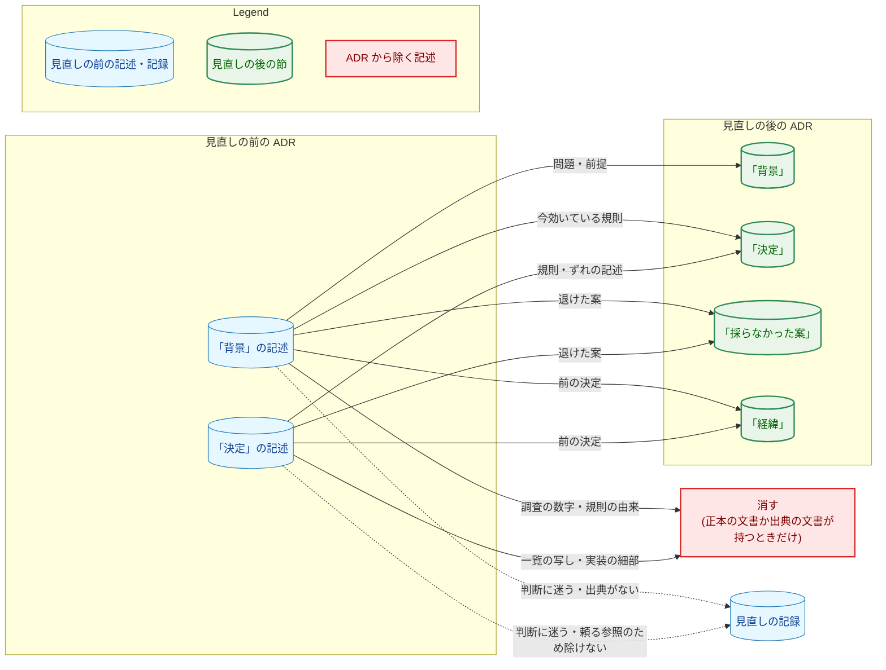
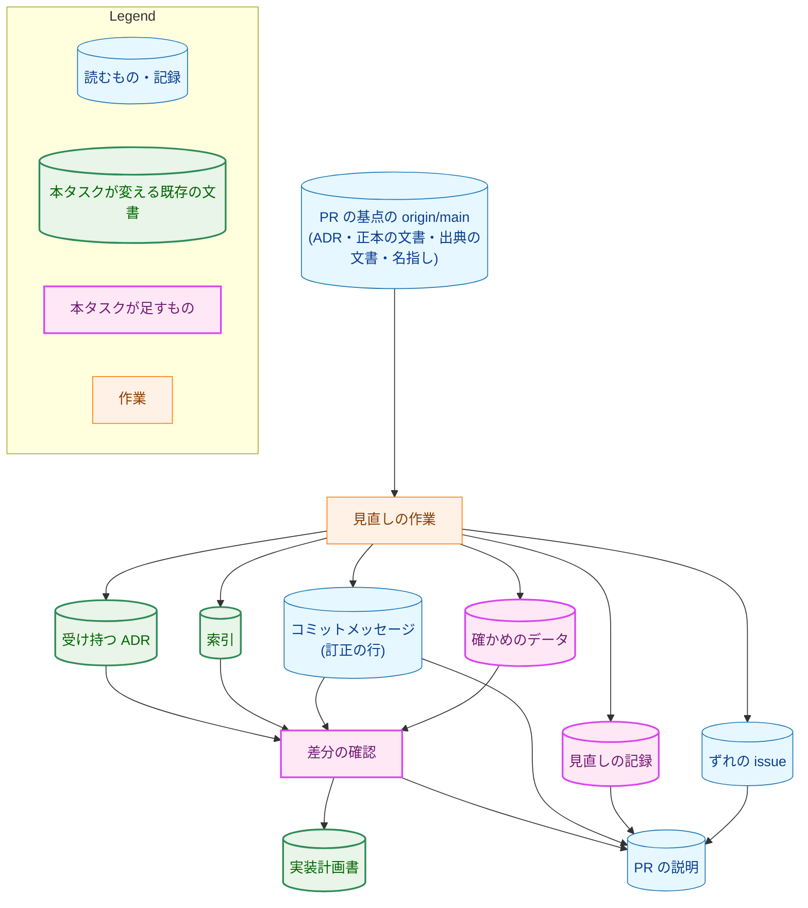
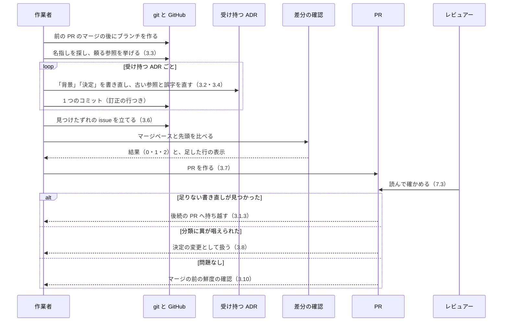
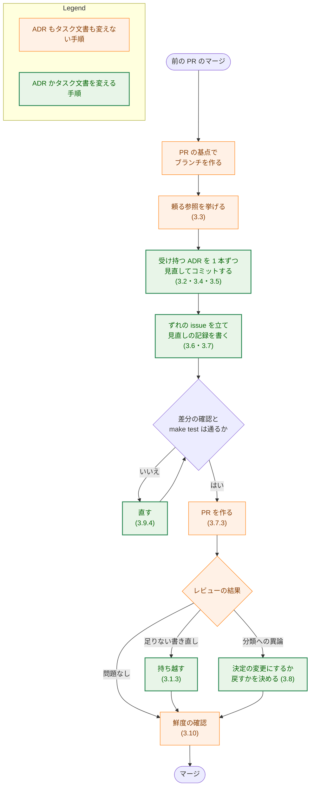
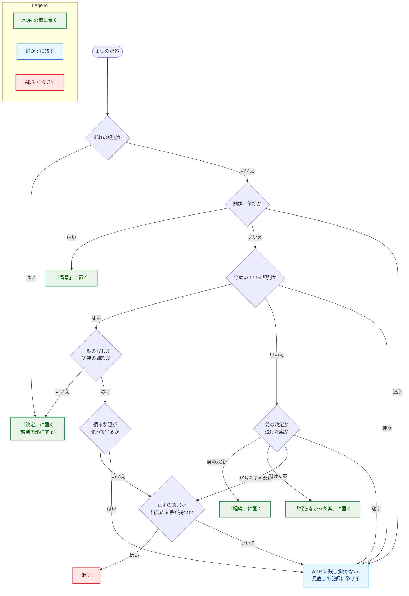

# アーキテクチャ設計書：既存の ADR-0001〜0038 の背景と決定を、ADR の規約の基準で見直す

## Document Status

| Item | Value |
|---|---|
| Status | `draft` |
| Created | 2026-11-09 |
| Review date | - |
| Reviewer | - |
| Comments | - |

本書は [01_requirements.md](01_requirements.md)（要件定義書。以下、要件書）の設計である。既存のファイルの内容は、コミット `46c1f8bc` で確かめた（以下、本書を確かめたコミット）。`file:line` の行番号は、このコミットでの行番号である。F-NNN・AC-NN は要件書の項番を、H-NN は [design_handoff.md](design_handoff.md)（以下、申し送り）の項番を指す。申し送りへの対応は付録 A に、受け入れ基準との対応は付録 B にまとめる。

本書は、要件書 6 章の用語（正本の文書・ずれの記述・編集上の訂正・基準に合わせる書き直し・前の決定・前の規則の中身・退けた案・腐りやすい実装の細部・受け持つ ADR・見直す）を、要件書と同じ意味で使う。そのほかに、次の用語を使う。

-   **規約:** `docs/dev/conventions/adr.md`。
-   **対象の ADR:** ADR-0001〜0038（要件書 3 章の冒頭）。
-   **実装の PR:** 本タスクの実装の PR。要件書の「本タスクの PR」と同じものである。本書の PR と、実装計画書の PR は含まない。
-   **系列:** 主題で分けた、対象の ADR のまとまり。3.1 で定める ①〜⑤ の 5 つがあり、1 つの系列を 1 つの実装の PR が受け持つ。
-   **追加の PR:** 持ち越しの ADR が ⑤ までに収まらないときだけ作る、6 本目の実装の PR（3.1.3）。
-   **最後の PR:** 追加の PR があればそれ、なければ ⑤ の PR。
-   **PR の基点:** 実装の PR のブランチを作るときに取得した `origin/main` のコミット。見直しは、この版の ADR・正本の文書・コードと照合して行う。
-   **出典の文書:** ADR の記述のもとになったタスク文書。ADR の「経緯」と「採らなかった案」がリンクする文書である。
-   **名指し:** 対象の ADR の外の文書とコードが、ある対象の ADR を番号かファイル名で指す箇所。
-   **頼る参照:** 名指しのうち、ある規則か見出しがその ADR に定めてあると述べるもの（AC-15）。3.3 で定める。
-   **見直しの記録:** 系列ごとに本タスクのディレクトリの下に置く文書。受け持つ ADR ごとの対応表・頼る参照・残した記述を持つ（3.7）。
-   **対応表:** 見直しの記録の中の、ADR ごとの表。見直しの前の記述と後の記述との対応を示す（3.7）。
-   **持ち越し:** PR を作った後に足りない書き直しが見つかった ADR を、本タスクの後続の実装の PR が受け持つこと（AC-19、3.1.3）。
-   **差分の確認:** 変更の前後の関係を述べる受け入れ基準を、マージベースと PR の先頭（最新のコミット）を比べて確かめるプログラム。本タスクの `_checks/` の下に置く（`docs/dev/conventions/requirements_process.md`「4. Acceptance Tests」）。恒久的なテストではない（3.9）。
-   **確かめのデータ:** 差分の確認が読むデータファイル。系列ごとの受け持つ ADR と、確かめで許す変更を持つ（3.9）。

## 1. 設計の全体像 (Design Overview)

### 1.1. 設計原則

-   **1 本の ADR を、1 つの作業の単位として閉じる。** 見直しは ADR ごとに行い、PR を作る前の 1 本の ADR の変更を 1 つのコミットに収める。訂正の行（3.7.1）と対応表も ADR ごとに書く。レビュアーは、ADR 1 本の前後を、ほかの ADR の変更と混ぜずに読める（1.2）。
-   **迷ったら、決定を変えない側に倒す。** 見直しの目的は書き方を直すことで、決定を変えることではない（要件書 2.3）。規約は、訂正かどうか迷う変更を決定の変更として扱うと定める（規約「Editorial corrections」）。本タスクの PR は決定を変えないので、迷う記述は書き直さずに残し、見直しの記録に挙げる（AC-14・AC-16、6.2）。理由は出典の文書から写し、出典の文書に理由がなければ `理由は記録されていない` と書く（AC-03）。
-   **機械で確かめられる前後の関係は差分の確認で、文の意味はレビューで読んで確かめる。** 差分の確認は、許す変更をデータに挙げたものだけに限り、挙げていない欠落を失敗にする（3.9）。基準に合っているかと、決定が変わらないかは、文の意味の問題なので読んで確かめる（要件書 5 章、[ADR-0016](../../dev/adr/0016-document-test-policy.md)）。新しい恒久的なテストは足さない（要件書 2.3）。
-   **記録は、squash の後も残る場所に置く。** 対応表と残した記述は、PR の説明ではなくリポジトリの見直しの記録に置く。訂正の段落（訂正の行から書く PR の説明の段落）は、規約のとおり PR の説明に置く（3.7）。
-   **コードと規約を変えない。** 実装の PR が変えるのは、受け持つ ADR、索引、本タスクのタスク文書だけである（AC-10、2.2）。

### 1.2. 設計の際に決めたこと（2026-11-09）

-   **ADR は主題で 5 つの系列に分け、1 つの系列を 1 つの実装の PR が受け持つ（H-01）:** 系列と順序は 3.1 のとおりである。PR の境界そのものは実装計画書で決める。
    -   **理由:** 対象の ADR は互いに参照し合い、その参照は主題ごとにまとまっている。本書を確かめたコミットで、対象の ADR の間の参照は 77 件あり、主題の系列では 24 件が系列をまたぎ、そのうち前の PR の ADR から後の PR の ADR への参照は 10 件である（3.1.2）。参照し合う ADR を同じ PR に入れると、AC-15 の「ほかの ADR が頼る規則を残す」を 1 つの PR の中で確かめられる。
    -   **採らなかった案:** 番号の順に 8 本ずつ区切る案は、単純だが、52 件の参照が PR の境界をまたぎ、そのうち 20 件が前の PR から後の PR への参照になるので採らない。
    -   ADR：なし。作業の範囲と順序の決定で、本タスクの中で閉じる。
-   **変えないものは、差分の確認と、レビューでの読みの組み合わせで確かめる（H-02）:** 差分の確認は、変えたファイルの範囲、リンクの集合、「状態」の表、題名と索引、「採らなかった案」「結果」「経緯」の既存の行、訂正の行を確かめる。足した行は表示し、レビューで読む（3.9）。
    -   **理由:** リンクや既存の行の欠落は機械で確実に見つかるが、38 本の ADR を目で探すと見落としやすい。一方、足した行が AC-02 の移動か AC-09 の訂正かは文の意味で決まるので、機械では判定できない。
    -   **採らなかった案:** すべてをレビューで読んで確かめる案は、リンクの欠落のような機械で見つかる誤りを目で探すことになるので採らない。
    -   ADR：なし。本タスクの確かめ方の決定で、本タスクの中で閉じる。
-   **決定が変わらないことは、1 本の ADR を 1 つのコミットにし、ADR ごとの対応表を置いて示す（H-03）:** 対応表の形と置き場所は 3.7 のとおりである。
    -   **理由:** コミットを ADR ごとに分ければ、レビュアーは ADR 1 本の差分だけを読める。対応表は、前の「決定」のどの項目が新しいどの項目になったかと、除いた細部がどの正本の文書か出典の文書にあるかを示し、AC-05 を読んで確かめるときの拠り所になる。
    -   **採らなかった案:** コミットを分けるだけで対応表を置かない案は、項目をまとめたり細部を正本へ移したりしたときの対応が差分から読み取りにくいので採らない。対応表だけでコミットを分けない案は、8 本の ADR の変更が 1 つの差分に混ざるので採らない。
    -   ADR：なし。本タスクの記録の仕方の決定で、本タスクの中で閉じる。
-   **レビュアーが訂正の分類に異を唱えた変更は、実装計画書に記録し、実装計画書を決定の変更として `draft` に戻す（H-07）:** 記録は、実装計画書の概要の章の「実装の際に決めたこと（YYYY-MM-DD）」の節に置き、手順は `requirements_process.md`「Editing an approved document」の決定の変更による（3.8）。
    -   **理由:** 異論は、実装の PR を作った後のレビューで出る。その PR が変えるタスク文書は実装計画書である。決定の変更の手順を使えば、`/fixpr` が実装計画書を `draft` に戻し、`/runpr` がマージの質問で、PR が変えた `draft` の文書を承認し直す（`.claude/commands/runpr.md:349-361`）。既存のコマンドの手順だけで閉じる。
    -   **採らなかった案:** 状態を `approved` のまま、セッションでの再承認の行で記録する案は、`requirements_process.md` がセッションでの再承認を `/runplan` が見つけた決定の変更に限っている（`docs/dev/conventions/requirements_process.md:41-48`）ので採らない。
    -   ADR：なし。本タスクの記録の手順の決定で、本タスクの中で閉じる。異論が出た変更そのものは決定の変更なので、その ADR を更新する（3.8）。

### 1.3. なぜ既存の確かめの仕組みでは足りないか

ADR を変えたタスク 0065 と 0070 は、それぞれ差分の確認を持つ。

-   0065 の `_checks/adrchecks` は、4 本の PR で使い回せる形である。確かめる値を実装計画書の表から読み、ADR の間で移した項目と、新しい ADR の「経緯」・正本の文書・issue へのリンクを確かめる（`docs/tasks/0065_adr_remaining/_checks/adrchecks/main.go:1-60`）。
-   0070 の `_checks/` は、1 本の PR で、規約のうち変えない部分がバイト単位で同じことを確かめ、日本語の値をデータファイルから読む（`docs/tasks/0070_adr_writing_criteria/_checks/main.go:1-21`）。

どちらも、本タスクが確かめる性質（受け持つ ADR ごとのリンクの集合と既存の行が減らないこと、「状態」の表が変わらないこと、系列ごとのファイルの範囲、コミットごとの訂正の行）を持たない。そのため、本タスクの差分の確認は新しく書く。構成は、複数の PR で使い回す点で 0065 に、データファイルを持つ点で 0070 に倣う。確かめる値を実装計画書の表ではなくデータファイルに置くのは、許す変更（直したリンク、直した行）が ADR ごとに前後の文を持ち、表のセルに収めにくいためである。節の切り出しには `internal/doctestutil` を使う。このパッケージは `test` のビルドタグの後ろにあるので、0070 と同じく `-tags test` でビルドする（3.9）。

### 1.4. 概念モデル

図 1 は、見直しの前の ADR の記述が、見直しの後にどこへ行くかを示す。実線の矢印 A → B は「A に当たる記述は B に置く」を、点線の矢印 A -.-> B は「A に当たる記述は ADR に書き直さずに残し、B に挙げる」を表す。



消すのは、正本の文書か出典の文書が同じ内容を持つときだけである（AC-02・AC-05）。どの記述をどこへ置くかの判断の順序は、6.2 の図 5 にある。

## 2. システム構成 (System Structure)

### 2.1. 全体構成

図 2 は、1 つの実装の PR で、情報がどこからどこへ流れるかを示す。矢印 A → B は「A の内容が B に入る」を表す。



PR の説明へ入るのは、訂正の段落（訂正の行から）、見直しの記録へのリンク、ずれの issue（3.6）、差分の確認の結果である（3.7.2）。実装計画書へ入るのは、差分の確認の結果、持ち越し（3.1.3）、異論が出た変更（3.8）である。

### 2.2. コンポーネント配置

| ファイル | 変更 | 役割 | 変える PR |
|---|---|---|---|
| `docs/dev/adr/0001-*.md`〜`docs/dev/adr/0038-*.md` | 変更 | 「背景」と「決定」の書き直し、移した記述の受け取り（「経緯」「採らなかった案」）、古い参照と誤字の訂正、題名の書き直し | その ADR を受け持つ実装の PR（3.1） |
| `docs/dev/adr/README.md` | 変更（題名を書き直したときだけ） | 題名を書き直した ADR の行の題名を、ADR の 1 行目とそろえる（AC-07） | 題名を書き直した実装の PR |
| `docs/tasks/0073_adr_context_decision_review/_checks/` の下の Go のファイル | 新規 | 差分の確認（3.9） | ①（後の PR が直すときは 3.9.4） |
| `docs/tasks/0073_adr_context_decision_review/_checks/` の下の確かめのデータ | 新規・変更 | 系列ごとの受け持つ ADR と、確かめで許す変更（3.9.3） | 各実装の PR |
| `docs/tasks/0073_adr_context_decision_review/` の下の見直しの記録（系列ごとに 1 つ） | 新規 | 対応表・頼る参照・残した記述（3.7） | 各実装の PR |
| `docs/tasks/0073_adr_context_decision_review/03_implementation_plan.md` | 変更 | 検証の記録、持ち越し（3.1.3）、異論が出た変更の記録（3.8） | 各実装の PR |

実装の PR は、本タスクのディレクトリの下では、上の表の 4 種類だけを変える。要件書と本書は変えない。コード、テスト、規約、`CLAUDE.md`、`.claude/commands/` の下のファイルは変えない（AC-10）。そのため、更新の要る既存のテストはない。ADR を読む既存の検査は `TestADRRecords`（`cmd/yt2column/adr_test.go`）と `TestInstructionDocPaths`（`cmd/yt2column/docpaths_test.go:140`）で、どちらも見直しの後に通る必要がある（AC-11、7.1）。`TestLightweightCheckRevisitConditions` は ADR-0012 のパスを失敗の文言に含めるだけで、ADR の中身を読まない（`cmd/yt2column/lightweight_docs_test.go:494-517`）。

### 2.3. データフロー

図 3 は、1 つの実装の PR の流れを示す。



図 3 はシーケンス図で、色分けしたノードを持たないので、Legend を置かない（`docs/dev/conventions/mermaid_reference.md` の 4 章の例と同じである）。どの分岐でも、マージの前に 3.10 の鮮度の確認を行う。

## 3. コンポーネント設計 (Component Design)

本タスクはコードを書かないので、interface と型の定義は、差分の確認が読む確かめのデータの形（3.9.3）だけである。

### 3.1. 系列と PR の順序（H-01、AC-17・AC-18・AC-19）

#### 3.1.1. 系列

| 系列 | 主題 | 受け持つ ADR | 本数 |
|---|---|---|---|
| ① | LLM と生成 | 0001・0002・0003・0004・0019・0020・0021・0025 | 8 |
| ② | 設定・データ・テストの基盤 | 0018・0022・0023・0024・0032・0034・0038 | 7 |
| ③ | サーバと投稿 | 0005・0006・0007・0011・0027・0028・0031・0033 | 8 |
| ④ | ブラウザ拡張 | 0008・0009・0010・0017・0026・0029・0030 | 7 |
| ⑤ | 開発のプロセス | 0012・0013・0014・0015・0016・0035・0036・0037 | 8 |

5 つの系列を合わせると、ADR-0001〜0038 の 38 本をちょうど 1 回ずつ受け持つ（AC-18）。どの系列も 8 本以下である（AC-17）。② は、ほかの系列が 8 本の上限で受け持てなかった ADR を集めた系列で、主題のまとまりはほかの系列より弱い。たとえば ADR-0038 は ⑤ の ADR-0016・ADR-0037 と、ADR-0022・ADR-0023 は ① の ADR-0021 と関係が深い。

実装の PR は ① から ⑤ の順に、前の PR のマージの後にブランチを作る。持ち越し（3.1.3）、確かめのデータへの書き足し（3.9.3）、系列をまたぐ参照の読み直し（3.1.2）は、この順序を前提にする。① から始めるのは、要件書が基準に合わない例として挙げる ADR-0001 を含むからで、ほかに強い理由はない。

#### 3.1.2. 系列をまたぐ参照

本書を確かめたコミットで、対象の ADR が本文で名指しするほかの対象の ADR を数えた。系列をまたぐ参照は次のとおりである。

| 参照する ADR（系列） | 参照される ADR（系列） |
|---|---|
| 0003（①） | 0018・0024（②） |
| 0019（①） | 0005（③） |
| 0018（②） | 0003（①）、0005・0006（③） |
| 0022・0023（②） | 0021（①） |
| 0024（②） | 0003（①） |
| 0034（②） | 0002（①）、0017（④） |
| 0005（③） | 0019（①）、0026（④） |
| 0006（③） | 0026（④） |
| 0033（③） | 0023（②） |
| 0008・0009（④） | 0011（③） |
| 0010（④） | 0027・0028（③） |
| 0026（④） | 0005・0006（③） |
| 0027（③） | 0010（④） |
| 0029（④） | 0035（⑤） |
| 0035（⑤） | 0029（④） |

ほかの参照は系列の中で閉じる。ある系列の PR は、ほかの系列の ADR を変えない（AC-10）。そのため、後の PR は、前の PR が受け持つ ADR のうち、自分の受け持つ ADR を名指ししているものを、自分の PR の基点の版で読み直し、頼る参照として挙げる（3.3）。その規則は、後の PR が自分の ADR の「決定」に残す（AC-15）。

#### 3.1.3. 持ち越し

実装の PR を作った後のレビューで、受け持った ADR に足りない書き直しが見つかったときは、その PR では直さない（AC-19、規約「Editorial corrections」の「After the PR is created」）。

-   **書く時点と場所:** その PR の `/fixpr` の回で、実装計画書の持ち越しの一覧に、ADR と見つかった内容を書き、レビューのスレッドへの返信でも持ち越したことを述べる。持ち越しの規則は AC-19 と本節が定めるので、一覧への書き足しは進み具合の記録で、決定の変更ではない。
-   **持ち越し先:** 次の系列の PR である。持ち越した ADR を加えると、その系列の本数が 8 本を超えるときは、その次の系列の PR へ回す（AC-17）。① から ④ の PR からの持ち越しで、⑤ までに回せないものは、追加の PR が受け持つ。⑤ の PR を作った後のレビューで見つかったものも、追加の PR があればそれが受け持つ。
-   **最後の PR の後:** 最後の PR を作った後のレビューで見つかった足りない書き直しは、issue にする（AC-19）。追加の PR がないとき、⑤ の PR のレビューで見つかったものは、⑤ が最後の PR なので issue にする。追加の PR は 1 本に限るので、持ち越しの連鎖はそこで終わる。この issue は本タスクの完了の条件に含めない（要件書 3 章の冒頭）。

系列の本数は 8・7・8・7・8 で、② と ④ に 1 本ずつしか余りがないので、持ち越しが 2 本以上あれば追加の PR が必要になりやすい。実装計画書は、追加の PR を、持ち越しがあるときだけ作る PR として置く。

### 3.2. 1 本の ADR の見直し（F-001・F-002、AC-01〜AC-07）

見直しは、PR の基点の ADR を読み、「背景」と「決定」の記述を 1 つずつ図 5（6.2）の順で振り分けてから書き直す。

#### 3.2.1. 「背景」

-   **残すもの:** 決定が答えている問題と、決定を縛る前提。決定の根拠そのものである数字（規約「What 背景 holds」の例のような、測った遅さ）も残す。
-   **「決定」へ移すもの:** 今効いている規則で、「決定」にないもの（要件書 1 章「上の決定から導いたこと」）。頼る参照が頼っている規則が「背景」にあるときも、「決定」へ移す（AC-15）。移した規則は、「決定」のほかの項目と同じ形にする（3.2.2）。意味を変えずに移せないときは、移さずに残し、見直しの記録に挙げる（AC-16）。
-   **「経緯」へ移すもの:** 前の決定。「経緯」にすでに項目があれば、「背景」から消すだけにする。なければ、規約の「History entries」の形で、日付の順の位置に置く（3.5）。
-   **「採らなかった案」へ移すもの:** 退けた案。すでにあれば消すだけにする。なければ、規約の「採らなかった案」の形（案と、採らなかった理由と、出典の文書へのリンク）で足す。出典の文書に理由がなければ `理由は記録されていない` と書く。
-   **消すもの:** 前の決定でも、退けた案でも、今効いている規則でもない記述（調査の数字、規則の由来など）。消すのは、出典の文書がその記述を持つときだけである。出典の文書がどこにもないときは消さずに残し、見直しの記録に挙げる（AC-14）。

#### 3.2.2. 「決定」

-   **1 項目 1 規則:** 「決定」の各項目は、後の変更が守るべき規則を 1 つ述べる。規則の文を太字で書き、続けて短い理由と、その規則の仕様の場所を書く。この形は、ADR-0039 の「決定」と同じである。
-   **理由:** 出典の文書から写す。出典の文書に理由がない項目は `理由は記録されていない` と書き、理由を補わない（AC-03）。
-   **場所:** 正本の文書と節の見出し、パッケージかファイル、または、正本の文書がないときは、その規則を記録した出典の文書と節の見出しである。行番号は付けない。節は見出しを本文で名指しし、アンカーへはリンクしない（規約「Links」）。
-   **末尾にまとめた正本の段落:** ADR-0001・ADR-0009・ADR-0031 などが「決定」の末尾にまとめて挙げる正本は、各項目の場所に振り分ける。振り分けた後も、リンクは同じ ADR に残る（AC-06、3.9 で確かめる）。
-   **除くもの:** 正本の文書が持つ一覧の写しと、腐りやすい実装の細部（AC-04）。除くのは、正本の文書か出典の文書が同じ内容を持つときだけである（AC-05）。どちらにもない細部は除かずに残し、見直しの記録に挙げる（AC-14）。頼る参照が頼っている記述は、書き直してよいが除かない。除かないと基準に合わせられないときは、そのまま残し、見直しの記録に挙げる（AC-15・AC-16）。
-   **ずれの記述:** 意味を変えずに「決定」に残す。ずれの記述と、それがリンクする issue の URL は、文を書き直しても同じ ADR に残る（AC-06）。ずれの記述は、受け持つ ADR ごとに、PR の基点で `issues/` へのリンクを探して見つける（具体的な形は実装計画書で決める）。本書を確かめたコミットでは、ADR-0006（`docs/dev/adr/0006-threat-model.md:29`、#678）、ADR-0028（`docs/dev/adr/0028-no-automatic-resend.md:24`、#720）、ADR-0034（`docs/dev/adr/0034-template-allowlist.md:24`、#725）、ADR-0035（`docs/dev/adr/0035-language-policy.md:21`、#726）の「決定」にある。ADR-0018 の「背景」にも issue へのリンクがある（`docs/dev/adr/0018-server-config-file.md:11`）が、これはずれの記述ではなく、リンクの集合として残す。ずれが直ったかどうかは確かめない（要件書 1 章）。

#### 3.2.3. 題名

題名は、書き直した「決定」にもう書かれていない細部を述べているときだけ、意味を変えずに書き直す（AC-07）。書き直したときは、同じコミットで索引の行の題名を ADR の 1 行目とそろえ、そのコミットの訂正の行に索引の変更も書く。索引の題名と ADR の 1 行目が一致することは、`TestADRRecords` が確かめる（`cmd/yt2column/adr_test.go:415-416`）。それ以外の題名と索引の行は変えない（3.9 で確かめる）。

#### 3.2.4. 変えないもの

-   「状態」の表は変えない（AC-08）。
-   「採らなかった案」「結果」「経緯」は、3.2.1・3.2.2 で移す記述、3.4 の訂正、3.8 の「経緯」の項目を除いて変えない（AC-08）。
-   「経緯」には、編集上の訂正そのものの項目を足さない（AC-22）。
-   `###` の小見出しは残す。たとえば ADR-0012 の「見直しの条件」（`docs/dev/adr/0012-lightweight-check-in-bash.md:30`）は、頼る参照が見出しで指す（3.3）。

### 3.3. 頼る参照の洗い出し（H-06、AC-15・AC-16）

AC-15 が残すことを求めるのは、ある対象の ADR に定めがあるとして参照する規則と見出しである。そのような参照は、ADR を名指しする。名指ししない記述は、その ADR に定めがあると述べていないので、AC-15 の対象にならない。そこで、頼る参照は、名指しを探してから読んで選ぶ。

-   **探す時点:** 実装の PR ごとに、書き直しの前に、PR の基点で探す。マージの前に、鮮度の確認でもう一度探す（3.10）。
-   **探す範囲:** リポジトリの全体。ただし、`docs/tasks/` の下（AC-15 の対象外。要件書 2.3）と、探している ADR 自身は除く。ほかの ADR（ADR-0039 と ADR-0040 を含む）、`CLAUDE.md`、`docs/` の下の生きた文書、コード、コメント、テスト、スクリプトはすべて含む。
-   **探す文字列:** 受け持つ ADR ごとに、番号での名指し（`ADR-NNNN` と、ハイフンのない書き方）と、ファイルでの名指し（`adr/` の下の `NNNN-` で始まるファイル名）である。題名を一度書き直した ADR の古いファイル名も拾えるよう、ファイル名は番号の部分だけで探す。`git grep` の具体的な形は、実装計画書で決める。
-   **選び方:** 名指しを 1 件ずつ読み、ある規則か見出しがその ADR に定めてあると述べるものを、頼る参照とする。単に ADR を紹介するだけのリンク（「詳しくは ADR-NNNN」など）は、頼る参照ではない。
-   **挙げ方:** 頼る参照と、それが頼る規則か見出しを、書き直しの前に、見直しの記録に挙げる（3.7）。書き直しの後、それらが同じ ADR の「決定」と同じ見出しに残ることを読んで確かめる。

本書を確かめたコミットでは、`docs/tasks/` と `docs/dev/adr/` の外で対象の ADR を名指しするファイルは、`.claude/commands/_lib/lightweight-check.sh`・`CLAUDE.md`・`cmd/yt2column/adr_test.go`・`cmd/yt2column/lightweight_docs_test.go`・`docs/dev/conventions/adr.md`・`docs/dev/project_overview.md`・`docs/dev/security.md`、および `docs/research/transcript_acquisition/` の下の 2 つの文書である。このうち `adr_test.go` と `adr.md` の名指しは、テストの入力か規約の例で、対象の ADR の規則に頼らない。

### 3.4. 古い参照と誤字（H-04、AC-09）

見直しでは ADR の全体を読むので、「採らなかった案」「結果」「経緯」も含めて、次のものを、PR の基点の文書とコードと照合する。

-   **リンクの先のファイル:** あることは `TestInstructionDocPaths` が確かめる。
-   **本文で挙げる節の見出し:** リンクの先の文書に、その見出しが今もあるかを読んで確かめる。`§1.2` のような節の番号も同じである。
-   **パッケージ・ファイル・関数・型・環境変数の名前:** `git ls-files` と `git grep` で、今もあるかを確かめる。

古くなっていたものは、規約の「Editorial corrections」の (3) として直す。直した結果は、その ADR の「決定」と矛盾してはならない（AC-09）。改名されたものが決定の一部であるとき（環境変数、プロトコルのメンバなど）や、直すと「決定」が述べる振る舞いと食い違うときは、編集上の訂正にならない。その場合は直さずに、ずれとして issue にする（3.6）。正本の文書へのリンクが古くなっていたときは、同じ正本の今の場所へ直す（AC-06）。意味を変えない誤字は (4) として直す。直したリンクと行は、確かめのデータに挙げる（3.9.3）。

### 3.5. 「経緯」へ置く前の決定（H-05、AC-02・AC-22）

「背景」か「決定」から除いた前の決定に「経緯」の項目がないときは、規約の「History entries」の形で項目を置く。

-   **日付:** 規約の「Date of an entry copied from an existing decision」の 1〜4 の順に、出典の文書から決める。`Created` は使わない。4 の場合（文書を加えたコミットの日付）は、要旨の後に `（日付は文書を加えたコミットの日付）` を付ける。
-   **位置:** 日付の順の位置に置く。新しい出来事の項目ではないので、末尾には置かない（AC-22）。日付が後ろへ戻らないことは、差分の確認が確かめる（3.9）。
-   **確かめ:** 日付をどの規則で決めたか（1〜4 のどれか、と見出しか行）を、対応表の行に書く。レビュアーはそれを出典の文書と照合して確かめる。
-   **出典の文書がないとき:** 前の決定を記録した文書が見つからないときは、「経緯」に置けないので、記述を残し、見直しの記録に挙げる（AC-14）。

### 3.6. 見つけたずれ（AC-12・AC-13）

見直しで、ADR の決定と、正本の文書と、コードのどれかが食い違っているのを見つけたときは、ADR にずれの記述を足さない（規約「Discrepancy statements」）。

-   **既存の issue:** そのずれを扱う issue があるかを、実装の PR を作る前に探す。あれば、PR の説明にその issue を挙げる。
-   **新しい issue:** なければ、その ADR を名指しする issue を、PR を作る前に立て、PR の説明に挙げる（AC-13）。issue の本文はリポジトリの決まりどおり日本語で書く。
-   **PR を作った後に見つかったずれ:** 同じく issue を立てる。PR の説明には挙げなくてよい（AC-13）。

issue を探す操作と立てる操作は GitHub との通信なので、実装の際にユーザーの承認を得て行う（`CLAUDE.md`「Tool Execution Safety」）。承認が得られないときは、PR を作らずに止まる。AC-13 が、issue を PR より前に立てることを求めるためである。issue の本文は、投稿の前に、Codex を呼ぶ言及を含まないことを確かめる（`.claude/commands/_context.md`「PR review request」）。

### 3.7. 記録：訂正の行・見直しの記録・PR の説明（H-03、AC-14・AC-16・AC-18・AC-21）

#### 3.7.1. コミット

-   PR を作る前の 1 本の ADR の見直しを、1 つのコミットにする。題名を書き直したときの索引の行も、同じコミットに含める。差分の確認やレビューで見つけた誤りを PR を作る前に直すときは、その ADR のコミットに畳み込む。
-   そのコミットのメッセージに、変更ごとに訂正の行を書く。形は `requirements_process.md`「Recording in the PR description」の correction line で、文書のパスは ADR（索引を変えたときは索引も）のリポジトリからのパスである。たとえば、次のように書く。

    ```text
    Editorial correction: docs/dev/adr/0009-viewer-opening.md: moved the tab placement details (index + 1, openerTabId) out of 決定, as the 0050 design §6.1 holds them; no decision changed
    ```

-   移した記述は「何をどこからどこへ移したか」を、消した記述は「何を消したか」を書く（AC-21）。
-   見直して変える箇所がなかった ADR には、コミットを作らない。
-   PR を作った後に ADR を変えるコミットは、3.8 の決定の変更と、3.10 で PR 自身の変更を戻すコミットだけである。どちらも訂正の行を持たない。

#### 3.7.2. 見直しの記録

見直しの記録は、系列ごとに本タスクのディレクトリの下に置く日本語の文書で、PR を作る前に、その系列の ADR のコミットと同じブランチでコミットする。squash の後も `main` に残り、PR の説明の書き換え（`/fixpr` は、古くなった PR の説明を書き直すことがある）にも影響されない。ファイルの名前は実装計画書で決める。受け持つ ADR ごとに次のものを持つ。

| 項目 | 内容 | AC |
|---|---|---|
| 対応表 | 下の形 | AC-05、H-03 |
| 頼る参照 | 3.3 で挙げた参照と、それが頼る規則か見出し | AC-15 |
| 残した記述 | AC-14 と AC-16 で書き直さずに残した記述と理由。AC-16 では頼っている文書かコードも挙げる | AC-14・AC-16 |
| 変えなかった ADR | 見直して変える箇所がなかったこと | AC-18 |

対応表は、ADR ごとに次の列を持つ。

| 列 | 内容 |
|---|---|
| 前の記述 | 見直しの前の「背景」の段落か「決定」の項目（「決定」の項目 2、「背景」の段落 1 など） |
| 行き先 | 新しい「決定」の項目、「経緯」、「採らなかった案」、または「消した」 |
| 根拠 | 除いた細部や消した記述を持つ正本の文書か出典の文書と、その節の見出し。「経緯」に置いた項目は、日付を決めた規則（3.5） |

#### 3.7.3. PR の説明

PR の説明は、`.claude/commands/_lib/task-pr-handoff.md` の Part B 手順 3 の項目に加えて、次のものを持つ。

-   訂正の段落。訂正の行から書き、変更を編集上の訂正と明示する（AC-21）。
-   見直しの記録へのリンクと、AC-14・AC-16 で残した記述の要約（AC-14・AC-16）。
-   ずれの issue（AC-12）と、見直して変える箇所がなかった ADR（AC-18）。
-   差分の確認の結果の要約と、比べた 2 つのコミットの ID（3.9.4）。差分の確認が許した変更（確かめのデータに挙げたもの）の一覧も、出力から写す。

### 3.8. 分類に異を唱えられた変更（H-07、AC-20）

実装の PR のレビュアーが、ある変更を編集上の訂正とする分類に異を唱えたときは、その変更を決定の変更として扱う（AC-20、規約「Classifying a change」）。`/fixpr` の回で、まずレビュアーに、変更を残すか、見直しの前の記述に戻すかを尋ねる。

-   **変更を残すとき（決定を変える）:**
    1.  その ADR の「経緯」の末尾に、決定の変更の項目を足す。項目は、手順 3 で書く実装計画書の節へリンクする。
    2.  変えた「決定」を、正本の文書とコードと照合する。食い違うときは、その ADR の「決定」にずれの記述を足し、その ADR を名指しする issue を立てる（規約「Discrepancy statements」）。本タスクの PR は正本の文書とコードを変えない（AC-10）ので、食い違いはずれとして残す。
    3.  実装計画書の概要の章に「実装の際に決めたこと（YYYY-MM-DD）」の節を置き（なければ作る）、変更の内容と理由、ADR の判断（「ADR-NNNN を更新」）を書く。
    4.  実装計画書を、`requirements_process.md`「Editing an approved document」の決定の変更として `draft` に戻す。`Comments` と、`#未記入` の `draft` への戻しの行を書く。
    5.  `/runpr` は、マージの質問で、PR が変えた `draft` の実装計画書を承認し直す（`.claude/commands/runpr.md:349-361`）。
    6.  この回の ADR のコミットは訂正の行を持たないので、確かめのデータの `unrecorded_commits` に理由とともに挙げる（3.9.3）。
-   **前の記述に戻すとき:** その変更を、見直しの前の記述に戻す。戻すのは、PR 自身が加え、まだ `main` にない記述の修正で、規約は PR を作った後にも認める（規約「Editorial corrections」の「After the PR is created」）。`main` に入る決定は変わらないので、「経緯」の項目と実装計画書の記録は要らない。戻した ADR は基準に合わない記述を残すので、持ち越す（3.1.3）。戻したコミットは、確かめのデータの `unrecorded_commits` に挙げる。

どちらのときも、訂正の段落はすでに PR の説明にあり、規約と `/fixpr` は書き換えない。そのため、`/fixpr` は、スレッドへの返信で、どの訂正の行を決定の変更として扱ったか、または戻したかを述べ、PR に記録を残す。要件書と本書は変えない。異論が出たのは本タスクの方針ではなく、ある ADR の 1 つの変更の分類だからである。

### 3.9. 差分の確認（H-02、AC-06・AC-07・AC-08・AC-10・AC-17・AC-18・AC-21・AC-22）

#### 3.9.1. 確かめること

確かめは、許す変更をデータに挙げたものだけに限る。挙げていない変更は失敗にし、挙げたのに当てはまる変更がない項目も失敗にする（古くなった許可を残さないため）。許した変更は、すべて出力に表示する。

| 対象 | 確かめること |
|---|---|
| AC-10 | マージベースから先頭までに変わったファイルが、系列の受け持つ ADR、索引、本タスクのディレクトリの下の確かめのデータ・見直しの記録・実装計画書だけである。差分の確認の Go のファイルの変更は、確かめのデータに挙げたときだけ許す（3.9.4） |
| AC-17・AC-18 | 確かめのデータは、① の PR で 5 つの系列の `adrs` をすべて持つ。その 5 つを合わせると ADR-0001〜0038 をちょうど 1 回ずつ含む。実行する系列の `adrs` と `carried_in` を合わせて 8 本以下で、`carried_in` の ADR はそれより前の系列の `adrs` にある（比べるのは前後の関係ではなく、確かめのデータの値である） |
| AC-06 | 受け持つ ADR ごとに、マージベースにあったリンクの先（相対リンク・URL・自動リンク）が、先頭にもある。確かめのデータに、直したリンク（前と後）か、消したリンク（理由つき）として挙げたものは除く。読み取れないリンクの書き方があれば失敗にする |
| AC-08 | 受け持つ ADR の「状態」の節が、前後で 1 バイトも違わない |
| AC-07 | 受け持つ ADR の 1 行目が、確かめのデータに題名の書き直しとして挙げた ADR を除いて、前後で同じである。索引は、題名を書き直した ADR の行の題名のセルを除いて、前後で同じである |
| AC-08・AC-22 | 受け持つ ADR の「採らなかった案」「結果」「経緯」の、マージベースにあった空でない行が、先頭にも同じ文で残る。確かめのデータに直した行として挙げたものは除く。足した行は表示する。「経緯」の項目の日付は、上から下へ後ろへ戻らない |
| AC-21 | マージベースから先頭までの、マージコミットを除く各コミットについて（`main` を取り込むマージコミットは、ほかのタスクの変更を持つので対象にしない）、そのコミットが変えた受け持つ ADR と索引のそれぞれに、そのコミットのメッセージの訂正の行が 1 つ以上ある。1 つのコミットは、受け持つ ADR を 1 本だけ変える（索引を除く）。`Editorial correction: ` で始まる行で、形が合わないものは失敗にする。確かめのデータに、訂正の行を持たないコミット（3.7.1 の最後の項目）として理由とともに挙げたものは除く |

「背景」と「決定」の内容が基準に合うかと、決定が変わらないかは確かめない。文の意味の問題だからである（7.3）。

#### 3.9.2. 性質

-   **比べる 2 つのコミットと、系列を引数で受け取る。** 前のコミットは、`origin/main` を取得した後の `git merge-base origin/main HEAD` で、後のコミットは `HEAD` である。前のコミットが後のコミットの祖先でなければ失敗する。AC-10 で失敗したときは、変わったファイルを表示し、前のコミットを誤るとほかのタスクのファイルが混ざることを添える。
-   **すべてをコミットから読む。** ADR・索引・コミットメッセージだけでなく、確かめのデータも、後者のコミットから git で読む。作業ツリーは読まない。出力には、2 つのコミットの完全な ID と、確かめのデータと差分の確認のプログラムのファイルの blob の ID を表示する。記録した結果が、どのデータとプログラムによるものかを後から確かめられるようにするためである。
-   **節の位置は、`##` の見出しで決める。** 行番号では決めない。見出しが見つからないか、2 回以上見つかるときは失敗する。
-   **終了コード:** すべて通れば 0、違反があれば 1、入力を読めなければ 2 で終わる。0070 の `_checks/` と同じである（`docs/tasks/0070_adr_writing_criteria/_checks/main.go:17-19`）。
-   **日本語の文字列は確かめのデータに置く。** Go のソースの文字列は英語にする（`CLAUDE.md`「Go Idioms」）。「状態」「経緯」などの見出しも、確かめのデータから読む。
-   **`make test` と CI は実行しない。** `_` で始まるディレクトリは `go list ./...` から外れる（`requirements_process.md`「4. Acceptance Tests」）。

#### 3.9.3. 確かめのデータの形

確かめのデータは、系列ごとに次の値を持つ。① の PR が 5 つの系列の `adrs` をすべて書き、各実装の PR は、自分の系列のほかの値（持ち越し・許す変更）を書き足す。系列の名前は、引数で渡す ASCII の名前（`s1`〜`s5` と、追加の PR の `s6`）である。Go の型で表すと、次の形である。

```go
// checkData is the data file the diff check reads from the head commit.
type checkData struct {
	TaskDir  string           `json:"task_dir"`
	Index    string           `json:"index"`
	Headings sectionHeadings  `json:"headings"`
	Groups   map[string]group `json:"groups"` // keyed by the group name given as the argument
}

// sectionHeadings are the ADR section headings the checks locate sections by.
type sectionHeadings struct {
	Status       string `json:"status"`
	Alternatives string `json:"alternatives"`
	Consequences string `json:"consequences"`
	History      string `json:"history"`
}

// group is one implementation pull request: the ADRs it reviews and every
// change the checks allow. Every ADR an entry names must be in ADRs or CarriedIn.
type group struct {
	ADRs              []string       `json:"adrs"`       // repository-relative paths, first review
	CarriedIn         []string       `json:"carried_in"` // carried over from an earlier group
	RetitledADRs      []string       `json:"retitled_adrs"`
	LinkChanges       []change       `json:"link_changes"` // After empty: the link was removed
	LineChanges       []change       `json:"line_changes"` // lines of 採らなかった案, 結果, 経緯
	UnrecordedCommits []commitReason `json:"unrecorded_commits"`
	CheckerChanges    string         `json:"checker_changes"` // why the Go files changed, if they did
}

// change allows one link target or one line of an ADR to change.
// A link target is the repository-relative path it resolves to, anchor dropped,
// or the URL as written.
type change struct {
	ADR    string `json:"adr"`
	Before string `json:"before"`
	After  string `json:"after"`
	Reason string `json:"reason"`
}

// commitReason names a commit that changes an ADR without a correction line.
type commitReason struct {
	Commit string `json:"commit"`
	Reason string `json:"reason"`
}
```

#### 3.9.4. 実行・記録・直し方

-   **実行:** 実装の PR のブランチの上で、PR を作る前に実行する。出力と、比べた 2 つのコミットの完全な ID を、実装計画書の検証の行と PR の説明に記録する。記録の後に、受け持つ ADR か確かめのデータを変えるコミットや、`main` を取り込むコミットが入ったときは、実行し直して記録を改める。マージの前の鮮度の確認でも実行する（3.10）。
-   **失敗の直し方:** 違反は、ADR を直すか、正しい変更なら確かめのデータに挙げて直す。確かめのデータへの書き足しは差分に現れ、許した変更として出力と PR の説明に表示されるので、レビュアーが確かめられる。「状態」の節と、AC-10 のファイルの範囲は、確かめのデータで許せない。
-   **差分の確認そのものの直し:** ① の後の PR が差分の確認の Go のファイルを直すときは、確かめのデータの `checker_changes` に理由を書き、PR の説明でも述べる。差分の確認は、最後の PR のマージまで使い、その後は保守しない（`requirements_process.md`「4. Acceptance Tests」）。

### 3.10. マージの前の鮮度の確認（AC-05・AC-15）

`/runpr` は、PR のブランチに `main` を取り込むことを、衝突を解くときなど必要なときにだけ行い、マージの前の取り込みを求めない（`.claude/commands/runpr.md:270-277`）。マージは squash で行う。そのため、PR を作った後に、ほかのタスクの PR が、この PR の受け持つ ADR、その根拠の文書、または頼る参照を `main` で変えても、テキストが衝突しなければ、誰も読んでいない組み合わせがマージされうる。そこで、実装の PR は、`/runpr` のマージの質問に答える前に、次の確認を行う。コマンドの定義は変えない（AC-10）ので、この確認は、実装計画書の PR の作成ポイントの「レビュー観点」に、マージの前の手順として置く。

1.  `origin/main` を取得する（ネットワークの操作なので、ユーザーの承認を得る）。
2.  マージベースから `origin/main` までに、受け持つ ADR、索引、見直しの記録の「根拠」の列が挙げる文書が変わったかを見る。
3.  `origin/main` で名指しを探し直し、見直しの記録の頼る参照と比べる（3.3）。
4.  どれも変わっていなければ、確認は終わる。変わっていれば、`main` を取り込み、次のとおり扱う。
    -   **受け持つ ADR が変わった:** その ADR についての PR の変更を戻して `main` の版にする（PR 自身の変更を戻すことは、PR を作った後にも認められる）。戻したコミットは確かめのデータの `unrecorded_commits` に挙げ、ADR を持ち越す（3.1.3）。戻した ADR の訂正の行は、`/fixpr` の回か PR へのコメントで、取り下げたと述べる。
    -   **根拠の文書か頼る参照が変わった:** 影響する対応表の行を読み直す。除いた細部がもう根拠の文書にないときや、新しい頼る参照が頼る規則を除いていたときは、その ADR の変更を同じく戻して持ち越す。
5.  差分の確認を実行し直し、記録を改める（3.9.4）。

## 4. エラーハンドリング設計 (Error Handling Design)

### 4.1. 実行時のエラー

N/A。本タスクは文書だけを変え、実行時の振る舞いを変えない。差分の確認の終了コードは 3.9.2 のとおりである。

### 4.2. 手順の中の失敗

| 失敗 | 扱い |
|---|---|
| 差分の確認が 1（違反）で終わる | PR を作らない。3.9.4 のとおり直す。正しく直せない違反（たとえばリンクを残すと決定を変えることになる）は、変更を戻して記述を残し、見直しの記録に挙げる（AC-14） |
| 差分の確認が 2（入力を読めない）で終わる | PR を作らない。引数・確かめのデータ・コミットを直してから実行し直す |
| `make test` が通らない | PR を作らない。`TestADRRecords` か `TestInstructionDocPaths` の失敗は、見直しの変更が規約の構造かリンクを壊したことを示すので、ADR を直す（AC-11） |
| 見直しの途中で、決定を変えずには基準に合わせられない記述が見つかる | 書き直さずに残し、見直しの記録に挙げる（AC-14・AC-16） |
| PR を作る前に、ほかのタスクの PR が、この PR の受け持つ ADR を `main` で変えた | `main` を取り込み、規約の「Taking in `main`」の手順 3 のとおり、その ADR を読み直す。見直しをその版に合わせてやり直し、そのコミットと対応表を改める |
| PR を作った後に、`main` で自分の受け持つ ADR などが変わった | 3.10 のとおり、PR の変更を戻して持ち越す |
| issue を立てる承認が得られない | PR を作らずに止まる（3.6） |
| PR を作った後に、足りない書き直しが見つかる | その PR では直さず、持ち越す（3.1.3） |
| 分類に異が唱えられる | 3.8 のとおり扱う |

## 5. セキュリティ考慮事項 (Security Considerations)

### 5.1. 脅威モデル

N/A。本タスクは外部コマンドの呼び出し、秘密、キャッシュ、ネットワークへの送信、信頼できない文字列の埋め込みのどれにも触れないので、`docs/dev/security.md` を適用する条件に当たらない（`.claude/commands/_context.md`「Conditional-guide trigger」）。脅威モデルの ADR-0006 と、秘密の扱いの ADR-0031 も、書き方だけを直し、決定と `docs/dev/security.md` を変えない（要件書 4.2）。

### 5.2. 残余のリスクと注意

-   **決定の取りこぼし:** 見直しは文の書き直しなので、決定の一部を誤って消すか、前提を誤って規則に格上げするおそれがある。差分の確認は、リンクと「採らなかった案」「結果」「経緯」の既存の行の欠落を見つけるが、「背景」と「決定」の規則の文の欠落は見つけない。迷ったら残す原則（1.1）、対応表、レビューでの読み（7.3）で防ぐ。
-   **許可の書き足し:** 差分の確認の失敗は、確かめのデータに許可を書き足して通せる。書き足しは差分と出力と PR の説明に現れ、レビュアーが読む（3.9.4）。
-   **GitHub への投稿:** issue と PR の説明は GitHub に投稿される。投稿の前に、Codex を呼ぶ言及を含まないことを確かめる（3.6、`.claude/commands/_lib/task-pr-handoff.md` の Part B 手順 3）。

## 6. 処理フロー詳細 (Processing Flow Details)

### 6.1. 1 つの実装の PR の流れ

図 4 は、1 つの実装の PR の流れを示す。矢印は作業の順序を表す。



### 6.2. 「背景」と「決定」の記述の振り分け

図 5 は、見直しの前の「背景」と「決定」の 1 つの記述を、どこへ置くかを決める順序を示す。矢印は判断の順序を表す。どの判断でも、迷ったら「残す」へ進む（1.1）。



-   ずれの記述は、意味を変えずに「決定」に置く（3.2.2）。
-   「背景」にある今効いている規則は、「決定」へ移す（3.2.1）。頼る参照が頼る規則は「決定」に置き、除かない（AC-15）。
-   「経緯」へ置く前の決定に出典の文書がないときも、「残す」へ進む（3.5）。
-   図に描いていない残す場合として、決定の意味を変えないと移せないか除けない記述も残す（AC-14・AC-16）。

## 7. テスト戦略 (Test Strategy)

### 7.1. ユニットテスト

新しいテストは足さない（1.1）。実装の PR の後も既存のテストが通ることを、`make test` で確かめる（AC-11）。とくに次の 2 つが、変える文書を読む。

| 検査 | 読むもの | 本タスクの変更との関係 | CI での実行 |
|---|---|---|---|
| `TestADRRecords`（`cmd/yt2column/adr_test.go`） | 規約の「Template」「Status」「Index」の節、各 ADR、索引 | 見直しは `##` の節の構成と「状態」を変えない。題名を書き直したときは、同じコミットで索引をそろえる（3.2.3） | `doc-guard` |
| `TestInstructionDocPaths`（`cmd/yt2column/docpaths_test.go:140`） | 文書のリンクとパス | 移した記述と直したリンクの先は、今あるファイルでなければならない（3.4） | `doc-guard` |

実装の PR は `docs/` の下しか変えないので、CI の `check-changes` はコードの変更なしと判定し、`doc-guard` ジョブが動く。差分の確認の Go のファイルは `_checks/` の下にあり、`go list ./...` から外れるので、`make lint` と `make test` の対象にならない。

### 7.2. 差分の確認（`_checks/`）

3.9 のとおりである。AC-06・AC-07・AC-08・AC-10・AC-21・AC-22 の前後の関係と、AC-17・AC-18 の確かめのデータの値を確かめる。

### 7.3. 読んで確かめる（manual）

文の意味を述べる AC は、PR のレビューで ADR と見直しの記録を読んで確かめる（ADR-0016）。

-   AC-01・AC-02：各 ADR の「背景」と、対応表の「背景」の行を読む。
-   AC-03・AC-04：各 ADR の「決定」を読む。
-   AC-05：対応表と、除いた細部の根拠の文書を読む。
-   AC-06：ずれの記述の意味が変わらないことを読む（リンクの集合は差分の確認が確かめる）。
-   AC-07：題名を書き直した ADR の題名と「決定」を読む。
-   AC-08：差分の確認が表示する、許した変更と足した行を読む。
-   AC-09：訂正の段落と、直した箇所を読む。
-   AC-12〜AC-14・AC-16：PR の説明のずれの issue と、見直しの記録の残した記述を読む。
-   AC-15：見直しの記録の頼る参照を、書き直した「決定」と見出しと照合する。
-   AC-18：見直しの記録の、変えなかった ADR の記述を読む。
-   AC-19・AC-20：PR を作った後の `/fixpr` の回で、持ち越しと異論の扱いが 3.1.3 と 3.8 のとおりかを読む。
-   AC-21：訂正の行が、何を何に変えたか、消した記述と移した記述を述べていることを読む。
-   AC-22：差分の確認が表示する、「経緯」に足した行を読み、編集上の訂正そのものの項目がなく、移した前の決定が日付の順の位置にあることを確かめる。

### 7.4. 結合テスト・セキュリティテスト

N/A。実行時の振る舞いを変えないので、結合テストの対象がない。セキュリティの考慮事項もない（5 章）。

## 8. 実装の優先順位 (Implementation Priorities)

1.  **実装の PR ①:** 差分の確認と確かめのデータを足し、系列 ① の ADR を見直す。差分の確認は、最初に使う PR で足す。
2.  **実装の PR ②〜⑤:** 系列の順に、前の PR のマージの後に見直す。前の PR からの持ち越しがあれば、その ADR も受け持つ（3.1.3）。
3.  **追加の PR（持ち越しがあるときだけ）:** ⑤ までに受け持てなかった持ち越しの ADR を見直す。

PR の境界、各 PR の手順、`git grep` の具体的な形、確かめのデータと見直しの記録のファイルの名前は、実装計画書で決める。

## 9. 将来の拡張 (Future Extensibility)

-   **ADR の訂正の記録を、コマンドが PR の説明へ受け渡すこと:** [#732](https://github.com/isseis/yt2column/issues/732) と [#747](https://github.com/isseis/yt2column/issues/747) が扱う。それらが入れば、PR を作った後の訂正の制限（AC-19）は緩む可能性があるが、本タスクは今の規約に従う。
-   **ADR-0039 と、本タスクの後に書かれる ADR:** 規約の基準に沿って書かれるので、本タスクの見直しの対象にしない。ADR-0040 も、対象の ADR の範囲（ADR-0001〜0038）の外である。
-   **差分の確認:** 本タスクの PR のための使い捨てで、最後の PR のマージの後は保守しない（3.9.4）。

## 付録 A: 申し送り（design_handoff.md）への対応

| 項目 | 対応 | 節 |
|---|---|---|
| H-01（ADR を PR へまとめる方法） | 主題で 5 つの系列に分け、① から ⑤ の順に、前の PR のマージの後に作る。系列をまたぐ参照は、後の PR が頼る参照として挙げる | 1.2・3.1 |
| H-02（変えないものの確かめ方） | 差分の確認で、ファイルの範囲・リンクの集合・「状態」・題名と索引・「採らなかった案」「結果」「経緯」の既存の行・訂正の行を確かめる。移動と訂正は、確かめのデータに挙げたものだけを許し、足した行は表示して読む | 1.2・3.9 |
| H-03（決定が変わらないことの示し方） | 1 本の ADR を 1 つのコミットにし、系列ごとの見直しの記録に ADR ごとの対応表を置く | 1.2・3.7 |
| H-04（古くなった参照の見つけ方） | リンクの先は `TestInstructionDocPaths`、見出しは読んで、名前は `git ls-files` と `git grep` で、PR の基点の文書とコードと照合する | 3.4 |
| H-05（前の決定の「経緯」への置き方） | 規約の日付の規則 1〜4 で決め、日付の順の位置に置き、どの規則で決めたかを対応表に書く。日付の順は差分の確認が確かめる | 3.5・3.9 |
| H-06（頼る参照の見つけ方） | 書き直しの前とマージの前に、`docs/tasks/` を除くリポジトリの全体から番号とファイル名での名指しを探し、頼る参照を選んで見直しの記録に挙げる | 3.3・3.10 |
| H-07（分類に異を唱えられた変更の記録先と手順） | 変更を残すときは、実装計画書の「実装の際に決めたこと」に記録し、決定の変更として `draft` に戻し、`/runpr` が承認し直す。前の記述に戻すときは、PR 自身の変更を戻して持ち越す | 1.2・3.8 |

## 付録 B: 受け入れ基準との対応

| AC | 節 | 確かめ方 |
|---|---|---|
| AC-01 | 3.2.1 | manual（7.3） |
| AC-02 | 3.2.1・3.5 | manual（7.3）、既存の行は diff（3.9） |
| AC-03 | 3.2.2 | manual（7.3） |
| AC-04 | 3.2.2 | manual（7.3） |
| AC-05 | 3.2.2・3.7・3.10 | manual（7.3） |
| AC-06 | 3.2.2・3.4 | diff（3.9）と manual（7.3） |
| AC-07 | 3.2.3 | diff（3.9）、`TestADRRecords`、manual（7.3） |
| AC-08 | 3.2.4 | diff（3.9）と manual（7.3） |
| AC-09 | 3.4 | manual（7.3） |
| AC-10 | 2.2 | diff（3.9） |
| AC-11 | 7.1 | test（`make test`） |
| AC-12 | 3.6 | manual（7.3） |
| AC-13 | 3.6 | manual（7.3） |
| AC-14 | 3.2・3.5・4.2 | manual（7.3） |
| AC-15 | 3.3・3.10 | manual（7.3） |
| AC-16 | 3.2・3.3 | manual（7.3） |
| AC-17 | 3.1 | 確かめのデータの値の確かめ（3.9） |
| AC-18 | 3.1・3.7 | 確かめのデータの値の確かめ（3.9）と manual（7.3） |
| AC-19 | 3.1.3・3.10 | manual（7.3） |
| AC-20 | 3.8 | manual（7.3） |
| AC-21 | 3.7 | diff（3.9）と manual（7.3） |
| AC-22 | 3.2.4・3.5 | diff（3.9）と manual（7.3） |
