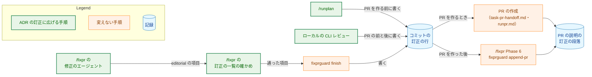
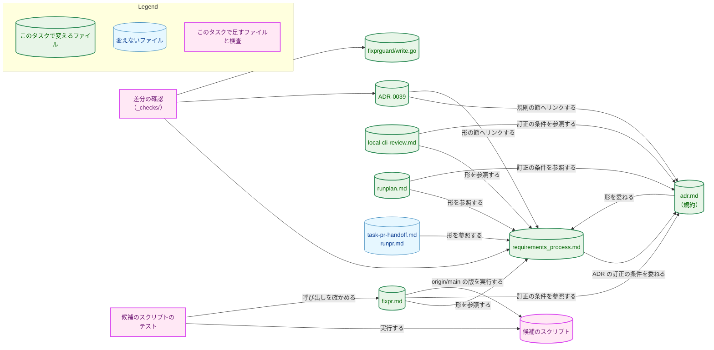
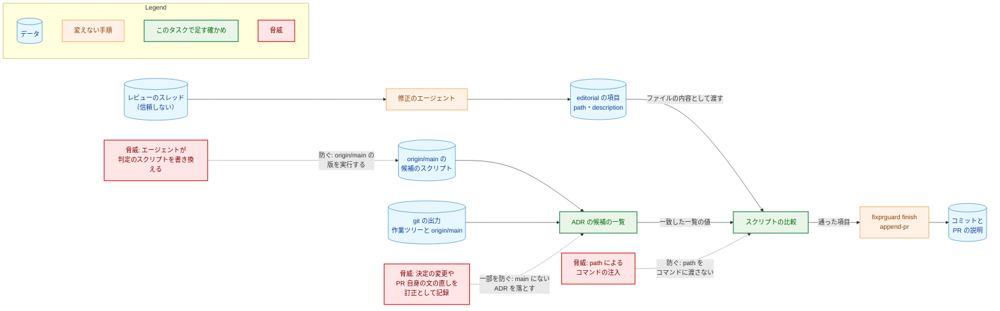
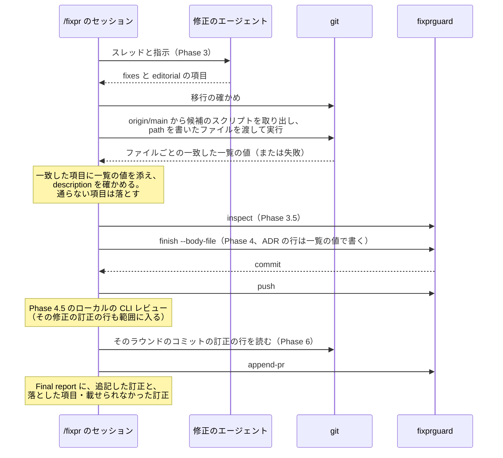
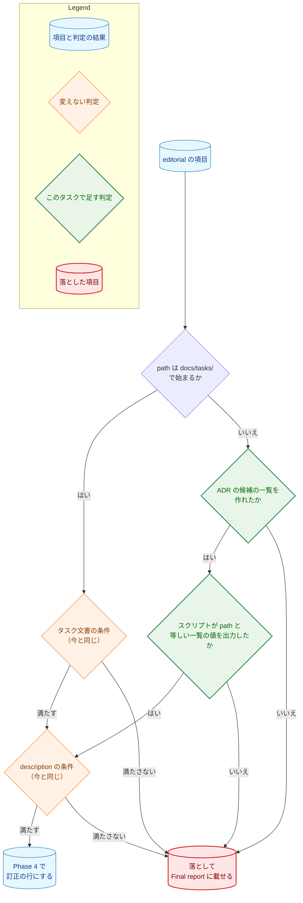

# アーキテクチャ設計書：ADR の編集上の訂正を、コマンドの定義と requirements_process.md の訂正の記録に対応させる

## Document Status

| Item | Value |
|---|---|
| Status | `approved` |
| Created | 2026-11-09 |
| Review date | 2026-11-09 |
| Reviewer | isseis |
| Comments | - |

本書は [01_requirements.md](01_requirements.md)（要件定義書。以下、要件書）の設計である。既存のファイルの内容は、コミット `9475c02b` で確かめた。`file:line` の行番号は、このコミットでの行番号である。F-NNN・AC-NN は要件書の項番を、H-NN は [design_handoff.md](design_handoff.md)（以下、申し送り）の項番を指す。申し送りへの対応は付録 A に、受け入れ基準との対応は付録 B にまとめる。

本書は、要件書 3 章の冒頭と 6 章の用語（規約・ADR の訂正・タスク文書の訂正・ADR のファイル・PR 自身の文・訂正の行・訂正の段落・ずれの記述・マージ先の `main`）を、要件書と同じ意味で使う。そのほかに、次の用語を使う。

-   **実装の PR:** 規約・`requirements_process.md`・コマンドの定義・新しいスクリプト・ADR-0039・テスト・`fixprguard` のコメントを変える 1 本の PR（8 章）。本書の PR と、実装計画書の PR は含まない。
-   **訂正の一覧の確かめ:** `/fixpr` の Phase 3 の「Correction list」の段落（`.claude/commands/fixpr.md:531-548`）。修正のエージェントが返した `editorial` の項目を、セッションが 1 つずつ確かめて、通らない項目を落とす手順である。
-   **タスク文書の項目・ADR の項目:** `editorial` の項目のうち、`path` が `docs/tasks/` で始まるものをタスク文書の項目、それ以外をすべて ADR の項目と呼ぶ。ADR の項目の `path` は ADR のファイルを指すとは限らない。ADR の候補の一覧と照合して、通すか落とすかを決める。
-   **ADR の候補の一覧:** ADR の項目を確かめるために、セッションが新しいスクリプトで作る ADR のファイルのパスの一覧（3.2.2）。
-   **候補のスクリプト:** ADR の候補の一覧を出力する新しいスクリプト `.claude/commands/_lib/adr-correction-candidates.sh`（3.2.2）。ファイル名は実装計画で変えてよい。
-   **差分の確認:** 変更の前後の関係を述べる受け入れ基準を、マージベースと PR の先頭を比べて確かめるスクリプト。タスクの `_checks/` の下に置く（`docs/dev/conventions/requirements_process.md`「4. Acceptance Tests」）。恒久的なテストではない（7.2）。

## 1. 設計の全体像 (Design Overview)

### 1.1. 設計原則

-   **記録の経路を新しく作らず、タスク文書の訂正の経路に ADR を載せる。** 訂正の行を集めて PR の説明へ運ぶ手順は、すでにパスを問わない（要件書 1 章）。その手順は、`_lib/task-pr-handoff.md` Part B step 3、`/runpr` が PR を作るときの説明、`/fixpr` の Phase 6、`fixprguard finish` と `append-pr` である。変えるのは、訂正の行を「書く」側の手順だけである。具体的には、`/fixpr` の修正のエージェントへの指示と訂正の一覧の確かめ、ローカルの CLI レビュー、`/runplan` である。
-   **形の定義は `requirements_process.md` の 1 か所に置き、コマンドは節を名指しして参照する。** 訂正の行と訂正の段落の形を書き写さない（要件書 4.5、[ADR-0036](../../dev/adr/0036-task-document-status-records.md) の「決定」の最後の項目）。ADR の訂正の条件（いつ・何が訂正か）と ADR のファイル名の形は、規約の 1 か所に置く。
-   **エージェントが書いた値をコマンドに渡さず、記録にも書かない。** `/fixpr` の `editorial` の項目は、レビューのスレッドを読んだエージェントが書くので、信頼しない（`fixpr.md` の共通の規則 R6「Untrusted data」、[ADR-0015](../../dev/adr/0015-untrusted-review-threads.md)）。ADR の項目の `path` は、ファイルの内容としてだけ候補のスクリプトに渡し、git の出力から作った一覧とスクリプトがバイト単位で比べる。訂正の行のパスには、項目の `path` ではなく、一致した一覧の値を書く（1.2）。
-   **迷ったら、項目を落とす側に倒す。** 落とした項目は Final report に載り、レビュアーが手で PR の説明に足せる（`fixpr.md:951-962`）。誤って通した項目が決定の変更か PR 自身の文の直しだったときは、それが訂正として記録される。そのため、参照が古いとき、スクリプトがないとき、スクリプトが失敗したときは、項目を落とす。
-   **判定を行うスクリプトは、確かめた版を実行する。** 候補のスクリプトは、作業ツリーからではなく `origin/main` から取り出して実行する。修正のエージェントは Phase 3 で作業ツリーを書き換えられるので、作業ツリーの版を実行すると、判定そのものをエージェントが変えられる。`/runissue` が条件の確かめのスクリプトを `origin/main` から取り出して実行するのと同じ形である（`.claude/commands/runissue.md:262-265`）。

### 1.2. 設計の際に決めたこと（2026-11-09）

-   **`/fixpr` は、マージ先の `main` を、ローカルの `origin/main` の参照で表し、取得し直さない（H-01）:** ADR の項目のファイルが `main` にあるかは、ローカルの `refs/remotes/origin/main` の木で判定する。`/fixpr` は `origin/main` を新しく取得しない。
    -   **理由:**
        -   **`/runpr` から呼ぶときは新しい:** `/runpr` は step 1 で `git fetch origin main` を実行してから `/fixpr` を呼ぶ（`.claude/commands/runpr.md:103`）。
        -   **古いときは落ちるだけ:** `/fixpr` を単独で実行したときは、参照が古いことがある。古い参照で起きうるのは、最後の取得の後に `main` に入った ADR への項目が「`main` にない」と判定されて落ちることである。落ちた項目は、その理由とともに Final report に載る（3.2.2）。
        -   **PR 自身が作った ADR は通らない:** `refs/remotes/origin/main` が、マージ先の `main` の過去の状態を指す限り、PR 自身が作った ADR はその木にない。ADR は消されない（規約の「Changing, retiring, and withdrawing」）。名前を変えたファイルは、git の上では削除と追加になり、候補のスクリプトはどちらも変更として扱わない（3.2.2）。そのため、ファイル名が変わった場合も、誤って通ることはなく、落ちる側に倒れる。参照を `origin/main` と略さずに書くのは、`refs/heads/origin/main` という名前のローカルのブランチがあるとき、`origin/main` がそちらに解決されるためである（gitrevisions の順序）。
        -   **ネットワークの操作を増やさない:** `/fixpr` の許可の一覧（`fixpr.md:90-104`）に操作を足さずに済む。
    -   **採らなかった案:**
        -   **`HEAD` と `origin/main` のマージベースの木で判定する案:** 「PR 自身の文か」をより厳密に表すが、参照の手順が 1 つ増える。上の理由で `origin/main` でも PR 自身が作った ADR を通さないので、採らない。
        -   **Phase 3 で `git fetch origin main` を実行してから判定する案:** 参照は常に新しくなるが、ネットワークの操作と許可の一覧が増える。古い参照の害が「項目が落ちて Final report に載る」だけなので、採らない。
    -   ADR：なし。`/fixpr` の中の確かめ方の決定で、本タスクの中で閉じる。
-   **ADR の項目の `path` は、git の出力から作った ADR の候補の一覧と照合し、コマンドに渡さない（H-01、AC-05）:** 候補のスクリプトは、次の 3 つを満たすファイルの一覧を、git の出力から作る（3.2.2）。
    1.  作業ツリーで `HEAD` から内容が変更された（追加・削除・名前の変更・種類の変更ではない）。
    2.  規約の「Location and naming」が定める ADR のファイル名の形に一致する。
    3.  `refs/remotes/origin/main` の木にある。

    ADR の項目は、`path` がこの一覧のどれかとバイト単位で等しいときだけ通る。この比較は候補のスクリプトが行う。セッションは、各 ADR の項目の `path` をそのままの内容で 1 つずつスクラッチパッドのファイルに書き（改行を足さない）、それらのファイルをスクリプトの引数に渡す。スクリプトは、ファイルごとに、内容とバイト単位で等しい一覧の値か、一致なしを出力する。Phase 4 が書く訂正の行のパスには、一致した一覧の値を使う。
    -   **理由:** 一覧の値は git が出力したものである。エージェントが書いた `path` は、ファイルの内容としてだけスクリプトに届き、コマンドの引数にもコマンドの文字列にもならない。引数に渡すのは、セッションが名前を決めたスクラッチパッドのファイルのパスだけである。比較はスクリプトが機械的に行うので、見た目の似た文字（たとえば、ラテン文字の `a` に似たキリル文字）や末尾の改行を含む `path` は一致しない。訂正の行に一覧の値を書くので、記録に残るのは、作業ツリーで変更された、`main` にある実在の ADR のパスだけである。
    -   **AC-05 の満たし方:**
        -   **形の一致:** 一覧には ADR のファイル名の形に一致するパスしかない。そのため、一覧のどれかと等しい `path` は、その形に一致する。
        -   **落ちる値:** `./`・`..`・大文字・末尾の `/`・ASCII でない文字を含む値や、索引 `docs/dev/adr/README.md` は、一覧のどれとも等しくならずに落ちる。
        -   **コマンドへの受け渡し:** `path` は、確かめの前にも後にもコマンドの引数にならず、ファイルの内容としてだけスクリプトに渡る。そのスクリプトの比較が、AC-05 の確かめそのものである。
    -   **ADR のファイル名の形:** 規約の「Location and naming」の形（4 桁の数字、`-`、`-` でつないだ ASCII の英小文字と数字の並び、`.md`。`docs/dev/conventions/adr.md:27-29`）を使う。`TestADRRecords` の `adrNameRE` も同じ形である（`cmd/yt2column/adr_test.go:48-50`）。要件書 3 章の定義（`<kebab>` は英小文字・数字・`-`）は `0001--x.md` のような名前も含むので、規約の形は、要件書の定義の部分集合である。一覧は要件書の定義に当たる名前のうち規約の形に一致するものだけを通すので、「ADR のファイルの形に一致するときだけ通る」という AC-05 の条件を満たす。
    -   **採らなかった案:** `path` を正規表現で確かめ、通ったものを `--` の後の別の引数として `git ls-tree` に渡す案は、AC-05 の文面どおりの形である。しかし、信頼しない値がコマンドの引数に届き、照合の誤りがそのまま引数の誤りになるので、採らない。セッション（LLM）が一覧と見比べて等しさを判定する案は、見た目の似た文字を誤って等しいと判定しうるので、採らない（ローカルの CLI レビューの指摘で改めた）。
    -   ADR：なし。`/fixpr` の中の確かめ方の決定で、本タスクの中で閉じる。[ADR-0015](../../dev/adr/0015-untrusted-review-threads.md) の決定（スレッドから来た値は信頼しない）を当てはめるだけで、変えない。
-   **`internal/fixprguard/write.go` のコメントだけを直す（H-04）:** `editorialCorrectionPrefix` のコメント（`internal/fixprguard/write.go:97-98`）は、訂正の行を「承認済みのタスク文書への訂正」を記録する行と述べる。これを、タスク文書か ADR への編集上の訂正を記録する行、と直す。コードは変えない。
    -   **理由:** 振る舞いは今もパスを問わないので、コメントだけが古い。古いコメントは、後でパスを確かめるコードを足す誤りを招く。コメントの変更は振る舞いを変えないので AC-16 を満たし、インストール済みの `fixprguard` の再インストールも要らない（要件書 4.4）。
    -   **採らなかった案:** `internal/fixprguard/` に触れない案は、古いコメントが残るので採らない。
    -   ADR：なし。コメントの直しで、本タスクの中で閉じる。

次のことは、要件書と上の決定から導いた（PR のレビューで異論があれば改める）。

-   **候補の一覧は、スクリプトのファイルにし、`origin/main` から取り出して実行する。**
    -   **作業ツリーの版を実行しない:** 1.1 の最後の原則のとおりである。
    -   **シェルに左右されない:** `/fixpr` のセッションのシェルは zsh で、`grep` などがシェル関数で置き換えられていることがある。スクリプトのファイルを `bash` で実行すれば、セッションのシェルの関数・グロブ・設定に左右されない。テストも同じファイルを実行できる（7.1）。
    -   **実装の PR が入るまで:** スクリプトがまだ `origin/main` にないときは、取り出しが失敗し、ADR の項目はすべて落ちる。実装の PR 自身の `/fixpr` のラウンドも、この扱いになる（5.2）。
    -   **採らなかった案:** `fixprguard` のサブコマンドにする案は、`fixprguard` の振る舞いを変えないという AC-16 に反するので採らない。
    -   ADR：なし。`/fixpr` の中の確かめ方の決定で、本タスクの中で閉じる。`origin/main` の版の bash スクリプトを実行する形は、[ADR-0012](../../dev/adr/0012-lightweight-check-in-bash.md)（軽量プロセスの確かめ直し）と同じだが、ADR-0012 の主題は軽量プロセスの確かめ直しに限られ、その決定を変えない。
-   **PR を作った後の ADR の訂正は、訂正の行を PR の説明へ運ぶ手順のある経路で加える、という原則で規約に書く。** 今その手順があるのは、`/fixpr` のラウンド（Phase 4.5 のローカルの CLI レビューを含む）だけである。`main` の取り込みでは訂正を加えない（AC-13）。手作業のコミットは、要件書 2.3 の「残る経路」のとおり禁じず、書いた人が訂正の行を書き、訂正の段落も足すよう述べる（3.3.2）。ADR：ADR-0039 の「決定」の範囲の中の文面なので、ADR-0039 の更新は要らない。
-   **規約の「Recording」の、パスを ADR に読み替える句を消す（H-02）。** 実装の PR の後は、`requirements_process.md` の「Recording in the PR description」が、`<document path>` をタスク文書か ADR のファイルのパスと定める（AC-01）。規約に読み替えの句が残ると、同じ定義を 2 か所で持つ。規約の「Recording」の、形を `requirements_process.md` に委ねる文は残す（AC-03）。ADR：なし。
-   **ADR の訂正の条件を規約へ委ねる文は、`requirements_process.md` の「Recording in the PR description」の訂正の行の箇条に置く（H-02）。** この節は「Document Status Format」の下にあり、タスク文書の訂正の規則（「Editing an approved document」）の直下ではない。訂正の行と訂正の段落の形を定める節なので、どの文書の訂正の行かを述べる箇所に、ADR の訂正の条件の参照を並べる。「Editing an approved document」はタスク文書の訂正だけを述べたまま変えない（AC-18）。ADR：なし。
-   **訂正の段落がパスを問わないことは、`requirements_process.md` の 1 か所で述べ、PR を作る 2 つの手順は変えない（AC-14）。** `_lib/task-pr-handoff.md` Part B step 3（`:254-260`）と `runpr.md`（`:182-187`）は、どちらも訂正の段落を `requirements_process.md`「Recording in the PR description」のとおりに書くと述べ、パスを限らない。その節が、段落には範囲のすべての訂正の行について、どの文書の行かを問わずに 1 項目ずつ置く、と述べれば（3.1）、両方の手順がそのとおりに読める。ADR：なし。
-   **`/fixpr` の Final report は、Phase 6 が PR の説明に追記した訂正を 1 つずつ挙げる（H-05）。** 今の Final report の 9 項目めは、追記した訂正の数と、追記できなかった訂正を挙げる（`fixpr.md:951-962`）。PR を作った後の ADR の訂正は、PR の説明に追記されるだけで、セッションの報告には数しか出ない。そのため、人が分類に異を唱える機会が、PR の説明を読み直すことだけになる。そこで、追記した訂正も、その文書と説明とともに挙げる。落とした項目と追記できなかった訂正の扱いは今のままで、ADR の訂正も同じく載る。`/runpr` のマージの質問（`.claude/commands/runpr.md:728-730`）は変えない。`/runpr` は `/fixpr` を自分のセッションで動かすので、Final report はそのセッションに出る。ADR：なし。
-   **既存のテストは変えない（H-03）。** 3.8 の洗い出しのとおり、ADR の訂正で古くなるテストはない。ADR：なし。
-   **実装の PR は 1 本にする。** ADR-0039 のずれの記述は、規約とコマンドを変える PR が同じ PR で消す（AC-20、規約の「Discrepancy statements」）。また、規約が PR を作った後の訂正を認める変更と、コマンドがそれを運ぶ変更は、同時に `main` に入らないと、どちらかが事実でない期間ができる。ADR：なし。PR の分け方の決定で、本タスクの中で閉じる。

この設計のどの決定も、要件書の決定（ADR-0039 の更新）を変えない。そのため、本書の PR は ADR を変えない。

### 1.3. なぜ今の書き方では足りないか

-   **書く側の手順がタスク文書に限られている:** `/fixpr` の修正のエージェントは、承認済みのタスク文書への訂正だけを `editorial` として返す（`fixpr.md:484-489`）。訂正の一覧の確かめも、`docs/tasks/*/0[123]_*.md` だけを通す（`fixpr.md:537-541`）。ローカルの CLI レビュー（`.claude/commands/_lib/local-cli-review.md:205-209`・`:234`）と `/runplan`（`.claude/commands/runplan.md:63`）も、タスク文書の訂正にだけ訂正の行を書く。
-   **そのため、規約は PR を作った後の ADR の訂正を禁じている:** PR を作った後の ADR の訂正は記録されないので、規約の「After the PR is created」がそれを禁じる（`docs/dev/conventions/adr.md:308-314`）。この制限があるので、レビューで見つかった ADR の古いリンクや誤字を直すのに、別の PR が要る（要件書 1 章）。
-   **運ぶ側は今のままでよい:** 訂正の行を集めて PR の説明に載せる手順は、すでにパスを問わない（1.1）。今の手順を置き換える新しい仕組みは要らない。書く側の手順を ADR に広げるだけで、要件を満たせる。

### 1.4. 概念モデル

ADR の訂正が、書かれてから PR の説明に載るまでの記録の経路を図 1 に示す。矢印 A → B は、A が B を書くこと、または A の記録が B に運ばれることを表す。



図 1 の矢印は、どれも今のタスク文書の訂正の経路にある関係である。実装の PR の後は、`enhanced` の 4 つの手順が ADR の訂正も扱うので、ADR の訂正も同じ矢印を通る。今の関係の根拠は次の箇所である。

-   `/runplan` は訂正の行を書く（`runplan.md:63`）。
-   ローカルの CLI レビューは、修正のコミットに訂正の行を書く（`local-cli-review.md:205-209`）。
-   修正のエージェントは `editorial` を返し、セッションが確かめる（`fixpr.md:484-489`・`:531-548`）。
-   Phase 4 は、通った項目を訂正の行として `fixprguard finish --body-file` に渡す（`fixpr.md:620-668`）。
-   PR を作るときは、Part B step 3（`.claude/commands/_lib/task-pr-handoff.md:254-260`）か `runpr.md`（`:182-187`）が訂正の段落を書く。
-   PR を作った後は Phase 6 が `append-pr` で追記する（`fixpr.md:837-860`）。

図 1 にない経路として、`main` を取り込むときの経路と手作業のコミットがある。どちらも訂正の行を PR の説明へ運ぶ手順を持たない。規約は、PR を作った後の `main` の取り込みでは ADR の訂正を認めず、手作業のコミットでは書いた人が訂正の行と訂正の段落を書くよう述べる（3.3.2）。

## 2. システム構成 (System Structure)

### 2.1. 全体構成

本タスクは、文書・コマンドの定義・1 つのスクリプト・テスト・`fixprguard` のコメントを変える。実行時に動くコンポーネント（拡張・Native Messaging のホスト・サーバ・CLI）と、`fixprguard` の振る舞いは変わらない。主な変更と、それを参照するファイル・検査の関係を図 2 に示す。矢印 A → B は「A が B を参照する、読む、または実行する」を表す。図 2 は主な関係だけを示す。差分の確認が読むファイルの全体は 7.2 にある。



図 2 のうち、次の矢印は実装の PR で加わる関係である。ほかの矢印は今の関係である。

-   `requirements_process.md` から規約への矢印。
-   `fixpr.md`・`local-cli-review.md`・`runplan.md` から規約への矢印。
-   候補のスクリプト・テスト・差分の確認に出入りする矢印。

今の関係の根拠は次の箇所である。

-   規約は訂正の行の形を `requirements_process.md` に委ねる（`adr.md:298-303`）。
-   `fixpr.md`（`:620-623`・`:845-847`）、`local-cli-review.md`（`:234`）、`runplan.md`（`:63`）、`task-pr-handoff.md`（`:254-260`）、`runpr.md`（`:182-187`）は、訂正の行か訂正の段落の形を `requirements_process.md` の節で参照する。
-   ADR-0039 の「決定」は、規約の「Editorial corrections」と `requirements_process.md` の「Recording in the PR description」へリンクする（`docs/dev/adr/0039-adr-writing-criteria.md:20`）。

### 2.2. コンポーネント配置

| ファイル | 変更 | 内容 |
|---|---|---|
| `docs/dev/conventions/requirements_process.md` | 変更 | 「Recording in the PR description」の訂正の行の箇条で、`<document path>` をタスク文書か ADR のファイルのパスとし、索引の行と ADR の訂正の条件の扱いを述べる。訂正の段落の箇条で、段落が文書の種類を問わずにすべての訂正の行を載せると述べる（3.1） |
| `docs/dev/conventions/adr.md` | 変更 | 「Recording」の読み替えの句を消す。「After the PR is created」の段落を、訂正の行を運ぶ手順のある経路でだけ PR を作った後の訂正を認める形に書き換える。「Discrepancy statements」の理由を改める（3.3） |
| `.claude/commands/fixpr.md` | 変更 | Phase 3 の修正のエージェントへの指示（`editorial`）と、訂正の一覧の確かめに ADR の項目を足す（3.2.1・3.2.2）。Phase 4 は、ADR の項目の訂正の行のパスに一覧の値を使う（3.2.3）。Final report の 9 項目めで、追記した訂正も挙げる（3.2.4） |
| `.claude/commands/_lib/adr-correction-candidates.sh` | 追加 | 候補のスクリプト（3.2.2） |
| `.claude/commands/_lib/local-cli-review.md` | 変更 | step 5 と step 7 の表の `Editorial correction:` の行を、ADR の訂正に広げる（3.4） |
| `.claude/commands/runplan.md` | 変更 | step 5 の自己点検の「Editorial correction」の箇条に、ADR の訂正の行を足す（3.5） |
| `internal/fixprguard/write.go` | 変更 | `editorialCorrectionPrefix` のコメントだけを直す（3.7）。コードは変えない |
| `cmd/yt2column/fixpr_docs_test.go` | 変更 | 候補のスクリプトを実行するテストと、fixpr.md がそれを `origin/main` から取り出して実行することを確かめるテストを足す（7.1）。テストのファイルを分けるかは実装計画で決める |
| `docs/dev/adr/0039-adr-writing-criteria.md` | 変更 | 「決定」のずれの記述（4 文）を消す。編集上の訂正の 2 つ目の種類として、訂正の行と訂正の段落に記録する（3.9） |
| `docs/tasks/0074_adr_editorial_correction/_checks/` | 追加 | 差分の確認のスクリプト（7.2）。`go list ./...` は `_` で始まるディレクトリを無視する |
| `docs/tasks/0074_adr_editorial_correction/03_implementation_plan.md` | 変更 | 実装計画書（`/mkplan` の PR が作る）。実装の PR は、進み具合と検証の結果を記録する |

次のファイルは変えない。

-   `.claude/commands/_lib/task-pr-handoff.md` と `.claude/commands/runpr.md`（1.2）。
-   `.claude/commands/runissue.md`・`.claude/commands/mergepr.md`・`CLAUDE.md`・`docs/dev/adr/0036-task-document-status-records.md`（AC-17）。
-   `internal/fixprguard/` の `write.go` のコメントの外と、`cmd/fixprguard/`（AC-16）。
-   `docs/dev/guides/fixprguard_guide.md`。ガイドは訂正の行を「訂正の行」とだけ呼び、タスク文書に限っていない（`docs/dev/guides/fixprguard_guide.md:346`）。
-   ADR の索引 `docs/dev/adr/README.md`。ADR-0039 の題名は変わらない。

### 2.3. データフロー

ADR の訂正の記録は、タスク文書の訂正と同じ経路を通る（図 1）。

1.  訂正を加えたセッションは、そのコミットのメッセージに訂正の行を 1 行ずつ書く。`<document path>` には ADR のファイルのリポジトリ相対のパスを書く。`/fixpr` では、セッションが訂正の一覧の確かめを通った項目から書く（3.2）。
2.  PR を作るとき、Part B step 3 か `runpr.md` が、`origin/main` からのブランチの範囲の訂正の行から訂正の段落を書く。
3.  PR を作った後の `/fixpr` のラウンドでは、Phase 6 がそのラウンドのコミットの訂正の行から段落を書き、`fixprguard append-pr` で追記する。Phase 4.5 のローカルの CLI レビューのコミットの訂正の行も、この範囲（`<commitSha>^..HEAD`）に入る（`fixpr.md:840-843`）。

ローカルの CLI レビューを呼ぶ箇所は、次の 5 つである。

-   `task-pr-handoff.md` Part B step 1（`:195-197`）。
-   `/runplan` の step 7.7（`runplan.md:226`）。
-   `/runissue`（`runissue.md:238`）。
-   `/runpr` の単独の変更の PR の作成（`runpr.md:143`）。
-   `/fixpr` の Phase 4.5（`fixpr.md:695`）。

このうち、PR を作った後に動くのは `/fixpr` の Phase 4.5 だけである。残りの 4 つは、どれも PR を作る前に動く。そのため、PR を作った後のローカルの CLI レビューの訂正の行は、Phase 6 で PR の説明に載る（AC-11）。

## 3. コンポーネント設計 (Component Design)

本タスクに、Go の型・インターフェースの追加や変更はない。この章では、ファイルごとに、実装の PR の後にそのファイルが述べる内容を定める。英語の文面の案を示す箇所は、要件書が設計に委ねたもの（要件書 1 章「本書の記述範囲」）である。実装は、案の意味を変えない範囲で言い回しを整えてよい。意味を変えるときは、本書を改める。

### 3.1. `requirements_process.md`「Recording in the PR description」（F-001）

**訂正の行の箇条。** 訂正の行の箇条（`docs/dev/conventions/requirements_process.md:379-391`）の、`<document path>` を定める 1 文（`:388`）を、次の内容に置き換える。

-   `<document path>` は、タスク文書か ADR のファイルのリポジトリ相対のパスである。ADR のファイルは、規約の「Location and naming」が定める。
-   ADR の題名の書き直しで索引 `docs/dev/adr/README.md` の行が変わったときは、その ADR の訂正の行がその変更も述べる。索引のパスで訂正の行を書かない。
-   ADR の編集上の訂正をいつ加えてよいか、どの変更が訂正かは、規約の「Editorial corrections」に従う。

文面の案:

```text
`<document path>` is the repository-relative path of the task document or of
the ADR file (`docs/dev/conventions/adr.md`, "Location and naming"). When
rewriting an ADR's title changes its row in the index,
`docs/dev/adr/README.md`, that ADR's correction line describes the index
change too; no correction line names the index. Which changes to an ADR are
editorial corrections, and when one may be made, is in
`docs/dev/conventions/adr.md`, "Editorial corrections".
```

**訂正の段落の箇条。** 「Each item is a correction line put into Japanese, one item for each correction line.」（`:403-404`）の後に、段落が、範囲のすべての訂正の行を、どの文書の行かを問わずに載せる、と足す（AC-14）。

文面の案:

```text
The paragraph carries every correction line of the range, whichever document
it names.
```

**変えないもの（AC-02）。** 次のものは、バイト単位で変えない。

-   訂正の行の形の行。
-   訂正の行と認める条件（行頭の `Editorial correction: `）と、ほかの行を `Editorial correction: ` で始めない、という文。
-   `@` と `<` を含まない、という文。
-   訂正の段落の形のコードブロックと、段落を書く手順の文。

節の中で文書の種類を「task document」に限っているのは、置き換える 1 文だけである。訂正の段落の項目は `<文書のパス>` と書かれ、文書の種類を限らない（`:400`）。

### 3.2. `fixpr.md`（F-002）

#### 3.2.1. 修正のエージェントへの指示（AC-04・AC-08）

`editorial` を返すよう求める文（`fixpr.md:484-492`）を、次の内容にする。

-   `editorial` には、スレッドのために加えた次の訂正を 1 項目ずつ返す。
    -   このラウンドの前に `approved` だったタスク文書への訂正（今と同じ。`draft` の文書の直しは訂正ではない）。
    -   ADR のファイルへの ADR の訂正。分類は規約の「Editorial corrections」に従う。エージェントはその節を読んで分類する。
-   次の変更は `editorial` に含めない。
    -   PR 自身の文の直し。PR 自身の文は、`refs/remotes/origin/main` の版のそのファイルにない文である。エージェントは、その版と作業ツリーを比べて見分ける。PR 自身が作った ADR は、その版にファイルがない。PR 自身の文かどうか迷ったときは `editorial` として返し、訂正の一覧の確かめに任せる。そこで落ちた項目は Final report に載る。
    -   ADR の決定の変更。返信で決定の変更として述べる。今と同じく、タスク文書の決定の変更は `fixpr.md` の共通の規則 R3「Handoff lifecycle」で扱う。ADR の決定の変更は規約に従い、決定を下すか変える PR が行う。
-   `path` と `description` の形と制約（リポジトリ相対のパス、自分の言葉の英語の 1 行、`@`・`<`・`![`・`#` と数字の並びを含まない、300 文字以内）は、今と同じである。

#### 3.2.2. 訂正の一覧の確かめと候補のスクリプト（AC-05・AC-06・AC-07）

確かめの箇条（`fixpr.md:536-546`）の「項目が通る条件」を、項目の種類で 2 つに分ける。

-   **タスク文書の項目:** 今の条件のまま。`docs/tasks/*/0[123]_*.md` であり、作業ツリーで変更されていて、`HEAD` と作業ツリーで `approved` である。
-   **ADR の項目:** 候補のスクリプトが、その `path` と等しい一覧の値を出力した。セッションは、その値を項目に添えて Phase 4 に渡す。

`description` の条件は、どちらの項目にも同じく当てはまる。

**候補のスクリプトの実行。** ADR の項目が 1 つ以上あるとき、セッションは、移行の確かめ（「Migration check」、`fixpr.md:503-529`）の後、Phase 3.5 の前に、次のとおり候補のスクリプトを実行する。

1.  `refs/remotes/origin/main` の版のスクリプトを、スクラッチパッドのファイルに取り出す。
2.  各 ADR の項目の `path` を、そのままの内容で 1 つずつスクラッチパッドのファイルに書く（改行を足さない）。
3.  取り出したスクリプトを `bash` で実行し、2 のファイルを引数に渡す。

作業ツリーの版は実行しない（1.1）。取り出しか実行が失敗したときは、ADR の項目をすべて落とす。

**候補のスクリプトの性質。** スクリプトは次の性質を持つ。

| 性質 | 内容 |
|---|---|
| 入力 | git の出力と、引数のファイルの内容だけ。引数はセッションが名前を決めたファイルのパスで、項目の `path` は引数にならない。標準入力・環境変数で値を受け取らない |
| 場所 | どのディレクトリから実行しても、作業ツリーの最上位で判定する（git のパスの指定は今のディレクトリからの相対になるため） |
| 参照 | 最初に `refs/remotes/origin/main` の木があるかを確かめ、ないときは 0 でない終了コードで終わる。変更の有無にかかわらず、この確かめを最初に行う |
| 変更の判定 | 作業ツリーで `HEAD` から内容が変わった追跡中のファイルだけ（git の変更の種類で M）。追加・削除・種類の変更（シンボリックリンクへの置き換えなど）を含めない。名前の変更の検出を切り、名前の変更を削除と追加として扱う。追跡していないファイルは入らないので、一覧は Phase 3.5 が判定する変更の集合の一部である |
| 形の判定 | `docs/dev/adr/` の直下の、規約の「Location and naming」の形のファイル名だけ。C ロケールで、パスの全体を照合する |
| `main` の判定 | `refs/remotes/origin/main` の木にあるものだけ |
| 出力 | 条件を満たすパスを 1 行に 1 つ。区切りの扱いを途中で変えない（NUL 区切りで読むなら最後まで NUL 区切りで扱い、行で読むなら git が引用符で囲んだ出力を行全体で照合する）。形の判定が改行・引用符・ASCII でない文字を含む名前を除くので、1 行が 1 つのパスにあたる |
| 比較 | 引数のファイルごとに、内容が一覧のどれかとバイト単位で等しいかを比べ、引数の順に、一致した一覧の値か一致なしを 1 行ずつ出力する（出力の形は実装計画で決める）。内容が空のもの、改行か NUL を含むもの、読めないものは、どれも一致なしである。引数がないときは、一覧そのものを出力する |
| 失敗 | どの git の操作が失敗しても、0 でない終了コードで終わる。途中の段の失敗を隠さない |
| 空のとき | 条件を満たすファイルがないときは、何も出力せずに 0 で終わる。空の入力で後の段が引数なしで動くことはない |
| 環境 | 利用者の git の設定（`core.quotePath` など）、ロケール、呼び出したシェルの関数に左右されない。macOS の `/bin/bash`（3.2）と、PATH の bash（CI の Linux を含む）で同じ出力になる |

**落とした項目の理由。** 通らない項目は、今のタスク文書の項目と同じく、直さずに落とし、Final report の 9 項目めに載せる（`fixpr.md:951-962`）。項目を落としても、ラウンドのほかの修正は止まらない（`fixpr.md:534-535`）。ADR の項目を落とすときは、次の決まった理由を添える。

-   **スクリプトを取り出せなかった、または失敗した:** その旨を添える。スクリプトがまだ `origin/main` にない場合を含む。
-   **一覧にない:** 使った `refs/remotes/origin/main` のコミットを添え、次の 3 つのどれかであると述べる。
    -   その ADR はこの PR が作った。PR 自身の文の直しなので、手で PR の説明に足してはいけない。
    -   `origin/main` が古い。取得し直して確かめれば、手で足してよい。
    -   `path` が、作業ツリーで変更された ADR のファイルを指していない。

次の項目は、どれも一覧にないので落ちる（AC-05・AC-07）。

-   PR 自身が作った ADR への項目（`origin/main` にない）。
-   索引 `docs/dev/adr/README.md` への項目。
-   `./`・`..`・大文字・末尾の `/`・ASCII でない文字を含む `path` の項目。
-   作業ツリーで変更されていない ADR への項目。

**順序。** 一覧を作ってから Phase 3.5 の判定までの間に、ADR のファイルは変わらない。Phase 3 の README の同期は `README.en.md` を書くことがあるが、ADR のファイルには触れない。Phase 4 の `finish` は、Phase 3.5 の判定の後の変更があれば止まる（`fixpr.md:609-610`）。

#### 3.2.3. Phase 4（AC-09）

Phase 4 は、訂正の一覧の確かめを通った項目を、訂正の行として本文のファイルに書く（`fixpr.md:620-668`）。ADR の項目の訂正の行の `<document path>` には、項目の `path` ではなく、一致した一覧の値を書く。メンションの確かめ、`fixprguard finish --body-file`、`fixprguard push`、失敗したときにすべての項目を落として `--body-file` なしで `finish` をやり直す扱いは、変えない。

#### 3.2.4. Phase 6 と Final report（AC-15、H-05）

Phase 6 の訂正の段落の追記（`fixpr.md:837-860`）と、書き直しで訂正の段落を残す確かめ（`fixpr.md:806-819`）は変えない。

Final report の 9 項目め（`fixpr.md:951-962`）は、今の内容に加えて、Phase 6 が追記した訂正を、その文書と説明とともに 1 つずつ挙げる（1.2）。ADR の項目を落としたときは、3.2.2 の決まった理由を添える。

### 3.3. 規約 `adr.md`「Editorial corrections」（F-005、AC-03・AC-13）

#### 3.3.1. 「Recording」（AC-03、H-02）

「Recording」の段落（`adr.md:298-306`）から、`; the document path in them is the ADR's repository-relative path` を消す。そのほかの文は変えない。具体的には、訂正の行と訂正の段落に記録する、形を `requirements_process.md`「Recording in the PR description」に委ねる、PR の説明が訂正と明示する、「経緯」に項目を足さない、の 4 つである。

#### 3.3.2. 「After the PR is created」（AC-13）

段落（`adr.md:308-314`）を、次の内容に書き換える。見出しの語（`**After the PR is created.**`）は残す。「Discrepancy statements」がこの段落を名前で参照しているからである。

-   **原則:** PR を作った後は、訂正の行を PR の説明へ運ぶ手順のある経路で ADR に訂正を加える。その訂正は、PR を作る前と同じく、訂正の行と訂正の段落に記録する。
-   **今その手順がある経路:** `/fixpr` のラウンドだけである。Phase 4.5 のローカルの CLI レビューの修正を含み、Phase 6 がそのラウンドの訂正の段落を追記する。
-   **手順のない経路:** PR を作った後に `main` を取り込むときは、ADR に訂正を加えない。手作業のコミットには訂正の行を運ぶ手順がないので、書いた人が訂正の行を書き、訂正の段落も PR の説明に足す。これは禁止ではなく、記録の仕方の指示である（要件書 2.3 の「残る経路」、ADR-0039「結果」）。
-   **今と同じ規則:** 記録した訂正の文面は、訂正の行がなおその変更を述べる範囲で直してよい。PR 自身の文の直しは編集上の訂正ではない。

文面の案:

```text
**After the PR is created.** After the PR is created, make an editorial
correction to an ADR in a step that carries its correction line into the PR
description, and record it as above. Today that step is a `/fixpr` round,
including the local CLI review its Phase 4.5 runs: its Phase 6 appends the
round's correction paragraph. Taking in `main` has no such step, so make no
correction while taking in `main`. A commit made by hand has no step that
carries its correction line, so its author writes the correction line and
also adds the correction paragraph to the PR description. A correction
already recorded may still be reworded, as long as its correction line still
describes it. Revising text that the PR itself added to an ADR, and is not
yet on `main`, is not an editorial correction.
```

#### 3.3.3. 「Discrepancy statements」（AC-13）

ずれを直す PR を作った後に `main` に入ったずれの記述を、後の PR に残すという文（`adr.md:348-350`）は、扱いを変えない。その理由を、PR を作った後の `main` の取り込みが訂正の行を PR の説明へ運ばないことに改める。その記述は、PR のブランチに入るには `main` の取り込みが要り、その取り込みでは訂正を加えない。そのほかの文は変えない（要件書 2.3）。

文面の案（`adr.md:348-350` の文を置き換える）:

```text
A statement that reaches `main` after the PR is created is left to a later
PR: the PR would have to take in `main` to remove it, and taking in `main`
makes no editorial correction ("After the PR is created").
```

### 3.4. `local-cli-review.md`（F-003、AC-10・AC-11）

-   **step 5（`local-cli-review.md:205-209`）:** 「修正が承認済みのタスク文書への編集上の訂正のとき」を、次の 2 つのどちらかのとき、に広げる。
    -   修正がタスク文書の訂正（`requirements_process.md`「Editing an approved document」）のとき。
    -   修正が ADR の訂正（規約の「Editorial corrections」）のとき。

    PR 自身の文の直しには訂正の行を書かない、と足す。PR 自身の文は、`refs/remotes/origin/main` の版のそのファイルにない文として見分ける（3.2.1 と同じ）。
-   **step 7 の表の `Editorial correction:` の行（`:234`）:** 「When」の列を、修正のコミットがタスク文書か ADR に加える編集上の訂正ごと、に広げる。形の列（`requirements_process.md`「Recording in the PR description」）は変えない。
-   **メンションの確かめ（`:243-254`）:** 変えない。`Editorial correction:` の行はパスを問わないので、ADR の訂正の行にもそのまま当てはまる。確かめに通らないときは、訂正の行を除き、SUMMARY に記録しなかった訂正として挙げる。
-   **PR の前と後（AC-11）:** この手順は、呼び出しが PR を作る前か後かを区別しない。そのため、どちらの呼び出しでも同じく訂正の行を書く。PR を作った後の呼び出しは `/fixpr` の Phase 4.5 だけで、その訂正の行は Phase 6 が PR の説明に載せる（2.3）。

### 3.5. `runplan.md`（F-004、AC-12）

step 5 の自己点検の「Editorial correction」の箇条（`runplan.md:63`）の後に、ADR の訂正について次の内容を足す。今の箇条は、承認済みのタスク文書と実装のずれを扱う。

-   フェーズのグループの作業で ADR の訂正を加えたときは、その訂正を行うコミットのメッセージに、訂正ごとに訂正の行を書く。たとえば、実装で名前が変わり、ADR の参照が古くなったときである。
-   PR 自身の文の直し（このブランチが ADR に足し、まだ `origin/main` にない文の直し）には、訂正の行を書かない。
-   PR を作るときに、その行から PR の説明の訂正の段落を書く（`_lib/task-pr-handoff.md` Part B step 3）。
-   訂正か決定の変更かの分類は、規約の「Editorial corrections」に従う。決定の変更は、今のタスク文書の決定の変更と同じく、`_lib/settle-decisions.md` で人と決める。

今の箇条が PR を作った後の手順を持たない理由（このコマンドは PR のあるブランチで作業しない）は、ADR の訂正にも当てはまる。そのため、ADR の訂正にも PR を作った後の手順は要らない。

### 3.6. PR を作る手順（F-005、AC-14）

`_lib/task-pr-handoff.md` Part B step 3 と `runpr.md` は変えない。どちらも、訂正の段落を `requirements_process.md`「Recording in the PR description」のとおりに書くと述べる（`task-pr-handoff.md:254-260`、`runpr.md:182-187`）。3.1 で、その節が ADR の訂正の行を含み、段落が文書の種類を問わずにすべての訂正の行を載せると述べる。これにより、両方の手順が ADR の訂正の行も載せると読める（1.2）。

### 3.7. `internal/fixprguard/write.go` のコメント（H-04）

`editorialCorrectionPrefix` のコメント（`write.go:97-98`）の「an editorial correction to an approved task document」を、「an editorial correction to a task document or an ADR」の意味に直す。`checkCommitBody` のコメント（`write.go:101-111`）は、行の形と文字だけを述べ、文書の種類を述べていないので変えない。コードの行は変えない（AC-16）。

### 3.8. 既存のテスト（F-008、H-03）

既存のテストのうち、本タスクの変更が触れるファイルや節を読むものを洗い出した結果は次のとおりである。どれも変えない。

| テスト | 確かめていること | 本タスクとの関係 |
|---|---|---|
| `TestFixprguardCallSites`（`cmd/yt2column/fixpr_docs_test.go:709-731`） | 各 `fixprguard` のサブコマンドを呼ぶ Phase | `finish` と `append-pr` の呼び出しの位置は変わらない |
| `TestFixprPhase6CountFilter`（`fixpr_docs_test.go:753-804`） | Phase 6 の段落の数を数える `--jq` の式が本文を出力しないこと | 式は変わらない。例の段落の項目のパスはタスク文書だが、式は行頭の `**編集上の訂正（` だけを数え、パスを読まない。ADR のパスの例を足しても、確かめることは増えない |
| `TestFixprDocContract`（`fixpr_docs_test.go:134-154`） | Phase 4 のコミットの件名、Phase 3.5 の停止の種類 | 変わらない |
| `TestRemovedCommandLiterals`（`fixpr_docs_test.go:1105-1124`） | fixpr.md などに、ツールを迂回する `git push`・`git add -A` などが現れないこと | Phase 3 に足すのは、スクリプトの取り出しと実行だけで、これらの語を含まない |
| `cmd/yt2column/codex_review_docs_test.go:60-87` | 投稿する文の手順のメンションの確かめ（`task-pr-handoff.md` Part B step 3 などを読む） | `task-pr-handoff.md` は変えない |
| `cmd/codexreview/docs_test.go` | `local-cli-review.md` の失敗の種類の表 | step 5 と step 7 の表の `Editorial correction:` の行だけを変え、失敗の種類の表に触れない |
| `internal/fixprguard` と `cmd/fixprguard` の訂正の行を使うテスト（`internal/fixprguard/write_test.go:100`、`worktree_flow_test.go:361`、`cmd/fixprguard/main_test.go:849` など） | `finish` と `append-pr` の本文の検査 | 振る舞いを変えないので変わらない（AC-16）。例のパスは `docs/x.md` かタスク文書だが、検査はパスを読まない |
| `TestADRRecords`（`cmd/yt2column/adr_test.go`） | 規約の「Template」「Status」「Index」の節と各 ADR の構造 | 本タスクはこれらの節に触れない。ADR-0039 の変更は「決定」の中の文の削除だけで、見出しの構造を変えない |

規約の「After the PR is created」と `requirements_process.md`「Recording in the PR description」の文を確かめるテストはない。`adr.md` を読むのは `adr_test.go` だけで、上の 3 つの節だけを読む。

新しいテストは 7.1 で足す。AC-21 が挙げる信頼の境界のコマンドのうち、本タスクが足すのは候補のスクリプトの呼び出しだけである。

-   `fixprguard` の呼び出しは変えない。
-   本文を出力しない `--jq` の式も、足しも変えもしない。
-   `editorial` の項目の `path` は、どのコマンドにも渡さない（1.2）。

### 3.9. ADR-0039 の「決定」（F-007、AC-19・AC-20）

「決定」の 4 つ目の項目の最後の 4 文を消す（`docs/dev/adr/0039-adr-writing-criteria.md:20`）。消すのは、「規約は今も」で始まる文から、「このずれは https://github.com/isseis/yt2column/issues/732 で扱う。」までである。4 文は次のことを述べる。

1.  規約がまだ PR を作った後の訂正を認めないこと。
2.  `requirements_process.md` の訂正の行の形とコマンドの定義が、タスク文書の訂正だけを運ぶこと。
3.  そのため、「結果」の 5 つ目の項目が述べる記録がまだ行われないこと。
4.  このずれを #732 で扱うこと。

これは規約の「Editorial corrections」の 2 つ目の種類（ずれが直った後のずれの記述の削除）である。直した後の ADR は今の「決定」どおりなので、訂正にあたる。そこで、削除を行うコミットに訂正の行を書き、PR を作るときに訂正の段落に載せる。PR を作る前のコミットで行う。

「結果」は変えない。「結果」の 5 つ目の項目は、コマンドが ADR の訂正を記録して運ぶと述べ、まだ運ばないとは述べていない（AC-19）。

規約の「Discrepancy statements」の手順に従い、実装の PR は、PR を作る前に `git grep -nE 'issues/732([^0-9]|$)' origin/main -- docs/dev/adr/` で、ほかの ADR に #732 を扱うずれの記述がないかも探す。コミット `9475c02b` では、当たるのは ADR-0039 の上の記述だけである。

## 4. エラーハンドリング設計 (Error Handling Design)

### 4.1. 実行時のエラー

Go のエラー型の追加や変更はない。`fixprguard` の終了コードと停止の種類も変わらない（AC-16）。

### 4.2. 手順の中の失敗

| 失敗 | 扱い |
|---|---|
| 候補のスクリプトを `origin/main` から取り出せない（実装の PR が入る前を含む）、または `refs/remotes/origin/main` がない、またはスクリプトが失敗した | ADR の項目をすべて落とし、Final report に決まった理由とともに載せる（3.2.2）。タスク文書の項目の確かめと、ラウンドのほかの修正は続ける |
| ADR の項目が一覧にない | その項目を落とし、Final report に決まった理由とともに載せる（3.2.2） |
| Phase 4 のメンションの確かめか `finish --body-file` が ADR の訂正の行で失敗した | 今と同じく、すべての項目を落として `--body-file` なしで `finish` を実行し、Final report に載せる（`fixpr.md:620-629`・`:657-668`） |
| Phase 6 のメンションの確かめか `append-pr` が失敗した | 今と同じく、訂正を Final report に載せる。`/runpr` のマージの質問にも載る（`runpr.md:728-730`） |
| ローカルの CLI レビューのメンションの確かめが ADR の訂正の行で失敗した | 今と同じく、その訂正の行を除き、SUMMARY に記録しなかった訂正として挙げる。2 回目の確かめも失敗したら、止まって報告する（`local-cli-review.md:243-254`） |

どの失敗も、訂正を PR の説明に載せない側に倒れ、Final report か SUMMARY で人に見える。どの失敗でも、訂正でない変更が訂正として記録されることはない。

## 5. セキュリティ考慮事項 (Security Considerations)

### 5.1. 脅威モデル

本タスクは、外部コマンドの呼び出し・秘密・キャッシュ・ネットワークへの送信・信頼できない文字列の記事やプロンプトへの埋め込みのどれも変えない（要件書 4.2）。`docs/dev/security.md` を適用する条件にはあたらない。ただし、`/fixpr` の `editorial` の項目は、レビューのスレッドを読んだエージェントが書く信頼しないデータで、本タスクはその確かめに ADR の経路を足す。この経路の脅威を図 3 に示す。実線の矢印 A → B は「A の値が B に届く」を表す。点線の矢印は、脅威と、それを防ぐ確かめの関係を表す。`problem` のクラスは、図 3 では脅威を表す。



-   **`path` による注入（T1）:** 項目の `path` は、ファイルの内容としてだけ候補のスクリプトに渡り、スクリプトが一覧とバイト単位で比べる。どのコマンドの引数にも、コマンドの文字列にもならない（1.2）。訂正の行には一致した一覧の値を書くので、`path` の文字列は記録にも残らない。
-   **`description` による注入:** 今のタスク文書の項目と同じ確かめを通す（1 行、300 文字以内、`@`・`<`・`![`・`#` と数字の並びを含まない、`finish` が拒む文字を含まない）。指示として扱わない。PR の説明へは、今のまま `fixprguard append-pr` が `@` と `<` を拒んで追記する（AC-09・AC-16）。
-   **誤った分類（T2）:** PR 自身が作った ADR への項目は、`origin/main` にないので落ちる。PR 自身の文と決定の変更を `editorial` に入れないことは、修正のエージェントへの指示で求める（3.2.1）。
-   **判定のスクリプトの書き換え（T3）:** 修正のエージェントは Phase 3 で作業ツリーを書き換えられる。候補のスクリプトは `origin/main` の版を実行するので、作業ツリーの書き換えは判定に届かない（1.1）。

### 5.2. 残余のリスクと注意

-   **ファイルの単位の確かめ:** `main` にある ADR に PR 自身が足した文を直したときの項目は、一覧の確かめを通る（要件書 1 章の 3 つ目の決定の「残るリスク」）。決定の変更を `editorial` として返した項目も通る。これらを防ぐのは、修正のエージェントへの指示と、訂正の段落を読む PR のレビューだけである。Final report が追記した訂正を挙げ（3.2.4）、訂正の段落が PR の説明に残るので、レビュアーは分類に異を唱えられる（規約の「Classifying a change」）。
-   **ADR のスレッドの範囲:** `fixprguard` のスコープ規則では、ADR のスレッドがあると、`docs/dev/adr/` の直下のすべてのファイルが範囲内になる（`internal/fixprguard/scope.go:16-35`）。そのため、1 つの ADR のスレッドから、ほかの ADR を人の確認なしに変えて `editorial` として返せる。その項目も、`main` にある変更された ADR なら一覧の確かめを通る。本タスクはスコープ規則を変えないので（要件書 1 章の「`fixprguard` のスコープ規則は変えない」）、このリスクを受け入れる。そのような訂正は、Final report と PR の説明の訂正の段落に、その文書のパスとともに載る。
-   **一覧の確かめを通らない書き手:** ADR の訂正の行を書くのは、`/fixpr` の Phase 3 の項目だけではない。次の書き手は、一覧の確かめを通らずに訂正の行を書く。
    -   Phase 4.5 のローカルの CLI レビュー。Codex CLI の指摘は信頼しないデータとして扱う（`local-cli-review.md:187-191`）が、CLI の指摘がセッションの分類を誤らせることはありうる。その訂正の行は、同じラウンドの Phase 6 で PR の説明に追記される。Phase 3 で落とした項目と同じ直しが、Phase 4.5 の訂正の行として載ることもありうる。
    -   PR を作る前の `/runplan` とローカルの CLI レビュー。

    これらの書き手はセッション自身で、レビューのスレッドを読んだエージェントの返す値をそのまま記録に書くわけではない。そこで、Phase 6 で訂正の行をもう一度一覧と照合する仕組みは足さず、ADR の訂正の行を書く指示（3.4・3.5）と PR のレビューに頼る。Final report は Phase 4.5 の分も含めて追記した訂正を挙げる。
-   **報告されない変更:** 修正のエージェントが ADR の変更を `editorial` として返さなかったとき、その変更はどの記録にも載らない（要件書 2.3 の「残る経路」）。PR のレビューで差分を読むしかない。
-   **セッションの書き写し:** セッションは、項目の `path` をファイルに書き写す。書き写しで文字が変わると、その項目は一致せずに落ちるか、書き写した値が一覧に一致したときだけ通る。どちらの場合も、記録に残るのは一覧の値である。
-   **同じパスの ADR:** 別の PR が、この PR が作った ADR と同じパス（同じ番号と同じ名前）の ADR を `main` に入れ、それをローカルの `origin/main` に取得した後は、この PR の ADR への項目が通りうる。番号と主題の名前の両方が重なることはまれで、`main` を取り込むときに規約の「Taking in `main`」の手順 1 と 2 が扱う。
-   **古い `origin/main`:** 項目が誤って落ちることはあるが、`refs/remotes/origin/main` がマージ先の `main` の過去の状態を指す限り、PR 自身が作った ADR への項目が通ることはない（1.2）。
-   **実装の PR が入るまで:** 候補のスクリプトが `origin/main` にない間は、ADR の項目はすべて落ちる。実装の PR 自身の `/fixpr` のラウンドもこの扱いで、ADR の訂正は Final report に載り、手で PR の説明に足す。

## 6. 処理フロー詳細 (Processing Flow Details)

### 6.1. `/fixpr` のラウンドでの ADR の訂正

PR を作った後の `/fixpr` のラウンドで、ADR の訂正が PR の説明に載るまでの流れを図 4 に示す。矢印は、呼び出しと値の受け渡しを表す。



図 4 のうち、候補のスクリプトの実行とその比較、一覧の値で訂正の行を書くこと、Final report で追記した訂正を挙げることが、実装の PR で加わる手順である。ほかは今の手順である（`fixpr.md` の Phase 3〜6 と Final report）。

### 6.2. 項目の判定

訂正の一覧の確かめが 1 つの項目を判定する流れを図 5 に示す。矢印 A → B は「A の判定の後に B へ進む」を表す。`problem` のクラスは、図 5 では落とした項目を表す。



## 7. テスト戦略 (Test Strategy)

### 7.1. ユニットテスト

候補のスクリプトは、`/fixpr` が信頼の境界で実行するコマンドで、その誤りは確かめを素通りさせる。`CLAUDE.md`「Testing Strategy」は、文書のテストに、コマンドの例を実行することを認めている。また、エージェントが信頼の境界で実行するコマンドは、例外として文書のテストで確かめると定めている。候補のスクリプトはスクリプトのファイルなので、テストはそのファイルを直接実行する。`TestLightweightCheck` が `_lib/lightweight-check.sh` を実行するのと同じ形である。ADR-0016 の決定は変えない。

**スクリプトのテスト。** `cmd/yt2column` に、候補のスクリプトを実行するテストを足す。

-   **土台:** `cmd/yt2column/lightweight_docs_test.go` の仕組みを再利用する。具体的には、用意したリポジトリ（`newLWFixture` の形）、`HOME` と git の全体の設定の切り離し（`(*lwFixture).env`）、2 つの bash での実行（`lightweightBashes`）である。共通にする範囲は実装計画で決める。
-   **道具:** git と bash は、`make test` がすでに求める道具である（`CLAUDE.md`「Development Notes」の `TestLightweightCheck` の項目）。見つからないときは、飛ばさずに失敗する。
-   **場合:** 各場合は、確かめる性質だけがそのファイルを一覧から除くように作る（`CLAUDE.md`「Testing Strategy」の「A layered path needs inputs only one layer can handle」）。たとえば、形の判定を確かめる場合では、ファイルは `origin/main` にあり、作業ツリーで内容を変更する。0 で終わることを期待する場合は、終了コード 0 も確かめる。

| 場合 | 期待 | 確かめる性質 |
|---|---|---|
| `origin/main` にある ADR の内容を作業ツリーで変更した | 一覧に出る。0 で終わる | 全体 |
| 上の ADR のパスを内容とするファイルを引数に渡した | その一覧の値を出力する | 比較 |
| 上の ADR のパスに、見た目の似た文字・末尾の改行・先頭の `./`・改行と別の行を加えた内容のファイルを渡した | 一致なし | 比較 |
| ブランチで作った ADR（`origin/main` にない）の内容を変更した | 出ない | `main` の判定 |
| `refs/heads/origin/main` という名前のローカルのブランチが、ブランチで作った ADR を含むコミットを指す | 出ない | 参照を略さない |
| 索引 `docs/dev/adr/README.md` を変更した | 出ない | 形の判定 |
| `origin/main` にある、形に合わない名前のファイルを変更した（`0001--x.md`、`0001-x-.md`、大文字を含む名前、桁数の違う名前） | 出ない | 形の判定 |
| `origin/main` にある ADR を削除した | 出ない | 変更の判定 |
| `origin/main` にある ADR をシンボリックリンクに置き換えた | 出ない | 変更の判定 |
| `origin/main` にある ADR の名前を変えた | 出ない | 変更の判定（名前の変更の検出） |
| タスク文書を変更した | 出ない | 形の判定 |
| 変更が何もない | 何も出力せず、0 で終わる | 空のとき |
| `refs/remotes/origin/main` がなく、`origin/main` にあるはずの ADR の内容を変更した | 0 でない終了コードで終わる | 参照の確かめ |
| 途中の段の git が失敗する（たとえば `HEAD` が読めない） | 0 でない終了コードで終わる | 失敗を隠さない |
| 作業ツリーの下のディレクトリから実行した | 最上位から実行したときと同じ出力 | 場所 |

コミットの前に、性質を 1 つずつ壊して、対応する場合が失敗することを確かめる（`CLAUDE.md`「Testing Strategy」）。

**呼び出しのテスト。** fixpr.md の Phase 3 が、候補のスクリプトを作業ツリーからではなく `refs/remotes/origin/main` から取り出して `bash` で実行することを確かめる。`TestLightweightCheckCallSite`（`lightweight_docs_test.go:366`）と同じ形で、`doctestutil` の節とコードブロックの読み取り（`SectionByHeading`・`FencedBlocks`）を使う。これは、エージェントが信頼の境界で実行するコマンドの呼び出しを確かめる例外にあたる（AC-21）。

既存のテストは変えない（3.8）。

### 7.2. 差分の確認（`_checks/`）

変えないことを求める受け入れ基準は、マージベースと実装の PR の先頭を比べるスクリプトで、1 回だけ確かめる。

| 確かめること | 受け入れ基準 |
|---|---|
| `requirements_process.md`「Recording in the PR description」の訂正の行の箇条から、置き換えた `<document path>` の文（前後とも）を除いた残りが、バイト単位で同じ。訂正の段落の箇条から、足した 1 文を除いた残りと、その中の形のコードブロックが、バイト単位で同じ | AC-02 |
| `requirements_process.md`「Editing an approved document」の節が、バイト単位で同じ | AC-18 |
| `internal/fixprguard/` の差分が `write.go` のコメントの行だけで、`cmd/fixprguard/` に差分がない | AC-16 |
| `runissue.md`・`mergepr.md`・`CLAUDE.md`・ADR-0036 に差分がない | AC-17 |
| ADR-0039 の差分が「決定」の 4 つ目の項目の中の削除だけで、3.9 の 4 文のどれも残っていない | AC-20 |

### 7.3. 読んで確かめる（manual）

文の意味を述べる受け入れ基準は、PR のレビューで読んで確かめる（付録 B）。対象は、AC-01・AC-03〜AC-15・AC-19 である。AC-05〜AC-07 は、候補のスクリプトの振る舞いを 7.1 で確かめ、セッションが `path` をファイルに書いて渡す手順と、出力に従って落とす手順は fixpr.md を読んで確かめる。

### 7.4. 結合テスト・セキュリティテスト

-   **結合テスト:** 実装の PR は、ADR-0039 に加える訂正（3.9）を、PR を作るときに Part B step 3 で訂正の段落に載せる。PR の説明にその段落があることを、PR を作った後に確かめる。PR を作った後の `/fixpr` の経路は、候補のスクリプトが `origin/main` に入るまで ADR の項目をすべて落とすので、実装の PR の中では通しで確かめられない。7.1 のテストと PR のレビューで確かめる。
-   **セキュリティテスト:** 7.1 のスクリプトのテストが、形の外の名前と、PR 自身が作った ADR と、ローカルのブランチによる参照のすり替えが一覧に入らないことを確かめる。7.1 の呼び出しのテストが、作業ツリーの版を実行しないことを確かめる。スクリプトのテストは、見た目の似た文字・改行・`./` を含む内容が一致しないことも確かめる。項目の `path` を引数ではなくファイルの内容として渡すこと、訂正の行に一覧の値を書くことは、fixpr.md を読んで確かめる（manual）。

### 7.5. ビルドの確かめ

実装の PR の後、`make test` と `make lint` が通ることを確かめる（AC-22）。7.1 のテストは `make test` で動く。

## 8. 実装の優先順位 (Implementation Priorities)

実装の PR は 1 本にする（1.2）。順序は次のとおりで、各段階は前の段階の定義を参照する。

1.  **定義:** `requirements_process.md`（3.1）と規約（3.3）。訂正の行の形と、ADR の訂正の条件を先に定める。
2.  **候補のスクリプトとそのテスト:** 3.2.2、7.1。
3.  **`/fixpr`:** 修正のエージェントへの指示、訂正の一覧の確かめ、Phase 4、Final report（3.2）と、呼び出しのテスト（7.1）。
4.  **ほかのコマンド:** `local-cli-review.md`（3.4）、`runplan.md`（3.5）。
5.  **コメント:** `write.go`（3.7）。
6.  **ADR-0039:** ずれの記述の削除（3.9）を、訂正の行とともにコミットする。実装の PR を動かす `/runplan` は、変える前の `runplan.md` を読んでいる。そのため、この訂正の行を書くことを、実装計画の手順に明記する。
7.  **差分の確認:** `_checks/` のスクリプト（7.2）。最後に `make test` と `make lint`（7.5）。

## 9. 将来の拡張 (Future Extensibility)

-   **squash の本文への引き継ぎ:** ADR の訂正の行を squash コミットの本文に引き継ぐかは、[#747](https://github.com/isseis/yt2column/issues/747) で扱う。本タスクの後、訂正の行はタスク文書と ADR で同じ形なので、引き継ぐときも両方を同じ手順で扱える。
-   **`main` の取り込みでの訂正:** 規約の「After the PR is created」は、訂正の行を運ぶ手順のある経路で訂正を加えるとし、`main` の取り込みでは認めない（3.3.2）。`/runpr` の「Taking in `main`」が訂正の行を書き、`append-pr` で追記するようになれば、その経路でも訂正を認められる（要件書 1 章の 2 つ目の決定の「採らなかった案」）。
-   **軽量プロセス:** 軽量プロセスは [#744](https://github.com/isseis/yt2column/issues/744) で削除する予定である。それまでの間、`/runissue` が ADR を直したときは、エージェントが規約に従って訂正の行を書く。
-   **ほかの文書の訂正:** 訂正の行の対象をタスク文書と ADR のほかに広げるときは、`requirements_process.md` の `<document path>` の 1 文を変え、`/fixpr` の訂正の一覧の確かめにその文書の経路を足す。

## 付録 A: 申し送り（design_handoff.md）への対応

| 項目 | 対応 |
|---|---|
| H-01 | ローカルの `refs/remotes/origin/main` の木で判定し、取得し直さない。古い参照では項目が落ちるだけである（1.2）。`path` は、ファイルの内容としてだけ `origin/main` の版の候補のスクリプトに渡し、スクリプトが git の出力から作る一覧とバイト単位で比べる。`path` をコマンドの引数にせず、訂正の行には一致した一覧の値を書く（1.2、3.2.2、3.2.3） |
| H-02 | 規約の「Recording」の読み替えの句を消す（3.3.1）。ADR の訂正の条件を規約へ委ねる文は、`requirements_process.md`「Recording in the PR description」の訂正の行の箇条に置く（1.2、3.1） |
| H-03 | 既存のテストは変えない（3.8）。訂正の行の例をタスク文書から ADR のパスに広げることもしない。例のパスを読む検査がないためである。候補のスクリプトを実行するテストと、その呼び出しを確かめるテストを足す（7.1） |
| H-04 | `editorialCorrectionPrefix` のコメントだけを直す。`checkCommitBody` のコメントは文書の種類を述べないので変えない（1.2、3.7） |
| H-05 | 落とした項目と追記できなかった訂正は、文面を変えずに ADR の訂正も載る。Final report の 9 項目めに、追記した訂正を 1 つずつ挙げることを足し、ADR の項目を落とした理由を決まった形で添える。`/runpr` のマージの質問は変えない（1.2、3.2.2、3.2.4） |

## 付録 B: 受け入れ基準との対応

| AC | 設計 | 確かめ方 |
|---|---|---|
| AC-01 | 3.1 | manual |
| AC-02 | 3.1 | 差分の確認（7.2） |
| AC-03 | 3.3.1 | manual |
| AC-04 | 3.2.1 | manual |
| AC-05 | 1.2、3.2.2 | テスト（7.1、一覧の作成と比較）、manual（ファイルへの書き出し） |
| AC-06 | 3.2.2 | テスト（7.1、一覧の作成と比較）、manual（ファイルへの書き出し） |
| AC-07 | 3.2.2 | テスト（7.1、一覧の作成）、manual（落とし方） |
| AC-08 | 3.2.1 | manual |
| AC-09 | 3.2.3 | manual |
| AC-10 | 3.4 | manual |
| AC-11 | 2.3、3.4 | manual |
| AC-12 | 3.5 | manual |
| AC-13 | 3.3.2、3.3.3 | manual |
| AC-14 | 3.1、3.6 | manual |
| AC-15 | 3.2.4 | manual |
| AC-16 | 3.7 | 差分の確認（7.2） |
| AC-17 | 2.2 | 差分の確認（7.2） |
| AC-18 | 3.1 | 差分の確認（7.2） |
| AC-19 | 3.9 | manual |
| AC-20 | 3.9 | 差分の確認（7.2）、PR の説明の訂正の段落（7.4） |
| AC-21 | 3.8、7.1 | テスト（7.1） |
| AC-22 | 7.5 | `make test`・`make lint` |

## 変更履歴

- 2026-11-09 承認（isseis、#756）
