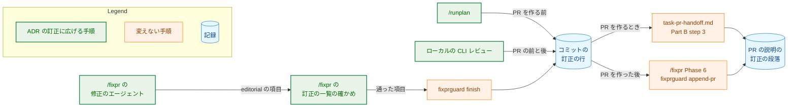
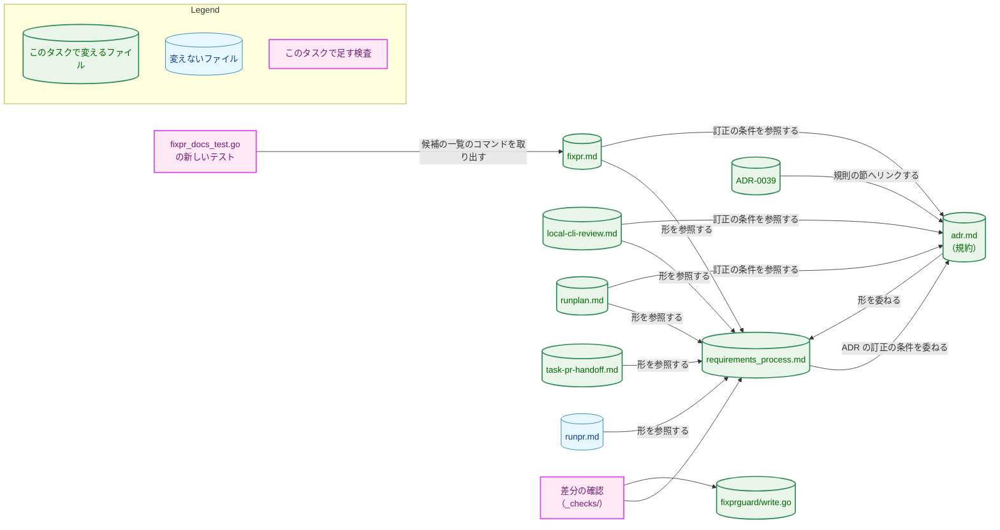
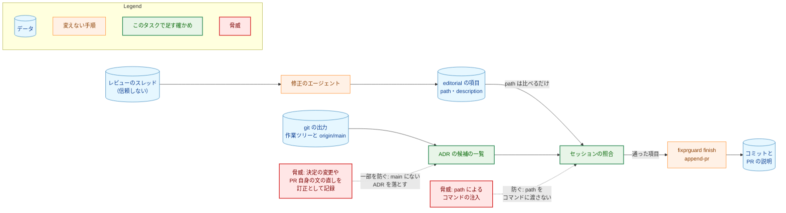
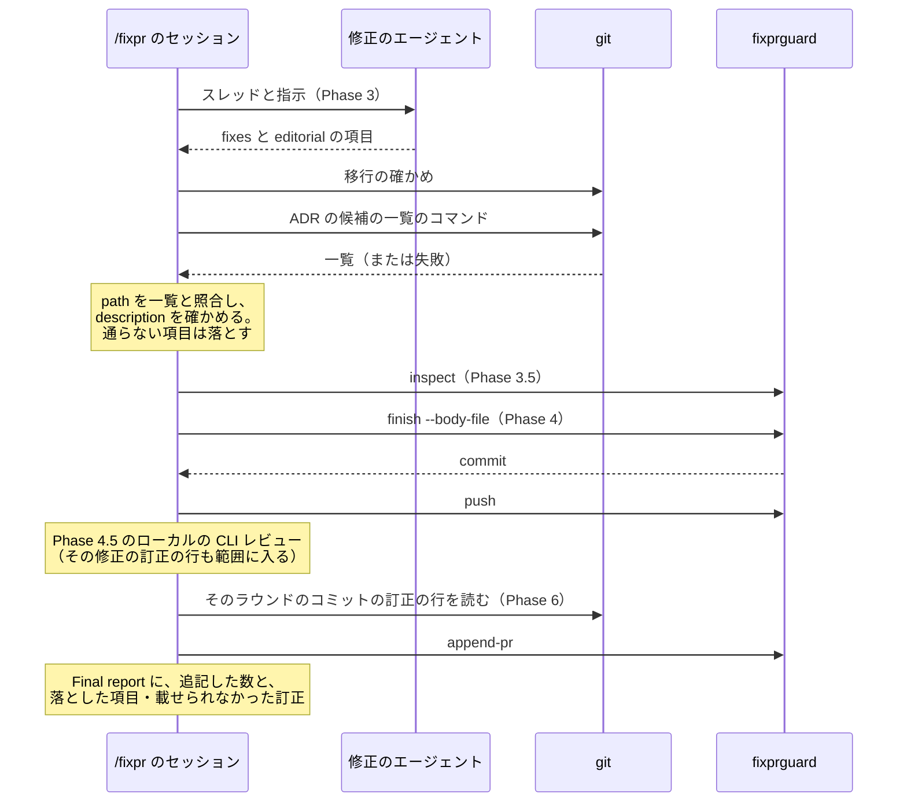
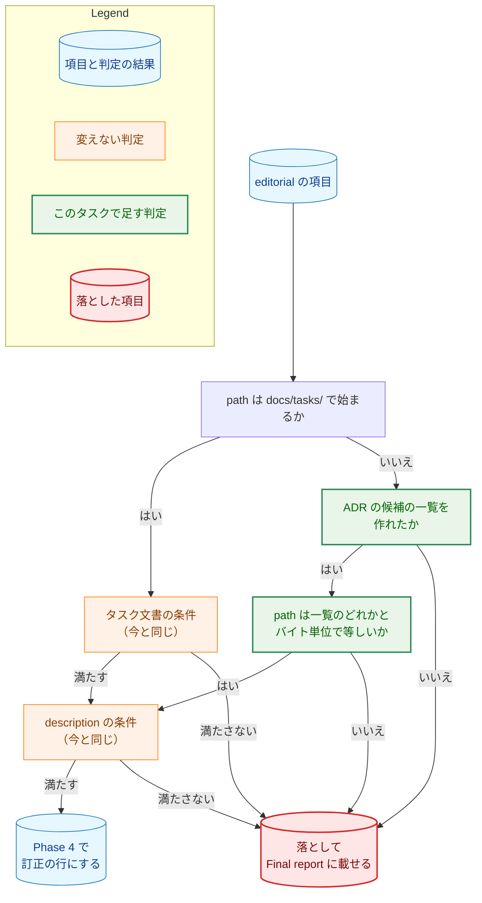

# アーキテクチャ設計書：ADR の編集上の訂正を、コマンドの定義と requirements_process.md の訂正の記録に対応させる

## Document Status

| Item | Value |
|---|---|
| Status | `draft` |
| Created | 2026-11-09 |
| Review date | - |
| Reviewer | - |
| Comments | - |

本書は [01_requirements.md](01_requirements.md)（要件定義書。以下、要件書）の設計である。既存のファイルの内容は、コミット `9475c02b` で確かめた。`file:line` の行番号は、このコミットでの行番号である。F-NNN・AC-NN は要件書の項番を、H-NN は [design_handoff.md](design_handoff.md)（以下、申し送り）の項番を指す。申し送りへの対応は付録 A に、受け入れ基準との対応は付録 B にまとめる。

本書は、要件書 3 章の冒頭と 6 章の用語（規約・ADR の訂正・タスク文書の訂正・ADR のファイル・PR 自身の文・訂正の行・訂正の段落・ずれの記述・マージ先の `main`）を、要件書と同じ意味で使う。そのほかに、次の用語を使う。

-   **実装の PR:** 規約・`requirements_process.md`・コマンドの定義・ADR-0039・文書のテストを変える 1 本の PR（8 章）。本書の PR と、実装計画書の PR は含まない。
-   **訂正の一覧の確かめ:** `/fixpr` の Phase 3 の「Correction list」の段落（`.claude/commands/fixpr.md:531-548`）。修正のエージェントが返した `editorial` の項目を、セッションが 1 つずつ確かめて、通らない項目を落とす手順である。
-   **ADR の候補の一覧:** 訂正の一覧の確かめで、セッションがコマンドで作る ADR のファイルのパスの一覧（3.2.2）。ADR の項目は、この一覧と照らして確かめる。
-   **差分の確認:** 変更の前後の関係を述べる受け入れ基準を、マージベースと PR の先頭を比べて確かめるスクリプト。タスクの `_checks/` の下に置く（`docs/dev/conventions/requirements_process.md`「4. Acceptance Tests」）。恒久的なテストではない（7.2）。

## 1. 設計の全体像 (Design Overview)

### 1.1. 設計原則

-   **記録の経路を新しく作らず、タスク文書の訂正の経路に ADR を載せる。** 訂正の行を集めて PR の説明へ運ぶ手順（`_lib/task-pr-handoff.md` Part B step 3、`/fixpr` の Phase 6、`fixprguard finish` と `append-pr`）は、すでにパスを問わない（要件書 1 章）。変えるのは、訂正の行を「書く」側の手順だけである。具体的には、`/fixpr` の修正のエージェントへの指示と訂正の一覧の確かめ、ローカルの CLI レビュー、`/runplan` である。
-   **形の定義は `requirements_process.md` の 1 か所に置き、コマンドは節を名指しして参照する。** 訂正の行と訂正の段落の形を書き写さない（要件書 4.5、[ADR-0036](../../dev/adr/0036-task-document-status-records.md) の「決定」の最後の項目）。ADR の訂正の条件（いつ・何が訂正か）は、規約の「Editorial corrections」の 1 か所に置く。
-   **エージェントが書いた値をコマンドに渡さない。** `/fixpr` の `editorial` の項目は、レビューのスレッドを読んだエージェントが書くので、信頼しない（R6、[ADR-0015](../../dev/adr/0015-untrusted-review-threads.md)）。ADR の項目は、git の出力から作った一覧と照らすだけにし、項目の `path` をコマンドの引数にしない（1.2 の 2 つ目の項目）。
-   **迷ったら、項目を落とす側に倒す。** 落とした項目は Final report に載り、レビュアーが手で PR の説明に足せる（`.claude/commands/fixpr.md:951-962`）。誤って通した項目は、決定の変更が訂正として記録される。そのため、確かめに使う参照が古いときや、コマンドが失敗したときは、項目を落とす。
-   **信頼の境界のコマンドは、実行して確かめる。** `/fixpr` の訂正の一覧の確かめに足すコマンドは、`CLAUDE.md`「Testing Strategy」の文書のテストの例外にあたる。fixpr.md からそのコマンドを取り出し、用意したリポジトリで実行するテストで確かめる（AC-21、7.1）。文の意味は、PR のレビューで読んで確かめる（[ADR-0016](../../dev/adr/0016-document-test-policy.md)）。

### 1.2. 設計の際に決めたこと（2026-11-09）

-   **`/fixpr` は、マージ先の `main` を、ローカルの `origin/main` の参照で表し、取得し直さない（H-01）:** ADR の項目のファイルが `main` にあるかは、ローカルの `origin/main` の木で判定する。`/fixpr` は `origin/main` を新しく取得しない。
    -   **理由:**
        -   **`/runpr` から呼ぶときは新しい:** `/runpr` は step 1 で `git fetch origin main` を実行してから `/fixpr` を呼ぶ（`.claude/commands/runpr.md:103`）。
        -   **古いときは落ちるだけ:** `/fixpr` を単独で実行したときは、参照が古いことがある。古い参照で起きうるのは、最後の取得の後に `main` に入った ADR への項目が「`main` にない」と判定されて落ちることだけである。落ちた項目は Final report に載る（`fixpr.md:951-962`）。逆に、PR 自身が作った ADR が古い参照の木にあることはない。ADR は消されず（規約の「Changing, retiring, and withdrawing」）、題名を書き直してもファイル名は変わらない（ファイル名は主題の名前で、`docs/dev/conventions/adr.md:27-29`）。そのため、PR 自身が作った ADR は、どの時点の `main` にもない。
        -   **ネットワークの操作を増やさない:** `/fixpr` の許可の一覧（`fixpr.md:90-104`）に操作を足さずに済む。
    -   **採らなかった案:**
        -   **`HEAD` と `origin/main` のマージベースの木で判定する案:** 「PR 自身の文か」をより厳密に表すが、参照の手順が 1 つ増える。上の理由で `origin/main` でも誤って通す場合がないので、採らない。
        -   **Phase 3 で `git fetch origin main` を実行してから判定する案:** 参照は常に新しくなるが、ネットワークの操作と許可の一覧が増える。古い参照の害が「項目が落ちて Final report に載る」だけなので、採らない。
    -   ADR：なし。`/fixpr` の中の確かめ方の決定で、本タスクの中で閉じる。
-   **ADR の項目の `path` は、git の出力から作った ADR の候補の一覧と照らし、コマンドに渡さない（H-01、AC-05）:** セッションは、次の 3 つを満たすファイルの一覧を、git の出力からコマンドで作る（3.2.2）。
    1.  作業ツリーで `HEAD` から変更された（追加・削除・名前の変更ではない）。
    2.  ADR のファイルの形に一致する。
    3.  `origin/main` の木にある。

    `path` が `docs/tasks/` で始まらない項目は、`path` がこの一覧のどれかとバイト単位で等しいときだけ ADR の項目として通る。
    -   **理由:** 一覧の値は git が出力したもので、エージェントが書いた値はどのコマンドにも届かない。照合は等しさだけなので、`./`・`..`・大文字・末尾の `/`・ASCII でない文字・索引 `docs/dev/adr/README.md` を含む `path` は、一覧のどれとも等しくならずに落ちる（AC-05）。「`HEAD` から変更された」に削除と追加を含めないのは、ADR の削除は訂正ではなく（規約は ADR を消さない）、追加は PR 自身の ADR だからである。今のタスク文書の項目も、作業ツリーの変更を git の出力から読む（`fixpr.md:537-538`）。ADR の項目は、それを一覧の作成まで進めた形である。
    -   **採らなかった案:** `path` を正規表現で確かめ、通ったものを `--` の後の別の引数として `git ls-tree` に渡す案は、要件の文面には沿う。しかし、信頼しない値がコマンドに届き、照合の誤りがそのまま引数の誤りになるので、採らない。
    -   ADR：なし。`/fixpr` の中の確かめ方の決定で、本タスクの中で閉じる。[ADR-0015](../../dev/adr/0015-untrusted-review-threads.md) の決定（スレッドから来た値は信頼しない）を当てはめるだけで、変えない。
-   **`internal/fixprguard/write.go` のコメントだけを直す（H-04）:** `editorialCorrectionPrefix` のコメント（`internal/fixprguard/write.go:97-98`）は、訂正の行を「承認済みのタスク文書への訂正」を記録する行と述べる。これを、タスク文書か ADR への編集上の訂正を記録する行、と直す。コードは変えない。
    -   **理由:** 振る舞いは今もパスを問わないので、コメントだけが古い。古いコメントは、後でパスを確かめるコードを足す誤りを招く。コメントの変更は振る舞いを変えないので AC-16 を満たし、インストール済みの `fixprguard` の再インストールも要らない（要件書 4.4）。
    -   **採らなかった案:** `internal/fixprguard/` に触れない案は、古いコメントが残るので採らない。
    -   ADR：なし。コメントの直しで、本タスクの中で閉じる。

次のことは、要件書と上の決定から導いた（PR のレビューで異論があれば改める）。

-   **規約の「Recording」の、パスを ADR に読み替える句を消す（H-02）。** 実装の PR の後は、`requirements_process.md` の「Recording in the PR description」が、`<document path>` をタスク文書か ADR のファイルのパスと定める（AC-01）。規約に読み替えの句が残ると、同じ定義を 2 か所で持つ。規約の「Recording」の、形を `requirements_process.md` に委ねる文は残す（AC-03）。ADR：なし。
-   **ADR の訂正の条件を規約へ委ねる文は、`requirements_process.md` の「Recording in the PR description」の訂正の行の箇条に置く（H-02）。** この節は「Document Status Format」の下にあり、タスク文書の訂正の規則（「Editing an approved document」）の直下ではない。訂正の行と訂正の段落の形を定める節なので、どの文書の訂正の行かを述べる箇所に、ADR の訂正の条件の参照を並べる。「Editing an approved document」はタスク文書の訂正だけを述べたまま変えない（AC-18）。ADR：なし。
-   **`/fixpr` の Final report と `/runpr` のマージの質問の文面は変えない（H-05）。** Final report の 9 項目め（`fixpr.md:951-962`）は、落とした訂正と載せられなかった訂正を「その文書・説明・理由」とともに挙げ、文書の種類を問わない。`/runpr` のマージの質問（`.claude/commands/runpr.md:728-730`）も、`/fixpr` が載せられなかったと報告した訂正をすべて挙げる。そのため、ADR の訂正も、文面を変えずにタスク文書の訂正と同じく載る。ADR：なし。
-   **`/runpr` が PR を作るときの説明の文面は変えない（AC-14）。** `runpr.md:182-187` は、訂正の段落を `requirements_process.md`「Recording in the PR description」のとおりに書くと述べ、パスを限らない。その節が ADR を含むようになれば（F-001）、ADR の訂正の行も載ると読める。`_lib/task-pr-handoff.md` Part B step 3 には、パスを問わないことを明示する句を足す（3.6）。ADR：なし。
-   **既存の文書のテストは変えない（H-03）。** 3.8 の洗い出しのとおり、ADR の訂正で古くなるテストはない。ADR：なし。
-   **実装の PR は 1 本にする。** ADR-0039 のずれの記述は、規約とコマンドを変える PR が同じ PR で消す（AC-20、規約の「Discrepancy statements」）。また、規約が PR を作った後の訂正を認める変更と、コマンドがそれを運ぶ変更は、同時に `main` に入らないと、どちらかが事実でない期間ができる。ADR：なし。PR の分け方の決定で、本タスクの中で閉じる。

この設計のどの決定も、要件書の決定（ADR-0039 の更新）を変えない。そのため、本書の PR は ADR を変えない。

### 1.3. なぜ今の書き方では足りないか

-   **書く側の手順がタスク文書に限られている:** `/fixpr` の修正のエージェントは、承認済みのタスク文書への訂正だけを `editorial` として返す（`fixpr.md:484-489`）。訂正の一覧の確かめも、`docs/tasks/*/0[123]_*.md` だけを通す（`fixpr.md:537-541`）。ローカルの CLI レビュー（`.claude/commands/_lib/local-cli-review.md:205-209`・`:234`）と `/runplan`（`.claude/commands/runplan.md:63`）も、タスク文書の訂正にだけ訂正の行を書く。
-   **そのため、規約は PR を作った後の ADR の訂正を禁じている:** PR を作った後の ADR の訂正は記録されないので、規約の「After the PR is created」がそれを禁じる（`docs/dev/conventions/adr.md:308-314`）。この制限があるので、レビューで見つかった ADR の古いリンクや誤字を直すのに、別の PR が要る（要件書 1 章）。
-   **運ぶ側は今のままでよい:** 訂正の行を集めて PR の説明に載せる手順は、すでにパスを問わない（1.1）。今の手順を置き換える新しい仕組みは要らない。書く側の手順を ADR に広げるだけで、要件を満たせる。

### 1.4. 概念モデル

ADR の訂正が、書かれてから PR の説明に載るまでの記録の経路を図 1 に示す。矢印 A → B は「A の記録が B に運ばれる」を表す。



図 1 の矢印は、どれも今のタスク文書の訂正の経路にある関係である。実装の PR の後は、`enhanced` の 4 つの手順が ADR の訂正も扱うので、ADR の訂正も同じ矢印を通る。今の関係は次の箇所による。

-   `/runplan` は訂正の行を書く（`runplan.md:63`）。
-   ローカルの CLI レビューは、修正のコミットに訂正の行を書く（`local-cli-review.md:205-209`）。
-   修正のエージェントは `editorial` を返し、セッションが確かめる（`fixpr.md:484-489`・`:531-548`）。
-   Phase 4 は、通った項目を訂正の行として `fixprguard finish --body-file` に渡す（`fixpr.md:620-668`）。
-   PR を作るときは Part B step 3 が訂正の段落を書く（`.claude/commands/_lib/task-pr-handoff.md:254-260`）。
-   PR を作った後は Phase 6 が `append-pr` で追記する（`fixpr.md:837-860`）。

図 1 にない経路として、`main` を取り込むときの経路がある。この経路は訂正の行を PR の説明へ運ばないので、規約はそこで ADR の訂正を認めない（3.3）。

## 2. システム構成 (System Structure)

### 2.1. 全体構成

本タスクは、文書・コマンドの定義・文書のテスト・`fixprguard` のコメントを変える。実行時に動くコンポーネント（拡張・Native Messaging のホスト・サーバ・CLI）と、`fixprguard` の振る舞いは変わらない。変えるファイルと、それを参照するファイル・検査の関係を図 2 に示す。矢印 A → B は「A が B を参照する、または読む」を表す。



図 2 のうち、次の矢印は実装の PR で加わる関係である。ほかの矢印は今の関係である。

-   `requirements_process.md` から規約への矢印。
-   `fixpr.md`・`local-cli-review.md`・`runplan.md` から規約への矢印。
-   新しいテストと差分の確認からの矢印。

今の関係は次の箇所による。

-   規約は訂正の行の形を `requirements_process.md` に委ねる（`adr.md:298-303`）。
-   `fixpr.md`（`:620-623`・`:845-847`）、`local-cli-review.md`（`:234`）、`runplan.md`（`:63`）、`task-pr-handoff.md`（`:254-260`）、`runpr.md`（`:182-187`）は、訂正の行か訂正の段落の形を `requirements_process.md` の節で参照する。
-   ADR-0039 の「決定」は、規約の「Editorial corrections」へリンクする（`docs/dev/adr/0039-adr-writing-criteria.md:20`）。

### 2.2. コンポーネント配置

| ファイル | 変更 | 内容 |
|---|---|---|
| `docs/dev/conventions/requirements_process.md` | 変更 | 「Recording in the PR description」の訂正の行の箇条で、`<document path>` をタスク文書か ADR のファイルのパスとし、索引の行と ADR の訂正の条件の扱いを述べる（3.1） |
| `docs/dev/conventions/adr.md` | 変更 | 「Recording」の読み替えの句を消す。「After the PR is created」の段落を、PR を作った後の訂正を認め、`main` の取り込みでは認めない形に書き換える。「Discrepancy statements」の理由の参照を改める（3.3） |
| `.claude/commands/fixpr.md` | 変更 | Phase 3 の修正のエージェントへの指示（`editorial`）と、訂正の一覧の確かめに ADR の項目を足す（3.2）。Phase 4・Phase 6・Final report は変えない |
| `.claude/commands/_lib/local-cli-review.md` | 変更 | step 5 と step 7 の表の `Editorial correction:` の行を、ADR の訂正に広げる（3.4） |
| `.claude/commands/runplan.md` | 変更 | step 5 の自己点検の「Editorial correction」の箇条に、ADR の訂正の行を足す（3.5） |
| `.claude/commands/_lib/task-pr-handoff.md` | 変更 | Part B step 3 の訂正の段落の箇条に、パスを問わないことを明示する句を足す（3.6） |
| `internal/fixprguard/write.go` | 変更 | `editorialCorrectionPrefix` のコメントだけを直す（3.7）。コードは変えない |
| `cmd/yt2column/fixpr_docs_test.go` | 変更 | ADR の候補の一覧のコマンドを fixpr.md から取り出して実行するテストを足す（7.1） |
| `docs/dev/adr/0039-adr-writing-criteria.md` | 変更 | 「決定」のずれの記述（PR を作った後の訂正はまだ認められず、運ばれないと述べる 3 文と #732 へのリンク）を消す。編集上の訂正の 2 つ目の種類として、訂正の行と訂正の段落に記録する（3.9） |
| `docs/tasks/0074_adr_editorial_correction/_checks/` | 追加 | 差分の確認のスクリプト（7.2）。`go list ./...` は `_` で始まるディレクトリを無視する |
| `docs/tasks/0074_adr_editorial_correction/03_implementation_plan.md` | 変更 | 実装計画書（`/mkplan` の PR が作る）。実装の PR は、進み具合と検証の結果を記録する |

次のファイルは変えない。

-   `.claude/commands/runpr.md`（1.2）。
-   `.claude/commands/runissue.md`・`.claude/commands/mergepr.md`・`CLAUDE.md`・`docs/dev/adr/0036-task-document-status-records.md`（AC-17）。
-   `internal/fixprguard/` の `write.go` のコメントの外と、`cmd/fixprguard/`（AC-16）。
-   `docs/dev/guides/fixprguard_guide.md`。ガイドは訂正の行を「訂正の行」とだけ呼び、タスク文書に限っていない（`docs/dev/guides/fixprguard_guide.md:346`）。
-   ADR の索引 `docs/dev/adr/README.md`。ADR-0039 の題名は変わらない。

### 2.3. データフロー

ADR の訂正の記録は、タスク文書の訂正と同じ経路を通る（図 1）。

1.  訂正を加えたセッションは、そのコミットのメッセージに訂正の行を 1 行ずつ書く。`<document path>` には ADR のファイルのリポジトリ相対のパスを書く。`/fixpr` では、セッションが訂正の一覧の確かめを通った項目から書く（3.2）。
2.  PR を作るとき、Part B step 3 が `git log origin/main..HEAD` の訂正の行から訂正の段落を書く。
3.  PR を作った後の `/fixpr` のラウンドでは、Phase 6 がそのラウンドのコミットの訂正の行から段落を書き、`fixprguard append-pr` で追記する。ローカルの CLI レビュー（Phase 4.5）のコミットの訂正の行も、この範囲（`<commitSha>^..HEAD`）に入る（`fixpr.md:840-843`）。

`/fixpr` の外で、PR を作った後にローカルの CLI レビューを動かす経路はない。ローカルの CLI レビューは、PR を作る前（task-pr-handoff.md Part B step 1、`/runplan` の step 7.7、`/runissue`、`/runpr` の単独の変更）か、`/fixpr` の Phase 4.5 で動く。そのため、PR を作った後のローカルの CLI レビューの訂正の行は、Phase 6 で PR の説明に載る（AC-11）。

## 3. コンポーネント設計 (Component Design)

本タスクに、Go の型・インターフェースの追加や変更はない。この章では、ファイルごとに、実装の PR の後にそのファイルが述べる内容を定める。英語の文面の案を示す箇所は、要件書が設計に委ねたもの（要件書 1 章「本書の記述範囲」）である。実装は、案の意味を変えない範囲で言い回しを整えてよい。意味を変えるときは、本書を改める。

### 3.1. `requirements_process.md`「Recording in the PR description」（F-001）

訂正の行の箇条（`docs/dev/conventions/requirements_process.md:379-393`）の、`<document path>` を定める 1 文（`:388`）を、次の内容に置き換える。

-   `<document path>` は、タスク文書か ADR のファイル（`docs/dev/adr/NNNN-<kebab>.md`）のリポジトリ相対のパスである。
-   ADR の題名の書き直しで索引 `docs/dev/adr/README.md` の行が変わったときは、その ADR の訂正の行がその変更も述べる。索引のパスで訂正の行を書かない。
-   ADR の編集上の訂正をいつ加えてよいか、どの変更が訂正かは、規約の「Editorial corrections」に従う。

文面の案:

```text
`<document path>` is the repository-relative path of the task document or of
the ADR file (`docs/dev/adr/NNNN-<kebab>.md`). When rewriting an ADR's title
changes its row in the index, `docs/dev/adr/README.md`, that ADR's correction
line describes the index change too; no correction line names the index.
Which changes to an ADR are editorial corrections, and when one may be made,
is in `docs/dev/conventions/adr.md`, "Editorial corrections".
```

訂正の行の形の行、訂正の行と認める条件（行頭の `Editorial correction: `）、`@` と `<` を含まないこと、訂正の段落の形のコードブロック、段落を書く手順の文は、バイト単位で変えない（AC-02）。この 1 文のほかに、節の中の「task document」は次の 2 か所にない。訂正の段落の項目は `<文書のパス>` と書かれ、文書の種類を限らない（`:400`）。

### 3.2. `fixpr.md` Phase 3（F-002）

#### 3.2.1. 修正のエージェントへの指示（AC-04・AC-08）

`editorial` を返すよう求める文（`fixpr.md:484-492`）を、次の内容にする。

-   `editorial` には、スレッドのために加えた次の訂正を 1 項目ずつ返す。
    -   このラウンドの前に `approved` だったタスク文書への訂正（今と同じ。`draft` の文書の直しは訂正ではない）。
    -   ADR のファイルへの ADR の訂正。分類は規約の「Editorial corrections」に従う。
-   次の変更は `editorial` に含めない。
    -   PR 自身の文の直し。`origin/main` にない文、つまり PR 自身が ADR に足した文や PR 自身が作った ADR の文を直すことは、訂正ではない。
    -   ADR の決定の変更。決定の変更は、今と同じく、返信と Final report で扱う。
-   `path` と `description` の形と制約（リポジトリ相対のパス、自分の言葉の英語の 1 行、`@`・`<`・`![`・`#` と数字の並びを含まない、300 文字以内）は、今と同じである。

ADR の決定の変更の扱いは今と同じである。修正のエージェントは R3 によりタスク文書の決定の変更を扱い、ADR の決定の変更は規約に従う。この指示の変更は、決定の変更を `editorial` に入れないことを明示するだけである。

#### 3.2.2. 訂正の一覧の確かめ（AC-05・AC-06・AC-07）

確かめの箇条（`fixpr.md:536-546`）の「項目が通る条件」を、`path` で 2 つに分ける。

-   **`path` が `docs/tasks/` で始まる項目:** 今のタスク文書の条件のまま（`docs/tasks/*/0[123]_*.md`、作業ツリーで変更されている、`HEAD` と作業ツリーで `approved`）。
-   **それ以外の項目:** `path` が ADR の候補の一覧のどれかとバイト単位で等しいとき。

`description` の条件は、どちらの項目にも同じく当てはまる。

**ADR の候補の一覧。** セッションは、訂正の一覧の確かめの最初に、次の性質を持つ 1 つのコマンドで一覧を作る。一覧は、ADR の項目が 1 つもないときは作らなくてよい。

| 性質 | 内容 |
|---|---|
| 入力 | git の出力だけ。エージェントが返した値は使わない |
| 変更の判定 | 作業ツリーが `HEAD` から変更したファイル。追加・削除・名前の変更は含めない（名前の変更を変更として扱わないよう、名前の変更の検出を切る）。Phase 3.5 が判定する変更の集合に含まれる |
| 形の判定 | ADR のファイルの形 `docs/dev/adr/` + 4 桁の数字 + `-` + ASCII の英小文字・数字・`-` + `.md` に、行の全体が一致するもの。C ロケールで照合する。最後の出力にも形の判定をかけ、一覧に形の外の値が入らないようにする |
| `main` の判定 | ローカルの `origin/main` の木にあるもの（1.2）。取得し直さない |
| 出力 | 条件を満たすパスを 1 行に 1 つ。形の判定が改行を含む名前を除くので、1 行が 1 つのパスにあたる |
| 失敗 | git が失敗したとき（`origin/main` がない場合を含む）は、0 でない終了コードで終わる。パイプの途中の失敗も終了コードに表れる |
| 空のとき | 条件を満たすファイルがないときは、何も出力せずに 0 で終わる。空の入力で後段のコマンドが引数なしで動き、木の全体を出力することがない |
| 移植性 | 開発者の macOS と CI の Linux の両方で同じ出力になる（7.1 のテストが両方で動く） |

コマンドが失敗したときは、ADR の項目をすべて落とし、Final report に載せる。理由は「ADR の候補の一覧を作れなかった」とする。

**落とした項目。** 通らない項目は、今のタスク文書の項目と同じく、直さずに落とし、Final report の 9 項目めに載せる（`fixpr.md:951-962`）。項目を落としても、ラウンドのほかの修正は止まらない（`fixpr.md:534-535`）。次の項目は、どれも一覧にないので落ちる（AC-05・AC-07）。

-   PR 自身が作った ADR への項目（`origin/main` にない）。
-   索引 `docs/dev/adr/README.md` への項目。
-   `./`・`..`・大文字・末尾の `/`・ASCII でない文字を含む `path` の項目。
-   作業ツリーで変更されていない ADR への項目。

**順序。** 一覧を作るのは、移行の確かめ（「Migration check」、`fixpr.md:503-529`）の後、Phase 3.5 の前である。この間、作業ツリーは変わらない。

#### 3.2.3. 変えないもの（AC-09・AC-15）

Phase 4 は、訂正の一覧の確かめを通った項目を、パスを問わずに訂正の行として本文のファイルに書く（`fixpr.md:620-668`）。メンションの確かめ、`fixprguard finish --body-file`、`fixprguard push`、失敗したときにすべての項目を落として `--body-file` なしで `finish` をやり直す扱いは、変えない。Phase 6 の訂正の段落の追記（`fixpr.md:837-860`）、書き直しで訂正の段落を残す確かめ（`fixpr.md:806-819`）、Final report も変えない。

### 3.3. 規約 `adr.md`「Editorial corrections」（F-005、AC-03・AC-13）

#### 3.3.1. 「Recording」（AC-03、H-02）

「Recording」の段落（`adr.md:298-306`）から、`; the document path in them is the ADR's repository-relative path` を消す。そのほかの文（訂正の行と訂正の段落に記録し、形を `requirements_process.md`「Recording in the PR description」に委ねる、PR の説明が訂正と明示する、「経緯」に項目を足さない）は変えない。

#### 3.3.2. 「After the PR is created」（AC-13）

段落（`adr.md:308-314`）を、次の内容に書き換える。見出しの語（`**After the PR is created.**`）は残す。「Discrepancy statements」がこの段落を名前で参照しているからである。

-   PR を作った後の `/fixpr` のラウンドとローカルの CLI レビューの修正でも、ADR に訂正を加えてよい。その訂正は、PR を作る前と同じく、訂正の行と訂正の段落に記録する。
-   PR を作った後に `main` を取り込むときは、ADR に訂正を加えない。その経路には、訂正の行を PR の説明へ運ぶ手順がないためである。
-   記録した訂正の文面は、訂正の行がなおその変更を述べる範囲で直してよい（今と同じ）。
-   PR 自身の文の直しは編集上の訂正ではない（今と同じ）。

文面の案:

```text
**After the PR is created.** An editorial correction may also be made after
the PR is created, in a `/fixpr` round or in a fix of the local CLI review;
record it as above, as before the PR is created. Do not make one while taking
in `main` after the PR is created: that path has no step that carries
correction lines into the PR description, so the reviewer would not see the
classification. A correction already recorded may still be reworded, as long
as its correction line still describes it. Revising text that the PR itself
added to an ADR, and is not yet on `main`, is not an editorial correction.
```

#### 3.3.3. 「Discrepancy statements」（AC-13）

ずれを直す PR を作った後に `main` に入ったずれの記述を、後の PR に残すという文（`adr.md:348-350`）は、扱いを変えない。理由の参照（`("After the PR is created")`）は、書き換えた段落を指したままでよい。書き換えた段落が、PR を作った後に `main` を取り込むときには訂正を加えないと述べるからである。ただし、その記述を消すには `main` を取り込む必要がある。そこで、参照の前に、その理由を短く足す（「消すには `main` を取り込む必要があり、そのときは訂正を加えないため」）。そのほかの文は変えない（要件書 2.3）。

### 3.4. `local-cli-review.md`（F-003、AC-10・AC-11）

-   **step 5（`local-cli-review.md:205-209`）:** 「修正が承認済みのタスク文書への編集上の訂正のとき」を、「修正がタスク文書の訂正（`requirements_process.md`「Editing an approved document」）か ADR の訂正（規約の「Editorial corrections」）のとき」に広げる。PR 自身の文の直しには訂正の行を書かない、と足す。
-   **step 7 の表の `Editorial correction:` の行（`:234`）:** 「When」の列を、修正のコミットがタスク文書か ADR に加える編集上の訂正ごと、に広げる。形の列（`requirements_process.md`「Recording in the PR description」）は変えない。
-   **メンションの確かめ（`:243-254`）:** 変えない。`Editorial correction:` の行はパスを問わないので、ADR の訂正の行にもそのまま当てはまる。確かめに通らないときは、訂正の行を除き、SUMMARY に記録しなかった訂正として挙げる。
-   **PR の前と後（AC-11）:** この手順は、呼び出しが PR を作る前か後かを区別しない。そのため、どちらの呼び出しでも同じく訂正の行を書く。PR を作った後の呼び出しは `/fixpr` の Phase 4.5 だけで、その訂正の行は Phase 6 が PR の説明に載せる（2.3）。

### 3.5. `runplan.md`（F-004、AC-12）

step 5 の自己点検の「Editorial correction」の箇条（`runplan.md:63`）の後に、ADR の訂正について次の内容を足す。今の箇条は、承認済みのタスク文書と実装のずれを扱う。

-   フェーズのグループの作業で ADR の訂正を加えたときは、その訂正を行うコミットのメッセージに、訂正ごとに訂正の行を書く。たとえば、実装で名前が変わり、ADR の参照が古くなったときである。
-   PR 自身の文の直し（このブランチが ADR に足し、まだ `origin/main` にない文の直し）には、訂正の行を書かない。
-   PR を作るときに、その行から PR の説明の訂正の段落を書く（`_lib/task-pr-handoff.md` Part B step 3）。
-   訂正か決定の変更かの分類は、規約の「Editorial corrections」に従う。決定の変更は、今のタスク文書の決定の変更と同じく、`_lib/settle-decisions.md` で人と決める。

今の箇条の、PR を作った後の手順がない理由（このコマンドは PR のあるブランチで作業しない）は、ADR の訂正にも当てはまる。そのため、ADR の訂正にも PR を作った後の手順は要らない。

### 3.6. `task-pr-handoff.md` Part B step 3（F-005、AC-14）

訂正の段落の箇条（`task-pr-handoff.md:254-260`）に、訂正の行のパスがタスク文書か ADR かを問わずに載せる、という句を足す。今の文もパスを限っていないが、F-001 で訂正の行が 2 種類の文書を含むようになるので、読み手が片方に限ると誤読しないよう明示する。段落の書き方そのものは `requirements_process.md` の節に委ねたままにする。`runpr.md` は、この手順と同じく `requirements_process.md` の節に従うと述べるので変えない（1.2）。

### 3.7. `internal/fixprguard/write.go` のコメント（H-04）

`editorialCorrectionPrefix` のコメント（`write.go:97-98`）の「an editorial correction to an approved task document」を、「an editorial correction to a task document or an ADR」の意味に直す。`checkCommitBody` のコメント（`write.go:101-111`）は、行の形と文字だけを述べ、文書の種類を述べていないので変えない。コードの行は変えない（AC-16）。

### 3.8. 文書のテスト（F-008、H-03）

既存の文書のテストのうち、本タスクの変更が触れる箇所を洗い出した結果は次のとおりである。どれも変えない。

| テスト | 確かめていること | 本タスクとの関係 |
|---|---|---|
| `TestFixprguardCallSites`（`cmd/yt2column/fixpr_docs_test.go:709-731`） | 各 `fixprguard` のサブコマンドを呼ぶ Phase | `finish` と `append-pr` の呼び出しの位置は変わらない |
| `TestFixprPhase6CountFilter`（`fixpr_docs_test.go:753-804`） | Phase 6 の段落の数を数える `--jq` の式が本文を出力しないこと | 式は変わらない。例の段落の項目のパスはタスク文書だが、式は行頭の `**編集上の訂正（` だけを数え、パスを読まないので、ADR のパスの例を足しても確かめることが増えない |
| `TestFixprDocContract`（`fixpr_docs_test.go:134-154`） | Phase 4 のコミットの件名、Phase 3.5 の停止の種類 | 変わらない |
| `internal/fixprguard` と `cmd/fixprguard` の訂正の行を使うテスト（`internal/fixprguard/write_test.go:100`、`worktree_flow_test.go:361`、`cmd/fixprguard/main_test.go:849` など） | `finish` と `append-pr` の本文の検査 | 振る舞いを変えないので変わらない（AC-16）。例のパスは `docs/x.md` かタスク文書だが、検査はパスを読まない |
| `TestADRRecords`（`cmd/yt2column/adr_test.go`） | 規約の「Template」「Status」「Index」の節と各 ADR の構造 | 本タスクはこれらの節に触れない。ADR-0039 の変更は「決定」の中の文の削除だけで、見出しの構造を変えない |

規約の「After the PR is created」と `requirements_process.md`「Recording in the PR description」の文を確かめるテストはない（`adr.md` を読むのは `adr_test.go` だけで、上の 3 つの節だけを読む）。

新しいテストは 1 つ足す（7.1）。AC-21 が挙げる信頼の境界のコマンドのうち、本タスクが足すのは ADR の候補の一覧のコマンドだけである。

-   `fixprguard` の呼び出しは変えない。
-   本文を出力しない `--jq` の式も、足しも変えもしない。
-   `editorial` の項目の `path` は、どのコマンドにも渡さない（1.2）。

### 3.9. ADR-0039 の「決定」（F-007、AC-19・AC-20）

「決定」の 4 つ目の項目の最後の 3 文を消す（`docs/dev/adr/0039-adr-writing-criteria.md:20`）。この 3 文は、規約がまだ PR を作った後の訂正を認めないこと、`requirements_process.md` とコマンドがタスク文書の訂正だけを運ぶこと、そのずれを #732 で扱うことを述べる。これは規約の「Editorial corrections」の 2 つ目の種類（ずれが直った後のずれの記述の削除）である。直した後の ADR は今の「決定」どおりなので、訂正にあたる。そこで、削除を行うコミットに訂正の行を書き、PR を作るときに訂正の段落に載せる。PR を作る前のコミットで行う。

「結果」は変えない。「結果」の 5 つ目の項目は、コマンドが ADR の訂正を記録して運ぶと述べ、まだ運ばないとは述べていない（AC-19）。

規約の「Discrepancy statements」の手順に従い、実装の PR は、PR を作る前に `git grep -nE 'issues/732([^0-9]|$)' origin/main -- docs/dev/adr/` で、ほかの ADR に #732 を扱うずれの記述がないかも探す。コミット `9475c02b` では、当たるのは ADR-0039 の上の記述だけである。

## 4. エラーハンドリング設計 (Error Handling Design)

### 4.1. 実行時のエラー

Go のエラー型の追加や変更はない。`fixprguard` の終了コードと停止の種類も変わらない（AC-16）。

### 4.2. 手順の中の失敗

| 失敗 | 扱い |
|---|---|
| ADR の候補の一覧のコマンドが失敗した（`origin/main` がない、git が失敗した） | ADR の項目をすべて落とし、Final report に理由とともに載せる。タスク文書の項目の確かめと、ラウンドのほかの修正は続ける |
| ADR の項目が一覧にない | その項目を落とし、Final report に載せる（今のタスク文書の項目と同じ） |
| Phase 4 のメンションの確かめか `finish --body-file` が ADR の訂正の行で失敗した | 今と同じく、すべての項目を落として `--body-file` なしで `finish` を実行し、Final report に載せる（`fixpr.md:620-629`・`:657-668`） |
| Phase 6 のメンションの確かめか `append-pr` が失敗した | 今と同じく、訂正を Final report に載せる。`/runpr` のマージの質問にも載る（`runpr.md:728-730`） |
| ローカルの CLI レビューのメンションの確かめが ADR の訂正の行で失敗した | 今と同じく、その訂正の行を除き、SUMMARY に記録しなかった訂正として挙げる。2 回目の確かめも失敗したら、止まって報告する（`local-cli-review.md:243-254`） |

どの失敗も、訂正を PR の説明に載せない側に倒れ、Final report か SUMMARY で人に見える。どの失敗でも、訂正でない変更が訂正として記録されることはない。

## 5. セキュリティ考慮事項 (Security Considerations)

### 5.1. 脅威モデル

本タスクは、外部コマンドの呼び出し・秘密・キャッシュ・ネットワークへの送信・信頼できない文字列の記事やプロンプトへの埋め込みのどれも変えない（要件書 4.2）。`docs/dev/security.md` を適用する条件にはあたらない。ただし、`/fixpr` の `editorial` の項目は、レビューのスレッドを読んだエージェントが書く信頼しないデータで、本タスクはその確かめに ADR の経路を足す。この経路の脅威を図 3 に示す。矢印 A → B は「A の値が B に届く」を表す。



図 3 の点線は、脅威と、それを防ぐ確かめの関係を表す。

-   **`path` による注入（T1）:** 項目の `path` はセッションの照合で比べるだけで、どのコマンドの引数にも、コマンドの文字列にもならない（1.2）。一覧の値は git の出力で、形の判定を通ったものだけである。
-   **`description` による注入:** 今のタスク文書の項目と同じ確かめを通す（1 行、300 文字以内、`@`・`<`・`![`・`#` と数字の並びを含まない、`finish` が拒む文字を含まない）。指示として扱わない。PR の説明へは、今のまま `fixprguard append-pr` が `@` と `<` を拒んで追記する（AC-09・AC-16）。
-   **誤った分類（T2）:** PR 自身が作った ADR への項目は、`origin/main` にないので落ちる。決定の変更を `editorial` に入れないことは、修正のエージェントへの指示で求める（3.2.1）。

### 5.2. 残余のリスクと注意

-   **ファイルの単位の確かめ:** `main` にある ADR に PR 自身が足した文を直したときの項目は、一覧の確かめを通る（要件書 1 章の 3 つ目の決定の「残るリスク」）。決定の変更を `editorial` として返した項目も通る。これらを防ぐのは、修正のエージェントへの指示と、訂正の段落を読む PR のレビューだけである。訂正の段落は、レビュアーが分類に異を唱える機会として PR の説明に残る（規約の「Classifying a change」）。
-   **報告されない変更:** 修正のエージェントが ADR の変更を `editorial` として返さなかったとき、その変更はどの記録にも載らない（要件書 2.3 の「残る経路」）。Phase 3.5 は、タスク文書のスレッドから ADR を変えたときは範囲外として人に確かめる（`internal/fixprguard/scope.go:16-35`）。しかし、ADR のスレッドから同じ ADR を変えたときは範囲内で、確かめない。PR のレビューで差分を読むしかない。
-   **古い `origin/main`:** 項目が誤って落ちることはあるが、誤って通ることはない（1.2）。

## 6. 処理フロー詳細 (Processing Flow Details)

### 6.1. `/fixpr` のラウンドでの ADR の訂正

PR を作った後の `/fixpr` のラウンドで、ADR の訂正が PR の説明に載るまでの流れを図 4 に示す。矢印は、呼び出しと値の受け渡しを表す。



図 4 のうち、ADR の候補の一覧のコマンドとその照合が、実装の PR で加わる手順である。ほかは今の手順である（`fixpr.md` の Phase 3〜6）。

### 6.2. ADR の項目の判定

訂正の一覧の確かめが 1 つの項目を判定する流れを図 5 に示す。矢印 A → B は「A の判定の後に B へ進む」を表す。



## 7. テスト戦略 (Test Strategy)

### 7.1. ユニットテスト

`cmd/yt2column/fixpr_docs_test.go` に、ADR の候補の一覧のコマンドを確かめるテストを 1 つ足す（AC-21）。

-   **取り出し:** fixpr.md の Phase 3 から、一覧のコマンドを 1 つだけ取り出す。取り出せないか、2 つ以上あるときは失敗する。取り出し方（コードブロックの見分け方）は実装計画で決める。
-   **実行:** 用意したリポジトリで、コマンドを bash で実行する。`origin/main` は `refs/remotes/origin/main` の参照として作る。git と bash は、`make test` がすでに求める道具である（`CLAUDE.md`「Development Notes」の `TestLightweightCheck` の項目）。見つからないときは、飛ばさずに失敗する。
-   **場合:** 次の場合で、出力と終了コードを確かめる。

| 場合 | 期待 |
|---|---|
| `origin/main` にある ADR を作業ツリーで変更した | 一覧に出る |
| PR のブランチで作った ADR（`origin/main` にない）を変更した | 出ない |
| 索引 `docs/dev/adr/README.md` を変更した | 出ない |
| ADR のファイルの形に合わない名前（大文字を含む、桁数が違う）のファイルを `docs/dev/adr/` で変更した | 出ない |
| `origin/main` にある ADR を作業ツリーで削除した | 出ない |
| タスク文書を変更した | 出ない |
| 変更が何もない | 何も出力せず、0 で終わる |
| `origin/main` の参照がない | 0 でない終了コードで終わる |

どの場合も、コマンドの性質（3.2.2 の表）のどれかを壊すと失敗するように組む。たとえば、形の判定を外すと索引の場合が、`main` の判定を外すとブランチで作った ADR の場合が、空のときの扱いを外すと変更がない場合が失敗する。コミットの前に、これらの性質を 1 つずつ壊してテストが失敗することを確かめる（`CLAUDE.md`「Testing Strategy」）。

既存のテストは変えない（3.8）。

### 7.2. 差分の確認（`_checks/`）

変えないことを求める受け入れ基準は、マージベースと実装の PR の先頭を比べるスクリプトで、1 回だけ確かめる。

| 確かめること | 受け入れ基準 |
|---|---|
| `requirements_process.md`「Recording in the PR description」の、訂正の行の形の行と、訂正の段落の形のコードブロックが、バイト単位で同じ | AC-02 |
| `requirements_process.md`「Editing an approved document」の節が、バイト単位で同じ | AC-18 |
| `internal/fixprguard/` の差分が `write.go` のコメントの行だけで、`cmd/fixprguard/` に差分がない | AC-16 |
| `runissue.md`・`mergepr.md`・`CLAUDE.md`・ADR-0036 に差分がない | AC-17 |
| ADR-0039 の差分が「決定」の中の削除だけで、`#732` へのリンクが「決定」から消えている | AC-20 |

### 7.3. 読んで確かめる（manual）

文の意味を述べる受け入れ基準は、PR のレビューで読んで確かめる（付録 B）。対象は、AC-01・AC-03〜AC-08・AC-10〜AC-15・AC-19 である。

### 7.4. 結合テスト・セキュリティテスト

-   **結合テスト:** 実装の PR は、自身の ADR-0039 の訂正（3.9）を、PR を作るときに Part B step 3 で訂正の段落に載せる。PR の説明にその段落があることを、PR を作った後に確かめる。PR を作った後の `/fixpr` の経路は、実装の PR の中では、ADR の訂正を求めるスレッドがない限り動かない。そのため、7.1 のテストと PR のレビューで確かめる。
-   **セキュリティテスト:** 7.1 のテストの、`./`・大文字・索引などの場合が、形の外の値が一覧に入らないことを確かめる。`path` をコマンドに渡さないことは、fixpr.md を読んで確かめる（manual）。

## 8. 実装の優先順位 (Implementation Priorities)

実装の PR は 1 本にする（1.2）。順序は次のとおりで、各段階は前の段階の定義を参照する。

1.  **定義:** `requirements_process.md`（3.1）と規約（3.3）。訂正の行の形と、ADR の訂正の条件を先に定める。
2.  **`/fixpr`:** 修正のエージェントへの指示と訂正の一覧の確かめ（3.2）、新しいテスト（7.1）。
3.  **ほかのコマンド:** `local-cli-review.md`（3.4）、`runplan.md`（3.5）、`task-pr-handoff.md`（3.6）。
4.  **コメント:** `write.go`（3.7）。
5.  **ADR-0039:** ずれの記述の削除（3.9）を、訂正の行とともにコミットする。
6.  **差分の確認:** `_checks/` のスクリプト（7.2）。

## 9. 将来の拡張 (Future Extensibility)

-   **squash の本文への引き継ぎ:** ADR の訂正の行を squash コミットの本文に引き継ぐかは、[#747](https://github.com/isseis/yt2column/issues/747) で扱う。本タスクの後、訂正の行はタスク文書と ADR で同じ形なので、引き継ぐときも両方を同じ手順で扱える。
-   **`main` の取り込みでの訂正:** `/runpr` の「Taking in `main`」が訂正の行を書き、`append-pr` で追記するようになれば、規約の「After the PR is created」の、`main` の取り込みでは訂正を加えないという制限を外せる（要件書 1 章の 2 つ目の決定の「採らなかった案」）。
-   **軽量プロセス:** 軽量プロセスは [#744](https://github.com/isseis/yt2column/issues/744) で削除する予定である。それまでの間、`/runissue` が ADR を直したときは、エージェントが規約に従って訂正の行を書く。
-   **ほかの文書の訂正:** 訂正の行の対象をタスク文書と ADR のほかに広げるときは、`requirements_process.md` の `<document path>` の 1 文と、`/fixpr` の訂正の一覧の確かめに経路を足す。

## 付録 A: 申し送り（design_handoff.md）への対応

| 項目 | 対応 |
|---|---|
| H-01 | ローカルの `origin/main` の木で判定し、取得し直さない。古い参照では項目が落ちるだけである（1.2）。`path` の照合は、git の出力から作った ADR の候補の一覧とのバイト単位の等しさで行い、`path` をコマンドに渡さない（1.2、3.2.2） |
| H-02 | 規約の「Recording」の読み替えの句を消す（3.3.1）。ADR の訂正の条件を規約へ委ねる文は、`requirements_process.md`「Recording in the PR description」の訂正の行の箇条に置く（1.2、3.1） |
| H-03 | 既存の文書のテストは変えない（3.8）。訂正の行の例をタスク文書から ADR のパスに広げることもしない。例のパスを読む検査がないためである。ADR の候補の一覧のコマンドを実行するテストを足す（7.1） |
| H-04 | `editorialCorrectionPrefix` のコメントだけを直す。`checkCommitBody` のコメントは文書の種類を述べないので変えない（1.2、3.7） |
| H-05 | Final report と `/runpr` のマージの質問は、文書の種類を問わずに訂正を挙げるので、文面を変えない（1.2） |

## 付録 B: 受け入れ基準との対応

| AC | 設計 | 確かめ方 |
|---|---|---|
| AC-01 | 3.1 | manual |
| AC-02 | 3.1 | 差分の確認（7.2） |
| AC-03 | 3.3.1 | manual |
| AC-04 | 3.2.1 | manual |
| AC-05 | 1.2、3.2.2 | テスト（7.1）、manual |
| AC-06 | 3.2.2 | テスト（7.1）、manual |
| AC-07 | 3.2.2 | テスト（7.1）、manual |
| AC-08 | 3.2.1 | manual |
| AC-09 | 3.2.3 | manual |
| AC-10 | 3.4 | manual |
| AC-11 | 2.3、3.4 | manual |
| AC-12 | 3.5 | manual |
| AC-13 | 3.3.2、3.3.3 | manual |
| AC-14 | 3.6、1.2 | manual |
| AC-15 | 3.2.3 | manual |
| AC-16 | 3.7 | 差分の確認（7.2） |
| AC-17 | 2.2 | 差分の確認（7.2） |
| AC-18 | 3.1 | 差分の確認（7.2） |
| AC-19 | 3.9 | manual |
| AC-20 | 3.9 | 差分の確認（7.2）、PR の説明の訂正の段落（7.4） |
| AC-21 | 3.8、7.1 | テスト（7.1） |
| AC-22 | 8 章 | `make test`・`make lint` |
