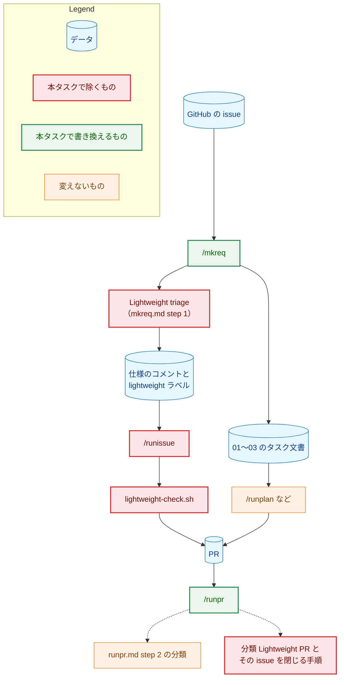
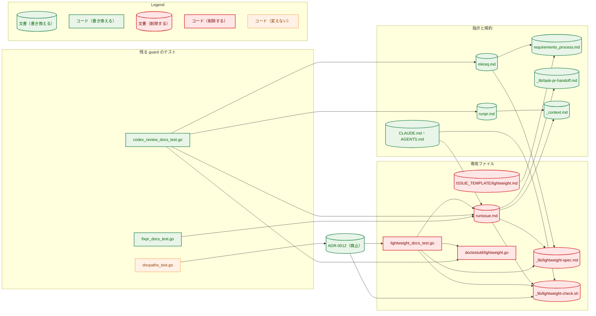
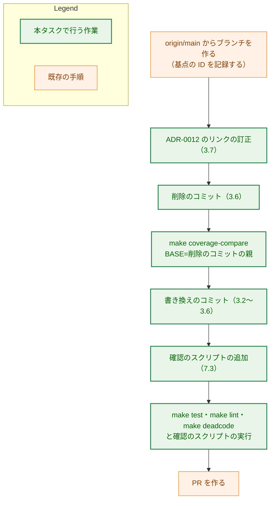
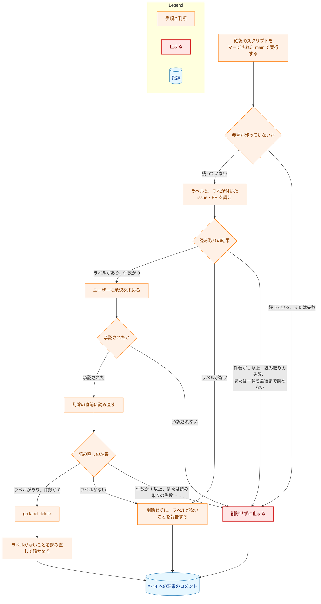

# アーキテクチャ設計書：使われていない軽量プロセスの削除

## Document Status

| Item | Value |
|---|---|
| Status | `approved` |
| Created | 2026-11-09 |
| Review date | 2026-11-09 |
| Reviewer | isseis |
| Comments | - |

本書は [01_requirements.md](01_requirements.md)（要件定義書。以下、要件書）の設計である。既存のファイルの内容は、コミット `ccb06be5`（`ccb06be547d8f0a6d64ff312f506dda2067a707e`）で確かめた。`file:line` の行番号は、このコミットでの行番号である。F-NNN・AC-NN は要件書の項番を、H-NN は [design_handoff.md](design_handoff.md)（設計への申し送り）の項番を指す。受け入れ基準との対応は付録 A に、申し送りの各項目の扱いは付録 B にまとめる。

本書は、要件書 6 章の用語（軽量プロセス・通常の進め方・軽量プロセスへの参照・簡易な進め方）を、要件書と同じ意味で使う。そのほかに、次の用語を使う。

-   **専用ファイル:** 要件書 AC-01 が挙げる 6 つのファイル。`.claude/commands/runissue.md`、`.claude/commands/_lib/lightweight-spec.md`、`.claude/commands/_lib/lightweight-check.sh`、`cmd/yt2column/lightweight_docs_test.go`、`internal/doctestutil/lightweight.go`、`.github/ISSUE_TEMPLATE/lightweight.md` である。
-   **実装の PR:** 本タスクの実装を入れる 1 本の PR（1.2）。本書の PR と、実装計画書の PR は含まない。
-   **削除のコミット:** 実装の PR の中で、テストの削除と、そのテストが読む文書の部分の削除だけを含むコミット（3.6、6.1）。テストの削除は、ふつうはこの 1 つのコミットに集める。`main` の取り込みでテストの削除が新たに要るときだけ、もう 1 つ作る（6.2）。`make coverage-compare` は、削除のコミットごとに、そのコミットとその親を比べる（AC-13）。
-   **書き換えのコミット:** 削除のコミットの後に置く、残った参照を文の組み立てごと直すコミット（6.1）。テストの削除を含まない。
-   **確認のスクリプト:** 指定したコミットの内容で AC-01〜AC-03 を確かめる、タスクの `_checks/` にあるプログラム（7.3）。`make test` と CI は実行しない。
-   **マージの後の手順:** 実装の PR がマージされた後に、手で行う手順（6.3）。マージされた `main` を確認のスクリプトで確かめ直してから、GitHub の `lightweight` ラベルを確かめて削除し、結果を #744 に記録する。

## 1. 設計の全体像 (Design Overview)

### 1.1. 設計原則

-   **削除の後に残る指示・規約・コード・テストは、軽量プロセスがはじめからなかったかのように読める形にする。** 軽量プロセスのためだけにある入力・手順・分類・行は、呼び出し元がなくなるので除く（YAGNI）。「削除した」「以前は」のような経緯は、今効いている指示に書かない。経緯は ADR（ADR-0012・ADR-0035・ADR-0040。本書の前の要件書の PR で更新済み）と git の履歴に残る。
-   **通常の進め方の振る舞いは変えない（F-003）。** 除いた結果、文の組み立てが変わる部分だけを書き換える（要件書 2.3）。残るコマンドが GitHub に投稿する箇所は、すべて今の mention check と `fixprguard` の守りを受けたままにする（AC-07）。
-   **削除の確かめは一度だけ行う（F-006）。** 軽量プロセスが残っていないことは、確認のスクリプトで、実装の PR の head と、マージされた `main` を確かめる。どちらも本タスクの間だけの確認で、マージの後の手順が済んだ後は実行しない。恒久のテストは足さない（AC-12、[ADR-0016](../../dev/adr/0016-document-test-policy.md)）。
-   **テストの削除は、規則どおり削除のコミットで確かめる（AC-13、[ADR-0037](../../dev/adr/0037-test-deletion-coverage.md)）。** 削除のコミットの親と削除のコミットのどちらでも `make test` が通るように、削除のコミットの範囲を決める（3.6）。

### 1.2. 設計の際に決めたこと（2026-11-09）

-   **廃止した ADR-0012 の本文にある、削除するファイルへの 2 つの相対リンクを、ファイルが残っているコミットを指す GitHub の permalink に直す。編集上の訂正として記録する（3.7）。**
    -   **理由:** `TestInstructionDocPaths`（`cmd/yt2column/docpaths_test.go:140`）は、ADR を含む指示の文書の相対リンクの先があることを確かめる。`ccb06be5` で専用ファイルを試しに削除して doc-guard のテストを実行すると、このテストだけが、ADR-0012 の `docs/dev/adr/0012-lightweight-check-in-bash.md:26` の `lightweight-check.sh` へのリンクと、`:43` の `lightweight_docs_test.go` へのリンクで失敗した。ADR の規約は、廃止した ADR にも、古くなったリンクを直す編集上の訂正を認める（`docs/dev/conventions/adr.md`「Editorial corrections」の 3）。要件書 2.3 がスコープの外に置く「ADR-0012 の本文の書き換え」は内容の書き換えを指し、決定を変えない訂正はこれに当たらないと解した。
    -   **採らなかった案:** リンクを外してコードスパンだけにする案（読み手が当時のファイルを開けなくなる）。`TestInstructionDocPaths` の対象から廃止した ADR を外す案（リンクの切れを見つける guard が、すべての廃止した ADR について弱まる）。
    -   ADR の判断：ADR は作らない。1 つの ADR の文面の訂正で、本タスクの中で閉じている。
-   **実装の PR は 1 本にする（H-05）。**
    -   **理由:** 2 本に分けると、途中の `main` は次のどちらかの状態になる。(1) 専用ファイルを先に消す場合、残る `mkreq.md` が、消えた `_lib/lightweight-spec.md` を指したままになる（`mkreq.md:10-12`）。(2) 参照を先に除く場合、`runissue.md` が、除いた `_context.md` の行や `_lib/task-pr-handoff.md` の入力を指したままになる（`runissue.md:9`・`:325-331`）。どちらも要件書 4.3 を満たさない。1 本の PR の中で、削除のコミットと書き換えのコミットに分ければ、レビューでも分けて読める（6.1）。
    -   **採らなかった案:** 2 本に分け、途中の状態を保つための一時的な書き換えを足す案。後の PR で消す文を書くことになる。
    -   ADR の判断：ADR は作らない。PR の分け方の決定で、本タスクの中で閉じている。
-   **ラベルの削除は、マージの後の手順として実装計画書の最後に置く。手順は、ユーザーが頼んだセッションで手で行い、結果を issue #744 にコメントとして残す（H-06、6.3）。**
    -   **理由:** ラベルの削除はマージの後に行う（要件書 1 章「要件定義の際に決めたこと」）。マージの後の `main` の実装計画書には、PR なしでは結果を書き込めない。#744 のコメントなら、承認・削除・停止のどれも、GitHub に残って後から読める。
    -   **採らなかった案:** 結果をセッションの報告だけに残す案。セッションを閉じると記録が残らない。
    -   ADR の判断：ADR は作らない。本タスクの中で閉じる手順の決定である。

次のことは、要件書と現行の規則から導いた（PR のレビューで異論があれば改める）。

-   **軽量プロセスのためだけにある入力と行は除く（H-01）。** `_lib/task-pr-handoff.md` の入力 `ISSUE_KEYWORD`、Part B の手順 3〜7 だけを使う呼び出し方、`_context.md` の 6 つの行（「Lightweight label」「Lightweight spec marker」「Lightweight revert marker」「Lightweight branch name」「Lightweight PR title」「Lightweight commit subject」）が当たる。どれも呼び出し元は `runissue.md` か、軽量プロセスの判定だけである（3.4）。ADR の判断：ADR は作らない。決定は要件書の F-002 であり、これはその実行の細部である。
-   **`runpr.md` の分類は、Plan PR・Task-document PR・Standalone change の 3 つにする（H-02、AC-06）。** Lightweight PR の分類を除くと、その分類のためだけにあった GraphQL の読み取りと、その承認も要らなくなる（3.3）。ADR の判断：ADR は作らない。要件書 AC-06 の実行の細部である。
-   **テストの削除は、1 つの削除のコミットに集める（H-03）。** 削除のコミットには、テストが読む文書の部分も、行の削除として入れる（3.6）。例外は、`main` の取り込みでテストの削除が新たに要るときの、もう 1 つの削除のコミットだけである（6.2）。ADR の判断：ADR は作らない。[ADR-0037](../../dev/adr/0037-test-deletion-coverage.md) の規則に従う作業の分け方である。

### 1.3. 概念モデル

軽量プロセスを除く前と後の、issue から PR のマージまでの流れを図 1 に示す。実線の矢印 A → B は「A の次に B が行われる、または A が B を作る」を、点線の矢印 A -.-> B は「A が B を手順の一部として含む」を表す。「runpr.md step 2 の分類」は、Plan PR・Task-document PR・Standalone change の 3 つである。



図 1 の矢印は、どれも `ccb06be5` の今の流れである（`.claude/commands/mkreq.md:70-191`、`.claude/commands/runissue.md`、`.claude/commands/runpr.md:279-339`）。凡例で「本タスクで除くもの」とした要素を除くと、issue から PR までの経路は、タスク文書を通る 1 本だけになる。`/mkreq` と `/runpr` は、赤の部分を除くために書き換えるが、残る振る舞いは変えない（F-003）。

## 2. システム構成 (System Structure)

### 2.1. 全体構成

本タスクは、指示の文書・規約・guard のテストだけを変える。実行時に動くコンポーネント（拡張・Native Messaging のホスト・サーバ・CLI）は変えない。図 2 に、コミットの分け方を決める参照の関係を示す。軽量プロセスへの参照をすべて描くのではなく、どのファイルを同じコミットで変えなければならないかを決める参照だけを描く（すべての参照の一覧は 2.2 と 3 章にある）。矢印 A → B は「A が B を参照する（読む、実行する、リンクする、名前を挙げる）」を表す。どの矢印も `ccb06be5` の今の関係である。



根拠は次のとおりである。`CLAUDE.md:208`・`:680-681`、`.claude/commands/mkreq.md:12`・`:72`、`.claude/commands/runissue.md:12`・`:325`・`:9`、`.claude/commands/runpr.md:41-43`、`.github/ISSUE_TEMPLATE/lightweight.md:6`、`cmd/yt2column/lightweight_docs_test.go:27-28`・`:324`・`:351`、`cmd/yt2column/codex_review_docs_test.go:80`・`:84-85`・`:161-162`、`cmd/yt2column/fixpr_docs_test.go:27`、`docs/dev/adr/0012-lightweight-check-in-bash.md:26`・`:43`。`docpaths_test.go` は ADR-0012 のリンクを読むだけで、変えない（1.2）。

### 2.2. コンポーネント配置

| ファイル | 変更 | 内容 | 節 |
|---|---|---|---|
| 専用ファイル（6 つ） | 削除 | 削除のコミットで消す（F-001） | 3.1・3.6 |
| `.claude/commands/mkreq.md` | 変更 | Lightweight triage と、それだけのための記述を除く | 3.2 |
| `.claude/commands/runpr.md` | 変更 | Lightweight PR の分類と、それだけのための手順・承認・プレースホルダを除く | 3.3 |
| `.claude/commands/_lib/task-pr-handoff.md` | 変更 | `runissue.md` のための記述と入力 `ISSUE_KEYWORD` を除く | 3.4 |
| `.claude/commands/_context.md` | 変更 | 軽量プロセスの 6 つの行を除き、「Reviewer ping」の行から `runissue.md` を除く | 3.4 |
| `.claude/commands/mktrans.md`、`.claude/commands/_lib/local-cli-review.md` | 変更 | 呼び出し元の一覧から `runissue.md` を除き、呼び出し元の数を直す | 3.5 |
| `CLAUDE.md`、`AGENTS.md` | 変更 | 軽量プロセスの例外・コマンド・開発の注意・Go Idioms の例外を除く | 3.5 |
| `docs/dev/conventions/requirements_process.md` | 変更 | LLM Constraints の例外、Review Flow の軽量プロセスの流れ、「Lightweight Process」の節を除く | 3.5 |
| `cmd/yt2column/codex_review_docs_test.go` | 変更 | `runissue.md` と Lightweight triage の投稿の箇所の行、読み取りだけの呼び出しの 2 つの項目を除き、コメント（投稿の箇所の数を含む）を直す | 3.6 |
| `cmd/yt2column/fixpr_docs_test.go` | 変更 | `runissuePath` と、レビュアーの名前を確かめる表の `runissue.md` の行を除き、コメントを直す | 3.6 |
| `docs/dev/adr/0012-lightweight-check-in-bash.md` | 変更 | 2 つのリンクを permalink に直す（編集上の訂正） | 3.7 |
| `docs/tasks/0075_remove_lightweight_process/_checks/` | 追加 | 確認のスクリプト | 7.3 |
| `docs/tasks/0075_remove_lightweight_process/03_implementation_plan.md` | 変更 | 実装計画書（`/mkplan` の PR が作る）。実装の PR は、進み具合と検証の結果を記録する | 6 |

次のものは変えない。

-   `docs/dev/conventions/test_organization.md`：`:14` の「Lightweight mocks」は軽量プロセスと関係がない（要件書 2.3）。
-   `docs/tasks/` の既存のタスク文書と `docs/tasks/0000_template/`：既存のタスク文書は当時の記録である（要件書 2.3）。`0000_template/` には軽量プロセスへの参照がない（`ccb06be5` で `git grep -i -E 'lightweight|軽量|runissue' -- docs/tasks/0000_template` は一致なし）。
-   ADR-0012 の 2 つのリンク以外の、ADR の本文と ADR の索引：要件書の PR で更新済みである（AC-08、#753）。ADR-0039 の「結果」（`docs/dev/adr/0039-adr-writing-criteria.md:49`）は「`/runissue` での訂正（軽量プロセスを削除するまで）」と書く。これは削除までの期間に限った記述で、削除の後も誤りにならない。リンクではないのでテストも失敗しない。ADR は AC-02 の対象の外なので、変えない。ADR-0012 の 2 つのリンクだけを直すのは、削除の後に指す先がなくなり、`TestInstructionDocPaths` が失敗するからである（1.2）。
-   Go の製品のコード、拡張、`Makefile`、CI の設定：軽量プロセスへの参照がない（`ccb06be5` で `git grep -i -E 'lightweight|runissue' -- Makefile .github/workflows '*.ts'` は一致なし）。

## 3. コンポーネント設計 (Component Design)

型・インターフェースの追加や変更はない。この章では、変えるファイルごとに、変更の後に満たす内容を定める。正確な文面は実装で決める。

### 3.1. 専用ファイルの削除（F-001）

6 つの専用ファイルを、削除のコミットで消す（3.6）。`internal/doctestutil/lightweight.go` の定数のうち、残るテストが使うのは `RunissueRevertHeading` だけで（`cmd/yt2column/codex_review_docs_test.go:80`）、それを使う箇所も削除のコミットで消える。`cmd/yt2column/lightweight_docs_test.go` が定める名前のうち、ほかのファイルが使うのは `runissueLinkedPRsQuery` だけで（`cmd/yt2column/codex_review_docs_test.go:161`）、それを使う箇所も同じコミットで消える。`ccb06be5` で 2 つのファイルとこれらを使う箇所を消した状態で、`go vet -tags test`・`make lint`・`make deadcode` が成功することを確かめた。

### 3.2. `mkreq.md`（AC-05）

除くもの：

-   フロントマターの `description`（`:2`）の「or, for a simple change, post its approved lightweight spec on the issue」。
-   冒頭の引用のうち、Lightweight triage が従う文書を述べる文（`:10-12`）。
-   軽量プロセスを紹介する段落（`:21-25`）。
-   「Placeholders」の段落（`:35-38`）。3 つのプレースホルダは、どれも Lightweight triage だけが使う。
-   「Authorization」の、Lightweight triage のための承認の文（`:44-49`。「For the lightweight triage of step 1, it also approves」から「`<lightweight-label>`.」まで）。最後の文「Nothing else that touches the network runs without asking.」（`:49-50`）は、コマンド全体に当てはまるので残す。残る承認（`gh issue view`・`gh repo view`・`gh pr list`、`_lib/task-pr-handoff.md` の承認）も変えない。
-   step 1 の「Lightweight triage」の項目（`:70-191`）。
-   step 1 の `gh issue view` の `--json` の `labels`（`:56`）。`labels` を読むのは Lightweight triage だけである（`:82`・`:88`）。`comments` は step 4 が読む（`:218`）ので残す。
-   step 9 の報告の、Lightweight triage が仕様のコメントを投稿した場合の文と、取り消された issue にラベルが残っている場合の文（`:299-303`）。

残る step 1 は、閉じた issue・別のリポジトリの issue・同じ issue の要件定義書が既にある場合に止まる 3 つの確認だけになり、step 2 へ進む。タスク 0072 の実装が先に `main` にあるときは、その手順（進め方を尋ねる手順と、簡易な進め方を選べない変更の一覧）を残し、軽量プロセスへの参照だけを除く（6.2）。

### 3.3. `runpr.md`（AC-06、H-02）

分類「Kind」を、Plan PR・Task-document PR・Standalone change の 3 つにする。除くもの：

| 箇所（`ccb06be5`） | 除く内容 | 除いた後 |
|---|---|---|
| `:40-43` | プレースホルダ `<lightweight-label>`・`<spec-marker>` の文 | `<review-mention>` までの定義が残る |
| `:54-56` | 「a lightweight PR, which `runissue.md` opened …」 | Standalone change の PR を作ることまでを述べる |
| `:86-90` | step 2 の GraphQL の読み取りと `gh repo view` の承認、Lightweight PR のマージの後の `gh issue view`・`gh issue close` の承認 | 最後の Plan PR の後の承認（`:83-86`）は残す |
| `:120-121` | `MERGED` の場合の「or a lightweight PR」 | 最後の Plan PR のときだけ issue を閉じる手順を行う |
| `:128-141` | Standalone change を作るとき、ブランチ名が「Lightweight branch name」の形なら止まる項目 | `<login>/issue-<N>` の形のブランチからも、ほかのブランチと同じように PR を作る |
| `:298-338` | 分類「Lightweight PR」（その PR が閉じる、ラベルの付いた issue を LW_ISSUE と呼ぶ）と、その GraphQL の読み取りと止まる条件 | Standalone change は「anything else」のまま |
| `:347-348` | PRE_MERGE の「A lightweight PR changes no task document …」 | なし |
| `:385` | NEXT の「lightweight PR and」 | 「standalone change: none」 |
| `:720-721` | step 4 の「For a lightweight PR, the body ends with `Closes #<LW_ISSUE>`」 | なし |
| `:885-889`・`:894-899` | step 5 の、LW_ISSUE を閉じる項目と、仕様の印を確かめる文、閉じる順の「or LW_ISSUE」 | 最後の Plan PR の `対応 issue` とリンクのための sub-issue だけを閉じる |

-   **Standalone change の扱いは変えない。** 分類「Standalone change」の定義は「anything else」（`:339`）なので、Lightweight PR の分類を除くと、head のブランチが `<login>/issue-<N>` の形で、閉じる対象の issue に `lightweight` ラベルが付いている PR も、そのまま Standalone change になる。NEXT はなく、PRE_MERGE は承認と PR 番号の書き込みの規則（どの種類にも当てはまる）だけで決まり、step 5 は issue を閉じない。
-   **GraphQL の読み取りを除く理由。** step 2 の `gh api graphql … -F n=<number>` の読み取り（`:311-327`）が読む `headRefName` と `closingIssuesReferences` は、Lightweight PR の判定だけが使う（`:298-304`）。`:74-76` の `gh repo view` と `gh api graphql` の承認は、`fixprguard` の操作のためのものなので、残す。
-   **`gh api user` は残る。** PRE_MERGE の承認（`:352`）と step 3（`:407`）が使う。承認の一覧（`:74`）は変えない。
-   **投稿の守り（AC-07）。** step 5 の `gh issue close` の前の mention check（`:901-904`）は、最後の Plan PR の issue を閉じるときのために残す。除くのは、LW_ISSUE のときだけ行う仕様の印の確認（`:896-899`）だけである。

### 3.4. `_lib/task-pr-handoff.md` と `_context.md`（H-01）

`_lib/task-pr-handoff.md` から除くもの：

-   `runissue.md` が Part B の手順 3〜7 だけを使うことを述べる段落（`:15-19`）。
-   入力の各項目の `runissue.md` についての文（`:42-43`・`:48-49`・`:52-55`・`:58-60`・`:73`）。
-   入力 `ISSUE` の「and `runissue.md`」と、`runissue.md` が渡す値の文（`:61-63`）。`ISSUE` は `mkreq.md` だけが渡す入力になる。
-   入力 `ISSUE_KEYWORD`（`:67-70`）。`closes` を渡すのは `runissue.md` だけで（`:69`）、ほかの呼び出し元は省略しており、既定の `refs` が使われる。Part B 手順 3 の「by ISSUE_KEYWORD」の分岐（`:262-272`）は、`refs` の場合の文（`Refs #<issue>` を書き、閉じるキーワードを書かない）だけにする。今の呼び出し元の振る舞いは変わらない（F-003）。
-   「Authorization」の「for its task or issue」の「or issue」（`:77`）。
-   Part B 手順 3 の、レビューしていないコミットの範囲の文の「or `runissue.md`」（`:243`）と、README の同期の文の「or `runissue.md`'s」（`:252`）。

`_context.md` から除くもの：

-   「Reviewer ping」の行（`:50`）の「, or `runissue.md`」。
-   行「Lightweight label」「Lightweight spec marker」「Lightweight revert marker」「Lightweight branch name」（`:55-58`）。3.3 で `runpr.md` の参照を除くと、参照元は `runissue.md`・`mkreq.md` の Lightweight triage・`lightweight_docs_test.go` だけになり、どれも本タスクで消える。
-   「PR title and squash subject」の表の行「Lightweight PR title」「Lightweight commit subject」（`:87-88`）。参照元は `runissue.md` だけである。

### 3.5. そのほかの指示と規約（AC-02）

| ファイル | 除くもの |
|---|---|
| `CLAUDE.md` | Documents の例外（`:37-44`。「Exception: a change that takes the lightweight process …」から「… applies unchanged.」まで）。Translation Guidelines の「and `/runissue`」（`:110`）。Claude Commands の `/mkreq` の行の軽量プロセスの部分（`:207`）と `/runissue` の行（`:208`）。軽量プロセスの段落（`:233-238`）。Development Notes の `jq` の項目の `TestLightweightSpecListing` と `_lib/lightweight-spec.md`（`:673-678`。残る 3 つのテストと 3 つのフィルタを述べる文にする）と、`bash` と `--attr-source` の項目（`:679-683`。この項目は `TestLightweightCheck` だけのためにある）。Go Idioms の lightweight-check literal exception（`:746-757`）。Requirements and Acceptance Criteria の「Lightweight process.」の段落（`:784-791`） |
| `AGENTS.md` | `:11` の「A second exception is a lightweight PR …」から段落の終わりまで |
| `docs/dev/conventions/requirements_process.md` | LLM Constraints の「Exception: the lightweight process.」（`:15-21`）。Review Flow の軽量プロセスの流れとその次の段落（`:87-105`）。「Lightweight Process」の節（`:418-615`。`## 1. Requirements Document` の前の区切りの線 `---`（`:616`）は残す） |
| `.claude/commands/mktrans.md` | `:35` の呼び出し元の一覧の「and `runissue.md`」 |
| `.claude/commands/_lib/local-cli-review.md` | `:20` の呼び出し元 `runissue.md` の行。呼び出し元の数「Six callers」（`:10-11`）を 5 に直す |

`.github/ISSUE_TEMPLATE/` には、削除の後も `accessibility.md` が残る。テンプレートの一覧を設定するファイル（`config.yml`）は `ccb06be5` にないので、ほかに変えるものはない。

### 3.6. guard のテスト（AC-04・AC-07・AC-13、H-03）

テストの削除は、1 つの削除のコミットに入れる（例外は 6.2 の取り込みの場合だけである）。

| ファイル | 削除のコミットで消すもの |
|---|---|
| `cmd/yt2column/lightweight_docs_test.go` | ファイル全体（`TestLightweightCheck` を含む 1,750 行） |
| `internal/doctestutil/lightweight.go` | ファイル全体 |
| `cmd/yt2column/codex_review_docs_test.go` | `postingSections` の「runissue.md revert」と「mkreq.md lightweight triage」の 2 行（`:79-87`）。`readOnlyInvocations` の `runissueLinkedPRsQuery`（`:161`）と、`runpr.md` の step 2 の GraphQL の読み取り（`:162`） |
| `cmd/yt2column/fixpr_docs_test.go` | 定数 `runissuePath`（`:27`）と、`TestContextAndCommandsAgree` の表の `runissue.md` の行（`:1004`） |

削除のコミットには、これらのテストが読む文書の部分も、行の削除として入れる。

-   専用ファイルの残りの 4 つ（`runissue.md`、`_lib/lightweight-spec.md`、`_lib/lightweight-check.sh`、`ISSUE_TEMPLATE/lightweight.md`）。
-   `mkreq.md` の Lightweight triage の項目（`:70-191`）。`postingSections` の「mkreq.md lightweight triage」の行を消すと、この項目の `gh issue comment <N> --body-file`（`:173`）が、`TestPostingCommandsInventory` で投稿の箇所の外の投稿になるためである。このため、項目だけを残して行を消すことも、行だけを残して項目を消すこともできない。
-   `runpr.md` の分類「Lightweight PR」の項目（`:298-338`）。`readOnlyInvocations` の `runpr.md` の項目を消すと、`:311` の `gh api graphql … -f query='` が投稿として数えられるためである。

この形にすると、削除のコミットの親と削除のコミットのどちらでも `make test` が通る。`ccb06be5` に上の削除だけを行った状態で、doc-guard のテスト（`go test -tags test ./cmd/yt2column ./cmd/yt2column-server ./cmd/fixprguard ./cmd/codexreview/... ./internal/pipeline`）と `./internal/doctestutil` を実行し、失敗が `TestInstructionDocPaths` の ADR-0012 の 2 つのリンクだけであることを確かめた。この失敗は、削除のコミットより前に直す（3.7、6.1）。`make test` 全体は、実装で削除のコミットごとに確かめる。

-   **削除のコミットに入れるのは、削除だけにする。** 例外は、消した定数の行に合わせて gofumpt が残りの定数の桁をそろえ直す変更だけである（`fixpr_docs_test.go:22-28` の定数の並びは、消す `runissuePath` が最も長い名前なので、残りの行の空白が変わる）。消したテストを説明するコメントの言い直し（`codex_review_docs_test.go:57` の投稿の箇所の数「ten」、`codex_review_docs_test.go:154-158`、`fixpr_docs_test.go:984-987`）は、書き換えのコミットで行う。削除のコミットの時点では、文書に軽量プロセスへの参照が残る。これは途中のコミットだけの状態で、PR の head では 3.2〜3.5 の書き換えで除く。
-   **投稿の守りは弱まらない（AC-07）。** 消す `postingSections` の 2 行と `readOnlyInvocations` の 2 つの項目は、消える文書の箇所だけを指す。`TestPostingCommandsInventory` は、残るすべてのコマンドの文書の投稿のコマンドを、今と同じように数える。削除の後に、どの投稿の箇所の外にも投稿が残らないことは、このテストが確かめる。
-   **レビュアーの名前の確認は弱まらない。** `TestContextAndCommandsAgree` の表から消すのは、消える `runissue.md` だけである。

### 3.7. ADR-0012 のリンク（1.2）

`docs/dev/adr/0012-lightweight-check-in-bash.md` の 2 つのリンクの先を、実装のブランチの基点のコミット（ファイルがまだある `origin/main` のコミット）の完全な ID を使った GitHub の permalink（`https://github.com/isseis/yt2column/blob/<ID>/<パス>`）に直す。

-   `:26` の `[lightweight-check.sh](../../../.claude/commands/_lib/lightweight-check.sh)`。
-   `:43` の `[lightweight_docs_test.go](../../../cmd/yt2column/lightweight_docs_test.go)`。

リンクの文と、ADR のほかの部分は変えない。`状態`・「経緯」・索引も変えない（編集上の訂正は経緯に項目を足さない。`docs/dev/conventions/adr.md`「Editorial corrections」の「Recording」）。

-   **規約の「Links」の例外。** 規約は、ADR のリンクを行番号のない相対リンクにするよう定める（`docs/dev/conventions/adr.md`「Links」）。指す先のファイルはリポジトリから消えるので、相対リンクでは指せない。そこで、ADR-0012 のこの 2 つのリンクだけを、消える前の版を固定して指す permalink にする。この例外は本タスクのこの 2 つのリンクに限り、今後の前例とはしない。規約は変えない。今の振る舞いを確かめているテストで、書き換えが要るものはない。`TestInstructionDocPaths` は外部の URL を確かめない（`cmd/yt2column/docpaths_test.go` の `docPathRefs` の説明）。
-   **記録。** コミットのメッセージに次の形の訂正の行を 1 行書き、PR の説明に訂正の段落を書く（`docs/dev/conventions/requirements_process.md`「Recording in the PR description」）。

    ```text
    Editorial correction: docs/dev/adr/0012-lightweight-check-in-bash.md: <what was changed to what>; no decision changed
    ```

-   **タスク 0073 との衝突。** タスク 0073 も ADR-0012 の「背景」「決定」を書き換えうる（要件書 5 章）。後からマージする側が、`docs/dev/conventions/adr.md`「Taking in `main`」に従って解く。0073 が先にマージされて 2 つのリンクの文が変わっていても、直すのはリンクの先だけである。

## 4. エラーハンドリング設計 (Error Handling Design)

N/A。実行時のコードを変えないので、エラーの型もメッセージも変わらない。手順の中の失敗の扱いは、次に挙げる各節に書く。

-   削除のコミットで `make test` が失敗したとき、`make coverage-compare` が `PASS` でないとき：7.2。
-   確認のスクリプトが参照を見つけたとき、git の読み取りに失敗したとき：7.3。
-   マージの後の手順で、マージされた `main` に参照が残っているとき、件数を確かめられないとき、ラベルの付いたものがあるとき、承認がないとき：6.3。

## 5. セキュリティ考慮事項 (Security Considerations)

要件書 4.2 のとおり、条件つきのセキュリティの指針の対象（`yt-dlp` の呼び出し、API キーと Webhook の URL、キャッシュ、ネットワークへの送信、信頼しないテキスト）に触れないので、脅威モデルの図は N/A とする。

開発の道具の信頼の境界については、次のとおりである。

-   **GitHub に投稿する箇所は減るだけで、残る箇所の守りは変えない（AC-07）。** 消える投稿は、`mkreq.md` の仕様のコメントとラベルの追加、`runissue.md` の取り消しのコメント、`runpr.md` の LW_ISSUE を閉じるときのコメントである。残る投稿の箇所の mention check と `fixprguard` の呼び出しは変えず、`TestPostingPathsCheckMention`・`TestPostingCommandsInventory` が今と同じように確かめる（3.6）。
-   **`main` を信頼の起点にした確かめ直しがなくなる。** `lightweight-check.sh` は、ブランチの側でスクリプトを書き換えられないよう `origin/main` の版を実行していた（ADR-0012「決定」）。この仕組みが守っていたのは、人がタスク文書を承認する手順を経ない実装だけである。軽量プロセスを除くと、すべての実装は承認されたタスク文書を経るので、守る対象もなくなる。
-   **ラベルの削除は、元に戻せない、ネットワークに触れる操作である。** ユーザーの承認を得てから行う（6.3、`CLAUDE.md`「Tool Execution Safety」）。#744 に残すコメントは、投稿の前に mention check を通す（`_context.md` の「PR review request」）。

## 6. 処理フロー詳細 (Processing Flow Details)

### 6.1. 実装の PR の流れ

図 3 に、実装の PR のコミットの順を示す。矢印 A → B は「A の次に B を行う」を表す。



1.  **ADR-0012 のリンクの訂正を、削除のコミットより前に置く。** 削除のコミットの時点で `TestInstructionDocPaths` が通るためである（3.6）。
2.  **削除のコミットの後に `make coverage-compare BASE=<削除のコミットの親>` を実行する。** 最後の行が `coverage-compare: PASS` であることを確かめ、出力を最後の行まで削除のコミットのメッセージに書く（メッセージだけを amend し、tree の ID は変えない）。PR の説明と、実装計画書の検証の節にも書く（`CLAUDE.md`「Testing Strategy」）。squash merge でブランチのコミットのメッセージは `main` に残らないので、実装計画書の記録が、後から読める記録になる。親のコミットでは `TestLightweightCheck` が走るので、比較を実行する環境にも `bash` と `--attr-source` を受け付ける `git` が要る。
3.  **書き換えのコミットで、3.2〜3.5 の残りと、3.6 のコメントの言い直しを行う。** 書き換えのコミットはテストの関数・表の行・サブテストを消さない。書き換えのコミットの数は、実装計画書で決める。
4.  **PR を作る前に、確認のスクリプトを PR の head で実行する（7.3）。** `make test`・`make lint`・`make deadcode` も実行する（AC-04）。結果を実装計画書に記録する。
5.  **確認の後のコミットは、このタスクのディレクトリ（`docs/tasks/0075_remove_lightweight_process/`）の外を変えない。** 確認のスクリプトの対象の外なので、記録した結果がそのまま head に当てはまる。`/fixpr` のラウンドや `main` の取り込みでこのディレクトリの外が変わったときは、確認のスクリプトと `make test` などを実行し直し、記録を改める。
6.  **マージの後に、マージされた `main` を確かめ直す（6.3）。** 最後の確認から squash merge までの間に、ほかの PR が軽量プロセスへの参照を `main` に入れることを、PR の側の確認だけでは防げないためである（6.2）。

### 6.2. `main` の取り込みと、タスク 0072 との順序（AC-03）

タスク 0072 の実装と本タスクの実装の順序は決めない（要件書 1 章）。本タスクの実装の PR は、PR を作る前と、`main` が進んだときに `origin/main` を取り込んで、確認のスクリプトを実行し直す。

-   **取り込みは merge で行い、rebase しない。** rebase は削除のコミットを作り直すので、コミットのメッセージと実装計画書に記録した `make coverage-compare` の出力の ID が、PR のどのコミットとも合わなくなる。`/runpr` の取り込みも merge である（`.claude/commands/runpr.md:270`）。
-   **0072 の実装が先にマージされたとき。** 取り込みの衝突は、0072 が足した簡易な進め方（`/mkreq` が進め方を尋ねる手順と、簡易な進め方を選べない変更の一覧）を残し、軽量プロセスへの参照だけを除いて解く（AC-05）。0072 が新しいファイルに足した参照も、確認のスクリプトが見つける（AC-03）。
-   **取り込みでテストの削除が新たに要るとき**（0072 が、軽量プロセスの文書を読むテストを足したときなど）。マージのコミットでは `make test` が通るようにする（失敗すると、比較は `STOP` で終わるため）。そのテストが読む文書の部分は、マージのコミットでは残すか戻す。その後に、そのテストとそれが読む文書の部分だけを消す削除のコミットを作り、`make coverage-compare` をもう一度行う（3.6 と同じ形、AC-13）。その出力も、最初の削除のコミットと同じく、コミットのメッセージ・PR の説明・実装計画書に記録する（6.1 の 2）。
-   **本タスクが先にマージされたとき。** AC-02 は、本タスクの実装の PR の head と、マージされた `main`（6.3）で確かめる。その後に 0072 が足す参照は、0072 の実装の PR のレビューで扱う（要件書 1 章）。
-   **最後の確認とマージの間に、ほかの PR が `main` に入ったとき。** GitHub は、衝突がなければそのまま squash merge する。マージされた `main` に参照が残っていないことは、マージの後の手順の最初に確認のスクリプトで確かめる（6.3）。

### 6.3. マージの後の手順（AC-02・AC-09・AC-10、H-06）

**実装計画書での書き方。** 実装計画書の最後に、どのフェーズにも入らない節として置く。チェックボックスにしない。`### PR-N 作成ポイント` の印にもしない。マージの後の `main` の実装計画書は、PR なしではチェックを付けられないので、チェックボックスにすると、未完了の項目として残り、後の `/runplan 0075` が実装の続きとして拾う（`.claude/commands/runplan.md:45`）。印にしないので、最後の PR の判定（`_context.md`「Plan PR」）にも影響しない。この節は、どのコマンドも実行しない。実装の PR の説明と、`/runplan` の最後の報告で、マージの後にこの手順を手で行うことを示す。ユーザーが頼んだセッションが、この節に従って手で行う。

**流れ。** `/runpr` が実装の PR をマージして #744 を閉じた後に行う。図 4 に流れを示す。矢印 A → B は「A の次に B を行う」を、矢印のラベルはその矢印へ進む条件を表す。



-   **マージされた `main` の確認（AC-02・AC-03）。** `git fetch origin main` の後、確認のスクリプトを、実装の PR の squash のコミット（`gh pr view <PR> --json mergeCommit` の ID）で実行する。参照が見つかったとき、またはスクリプトが失敗したときは、ラベルに触れずに止まり、残った参照を除く PR を別に作るよう報告する。
-   **リポジトリの固定。** 読み取り・削除・コメントは、どれもリポジトリを `isseis/yt2column` に固定して行う（GraphQL の `owner`・`name` の変数、`gh` の `-R isseis/yt2column`）。作業のチェックアウトの既定のリモートから決めない。別のリポジトリを読んで「ラベルがない」と誤って報告したり、読んだのと別のリポジトリで削除したりしないためである。
-   **読み取り。** 1 回の GraphQL の問い合わせで、リポジトリの `label(name: "lightweight")` と、その `issues` と `pullRequests` を読む。状態を絞らないので、開いているものと閉じたものの両方が入る。それぞれについて、`totalCount`、番号の一覧（`nodes { number }`）、`pageInfo { hasNextPage }` を読む。番号の一覧は、1 ページで読める最大の件数（GraphQL の上限の 100）を指定して読む。`label` が `null` ならラベルはない。問い合わせの失敗、応答に `errors` があるとき（`data` が一部だけ返っても）、または `hasNextPage` が `true` で一覧を最後まで読めないときは、件数を確かめられなかったとして止まる（AC-10）。
-   **1 件以上あったとき。** 削除せずに止まり、見つかった issue と PR の番号を示して、そのラベルを手で外し、通常の進め方で進めるよう案内する（AC-10）。
-   **承認。** 件数が 0 のときだけ、`AskUserQuestion` で削除の承認を求める。承認の問いは、ラベルを消すことと、結果を #744 にコメントすることの両方を示す。
-   **削除の直前の読み直し。** 承認を待つ間に、ほかの worktree のセッション（`main` を取り込む前の `/mkreq` は Lightweight triage を含む）がラベルを付けうる。承認の後、削除の直前に同じ問い合わせをもう一度読み、`label` があり、2 つの件数がどちらも 0 で、`hasNextPage` が `false` のときだけ削除する。ラベルがなくなっていれば、「ラベルがない」として報告する。件数が 1 以上か読み取りに失敗したときは、上と同じに止まる（AC-10）。この読み直しから削除までの間にラベルが付く余地は残るが、この間に人の操作を挟まないので、その時間は短い。
-   **削除と確かめ。** `gh label delete lightweight -R isseis/yt2column --yes` で削除し、同じ問い合わせを読み直して `label` が `null` であることを確かめる（AC-09）。読み直しで残っていれば、止まって報告する。
-   **記録。** どの場合も、結果を日本語のコメントに書いてファイルに置く。結果として書くのは、確認のスクリプトの出力と確かめたコミットの ID、削除の直前の読み取りの結果（件数と読んだ時刻）、および次のいずれかである：ラベルを削除した、止まった（その理由と見つかった番号）、ラベルがなかった。mention check（`grep -qiF -- '<review-mention>' <file>`、終了コード 1 のときだけ投稿する）を通してから、`gh issue comment 744 -R isseis/yt2column --body-file <file>` で #744 に投稿する。mention check で止まったときは、投稿せずに結果をセッションで報告する。
-   **やり直し。** 手順は何度でもやり直せる。止まった理由を除いた後（ラベルを手で外した後など）に、最初からもう一度行う。実行のたびに #744 に新しいコメントを 1 つ足す。削除の後にやり直したときは、「ラベルがない」の分岐で終わる。
-   **承認の範囲。** 読み取りと #744 へのコメントも、ネットワークに触れる。ユーザーがこの手順を頼むことで読み取りを承認し、削除とコメントは上の承認の問いで承認する（`CLAUDE.md`「Tool Execution Safety」）。止まった場合のコメントも、投稿の前にユーザーに示して承認を得る。

## 7. テスト戦略 (Test Strategy)

### 7.1. ユニットテスト

新しいテストは足さない（AC-12）。実装の PR の head で、`make test`・`make lint`・`make deadcode` が成功することを確かめる（AC-04）。軽量プロセスのためのテスト（`TestLightweightCheck` などの `lightweight_docs_test.go` のテスト）は、削除のコミットで消える。

-   **残るテストが確かめること。** `TestPostingPathsCheckMention`・`TestPostingCommandsInventory`（AC-07、3.6）、`TestContextAndCommandsAgree`、`TestInstructionDocPaths`（削除したファイルへの相対リンクが残らないこと）、`TestADRRecords`（AC-08、ADR-0012 の訂正の後も構造が保たれること）。
-   **CLAUDE.md の記述と、テストの実行の条件。** `make test` は、軽量プロセスのために `bash` と `--attr-source` を受け付ける `git` を求めなくなる（AC-04）。`CLAUDE.md` の `jq` の項目は、残る 3 つのテストを挙げる（3.5）。

### 7.2. テストの削除の確かめ（AC-13）

削除のコミットで、`make coverage-compare BASE=<削除のコミットの親>` を、コマンドの時間の上限を 10 分以上にするか、バックグラウンドで実行する（`CLAUDE.md`「Testing Strategy」）。消すテストは文書を読む guard だけである。比較の道具は Go のファイルの差分だけを読み（`internal/coveragecompare/target_go.go:12`）、`_test.go` のファイルと `//go:build test` のファイルを製品のコードとして扱わない（`internal/coveragecompare/product.go:20-50`）。削除するのは、どちらかに当たるファイルと、Go でないファイルだけなので、製品のコードの関数の範囲は変わらない。最後の行が `coverage-compare: PASS` でないとき（`FAIL` か `STOP <kind>`）は、PR を作らずに止まり、出力を示してユーザーに尋ねる。

### 7.3. 確認のスクリプト（AC-01・AC-02・AC-03・AC-11、H-04）

`docs/tasks/0075_remove_lightweight_process/_checks/` に、Go の `main` パッケージとして置く（タスク 0071 の `_checks/` と同じ形）。`go list ./...` は `_` で始まるディレクトリを無視するので、`make test` と CI は実行しない（AC-11）。

-   **入力と決定性。** 確かめるコミットを 1 つ引数で受け取り、最初に `git rev-parse --verify <引数>^{commit}` で完全な ID に解決して、その後のすべての呼び出しにその ID を使う。作業ツリーは読まない。git の設定の影響を除くため、`-c core.quotePath=false` を付け、色付けと textconv を止め、バイナリのファイルも探す（`-I` を使わない）。結果は引数のコミットだけで決まる。違反でも読み取りの失敗でも、0 でない終了コードで終わる。
-   **出力の読み方。** `git grep` の出力の各行を `<ID>:<パス>:<行番号>:<内容>` として読み、この形に読めない行（「Binary file … matches」など）は失敗にする。`git grep` の終了コードが 1（一致なし）は合格、2 以上は読み取りの失敗として扱う。

| AC | 確かめること |
|---|---|
| AC-01 | 6 つの専用ファイルが、どれもそのコミットにない（`git ls-tree` が、成功して何も出力しない） |
| AC-02・AC-03 | `docs/tasks/`（ただし `docs/tasks/0000_template/` は対象に含める）と `docs/dev/adr/` を除く、そのコミットのすべてのファイルで、下の語の一覧に当たる行が、除外の一覧に挙げた行のほかにない |

-   **探す範囲。** `docs/tasks/` を除く pathspec だけを使うと、`docs/tasks/0000_template/` も外れてしまう。リポジトリ全体を読み、パスで `docs/tasks/0000_template/` を範囲に戻す形にする。
-   **語の一覧。** 大文字と小文字を区別せずに探す。`lightweight`（`Lightweight triage`・`TestLightweightCheck`・`doctestutil` の定数・`lightweight-spec`・`<!-- yt2column:lightweight-spec -->` を含む）、`runissue`（`/runissue`・`runissue.md`・`runissuePath` を含む）、`軽量`、`LW_ISSUE`、`spec comment`、`仕様のコメント`、`spec-marker`、`spec marker`、`revert marker`、`issue-<`（軽量プロセスのブランチ名と PR のタイトルの形）、`ISSUE_KEYWORD`、`closingIssuesReferences`、`attr-source`。最後の 3 つは、軽量プロセスのためだけにある入力・読み取り・テストの実行の条件である（3.3〜3.5）。`ccb06be5` で、専用ファイルと 2.2 の書き換えるファイルの外でこの一覧に当たるのは、`test_organization.md:14` だけである。
-   **除外の一覧。** ファイルのパスと、行の内容の全体の組で書く。今は `docs/dev/conventions/test_organization.md` の「Lightweight mocks」の行の 1 つだけである。行番号では書かないので、ほかの行が増えても除外はずれない。除外の各項目は、当たる回数がちょうど 1 回でなければ失敗する。当たらない除外が残って、別の一致を見逃すことを防ぐためである。
-   **出力。** 除外の外の一致は、ファイルと行番号と行の内容を出力する。どの場合も、確かめたコミットの完全な ID と、スクリプト自身の blob の ID を出力する。記録した結果を、その結果を出したときの語の一覧と除外の一覧の版に結び付けるためである。
-   **語の判断の限界。** 一覧の語は、軽量プロセスへの参照を見つけるためのもので、すべての参照を見つけることは保証しない。語に当たらない言い換えの参照と、除外の行が軽量プロセスと関係がないことは、PR のレビューで読んで確かめる（7.4）。

PR を作る前と、`main` を取り込んだ後に、PR の head で実行し（6.1・6.2）、マージの後に、マージされた `main` で実行する（6.3）。PR の側の出力と、確かめたコミットの完全な ID を実装計画書の検証の行に記録する。マージの後の出力は #744 のコメントに記録する。

### 7.4. 読んで確かめる（manual）

-   AC-02：書き換えた文書（3.2〜3.5）が、軽量プロセスへの参照を持たず、文として成り立っていることを読む。確認のスクリプトの除外の行が軽量プロセスと関係のないことも読む。
-   AC-05：`mkreq.md` の step 1 の残りの確認と、step 2 へ進む流れが今と同じであることを読む。
-   AC-06：`runpr.md` の分類と、Standalone change の PR を作る手順を読む（3.3）。
-   AC-12：実装の PR の差分が、テストを足していないことを読む。

### 7.5. 結合テスト・セキュリティテスト

N/A。実行時の振る舞いを変えないので、対象がない。投稿の守りは 7.1 の既存のテストが確かめる。

## 8. 実装の優先順位 (Implementation Priorities)

実装の PR は 1 本で（1.2）、6.1 の順に進める。

1.  ADR-0012 のリンクの訂正（3.7）。
2.  削除のコミットと `make coverage-compare`（3.6、7.2）。
3.  書き換えのコミット（3.2〜3.5、3.6 のコメント）。
4.  確認のスクリプトとその実行、`make test`・`make lint`・`make deadcode`（7.1、7.3）。
5.  PR のマージの後、マージの後の手順（6.3）。

## 9. 将来の拡張 (Future Extensibility)

-   **文書を作る負荷を減らす進め方は、簡易な進め方だけになる（[ADR-0040](../../dev/adr/0040-simple-task-documents.md)）。** 後で別の進め方を足すときは、本タスクで除いた入力（`ISSUE_KEYWORD` など）を戻すのではなく、その進め方の要件から設計し直す。
-   本タスクは、軽量プロセスへの参照が戻ることを検出する恒久のテストを足さない（AC-12）。参照が戻ったときは、その PR のレビューで見つける。

## 付録 A: 受け入れ基準との対応

確かめ方の種類は、`docs/dev/conventions/requirements_process.md`「4. Acceptance Tests」の `test`・`static`・`diff`・`manual` で書く。実装計画書の検証の節は、この表の種類をそのまま使う。

| AC | 設計の箇所 | 確かめ方 |
|---|---|---|
| AC-01 | 3.1、7.3 | `static`（確認のスクリプト。ファイルがないことを、PR の head とマージされた `main` で確かめる） |
| AC-02 | 3.2〜3.5、7.3、7.4 | `static`（確認のスクリプト）と `manual`（7.4） |
| AC-03 | 6.2、7.3 | `static`（確認のスクリプト。取り込みの後と、マージされた `main` でも実行する） |
| AC-04 | 3.6、7.1 | `test`（`make test`・`make lint`・`make deadcode`） |
| AC-05 | 3.2、6.2、7.4 | `manual` |
| AC-06 | 3.3、7.4 | `manual` |
| AC-07 | 3.3、3.6、5 | `test`（`TestPostingPathsCheckMention`・`TestPostingCommandsInventory`） |
| AC-08 | 2.2、3.7 | `test`（`TestADRRecords`）。ADR の変更は要件書の PR（#753）で済んでいる |
| AC-09 | 6.3 | マージの後に確かめる（#744 のコメント） |
| AC-10 | 6.3 | マージの後に確かめる（#744 のコメント） |
| AC-11 | 7.3 | `static`（`_checks/` にスクリプトがあり、`Makefile` と `.github/workflows/` がそれを実行しないこと） |
| AC-12 | 7.4 | `manual`（PR の差分にテストの追加がないこと） |
| AC-13 | 3.6、6.1、7.2 | `test`（`make coverage-compare` の出力。コミットのメッセージ・PR の説明・実装計画書に記録する） |

**`requirements_process.md`「4. Acceptance Tests」との違い。** 次の 3 つは、同節の規則どおりではない。本文の該当の節にも書いた。

-   **AC-01〜AC-03 の確認のスクリプトは、`diff` ではなく、変更の後の状態だけを確かめる。** 同節は `_checks/` のスクリプトを変更の前後の比較（`diff`）とし、文書に語があるかないかを `static` だけで済ませることを認めない。本タスクでは、要件書 1 章（issue #744 の決定）がこの例外を定め、語が軽量プロセスを指すかどうかの判断を `manual` に任せた。そのため、AC-02 には `manual` を併せる。AC-01 が確かめるのはファイルがないことで、文書の語ではない。`/runplan` の最後の確認（`.claude/commands/runplan.md:79`・`:231`）は、これらを `static` として数え、「両方のコミットの ID」の記録は求めない（確かめたコミットの ID を 1 つ記録する）。
-   **AC-05・AC-06・AC-12 の `manual` は、文書の文の内容を読む確かめである。** AC-05・AC-06 はコマンドの文書が述べる手順を、AC-12 は PR の差分を読む。どれも実行して確かめられるテストがなく、恒久のテストを足さないことが要件である（AC-12）。
-   **AC-09・AC-10 は、実装の PR を作る時点では確かめられない。** マージの後に行う操作だからである（要件書 1 章）。実装計画書の検証の節は、この 2 つを「マージの後に確かめる」とし、確かめた記録を #744 のコメントとする。`/runplan` の最後の確認（`.claude/commands/runplan.md:79`・`:231`）はこの例外を知らず、本タスクは `runplan.md` を変えない。そのため、最後の確認は、この 2 つを、検証の種類を持たない既知の不足として報告する。実装の PR の説明も、この 2 つがマージの後の手順（6.3）で確かめられることを示す。レビュアーは、この不足を本書の承認で受け入れたものとして、PR をレビューする。

要件書 4.2 のとおり、条件つきのセキュリティの指針の対象に触れないので、セキュリティの要件のためのテストは足さない。

## 付録 B: 設計への申し送りの扱い

| 項目 | 扱い | 節 |
|---|---|---|
| H-01 | 除く。`ISSUE_KEYWORD`、Part B の手順 3〜7 だけを使う呼び出し方、`_context.md` の軽量プロセスの 6 つの行を除く。残る呼び出し元は `ISSUE_KEYWORD` を省略していたので、振る舞いは変わらない | 1.2、3.4 |
| H-02 | 分類を 3 つにし、Lightweight PR のためだけの GraphQL の読み取り・承認・手順・プレースホルダを除く。Standalone change の定義は「anything else」のままなので、扱いは変わらない | 3.3 |
| H-03 | テストの削除（2 つのファイル全体と、2 つのテストのファイルの表の行と項目）を、それが読む文書の部分とともに 1 つの削除のコミットに集め、`make coverage-compare` をそのコミットで行う。コメントの言い直しは書き換えのコミットで行う。`main` の取り込みでテストの削除が新たに要るときだけ、もう 1 つの削除のコミットを作る | 3.6、6.2、7.2 |
| H-04 | 確認のスクリプトは、語の一覧を大文字と小文字を区別せずに探し、除外はファイルと行の内容の組で書き、各除外がちょうど 1 回当たることを求める | 7.3 |
| H-05 | 1 本の PR にする | 1.2、6.1 |
| H-06 | 実装計画書の最後の、チェックボックスにしない「マージの後の手順」の節にする。マージされた `main` を確認のスクリプトで確かめ直してから、ラベルを確かめて削除し、結果を #744 にコメントとして残す | 1.2、6.3 |

## 変更履歴

- 2026-11-09 承認（isseis、#757）
