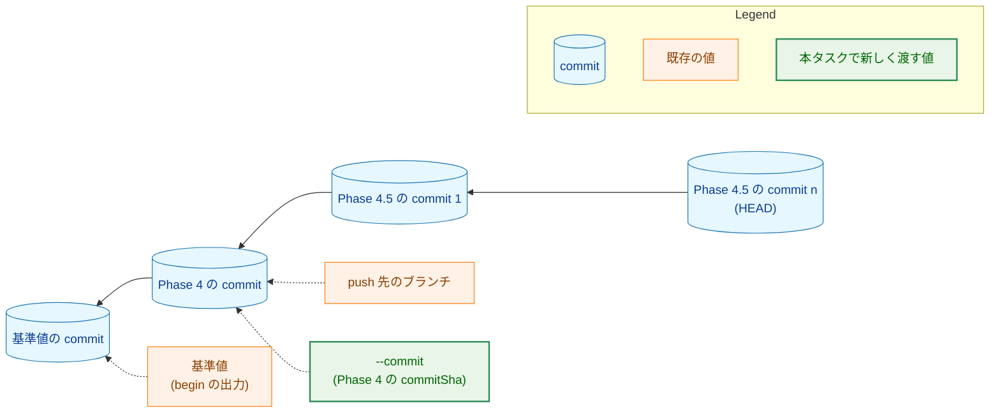
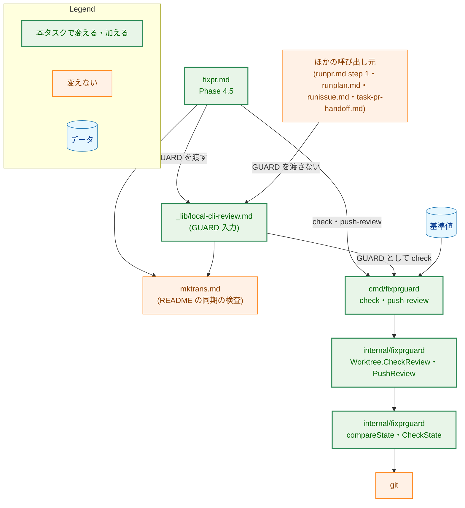
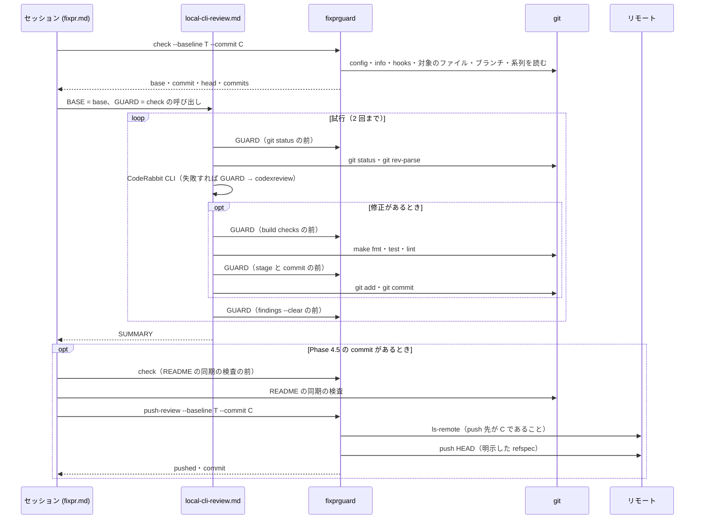
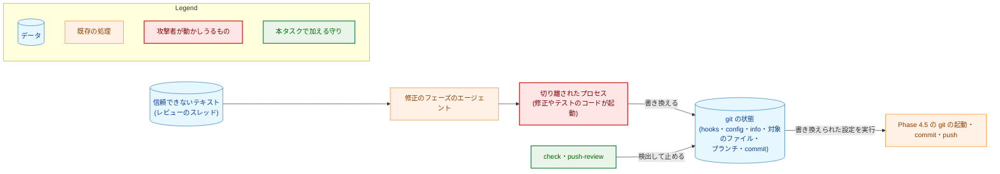
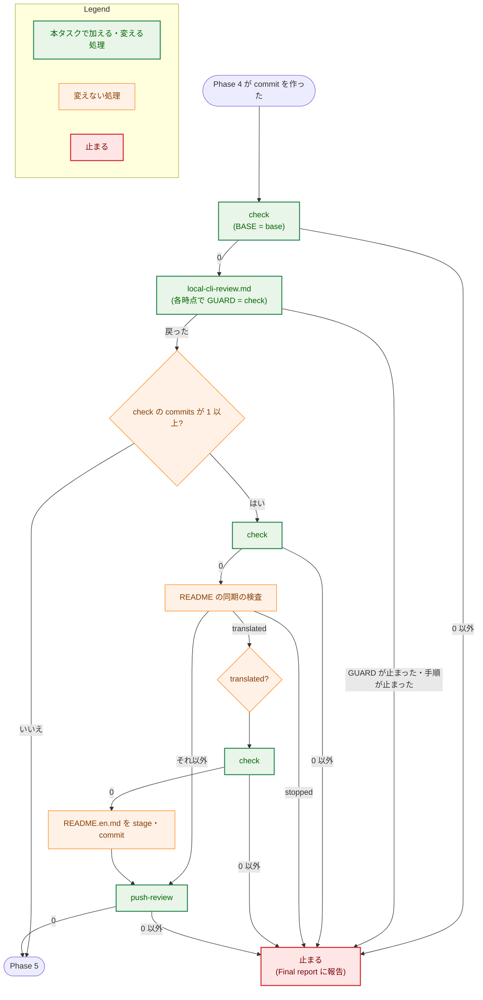

# 設計書：/fixpr Phase 4.5 の git の起動と push の前に、ガードツールが git の状態を基準値と比べる

## Document Status

| Item | Value |
|---|---|
| Status | `draft` |
| Created | 2026-11-10 |
| Review date | - |
| Reviewer | - |
| Comments | - |

対応する要件定義書: [01_requirements.md](01_requirements.md)（対応 issue: [#426](https://github.com/isseis/yt2column/issues/426)）

本書が `file:line` で示す既存のコードと文書は、commit `9d15028d` で読んだものである。

## 1. 設計の全体像 (Design Overview)

本タスクでは、ガードツール `fixprguard` に 2 つのサブコマンドを加える。

-   **`check`:** git の状態を基準値と比べるだけのサブコマンド。
-   **`push-review`:** Phase 4.5 の commit を push するサブコマンド。

`/fixpr` の Phase 4.5 は、手順が定める git の起動の前に `check` を呼び、最後に `push-review` で push する。ローカルの CLI レビューの共有の手順（`.claude/commands/_lib/local-cli-review.md`）には、任意の入力 **GUARD** を加える。GUARD は、手順が git を起動する前に実行する比較のコマンドである。`/fixpr` だけが GUARD を渡し、ほかの 5 つの呼び出し元は渡さない。

### 1.1. 設計原則

-   **比べ方は 1 か所に置く。** `check` と `push-review` は、Phase 4 の `push` と同じ比較（`compareState` と、その中の `CheckState`）を使う。Phase 4.5 のための別の規則は作らない（要件定義書 4.5）。変えるのは、HEAD と push 先の OID を何と比べるかだけである。それは、比較に渡す「決まり」の値で宣言する（3.4）。
-   **決定的な判定は Go に置く。** HEAD の系列の判定、Phase 4 の commit を求めること、push 先の確認は、ツールが行う。コマンドの文書には呼び出しだけを書く（[ADR-0014](../../dev/adr/0014-deterministic-checks-in-go.md)）。
-   **振る舞いはサブコマンドで宣言する。** Phase 4 の push と Phase 4.5 の push は、別のサブコマンドにする。既存の `push` に、HEAD の形を見て振る舞いを選ばせない（CLAUDE.md の「Declare, don't infer」）。
-   **セッションが渡す値は、検査を厳しくするだけに使う。** `--commit` には Phase 4 の commit を渡す。ツールは Phase 4 の commit を git の状態から求め、渡された値と違えば止まる。渡された値によって、検査が緩むことはない（AC-02）。
-   **止まった後、セッションは git を起動しない。** 止まったときの報告に要る値は、最後に通った比較の出力と、セッション自身が記録した値から作る（3.8）。止まった時点の git の状態は、hooks や config が書き換えられている可能性があり、信頼できないためである。
-   **ほかの呼び出し元の振る舞いは変えない。** GUARD は任意の入力であり、渡さなければ手順は今までと同じに動く（AC-11）。

### 1.2. 設計の際に決めたこと（2026-11-10）

-   **比較を新しいサブコマンド `check` で、Phase 4.5 の push を新しいサブコマンド `push-review` で行う。既存の `push` は変えない。** 既存の `push` は、HEAD が `--commit` そのものであることを求める（`internal/fixprguard/worktree.go:571-589`）。Phase 4.5 の commit は、その上に積まれる。既存の `push` に両方を扱わせると、HEAD が `--commit` と一致するかどうかで、どちらの検査をするかを選ぶことになる。これは、呼び出し元のデータの形から振る舞いを推論することである。`push` にモードのフラグを加える案も考えたが、検査の内容と出力の意味が違うものを、1 つのサブコマンドに同居させることになる。ADR の判断: [ADR-0015](../../dev/adr/0015-untrusted-review-threads.md) を更新した。ガードツールと `/fixpr` の手順の両方にまたがる、呼び出しの形の決定だからである。
-   **比較の呼び出しは、`local-cli-review.md` に任意の入力 GUARD として加える。** 比べる時点のほとんどは、`local-cli-review.md` の各 step の中にある（3.6）。`fixpr.md` から「手順 N の前に比べる」と指示する書き方だと、手順の step の番号や構成が変わったとき、指示が黙ってずれる。GUARD を手順の中に書けば、時点が手順と一緒に動く。ADR の判断: 上の決定と同じく、ADR-0015 の更新に含めた。
-   **`--protocol` を `5` から `6` に上げる。** 出力の契約（`parts` の値。下の決定）を変えるので、ガイドの 9 章の規則に従う。番号を上げると、古いツールは `/fixpr` の最初の呼び出し（`begin`）か、`/runpr` の最初の呼び出し（`interaction-limits`）で、終了コード `2` で止まる。Phase 4 が push する前に止まるので、半端な状態が残らない（AC-10）。番号を上げなくてもよい例外（9 章の 3 つの条件）も使えた。しかしその場合、古いツールは Phase 4.5 の最初の `check` で止まる。その時点では Phase 4 の commit がすでに push されており、診断も、使い方の誤りと見分けがつかない。ADR の判断: ADR にしない。ガイドの 9 章の規則に従うだけで、新しい方針を作らないためである。
-   **`parts` に `branch` を加え、すべてのサブコマンドでブランチの違いを `branch` で示す。** AC-05 は、(b) ブランチの違いと (c) HEAD の系列の違いを区別することを求める。今は、どちらも `head` になる（`internal/fixprguard/gitstate.go:822-824`）。新しいサブコマンドだけを `branch` にすると、同じ違いを、サブコマンドによって別の値で示すことになる。プロトコルを上げるので、既存の `inspect`・`finish`・`push` も、ブランチの違いを `branch` で示すように揃える。ADR の判断: ADR にしない。出力の値の決定で、仕様は `docs/dev/guides/fixprguard_guide.md` の 8 章に置くためである。
-   **`coderabbit review findings --clear`（`local-cli-review.md` の手順 6）の前にも比べる。** このコマンドが git を起動するかは、確かめていない。CodeRabbit CLI の `review` は git を読むので、`findings --clear` も起動しうる。AC-01 は比べる時点の下限を定めるものなので、時点を足しても要件とは食い違わない。比べる回数は、1 回の Phase 4.5 で多くても 2 回増えるだけである。ADR の判断: ADR にしない。本タスクの中で閉じる、時点の追加だからである。

### 1.3. 既存のサブコマンドでは足りない理由

-   **`push` は Phase 4.5 の commit を送れない。** `push` は、HEAD が `--commit` であること、その親が基準値の commit だけであること、push 先の OID が基準値と同じであることを確かめる（`internal/fixprguard/worktree.go:577-584`）。Phase 4.5 では、HEAD は Phase 4 の commit の上にあり、push 先の OID は Phase 4 の commit である。そのため、どの確認にも通らない。今の文書のガードも、これを理由に Phase 4.5 の `git push` を例外にしている（`cmd/yt2column/fixpr_docs_test.go:1117-1118`）。
-   **`inspect` は比較のほかに `gh` を起動し、範囲を判定する。** `inspect` は、スレッドの `path` を GitHub から取り直す（`cmd/fixprguard/main.go:611-615`）。Phase 4.5 にはスレッドがなく、要件定義書は範囲の検査をしないと決めた（1 章）。比べるだけの呼び出しに `inspect` を使うと、毎回 GitHub に問い合わせることになる。
-   **`finish` は Phase 4.5 の commit を作れない。** `finish` は、commit の件名を固定し、本文に `Editorial correction:` の行だけを認める。ローカルの CLI レビューの記録の行と、README の同期の commit を通せない（要件定義書 1 章）。

### 1.4. 概念モデル

矢印 A → B は「A の親が B である」を表す（commit の親子）。点線の矢印は「値が指す commit」を表す。



-   **1 本につながる:** 要件定義書 3 章の定義のとおり、HEAD から Phase 4 の commit までの各 commit が親をちょうど 1 つ持ち、Phase 4 の commit の親が基準値の commit だけであること。
-   **Phase 4 の commit:** HEAD から親をたどって、親が基準値の commit である commit。ツールが求める。`--commit` と一致しなければ止まる。
-   **Phase 4.5 の commit:** Phase 4 の commit より後の commit。`check` の出力の `commits` はその数である。0 のとき、HEAD は Phase 4 の commit である。

## 2. システム構成 (System Structure)

### 2.1. 全体構成

矢印 A → B は「A が B を呼ぶ、または実行する」を表す。



### 2.2. コンポーネント配置

| ファイル | 新規・変更 | 責務 | 更新が要る既存のテスト |
|---|---|---|---|
| `internal/fixprguard/gitstate.go` | 変更 | `PartBranch` を加え、`GitStateParts` に含める。`compareState` に、HEAD と push 先の OID を何と比べるかの決まり（3.4）を渡せるようにする。ブランチの違いを `branch` で、HEAD の違いを `head` で示す | `gitstate_test.go` の `branch_switch_same_commit`・`detached_head_same_commit`（期待する `parts` が `head` から `branch` へ） |
| `internal/fixprguard/worktree.go` | 変更 | `CheckReview`・`PushReview` を加える。`checkCommit` のブランチの違いを `branch` で示す | なし（`checkCommit` の既存のテストはブランチを変えない） |
| `internal/fixprguard/types.go` | 変更 | `Protocol` を `6` にする | なし（テストは `Protocol` を参照する） |
| `cmd/fixprguard/main.go` | 変更 | `check`・`push-review` の引数の宣言と、呼び出しの順序 | なし |
| `internal/fixprguard/*_test.go`・`cmd/fixprguard/main_test.go` | 変更 | 7 章のテストを加える | 上の 2 つ |
| `.claude/commands/fixpr.md` | 変更 | Phase 4.5 の `check`・`push-review` の呼び出し、許可の段落、`--protocol 6`、古いツールの診断、Final report の 3 項目 | なし |
| `.claude/commands/_lib/local-cli-review.md` | 変更 | 任意の入力 GUARD と、それを実行する時点 | なし |
| `.claude/commands/runpr.md` | 変更 | `--protocol 6` と、古いツールの診断 | なし |
| `.claude/commands/_context.md` | 変更 | 「Guard tool」の行 | なし |
| `docs/dev/guides/fixprguard_guide.md` | 変更 | 4 章（番号 `6`）、5 章（`check`・`push-review`）、7.1・7.2、8 章（`branch`）、9 章 | なし |
| `docs/dev/adr/0015-untrusted-review-threads.md` | 変更 | 本書の PR で呼び出しの形を加えた。実装の PR で、ずれの記述（「まだ反映されていない」）を取り除く | なし |
| `docs/tasks/0030_fixpr_untrusted_threads/02_architecture.md` | 変更 | 5.2・5.3 に本タスクの注記を足す（本文は変えない） | なし |
| `cmd/yt2column/fixpr_docs_test.go` | 変更 | `TestFixprguardCallSites` に Phase 4.5 の `check`・`push-review` を加える。`TestRemovedCommandLiterals` の Phase 4.5 の例外を外す。`local-cli-review.md` の GUARD の検査を加える（7.4） | `TestRemovedCommandLiterals`（Phase 4.5 の `git push` を許す例外とその注記） |

`compareState` と `CheckState` は、これまでどおり 1 つだけ置く。新しいサブコマンドのために、比べ方を複製しない。

### 2.3. データフロー: Phase 4.5

矢印は、呼び出しと、その応答を表す。



図は流れの概略であり、比べる時点の正確な一覧は 3.6 の表である。

### 2.4. 既存の挙動の確認

-   `compareState` は、`CheckState`、index のフラグ、HEAD とブランチの順に比べる。`checkLocal` を渡したときは、push 先の OID を読まない（`internal/fixprguard/gitstate.go:811-839`）。ブランチは、基準値に名前ではなく digest で記録されている（`gitstate.go:777`・`822`）。
-   `CheckState` は、config と info をファイルだけで比べ、`git config --list` を起動し、それが一致してから hooks の場所を求め、最後に対象のファイルを列挙する（`gitstate.go:556-604`）。新しいサブコマンドも、この順序をそのまま使う。
-   `commitObject` は、replace refs を無効にした `git cat-file` で commit を読み、親の一覧を返す（`gitstate.go:639-670`）。系列の判定（3.3）はこれを使う。
-   `Push` は、明示した refspec で、タグとサブモジュールを伴わずに push する（`worktree.go:585-586`）。`PushReview` も同じ引数で push する。
-   引数の解析は、`--protocol` がバイナリの番号と一致しなければ、終了コード `2` で止まる（`cmd/fixprguard/main.go:243-245`）。知らないサブコマンドも、終了コード `2` で止まる（`main.go:222-224`）。
-   `fixpr.md` の Phase 4.5 は、BASE を `$(git rev-parse <commitSha>^)` で求め（`.claude/commands/fixpr.md:703-704`）、最後に素の `git push` を実行する（`fixpr.md:718`）。
-   `local-cli-review.md` の手順 3 は、今の場所が作業ツリーの最上位でなければ、`git rev-parse --show-toplevel` で最上位を求めて移る（`.claude/commands/_lib/local-cli-review.md:103-105`）。ガードツールは、作業ツリーの最上位で実行することを前提にしている（`fixprguard_guide.md` 4 章の終了コード `2`）。

## 3. コンポーネント設計 (Component Design)

### 3.1. サブコマンド

| サブコマンド | 引数 | すること | 出力（終了コード `0`） |
|---|---|---|---|
| `check --baseline TOKEN --commit SHA` | どちらも必須。PR は取らない | 要件定義書 3 章の (a)・(b)・(c) を比べる。(c) で求めた Phase 4 の commit が `--commit` と一致することを確かめる | `protocol`・`base`（基準値の commit）・`commit`（Phase 4 の commit）・`head`（HEAD）・`commits`（Phase 4 の commit より後の commit の数） |
| `push-review --baseline TOKEN --commit SHA` | どちらも必須。PR は取らない | `check` と同じことを比べ、さらに push 先の OID が `--commit` であることを確かめる。`commits` が 1 以上なら、HEAD を明示した refspec で push する | `protocol`・`pushed`・`commit`（push した HEAD。`pushed` が `false` のときは Phase 4 の commit） |

-   どちらも `gh` を起動しない。そのため、`GH_REPO`・`GH_HOST` の検査（`main.go:355-361`）の対象外である。
-   `--commit` は、40 桁か 64 桁の小文字の 16 進数だけを受け付ける。ほかの形は、使い方の誤り（終了コード `2`）になる（要件定義書 4.2）。
-   `push-review` は、`commits` が 0 のとき（HEAD が Phase 4 の commit のとき）、比較と push 先の確認だけを行い、push せずに `pushed: false` を返す。`fixpr.md` は、Phase 4.5 の commit がないとき `push-review` を呼ばない（AC-09）。ツールは、呼ばれた場合でも、送るものがなければ何も送らない。
-   `push-review` の出力は、既存の `push` の出力（`PushResult`）と同じ形にする。

### 3.2. 型と interface

```go
// PartBranch names the branch HEAD is on: it differs from the baseline's
// branch, or HEAD is detached.
const PartBranch = "branch"

// CheckResult is the output of check: the git state matches the baseline,
// HEAD is on the baseline's branch, and HEAD continues in one line from the
// Phase 4 commit, whose only parent is the baseline's commit.
type CheckResult struct {
	Protocol int    `json:"protocol"`
	Base     string `json:"base"`    // the baseline's commit
	Commit   string `json:"commit"`  // the Phase 4 commit, found from the git state
	Head     string `json:"head"`
	Commits  int    `json:"commits"` // commits after the Phase 4 commit
}

// CheckReview compares the git state as check does. commit is the Phase 4
// commit the caller names; it only narrows the check.
func (w *Worktree) CheckReview(ctx context.Context, base Baseline, commit string) (CheckResult, error)

// PushReview checks as CheckReview does and that the push target branch is
// at commit, then pushes HEAD with an explicit refspec when HEAD is past
// commit.
func (w *Worktree) PushReview(ctx context.Context, base Baseline, commit string) (PushResult, error)
```

`compareState` に渡す決まりは、パッケージの中の型である。

```go
// headRule says what HEAD must be. The zero value is the stricter one.
type headRule int

const (
	// headIsCommit: HEAD is the given commit (inspect, finish, push).
	headIsCommit headRule = iota
	// headFollowsCommit: HEAD continues in one line from the given commit,
	// whose only parent is the baseline's commit (check, push-review).
	headFollowsCommit
)
```

push 先の OID を何と比べるかは、既存の `stateCheck`（`checkWithRemote`・`checkLocal`）に加えて、比べる相手の OID を渡す形にする。`check` は push 先を読まない（ネットワークに出ない）。`push-review` は、push 先を `--commit` と比べる。既存の `inspect`・`push` は、今までどおり基準値の OID と比べる。

### 3.3. 系列の判定（要件定義書 3 章の (c)）

-   HEAD から親をたどる。たどる各 commit は、親をちょうど 1 つ持たなければならない。親が 2 つ以上の commit（マージの commit）と、親のない commit は、`head` で止める。
-   親が基準値の commit である commit に着いたら、それを Phase 4 の commit とする。HEAD が基準値の commit そのものなら、Phase 4 の commit がないので、`head` で止める。
-   求めた Phase 4 の commit が `--commit` と違えば、`head` で止める。
-   たどる数には上限を置く。Phase 4.5 が作る commit は、2 回の試行の修正と README の同期の commit で、多くても数個である。上限は、Phase 4 の commit より後の commit で 32 個とする。超えたら、`head` で止める。上限は、基準値の commit から続かない長い列で、git を限りなく起動しないためのものである。
-   commit は `commitObject`（replace refs を無効にした `git cat-file`）で読む。commit-graph や replace refs で、親を偽れないようにするためである。
-   ブランチの比較（(b)）は、系列の判定より前に行う。ブランチが違えば `branch` で止め、系列はたどらない。

### 3.4. 比べる順序

`check` と `push-review` は、既存の `compareState` を、決まり `headFollowsCommit` で呼ぶ。比べる順序は、今の `compareState` と同じである。

1. `CheckState`（config・info・hooks・対象のファイル）。違えば、それより後の git を起動しない。
2. index のフラグ（skip-worktree・assume-unchanged）。
3. ブランチ（`branch`）。
4. HEAD（決まりに従う。`headFollowsCommit` では 3.3 の判定。`head`）。
5. push 先の OID（`push-review` だけ。`remote`）。

要件定義書の (a) は 1 と 2、(b) は 3、(c) は 4 に当たる。AC-07 の push 先の確認は 5 に当たる。

### 3.5. Phase 4.5 の push（F-003）

-   `push-review` は、3.4 の 1〜5 に通った後、`<HEAD>:refs/heads/<ブランチ>` の refspec で、`--no-follow-tags` と `--recurse-submodules=no` を付けて push する。push 先のリモートは、既存の `Push` と同じく `resolvePushTarget` が決める（AC-08）。
-   push 先の OID が `--commit` でなければ、push せずに `remote` で止まる（AC-07）。Phase 4 の push の後に、ほかの誰かがブランチを進めた場合に当たる。
-   push 先が基準値の OID でなく `--commit` であることで、Phase 4 の push が届いたことも確かめる。

### 3.6. `local-cli-review.md` の GUARD 入力（F-001・F-005）

`local-cli-review.md` の入力に、次の任意の入力を加える。

-   **GUARD**（任意）— 手順が git を起動する前に、そのつど実行するコマンド。終了コード `0` のときだけ続ける。それ以外（終了コード `1`・`2`・`3`、信号による終了、読めない出力）は、手順と呼び出し元を止め、呼び出し元の指示に従って報告する。渡さない呼び出し元では、手順は今までと同じに動く。今、渡すのは `fixpr.md` の Phase 4.5 だけである。

比べる時点は、次の表のとおりである。「場所」は、その時点を書く文書である。

| 時点 | 場所 | 対応する AC-01 の項目 |
|---|---|---|
| Phase 4.5 の最初（BASE を求める前） | `fixpr.md` | BASE を求める `git rev-parse`。BASE は、この `check` の出力の `base` を使う。`git rev-parse <commitSha>^` はもう実行しない |
| 手順 1 の最初（各試行の `git status` の前） | `local-cli-review.md` | 各試行の最初の `git status`。続く CodeRabbit CLI も含む |
| 手順 3 の最初（`git rev-parse --show-toplevel` を含む、手順 3 の最初の git の前） | `local-cli-review.md` | `codexreview` の前の `git rev-parse`。続く `codexreview` も含む |
| 手順 5 の build checks の前 | `local-cli-review.md` | 修正の build checks |
| 手順 5 の README の同期の検査の前（修正が `README.md` を変えたとき） | `local-cli-review.md` | 修正が `README.md` を変えたときの README の同期の検査 |
| 手順 5 の stage の前（stage から commit までの間に、ほかの git を起動しない） | `local-cli-review.md` | 修正の stage と commit |
| 手順 6 の `coderabbit review findings --clear` の前 | `local-cli-review.md` | AC-01 の外。1.2 の決定で足した |
| 手順が戻った後、README の同期の検査の前（Phase 4.5 の commit があるとき） | `fixpr.md` | Phase 4.5 の終わりの README の同期の検査 |
| `README.en.md` の stage の前（同期が `translated` のとき） | `fixpr.md` | README の同期の `README.en.md` の stage と commit |
| push の前 | `fixpr.md`（`push-review` が自分で比べる） | AC-07 |

-   GUARD は、作業ツリーの最上位で実行する。手順 3 は、最上位でなければ移る前に GUARD を実行する必要がある。そこで、GUARD は「今の場所によらず、作業ツリーの最上位を絶対パスで示して実行する」と文書に書く。最上位の絶対パスは、Phase 4.5 の最初にセッションが記録したものを使い、それを求めるために git を起動しない。セッションは Phase 1 の前から作業ツリーの最上位にいる（`fixprguard begin` が最上位を求める）。
-   手順 1 の `git rev-parse <BASE>`・`git rev-parse HEAD` は残す。これらは、手順 1 の最初の GUARD の後に実行される。
-   設計の時点の `fixpr.md`・`local-cli-review.md`・`mktrans.md` に照らして、手順が定める git の起動を確かめた。上の表で覆わないものは、次の 2 つだけである。どちらも、要件定義書を変える必要はない。
    -   `mktrans.md` の README の同期の検査の中の `git hash-object` と `git diff`（`.claude/commands/mktrans.md:77`・`160`）。これらは、表の「README の同期の検査の前」の比較の後に、続けて実行される。要件定義書は、検査を 1 つの時点として扱う（AC-01）。
    -   Phase 4 の commit がないときの `git fetch --prune` と `git rev-list`（`fixpr.md:683-688`）。これは Phase 4 の中の手順で、Phase 4.5 は飛ばされる（AC-09）。

### 3.7. `fixpr.md` の変更（F-001〜F-004・F-006）

-   **Phase 4.5:** 3.6 の表の `fixpr.md` の時点で `check` を呼ぶ。BASE は最初の `check` の `base` を使う。`local-cli-review.md` に GUARD として `check` の呼び出しを渡す。Phase 4.5 の commit の有無は、手順が戻った後の `check` の `commits` で決める。commit があれば、最後に `push-review` を呼ぶ。素の `git push` は書かない（AC-06）。
-   **許可の段落:** `git push` を「Phase 4（`push`）と Phase 4.5（`push-review`）でガードツールが行う」と書き直す。`README.en.md` の commit が「Phase 4.5 の `git push` で push される」という記述も、`push-review` に直す。
-   **`--protocol 6`:** すべての呼び出しの番号を `6` にする。
-   **古いツール（AC-10）:** 「The guard tool」の節に、次の振る舞いを足す。`begin` が終了コード `2` で止まり、診断が `--protocol does not match` を含むときは、インストール済みのツールが文書より古い（または新しい）。そのときは、最新の `main` から `make install-fixprguard` を実行するよう利用者に示して止まる。Phase 4.5 で `check` が同じ診断で止まった場合も、同じ案内を出し、AC-05 の報告も行う。`runpr.md` の step 1 の `interaction-limits` にも、同じ案内を足す。
-   **Final report:** 3.8 のとおり。

### 3.8. 止まったときの報告（F-002）

Phase 4.5 で、`check`・GUARD・`push-review` が止まったときは、次のようにする。

-   止まった時点の git の起動と、それより後の build checks・stage・commit・push をしない。Phase 5 と Phase 6 も行わない。作業ツリーと commit は残す（AC-04）。
-   **報告には、git を起動して得た値を使わない。** 止まった時点の hooks や config は、書き換えられている可能性があるためである。数と範囲は、次のものから作る。
    -   最後に通った `check`（GUARD を含む）の出力の `head` と `commits`。
    -   その `check` の後にセッションが作った commit の数。セッションは、自分が実行した `git commit` が成功したかを知っている。
    -   `local-cli-review.md` の手順 1 が記録した BASE・HEAD1・HEAD2。
-   **push されていない commit の数:** 最後に通った `check` の `commits` と、その後に作った commit の数の和。
-   **ローカルの CLI レビューを受けていない範囲:** `local-cli-review.md` の手順 7 の `Local CLI review: not run` の行の形で示す。範囲の終わりの commit の SHA が、最後に通った `check` の後に作った commit のものである場合は、セッションはその SHA を知らない。その場合は、範囲の終わりを最後に通った `check` の `head` とし、その後に作った commit の数を添える。

Final report への組み込み（AC-05・H-04）は次のとおりである。

| AC-05 の項目 | Final report の項目 |
|---|---|
| 止まった時点、`stop`、`parts`（`branch`・`head`・`remote` で (b)・(c)・push 先の OID を区別する） | 「Stops to act on」 |
| Phase 4 の commit が push 済みであること | 「Stops to act on」 |
| 返信も解決もしていないスレッドの一覧 | 「Stops to act on」 |
| push されていない Phase 4.5 の commit の数 | 「Stops to act on」 |
| 復旧のために利用者が確かめること（`dirty-work-tree`、push されていない commit を次の `/fixpr` がどう扱うか、`ignored` なら 8.1） | 「Stops to act on」 |
| ローカルの CLI レビューを受けていない範囲 | 「Local CLI review」 |
| Phase 6 で PR の説明に足していない編集上の訂正 | 「Editorial corrections」 |

`ignored` で止まったときは、既存の `CheckState` が止まった時点の記録のファイル（`fixprguard-ignored-stop`）を書く（`gitstate.go:597-600`）。新しいサブコマンドも `CheckState` を使うので、同じく書く。

### 3.9. 文書（F-006）

-   **`_context.md` の「Guard tool」の行:** Phase 4.5 で、`check` が git の起動の前に比べ、`push-review` が push することを書く。Phase 4.5 の commit が範囲の検査を受けないことも書く（AC-12）。
-   **`fixprguard_guide.md`:**
    -   4 章: 番号を `6` にする。`--protocol does not match` の診断が、古いツールを示すことを書く。
    -   5 章: `check`・`push-review` の節を加える。
    -   7.1: `check`・`push-review` が守ることを加える。書き換えられた hooks・config で git を起動しない保証の主語に、2 つを加える。
    -   7.2: 守らないことを加える。Phase 4.5 の修正の範囲の検査がないこと、比較が時点だけの確認であること、手順が定めない git の起動、1 本につながる commit の出所を区別しないこと。
    -   8 章: `parts` に `branch` を加える。
    -   9 章: タスク 0076 が `6` を使ったことを、番号の例に加える。
-   **ADR-0015:** 本書の PR で、呼び出しの形（1.2）を決定に加えた。実装の PR で、「まだ反映されていない」というずれの記述を取り除く。
-   **タスク 0030 の設計書:** 5.2 と 5.3 の先頭に、タスク 0057 の注記と同じ形の注記を足す（AC-13）。5.2 には、Phase 4.5 の比較と push の守りを本タスクが加えたことを書く。5.3 には、「確認と実行の間のずれ」が Phase 4.5 の各時点に縮んだことと、残る残余のリスクの置き場（本タスクの要件定義書 4.2 と `fixprguard_guide.md` 7.2）を書く。両節の本文は変えない。

### 3.10. 副作用の契約

| サブコマンド | 読むもの | 書くもの | ネットワーク |
|---|---|---|---|
| `check` | git の状態（config・info・hooks・対象のファイル・index のフラグ・HEAD・commit の親） | `ignored` で止まったときだけ、git のディレクトリに止まった時点の記録のファイル | なし。`git ls-remote` も起動しない |
| `push-review` | `check` と同じものと、push 先の OID（`git ls-remote`） | `ignored` で止まったときの記録のファイル。`commits` が 1 以上で、すべての確認に通ったときだけ push | `git ls-remote` と `git push` |

どちらも、作業ツリー・index・ブランチ・ref を変えない（push によってリモートの ref が変わることを除く）。

## 4. エラーハンドリング設計 (Error Handling Design)

-   新しい止まった種類は加えない。比較に通らないときは、既存の `git-state-changed` で止まる。`parts` の値は次のとおりである。

| `parts` | 意味 | 出すサブコマンド |
|---|---|---|
| `head` | HEAD が期待と違う。`inspect`・`finish`・`push` では HEAD が期待の commit でない。`check`・`push-review` では、HEAD が Phase 4 の commit から 1 本につながらない（マージの commit、基準値の commit から続かない列、Phase 4 の commit がない、`--commit` と違う、上限を超える） | すべて |
| `branch`（新規） | HEAD が基準値のブランチにない（別のブランチ、detached HEAD） | すべて |
| `remote` | push 先の OID が期待と違う（`push-review` では `--commit` でない） | `inspect`・`push`・`push-review` |
| `hooks`・`config`・`info`・`ignored` | 今までと同じ | すべて |

-   `branch` と `head` は、同時に並ぶことがある。ブランチが違うときは、系列をたどらない（3.3）ので、`check`・`push-review` では `branch` だけが並ぶ。
-   git の失敗、読めない commit は、既存の `git-failed` で止まる。
-   `--baseline`・`--commit` の形の誤りは、既存の `ErrInvalidInput` で、終了コード `2` になる。
-   新しい種類の誤りの型は加えない。`GitStateError` の `Parts` に `PartBranch` が入るだけである。
-   標準エラーの診断は、既存の規則のとおり、規則の名前と `parts` だけを示し、SHA やブランチの名前を出さない。

## 5. セキュリティ考慮事項 (Security Considerations)

条件付きのガイド（`docs/dev/security.md`）の適用: N/A。理由は要件定義書 4.2 のとおりである。本タスクの push は、fix round がすでに行っている git の操作であり、製品の送信ではない。

### 5.1. 脅威モデル

矢印 A → B は「A が B に影響を与える、または B を検出する」を表す。



-   **守るもの:** Phase 4 の `push` の確認の後に、hooks・config・info・対象のファイル・ブランチ・commit の列が書き換えられること。書き換えは、Phase 4.5 の git の起動・commit・push で実行されうる。
-   **信頼の境界:** `--commit` はセッションが渡す。セッションは信頼できないテキストの影響を受けうる。そこで、ツールは Phase 4 の commit を git の状態から求め、`--commit` は一致の確認にだけ使う（AC-02）。`--commit` に別の値を渡しても、検査は緩まず、止まるだけである。
-   **GUARD の値:** GUARD は `fixpr.md` が書いたコマンドである。`local-cli-review.md` は、渡されたコマンドを実行するだけである。GUARD を渡さない（比べない）こと、つまりセッションが手順に従わないことは防げない。要件定義書 4.2 の「比較を呼ぶことは文書に依存する」と同じである。文書のガード（7.4）が、文書の書き換えによって呼び出しが消えることを検出する。

### 5.2. 守りの対応

| 経路 | 守り | 強制する主体 | 保証の強さ |
|---|---|---|---|
| Phase 4 の `push` の後に、hooks・config・info・対象のファイルが書き換えられる | 各時点の `check`（3.6） | 比較はコード。呼ぶことは文書 | 比べた時点だけの確認 |
| ブランチを切り替える | `check` の (b)（`branch`） | 同上 | 同上 |
| マージの commit や、基準値の commit から続かない commit を混ぜる | `check` の (c)（`head`） | 同上 | 同上 |
| Phase 4.5 の push の宛先や送るものを変える | `push-review` の明示した refspec、タグとサブモジュールを伴わないこと、push 先の確認 | コード | 決定的（確認の時点について） |
| 古いツールで、検査なしに進む | `--protocol 6` | コード | 決定的 |

### 5.3. 残余のリスク

要件定義書 4.2 の残余のリスク（範囲の検査がないこと、比較が時点だけの確認であること、手順が定めない git の起動、1 本につながる commit の出所を区別しないこと、比較を呼ぶことが文書に依存すること、Phase 4.5 の push の後の書き換え）は、すべて残る。設計で、次のことが加わる。

-   **`git status` から CodeRabbit CLI まで、`codexreview` の中、build checks の中の書き換え。** 1 つの時点の比較は、その後に続く複数のコマンドを覆う（各試行の `git status`・`git rev-parse`・CodeRabbit CLI、`make fmt`・`make test`・`make lint`）。その間に書き換えられた設定は、同じ時点の後のコマンドで実行されうる。`finish` は `make` のターゲットごとに比べるが、Phase 4.5 の build checks は、要件定義書のとおり、1 つの時点として扱う。
-   **README の同期の検査の中の git。** `git hash-object` と `git diff` は、1 つの比較の後に続けて実行される（3.6）。
-   **報告の SHA。** 最後に通った `check` の後に作った commit の SHA は、報告に出ない（3.8）。利用者は、`fixprguard_guide.md` 8 章の手順で状態を確かめた後に、`git log` で確かめる。

### 5.4. 観測のしやすさ

-   止まったときの出力は、既存の `stop` と `parts` である。`branch` を加えたので、ブランチの切り替えと、commit の列の違いを、出力だけで見分けられる。
-   `check` の出力は、Phase 4.5 の各時点の HEAD と、Phase 4.5 の commit の数を示す。セッションの記録と食い違えば、利用者が気づける。

## 6. 処理フロー詳細 (Processing Flow Details)

### 6.1. Phase 4.5 の流れ

矢印は処理の順序を表す。「止まる」は 3.8 の振る舞いである。



-   「`check` の commits が 1 以上?」の判定には、手順が戻った後にもう一度 `check` を呼ぶ必要がある。そこで、手順 6 の最後の GUARD（`findings --clear` の前）の出力を使う。CodeRabbit CLI が成功しなかった試行では、手順 6 の GUARD は実行されないので、手順が戻った直後に `check` を呼ぶ。どちらの場合も、判定に使う値は、手順の最後の commit より後の `check` の出力である。

## 7. テスト戦略 (Test Strategy)

### 7.1. ユニットテスト

git は、一時ディレクトリの実際のリポジトリで試す（`fixprguard_guide.md` 9 章）。

-   **系列の判定（H-05）:** 次の各場合を試す。
    -   Phase 4.5 の commit が 0 個・1 個・複数のとき（通る。`commits` と `head` を確かめる）。
    -   マージの commit を含むとき（`head`）。
    -   HEAD が基準値の commit のとき（Phase 4 の commit を含まない。`head`）。
    -   ブランチを切り替えたとき、detached HEAD のとき（`branch`）。
    -   基準値の commit を親に持たない列のとき（`head`）。
    -   `--commit` が求めた Phase 4 の commit と違うとき（`head`）。
    -   上限を超えるとき（`head`）。
-   **比較の順序:** config を書き換えたとき、`git config --list` のほかの git を起動しないこと（既存の `TestPushRechecks` の `listOnly` と同じ確かめ方）。hooks・info・対象のファイルを書き換えたときの `parts`。
-   **`push-review`:** 次の各場合を試す。
    -   push 先が `--commit` でないとき（`remote` で、push しない）。
    -   push の refspec が HEAD とブランチだけで、タグを送らないこと。
    -   `commits` が 0 のとき、push しないこと。
    -   設定された push の refspec が、送るものを変えないこと。
-   **`branch` の値:** 既存の `inspect`・`finish`・`push` で、ブランチの切り替えが `branch` になること（`gitstate_test.go` の 2 つの行の期待を更新する）。
-   **引数:** `check`・`push-review` の必須のフラグ、`--commit` の形、`--protocol 6` の一致。

### 7.2. 壊して失敗を確かめる

7.1 の各テストについて、守りを外して失敗することを確かめ、commit のメッセージに書く（CLAUDE.md の「Testing Strategy」）。たとえば、次のような外し方である。

-   親が 2 つの commit を通す。
-   `--commit` との照合を外す。
-   ブランチの比較を外す。
-   `push-review` の push 先の確認を基準値の OID に戻す。
-   `CheckState` の呼び出しを外す。

### 7.3. 結合テスト

`cmd/fixprguard` のテストで、`check` と `push-review` を実行し、出力の JSON の形と終了コードを確かめる。`gh` を起動しないことも確かめる（`gh` の fake に呼び出しが届かない）。

### 7.4. 文書のガード

CLAUDE.md の「Document tests」の例外（エージェントが信頼の境界で実行するコマンド）に当たるので、次を確かめる。

-   `TestFixprguardCallSites`: `fixpr.md` の Phase 4.5 が、`fixprguard check ` と `fixprguard push-review ` を呼ぶこと。
-   `TestRemovedCommandLiterals`: Phase 4.5 の例外と、その注記（`fixpr_docs_test.go:1117-1118`）を外し、Phase 4.5 も `git push` を含まないことを確かめる。
-   `local-cli-review.md` が GUARD の入力を定義していること。`fixpr.md` の Phase 4.5 が、GUARD に `fixprguard check` を渡すこと。
-   既存の `TestDocumentedInvocationsParse`（`cmd/fixprguard/docs_test.go:206`）が、文書の `check`・`push-review` の呼び出しを解析すること。`--protocol` の一致（`docs_test.go:343`）と、`parts` の一覧（`TestGuideNamesGitStateParts`）も、既存のガードが確かめる。

AC-11（ほかの呼び出し元が変わらないこと）は、ほかの呼び出し元の文書が変わらないことを、タスクの `_checks/` の diff の確認で確かめる（`requirements_process.md` §4）。ほかの呼び出し元に `fixprguard` がないことを確かめる恒久のテストは置かない。

### 7.5. セキュリティテスト

7.1 の比較の順序のテストが、書き換えられた config で git を起動しないことを確かめる。系列の判定のテストが、マージの commit と、基準値の commit から続かない列を押し通せないことを確かめる。

## 8. 実装の優先順位 (Implementation Priorities)

`--protocol` の番号は、ツールとすべての文書の呼び出しで一致していなければならず、文書のガードがその一致を確かめる（`cmd/fixprguard/docs_test.go:343`）。そのため、ツールの変更と文書の番号の変更は、同じ PR に入れる。

1. `PartBranch` と、`compareState` の HEAD の決まり。既存のテストの期待を更新する。
2. 系列の判定と `CheckReview`、そのテスト。
3. `PushReview`、そのテスト。
4. `cmd/fixprguard` の `check`・`push-review` と、`Protocol` を `6` に。
5. `fixpr.md`・`local-cli-review.md`・`runpr.md`・`_context.md`・`fixprguard_guide.md` と、文書のガード。
6. ADR-0015 のずれの記述を取り除き、タスク 0030 の設計書に注記を足す。

PR の切り方は、実装計画で決める。

## 9. 将来の拡張 (Future Extensibility)

-   ほかの呼び出し元が基準値を持つようになれば、GUARD を渡すだけで、同じ比較を使える。
-   Phase 5・6 の `reply`・`edit-pr`・`append-pr` に `--baseline` を渡し、`gh` の起動の前に比べることもできる（要件定義書 2.3 のスコープ外）。そのときも、`compareState` を共有する。

## 付録 A: 申し送り（design_handoff.md）への対応

| 項目 | 採った方針 |
|---|---|
| H-01: ガードツールの呼び出しの形 | 新しいサブコマンド `check` と `push-review` を加えた（1.2・3.1）。確かめ方は、`compareState` に HEAD の決まりと push 先の比べる相手を渡して共有する（3.2・3.4）。Phase 4 の commit はツールが求め、`--commit` は一致の確認にだけ使う。たどる数の上限は 32 個（3.3）。BASE は `check` の出力の `base` を使い、`git rev-parse` で求めない（3.6） |
| H-02: 呼び出しを書く場所 | `local-cli-review.md` に任意の入力 GUARD を加えた（1.2・3.6）。時点の一覧を、設計の時点の文書に照らして確かめた。要件定義書に戻す漏れはなかった。`coderabbit review findings --clear` の前の比較を足した（1.2） |
| H-03: `--protocol` と古いツール | `6` に上げた。古いツールは最初の呼び出しで止まり、`fixpr.md`・`runpr.md` が再インストールを案内する（1.2・3.7） |
| H-04: 止まったときの報告 | Final report の既存の項目に組み込んだ（3.8）。数と範囲は、最後に通った `check` の出力とセッションの記録から求め、止まった後に git を起動しない。止まった時点の記録のファイルは `CheckState` が書く。`parts` に `branch` を加えた（1.2・4 章） |
| H-05: テスト | 系列の判定に、指定の各場合を入れる（7.1）。文書のガードは、`fixpr.md` の Phase 4.5 の呼び出し、`git push` を直接実行しないこと、GUARD の受け渡しを確かめる（7.4） |

## 付録 B: 受け入れ基準との対応

| AC | 設計 |
|---|---|
| AC-01 | 3.6 の時点の表 |
| AC-02 | 3.3・3.4。`--commit` は一致の確認だけに使う（1.1・5.1） |
| AC-03 | commit はセッションが今までどおりのメッセージで作る。本タスクは commit のメッセージを変えない（3.6） |
| AC-04 | 3.8 |
| AC-05 | 3.8 の表 |
| AC-06 | 3.7。`TestRemovedCommandLiterals`（7.4） |
| AC-07 | 3.5 |
| AC-08 | 3.5 |
| AC-09 | 3.1・6.1 |
| AC-10 | 1.2・3.7 |
| AC-11 | 3.6（GUARD は任意）・7.4 |
| AC-12 | 3.7・3.9 |
| AC-13 | 3.9 |
| AC-14 | 7 章 |
