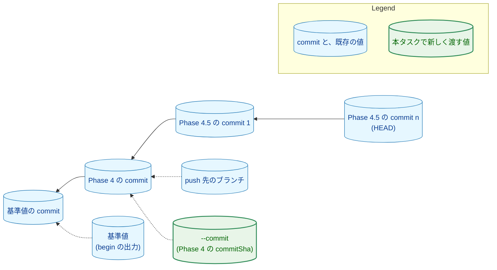
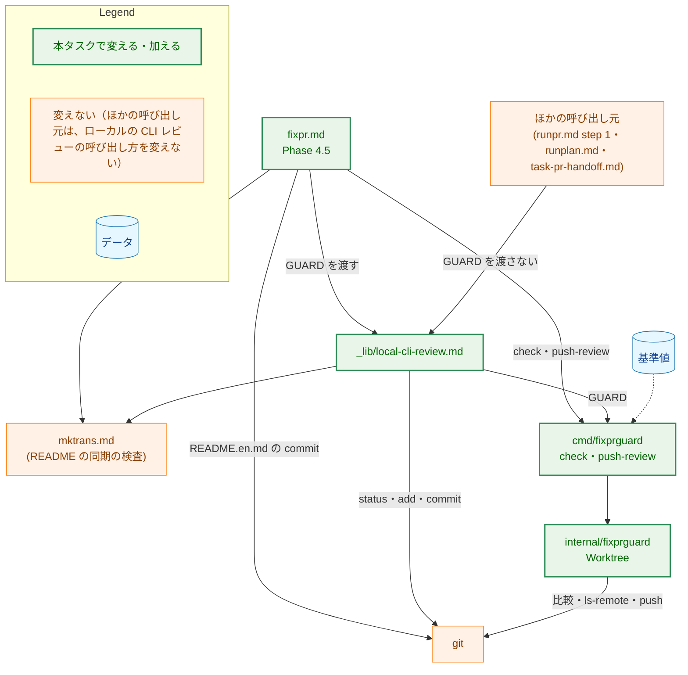
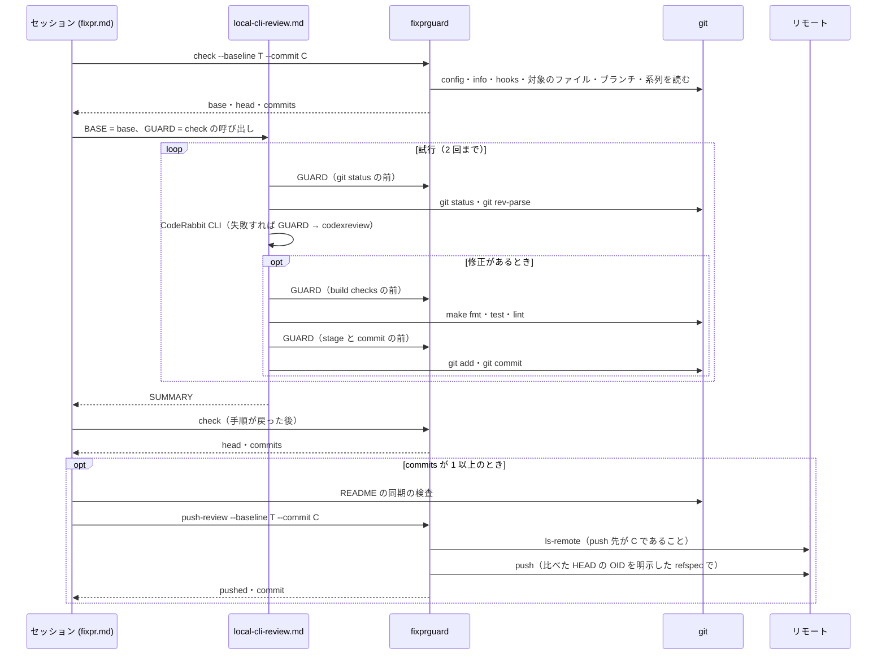
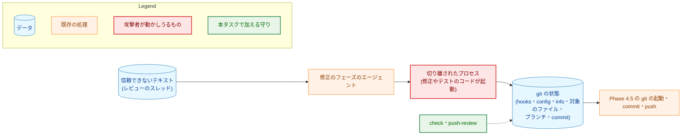
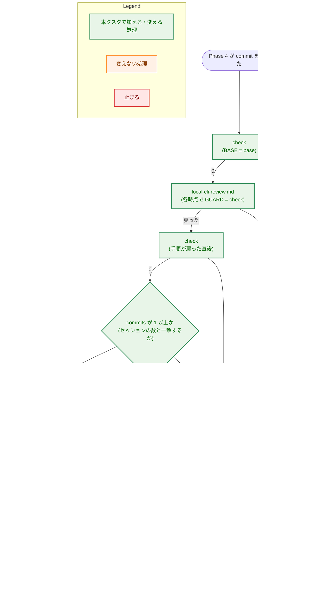

# 設計書：/fixpr Phase 4.5 の git の起動と push の前に、ガードツールが git の状態を基準値と比べる

## Document Status

| Item | Value |
|---|---|
| Status | `draft` |
| Created | 2026-11-10 |
| Review date | - |
| Reviewer | - |
| Comments | - |

対応する要件定義書: [01_requirements.md](01_requirements.md)（対応 issue: [#426](https://github.com/isseis/yt2column/issues/426)）

本書が `file:line` で示す既存のコードと文書は、commit `39c0c4aa`（`main` の #764 を取り込んだ後）で読んだものである。

## 1. 設計の全体像 (Design Overview)

本タスクでは、ガードツール `fixprguard` に 2 つのサブコマンドを加える。

-   **`check`:** git の状態を基準値と比べるだけのサブコマンド。
-   **`push-review`:** Phase 4.5 の commit を push するサブコマンド。

`/fixpr` の Phase 4.5 は、手順が定める git の起動の前に `check` を呼び、最後に `push-review` で push する。ローカルの CLI レビューの共有の手順（`.claude/commands/_lib/local-cli-review.md`。以下、「手順」は `local-cli-review.md` の手順の全体を、「手順 N」はその step N を指す）には、任意の入力 **GUARD** を加える。GUARD は、手順が git を起動する前に実行する比較のコマンドである。共有の手順の呼び出し元は 5 つあり、GUARD を渡すのはそのうち `/fixpr` だけである。

### 1.1. 設計原則

-   **比べ方は 1 か所に置く。** `check` と `push-review` は、Phase 4 の `push` と同じ比較（`compareState` と、その中の `CheckState`）を使う。Phase 4.5 のための別の規則は作らない（要件定義書 4.5）。変えるのは、HEAD と push 先の OID を何と比べるかだけである。それは、比較に渡す「HEAD の決まり」の値で宣言する（3.2）。
-   **決定的な判定は Go に置く。** HEAD の系列の判定、Phase 4 の commit を求めること、push 先の確認は、ツールが行う。コマンドの文書には呼び出しだけを書く（[ADR-0014](../../dev/adr/0014-deterministic-checks-in-go.md)）。
-   **振る舞いはサブコマンドで宣言する。** Phase 4 の push と Phase 4.5 の push は、別のサブコマンドにする。既存の `push` に、HEAD の形を見て振る舞いを選ばせない（CLAUDE.md の「Declare, don't infer」）。
-   **セッションが渡す値は、検査を厳しくするだけに使う。** `--commit` には Phase 4 の commit を渡す。ツールは Phase 4 の commit を git の状態から求め、渡された値と違えば止まる。渡された値によって、検査が緩むことはない（AC-02）。
-   **止まった後、セッションは git を起動しない。** 止まったときの報告に要る値は、`check` の出力と、セッション自身が記録した値から作る（3.8）。止まった時点の git の状態は、hooks や config が書き換えられている可能性があり、信頼できないためである。
-   **ほかの呼び出し元の振る舞いは変えない。** GUARD は任意の入力であり、渡さなければ手順は今までと同じに動く（AC-11）。

### 1.2. 設計の際に決めたこと（2026-11-10）

-   **比較を新しいサブコマンド `check` で、Phase 4.5 の push を新しいサブコマンド `push-review` で行う。既存の `push` は変えない。** 既存の `push` は、HEAD が `--commit` そのものであることを求める（`internal/fixprguard/worktree.go:575`、`internal/fixprguard/gitstate.go:822`）。Phase 4.5 の commit は、その上に積まれる。既存の `push` に両方を扱わせると、HEAD が `--commit` と一致するかどうかで、どちらの検査をするかを選ぶことになる。これは、呼び出し元のデータの形から振る舞いを推論することである。`push` にモードのフラグを加える案も考えたが、検査の内容と出力の意味が違うものを、1 つのサブコマンドに同居させることになる。ADR の判断: [ADR-0015](../../dev/adr/0015-untrusted-review-threads.md) を更新した。ガードツールと `/fixpr` の手順の両方にまたがる、呼び出しの形の決定だからである。
-   **比較の呼び出しは、主に `local-cli-review.md` の任意の入力 GUARD として加える。** 比べる時点のほとんどは、`local-cli-review.md` の各 step の中にある（3.6）。`fixpr.md` から「手順 N の前に比べる」と指示する書き方だと、手順の各 step の番号や構成が変わったとき、指示が気づかれないままずれる。GUARD を手順の中に書けば、時点が手順と一緒に動く。手順の外の時点（Phase 4.5 の最初、手順が戻った後、README の同期の `README.en.md` の commit）は、`fixpr.md` に書く。ADR の判断: 上の決定と同じく、ADR-0015 の更新に含めた。
-   **`--protocol` を `5` から `6` に上げる。** 出力の契約（`parts` の値。下の決定）を変えるので、ガイド（`docs/dev/guides/fixprguard_guide.md`）の 9 章の規則に従う。番号を上げると、番号の合わないツールは、`/fixpr` の最初の呼び出し（`begin`）か、`/runpr` の最初の呼び出し（`head`）で、終了コード `2` で止まる。Phase 4 が push する前に止まるので、半端な状態が残らない（AC-10）。番号を上げなくてもよい例外（9 章の 3 つの条件）も使えた。しかしその場合、古いツールは Phase 4.5 の最初の `check` で止まる。その時点では Phase 4 の commit がすでに push されており、診断も、使い方の誤りと見分けがつかない。ADR の判断: ADR にしない。ガイドの 9 章の規則に従うだけで、新しい方針を作らないためである。
-   **`parts` に `branch` を加え、比較を行うすべてのサブコマンドで、ブランチの違いを `branch` で示す。** AC-05 は、(b) ブランチの違いと (c) HEAD の系列の違いを区別することを求める（(a)・(b)・(c) は、要件定義書 3 章の「比べる」の 3 項目である。(a) は hooks・config・info・対象のファイルなど、(b) は今のブランチ、(c) は HEAD から基準値の commit までの系列）。今は、どちらも `head` になる（`internal/fixprguard/gitstate.go:822-824`）。タスク 0030 の設計書 3.7 の表が、`head` を「HEAD の OID と、HEAD がいるブランチ」と定めているためである。本タスクは、この定めを変える。新しいサブコマンドだけを `branch` にすると、同じ違いを、サブコマンドによって別の値で示すことになる。プロトコルを上げるので、既存の `inspect`・`finish`・`push` も、ブランチの違いを `branch` で示すように揃える。古い方針を確かめる既存のテストは、`internal/fixprguard/gitstate_test.go` の `branch_switch_same_commit` と `detached_head_same_commit` である（期待する値を `branch` に更新する）。0030 の設計書 3.7 には注記を足す（3.9）。ADR の判断: ADR にしない。出力の値の決定で、仕様は `docs/dev/guides/fixprguard_guide.md` の 8 章に置くためである。
-   **`coderabbit review findings --clear`（`local-cli-review.md` の手順 6）の前にも比べる。** このコマンドが git を起動するかは、確かめていない。CodeRabbit CLI の `review` は git を読むので、`findings --clear` も起動しうる。AC-01 は比べる時点の下限を定めるものなので、時点を足しても要件とは食い違わない。比べる回数は、1 回の Phase 4.5 で多くても 2 回増えるだけである。ADR の判断: ADR にしない。本タスクの中で閉じる、時点の追加だからである。

### 1.3. 既存のサブコマンドでは足りない理由

-   **`push` は Phase 4.5 の commit を送れない。** `push` は、HEAD が `--commit` であること（`compareState` の中。`gitstate.go:822`）、その親が基準値の commit だけであること（`worktree.go:579-583`）、push 先の OID が基準値と同じであること（`gitstate.go:836-838`）を確かめる。Phase 4.5 では、HEAD は Phase 4 の commit の上にあり、push 先の OID は Phase 4 の commit である。そのため、どの確認にも通らない。今の文書のガードも、これを理由に Phase 4.5 の `git push` を例外にしている（`cmd/yt2column/fixpr_docs_test.go:1115-1116`）。
-   **`inspect` は比較のほかに `gh` を起動し、範囲を判定する。** `inspect` は、スレッドの `path` を GitHub から取り直す（`cmd/fixprguard/main.go:611-615`）。Phase 4.5 にはスレッドがなく、要件定義書は範囲の検査をしないと決めた（1 章）。比べるだけの呼び出しに `inspect` を使うと、毎回 GitHub に問い合わせることになる。
-   **`finish` は Phase 4.5 の commit を作れない。** `finish` は、commit の件名を固定し、本文に `Editorial correction:` の行だけを認める。ローカルの CLI レビューの記録の行と、README の同期の commit を通せない（要件定義書 1 章）。

### 1.4. 概念モデル

実線の矢印 A → B は「A の親が B である」を表す（commit の親子）。点線の矢印 A → B は「値 A が commit B を指す」を表す。



-   **1 本につながる:** 要件定義書 3 章の定義のとおり、HEAD から Phase 4 の commit までの各 commit が親をちょうど 1 つ持ち、Phase 4 の commit の親が基準値の commit だけであること。
-   **Phase 4 の commit:** HEAD から親をたどって、親が基準値の commit である commit。ツールが求める。`--commit` と一致しなければ止まる。
-   **Phase 4.5 の commit:** Phase 4 の commit より後の commit。`check` の出力の `commits` はその数である。0 のとき、HEAD は Phase 4 の commit である。

## 2. システム構成 (System Structure)

### 2.1. 全体構成

実線の矢印 A → B は「A が B を呼ぶ、または実行する」を表す。点線の矢印 A → B は「A が B の入力になる」を表す。



`runpr.md` は `--protocol` の番号と古いツールの案内を変えるが（3.7）、step 1 のローカルの CLI レビューの呼び出し方は変えない。

### 2.2. コンポーネント配置

| ファイル | 新規・変更 | 責務 | 更新が要る既存のテスト |
|---|---|---|---|
| `internal/fixprguard/gitstate.go` | 変更 | `PartBranch` を加え、`GitStateParts` に含める。`compareState` が HEAD の決まり（3.2）を受け取り、その決まりから、push 先の OID の比較対象を決める。ブランチの違いを `branch` で、HEAD の違いを `head` で示す | `gitstate_test.go` の `branch_switch_same_commit`・`detached_head_same_commit`（期待する `parts` が `head` から `branch` へ） |
| `internal/fixprguard/worktree.go` | 変更 | `CheckReviewState`・`PushReviewed` を加える。`checkCommit` のブランチの比較も、`compareState` と同じ振り分けで `branch` を示す | なし（`checkCommit` の既存のテストはブランチを変えない） |
| `internal/fixprguard/types.go` | 変更 | `Protocol` を `6` にする | なし（テストは `Protocol` を参照する） |
| `cmd/fixprguard/main.go` | 変更 | `check`・`push-review` の引数の宣言と、呼び出しの順序 | なし |
| `internal/fixprguard/*_test.go`・`cmd/fixprguard/main_test.go` | 変更 | 7 章のテストを加える | 上の 2 つ |
| `cmd/fixprguard/docs_test.go` | 変更 | `TestDocumentedInvocationsParse` の、呼び出しがあるべきサブコマンドの一覧（`docs_test.go:217-218`）に `check`・`push-review` を加える | なし |
| `cmd/yt2column/fixpr_docs_test.go` | 変更 | 7.4 の文書のガード | `TestRemovedCommandLiterals`（Phase 4.5 の `git push` を許す例外とその注記。`fixpr_docs_test.go:1115-1116`） |
| `.claude/commands/fixpr.md` | 変更 | Phase 4.5 の `check`・`push-review` の呼び出し、許可の段落、`--protocol 6`、番号の合わないツールの案内、「Stops on the ignored files」、Final report の 3 項目 | なし |
| `.claude/commands/_lib/local-cli-review.md` | 変更 | 任意の入力 GUARD と、それを実行する時点 | なし |
| `.claude/commands/runpr.md` | 変更 | `--protocol 6` と、番号の合わないツールの案内 | なし |
| `.claude/commands/_context.md` | 変更 | 「Guard tool」の行 | なし |
| `docs/dev/guides/fixprguard_guide.md` | 変更 | 4 章（番号 `6`）、5 章（`check`・`push-review`）、7.1・7.2、8 章（`branch`）、9 章 | なし |
| `docs/dev/adr/0015-untrusted-review-threads.md` | 変更 | 本書の PR で呼び出しの形を加えた。実装の PR で、ずれの記述（「まだ反映されていない」）を取り除く | なし |
| `docs/tasks/0030_fixpr_untrusted_threads/02_architecture.md` | 変更 | 3.7・5.2・5.3 に本タスクの注記を足す（本文は変えない） | なし |

`compareState` と `CheckState` は、これまでどおり 1 つだけ置く。新しいサブコマンドのために、比べ方を複製しない。

### 2.3. データフロー: Phase 4.5

矢印は、呼び出しと、その応答を表す。



図は流れの概略である。比べる時点の正確な一覧は 3.6 の表にある（手順 3・5・6 の GUARD の一部は図から省いた）。

### 2.4. 既存の挙動の確認

-   `compareState` は、`CheckState`、index のフラグ、HEAD とブランチの順に比べる。`checkLocal` を渡したときは、push 先の OID を読まない（`internal/fixprguard/gitstate.go:811-839`）。ブランチは、基準値に名前ではなく digest で記録されている（`gitstate.go:777`・`822`）。
-   `CheckState` は、config と info をファイルだけで比べ、`git config --list` を起動し、それが一致してから hooks の場所を求め、最後に対象のファイルを列挙する（`gitstate.go:556-606`）。新しいサブコマンドも、この順序をそのまま使う。
-   `CheckState` は、今の場所で git のディレクトリを見つけられなければ、`config` の違いとして止まる（`gitstate.go:561-564`）。
-   `commitObject` は、replace refs を無効にした `git cat-file` で commit を読み、親の一覧を返す（`gitstate.go:639-664`）。系列の判定（3.3）はこれを使う。
-   `Push` は、確かめた SHA を送り元とする明示した refspec で、タグとサブモジュールを伴わずに push する（`worktree.go:584-586`）。`PushReviewed` も同じ形で push する。
-   `headState` は、HEAD の OID と、HEAD がいるブランチを、2 回の git の起動で読む（`gitstate.go:610-632`）。
-   引数の解析は、`--protocol` がバイナリの番号と一致しなければ、終了コード `2` で止まる（`cmd/fixprguard/main.go:243-245`）。知らないサブコマンドも、終了コード `2` で止まる（`main.go:222-224`）。
-   `fixpr.md` の Phase 4.5 は、BASE を `$(git rev-parse <commitSha>^)` で求め（`.claude/commands/fixpr.md:704`）、最後に素の `git push` を実行する（`fixpr.md:718`）。
-   `runpr.md` の最初の `fixprguard` の呼び出しは `head` である（`.claude/commands/runpr.md:176`）。
-   `local-cli-review.md` の手順 3 は、今の場所が作業ツリーの最上位でなければ、`git rev-parse --show-toplevel` で最上位を求めて、単独の `cd` で移る（`.claude/commands/_lib/local-cli-review.md:102-104`）。手順 6 の `coderabbit review findings --clear` は、その範囲の試行のどれかの結果が `coderabbit` のときに、トリアージの後で実行する（`local-cli-review.md:220-221`）。

## 3. コンポーネント設計 (Component Design)

### 3.1. サブコマンド

| サブコマンド | 引数 | すること | 出力（終了コード `0`） |
|---|---|---|---|
| `check --baseline TOKEN --commit SHA` | どちらも必須。PR は取らない | 要件定義書 3 章の (a)・(b)・(c) を比べる。(c) で求めた Phase 4 の commit が `--commit` と一致することを確かめる | `protocol`・`base`（基準値の commit）・`head`（HEAD）・`commits`（Phase 4 の commit より後の commit の数） |
| `push-review --baseline TOKEN --commit SHA` | どちらも必須。PR は取らない | `check` と同じことを比べ、さらに push 先の OID が `--commit` であることを確かめ、比べた HEAD の OID を push する | `protocol`・`pushed`（常に `true`）・`commit`（push した HEAD の OID） |

-   `--commit` は、どちらのサブコマンドでも Phase 4 の commit である。既存の `push` の `--commit`（push する commit そのもの）とは意味が違う。ガイドの 5 章にこの違いを書く。
-   どちらも `gh` を起動しない。そのため、`GH_REPO`・`GH_HOST` の検査（`main.go:355-361`）の対象外である。
-   `--commit` は、40 桁か 64 桁の小文字の 16 進数だけを受け付ける。ほかの形は、使い方の誤り（終了コード `2`）になる（要件定義書 4.2）。
-   **最上位でない場所での実行:** どちらも、比べる前に、今の場所が作業ツリーの最上位であることを確かめる。最上位でなければ、使い方の誤り（終了コード `2`）で止まる。`begin` と同じ扱いである（`fixprguard_guide.md` 4 章）。最上位でない場所では、`CheckState` が git のディレクトリを見つけられず、それを `config` の違いとして扱う。そのままだと、場所の誤りが設定の書き換えに見えてしまうためである。
-   **送るものがないとき:** `push-review` は、`commits` が 0 のとき（HEAD が Phase 4 の commit のとき）、push せずに使い方の誤り（終了コード `2`）で止まる。`fixpr.md` は、Phase 4.5 の commit がないとき `push-review` を呼ばない（AC-09）。呼ばれた場合を黙って成功にせず、拒否する（CLAUDE.md の「Reject, don't normalize」）。
-   **push の後にもう一度呼んだとき:** push 先の OID が `--commit` でなくなっているので、`remote` で止まる。ガイドの 8 章の `remote` の対処に、この場合を書く。

### 3.2. 型と interface

```go
// PartBranch names the branch HEAD is on: it differs from the baseline's
// branch, or HEAD is detached.
const PartBranch = "branch"

// ReviewState is the output of check: the git state matches the baseline,
// HEAD is on the baseline's branch, and HEAD continues in one line from the
// Phase 4 commit, whose only parent is the baseline's commit.
type ReviewState struct {
	Protocol int    `json:"protocol"`
	Base     string `json:"base"`    // the baseline's commit
	Head     string `json:"head"`    // the HEAD commit that was checked
	Commits  int    `json:"commits"` // commits after the Phase 4 commit
}

// CheckReviewState compares the git state as check does. phase4 is the
// Phase 4 commit the caller names; it only narrows the check.
func (w *Worktree) CheckReviewState(ctx context.Context, base Baseline, phase4 string) (ReviewState, error)

// PushReviewed checks as CheckReviewState does and that the push target
// branch is at phase4, then pushes the checked HEAD OID with an explicit
// refspec. It refuses when there is no commit after phase4.
func (w *Worktree) PushReviewed(ctx context.Context, base Baseline, phase4 string) (PushResult, error)
```

`compareState` は、HEAD の決まりを受け取る形に変える。HEAD の決まりは、HEAD を何と比べるかと、push 先の OID を何と比べるかを、まとめて宣言する。

```go
// headRuleKind says what HEAD must be. The zero value is the stricter one.
type headRuleKind int

const (
	// headIsCommit: HEAD is commit, and the push target is at the
	// baseline's OID (inspect, finish, push).
	headIsCommit headRuleKind = iota
	// headFollowsPhase4: HEAD continues in one line from commit, the Phase 4
	// commit, whose only parent is the baseline's commit; the push target is
	// at commit (check, push-review).
	headFollowsPhase4
)

// headRule pairs the kind with the commit it is anchored at.
type headRule struct {
	kind   headRuleKind
	commit string
}

// stateResult is what compareState checked: the push target, the HEAD OID it
// read, and, under headFollowsPhase4, the number of commits after commit.
type stateResult struct {
	target  pushTarget
	head    string
	commits int
}

func (w *Worktree) compareState(ctx context.Context, base Baseline, rule headRule, check stateCheck) (stateResult, error)

// GitStateError gains Rule: under head, the name of the rule HEAD failed
// (a fixed word, never a SHA), printed in the one-line diagnostic.
type GitStateError struct {
	Parts []string
	Rule  string
}
```

-   既存の `stateCheck`（`checkWithRemote`・`checkLocal`）は、push 先を読むかどうかだけを決める。push 先を何と比べるかは、HEAD の決まりが決める。そのため、HEAD の決まりと push 先の OID の比較対象が食い違う組み合わせは作れない。
-   ブランチの比較と、`branch`・`head` の振り分けは、`compareState` と `checkCommit` が共有する 1 つの関数で行う。振り分けの規則を 1 か所に置くためである。
-   `Push` の、親が基準値の commit だけであることの確認（`worktree.go:579-583`）は、今の位置のままにする。`headIsCommit` の HEAD の比較は、`inspect`（HEAD が基準値の commit）と共有するので、親の確認を含められないためである。

### 3.3. 系列の判定（要件定義書 3 章の (c)）

-   HEAD から親をたどる。たどる各 commit は、親をちょうど 1 つ持たなければならない。親が 2 つ以上の commit（マージの commit）と、親のない commit は、`head` で止める。
-   親が基準値の commit である commit に着いたら、それを Phase 4 の commit とする。HEAD が基準値の commit そのものなら、Phase 4 の commit がないので、`head` で止める。
-   求めた Phase 4 の commit が `--commit` と違えば、`head` で止める。
-   たどる数には上限を置く。Phase 4.5 が作る commit は、2 回の試行の修正と README の同期の commit で、多くても数個である。上限は、Phase 4 の commit より後の commit で 32 個とする。超えたら、`head` で止める。上限は、基準値の commit から続かない長い列をたどって、git を際限なく起動し続けないためのものである。
-   commit は `commitObject`（replace refs を無効にした `git cat-file`）で読む。commit-graph や replace refs で、親を偽れないようにするためである。
-   たどり始める HEAD は、`headState` が読んだ OID である。以後の判定と push は、この OID を使い、記号の `HEAD` を git に解決し直させない。

### 3.4. 比べる順序

`check` と `push-review` は、既存の `compareState` を、HEAD の決まり `headFollowsPhase4` で呼ぶ。比べる順序は、今の `compareState` と同じである。

1. `CheckState`（config・info・hooks・対象のファイル）。違えば、それより後の git を起動しない。
2. index のフラグ（skip-worktree・assume-unchanged）。
3. ブランチ（`branch`）。違えば、HEAD は比べない。
4. HEAD（決まりに従う。`headFollowsPhase4` では 3.3 の判定。`head`）。
5. push 先の OID（`push-review` だけ。`remote`）。

要件定義書の (a) は 1 と 2、(b) は 3、(c) は 4 に当たる。AC-07 の push 先の確認は 5 に当たる。

### 3.5. Phase 4.5 の push（F-003）

-   `push-review` は、3.4 の 1〜5 に通った後、`<比べた HEAD の OID>:refs/heads/<ブランチ>` の refspec で、`--no-follow-tags` と `--recurse-submodules=no` を付けて push する。送り元は、3.3 で系列をたどった OID であり、記号の `HEAD` ではない。push 先の確認（ネットワークの読み取り）の間に HEAD が動いても、確かめていない commit は送らない。push 先のリモートは、既存の `Push` と同じく `resolvePushTarget` が決める（AC-08）。
-   push 先の OID が `--commit` でなければ、push せずに `remote` で止まる（AC-07）。Phase 4 の push の後に、ほかの誰かがブランチを進めた場合に当たる。
-   push 先が基準値の OID でなく `--commit` であることで、Phase 4 の push が届いたことも確かめる。

### 3.6. GUARD と比べる時点（F-001・F-005）

`local-cli-review.md` の入力に、次の任意の入力を加える。

-   **GUARD**（任意）— 手順が git を起動する前に、そのつど単独の呼び出しとして実行するコマンド。
    -   終了コード `0` のときだけ続ける。それ以外（終了コード `1`・`2`・`3`、信号による終了、読めない出力）は、手順と呼び出し元を止め、呼び出し元の指示に従って報告する。
    -   手順のどの判断も GUARD の出力に依らない（出力は、呼び出し元が報告のために記録する。3.8）。
    -   GUARD を渡す呼び出し元は、作業ツリーの最上位の絶対パス（ROOT）も渡す。GUARD を渡されたとき、手順 3 は、最上位を `git rev-parse --show-toplevel` で求めず、ROOT への単独の `cd` を実行してから GUARD を実行する。
    -   渡さない呼び出し元では、手順は今までどおりに動く。今、渡すのは `fixpr.md` の Phase 4.5 だけである。

比べる時点は、次の表のとおりである。「場所」は、その時点を書く文書である。

| 時点 | 場所 | 対応する AC-01 の項目 |
|---|---|---|
| Phase 4.5 の最初（BASE を求める前） | `fixpr.md` | BASE を求める `git rev-parse`。BASE は、この `check` の出力の `base` を使う。`git rev-parse <commitSha>^` はもう実行しない |
| 手順 1 の最初（各試行の `git status` の前） | `local-cli-review.md` | 各試行の最初の `git status`。続く CodeRabbit CLI も含む |
| 手順 3 の最初（`git rev-parse --show-toplevel` を含む、手順 3 の最初の git の前） | `local-cli-review.md` | `codexreview` の前の `git rev-parse`。続く `codexreview` も含む |
| 手順 5 の build checks の前 | `local-cli-review.md` | 修正の build checks |
| 手順 5 の README の同期の検査の前（修正が `README.md` を変えたとき） | `local-cli-review.md` | 修正が `README.md` を変えたときの README の同期の検査 |
| 手順 5 の stage の前（stage から commit までの間に、ほかの git を起動しない） | `local-cli-review.md` | 修正の stage と commit |
| 手順 6 の `coderabbit review findings --clear` の前 | `local-cli-review.md` | AC-01 の外。1.2 の決定で足した |
| 手順が戻った直後（Phase 4.5 の commit の有無を決める。README の同期の検査の前を兼ねる） | `fixpr.md` | Phase 4.5 の終わりの README の同期の検査 |
| `README.en.md` の stage の前（同期が `translated` のとき） | `fixpr.md` | README の同期の `README.en.md` の stage と commit |
| push の前 | `fixpr.md`（`push-review` が自分で比べる） | AC-07 |

-   **実行する場所:** `check` は、作業ツリーの最上位で実行しなければならない（3.1）。セッションは、Phase 1 の `begin` が通った直後に、そのときの場所（`begin` が最上位であることを確かめた場所）を `pwd` で記録する。GUARD と `check` は、記録した場所で、`cd ... &&` を付けない単独の呼び出しとして実行する。手順 3 では、この記録した場所を ROOT として受け取った手順が、単独の `cd` を先に実行する。場所を求めるために git は起動しない。`cd ... &&` を付けた形では、権限の確認が再び求められる（`local-cli-review.md:108-109` の注意と同じ）。
-   **commit の有無の判定:** Phase 4.5 の commit があるかは、手順が戻った直後の `check` の `commits` で決める。手順の中の GUARD の出力は使わない。セッションは、手順の中で自分が成功させた `git commit` の数も数えておき、`commits` と食い違えば止まる（検査を厳しくするだけの照合である）。この停止はツールの停止ではないので、`stop` と `parts` はない。Final report の「Stops to act on」に、食い違いで止まったことと、`check` の `commits` とセッションの数の両方を示す。
-   **HEAD3:** 手順 7 の `Local CLI review: not run` の行が使う HEAD3（手順が戻ったときの HEAD）は、手順が戻った直後の `check` の `head` を使う。`git rev-parse HEAD` を比較なしに起動しない。HEAD3 の行は、手順の中で書けないとき SUMMARY で返される（`local-cli-review.md` の手順 7）ので、手順が戻った後に値が決まっても足りる。
-   手順 1 の `git rev-parse <BASE>`・`git rev-parse HEAD` は残す。これらは、手順 1 の最初の GUARD の後に実行される。
-   設計時点の `fixpr.md`・`local-cli-review.md`・`mktrans.md` が定める git の起動を洗い出し、上の表と照合した。上の表で覆わないものは、次の 2 つだけである。どちらも、要件定義書を変える必要はない。
    -   `mktrans.md` の README の同期の検査の中の `git hash-object` と `git diff`（`.claude/commands/mktrans.md:77`・`160`）。これらは、表の「README の同期の検査の前」の比較の後に、続けて実行される。要件定義書は、検査を 1 つの時点として扱う（AC-01）。
    -   Phase 4 の commit がないときの `git fetch --prune` と `git rev-list`（`fixpr.md:682-688`）。これは Phase 4 の中の手順で、Phase 4.5 は飛ばされる（AC-09）。

### 3.7. `fixpr.md` と `runpr.md` の変更（F-001〜F-004・F-006）

-   **Phase 4.5:** 3.6 の表の `fixpr.md` の時点で `check` を呼ぶ。BASE は最初の `check` の `base` を使う。`local-cli-review.md` に GUARD として `check` の呼び出しを渡す。commit があれば、最後に `push-review` を呼ぶ。Phase 4.5 の節には `git push` を書かない（禁止の文としても書かない。7.4）（AC-06）。
-   **commit のメッセージ:** 本タスクは、Phase 4.5 の commit のメッセージを変えない。修正の commit は手順 7 の記録の行を持ち、README の同期の commit は今までのメッセージを持つ（AC-03）。
-   **許可の段落:** `git push` を「Phase 4（`push`）と Phase 4.5（`push-review`）でガードツールが行う」と書き直す。`README.en.md` の commit が「Phase 4.5 の `git push` で push される」という記述も、`push-review` に直す。
-   **「Stops on the ignored files」:** 止まりうるサブコマンドに `check`・`push-review` を加え、GUARD として実行した `check` の停止も含めることを書く。その停止の後も、無視されるファイルを列挙したり読んだりしない。
-   **`--protocol 6`:** `fixpr.md`・`runpr.md` のすべての呼び出しの番号を `6` にする。
-   **番号の合わないツール（AC-10）:** `fixpr.md` の「The guard tool」の節と、`runpr.md` の step 1 の `head` の呼び出しに、次の振る舞いを足す。終了コード `2` の診断が `--protocol does not match` を含むときは、インストール済みのツールと文書の番号が違う。利用者には次の 2 つの直し方を示して止まる。(1) ツールが古いとき: 最新の `main` から `make install-fixprguard` を実行する。(2) 作業中のブランチが `main` より古いとき（新しいツールで古い文書を実行した場合）: 先に `main` を取り込む。`runpr.md` で、この診断を fork の PR の停止として報告しない。
-   **Final report:** 3.8 のとおり。

### 3.8. 止まったときの報告（F-002）

Phase 4.5 で、`check`・GUARD・`push-review` が止まったときは、次のようにする。

-   止まった時点の git の起動と、それより後の build checks・stage・commit・push をしない。Phase 5 と Phase 6 も行わない。作業ツリーと commit は残す（AC-04）。
-   **報告には、git を起動して得た値を使わない。** 止まった時点の hooks や config は、書き換えられている可能性があるためである。数と範囲は、次のものから作る。
    -   セッションが Phase 4.5 で受け取った `check` の出力のうち、最後に通ったものの `head` と `commits`。GUARD の出力は手順の中でセッションが受け取るので、セッションはそれを記録しておく。
    -   その `check` の後にセッションが作った commit の数。セッションは、自分が実行した `git commit` が成功したかを知っている。ただし、Bash ツールの時間切れや信号で終わった `git commit` は、ref を動かしたかが分からない。その場合は、数を「少なくとも N 個」と報告する。
    -   `local-cli-review.md` の手順 1 が記録した BASE・HEAD1・HEAD2。
-   **push されていない commit の数:** 最後に通った `check` の `commits` と、その後に作った commit の数の和。
-   **`push-review` の push そのものの失敗:** `push-review` が `git-failed` で止まり、標準エラーの規則の名前が `push` のときは、push が届いたかが分からない（接続が ref の更新の後に切れた場合など）。そのときは、push されていない commit の数の代わりに「push の結果は不明」と報告する。比べる段階（`git-state-changed`、`ls-remote` の失敗）で止まったときは、push していない。`push-review` が時間切れや信号で終わったとき、または出力を読めないときも、push の後に終わった可能性があるので、「push の結果は不明」と報告する。
-   **Phase 4.5 の最初の `check` で止まったとき:** 通った `check` はなく、BASE・HEAD1・HEAD2 もまだない。このときセッションは commit を作っていないので、push されていない Phase 4.5 の commit は 0 個である。ローカルの CLI レビューを受けていない範囲は、Phase 4 の commit（Phase 4 の `commitSha`）だけであり、`Local CLI review: not run` の行の形ではなく、その SHA で示す。ほかの値を推測して報告しない。
-   **ローカルの CLI レビューを受けていない範囲:** `local-cli-review.md` の手順 7 の `Local CLI review: not run` の行の形で示す。範囲の終わりの commit の SHA が、最後に通った `check` の後に作った commit のものである場合は、セッションはその SHA を知らない。その場合は、範囲の終わりを最後に通った `check` の `head` とし、その後に作った commit の数を添える。

Final report への組み込み（AC-05・H-04）は次のとおりである。

| AC-05 の項目 | Final report の項目 |
|---|---|
| 止まった時点、`stop`、`parts`（`branch`・`head`・`remote` で (b)・(c)・push 先の OID を区別する） | 「Stops to act on」 |
| Phase 4 の commit が push 済みであること | 「Stops to act on」 |
| 返信も解決もしていないスレッドの一覧 | 「Stops to act on」 |
| push されていない Phase 4.5 の commit の数（または、push の結果が不明であること） | 「Stops to act on」 |
| 復旧のために利用者が確かめること（`dirty-work-tree`、push されていない commit を次の `/fixpr` がどう扱うか、`ignored` なら 8.1） | 「Stops to act on」 |
| ローカルの CLI レビューを受けていない範囲 | 「Local CLI review」 |
| Phase 6 で PR の説明に足していない編集上の訂正 | 「Editorial corrections」 |

`ignored` で止まったときは、既存の `CheckState` が止まった時点の記録のファイル（`fixprguard-ignored-stop`）を書く（`gitstate.go:602`）。新しいサブコマンドも `CheckState` を使うので、同じく書く。

### 3.9. 文書（F-006）

-   **`_context.md` の「Guard tool」の行:** Phase 4.5 で、`check` が git の起動の前に比べ、`push-review` が push することを書く。Phase 4.5 の commit が範囲の検査を受けないことも書く（AC-12）。
-   **`fixprguard_guide.md`:**
    -   2 章の「作業ディレクトリ」の行と 4 章の終了コード `2` の行: 最上位でない場所で終了コード `2` になるサブコマンドに、`check`・`push-review` を加える。
    -   4 章: 番号を `6` にする。`--protocol does not match` の診断と、その 2 つの直し方（3.7）を書く。
    -   5 章: `check`・`push-review` の節を加える。`--commit` の意味が `push` と違うことを書く。
    -   7.1: `check`・`push-review` が守ることを加える。書き換えられた hooks・config で git を起動しない保証の主語に、`check` と `push-review` を加える。
    -   7.2: 守らないことを加える。Phase 4.5 の修正の範囲の検査がないこと、比較が時点だけの確認であること、手順が定めない git の起動、1 本につながる commit の出所を区別しないこと。
    -   8 章: `parts` に `branch` を加える。`head` で止まったときの標準エラーの規則の名前（4 章）を挙げる。`push-review` を push の後にもう一度呼んだときの `remote` を書く。
    -   9 章: タスク 0076 が `6` を使ったことを、番号の例に加える。
-   **ADR-0015:** 本書の PR で、呼び出しの形（1.2）を決定に加えた。実装の PR で、「まだ反映されていない」というずれの記述を取り除く。
-   **タスク 0030 の設計書:** 次の 3 か所に、タスク 0057 の注記と同じ形の注記を足す。各節の本文は変えない（AC-13）。
    -   3.7: `parts` の `head` からブランチの違いを `branch` に分けたこと。今の仕様は `fixprguard_guide.md` の 8 章にある。
    -   5.2: Phase 4.5 の比較と push の守りを本タスクが加えたこと。
    -   5.3: 「確認と実行の間のずれ」が Phase 4.5 の各時点に縮んだことと、残る残余のリスクの置き場（本タスクの要件定義書 4.2 と `fixprguard_guide.md` 7.2）。

### 3.10. 副作用の契約

| サブコマンド | 読むもの | 書くもの | ネットワーク |
|---|---|---|---|
| `check` | git の状態（config・info・hooks・対象のファイル・index のフラグ・HEAD・commit の親） | `ignored` で止まったときだけ、git のディレクトリに止まった時点の記録のファイル | なし。`git ls-remote` も起動しない |
| `push-review` | `check` と同じものと、push 先の OID（`git ls-remote`） | `ignored` で止まったときの記録のファイル。すべての確認に通ったときだけ push | `git ls-remote` と `git push` |

どちらも、作業ツリー・index・ブランチ・ローカルの ref を変えない。

## 4. エラーハンドリング設計 (Error Handling Design)

-   停止の種類は新しく加えない。比較に通らないときは、既存の `git-state-changed` で止まる。`parts` の値は次のとおりである。「比較を行うサブコマンド」は、`inspect`・`finish`・`push`・`check`・`push-review` である。

| `parts` | 意味 | 出すサブコマンド |
|---|---|---|
| `branch`（新規） | HEAD が基準値のブランチにない（別のブランチ、detached HEAD）。このとき HEAD は比べないので、`head` は並ばない | 比較を行うサブコマンド |
| `head` | HEAD が期待と違う。`inspect`・`finish`・`push` では、HEAD が期待の commit でない、または親が期待と違う。`check`・`push-review` では、HEAD が Phase 4 の commit から 1 本につながらない | 比較を行うサブコマンド |
| `remote` | push 先の OID が期待と違う（`push-review` では `--commit` でない） | `inspect`・`push`・`push-review` |
| `hooks`・`config`・`info`・`ignored` | 今までと同じ | 比較を行うサブコマンド |

-   `check`・`push-review` が `head` で止まったときは、標準エラーの 1 行の診断が、次のどの規則に当たったかを、規則の名前だけで示す（SHA は出さない）。マージの commit（親が 2 つ以上）、親のない commit、Phase 4 の commit がない（HEAD が基準値の commit）、`--commit` との不一致、たどる数の上限。規則の名前の一覧は、ガイドの 8 章に書く。`parts` は `head` のままで、出力の契約は増やさない。
-   `begin` は、detached HEAD を今までどおり使い方の誤り（終了コード `2`）で止める。`begin` は基準値を作る側なので、比べない。
-   git の失敗、読めない commit は、既存の `git-failed` で止まる。規則の名前で、どの git が失敗したかが分かる（`push` なら push そのもの）。
-   `--baseline`・`--commit` の形の誤り、作業ツリーの最上位でない場所での実行、`push-review` の送るものがないことは、既存の `ErrInvalidInput` で、終了コード `2` になる。
-   新しい種類の誤りの型は加えない。`GitStateError` には、`head` の中の規則の名前を持つ欄を加える（3.2）。`Parts` に `PartBranch` が入ることと合わせ、変えるのはこの 2 つだけである。

## 5. セキュリティ考慮事項 (Security Considerations)

条件付きのガイド（`docs/dev/security.md`）の適用: N/A。理由は要件定義書 4.2 のとおりである。本タスクの push は、fix round がすでに行っている git の操作であり、製品の送信ではない。

### 5.1. 脅威モデル

実線の矢印 A → B は「A が B に影響を与える」を表す。点線の矢印 A → B は「A が B の書き換えを検出して止める」を表す。



赤（`problem` のクラス）は、この図では攻撃者が動かしうるものを表す。

-   **防ぐこと:** Phase 4 の `push` の確認の後に、hooks・config・info・対象のファイル・ブランチ・commit の列が書き換えられること。書き換えは、Phase 4.5 の git の起動・commit・push で実行されうる。
-   **信頼の境界:** `--commit` はセッションが渡す。セッションは信頼できないテキストの影響を受けうる。そこで、ツールは Phase 4 の commit を git の状態から求め、`--commit` は一致の確認にだけ使う（AC-02）。`--commit` に別の値を渡しても、検査は緩まず、止まるだけである。
-   **GUARD の値:** GUARD は `fixpr.md` が書いたコマンドである。`local-cli-review.md` は、渡されたコマンドを実行するだけである。セッションが手順に従わず、GUARD を実行しないことは防げない。要件定義書 4.2 の「比較を呼ぶことは文書に依存する」と同じである。文書のガード（7.4）は、`fixpr.md` の呼び出しと、`local-cli-review.md` の各 step に GUARD の時点があることを確かめる。1 つの step の中の時点が消えることは、レビューで確かめる（5.3）。

### 5.2. 守りの対応

| 経路 | 守り | 強制する主体 | 保証の強さ |
|---|---|---|---|
| Phase 4 の `push` の後に、hooks・config・info・対象のファイルが書き換えられる | 各時点の `check`（3.6） | 比較はコード。呼ぶことは文書 | 比べた時点だけの確認 |
| ブランチを切り替える | `check` の (b)（`branch`） | 同上 | 同上 |
| マージの commit や、基準値の commit から続かない commit を混ぜる | `check` の (c)（`head`） | 同上 | 同上 |
| Phase 4.5 の push の宛先や送るものを変える | `push-review` の、比べた OID を送り元とする明示した refspec、タグとサブモジュールを伴わないこと、push 先の確認 | コード | 決定的（確認の時点について） |
| 番号の合わないツールで、検査なしに進む | `--protocol 6` | コード | 決定的 |

### 5.3. 残余のリスク

要件定義書 4.2 の残余のリスク（範囲の検査がないこと、比較が時点だけの確認であること、手順が定めない git の起動、1 本につながる commit の出所を区別しないこと、比較を呼ぶことが文書に依存すること、Phase 4.5 の push の後の書き換え）は、すべて残る。設計で、次のことが加わる。

-   **1 つの時点の後に続く複数のコマンド。** 1 つの時点の比較は、その後に続く複数のコマンドを覆う（各試行の `git status`・`git rev-parse`・CodeRabbit CLI、`make fmt`・`make test`・`make lint`）。その間に書き換えられた設定が、同じ時点の後のコマンドの実行に効きうる。`finish` は `make` のターゲットごとに比べるが、Phase 4.5 の build checks は、要件定義書のとおり、1 つの時点として扱う。
-   **README の同期の検査の中の git。** `git hash-object` と `git diff` は、1 つの比較の後に続けて実行される（3.6）。
-   **`headState` の 2 回の読み取り。** HEAD の OID とブランチは、2 回の git の起動で読む（2.4）。その間にブランチを切り替えられると、切り替え先のブランチの OID と、基準値のブランチの名前の組を読みうる。系列の判定と push 先の確認により影響は小さくなるが、0030 の設計書 5.3 の「確認と実行の間のずれ」の一部として残る。
-   **報告の SHA と数。** 最後に通った `check` の後に作った commit の SHA は、報告に出ない。時間切れの `git commit` があれば、数も「少なくとも」になる（3.8）。利用者は、`fixprguard_guide.md` 8 章の手順で状態を確かめた後に、`git log` で確かめる。
-   **step の中の GUARD の時点の削除。** 文書のガードは、`local-cli-review.md` の各 step に GUARD の時点があることを確かめるが、1 つの step の中に時点がいくつあるかは確かめない（7.4）。手順 5 の 3 つの時点のどれかが消えても、テストは通る。PR のレビューで確かめる。
-   **権限の確認による停止。** Phase 4.5 の 1 回の実行で、`fixprguard check` を 10 回近く呼ぶ。権限の確認に「今後は確認しない」と答えると `.claude/settings.local.json` が書き換わり、次の比較が `ignored` で止まる。要件定義書 4.3 が受け入れた停止であり、Phase 4 の commit は push 済みでも、返信と解決はされない。本タスクは、権限の設定を変えない。

### 5.4. 観測のしやすさ

-   止まったときの出力は、既存の `stop` と `parts` である。`branch` を加えたので、ブランチの切り替えと、commit の列の違いを、出力だけで見分けられる。`head` の中の規則は、標準エラーの規則の名前で分かる（4 章）。
-   `check` の出力は、Phase 4.5 の各時点の HEAD と、Phase 4.5 の commit の数を示す。手順が戻った後の `commits` が、セッションが数えた commit の数と食い違えば止まる（3.6）ので、ほかのプロセスが足した commit に気づける場合がある。

## 6. 処理フロー詳細 (Processing Flow Details)

### 6.1. Phase 4.5 の流れ

矢印は処理の順序を表す。矢印のラベルは、直前の処理の終了コード、または判定の結果である。「止まる」は 3.8 の振る舞いである。



赤（`problem` のクラス）は、この図では止まる処理を表す。

## 7. テスト戦略 (Test Strategy)

### 7.1. ユニットテスト

git は、一時ディレクトリの実際のリポジトリで試す（`fixprguard_guide.md` 9 章）。

-   **系列の判定（H-05）:** 次の各場合を試す。
    -   Phase 4.5 の commit が 0 個・1 個・複数のとき（`check` は通る。`commits` と `head` を確かめる）。
    -   マージの commit を含むとき（`head`）。
    -   HEAD が基準値の commit のとき（Phase 4 の commit を含まない。`head`）。
    -   ブランチを切り替えたとき、detached HEAD のとき（`branch`）。
    -   基準値の commit を親に持たない列のとき（`head`）。
    -   `--commit` が求めた Phase 4 の commit と違うとき（`head`）。
    -   上限を超えるとき（`head`）。
    -   各 `head` の場合に、標準エラーの規則の名前が違うこと。
-   **比較の順序:** config を書き換えたとき、`git config --list` 以外の git を起動しないこと（既存の `TestPushRechecks` の `listOnly` と同じ確かめ方）。hooks・info・対象のファイルを書き換えたときの `parts`。
-   **`push-review`:** 次の各場合を試す。
    -   push 先が `--commit` でないとき（`remote` で、push しない）。
    -   push の refspec の送り元が、比べた HEAD の OID であること（記号の `HEAD` でないこと）。タグを送らないこと。
    -   `commits` が 0 のとき、終了コード `2` で push しないこと。
    -   設定された push の refspec が、送るものを変えないこと。
-   **`branch` の値:** 既存の `inspect`・`finish`・`push` で、ブランチの切り替えが `branch` になること（`gitstate_test.go` の 2 つの行の期待を更新する）。
-   **引数:** `check`・`push-review` の必須のフラグ、`--commit` の形、`--protocol 6` の一致、作業ツリーの最上位でない場所での終了コード `2`。

### 7.2. 壊して失敗を確かめる

7.1 の各テストについて、守りを外して失敗することを確かめ、commit のメッセージに書く（CLAUDE.md の「Testing Strategy」）。たとえば、次のような外し方である。

-   親が 2 つの commit を通す。
-   `--commit` との照合を外す。
-   ブランチの比較を外す。
-   `push-review` の push 先の確認を基準値の OID に戻す。
-   `push-review` の refspec の送り元を記号の `HEAD` にする。
-   `CheckState` の呼び出しを外す。

### 7.3. 結合テスト

`cmd/fixprguard` のテストで、`check` と `push-review` を実行し、出力の JSON の形と終了コードを確かめる。`gh` を起動しないことも確かめる（`gh` の fake に呼び出しが届かない）。

### 7.4. 文書のガード

CLAUDE.md の「Document tests」の例外（エージェントが信頼の境界で実行するコマンド。`fixprguard` の呼び出し箇所と、ガードを迂回するコマンド）に当たるので、次を確かめる。

-   `TestFixprguardCallSites`: `fixpr.md` の Phase 4.5 が、`fixprguard check ` と `fixprguard push-review ` を呼ぶこと。
-   `TestRemovedCommandLiterals`: Phase 4.5 の例外とその注記を外し、Phase 4.5 も `git push` を含まないことを確かめる。このテストは Phase 4.5 の節のどこに `git push` があっても失敗するので、Phase 4.5 の文書は、禁止の文の中でも `git push` と書かない。
-   **GUARD の構造の検査:** `local-cli-review.md` の「Inputs the calling command must supply」の節に、太字のラベル `**GUARD**` で始まる項目があること。手順 1・3・5・6 の各 step の本文が、`GUARD` の語を含むこと。`fixpr.md` の Phase 4.5 が、`**GUARD**` に `fixprguard check` を渡すこと。どれも、見出しと太字のラベルと step の番号で節を見つける、構造の検査である。
-   既存の `TestDocumentedInvocationsParse` が、文書の `check`・`push-review` の呼び出しを解析すること（呼び出しがあるべきサブコマンドの一覧に 2 つを加える）。`--protocol` の一致（`cmd/fixprguard/docs_test.go:343`）と、`parts` の一覧（`TestGuideNamesGitStateParts`）も、既存のガードが確かめる。

AC-11（ほかの呼び出し元が変わらないこと）は、タスクの `_checks/` の diff の確認で確かめる（`requirements_process.md` §4）。対象は、ほかの呼び出し元が共有の手順を呼ぶ箇所（`runpr.md` の step 1、`runplan.md`、`task-pr-handoff.md` の Part B）の文である。`runpr.md` は番号の変更を含むので、ファイル全体ではなく、その箇所に限る。あわせて、GUARD を渡さない経路が変わらないことを確かめる。`local-cli-review.md` の diff で加わる文が、どれも GUARD を渡されたときだけに働く文であることを、PR のレビューで読んで確かめる（`manual`）。

### 7.5. セキュリティテスト

7.1 の比較の順序のテストが、書き換えられた config で git を起動しないことを確かめる。系列の判定のテストが、マージの commit と、基準値の commit から続かない列を押し通せないことを確かめる。`push-review` のテストが、確かめていない commit を送らないことを確かめる。

### 7.6. 実際のツールでの確かめ

本タスクで初めて、CodeRabbit CLI、`coderabbit review findings --clear`、`codexreview` と Codex CLI、Phase 4.5 の build checks が、基準値を取ってから比較するまでの間に実行される。これらが、比べる状態（設定の値の一覧、info、hooks、対象のファイル）を書き換えないことは、確かめていない。1 つでも書き換えれば、Phase 4.5 は毎回止まる。そこで、実装の初めに次を確かめ、結果を実装計画に記録する。

-   開いている PR のブランチで、既存の `begin` で基準値を取る。CodeRabbit CLI、`coderabbit review findings --clear`、`codexreview`、`make fmt`・`make test`・`make lint` を 1 回ずつ実行した後に、`--thread` を渡さない既存の `inspect` で比べ、止まらないことを観測する。どのツールも commit を作らないので、HEAD を基準値の commit と比べる `inspect` で足りる。`make fmt` が作業ツリーを変えると、`inspect` は終了コード `3` になりうるが、それは範囲の判定の結果であり、比較には通っている。
-   ドキュメントだけの小さな PR で、`/fixpr` の Phase 4.5 を 1 回通し、止まらずに push まで進むことを観測する。止まったら、その原因を、`fixprguard_guide.md` 7.2.5 の正当な書き込みに当たるかで判断して記録する。

## 8. 実装の優先順位 (Implementation Priorities)

`--protocol` の番号は、ツールとすべての文書の呼び出しで一致していなければならず、文書のガードがその一致を確かめる（`cmd/fixprguard/docs_test.go:343`）。そのため、ツールの変更と文書の番号の変更は、同じ PR に入れる。

1. 7.6 の 1 つ目の確かめ（ツールが比べる状態を書き換えないこと）。
2. `PartBranch` と、`compareState` の HEAD の決まり。既存のテストの期待を更新する。
3. 系列の判定と `CheckReviewState`、そのテスト。
4. `PushReviewed`、そのテスト。
5. `cmd/fixprguard` の `check`・`push-review` と、`Protocol` を `6` に。
6. `fixpr.md`・`local-cli-review.md`・`runpr.md`・`_context.md`・`fixprguard_guide.md` と、文書のガード。
7. ADR-0015 のずれの記述を取り除き、タスク 0030 の設計書に注記を足す。
8. マージと再インストールの後、7.6 の 2 つ目の確かめ。

PR の切り方は、実装計画で決める。

## 9. 将来の拡張 (Future Extensibility)

-   `check` と `push-review` は、`/fixpr` の Phase 4 の commit を前提にしている（`--commit` と HEAD の決まり `headFollowsPhase4`）。ほかの呼び出し元が基準値を持つようになっても、GUARD の仕組みはそのまま使える。ただし、比べる内容には、その呼び出し元に合わせた新しい HEAD の決まりが要る。
-   Phase 5・6 の `reply`・`edit-pr`・`append-pr` に `--baseline` を渡し、`gh` の起動の前に比べることもできる（要件定義書 2.3 のスコープ外）。そのときも、`compareState` を共有する。

## 付録 A: 申し送り（design_handoff.md）への対応

| 項目 | 採った方針 |
|---|---|
| H-01: ガードツールの呼び出しの形 | 新しいサブコマンド `check` と `push-review` を加えた（1.2・3.1）。確かめ方は、`compareState` に HEAD の決まりを渡して共有する。HEAD の決まりが、push 先の OID の比較対象も決める（3.2・3.4）。Phase 4 の commit はツールが求め、`--commit` は一致の確認にだけ使う。たどる数の上限は 32 個（3.3）。BASE は `check` の出力の `base` を使い、`git rev-parse` で求めない（3.6） |
| H-02: 呼び出しを書く場所 | `local-cli-review.md` に任意の入力 GUARD を加え、手順の外の時点は `fixpr.md` に書いた（1.2・3.6）。時点の一覧を、設計時点の文書と照合した。要件定義書に戻す漏れはなかった。`coderabbit review findings --clear` の前の比較を足した（1.2） |
| H-03: `--protocol` と古いツール | `6` に上げた。番号の合わないツールは最初の呼び出しで止まり、`fixpr.md`・`runpr.md` が再インストールか `main` の取り込みを案内する（1.2・3.7） |
| H-04: 止まったときの報告 | Final report の既存の項目に組み込んだ（3.8）。数と範囲は、`check` の出力とセッションの記録から求め、止まった後に git を起動しない。止まった時点の記録のファイルは `CheckState` が書く。`parts` に `branch` を加えた（1.2・4 章） |
| H-05: テスト | 系列の判定に、指定の各場合を入れる（7.1）。文書のガードは、`fixpr.md` の Phase 4.5 の呼び出し、`git push` を直接実行しないこと、GUARD の構造を確かめる（7.4） |

## 付録 B: 受け入れ基準との対応

| AC | 設計 |
|---|---|
| AC-01 | 3.6 の時点の表 |
| AC-02 | 3.3・3.4。`--commit` は一致の確認だけに使う（1.1・5.1） |
| AC-03 | 3.7 の「commit のメッセージ」 |
| AC-04 | 3.8 |
| AC-05 | 3.8 の表 |
| AC-06 | 3.7。`TestRemovedCommandLiterals`（7.4） |
| AC-07 | 3.5 |
| AC-08 | 3.5 |
| AC-09 | 3.1・6.1 |
| AC-10 | 1.2・3.7 |
| AC-11 | 3.6（GUARD は任意）・7.4 |
| AC-12 | 3.7・3.9 |
| AC-13 | 3.9 |
| AC-14 | 7 章 |
