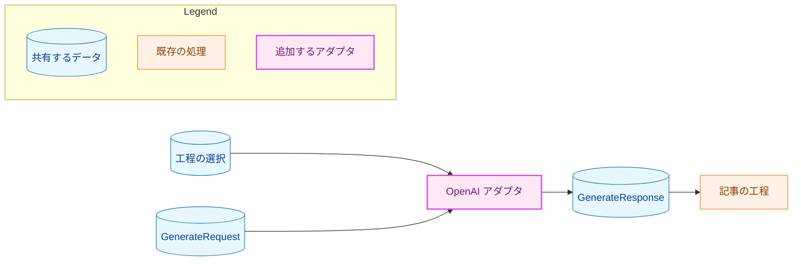
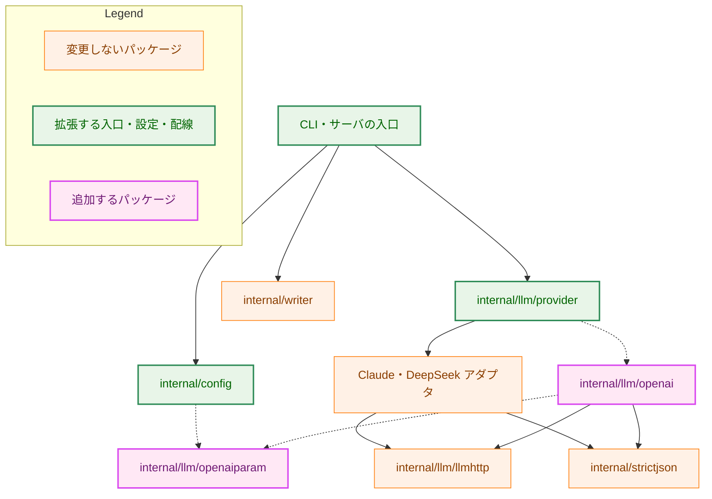
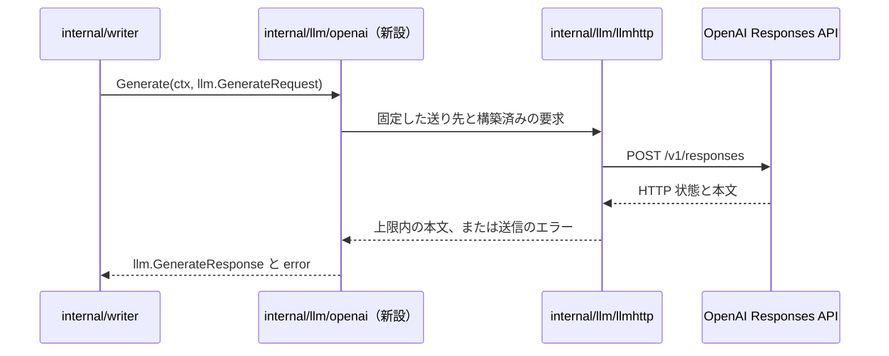
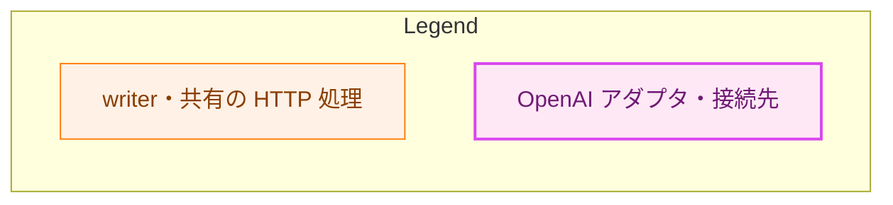
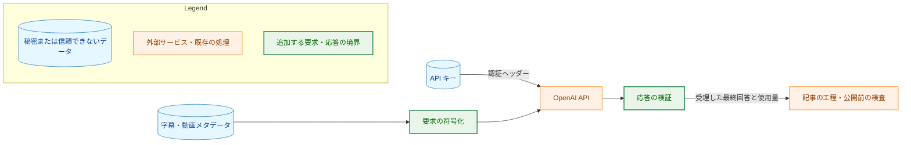
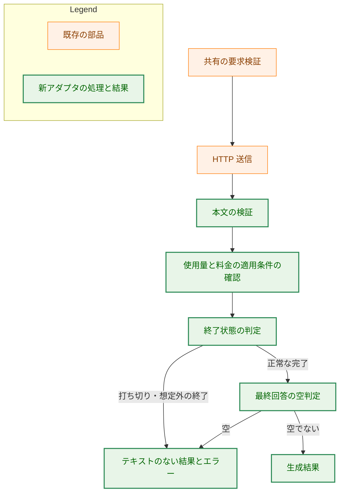

# アーキテクチャ設計書：OpenAI API のアダプタを追加する

## Document Status

| Item | Value |
|---|---|
| Status | `approved` |
| Created | 2026-11-10 |
| Review date | 2026-11-10 |
| Reviewer | isseis |
| Comments | - |

## 1. 設計の全体像 (Design Overview)

### 1.1. 目的と設計原則

[要件定義書](01_requirements.md)の F-001〜006 に従い、記事の生成・字数の調整・検証・推敲に OpenAI を選べるようにする。生成と字数の調整は同じ設定、検証・推敲は独立した設定を使う。本番の既定は Claude のままとし、品質の比較は #569 に委ねる。

`internal/llm/openai` が Responses API と共有の `LLMClient` の間を変換する。共有の HTTP 送信、厳格な JSON の部品、使用量、料金、記事の組み立ては再利用する。DeepSeek の要求と応答の形式は Responses API と異なるため、既存の DeepSeek アダプタを設定で切り替えるだけでは AC-07・AC-11〜15 を満たせない。一方、送信と記事の工程には別の仕組みを設ける必要がない。

境界は [ADR-0001](../../dev/adr/0001-llm-adapter-stdlib.md)、共有の結果は [ADR-0021](../../dev/adr/0021-llm-client-contract.md)、設定は [ADR-0003](../../dev/adr/0003-llm-config-contract.md)・[ADR-0018](../../dev/adr/0018-server-config-file.md) を引き継ぐ。プロンプトの内容から設定や送り先を選ばず、構築時に検証した型で指定する。

### 1.2. 設計の際に決めたこと（2026-11-10）

- **処理方式は Standard、プロンプトキャッシュの最低保持期間は30分に固定する。** 要求に `service_tier: "default"` と `prompt_cache_options.ttl: "30m"` を明示する。プロジェクトの設定や保持期間によって単価が変わり、4区分の使用量だけでは料金を決められなくなるためである。切り替える設定は設けない。外部サービスとデータ保持の契約を定める主要な決定なので、[ADR-0041](../../dev/adr/0041-openai-api.md) を更新する。
- **Standard を確認できない場合は、トークン数を保ち、料金だけを不明にする。** AC-19 の「料金の不明で生成・公開を止めない」を維持する。要求は固定するが、応答の `service_tier` が欠け・重複・型違い・`null`・`default` 以外でも、それだけで本文を拒否しない。料金の適用条件を表す汎用の情報を `Usage` に添え、中間生成物にも保存する。既存の4区分だけでは、トークン数が分かっていても通常単価を適用できない状態を表せないためである。共有の契約と料金の前提を変える主要な決定なので、[ADR-0021](../../dev/adr/0021-llm-client-contract.md)・[ADR-0022](../../dev/adr/0022-cost-estimate.md) を更新する。プロバイダ固有の応答型やフィールドは共有の `GenerateResponse` に加えない。
- **中間生成物は版4を書き、既存の版3も読み込む。** 料金の適用条件を保存し、再開後も料金の既知・不明を維持する。要件の互換性と既存の再開を保つため、版3の記録を再計算・書き換えずに再利用する。形式と互換性を変える主要な決定なので、[ADR-0023](../../dev/adr/0023-artifact-resume.md) を更新する。詳細と従来方針に対する例外は §3.4.2 に記す。
- **出力上限の測定は製品のアダプタを実装する前に行う。** テスト専用キーを使い、既存の公開動画2本、2モデルの `medium`、3工程を対象にする。最大14回・予算枠20米ドル・自動再送なしで実行する許可を得た。製品コードは変更せず、基準コミットの作業用コピーに測定用の入口を置いて、既存の字幕パーサとプロンプトの検証・展開を呼ぶ。数値と制約は §1.4 に記す。実測で決める方針は ADR-0041 の既決事項であり、測定用ファイルの配置に別の ADR は不要である。


**Standard を選ぶ理由。** 利用者が生成結果を待つ単発処理であり、高速化のための追加料金を避ける。候補モデルについて、各方式を次のように判断した。

| 方式 | 料金・動作と選定理由 |
|---|---|
| Standard | 通常単価での処理。本タスクの基準として採用する |
| Fast（旧称 Priority） | Standard の2倍の単価。高速化への追加料金を払う要件がないため採らない。`fast` と `priority` は同じ方式を指定する |
| Ultrafast | より高速で高価な方式。高速化への追加料金を避けるため採らない |
| Flex | Standard より安価だが、処理が遅く、リソース不足による拒否も起こりうる。本ツールは15分の期限で結果を待ち、自動再送もしないため、その遅延と可用性の条件を避けて Standard を選ぶ |
| Batch | 非同期の一括処理であり、要件の対象外 |

Standard は全方式で最安という選定ではない。高速化への追加料金と Flex の遅延・可用性の条件を踏まえた設計判断であり、方式間の速度・総費用の比較測定はしていない。2026-11-10 に [Fast](https://developers.openai.com/api/docs/guides/fast-mode)・[Ultrafast](https://developers.openai.com/api/docs/guides/ultrafast-mode)・[Flex](https://developers.openai.com/api/docs/guides/flex-processing) と [Astra](https://developers.openai.com/api/docs/models/gpt-6-astra)・[Sol](https://developers.openai.com/api/docs/models/gpt-6.1-sol) の公式文書を確認した。

**キャッシュの30分を選ぶ理由。** 候補モデルの既定値を使い、12時間の保持に伴う書き込み単価の増加を避ける。公式の書き込み単価は30分が通常入力の1.25倍、12時間が2.5倍である。本タスクは長い間隔を空けたプロンプトの再利用を要件にしていないため、まず30分を選ぶ。再利用の頻度によって12時間のほうが総費用を抑える可能性はあり、両者の総費用は比較測定していない。30分は最低保持期間であり、削除の期限ではない。2026-11-10 に [Prompt caching](https://developers.openai.com/api/docs/guides/prompt-caching) で確認した。

そのほかの構成は、要件書の決定と既存のパッケージ境界に従う。`openaiparam` は設定とアダプタが共有する effort の型だけを持つ。新しいプロバイダを追加する際の既存方針（ADR-0001）の適用であり、別の ADR は作らない。

### 1.3. 概念モデル

矢印 A → B は、A の情報が B に渡ることを示す。プロバイダ固有の要求と応答は OpenAI アダプタの内側にとどめる。



### 1.4. 既定の出力上限と測定根拠（AC-09・10、H-04）

**既定値は6,080トークンとする。** `internal/llm/openai/request.go` の `defaultMaxOutputTokens` に置き、生成・字数の調整・検証・推敲で共有する。正の要求値をこの定数で制限しない。

2026-11-10、基準コミット `cf0784392b08982694e3b1c020b47113b881071d` のコピーで、2モデルをそれぞれ `medium`、Standard、キャッシュ TTL 30分、`store: false`、非ストリーミングで逐次実行した。出力の上限は32,000トークン、各呼び出しの期限は15分である。素材は既存の評価用キャッシュの `roNZ-rLxhUE`（32分台）と `qjAz-VOAdz4`（39分台）で、[0008 評価記録](../0008_column_prompt/02_evaluation.md) §3.2 の動画を使った。字幕は取り直していない。

プロンプトは当該コミットの `writer` の型と展開処理をそのまま使った。字数の調整には、両モデルとも生成記事が4,000字以内だったため、32分台の同じ動画の既存の長い記事（0018 B3、roNZ-rLxhUE-1 の generation、本文4,401字）を使った。39分台の動画には該当する既存記事がなく、字数の調整は呼んでいない。検証・推敲は、32分台では今回の字数の調整の結果、39分台では今回の生成結果を入力にした。

実時間は、1回の HTTP 要求を送る直前から、応答本文を最後まで読み終えるまでの単調時計で測った値である。プロンプトの展開・起動・応答の解析は含まない。既存のガイドと同じく、呼び出し1回の出力トークン数を実時間で割って速度を求めるが、CLI 全体の時間を使った既存の Claude の記録より測定区間は狭い。製品の工程全体の所要時間を保証する記録ではない。

| モデル | 素材 | 工程 | 通常入力 | 読み取り | 書き込み | 出力 | 実時間（秒） | 終了 |
|---|---|---|---:|---:|---:|---:|---:|---|
| `gpt-6-astra` | `roNZ-rLxhUE` | 生成 | 3 | 0 | 17,300 | 2,979 | 68.157028 | completed |
| `gpt-6-astra` | `roNZ-rLxhUE` | 字数の調整 | 3 | 0 | 3,839 | 2,911 | 32.168591 | completed |
| `gpt-6-astra` | `roNZ-rLxhUE` | 検証・推敲 | 3 | 0 | 15,059 | 1,092 | 26.484263 | completed |
| `gpt-6-astra` | `qjAz-VOAdz4` | 生成 | 3 | 5,386 | 13,405 | 3,020 | 69.455537 | completed |
| `gpt-6-astra` | `qjAz-VOAdz4` | 検証・推敲 | 3 | 0 | 16,501 | 90 | 6.642151 | completed |
| `gpt-6.1-sol` | `roNZ-rLxhUE` | 生成 | 3 | 0 | 17,300 | 2,987 | 59.906236 | completed |
| `gpt-6.1-sol` | `roNZ-rLxhUE` | 字数の調整 | 3 | 0 | 3,839 | 2,799 | 30.708958 | completed |
| `gpt-6.1-sol` | `roNZ-rLxhUE` | 検証・推敲 | 3 | 0 | 14,902 | 774 | 11.962839 | completed |
| `gpt-6.1-sol` | `qjAz-VOAdz4` | 生成 | 3 | 5,386 | 13,405 | 2,996 | 59.523600 | completed |
| `gpt-6.1-sol` | `qjAz-VOAdz4` | 検証・推敲 | 3 | 0 | 16,446 | 188 | 5.842604 | completed |

全10回で `service_tier: default` と使用量の4区分を確認した。別に、独自の短い英語プロンプトを上限16で各モデル1回ずつ送り、両方とも `incomplete_details.reason: max_output_tokens`、出力16、推論要素だけで文面がない応答を得た。これら2回は打ち切りの形を確認するための試行であり、3工程の最大出力と速度の計算には含めない。合計12回の推定費用は1.600507米ドルで、予算枠20米ドル以内だった。

| 条件 | 判定 |
|---|---|
| (a) 最大出力の2倍以上 | 最大は3,020。下限は6,040で、6,080は約2.013倍 |
| (b) 最低速度でも450秒以内 | 最低速度は Astra の39分台の検証・推敲、90 / 6.642151 ≒ 13.549828 トークン/秒。整数の上限は6,097で、6,080の見積もりは約448.714秒 |
| (c) 両モデルが受理する範囲 | [Astra](https://developers.openai.com/api/docs/models/gpt-6-astra) と [Sol](https://developers.openai.com/api/docs/models/gpt-6.1-sol) の公式の最大出力は128,000。2026-11-10に確認し、測定では両方が32,000の指定を受理した |

3条件から得られた整数の範囲は6,040〜6,097であり、その中から6,080を選んだ。範囲は狭い。短い応答では通信の待ち時間の割合が大きく、同じ速度で長い応答を見積もることは保守的だが、混雑時や異なる出力長の性能を保証しない。起動・プロンプト展開を含む工程全体が `LLMTimeout` の半分の時間内に完了することも保証しない。出力が変動して最大値が増える、または再測定の速度が落ちて3条件を両立できなくなった場合は、上限を推測で増減せず再相談する。

実装では `provider_test.go` に、実際に送られる既定上限が最大出力の2倍以上、最低速度で `LLMTimeout` の半分以内、両モデルの最大出力以内であることを確かめる検査を置く。定数と同じ数値を比較するだけのテストにはしない。モデル・effort・テンプレート・処理方式・保持期間が変わったときは測り直す。`docs/dev/guides/openai_output_limit.md` は測定方法と更新対象を示し、本節を現在の根拠として参照する。

測定回数は各条件1回で、品質の評価ではない。今回測定したものより長い素材、ほかのモデル、既定以外の effort、継続的な性能の変化には打ち切りと期限切れが残る。素材・生成記事・生応答・測定用コードはリポジトリにコミットしない。テスト用に保存する実応答は §7.2 の短い独自プロンプトで別途取得する。

## 2. システム構成 (System Structure)

### 2.1. 配置と依存関係

矢印 A → B は A が B を呼ぶことを示す。破線は構築と設定に追加する依存である。OpenAI アダプタから共有の部品への矢印も、新設パッケージが使う予定の依存を示す。既存の配線は `internal/llm/provider/provider.go:40`・`:46`・`:87` と、CLI の `cmd/yt2column/run.go:521`、サーバの `cmd/yt2column-server/run.go:324` で確認した（基準コミット `cf0784392b08982694e3b1c020b47113b881071d`）。



`provider` は工程の選択から適切なアダプタを作り、入口がそのクライアントを `writer` に渡す。`writer` から `provider` を呼ぶ構成にはしない。CLI は環境変数、サーバは設定ファイルという入力元の分離を維持する。

### 2.2. 1回の生成のデータの流れ

実線の矢印は呼び出し、破線の矢印は結果の返却を示す。OpenAI アダプタだけが新設で、`writer`・HTTP の部品・API がやり取りするデータを示す。



この図の役割の凡例を次に示す。外部 API は新たに接続するサービスである。



## 3. コンポーネント設計 (Component Design)

### 3.1. 設定と effort の型（AC-01〜06、H-05）

`config.Provider` に `ProviderOpenAI` を加える。`LLMSelection` は非公開の `openaiparam.Effort` を持ち、`OpenAIEffort()` で返す。`LLMConfig` は `secret.Secret` のキーと `OpenAIAPIKey()` を持つ。共有の `GenerateRequest`・`GenerateResponse` にフィールドを加えない。

`openaiparam.Effort` は列挙型とし、ゼロ値は未設定を表す無効値、`none` はそれと区別した有効値にする。`ParseEffort`・`String`・`Valid`・`EffortValues` の責務を既存のパラメータ型に合わせる。受理する7値は同パッケージの1か所で定義する。`EffortValues` の順序は `none`・`minimal`・`low`・`medium`・`high`・`xhigh`・`max` と定義し、案内とテストで共有する。未知の値を有効値に変換しない。

設定の境界は最初の `/` と、モデル部分に最大1個の `+` である。プロバイダの綴りは `openai` のみ受理する。effort を省略した OpenAI の選択は、その工程に `medium` を当てはめる。モデル ID の文字列は変換しない。未知のモデルやモデルと effort の非対応を設定で推測せず、API の拒否として扱う。

実行する工程が OpenAI を使うときだけキーを読む。検証・推敲の選択を継承するために生成の選択を読む場合と、生成自体を実行する場合を区別し、再開で使わないプロバイダのキーを要求しない。現在の継承と必要設定の分離は `internal/config/config.go:485`・`:610` にある（基準コミットは §2.1）。この分岐に OpenAI を追加する。

サーバの許可リストは既存6キーに `OPENAI_API_KEY` を加えた7キーとする。雛形はコメント行だけでキーを説明する。ファイルの書式・サイズ・所有者・モードの検査を変更せず、環境からの補完も設けない。不正な effort は `ErrInvalid`、選択したプロバイダのキーの欠けと空の値は `ErrMissing` とし、設定名と固定の理由を返す。入口の既存の設定エラー経路で終了コード2を返す。

### 3.2. アダプタの境界（AC-07〜09・20）

新設する公開の構築用の型は次の範囲に限る。`New` は `llm.LLMClient` を返し、具体型を公開しない。

```go
type Options struct {
    APIKey  secret.Secret
    Model   string
    Effort  openaiparam.Effort
    Timeout time.Duration
}
```

構築時に、API キー・モデル ID・effort・期限を AC-08 の規則で検証する。`Generate` は既存の `GenerateRequest.Validate` を使う（`internal/llm/llm.go:36`、基準コミットは §2.1）。プロンプトを本文の値として符号化し、システムとユーザーの役割を保持する。要求するメンバーはモデル、2つの入力、effort、出力上限、非ストリーミング、保存の無効化、Standard、30分のキャッシュ設定に限る。ツール・会話 ID・過去の応答 ID・推論の要約を要求しない。

送り先は `https://api.openai.com/v1/responses` の定数とする。モデル ID を URL に埋め込まず、API キーは `Authorization: Bearer …` にだけ設定する。クライアントは構築後に状態を変えず、同時に呼べるものとする。本番には送り先や HTTP クライアントの差し替え口を公開しない。

`provider` の生成・検証用の両経路が、選択した工程のモデルと effort、共有の OpenAI キー、`LLMTimeout` を渡す。字数の調整は生成クライアントを使う。正の `MaxOutputTokens` はそのまま送り、0だけを §1.4 の既定値に置き換える。期限・リダイレクト拒否・8 MiB の応答上限・送信と読み取りの失敗分類は `llmhttp` に任せ、自動再送を加えない（既存の契約は `internal/llm/llmhttp/llmhttp.go:59`、基準コミットは §2.1）。

### 3.3. 応答の検証とテキストの選択（AC-11〜15、H-01）

本文は `strictjson.ParseObject` を通す。各階層で消費する名前だけを `Collect` し、消費するメンバーの重複を拒否する。エスケープ後の名前を完全一致で扱う。応答本文・出力要素・文面要素・不完全終了の詳細の形と、欠け・`null` の例外は要件書 F-003 の表に従う。`service_tier` は本文の受理条件には含めず、料金の適用条件として別に読む。JSON 全体の不正は従来どおり拒否する。

配列の各要素を検証し、後ろに不正な要素がある場合も、それより前のテキストを返さない。`reasoning` は種類だけを消費し、その他のメンバーを読まない。`message` は `role`・`status`・`content`・任意の `phase` を検査する。`output_text` の文字列と、`refusal` の文字列は型を検証するが、拒否の自由文は結果にもエラーにも使わない。

最終回答は `phase` が欠け・`null`・`final_answer` のメッセージの `output_text` を、出現順に区切りなしで連結する。`commentary` は型と終了状態を検査したうえで、文面から除く。推論も除く。終了の判定は §4 の表に従う。正常な形でも、最終回答が空または空白だけなら成功にしない。

応答の `model` をそのまま結果のモデル名にし、`ModelVersion` は空にする。要求したモデルから応答のモデル名を補完せず、版やエイリアスを推測しない。記事に書けるモデル名かどうかの既存の検査も引き続き適用する。

### 3.4. 使用量と料金（AC-16〜19、H-02・03）

本文全体の JSON 検査は先に通し、`usage` の検証は本文を受理する検証から分ける。`usage` とその中の消費する各メンバーを個別に読むことで、使用量の重複や欠けを、本文全体の失敗にしない。数値は `strictjson.Value.AsNonNegativeInt64` を使う。読み取りと書き込みの合計が入力合計を超える場合も、使用量全体を不明にする。整数の範囲を確認してから比較し、負の差や桁あふれを既知のトークン数にしない。

| 共有の区分 | Responses の値 |
|---|---|
| `TokenCounts.Input` | `input_tokens` から読み取り分と書き込み分を除いた値 |
| `TokenCounts.CacheRead` | `input_tokens_details.cached_tokens` |
| `TokenCounts.CacheWrite` | `input_tokens_details.cache_write_tokens` |
| `TokenCounts.Output` | 推論を含む `output_tokens` |

`total_tokens` と推論の内訳は加算しない。`cache_write_tokens` のない旧モデルの応答を0で補わない。不明の理由には、既存の `UnknownRule` に `RuleInconsistent` を加え、内訳が合計と整合しない場合を `usage.input_tokens_details:inconsistent` として示す。応答の値を含めず、固定した規則とメンバー名を返す。保存する使用量の4区分と、不明を表す `null` は維持する。料金の適用条件は以下の別の情報で表す。

料金は既存の `pricing` に置く。次の Standard・30分キャッシュの単価を追加し、入力全体が272,000トークンを超えたときは入力3区分を2倍、出力を1.5倍にする。しきい値は通常入力だけでなくキャッシュの2区分も含む。既存の `schemePromptTier` を使い、新しい計算方式は作らない（`internal/pricing/rates.go:31`、基準コミットは §2.1）。

| モデル | 通常入力 | キャッシュ読み取り | キャッシュ書き込み | 出力 |
|---|---:|---:|---:|---:|
| `gpt-6-astra` | $10 | $1 | $12.50 | $50 |
| `gpt-6.1-sol` | $2 | $0.10 | $2.50 | $10 |

100万トークンあたりの米ドル。2026-11-10 に [Pricing](https://developers.openai.com/api/docs/pricing)・[Astra](https://developers.openai.com/api/docs/models/gpt-6-astra)・[Sol](https://developers.openai.com/api/docs/models/gpt-6.1-sol) で確認した。キャッシュの書き込みは通常入力の単価への上乗せではなく、その区分の料金として数える。[キャッシュの仕様](https://developers.openai.com/api/docs/guides/prompt-caching)では30分と12時間で書き込み単価が異なるため、要求で30分を固定し、明示的なキャッシュ境界による別の保持期間を送らない。

料金表は完全一致のモデル名で照合する。応答のモデル名が表になければ、使用量が分かっていても料金は不明である。モデル名を推測してエイリアスへ寄せない。工程ごとの使用量、記事・失敗時の料金、中間生成物と再開には共有の経路を使う。

### 3.4.1. トークン数と料金の適用条件の分離

`llm.Usage` の非公開フィールドに、`PricingContext` 型の値を持たせる。これは「今回の使用量に、どの前提の単価を適用できるか」を表すプロバイダに依存しない列挙型であり、トークン数が分かるかどうかとは別に扱う。`Usage` の比較可能性を維持する。既存の `KnownUsage` はゼロ値の条件を持つ使用量を作り、新しい構築口 `KnownUsageWithPricingContext` はトークン数と検証済みの条件を受け取る。列挙外の値はエラーにし、`Usage.PricingContext()` で条件を取得できるようにする。

| 型の値 | 意味 | 版4の保存値 |
|---|---|---|
| `PricingContextUnspecified`（ゼロ値） | 追加の料金条件を報告していない。追加条件を要求しない単価表の行にだけ適用できる | `unspecified` |
| `PricingContextStandard30m` | Standard と30分のキャッシュ設定を確認した | `standard-30m` |
| `PricingContextUnverified` | 料金に必要な条件を確認できない | `unverified` |

OpenAI は、送った要求が30分の設定で、応答に重複のない文字列 `service_tier: default` がある場合だけ `PricingContextStandard30m` を設定する。それ以外は `PricingContextUnverified` とする。`service_tier` の自由文は保持しない。本文が正常なら生成を成功させ、有効な使用量の4区分とモデル名を返す。打ち切り等の3種の失敗でも同じ情報を返す。使用量自体が不明の場合は、料金も不明なので条件を `unspecified` として扱う。

単価表の各行は必要な `PricingContext` を宣言する。OpenAI の2行は `PricingContextStandard30m`、既存モデルの行は追加条件を要求しない `PricingContextUnspecified` とする。`pricing` は条件が一致する場合だけ算出する。`unverified`・列挙外・必要条件との不一致は `ReasonPricingContextUnknown` とし、出力の固定した理由は `pricing-context-unknown` にする。モデル名の完全一致、使用量の既知・不明の区別、整数での計算は維持する。応答のモデル名が別のプロバイダの料金表に一致した場合も、条件の不一致で通常単価を誤って適用しない。

料金にこの状態を加えても、トークン数の行・記事・ジョブ API の書式は変えない。料金が不明の場合は既存の不明の表現を使い、生成・保存・公開を続ける。CLI と統合テストの料金の理由の表示に新しい列挙値の対応を加える。

### 3.4.2. 中間生成物と既存の再開の互換性

版4は、現在の版3のフィールドに、必須の `pricing_context` を加える。受理する保存値は §3.4.1 の3つだけとし、欠け・`null`・型違い・重複・未知の値は中間生成物の不正として拒否する。使用量が `null` なら条件は `unspecified` に限る。版4の識別子には、版と料金の条件も含める。本文やトークン数を保ったまま条件だけを書き換えたファイルも、既存の識別子の検査で拒否する。識別子は秘密の鍵を使わないため、書き換えた人が識別子も計算し直す改ざんは検出できない。この残余リスクは従来と同じである。

版3はその版の既存の形と識別子の規則で厳格に検証し、料金の条件を報告していない記録として読み込む。版3に `pricing_context` を加えたファイルは、その版にないキーなので拒否する。版3の内容・識別子・呼び出し時刻・使用量を変えず、再利用したファイルを書き直さない。後続工程の新しい記録は版4で保存し、入力の識別子は再利用した版3の記録をそのまま指す。版3と版4が混ざる連鎖も検証して再開できる。版1・2と、ほかの未知の版は引き続き拒否する。

**従来の方針との関係。** [0022 設計書](../0022_cost_estimate/02_architecture.md) §1.3 の例外2と [ADR-0023](../../dev/adr/0023-artifact-resume.md) は、形式を上げたら古い版を拒否する方針である。本タスクは、要件 AC-18 と互換性の節に従って既存の版3からの再開を保つため、版3を読み込む例外を設ける。版3には時刻と4区分があり（`internal/artifact/format.go:58`、基準コミットは §2.1）、既存モデルの料金に必要な情報がそろうため、その料金を再解釈する必要がない。OpenAI の単価表の行は確認済みの条件を要求するので、条件のない版3の記録が OpenAI のモデル名を持つ場合も料金を既知と推測しない。

更新する既存テストは、`internal/artifact/format_test.go` の `TestMarshalParseRoundTrip`・`TestParseRecordRejects`・`TestParseRecordRejectsUsage`・`TestParseRejectsVersion1`・`TestParseRejectsVersion2`・`TestRecordIDCoversUsage`、`store_test.go` の連鎖の保存・読み込み、および文書の版の値を照合する `cmd/yt2column/docs_test.go` の検査である。版3の既存の識別子のままでの読解、版を偽った入力、混在する連鎖、条件の変更の検出を追加する。旧バイナリは版4を読めないため、更新後に作った中間生成物から再開するときは対応版を使う。自動での書き戻しや旧版用の変換は行わない。

### 3.5. ファイルごとの責務

次の表は実装で追加・変更するファイルの範囲である。本設計の PR は設計書と ADR の変更だけを含める。製品コード・利用案内・実応答のサンプルは、実装計画の承認後に反映する。

| ファイル | 追加・変更する責務 |
|---|---|
| `internal/llm/openaiparam/openaiparam.go`・`openaiparam_test.go`（新規） | effort の型と受理する値の一覧 |
| `internal/llm/openai/openai.go`・`request.go`・`response.go`・`errors.go`（新規） | 構築、要求、応答の検証、使用量の変換、エラーの分類 |
| 同パッケージの `openai_test.go`・`response_test.go`・`test_helpers.go`・`test_helpers_endpoint.go`（新規） | 偽のキーとループバックによる境界・通信の確認。送り先の差し替えはテスト限定 |
| 同パッケージの `integration_env_test.go`・`integration_test.go`・`makefile_test.go`（新規） | 実 API の実行条件と Make ターゲットの確認 |
| `internal/llm/openai/testutil/integration.go`・`integration_settings_test.go`（新規） | テスト専用の設定、オプトイン、デバッグ拒否の判定 |
| `internal/llm/usage.go`・`usage_test.go` | 使用量の不明の規則、料金の適用条件の型・構築・取得 |
| `internal/artifact/artifact.go`・`format.go`・`format_test.go`・`store_test.go` | 版4の条件の保存と識別子、版3との混在した再開、厳格な検証 |
| `internal/config/config.go`・`config_test.go` | provider、工程の選択、OpenAI キー、effort の既定と継承 |
| `internal/config/serverfile.go`・`serverfile_test.go` | 7キーの許可リストと雛形、従来の書式の維持 |
| `internal/config/envaccess_test.go` | 秘密の設定名の一覧に `OPENAI_API_KEY` を追加 |
| `internal/llm/provider/provider.go`・`provider_test.go` | 両工程の構築、混在、実測値と既定上限・期限の関係 |
| `cmd/yt2column/run.go`・`run_test.go`・`cost_test.go` | 伏せ字への追加、設定エラーの終了コード、再開と配線、料金の新しい不明の理由の表示 |
| `cmd/yt2column-server/run.go`・`run_test.go` | サーバの伏せ字と、環境のキーを使わないことの確認 |
| `internal/pricing/pricing.go`・`rates.go`・`rates_test.go`・`pricing_test.go` | 2モデルの単価と適用条件、出典、手計算した費用としきい値の確認 |
| `internal/pricing/testutil/helpers.go`・`helpers_test.go` | 統合テスト用の料金の新しい不明の理由の表示 |
| `internal/pipeline/pipeline_test.go` | `TestConfigImports` にパラメータ型を追加し、`TestFakesCarryBuildTag` のファイル数を更新 |
| `cmd/yt2column/docs_test.go` | `TestEffortValuesDocsContract` 等に OpenAI の設定・effort・統合テストの値と保存形式の版を追加 |
| `Makefile` | 有料実行の注意を示す `test-integration-openai` を追加 |
| `testdata/openai_responses_completed.json`・`openai_responses_incomplete.json`（新規）、`testdata/README.md` | 独自の短いプロンプトの実応答と、取得・加工・再取得の記録 |
| `README.md`・`README.en.md` | OpenAI の指定例、課金、effort、上限、データ保持。日本語を変更後に `/mktrans` で同期 |
| `CLAUDE.md`、`docs/dev/project_overview.md`・`security.md`・`conventions/package_reference.md` | 実装したプロバイダ、秘密の経路、保持の説明、JSON の利用者と新パッケージの参照表 |
| `docs/dev/guides/development.md`・`cli.md`・`pricing_update.md`、`openai_output_limit.md`（新規） | 統合テスト、単価の照合、出力上限の測り直し |

既存の検査では `TestParseServerFileAccepts`・`TestParseServerFileRejects`・`TestServerFileTemplate` が受理するキー、`TestLoadParsesLLMValue`・`TestParseLLMProvider`・`TestLoadProviderVarsFollowSelection` が provider と必要な設定、`TestEnvAccessConfined` が秘密の設定名、`TestRateTableModels` がモデル一覧を対象とする。これらの期待値を更新する。`TestLoadProductionDefaults` と既存2プロバイダの通信テストは維持し、既定や既存の送信条件の変更を検出する。

## 4. エラーハンドリング設計 (Error Handling Design)

`openai` の公開の番兵は `ErrHTTPStatus`・`ErrInvalidResponse`・`ErrTransport` とする。構築の拒否は公開の型を増やさず、固定の理由で返す。HTTP 状態の型は状態コードだけを持ち、本文やヘッダーを保持しない。

```go
type HTTPStatusError struct {
    StatusCode int
}
```

| 優先順・境界 | エラー | 返す結果 |
|---|---|---|
| 要求の不正 | `llm.ErrInvalidRequest` | ゼロ値 |
| 通信・HTTP 状態・本文上限・JSON と各要素の形 | context のエラー、または `openai` の番兵 | ゼロ値 |
| 形を検査後、`incomplete` と `max_output_tokens` | `llm.ErrTruncated` | モデル名と使用量のみ |
| それ以外の不完全終了・未知の終了状態・未完了メッセージ・拒否・error オブジェクト | `llm.ErrUnexpectedFinishReason` | モデル名と使用量のみ |
| 完了した最終回答がない・空・空白だけ | `llm.ErrEmptyResponse` | モデル名と使用量のみ |
| 完了した最終回答 | なし | テキスト・モデル名・使用量。版は空 |

使用量の不正や料金の適用条件の不明だけでは生成を失敗させない。JSON 全体の不正は、`usage` の中だけに現れても本文の不正である。打ち切りは文面がない場合も検出し、送った上限と effort を固定の書式で示す。最終回答の文面がないときは effort を下げる案内を添える。推論・途中経過があるだけで「文面あり」としない。

HTTP の案内は、401なら認証、403なら権限、400・404ならモデル・effort・上限・入力、429なら利用上限・課金・時間を置いた再実行、5xxなら提供元の障害を示す。応答の自由文、未知の終了状態の値、API キー、プロンプトをエラーに含めない。`HTTPStatusError` は `ErrHTTPStatus` を unwrap し、呼び出し側は既存の `errors.Is` と `errors.AsType` を使えるようにする。

## 5. セキュリティ考慮事項 (Security Considerations)

### 5.1. 信頼の境界

矢印 A → B はデータの移動を示す。API キーは認証ヘッダーにだけ渡す。API から来る文面・メタデータ・使用量はすべて信頼できない入力である。



### 5.2. 攻撃ベクトルへの対応

[security.md](../../dev/security.md) の各節を適用する。

| 対象 | 本設計の対応 |
|---|---|
| 外部コマンド（§1） | OpenAI のキーを子プロセスの環境許可リストに加えない。アダプタは外部コマンドを呼ばない |
| 秘密（§2） | キーは `secret.Secret` で保持する。CLI の `cmd/yt2column/run.go:301` とサーバの `cmd/yt2column-server/run.go:191` の `redact.SecretStrings` の両方に追加する（基準コミットは §2.1）。エラーの固定文と既存の伏せ字で、値と断片を出さない |
| 通信（§3） | HTTPS の固定先、リダイレクト拒否、送信から読み取りまでの期限、自動再送なし。要求の URL に秘密やモデル ID を含めない |
| 送るデータ（§4） | 公開動画の字幕・タイトル・チャンネル名・概要欄と工程のプロンプト、後段では記事を送る。`store: false` を固定する |
| キャッシュ（§5） | 製品のキャッシュの書式と寿命を変更しない。API のプロンプトキャッシュとは区別する |
| 信頼できないテキスト（§6） | §3.3・3.4 の検査を通す。推論・途中経過・拒否を公開せず、生成テキストを実行しない。出典 URL は既存の動画 ID の検証経路で付ける |
| 実データ（§7） | 動画の測定素材と生成記事の全文はコミットしない。保存するサンプルは独自の短いプロンプトを使い、取得者を識別する値を除く |
| サーバと拡張（§8） | 設定ファイルの保護を維持する。ジョブ API、拡張の権限、投稿の操作を変えない |

Go の HTTP/2 デバッグによる認証ヘッダーの漏えいは既存の残余リスクとして扱う。本番の CLI・サーバは通信前の警告を維持し、実 API の統合テストと測定用の入口は有効な設定を検出したら送信しない。

### 5.3. データの保持と外部仕様の確認

2026-11-10 に [Data controls](https://developers.openai.com/api/docs/guides/your-data) と [Prompt caching](https://developers.openai.com/api/docs/guides/prompt-caching) を確認した。API に送った内容は既定で学習に使われないが、不正利用の監視ログは通常最大30日保持されうる。`store: false` は応答を後で API から取得するための保存を止めるもので、監視ログとプロンプトキャッシュの保持を止めるものではない。

30分はプロンプトキャッシュの最低保持期間であり、30分後の削除を保証しない。キャッシュの状態は暗号化した KV テンソルとして別に保持されうる。この違いと公式の出典・確認日を `security.md` に追記し、README から参照できるようにする。ゼロデータ保持とは説明しない。

新しい外部機能は OpenAI との HTTP 通信だけである。macOS の実測で §1.4 の要求を確認し、Linux は同じ要求・検証の契約をループバックのテストと CI で確かめる。Mattermost に渡すデータ形式には新機能を持ち込まないため、Mattermost 固有の機能の確認は N/A である。全モデル・アカウントでの利用権限、任意のモデルの固定パラメータ対応までは確認しない。未対応なら API のエラーとし、モデル名から別の要求へ自動的に切り替えない。

## 6. 主要な処理の流れ (Processing Flow Details)

矢印は処理の移行を示す。検証の中で値を補正したり、エラーの後に部分的な結果を記事へ渡したりしない。



要求・送信・本文の検証で失敗したときは、図の後続の処理へ進まずゼロ値を返す。使用量の不正は使用量を「不明」とし、料金の条件を確認できない場合は有効なトークン数を保って料金だけを「不明」として後続へ進む。本文の形を検査してから、打ち切り・想定外の終了・空の順に判定する。最終回答がなくても、出力上限による終了なら打ち切りを優先する。

## 7. テスト戦略 (Test Strategy)

### 7.1. ユニットテストと回帰の確認

実 API と本番のキーを使わず、共有の偽クライアントとループバックの HTTP サーバを使う。新しいアダプタでは既存の `llmhttptest` と、ループバックだけを受理するテスト専用の構築口を使う。テスト用のコードのビルドタグは [test_organization.md](../../dev/conventions/test_organization.md) に従う。新しい `testutil` のファイル数を `TestFakesCarryBuildTag` に反映し、`TestConfigImports` の対象と許可するパラメータ型に `openaiparam` を追加する。共通型のフィールドと interface のガードは維持する。

| 対象 AC | 検証する振る舞い |
|---|---|
| AC-01〜03 | 全7 effort、既定と継承、大小文字・空白・空・複数の `+` の拒否、`/` を含むモデル、未知モデル、両工程での3プロバイダの組み合わせ |
| AC-04〜06 | 必要なキーだけの読み込み、欠け・空の終了コード2、再開、サーバの環境無視、7キーのファイルと雛形、未知キー・書式・サイズ・権限の拒否 |
| AC-07〜10 | 記録した要求の役割・固定先・effort・上限・保存・方式・TTL。不正な構築と要求での送信0回。測定値と実際に送った既定上限と期限の関係 |
| AC-11・12 | 全階層の消費メンバーの欠け・重複・型、エスケープした同名キー、大文字違い、未知の要素、後続データ、不正UTF-8・サロゲート、途中の不正要素。複数メッセージの順序・区切りなしの連結と phase |
| AC-13〜15 | テキストなしの打ち切り、複合的な異常の優先順、未完了・拒否・error・未知の状態、途中経過のみと空白の応答。3種の失敗のモデル・使用量と、ほかの失敗のゼロ値 |
| AC-16・17 | `-0`・符号・小数・指数・範囲外・`null`、全階層の欠け・重複・型、内訳の不整合。使用量だけが不正な成功と拒否した応答の両方、推論の二重加算の防止 |
| AC-18・19 | 既存の工程・失敗・記事・再開への引き継ぎ。料金は独立した手計算と比較し、入力合計272,000と272,001、キャッシュのみでしきい値をまたぐ場合、未知の応答モデルを確認 |
| AC-20〜22 | リダイレクト先にキーを送らないこと、送信中と本文読み取り中の期限・キャンセル・切断・8 MiB 超過、HTTP 状態と固定の案内、送信回数、両入口の秘密と末尾断片の伏せ字 |
| AC-23〜25 | 加工した実応答の読解、統合テストの実行条件、設定名と effort 等の文書の値。保持の説明と実測の限界は人が読む |

Standard の確認は、正しい応答、欠け・型違い・重複・未知の方式を偽の応答で確かめる。後者でもテキストと有効な使用量は返り、料金だけが不明になることを確認する。版4への保存と再開、版3との混在、条件だけの改変の拒否、旧2プロバイダの料金が維持されることも確認する。API キーに似せた値や制御文字を未知のメンバー・終了状態・拒否の文面に入れ、診断や結果に出さないことも確認する。偽のプロバイダを使った CLI・サーバのテストで、設定から構築・記事の結果までを確認する。

§3.5 に挙げた既存テストの期待値を更新し、旧2プロバイダと本番の既定の回帰も実行する。新設・変更した各テストでは、そのテストが対象とする振る舞いを一時的に壊して実際に失敗することを確認し、実装のコミットに記録する。文書の意味は PR レビューで読み、タスク文書の文章や測定表の文字列を固定するテストは作らない。

### 7.2. 実 API の統合テストとサンプル（H-06）

`test-integration-openai` は `integration` タグ、専用のオプトイン `YT2COLUMN_OPENAI_INTEGRATION=1`、テスト専用キー `YT2COLUMN_TEST_OPENAI_API_KEY` を要する。モデルと effort は `YT2COLUMN_TEST_OPENAI_MODEL`・`YT2COLUMN_TEST_OPENAI_EFFORT` で明示し、Make ターゲットの既定は候補モデルと `medium` にする。本番の `OPENAI_API_KEY` は設定されていても読まない。設定を読む処理を `openai/testutil` に置き、偽の lookup 関数で判定をテストする。

オプトインがなければ送信せずスキップする。テストキーがなければスキップ、モデル・effort が不正または HTTP/2 デバッグが有効なら、値を表示せず失敗させる。Make ターゲットは課金の注意と呼び出し数を示し、テスト全体の期限は各呼び出しの期限の合計より長くする。`make test` に含めない。

独自の短い英語プロンプトで成功と小さい出力上限による打ち切りを確かめる。成功が打ち切られた場合や、小さい上限でも完了した場合は、テストの前提が成立しなかったと報告する。自動で上限を増やして呼び直さない。本文の全文をログに出さず、モデル名・使用量・料金・所要時間だけを、秘密の伏せ字と表示のエスケープを通して出す。

実応答は取得日・モデル・effort・出力上限とともに一時保存し、認証・応答ID・要求ID・日時等の取得者を識別しうる値を除く。受理する値の構造を作り変えず、加工箇所を `testdata/README.md` に明記する。動画由来の本文はサンプルに使わない。実応答の追加取得は実装段階でその範囲の許可を得て行い、今回の出力上限の測定の許可を将来の実行に流用しない。

## 8. 実装の優先順位 (Implementation Priorities)

1. 設定・effort の型・キーの経路・静的ガードを対応させる。API の呼び出しはまだ有効にしない。
2. OpenAI の要求・応答・使用量・エラーを実装し、ループバックで境界を確認する。
3. 両工程の配線・両入口の伏せ字・単価をそろえ、CLI とサーバで3プロバイダを組み合わせる回帰を確認する。
4. 実応答と統合テスト、利用案内、測り直しのガイドを整える。README を翻訳し、文書の値の検査と全体のチェックを通す。

実装の分割と具体的な手順は、設計の承認後に `03_implementation_plan.md` で定める。公開時に設定の移行は不要で、従来の6キーだけのファイルを引き続き受理する。新しいキーを指定したファイルは旧バイナリでは未知キーになるので、OpenAI の設定を加える前に対応版へ更新する。

## 9. 将来の拡張性 (Future Extensibility)

追加のモデルは不透明な ID のまま API に渡し、料金を求めるモデルだけを料金表に追加する。固定の処理方式・保持期間に未対応のモデルは HTTP エラーになる旨を案内する。対応表やモデル名の接頭辞による分岐を追加しない。

処理方式とキャッシュ保持期間の選択、ストリーミング、ツール、会話の継続は別の要件とする。とくに料金の条件を増やすなら、本設計の料金の適用条件で表せるかを判断し、中間生成物・再開の契約も合わせて見直す。現在の列挙値で表せない条件を推測で既存の値へ寄せない。

## 変更履歴

- 2026-11-10 承認（isseis、#783）
